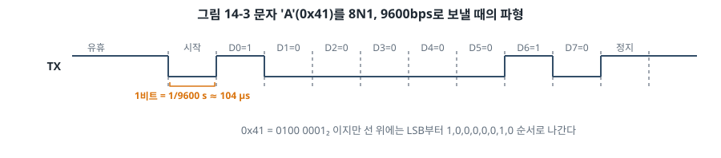
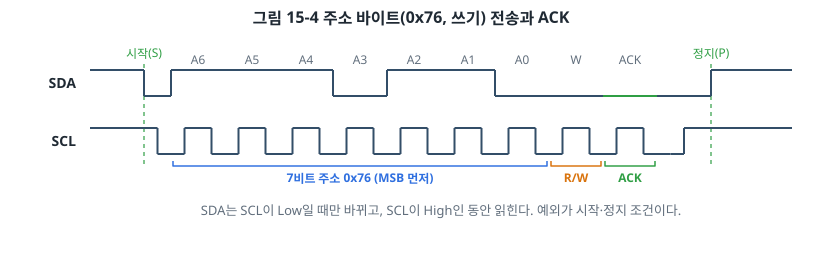
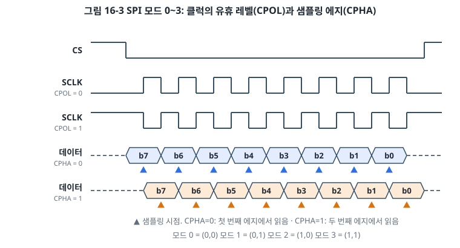

# 임베디드 시스템: 첫 LED부터 보안 OTA까지

> 첫 LED를 켜는 순간부터 양산 제품에 보안 부트와 무선 업데이트를 넣는 순간까지, 한 권으로 안내하는 임베디드 시스템 실전서

## 이 책은 누구를 위한 책인가

하드웨어를 처음 만지는 개발자부터 현업에서 제품을 만드는 개발자까지 모두를 대상으로 합니다. 목차를 난이도로 나누지 않고 주제의 흐름으로 구성해, 앞 장이 뒤 장의 바탕이 되도록 했습니다. 처음부터 읽으면 기초에서 실무 수준까지 자연스럽게 올라가고, 이미 아는 부분은 건너뛰어도 됩니다.

- C 언어는 알지만 하드웨어가 처음이라면 1장부터 차례로 읽으세요.
- HAL이나 아두이노로 동작하는 코드는 만들어 봤다면 3장, 4장, 7장을 훑어보고 제3부(통신)와 제4부(펌웨어의 내부)로 넘어가도 좋습니다.
- 실무에서 펌웨어를 개발하고 있다면 필요한 주제의 장을 바로 펴서 읽으면 됩니다.

## 책의 구성

| 부 | 주제 | 장 |
| --- | --- | --- |
| 제1부 | 임베디드 시스템의 바탕 | 1~5장 |
| 제2부 | 주변장치 다루기 | 6~12장 |
| 제3부 | 통신 | 13~20장 |
| 제4부 | 펌웨어의 내부 | 21~25장 |
| 제5부 | 실시간 운영체제 | 26~30장 |
| 제6부 | 제품으로 가는 길 | 31~36장 |
| 제7부 | 더 넓은 임베디드 세계 | 37~40장 |
| 부록 | 데이터시트 읽는 법, 회로도 기초, 계측 장비, 용어집, 부품 목록 | |

장별 상세 목차와 그림 목록은 [docs/outline.md](docs/outline.md)에 있습니다.

## 그림

그림은 이해를 돕는 핵심 도구입니다. 특히 통신 장에서는 신호가 시간에 따라 어떻게 움직이는지를 타이밍 다이어그램으로 먼저 보여 주고, 그다음에 코드를 설명합니다.

- 모든 그림은 `figures/chNN/` 아래의 SVG 파일이며, GitHub에서 바로 보입니다.
- 그림은 `tools/figgen.py`가 생성합니다. 그림을 고칠 때는 SVG가 아니라 스크립트를 고친 뒤 `python3 tools/figgen.py`를 실행합니다.

샘플 그림:





## 실습 환경

이 책은 보드 네 개에 역할을 나눠 맡깁니다. 같은 예제를 모든 보드에서 반복하지 않고, 각 보드가 가장 잘 보여 주는 주제를 맡습니다.

| 보드 | 칩 | 역할 |
| --- | --- | --- |
| **아두이노 우노** | ATmega328P (AVR 8비트, 16 MHz, Flash 32 KB, SRAM 2 KB) | 입문. USB 케이블 하나로 바로 시작하고, 아두이노 함수 뒤에서 레지스터가 어떻게 움직이는지 보여 준다 |
| **ATmega128** | ATmega128A (AVR 8비트, 16 MHz, Flash 128 KB, SRAM 4 KB) | 교육용 키트에서 널리 쓰이는 AVR. 우노와 레지스터가 거의 같아 다른 점만 박스로 짚는다 |
| **STM32** | NUCLEO-F411RE (Arm Cortex-M4F 32비트, 100 MHz, Flash 512 KB, SRAM 128 KB) | 주변장치와 기본 통신은 AVR과 나란히 비교하고, DMA·RTOS·부트로더·보안 같은 심화 내용을 전부 맡는다 |
| **ESP32** | ESP32-DevKitC (Xtensa 듀얼코어 32비트, 240 MHz, Wi-Fi, BLE) | 무선, IoT, OTA. 아두이노 IDE로 시작해 ESP-IDF로 넘어간다 |

| 항목 | 선택 |
| --- | --- |
| 언어 | C (C11). 아두이노 예제는 C++ 스케치, 39장은 Rust |
| AVR 툴체인 | 아두이노 IDE, avr-gcc, avrdude, USBasp(ATmega128 ISP) |
| STM32 툴체인 | Arm GNU Toolchain (`arm-none-eabi-gcc`), CMake, OpenOCD, GDB. STM32CubeIDE는 보충 설명 |
| ESP32 툴체인 | 아두이노 IDE(ESP32 코어), ESP-IDF |
| RTOS | FreeRTOS(STM32, ESP-IDF), Zephyr |
| 임베디드 리눅스 | Raspberry Pi 4 또는 5 |
| CAN 실습 | MCP2515 + TJA1050 모듈 (SPI로 연결해 우노와 STM32 모두 사용) |

특정 칩에 종속된 내용은 "왜 그렇게 되어 있는가"를 함께 설명하여, 다른 칩(nRF52, RP2040, NXP, GD32 등)으로도 옮겨 갈 수 있도록 씁니다.

## 저장소 구조

```
.
├── README.md             # 지금 보고 있는 문서
├── docs/
│   ├── outline.md        # 전체 목차, 장별 내용과 그림 목록
│   ├── writing-guide.md  # 집필 규칙 (문체, 장 구성, 그림, 코드)
│   └── publish-checklist.md  # 출판 전 확인 목록 (tools/checklist.py로 생성)
├── chapters/             # 본문 원고 (chNN-주제.md)
├── figures/              # 그림 (chNN/figN-M-주제.svg)
├── tools/
│   ├── figgen.py         # 그림 생성 스크립트
│   ├── checklist.py      # 출판 전 확인 목록 생성
│   ├── check_figs.py     # 그림 번호·파일·목록 검사
│   └── check_refs.py     # 절 번호 참조 검사
├── appendix/             # 부록 원고
└── code/                 # 장별 예제 코드 (chNN-주제/)
```

## 집필 현황

| 장 | 제목 | 상태 |
| --- | --- | --- |
| 1 | 임베디드 시스템이란 무엇인가 | 초고 완료 (샘플) |
| 2 | 하드웨어 기초: 회로와 데이터시트 | 초고 완료 |
| 3 | 마이크로컨트롤러의 구조 | 초고 완료 |
| 4 | 임베디드를 위한 C 언어 | 초고 완료 |
| 5 | 개발 환경 구축: 아두이노에서 레지스터까지 | 초고 완료 |
| 6 | GPIO: LED를 켜고 버튼을 읽다 | 초고 완료 |
| 7 | 인터럽트 | 초고 완료 |
| 8 | 타이머와 PWM | 초고 완료 |
| 9 | ADC와 DAC: 아날로그 세계와 만나다 | 초고 완료 |
| 10 | DMA | 초고 완료 |
| 11 | 저전력 설계 | 초고 완료 |
| 12 | 프로젝트: 디지털 온도계 | 초고 완료 |
| 13 | 통신의 기초 | 초고 완료 |
| 14 | UART | 초고 완료 |
| 15 | I2C | 초고 완료 |
| 16 | SPI | 초고 완료 |
| 17 | CAN | 초고 완료 |
| 18 | USB | 초고 완료 |
| 19 | 무선 통신: BLE와 Wi-Fi | 초고 완료 |
| 20 | IoT 프로토콜과 클라우드 연결 | 초고 완료 |
| 21 | 부트 과정과 링커 스크립트 | 초고 완료 |
| 22 | 빌드 시스템과 크로스 컴파일 | 초고 완료 |
| 그 외 | | 목차 확정 후 집필 예정 |
