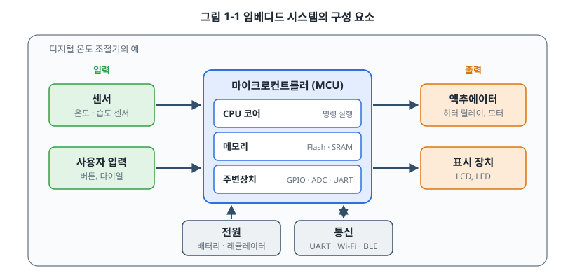
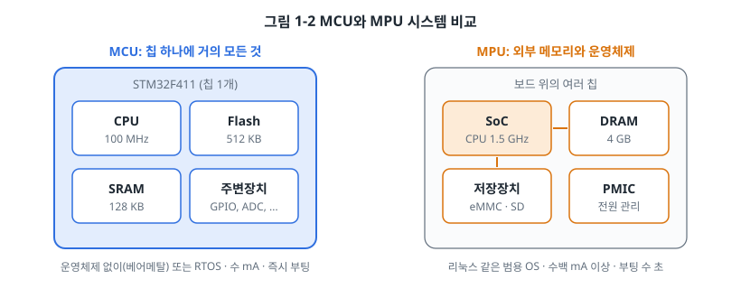
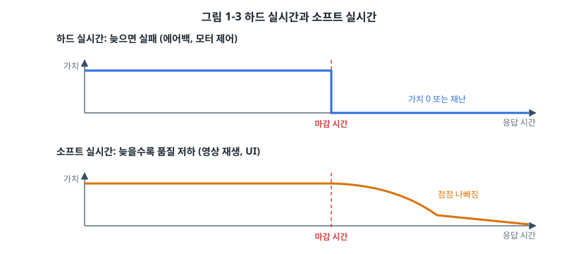
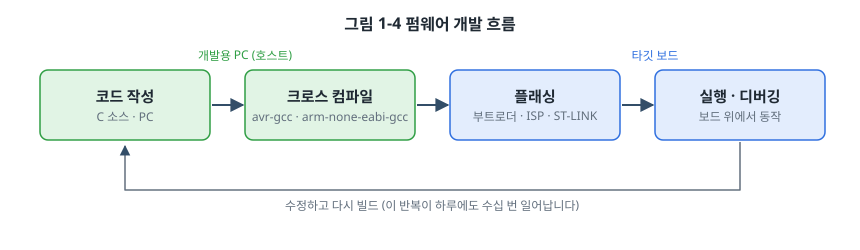
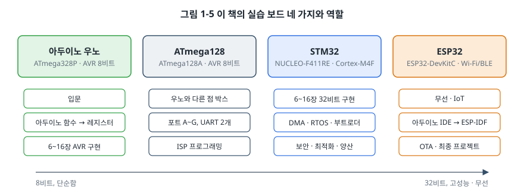
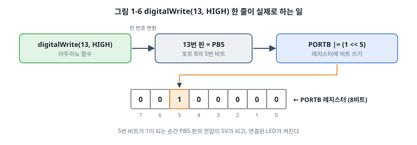

# 1장. 임베디드 시스템이란 무엇인가

## 이 장에서 배우는 것

- 임베디드 시스템의 정의와 범용 컴퓨터와의 차이
- 임베디드 시스템을 이루는 구성 요소
- 마이크로컨트롤러(MCU)와 마이크로프로세서(MPU)의 차이
- 실시간성이란 무엇이고 왜 중요한가
- 펌웨어 개발이 어떤 흐름으로 진행되는가

---

## 1.1 주변을 둘러보면

아침에 울리는 알람 시계, 물을 데우는 전기 포트, 출근길 교통카드 단말기, 자동차의 엔진 제어 장치, 사무실의 프린터, 손목의 스마트워치. 이 기기들은 생김새도 하는 일도 다르지만 공통점이 하나 있습니다. 안쪽 어딘가에 작은 컴퓨터가 들어 있고, 그 컴퓨터는 정해진 일 하나만을 위해 존재한다는 점입니다.

이처럼 **특정한 기능을 수행하기 위해 더 큰 장치 안에 내장(embedded)된 컴퓨터 시스템**을 임베디드 시스템이라고 부릅니다. 우리가 흔히 "컴퓨터"라고 부르는 노트북이나 스마트폰보다 훨씬 많은 수가 세상에 존재합니다. 한 대의 최신 자동차에만 수십에서 백 개가 넘는 제어 장치(ECU)가 들어가고, 가정집 하나에도 가전제품과 리모컨, 보일러 조절기, 공유기 등을 합치면 수십 개의 임베디드 시스템이 동작하고 있습니다.

## 1.2 범용 컴퓨터와 무엇이 다른가

노트북도 결국 CPU와 메모리로 이루어진 컴퓨터이고, 임베디드 시스템도 마찬가지입니다. 그런데 두 세계에서 일하는 개발자가 마주하는 문제는 꽤 다릅니다.

| 구분 | 범용 컴퓨터 (노트북, 서버) | 임베디드 시스템 |
| --- | --- | --- |
| 목적 | 사용자가 원하는 어떤 프로그램이든 실행 | 정해진 기능 하나를 오랫동안 안정적으로 수행 |
| 자원 | GB 단위의 메모리, GHz 단위의 CPU | KB 단위의 메모리, 수십~수백 MHz의 CPU가 흔함 |
| 운영체제 | Windows, macOS, Linux | 없음(베어메탈), RTOS, 또는 경량화된 리눅스 |
| 입출력 | 키보드, 마우스, 모니터 | 센서, 모터, 릴레이, LED, 통신선 |
| 전원 | 콘센트, 큰 배터리 | 코인 전지 하나로 수년을 버텨야 하는 경우도 있음 |
| 시간 제약 | 조금 느려도 사용자가 기다려 줌 | 정해진 시간 안에 반응하지 못하면 기능 실패 |
| 업데이트 | 언제든 설치 | 현장에 설치된 뒤에는 어렵거나 불가능할 수도 있음 |
| 고장의 결과 | 프로그램을 다시 실행 | 기계 손상, 인명 사고로 이어질 수도 있음 |

표의 아래쪽으로 갈수록 임베디드 개발의 특징이 드러납니다. 임베디드 개발자는 "동작하게 만드는 것"에서 멈추지 않고, **적은 자원으로, 정해진 시간 안에, 오랫동안, 안전하게** 동작하게 만들어야 합니다. 이 책 전체가 이 네 가지를 해내는 방법에 관한 이야기입니다.

> 💡 팁: 임베디드 시스템 위에서 돌아가는 소프트웨어를 보통 **펌웨어(firmware)** 라고 부릅니다. 하드웨어(hardware)처럼 단단히 붙어 있고, 소프트웨어(software)처럼 바꿀 수 있다는 의미에서 "중간(firm)"이라는 이름이 붙었습니다.

## 1.3 임베디드 시스템의 구성 요소

디지털 온도 조절기를 예로 들어 임베디드 시스템을 분해해 보겠습니다.



- **입력**: 실내 온도를 재는 센서와 사용자가 희망 온도를 정하는 버튼입니다. 바깥 세상의 정보를 전기 신호로 바꿔 줍니다.
- **마이크로컨트롤러(MCU)**: 시스템의 두뇌입니다. 센서 값을 읽고, 희망 온도와 비교하고, 히터를 켤지 판단합니다. 하나의 칩 안에 CPU 코어, 프로그램을 저장하는 Flash 메모리, 변수를 담는 SRAM, 그리고 바깥과 신호를 주고받는 여러 **주변장치(peripheral)** 가 들어 있습니다.
- **출력**: 판단 결과를 실제 행동으로 바꿉니다. 히터를 켜는 릴레이, 현재 온도를 보여 주는 LCD가 여기에 속합니다. 무언가를 움직이는 출력 장치를 **액추에이터(actuator)** 라고 부릅니다.
- **전원**: 배터리나 어댑터에서 받은 전기를 MCU가 쓸 수 있는 안정된 전압(예: 3.3V)으로 바꿉니다.
- **통신**: 스마트폰 앱으로 온도를 조절하려면 Wi-Fi나 BLE 같은 통신이 필요합니다. 개발 중에는 PC와 UART로 연결해 디버그 메시지를 주고받습니다.

거의 모든 임베디드 시스템은 이 구조의 변형입니다. 세탁기는 센서로 물의 양을 재고 모터를 돌리며, 드론은 자이로 센서를 읽어 네 개의 모터 속도를 1초에 수백 번 조절합니다. 앞으로 어떤 기기를 보더라도 "입력은 무엇이고, 무엇을 판단하고, 무엇을 출력하는가"를 떠올려 보면 구조가 보이기 시작합니다.

## 1.4 MCU와 MPU

임베디드 시스템의 두뇌는 크게 두 종류로 나뉩니다.



**마이크로컨트롤러(MCU, Microcontroller Unit)** 는 CPU, 메모리, 주변장치가 칩 하나에 모두 들어 있습니다. 전원과 몇 개의 부품만 붙이면 바로 동작하고, 전원을 넣는 순간 수 밀리초 안에 프로그램이 시작됩니다. 소비 전력이 작고 값도 싸서 수백 원짜리 칩도 많습니다. 대신 메모리가 작아 리눅스 같은 운영체제는 올릴 수 없고, 운영체제 없이(베어메탈) 또는 작은 실시간 운영체제(RTOS) 위에서 펌웨어를 실행합니다.

**마이크로프로세서(MPU, Microprocessor Unit)** 는 강력한 CPU를 중심으로 하고, 메모리(DRAM)와 저장장치(eMMC, SD 카드)를 칩 바깥에 둡니다. 스마트폰이나 라즈베리 파이에 들어가는 칩이 여기에 속합니다. 리눅스를 올릴 수 있어 화면, 네트워크, 파일 시스템 같은 복잡한 기능을 쉽게 만들 수 있지만, 전력 소모가 크고 부팅에 수 초가 걸립니다.

| 구분 | MCU | MPU |
| --- | --- | --- |
| 대표 예 | STM32, ESP32, nRF52, RP2040, AVR | Raspberry Pi의 BCM2711, NXP i.MX, TI Sitara |
| 메모리 | 칩 내부, KB~수 MB | 칩 외부 DRAM, 수백 MB~수 GB |
| 운영체제 | 없음, RTOS | 리눅스, 안드로이드 |
| 부팅 시간 | 수 ms | 수 초 |
| 소비 전력 | µA~수십 mA | 수백 mA 이상 |
| 주 용도 | 센서 노드, 모터 제어, 가전, 웨어러블 | 셋톱박스, 산업용 HMI, 게이트웨이, 카메라 |

이 책은 대부분을 MCU에 할애하고, 37장과 38장에서 MPU 위의 임베디드 리눅스를 다룹니다. MCU에서 레지스터와 인터럽트를 직접 다뤄 본 경험은 리눅스 디바이스 드라이버를 이해할 때도 그대로 쓰입니다.

## 1.5 실시간성

임베디드 시스템을 설명할 때 빠지지 않는 단어가 **실시간(real-time)** 입니다. 흔히 "빠르다"는 뜻으로 오해하지만, 실시간의 진짜 의미는 **정해진 시간(마감 시간, deadline) 안에 반드시 응답한다**는 것입니다. 평균적으로 빠른 것보다, 가장 느린 경우에도 마감을 지키는 것이 중요합니다.



- **하드 실시간(hard real-time)**: 마감을 한 번이라도 놓치면 시스템이 실패한 것입니다. 충돌을 감지한 에어백은 수십 밀리초 안에 터져야 하고, 그보다 늦으면 아무 의미가 없거나 오히려 위험합니다. 모터의 전류 제어, 심장 박동 조율기도 여기에 속합니다.
- **소프트 실시간(soft real-time)**: 마감을 놓치면 품질이 떨어지지만 시스템이 실패하지는 않습니다. 동영상 재생 중 프레임 하나가 늦게 나오면 화면이 잠깐 끊길 뿐입니다.

> ⚠️ 주의: "우리 제품은 실시간이 필요 없다"는 판단은 신중해야 합니다. 버튼을 눌렀는데 반응이 0.5초 늦는 리모컨은 "고장 났다"는 평을 듣습니다. 사용자가 느끼는 품질도 결국 시간 제약입니다.

실시간성을 보장하는 방법은 7장(인터럽트), 26장(RTOS), 28장(실시간성 분석)에서 단계적으로 다룹니다.

## 1.6 펌웨어는 어떻게 만들어지는가

PC용 프로그램은 작성한 컴퓨터에서 바로 실행합니다. 펌웨어는 사정이 다릅니다. 코드를 작성하는 PC(호스트)와 코드가 실행될 보드(타깃)가 서로 다른 CPU를 쓰기 때문입니다.



1. **코드 작성**: PC에서 C 언어로 펌웨어를 작성합니다.
2. **크로스 컴파일**: PC의 x86이나 Apple Silicon용이 아니라, 타깃 칩용 기계어를 만들어 내는 **크로스 컴파일러**로 빌드합니다. AVR용은 `avr-gcc`, Arm Cortex-M용은 `arm-none-eabi-gcc`입니다.
3. **플래싱**: 만들어진 바이너리를 MCU의 Flash 메모리에 기록합니다. 우노는 USB로 칩 안의 부트로더가 받아 쓰고, ATmega128은 ISP 프로그래머, STM32는 디버거(ST-LINK)를 씁니다.
4. **실행과 디버깅**: 보드를 리셋하면 펌웨어가 실행됩니다. 디버거를 연결하면 PC에서 펌웨어를 한 줄씩 멈추며 변수와 레지스터를 들여다볼 수 있습니다.

이 반복이 하루에도 수십 번 일어납니다. 그래서 개발 환경을 잘 갖추는 것이 생산성에 큰 차이를 만듭니다. 5장에서 이 환경을 처음부터 직접 구축합니다.

## 1.7 이 책의 실습 보드

이 책은 보드 네 개를 씁니다. 모든 예제를 네 보드에서 반복하지는 않고, 각 보드가 가장 잘 보여 주는 주제를 나눠 맡습니다.



| 보드 | 칩 | CPU | Flash / SRAM | 이 책에서 맡는 일 |
| --- | --- | --- | --- | --- |
| 아두이노 우노 | ATmega328P | AVR 8비트, 16 MHz | 32 KB / 2 KB | 입문, AVR 레지스터 실습 |
| ATmega128 키트 | ATmega128A | AVR 8비트, 16 MHz | 128 KB / 4 KB | 우노와 다른 점 비교 |
| NUCLEO-F411RE | STM32F411RE | Arm Cortex-M4F 32비트, 100 MHz | 512 KB / 128 KB | 32비트 주변장치, RTOS, 부트로더, 보안 등 심화 |
| ESP32-DevKitC | ESP32 (WROOM-32E) | Xtensa 듀얼코어 32비트, 240 MHz | 4 MB(외부) / 520 KB | Wi-Fi, BLE, IoT, OTA |

**아두이노 우노**로 시작하는 이유는 문턱이 가장 낮기 때문입니다. USB 케이블만 꽂으면 아두이노 IDE에서 바로 프로그램을 올릴 수 있습니다. 그런데 우리는 거기서 멈추지 않습니다. 같은 칩에 아두이노 함수 없이 레지스터를 직접 다루는 C 코드를 올려 보면서, 편리한 함수 뒤에서 실제로 무슨 일이 일어나는지 확인합니다.

**ATmega128**은 국내 학교와 교육용 키트에서 오랫동안 쓰여 온 AVR 칩입니다. 우노의 ATmega328P와 같은 AVR 계열이라 레지스터 이름과 쓰는 법이 거의 같습니다. 그래서 따로 장을 두지 않고, 포트 수나 UART 개수처럼 다른 점만 "ATmega128에서는" 박스로 짚습니다. 이미 ATmega128 키트를 가지고 있다면 그 키트로 따라와도 됩니다.

**STM32**는 이 책의 중심 보드입니다. 6장부터 16장까지는 같은 기능을 먼저 우노로, 다음에 STM32로 구현하면서 8비트와 32비트 MCU가 어떻게 다른지 비교합니다. DMA, RTOS, 부트로더, 보안처럼 AVR에는 없거나 한계가 있는 주제는 STM32로만 다룹니다. NUCLEO 보드는 디버거(ST-LINK)가 내장되어 있어 코드를 한 줄씩 멈추며 살펴볼 수 있습니다.

**ESP32**는 Wi-Fi와 BLE가 칩에 들어 있어 무선과 IoT 장을 맡습니다. 아두이노 IDE로도 프로그래밍할 수 있어서 우노에서 익힌 방식 그대로 무선을 시작한 뒤, 제조사의 공식 개발 환경인 ESP-IDF로 넘어갑니다.

> 🔍 깊이 보기: 다른 보드를 가지고 있다면 어떻게 할까요? 이 책은 라이브러리보다 레지스터와 동작 원리를 먼저 설명하기 때문에, 칩이 달라도 해당 칩의 데이터시트에서 같은 역할을 하는 레지스터를 찾으면 따라올 수 있습니다.

## 1.8 미리 보기: 함수 한 줄 뒤에 숨은 레지스터

자세한 설명은 3장, 4장, 6장에서 하겠지만, 임베디드 프로그래밍이 어떤 느낌인지 맛보기로 보드의 LED를 켜 보겠습니다. 우노에는 디지털 13번 핀에 LED가 연결되어 있습니다. 아두이노 방식으로는 이렇게 씁니다.

```cpp
void setup() {
    pinMode(13, OUTPUT);     // 13번 핀을 출력으로
    digitalWrite(13, HIGH);  // 13번 핀을 High로: LED가 켜진다
}

void loop() {
}
```

아두이노의 13번 핀은 칩 안에서는 **포트 B의 5번 비트(PB5)** 입니다. `pinMode`와 `digitalWrite`는 결국 이 비트에 해당하는 레지스터 값을 바꾸는 함수입니다. 같은 일을 레지스터로 직접 하면 이렇습니다.

```c
#include <avr/io.h>

int main(void)
{
    DDRB  |= (1 << DDB5);    /* 1) PB5를 출력으로 (Data Direction Register) */
    PORTB |= (1 << PORTB5);  /* 2) PB5를 High로: LED가 켜진다 */

    for (;;) {
        /* 펌웨어는 끝나지 않는다 */
    }
}
```



32비트 MCU인 STM32에서는 한 단계가 더 필요합니다. 전력을 아끼기 위해 주변장치의 클럭이 기본으로 꺼져 있어서, 먼저 GPIO 포트에 클럭을 넣어 줘야 합니다. NUCLEO 보드의 LED는 PA5에 연결되어 있습니다.

```c
#include <stdint.h>

/* 주소는 STM32F411 레퍼런스 매뉴얼(RM0383) 2.3절 메모리 맵에서 가져온다 */
#define RCC_AHB1ENR  (*(volatile uint32_t *)0x40023830u)  /* RCC 기준 0x40023800 + 0x30 */
#define GPIOA_MODER  (*(volatile uint32_t *)0x40020000u)  /* GPIOA 기준 0x40020000 + 0x00 */
#define GPIOA_ODR    (*(volatile uint32_t *)0x40020014u)  /* GPIOA 기준 0x40020000 + 0x14 */

int main(void)
{
    RCC_AHB1ENR |= (1u << 0);           /* 1) GPIOA에 클럭 공급 (GPIOAEN 비트) */

    GPIOA_MODER &= ~(3u << (5 * 2));    /* 2) PA5의 모드 비트 두 개를 지우고 */
    GPIOA_MODER |=  (1u << (5 * 2));    /*    01 = 범용 출력으로 설정 */

    GPIOA_ODR |= (1u << 5);             /* 3) PA5를 High로: LED가 켜진다 */

    for (;;) {
    }
}
```

낯선 것이 많을 것입니다. `DDRB`는 어디에 정의되어 있는지, STM32 코드의 주소는 왜 `0x40020014`인지, `volatile`은 왜 붙는지, 클럭은 왜 먼저 켜야 하는지, 마지막의 무한 루프는 왜 필요한지. 이 질문들에 대한 답을 3장(마이크로컨트롤러의 구조), 4장(임베디드를 위한 C 언어), 6장(GPIO)에서 하나씩 찾아갑니다. 지금은 **하드웨어를 움직이는 것은 결국 정해진 레지스터에 정해진 비트를 쓰는 일**이라는 감각만 가져가면 충분합니다.

> 🔧 ATmega128에서는: 레지스터 이름이 우노와 같은 규칙을 따릅니다. 포트가 A부터 G까지 있어서, 예를 들어 포트 A의 0번 핀에 LED가 달린 키트라면 `DDRA |= (1 << 0); PORTA |= (1 << 0);`처럼 씁니다. LED가 어느 핀에 연결되어 있는지는 키트의 회로도에서 확인하세요.

---

## 정리

- 임베디드 시스템은 특정 기능을 위해 더 큰 장치 안에 내장된 컴퓨터이며, 그 위에서 동작하는 소프트웨어를 펌웨어라고 합니다.
- 임베디드 개발은 적은 자원, 시간 제약, 장기간 안정성, 안전이라는 조건 아래에서 이루어집니다.
- 대부분의 임베디드 시스템은 입력 → MCU의 판단 → 출력 구조에 전원과 통신이 더해진 형태입니다.
- MCU는 모든 것이 칩 하나에 들어 있어 작고 저전력이며, MPU는 외부 메모리와 운영체제를 갖춰 복잡한 기능에 유리합니다.
- 실시간이란 빠른 것이 아니라 마감 시간을 반드시 지키는 것입니다.
- 펌웨어는 호스트 PC에서 크로스 컴파일한 뒤 타깃 보드에 플래싱하여 실행합니다.

## 연습 문제

1. 집이나 사무실에서 임베디드 시스템이 들어 있는 기기 다섯 가지를 찾고, 각각의 입력과 출력을 적어 보세요.
2. 다음 기기에 MCU와 MPU 중 어느 쪽이 어울릴지 고르고 이유를 설명하세요.
   (가) 무선 도어 센서 (나) 매장용 키오스크 (다) 전동 킥보드의 모터 제어기 (라) 차량용 블랙박스
3. 다음 중 하드 실시간 요구가 있는 것을 모두 고르세요.
   (가) 산업용 로봇 팔의 충돌 정지 (나) 스마트 스피커의 음악 재생 (다) 자동차의 ABS 브레이크 (라) 온도 기록기의 1분 간격 저장
4. 1.8절의 우노 레지스터 코드에서 LED를 끄려면 어느 줄을 어떻게 바꿔야 할지 추측해 보세요. (힌트: `|=` 대신 무엇을 써야 특정 비트를 0으로 만들 수 있을까요?)
5. 1.8절의 우노 코드와 STM32 코드를 비교해, STM32에만 있는 단계가 무엇인지 찾아 보세요.
6. 크로스 컴파일이 왜 필요한지 "호스트"와 "타깃"이라는 단어를 써서 두 문장으로 설명하세요.
