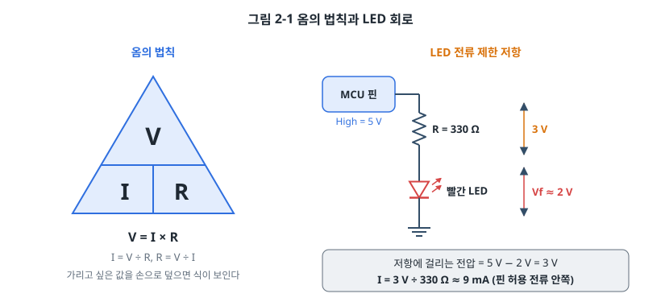
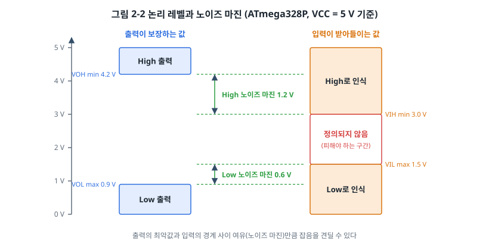
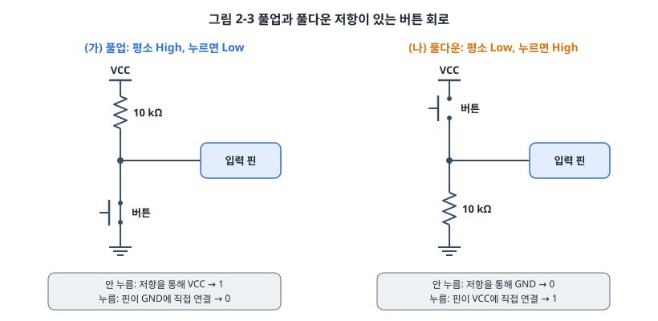
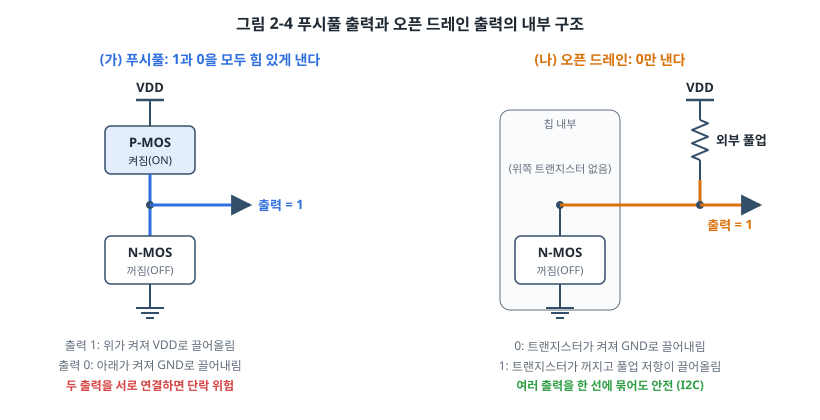
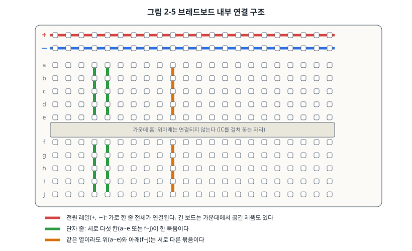
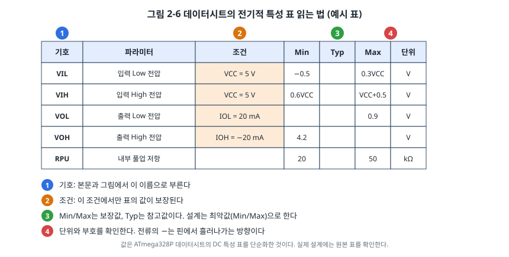

# 2장. 하드웨어 기초: 회로와 데이터시트

## 이 장에서 배우는 것

- 전압, 전류, 저항의 관계와 옴의 법칙
- LED에 맞는 전류 제한 저항을 계산하는 방법
- 디지털 입력이 0과 1을 구분하는 기준(논리 레벨)과 노이즈 마진
- 풀업과 풀다운 저항이 필요한 이유, 푸시풀과 오픈 드레인 출력의 차이
- 브레드보드와 멀티미터 사용법, 데이터시트에서 필요한 값을 찾는 방법

---

## 2.1 펌웨어 개발자에게 회로가 필요한 이유

펌웨어 개발자는 회로를 설계하지 않는 경우가 많습니다. 그래도 회로를 읽을 줄은 알아야 합니다. 코드가 핀에 1을 썼는데 LED가 켜지지 않을 때, 원인은 코드일 수도 있지만 저항 값이나 배선일 수도 있기 때문입니다. 버튼을 한 번 눌렀는데 두 번 눌린 것으로 처리될 때, 센서가 가끔 엉뚱한 값을 줄 때도 마찬가지입니다. 이런 문제의 상당수는 소프트웨어와 하드웨어의 경계에서 생기고, 그 경계를 볼 수 있는 사람이 빨리 해결합니다.

이 장에서는 이 책 전체에 필요한 만큼의 전기 지식을 다룹니다. 회로 이론을 깊이 파고들기보다, 마이크로컨트롤러의 핀 하나에 무엇을 연결해도 되고 무엇을 연결하면 안 되는지 판단할 수 있는 수준을 목표로 합니다. 회로도와 PCB를 더 알고 싶다면 부록 B를 참고하세요.

## 2.2 전압, 전류, 저항

전기 회로를 처음 배울 때는 물이 흐르는 관에 비유하면 이해하기 쉽습니다.

- **전압(voltage, 단위 V 볼트)** 은 두 지점 사이의 전기적인 높이 차이입니다. 물탱크의 수위 차이에 해당합니다. 전압은 항상 "어디와 비교해서"를 따지는 값이라서, 회로에서는 보통 GND(그라운드, 0 V)를 기준으로 삼습니다. "핀 전압이 5 V다"라는 말은 "GND보다 5 V 높다"는 뜻입니다.
- **전류(current, 단위 A 암페어)** 는 1초 동안 흐르는 전하의 양입니다. 관을 흐르는 물의 양에 해당합니다. 임베디드 회로에서는 mA(밀리암페어, 1/1000 A)나 µA(마이크로암페어, 1/1000 mA)를 주로 씁니다.
- **저항(resistance, 단위 Ω 옴)** 은 전류가 흐르기 어려운 정도입니다. 관의 굵기에 해당합니다. 같은 전압이라도 저항이 크면 전류가 적게 흐릅니다.

세 값 사이에는 **옴의 법칙(Ohm's law)** 이라는 관계가 있습니다.

```
V = I × R      (전압 = 전류 × 저항)
```



그림 2-1의 왼쪽 삼각형에서 구하고 싶은 값을 손으로 가리면 나머지 두 값으로 계산하는 식이 보입니다. V를 가리면 I × R, I를 가리면 V ÷ R, R을 가리면 V ÷ I입니다.

전류가 저항을 지나면 에너지가 열로 바뀝니다. 이때의 **전력(power, 단위 W 와트)** 은 P = V × I로 구합니다. 저항 부품에는 견딜 수 있는 전력(흔히 1/4 W)이 정해져 있어서, 큰 전류가 흐르는 곳에 작은 저항을 쓰면 뜨거워지거나 타 버립니다. 이 책의 실습에서 쓰는 수 mA 정도의 전류라면 1/4 W 저항으로 충분합니다.

> 💡 팁: 단위 앞의 접두사를 익혀 두면 계산 실수가 줄어듭니다. k(킬로)는 1000배, M(메가)는 100만 배, m(밀리)는 1/1000, µ(마이크로)는 1/1000000입니다. 5 V ÷ 10 kΩ = 0.5 mA처럼, V를 kΩ으로 나누면 결과가 바로 mA로 나옵니다.

## 2.3 LED를 안전하게 켜기: 전류 제한 저항

1장에서 레지스터에 비트 하나를 써서 LED를 켰습니다. 그런데 LED를 핀에 직접 연결하면 안 됩니다. LED는 일정한 전압(**순방향 전압 Vf**, 빨간 LED는 약 1.8~2.2 V)을 넘으면 전류가 급격히 늘어나는 성질이 있어서, 전류를 제한해 주는 저항이 없으면 LED나 MCU 핀이 망가질 수 있습니다.

그림 2-1의 오른쪽 회로로 저항 값을 계산해 보겠습니다.

1. 핀이 High일 때 전압은 5 V입니다.
2. LED에는 Vf만큼, 약 2 V가 걸립니다.
3. 나머지 5 V − 2 V = 3 V가 저항에 걸립니다.
4. LED에 10 mA를 흘리고 싶다면 R = 3 V ÷ 10 mA = 300 Ω입니다.
5. 저항은 정해진 값(E 계열)으로만 팔기 때문에 가장 가까운 큰 값인 330 Ω을 고릅니다. 이때 전류는 3 V ÷ 330 Ω ≈ 9 mA입니다.

일반적인 지시용 LED는 5~10 mA면 충분히 밝습니다. 요즘의 고휘도 LED는 1~2 mA로도 잘 보이므로 1 kΩ 정도를 써도 됩니다.

이 계산에서 꼭 확인해야 하는 것이 **핀 하나가 흘릴 수 있는 전류**입니다.

| MCU | 핀 하나의 절대 최대 전류 | 칩 전체(전원 핀) 제한 | 출처 |
| --- | --- | --- | --- |
| ATmega328P | 40 mA | VCC, GND 핀 합계 200 mA | ATmega328P 데이터시트, Absolute Maximum Ratings |
| STM32F411 | ±25 mA | 모든 I/O 합계 120 mA | STM32F411xC/E 데이터시트(DS10314), Absolute maximum ratings 표 |

> ⚠️ 주의: **절대 최대 정격(absolute maximum ratings)** 은 "이 값을 넘으면 망가질 수 있다"는 한계이지, 평소에 써도 되는 값이 아닙니다. 실제 설계는 데이터시트의 권장 동작 조건과 DC 특성 표에 있는 값(예: ATmega328P는 20 mA에서 출력 전압을 보장)을 기준으로 하고, 여유를 둡니다. 모터, 릴레이, 많은 LED처럼 큰 전류가 필요한 부하는 트랜지스터나 드라이버 IC를 거쳐 구동합니다.

## 2.4 디지털 논리 레벨

디지털 회로는 전압을 0과 1 두 가지로만 해석합니다. 그런데 전압은 실제로는 연속적인 값이고, 선에는 항상 약간의 잡음이 섞여 있습니다. 그래서 "몇 V부터 1로 볼 것인가"를 정해 둔 약속이 필요합니다. 이것을 **논리 레벨(logic level)** 이라고 합니다.



논리 레벨은 출력 쪽과 입력 쪽에 따로 정해져 있습니다.

| 기호 | 의미 | ATmega328P (VCC = 5 V) |
| --- | --- | --- |
| VOH | 출력이 High일 때 보장하는 최소 전압 | 4.2 V (20 mA를 내보낼 때) |
| VOL | 출력이 Low일 때 보장하는 최대 전압 | 0.9 V (20 mA를 받아들일 때) |
| VIH | 입력이 High로 인식하는 최소 전압 | 0.6 × VCC = 3.0 V |
| VIL | 입력이 Low로 인식하는 최대 전압 | 0.3 × VCC = 1.5 V |

출처: ATmega328P 데이터시트, Electrical Characteristics의 DC Characteristics 표. VOH와 VOL은 출력 전류가 작을수록 전원 전압에 더 가까워집니다.

그림 2-2에서 1.5 V와 3.0 V 사이는 입력이 0인지 1인지 보장하지 않는 구간입니다. 이 구간의 전압이 들어오면 칩마다, 온도마다, 심지어 같은 칩에서도 순간마다 다르게 읽힐 수 있습니다. 디지털 신호는 이 구간을 빠르게 지나가야 하고, 그 안에 머물러서는 안 됩니다.

출력의 최악값과 입력의 경계 사이에 남는 여유를 **노이즈 마진(noise margin)** 이라고 합니다. 우노끼리 연결하면 High 쪽 여유는 4.2 − 3.0 = 1.2 V, Low 쪽 여유는 1.5 − 0.9 = 0.6 V입니다. 선에 이보다 작은 잡음이 섞여도 받는 쪽은 값을 정확하게 읽습니다.

### 3.3 V와 5 V가 만날 때

이 책의 우노와 ATmega128은 5 V로, STM32와 ESP32는 3.3 V로 동작합니다. 전압이 다른 장치끼리 연결할 때는 두 방향을 따로 따져야 합니다.

- **3.3 V 출력 → 5 V 입력**: 3.3 V MCU의 High 출력은 3.3 V 근처인데, 5 V로 동작하는 ATmega328P의 VIH는 3.0 V입니다. 여유가 0.3 V 남짓밖에 없어서, 출력 전류가 크거나 잡음이 있으면 불안정해질 수 있습니다.
- **5 V 출력 → 3.3 V 입력**: 더 위험한 방향입니다. 3.3 V 칩의 입력에 5 V가 들어가면 칩 내부의 보호 다이오드로 전류가 흘러 망가질 수 있습니다. 다만 STM32의 데이터시트에서 **FT(Five-volt Tolerant)** 로 표시된 핀은 디지털 입력 모드에서 5 V를 견디도록 설계되어 있습니다. 어느 핀이 FT인지는 DS10314의 핀 정의 표에서 확인합니다. ESP32의 핀은 5 V를 견디지 못합니다.

두 경우 모두 안전한 방법은 **레벨 시프터(level shifter)** 를 쓰는 것입니다. I2C처럼 양방향 신호에는 MOSFET 하나와 풀업 저항 두 개로 만든 양방향 레벨 시프터 모듈을 흔히 씁니다.

> ⚠️ 주의: 전압이 다른 보드를 연결할 때는 신호선보다 **GND를 먼저, 반드시** 연결하세요. 전압은 GND를 기준으로 한 높이라서, 기준이 공유되지 않으면 두 보드는 같은 신호를 서로 다르게 봅니다.

## 2.5 풀업과 풀다운

버튼 하나를 입력 핀에 연결해 보겠습니다. 버튼의 한쪽을 핀에, 다른 쪽을 GND에 연결하면, 버튼을 누를 때 핀은 GND와 연결되어 확실히 0이 됩니다. 그러면 버튼에서 손을 뗐을 때는 어떨까요?

이때 핀은 어디에도 연결되지 않은 상태, 즉 **떠 있는(floating)** 상태가 됩니다. MCU의 입력 핀은 전류가 거의 흐르지 않을 정도로 저항이 커서, 떠 있는 핀의 전압은 주변 배선이 주워 오는 잡음이나 손가락의 정전기에 따라 제멋대로 변합니다. 아무것도 하지 않았는데 버튼이 눌렸다 떨어졌다 하는 것처럼 읽히는 이유입니다.

해결책은 저항을 통해 핀을 평소 값에 묶어 두는 것입니다.



- **풀업(pull-up)**: 핀과 VCC 사이에 저항을 둡니다. 버튼을 누르지 않으면 저항을 통해 VCC로 끌어올려져 1이 되고, 누르면 GND와 직접 연결되어 0이 됩니다. 눌렀을 때 0이 되므로 이런 입력을 **액티브 로(active low)** 라고 부릅니다.
- **풀다운(pull-down)**: 핀과 GND 사이에 저항을 둡니다. 평소에는 0, 누르면 1입니다.

저항 값은 보통 4.7 kΩ~10 kΩ을 씁니다. 너무 작으면 버튼을 누르는 동안 VCC에서 GND로 흐르는 전류가 커서 전력이 낭비되고(5 V ÷ 1 kΩ = 5 mA), 너무 크면 잡음에 약해지고 신호가 바뀌는 속도가 느려집니다.

다행히 대부분의 MCU에는 **내부 풀업 저항**이 들어 있어서 외부 저항 없이 버튼을 연결할 수 있습니다.

| MCU | 내부 풀업 | 내부 풀다운 | 출처 |
| --- | --- | --- | --- |
| ATmega328P | 20~50 kΩ | 없음 | ATmega328P 데이터시트, DC Characteristics의 RPU |
| STM32F411 | 약 40 kΩ (30~50 kΩ) | 약 40 kΩ (30~50 kΩ) | DS10314, I/O static characteristics의 RPU, RPD |

AVR에는 내부 풀다운이 없다는 점을 기억해 두세요. 그래서 AVR에서는 버튼을 GND 쪽에 연결하고 내부 풀업을 켜는 액티브 로 방식이 표준처럼 쓰입니다. 아두이노에서는 이렇게 씁니다.

```cpp
pinMode(2, INPUT_PULLUP);   // 2번 핀을 입력으로, 내부 풀업 켜기
```

같은 일을 레지스터로 하면 다음과 같습니다. 아두이노 2번 핀은 칩의 PD2입니다. AVR에서는 핀을 입력으로 둔 상태에서 PORT 레지스터의 비트에 1을 쓰면 내부 풀업이 켜집니다. 이 이상한 규칙의 이유는 6장에서 GPIO 내부 구조를 보면서 설명합니다.

```c
DDRD  &= ~(1 << DDD2);    /* PD2를 입력으로 */
PORTD |=  (1 << PORTD2);  /* 입력 상태에서 PORT 비트 = 1 → 내부 풀업 켜짐 */
```

> 🔧 ATmega128에서는: 풀업을 켜는 방법은 같습니다. 모든 핀의 풀업을 한꺼번에 끄는 PUD 비트의 위치만 다릅니다. ATmega328P는 MCUCR 레지스터의 4번 비트, ATmega128은 SFIOR 레지스터의 2번 비트입니다.

## 2.6 푸시풀과 오픈 드레인

출력 핀의 안쪽에는 전압을 만들어 내는 트랜지스터가 있습니다. 그 구성 방식에 따라 출력은 크게 두 종류로 나뉩니다.



**푸시풀(push-pull)** 출력은 VDD 쪽 트랜지스터(P-MOS)와 GND 쪽 트랜지스터(N-MOS)를 위아래로 쌓은 구조입니다. 1을 낼 때는 위쪽이 켜져 핀을 VDD로 밀어 올리고(push), 0을 낼 때는 아래쪽이 켜져 GND로 끌어내립니다(pull). 두 방향 모두 힘 있게 구동하므로 신호가 빠르고 깨끗합니다. MCU 출력의 기본값이 대부분 푸시풀입니다.

푸시풀 출력 두 개를 한 선에 연결하면 문제가 생깁니다. 한쪽이 1을, 다른 쪽이 0을 내는 순간 VDD에서 위쪽 트랜지스터, 선, 아래쪽 트랜지스터를 거쳐 GND로 큰 전류가 흐릅니다. 사실상의 단락입니다.

**오픈 드레인(open-drain)** 출력은 아래쪽 트랜지스터만 있습니다. 0을 낼 때는 트랜지스터가 켜져 GND로 끌어내리고, 1을 낼 때는 트랜지스터가 꺼져 핀이 아무 데도 연결되지 않은 상태가 됩니다. 그래서 바깥에 **풀업 저항**을 달아 1일 때 VDD로 끌어올려 줘야 합니다. (트랜지스터가 MOSFET이 아니라 바이폴라 트랜지스터면 같은 구조를 오픈 컬렉터라고 부릅니다.)

오픈 드레인은 0만 힘 있게 낼 수 있어서 느리고, 풀업 저항으로 전류가 새는 단점이 있습니다. 그런데도 널리 쓰이는 이유가 있습니다.

- **여러 출력을 한 선에 묶을 수 있습니다.** 누가 0을 내도 선이 0이 될 뿐 단락이 생기지 않습니다. 모두가 1(꺼짐)일 때만 선이 1이 됩니다. 이것을 **와이어드 AND(wired-AND)** 라고 하며, 15장의 I2C 버스가 이 원리로 동작합니다.
- **전압을 바꿀 수 있습니다.** 풀업 저항을 어느 전압에 연결하느냐에 따라 1의 전압이 정해지므로, 3.3 V 칩이 5 V 쪽 장치에 신호를 보낼 때 쓸 수 있습니다. 단, 이때는 핀이 그 전압을 견딜 수 있어야 합니다(FT 핀).

STM32는 핀마다 출력 방식을 고를 수 있습니다. GPIOx_OTYPER 레지스터의 비트가 0이면 푸시풀, 1이면 오픈 드레인입니다(RM0383, GPIO registers 절). AVR의 출력은 항상 푸시풀이라서, 오픈 드레인이 필요하면 PORT 비트를 0으로 고정해 두고 DDR 비트를 바꾸는 방법으로 흉내 냅니다. DDR이 1이면 0을 내고, 0이면 입력이 되어 핀을 놓아 주는 셈입니다. 15장에서 이 방법으로 I2C 버스를 다룰 때 다시 만납니다.

## 2.7 실습 도구: 브레드보드와 멀티미터

### 브레드보드

**브레드보드(breadboard)** 는 납땜 없이 부품을 꽂아 회로를 만드는 판입니다. 겉으로는 구멍이 고르게 뚫려 있지만, 안쪽에는 정해진 방향으로 금속 스프링이 연결되어 있습니다. 이 연결 구조를 모르면 회로를 엉뚱하게 꽂게 됩니다.



- **전원 레일**: 가장자리의 +, − 줄은 가로로 길게 연결되어 있습니다. VCC와 GND를 여기에 연결해 두고 필요한 곳으로 끌어다 씁니다. 긴 브레드보드 가운데 레일이 끊겨 있는 제품도 있으니 멀티미터로 확인하세요.
- **단자 줄**: 가운데 영역은 세로로 다섯 칸(a~e, f~j)이 한 묶음입니다. 같은 묶음에 꽂은 부품 다리는 서로 연결됩니다.
- **가운데 홈**: 위 묶음과 아래 묶음을 나눕니다. DIP 패키지 IC는 이 홈을 걸쳐 꽂아서 양쪽 다리가 서로 다른 묶음에 들어가게 합니다.

> ⚠️ 주의: 가장 흔한 실수는 저항이나 LED의 두 다리를 같은 세로 묶음에 꽂는 것입니다. 이렇게 꽂으면 부품의 양 끝이 이미 연결된 상태라서 부품을 건너뛰고 전류가 흐릅니다. 부품은 항상 서로 다른 묶음에 걸쳐 꽂으세요.

### 멀티미터

**멀티미터(multimeter)** 는 전압, 전류, 저항을 재는 기본 계측기입니다. 펌웨어 개발자가 가장 자주 쓰는 기능은 다음 네 가지입니다.

| 기능 | 연결 방법 | 쓰임 |
| --- | --- | --- |
| 직류 전압(V⎓) | 측정할 두 지점에 **병렬**로 댄다 | 전원 전압, 핀 출력이 High인지 확인 |
| 직류 전류(A⎓) | 회로를 끊고 그 사이에 **직렬**로 넣는다 | LED 전류, 보드 전체 소비 전류 측정 |
| 저항(Ω) | **전원을 끈 상태**에서 부품 양 끝에 댄다 | 저항 값 확인 |
| 통전(삑 소리) | 전원을 끈 상태에서 두 지점에 댄다 | 배선이 이어져 있는지, 단락이 없는지 확인 |

> ⚠️ 주의: 전류 측정 모드의 멀티미터는 내부 저항이 거의 0인 도선과 같습니다. 이 상태로 전원의 두 단자에 대면 단락이 되어 멀티미터의 퓨즈가 끊어지거나 전원이 망가집니다. 전류를 잰 다음에는 프로브를 전압 단자로 옮겨 꽂는 습관을 들이세요.

오실로스코프와 로직 애널라이저는 시간에 따라 변하는 신호를 보는 장비로, 3부의 통신 장에서 본격적으로 씁니다. 장비 선택과 사용법은 부록 C에 정리했습니다.

## 2.8 데이터시트와 레퍼런스 매뉴얼

부품에 관한 모든 사실은 제조사의 문서에 있습니다. 이 책의 예제에 나오는 레지스터 이름과 숫자도 모두 이 문서에서 가져왔습니다. MCU 문서는 대개 여러 권으로 나뉘어 있습니다.

| 문서 | 담긴 내용 | 이 책의 보드에서 |
| --- | --- | --- |
| 데이터시트(datasheet) | 핀 배치, 전기적 특성, 패키지 치수, 주문 코드 | ATmega328P, ATmega128A, STM32F411xC/E(DS10314) |
| 레퍼런스 매뉴얼(reference manual) | 주변장치의 동작과 레지스터 설명 | STM32F411은 RM0383. AVR은 데이터시트 한 권에 함께 들어 있다 |
| 프로그래밍 매뉴얼 | CPU 코어, 명령어, 코어 레지스터 | STM32 Cortex-M4 프로그래밍 매뉴얼(PM0214) |
| 에라타(errata) | 알려진 버그와 우회 방법 | STM32F411 에라타 시트(ES0287) |

> 💡 팁: 수백 쪽짜리 문서를 처음부터 읽을 필요는 없습니다. 처음에는 목차를 훑어 어떤 내용이 어디에 있는지만 익히고, 필요할 때 검색합니다. 레지스터 이름(예: `OTYPER`)으로 검색하면 설명과 비트 배치가 바로 나옵니다.

데이터시트에서 펌웨어 개발자가 가장 자주 펴 보는 곳이 **전기적 특성(electrical characteristics)** 표입니다. 처음 보면 숫자가 빽빽해서 어지럽지만, 읽는 순서를 알면 금방 익숙해집니다.



1. **기호**: VIL, VOH 같은 이름입니다. 문서의 다른 곳에서는 이 기호로 값을 가리킵니다.
2. **조건**: 그 값이 보장되는 조건입니다. "VOL 최대 0.9 V"는 IOL = 20 mA, VCC = 5 V일 때의 이야기이고, 전류가 더 크거나 전압이 낮으면 값이 달라집니다.
3. **Min, Typ, Max**: Min과 Max는 제조사가 시험으로 보장하는 한계이고, Typ(typical)는 대표적인 칩에서 측정한 참고값입니다. 설계는 언제나 최악의 경우, 즉 Min과 Max로 합니다. Typ 값을 믿고 만든 제품은 실험실에서는 잘 되다가 양산 뒤에 일부 제품에서만 문제가 생깁니다.
4. **단위와 부호**: 전류 값 앞의 −는 핀에서 흘러나가는 방향(소스)을, +는 핀으로 흘러 들어오는 방향(싱크)을 뜻합니다.

> 🔍 깊이 보기: 데이터시트에는 표 외에도 그래프가 많습니다. 예를 들어 "출력 전류에 따른 VOH" 그래프를 보면 핀이 전류를 많이 내보낼수록 High 전압이 얼마나 떨어지는지 알 수 있습니다. 표의 숫자는 그래프 위의 한 점일 뿐이라서, 조건이 표와 다를 때는 그래프를 함께 보면 감을 잡을 수 있습니다. 다만 그래프는 대개 Typ 값이므로 설계의 근거로 쓰지는 않습니다.

부록 A에서 데이터시트를 더 체계적으로 읽는 방법을 다룹니다.

## 2.9 실습: 버튼으로 LED 켜기

이 장에서 배운 내용을 모아 우노에 버튼과 LED를 연결해 보겠습니다. 버튼을 누르는 동안 LED가 켜지는 회로입니다.

**준비물**: 아두이노 우노, 브레드보드, 빨간 LED 1개, 330 Ω 저항 1개, 택트 스위치 1개, 점퍼 선, 멀티미터

**연결**

| 우노 핀 | 연결 |
| --- | --- |
| D8 (PB0) | 330 Ω 저항 → LED 애노드(긴 다리), LED 캐소드(짧은 다리) → GND |
| D2 (PD2) | 택트 스위치 한쪽. 다른 쪽은 GND (내부 풀업 사용) |
| GND | 브레드보드 − 레일 |

먼저 아두이노 방식으로 작성합니다.

```cpp
const int LED_PIN = 8;
const int BUTTON_PIN = 2;

void setup() {
    pinMode(LED_PIN, OUTPUT);
    pinMode(BUTTON_PIN, INPUT_PULLUP);   // 버튼은 GND 쪽: 누르면 LOW
}

void loop() {
    if (digitalRead(BUTTON_PIN) == LOW) {
        digitalWrite(LED_PIN, HIGH);
    } else {
        digitalWrite(LED_PIN, LOW);
    }
}
```

같은 동작을 레지스터로 작성한 코드입니다. 전체 프로젝트와 Makefile은 `code/ch02-button-led/`에 있습니다.

```c
#include <avr/io.h>

int main(void)
{
    DDRB  |=  (1 << DDB0);     /* PB0(D8): 출력 */
    DDRD  &= ~(1 << DDD2);     /* PD2(D2): 입력 */
    PORTD |=  (1 << PORTD2);   /* PD2 내부 풀업 켜기 */

    for (;;) {
        if ((PIND & (1 << PIND2)) == 0) {   /* 버튼 눌림 = Low */
            PORTB |=  (1 << PORTB0);        /* LED 켜기 */
        } else {
            PORTB &= ~(1 << PORTB0);        /* LED 끄기 */
        }
    }
}
```

입력 값은 PORT가 아니라 **PIN** 레지스터에서 읽는다는 점에 주의하세요. PORT는 "내가 쓴 값", PIN은 "핀에 실제로 걸린 전압을 읽은 값"입니다. 6장에서 세 레지스터의 역할을 자세히 다룹니다.

**멀티미터로 확인하기**

1. 버튼을 누르지 않은 상태에서 D2와 GND 사이 전압을 재 봅니다. 내부 풀업 덕분에 5 V 가까이 나와야 합니다.
2. 버튼을 누른 상태에서 다시 재면 0 V가 나와야 합니다.
3. 버튼을 누른 채로 저항 양 끝의 전압을 잽니다. 약 3 V가 나왔다면 옴의 법칙으로 LED 전류를 계산해 보세요(3 V ÷ 330 Ω ≈ 9 mA).
4. 회로를 끊고 멀티미터를 전류 모드로 직렬 연결해 직접 재 보고, 계산값과 비교합니다.

> 💡 팁: LED가 켜지지 않으면 먼저 LED의 방향을 확인하세요. 다리가 긴 쪽이 애노드(+)입니다. 다리를 잘랐다면 LED 몸통 테두리가 평평하게 깎인 쪽이 캐소드(−)입니다.

버튼을 빠르게 여러 번 누르다 보면 LED가 미세하게 깜빡이는 것을 볼 수도 있습니다. 버튼의 금속 접점이 붙는 순간 수 밀리초 동안 붙었다 떨어지기를 반복하는 **바운싱(bouncing)** 때문입니다. 지금 회로에서는 눈에 띄지 않지만, 버튼을 누른 횟수를 세는 프로그램에서는 큰 문제가 됩니다. 7장에서 바운싱을 다루는 방법을 배웁니다.

---

## 정리

- 옴의 법칙 V = I × R로 전압, 전류, 저항 중 두 값을 알면 나머지를 구할 수 있습니다.
- LED는 반드시 전류 제한 저항과 함께 연결하고, MCU 핀의 허용 전류를 데이터시트에서 확인합니다.
- 디지털 입력은 VIL 이하를 0, VIH 이상을 1로 읽으며, 그 사이는 보장되지 않습니다. 출력과 입력 레벨 사이의 여유가 노이즈 마진입니다.
- 떠 있는 입력은 값이 제멋대로 변하므로 풀업이나 풀다운 저항으로 기본값을 정해 줍니다. AVR에는 내부 풀업만, STM32에는 내부 풀업과 풀다운이 모두 있습니다.
- 푸시풀은 0과 1을 모두 힘 있게 내고, 오픈 드레인은 0만 내며 풀업 저항이 필요하지만 여러 출력을 한 선에 묶을 수 있습니다.
- 설계는 데이터시트의 Typ 값이 아니라 조건에 맞는 Min, Max 값으로 합니다.

## 연습 문제

1. 3.3 V로 동작하는 STM32의 핀에 Vf가 2.0 V인 빨간 LED를 연결해 5 mA를 흘리려고 합니다. 필요한 저항 값을 계산하고, 표준 저항 값 중에서 고르세요.
2. 풀업 저항을 1 kΩ으로 쓴 버튼 회로(VCC = 5 V)에서 버튼을 누르고 있는 동안 흐르는 전류와 저항에서 소비되는 전력을 계산하세요. 10 kΩ을 쓰면 어떻게 달라지나요?
3. 2.4절의 표를 이용해, 5 V 우노의 출력을 다른 5 V 우노의 입력에 연결할 때의 High 노이즈 마진과 Low 노이즈 마진을 구하세요. 그다음 3.3 V 장치의 출력(VOH = 2.9 V라고 가정)을 우노의 입력에 연결하면 High 노이즈 마진이 얼마인지 구하고, 이 연결이 안전한지 판단하세요.
4. 오픈 드레인 출력 세 개를 풀업 저항 하나가 달린 선에 묶었습니다. 세 출력이 각각 (1, 1, 1), (1, 0, 1), (0, 0, 0)을 내려고 할 때 선의 값은 무엇인가요? 이 동작이 AND와 같은 이유를 설명하세요.
5. 2.9절의 실습 회로에서 내부 풀업 대신 외부 10 kΩ 풀다운 저항을 쓰도록 바꾸려면 회로와 코드를 어떻게 고쳐야 하나요?
6. (실습) 사용하는 MCU의 데이터시트에서 VIH, VIL, 핀 하나의 최대 전류, 내부 풀업 저항 값을 찾아 표로 정리하고, 각 값이 어느 표, 어떤 조건에서 나온 것인지 함께 적으세요.
