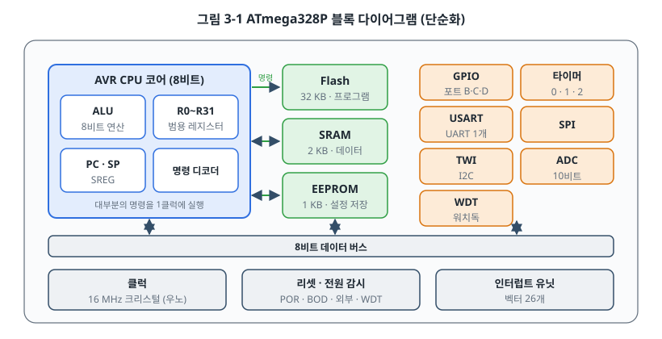
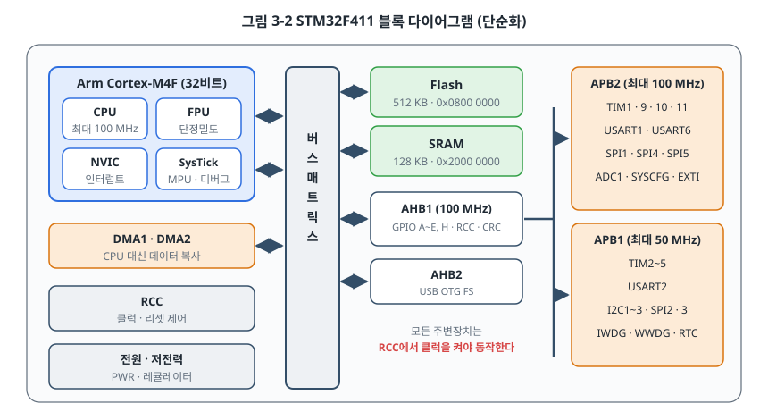
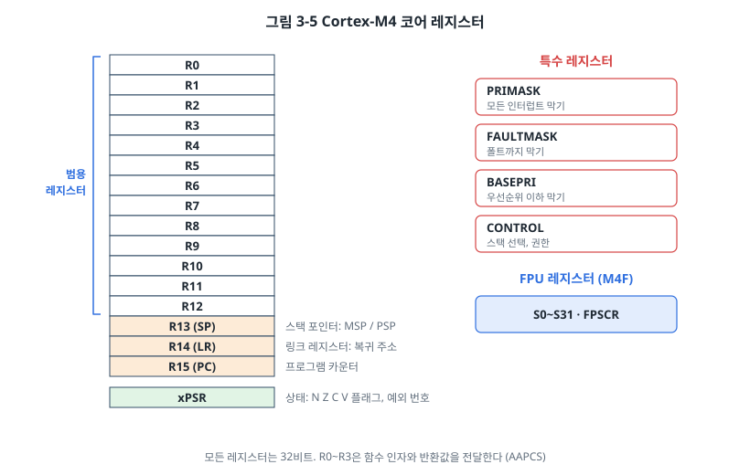
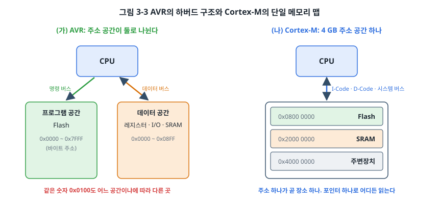
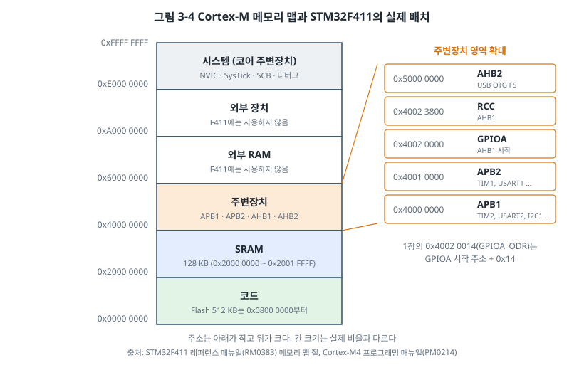
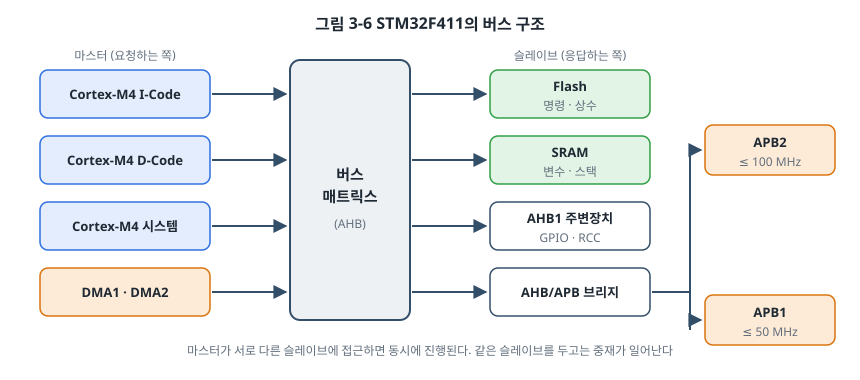
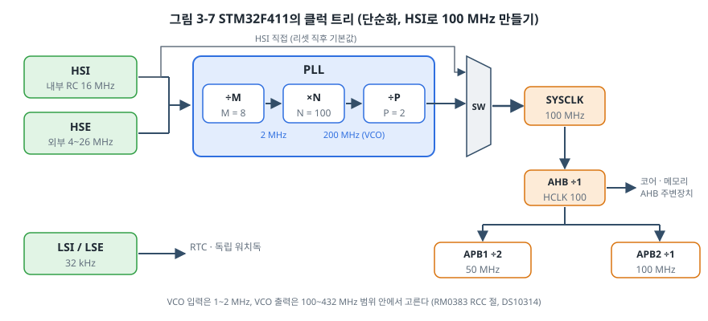

# 3장. 마이크로컨트롤러의 구조

## 이 장에서 배우는 것

- MCU 칩 안에 무엇이 들어 있는지 블록 다이어그램으로 읽는 방법
- AVR 코어와 Cortex-M 코어의 레지스터와 실행 방식
- 하버드 구조와 메모리 맵, 그리고 "레지스터에 쓴다"는 말의 정확한 의미
- 버스와 클럭 트리: 주변장치가 동작하려면 왜 클럭을 켜야 하는가
- 리셋의 종류와 CMSIS의 역할, 8비트와 32비트 MCU의 차이

---

## 3.1 칩 안을 들여다보기

1장에서 LED를 켜는 코드를 보면서 몇 가지 질문을 남겼습니다. STM32 코드의 주소는 왜 `0x40020014`인지, 클럭은 왜 먼저 켜야 하는지. 이 장에서 그 답을 찾습니다. 답은 모두 칩 안의 구조에 있습니다.

MCU의 구조를 한눈에 보여 주는 그림이 **블록 다이어그램(block diagram)** 입니다. 데이터시트의 앞부분에 반드시 들어 있고, 처음 보는 칩을 만났을 때 가장 먼저 펴 보는 그림입니다. 이 책의 두 주력 칩을 단순화한 블록 다이어그램부터 보겠습니다.



ATmega328P는 구조가 단순합니다. 8비트 CPU 코어 하나, 프로그램을 담는 Flash 32 KB, 변수를 담는 SRAM 2 KB, 전원이 꺼져도 값이 남는 EEPROM 1 KB가 있고, 주변장치들이 8비트 데이터 버스 하나에 나란히 매달려 있습니다.



STM32F411은 훨씬 복잡합니다. 32비트 Cortex-M4F 코어에 부동소수점 장치(FPU)가 붙어 있고, 메모리는 Flash 512 KB와 SRAM 128 KB입니다. 눈여겨볼 점은 가운데의 **버스 매트릭스**와 오른쪽의 **APB1, APB2**입니다. 주변장치가 한 줄에 매달려 있지 않고 속도가 다른 여러 버스에 나뉘어 있습니다. 또 하나, CPU 말고도 메모리에 접근할 수 있는 **DMA**가 있습니다.

블록 다이어그램을 읽을 때는 다음 세 가지를 확인하는 습관을 들이세요.

1. **코어**: 몇 비트이고 최대 몇 MHz로 동작하는가
2. **메모리**: Flash와 SRAM은 각각 얼마인가
3. **주변장치와 버스**: 내가 쓸 주변장치가 몇 개 있고, 어느 버스에 붙어 있는가

## 3.2 CPU 코어와 레지스터

### AVR 코어

AVR은 8비트 RISC 코어입니다. 한 번에 8비트 데이터를 다루고, 대부분의 명령을 클럭 한 번에 실행합니다. 그래서 16 MHz로 동작하는 우노는 1초에 대략 1600만 개의 명령을 실행합니다.

AVR 코어의 핵심은 **범용 레지스터 32개(R0~R31)** 입니다. 모든 계산은 이 레지스터에서 일어납니다. 메모리에 있는 변수 두 개를 더하려면 먼저 레지스터로 읽어 오고(load), 레지스터끼리 더한 다음, 결과를 메모리에 씁니다(store). R26~R31은 두 개씩 묶어 16비트 포인터 X, Y, Z로도 씁니다.

그 밖에 다음 줄에 실행할 명령의 주소를 담는 **PC(Program Counter)**, 스택의 꼭대기를 가리키는 **SP(Stack Pointer)**, 연산 결과의 상태(0인지, 자리올림이 있었는지 등)를 담는 **SREG(Status Register)** 가 있습니다. SREG의 7번 비트(I)는 전체 인터럽트를 켜고 끄는 스위치로, 7장에서 다시 만납니다.

### Cortex-M4 코어

Cortex-M4는 Arm이 설계한 32비트 코어입니다. ST, NXP, Nordic 같은 칩 제조사들이 Arm에서 코어 설계를 사 와서 자신의 메모리와 주변장치를 붙여 칩을 만듭니다. 그래서 STM32와 nRF52는 제조사가 달라도 코어 부분은 같은 방식으로 동작하고, 코어에 관한 지식은 그대로 옮겨 갈 수 있습니다.



Cortex-M4의 레지스터는 모두 32비트입니다.

- **R0~R12**: 범용 레지스터입니다. 함수를 호출할 때 R0~R3에 인자 네 개까지를 넣어 전달하고, 반환값은 R0으로 돌려받습니다. 이 약속을 AAPCS(Arm 아키텍처 프로시저 호출 표준)라고 합니다.
- **R13(SP)**: 스택 포인터입니다. 실제로는 MSP(Main Stack Pointer)와 PSP(Process Stack Pointer) 두 개가 있어서 상황에 따라 바꿔 씁니다. 26장의 RTOS가 이 기능을 씁니다.
- **R14(LR)**: 링크 레지스터입니다. 함수를 호출하면 돌아올 주소가 여기에 저장됩니다.
- **R15(PC)**: 프로그램 카운터입니다.
- **xPSR**: 연산 결과 플래그(N, Z, C, V)와 지금 처리 중인 예외 번호를 담습니다.
- **PRIMASK, FAULTMASK, BASEPRI**: 인터럽트를 막는 정도를 정하는 특수 레지스터입니다(7장, 27장).
- **CONTROL**: 어느 스택 포인터를 쓸지, 특권 수준이 무엇인지 정합니다.

Cortex-M4F의 F는 FPU가 있다는 뜻입니다. `float` 연산을 하드웨어로 처리하는 레지스터 S0~S31이 따로 있습니다. AVR에는 FPU가 없어서 `float` 곱셈 하나에도 수십~수백 클럭이 걸리는 소프트웨어 루틴이 실행됩니다.

> 🔍 깊이 보기: Cortex-M4는 3단계 파이프라인으로 명령을 가져오기(fetch), 해석하기(decode), 실행하기(execute)를 겹쳐서 처리합니다. 명령어 집합은 16비트와 32비트 명령이 섞인 Thumb-2입니다. 그래서 같은 C 코드를 빌드하면 AVR보다 대체로 짧은 기계어가 나옵니다. 34장에서 Thumb-2 어셈블리를 직접 읽어 봅니다.

## 3.3 메모리: Flash, SRAM, 그리고 주소 공간

MCU의 메모리는 쓰임새가 분명하게 나뉩니다.

| 메모리 | 전원이 꺼지면 | 쓰기 속도와 횟수 | 담는 것 |
| --- | --- | --- | --- |
| Flash | 남는다 | 느림, 블록 단위로 지운 뒤 씀, 약 1만 번 | 프로그램 코드, 상수 |
| SRAM | 사라진다 | 빠름, 횟수 제한 없음 | 변수, 스택, 힙 |
| EEPROM (AVR) | 남는다 | 느림, 바이트 단위, 약 10만 번 | 설정값, 보정값 |

STM32F411에는 EEPROM이 따로 없어서, 설정값을 남기려면 Flash의 한 섹터를 쓰거나 외부 EEPROM 칩을 씁니다. Flash와 EEPROM의 쓰기 횟수는 각 데이터시트의 Flash/EEPROM endurance 항목에서 확인합니다. 쓰기 횟수가 제한되어 있으므로, 값이 바뀔 때마다 매번 기록하는 설계는 제품 수명을 깎아 먹습니다.

### 하버드 구조와 단일 메모리 맵

CPU가 메모리에서 무언가를 읽으려면 주소를 보냅니다. 그런데 AVR과 Cortex-M은 주소를 해석하는 방식이 다릅니다.



AVR은 **하버드 구조(Harvard architecture)** 입니다. 프로그램을 담은 Flash와 데이터를 담은 SRAM이 서로 다른 주소 공간을 씁니다. 명령을 가져오는 길과 데이터를 읽고 쓰는 길이 따로 있어서 두 일을 동시에 할 수 있다는 장점이 있습니다. 대신 주소 `0x0100`이라는 숫자만으로는 어디를 가리키는지 알 수 없습니다. 프로그램 공간의 `0x0100`과 데이터 공간의 `0x0100`은 전혀 다른 곳입니다.

이 차이가 C 프로그래밍에 직접 영향을 줍니다. AVR에서 `const char msg[] = "hello";`라고 쓰면, 문자열은 Flash에 저장되지만 프로그램이 시작할 때 SRAM으로 복사됩니다. 보통의 포인터는 데이터 공간만 가리킬 수 있기 때문입니다. 2 KB밖에 없는 SRAM에서 이것은 큰 낭비라서, avr-libc는 상수를 Flash에 그대로 두는 `PROGMEM`과 그것을 읽는 `pgm_read_byte()` 같은 함수를 따로 제공합니다(4장).

Cortex-M은 **주소 공간 하나**를 씁니다. 32비트 주소로 4 GB의 공간을 표현할 수 있고, Flash, SRAM, 주변장치가 이 공간의 서로 다른 위치에 놓여 있습니다. 주소 하나가 장소 하나를 뜻하므로 포인터 하나로 Flash의 상수도, SRAM의 변수도, 주변장치의 레지스터도 똑같이 읽을 수 있습니다. 내부적으로는 명령과 데이터를 위한 버스(I-Code, D-Code)가 따로 있어서 하버드 구조의 속도 장점도 가져갑니다.

### AVR의 데이터 공간

AVR의 데이터 공간을 자세히 보면 SRAM만 있는 것이 아닙니다(ATmega328P 데이터시트, AVR Memories 장의 Data Memory Map).

| 데이터 주소 | 내용 |
| --- | --- |
| 0x0000 ~ 0x001F | 범용 레지스터 R0~R31 |
| 0x0020 ~ 0x005F | I/O 레지스터 64개 (PORTB, DDRB 등) |
| 0x0060 ~ 0x00FF | 확장 I/O 레지스터 160개 (UCSR0A, TCCR1A 등) |
| 0x0100 ~ 0x08FF | 내부 SRAM 2 KB |

범용 레지스터와 주변장치의 레지스터까지 모두 데이터 주소를 가지고 있습니다. 그래서 `PORTB`도 결국 데이터 공간의 한 주소이고, 그 주소에 값을 쓰는 것이 핀의 전압을 바꾸는 일이 됩니다. 이 방식을 **메모리 맵 I/O(memory-mapped I/O)** 라고 합니다.

> 🔧 ATmega128에서는: 데이터 공간의 구조는 같고 SRAM이 4 KB라서 0x0100 ~ 0x10FF까지입니다. 그 위로는 외부 메모리 인터페이스를 통해 칩 바깥의 SRAM을 연결할 수도 있습니다.

## 3.4 메모리 맵과 레지스터 접근

이제 1장의 질문 하나에 답할 수 있습니다. STM32에서 `0x40020014`라는 주소는 어디서 왔을까요?



Arm은 Cortex-M의 4 GB 주소 공간을 용도별로 나누어 정해 두었습니다. `0x0000 0000`부터는 코드, `0x2000 0000`부터는 SRAM, `0x4000 0000`부터는 주변장치, `0xE000 0000`부터는 NVIC나 SysTick 같은 코어 자체의 주변장치입니다. 칩 제조사는 이 큰 틀 안에서 자신의 메모리와 주변장치를 배치합니다.

STM32F411은 Flash를 `0x0800 0000`에, SRAM을 `0x2000 0000`에 두었습니다. 주변장치 영역에는 버스별로 구역을 나누어 APB1을 `0x4000 0000`, APB2를 `0x4001 0000`, AHB1을 `0x4002 0000`부터 배치했습니다. GPIOA는 AHB1의 맨 앞, `0x4002 0000`에 있습니다(RM0383 2.3절 메모리 맵 표).

주변장치 하나에는 여러 개의 레지스터가 정해진 간격으로 이어져 있습니다. GPIO는 32비트 레지스터들이 4바이트 간격으로 놓여 있고, 출력 데이터 레지스터 ODR은 시작 주소에서 `0x14`만큼 떨어져 있습니다(RM0383 8.4절 GPIO 레지스터). 그래서 GPIOA의 ODR은 `0x4002 0000 + 0x14 = 0x4002 0014`입니다.

1장에서는 이 주소를 `#define`으로 하나씩 정의했습니다. 레지스터가 수십 개라면 불편하겠지요. 실무에서는 레지스터 배치를 **구조체**로 표현합니다.

```c
typedef struct {
    volatile uint32_t MODER;     /* 0x00 */
    volatile uint32_t OTYPER;    /* 0x04 */
    volatile uint32_t OSPEEDR;   /* 0x08 */
    volatile uint32_t PUPDR;     /* 0x0C */
    volatile uint32_t IDR;       /* 0x10 */
    volatile uint32_t ODR;       /* 0x14 */
    volatile uint32_t BSRR;      /* 0x18 */
    volatile uint32_t LCKR;      /* 0x1C */
    volatile uint32_t AFR[2];    /* 0x20, 0x24 */
} GPIO_TypeDef;

#define GPIOA ((GPIO_TypeDef *)0x40020000u)
#define GPIOB ((GPIO_TypeDef *)0x40020400u)

GPIOA->ODR |= (1u << 5);   /* 0x4002 0014 번지에 쓰기 */
```

구조체 멤버가 4바이트씩 차례로 놓이므로 `GPIOA->ODR`은 정확히 `0x4002 0014`를 가리킵니다. 같은 구조체에 시작 주소만 바꿔 주면 GPIOB, GPIOC도 그대로 쓸 수 있습니다. 이 기법은 4장에서 자세히 다루고, 이 책의 STM32 예제가 쓰는 정의는 `code/common/stm32f411/stm32f411_regs.h`에 모아 두었습니다.

AVR의 `PORTB`도 같은 원리입니다. avr-libc의 헤더를 따라가 보면 `PORTB`는 결국 데이터 주소 `0x25`를 `volatile uint8_t` 포인터로 읽고 쓰는 매크로입니다. 다만 AVR에는 I/O 레지스터 전용 명령(`IN`, `OUT`, 비트 하나만 바꾸는 `SBI`, `CBI`)이 있어서, I/O 주소(데이터 주소 − 0x20, `PORTB`는 `0x05`)로 더 짧고 빠르게 접근할 수 있습니다. 컴파일러가 알아서 이 명령을 골라 줍니다.

> 💡 팁: "레지스터"라는 말은 두 가지 뜻으로 쓰입니다. CPU 안의 R0~R31이나 R0~R15 같은 **코어 레지스터**와, 주변장치를 제어하는 PORTB나 GPIOA_ODR 같은 **주변장치 레지스터**입니다. 이 책에서 그냥 "레지스터"라고 하면 대부분 주변장치 레지스터를 뜻합니다. 주변장치 레지스터는 메모리 주소를 가진 특별한 저장소이고, 그 비트 하나하나가 하드웨어와 연결되어 있습니다.

## 3.5 버스: 데이터가 다니는 길

CPU가 레지스터에 값을 쓰면, 그 값은 **버스(bus)** 를 타고 주변장치까지 갑니다. 버스는 주소, 데이터, 제어 신호를 실어 나르는 선의 묶음과 그 사용 규칙입니다.



STM32F411의 버스는 Arm의 AMBA 규격을 따릅니다.

- **버스 매트릭스(AHB)**: 요청하는 쪽(마스터)과 응답하는 쪽(슬레이브)을 연결하는 교차로입니다. 마스터는 CPU의 세 버스(I-Code, D-Code, 시스템)와 DMA입니다. 서로 다른 슬레이브로 가는 요청은 동시에 처리되고, 같은 슬레이브를 두고 겨루면 중재가 일어납니다. 10장의 DMA가 CPU와 동시에 일할 수 있는 이유가 이 구조입니다.
- **AHB1, AHB2**: 빠른 주변장치용 버스입니다. GPIO와 RCC가 AHB1에 있습니다. 그래서 GPIO는 클럭 한두 번 만에 접근할 수 있습니다.
- **APB1, APB2**: 느린 주변장치용 버스로, AHB에서 브리지를 거쳐 연결됩니다. 타이머, UART, I2C, SPI 대부분이 여기에 있습니다. APB2는 최대 100 MHz, APB1은 최대 50 MHz까지 동작합니다(DS10314 일반 동작 조건 표).

버스를 나누는 이유는 전력과 비용입니다. 모든 주변장치를 가장 빠른 버스에 달면 회로가 커지고 전력도 많이 씁니다. UART처럼 1초에 수천 바이트를 주고받는 주변장치는 느린 버스로도 충분합니다.

펌웨어 개발자에게 버스 구조가 중요한 순간은 두 가지입니다. 첫째, 주변장치에 클럭을 켤 때 어느 버스의 활성화 레지스터(`RCC_AHB1ENR`, `RCC_APB1ENR`, `RCC_APB2ENR`)를 써야 하는지 정해집니다. 둘째, 같은 UART라도 APB1에 붙은 USART2와 APB2에 붙은 USART1은 입력 클럭이 달라서 보레이트 계산이 달라집니다(14장).

AVR에는 이런 구분이 없습니다. 모든 주변장치가 같은 8비트 버스에 붙어 CPU와 같은 클럭으로 동작합니다. 단순하지만, 그만큼 확장성에 한계가 있습니다.

## 3.6 클럭: 칩의 심장 박동

디지털 회로는 **클럭(clock)** 이라는 일정한 박자에 맞춰 움직입니다. 클럭이 한 번 뛸 때마다 CPU는 명령을 한 단계 진행하고, 타이머는 숫자를 하나 세고, UART는 비트를 조금 더 내보냅니다. 클럭이 빠를수록 일을 빨리 하지만 전력도 많이 씁니다. 클럭이 멈추면 칩도 멈춥니다.

### 클럭 소스

| 소스 | 원리 | 장점 | 단점 |
| --- | --- | --- | --- |
| 내부 RC 발진기 | 칩 안의 저항과 커패시터 | 부품이 필요 없음, 빨리 시작 | 오차가 큼 (±1% 수준, 온도에 따라 변함) |
| 외부 크리스털 | 수정 진동자의 공진 | 정확함 (수십 ppm) | 부품과 핀 2개 필요, 시작이 느림 |
| PLL | 입력 클럭을 몇 배로 곱함 | 높은 주파수를 만듦 | 설정이 필요, 안정화 시간 |

**PLL(Phase-Locked Loop)** 은 낮은 주파수의 클럭을 받아 정확하게 몇 배로 높여 주는 회로입니다. 16 MHz 크리스털 하나로 100 MHz CPU 클럭을 만들 수 있는 것이 PLL 덕분입니다.

### STM32F411의 클럭 트리

STM32는 여러 클럭 소스와 PLL, 분주기를 조합해서 원하는 주파수를 만듭니다. 이 연결 관계를 **클럭 트리(clock tree)** 라고 부릅니다.



- **HSI**: 내부 RC 16 MHz. 리셋 직후 STM32는 HSI로 동작합니다.
- **HSE**: 외부 4~26 MHz. NUCLEO-F411RE에서는 보드의 ST-LINK가 8 MHz 클럭을 공급합니다. [보드 설정(솔더 브리지)에 따라 다름, 확인 필요]
- **LSI, LSE**: 32 kHz 대의 저속 클럭. RTC와 독립 워치독이 씁니다.
- **PLL**: 입력을 ÷M으로 나누고, ×N으로 곱하고, ÷P로 나눠 SYSCLK를 만듭니다.
- **SYSCLK → AHB → APB1, APB2**: 시스템 클럭을 분주해서 각 버스에 공급합니다.

HSI 16 MHz로 100 MHz를 만드는 계산은 다음과 같습니다.

```
VCO 입력  = 16 MHz ÷ M(8)    = 2 MHz      (1~2 MHz 범위여야 한다)
VCO 출력  = 2 MHz × N(100)   = 200 MHz    (100~432 MHz 범위여야 한다)
SYSCLK    = 200 MHz ÷ P(2)   = 100 MHz
APB1      = 100 MHz ÷ 2      = 50 MHz     (최대 50 MHz)
```

클럭을 올릴 때는 순서가 중요합니다. CPU가 빨라지면 Flash가 그 속도를 따라오지 못하기 때문에, 클럭을 올리기 **전에** Flash에 **대기 상태(wait state)** 를 넣어야 합니다. STM32F411은 전원 전압 2.7~3.6 V에서 100 MHz로 동작하려면 대기 상태 3이 필요합니다(RM0383 Flash 장의 "CPU 클럭 주파수와 Flash 읽기 시간" 표). 이 순서를 어기면 CPU가 Flash에서 엉뚱한 값을 읽어 즉시 HardFault에 빠집니다. 3.9절의 실습 코드에서 이 순서를 직접 따라가 봅니다.

### 클럭 게이팅: 왜 클럭을 켜야 하는가

STM32에서 주변장치를 쓰려면 먼저 RCC 레지스터에서 그 주변장치의 클럭을 켜야 합니다. 1장의 `RCC_AHB1ENR |= (1u << 0);`가 바로 GPIOA의 클럭을 켜는 코드였습니다.

리셋 직후 대부분의 주변장치 클럭이 꺼져 있는 이유는 **전력** 때문입니다. CMOS 회로는 클럭이 뛸 때마다 전력을 씁니다. STM32F411에는 수십 개의 주변장치가 있는데, 쓰지도 않는 것들까지 모두 클럭을 받으면 전력이 낭비됩니다. 그래서 필요한 것만 골라서 켜도록 했고, 이것을 **클럭 게이팅(clock gating)** 이라고 합니다. 11장의 저전력 설계에서 이 원리를 적극적으로 활용합니다.

> ⚠️ 주의: 클럭을 켜지 않은 주변장치의 레지스터에 쓰면 아무 일도 일어나지 않고, 읽으면 0이 나옵니다. 오류도 나지 않습니다. "레지스터에 분명히 썼는데 반응이 없다"면 가장 먼저 RCC 클럭 활성화를 확인하세요. 처음 STM32를 만지는 사람이 가장 많이 겪는 문제입니다.

### AVR의 클럭

ATmega328P의 클럭은 훨씬 단순합니다. 클럭 소스는 **퓨즈(fuse)** 라는 특별한 설정 비트로 고릅니다. 퓨즈는 프로그램과 별개로 ISP 프로그래머로만 바꿀 수 있는 설정으로, 잘못 바꾸면 칩이 클럭을 받지 못해 프로그래머로도 접근할 수 없게 될 수 있습니다. 우노는 공장에서 16 MHz 외부 크리스털을 쓰도록 퓨즈가 설정되어 나옵니다.

AVR에는 PLL이 없어서 클럭을 높일 수는 없지만, 실행 중에 **시스템 클럭 프리스케일러(CLKPR)** 로 클럭을 1/2, 1/4, ..., 1/256로 낮출 수 있습니다. 전력을 아낄 때 씁니다. 그리고 AVR에도 PRR(Power Reduction Register)이라는 레지스터가 있어서 쓰지 않는 주변장치의 클럭을 끌 수 있습니다. STM32와 반대로 기본값이 "켜짐"이라는 점이 다릅니다.

> ⚠️ 주의: AVR 퓨즈를 바꿀 때는 퓨즈 계산기로 값을 두 번 확인하세요. 특히 클럭 소스를 외부 클럭으로 잘못 바꾸면, 그 핀에 클럭을 넣어 주기 전까지 칩과 통신할 수 없습니다. 5장에서 퓨즈를 안전하게 읽고 쓰는 방법을 다룹니다.

## 3.7 리셋

**리셋(reset)** 은 칩을 정해진 초기 상태로 되돌리고 처음부터 프로그램을 시작하게 하는 일입니다. 리셋이 일어나는 원인은 여러 가지입니다.

| 리셋 원인 | 언제 일어나는가 | ATmega328P 플래그 (MCUSR) | STM32F411 플래그 (RCC_CSR) |
| --- | --- | --- | --- |
| 전원 인가 (POR) | 전원을 처음 넣을 때 | PORF | PORRSTF |
| 외부 리셋 | RESET 핀을 Low로 당길 때 (리셋 버튼) | EXTRF | PINRSTF |
| 브라운아웃 (BOR/BOD) | 전원 전압이 기준 아래로 떨어질 때 | BORF | BORRSTF |
| 워치독 | 워치독 타이머를 제때 갱신하지 않을 때 | WDRF | IWDGRSTF, WWDGRSTF |
| 소프트웨어 | 프로그램이 스스로 리셋을 요청할 때 | (없음, 워치독으로 대신함) | SFTRSTF |
| 저전력 관련 | 특정 저전력 모드 진입 오류 | (없음) | LPWRRSTF |

출처: ATmega328P 데이터시트 System Control and Reset 장의 MCUSR, RM0383 RCC 장의 RCC_CSR.

리셋 원인 플래그는 리셋이 지나간 뒤에도 남아 있어서, 프로그램이 시작할 때 "왜 다시 시작했는지"를 알 수 있습니다. 현장에 설치된 제품이 가끔 재부팅된다면, 그 원인이 전원 불안정(브라운아웃)인지 프로그램 멈춤(워치독)인지 이 플래그로 구분합니다. 이 플래그를 로그로 남기는 습관은 36장의 현장 진단에서 큰 도움이 됩니다.

리셋 직후 주변장치 레지스터는 데이터시트에 적힌 **리셋 값(reset value)** 으로 돌아갑니다. 반면 SRAM의 내용은 지워진다는 보장이 없습니다. 전원 인가 리셋이라면 쓰레기 값이, 리셋 버튼이라면 직전 값이 남아 있을 수 있습니다. 그래서 C 프로그램은 `main`이 시작되기 전에 전역 변수를 초기화하는 스타트업 코드를 실행합니다(21장).

> 🔍 깊이 보기: 우노에서 MCUSR을 읽어 보면 항상 0이 나올 수 있습니다. 우노의 부트로더(Optiboot)가 먼저 실행되면서 MCUSR을 읽고 지우는 경우가 있기 때문입니다. 부트로더 버전에 따라 리셋 원인을 레지스터 R2로 넘겨 주기도 합니다. [부트로더 버전별 동작 확인 필요] 리셋 원인을 정확히 확인하려면 부트로더 없이 ISP로 프로그램을 올리는 방법(5장)을 씁니다.

## 3.8 CMSIS: 칩이 달라도 같은 방식으로

Cortex-M 칩은 수천 종류가 있습니다. 제조사마다 레지스터 정의 방식이 제각각이라면 코드를 옮길 때마다 고생하겠지요. 그래서 Arm은 **CMSIS(Common Microcontroller Software Interface Standard)** 라는 표준을 만들었습니다.

- **CMSIS-Core**: Arm이 제공합니다. NVIC, SysTick, SCB 같은 코어 주변장치를 다루는 함수와 정의(`NVIC_EnableIRQ()`, `SysTick_Config()`, `__disable_irq()` 등)가 들어 있습니다. 어느 제조사의 Cortex-M4 칩에서든 같은 이름으로 씁니다.
- **CMSIS 디바이스 헤더**: 칩 제조사가 제공합니다. STM32F411은 `stm32f411xe.h`입니다. 주변장치 레지스터를 3.4절과 같은 구조체로 정의하고, 비트 위치에 `RCC_AHB1ENR_GPIOAEN` 같은 이름을 붙여 둡니다.
- **시스템 파일**: 리셋 직후 클럭을 설정하는 `SystemInit()`과 현재 코어 클럭 값을 담는 `SystemCoreClock` 변수를 제공합니다.

CMSIS 위에 제조사가 만든 더 편리한 라이브러리가 **HAL(Hardware Abstraction Layer)** 입니다. ST의 HAL을 쓰면 `HAL_GPIO_WritePin(GPIOA, GPIO_PIN_5, GPIO_PIN_SET)`처럼 레지스터를 몰라도 코드를 쓸 수 있습니다.

| 방식 | 예 | 장점 | 단점 |
| --- | --- | --- | --- |
| 주소 직접 | `*(volatile uint32_t *)0x40020014 |= ...` | 원리가 그대로 보임 | 읽기 어렵고 실수하기 쉬움 |
| CMSIS 구조체 | `GPIOA->ODR |= GPIO_ODR_OD5;` | 빠르고 가벼움, 이름이 데이터시트와 같음 | 레지스터를 알아야 함 |
| 제조사 HAL | `HAL_GPIO_WritePin(...)` | 빨리 만들 수 있음 | 코드가 크고 느림, 내부가 가려짐 |

이 책은 주로 CMSIS 구조체 방식을 씁니다. 레지스터를 직접 다루면서도 읽기 쉬운 코드를 만들 수 있고, 이 방식을 이해하면 HAL의 내부를 읽는 것도 어렵지 않기 때문입니다. 6장에서 같은 동작을 세 방식으로 모두 작성해 비교합니다.

## 3.9 실습: 같은 루프, 다른 클럭

클럭이 정말로 실행 속도를 결정하는지 눈으로 확인해 보겠습니다. 같은 지연 루프로 LED를 깜빡이다가 중간에 클럭만 바꿉니다. 전체 코드는 `code/ch03-clock/`에 있습니다.

**우노: 클럭을 1/8로 낮추기**

```c
for (uint8_t i = 0; i < 20; i++) {   /* 16 MHz로 10번 깜빡임 */
    PINB = (1 << PINB5);             /* PB5 출력 반전 (6장에서 설명) */
    delay(200000);
}

CLKPR = (1 << CLKPCE);                   /* 1) 변경 허가 */
CLKPR = (1 << CLKPS1) | (1 << CLKPS0);   /* 2) 4클럭 안에 ÷8 설정 */

for (;;) {                           /* 2 MHz: 같은 루프가 8배 느려진다 */
    PINB = (1 << PINB5);
    delay(200000);
}
```

CLKPR은 실수로 클럭이 바뀌는 것을 막기 위해 두 단계로 써야 합니다. 먼저 CLKPCE 비트에 1을 써서 변경을 허가하고, 4클럭 안에 원하는 분주비를 씁니다. 이런 **보호 시퀀스**는 워치독이나 Flash처럼 잘못 건드리면 위험한 레지스터에서 자주 볼 수 있습니다.

**STM32: 클럭을 100 MHz로 올리기**

```c
static void clock_init_100mhz(void)
{
    RCC->APB1ENR |= RCC_APB1ENR_PWREN;                 /* 1) 전압 스케일 1 */
    PWR->CR = (PWR->CR & ~PWR_CR_VOS_Msk) | PWR_CR_VOS_SCALE1;

    FLASH->ACR = (FLASH->ACR & ~FLASH_ACR_LATENCY_Msk) | 3u   /* 2) 대기 상태 3 */
               | FLASH_ACR_PRFTEN | FLASH_ACR_ICEN | FLASH_ACR_DCEN;

    RCC->CFGR = (RCC->CFGR & ~(RCC_CFGR_HPRE_Msk | RCC_CFGR_PPRE1_Msk | RCC_CFGR_PPRE2_Msk))
              | RCC_CFGR_PPRE1_DIV2;                   /* 3) APB1 ÷2 */

    /* 4) PLL: 16 MHz ÷ 8 × 100 ÷ 2 = 100 MHz (전체 코드는 예제 폴더 참고) */
    ...

    RCC->CR |= RCC_CR_PLLON;                           /* 5) PLL 켜고 기다리기 */
    while ((RCC->CR & RCC_CR_PLLRDY) == 0) {
    }

    RCC->CFGR = (RCC->CFGR & ~RCC_CFGR_SW_Msk) | RCC_CFGR_SW_PLL;   /* 6) 전환 */
    while ((RCC->CFGR & RCC_CFGR_SWS_Msk) != RCC_CFGR_SWS_PLL) {
    }
}
```

코드의 순서가 3.6절에서 설명한 순서와 같다는 것을 확인하세요. 전압과 Flash 대기 상태를 먼저 맞추고, 버스 분주를 정한 뒤, PLL을 켜고, 준비되면 전환합니다. "켜고 나서 준비될 때까지 기다린다"는 패턴(`while (... RDY == 0)`)도 하드웨어를 다룰 때 반복해서 나옵니다.

실행하면 우노의 LED는 중간부터 느려지고, NUCLEO의 LED는 중간부터 빨라집니다. 깜빡이는 간격을 스톱워치로 재서 비율을 계산해 보세요. 우노는 정확히 8배 가까이 나오지만, STM32는 16 MHz → 100 MHz로 6.25배가 아니라 조금 다르게 나올 수 있습니다. Flash 대기 상태와 캐시가 함께 바뀌었기 때문입니다. 클럭 주파수만으로 실행 시간이 정해지지 않는다는 이 사실은 34장의 성능 최적화에서 다시 다룹니다.

> ⚠️ 주의: 이 실습처럼 빈 루프로 시간을 재는 방법은 클럭, 컴파일러 최적화 옵션, 메모리 대기 상태에 따라 결과가 바뀝니다. 실제 제품에서 시간을 다룰 때는 반드시 타이머(8장)를 씁니다.

## 3.10 8비트와 32비트, 무엇이 다른가

지금까지 살펴본 내용을 정리해 보겠습니다.

| 항목 | ATmega328P (8비트 AVR) | STM32F411 (32비트 Cortex-M4F) |
| --- | --- | --- |
| 한 번에 처리하는 데이터 | 8비트 | 32비트 |
| 최대 클럭 | 20 MHz (우노는 16 MHz) | 100 MHz |
| 메모리 | Flash 32 KB, SRAM 2 KB, EEPROM 1 KB | Flash 512 KB, SRAM 128 KB |
| 주소 공간 | 하버드 (프로그램/데이터 분리) | 단일 4 GB 메모리 맵 |
| 버스 | 단일 8비트 버스 | 버스 매트릭스, AHB, APB 두 개 |
| 클럭 | 퓨즈로 소스 선택, PLL 없음 | HSI/HSE + PLL, 레지스터로 설정 |
| 주변장치 클럭 | 기본으로 켜짐 (PRR로 끔) | 기본으로 꺼짐 (RCC로 켬) |
| 부동소수점 | 소프트웨어 | 하드웨어 FPU |
| 인터럽트 | 고정 우선순위, 벡터 26개 | NVIC, 우선순위 설정 가능 |
| 동작 전압 | 1.8~5.5 V | 1.7~3.6 V |

32비트 MCU가 모든 면에서 나은 것처럼 보이지만, 8비트 MCU에는 여전히 자리가 있습니다. 구조가 단순해서 동작을 예측하기 쉽고, 5 V로 동작해서 잡음에 강하며, 값이 싸고 대기 전력이 작습니다. 단순한 가전 제어기나 리모컨에는 지금도 8비트 MCU가 많이 들어갑니다. 반대로 복잡한 통신, 신호 처리, RTOS가 필요하면 32비트 MCU가 맞습니다. 제품의 요구 사항에 맞는 칩을 고르는 감각은 이 책을 따라가며 두 칩을 나란히 다뤄 보면서 자연스럽게 길러집니다.

---

## 정리

- 블록 다이어그램에서 코어, 메모리, 주변장치와 버스를 먼저 확인합니다.
- AVR은 8비트 코어에 범용 레지스터 32개, Cortex-M4는 32비트 코어에 R0~R15와 특수 레지스터를 가집니다.
- AVR은 프로그램과 데이터의 주소 공간이 나뉜 하버드 구조이고, Cortex-M은 Flash, SRAM, 주변장치가 4 GB 주소 공간 하나에 배치됩니다.
- 주변장치 레지스터는 메모리 주소를 가지며, 그 주소에 값을 쓰면 하드웨어가 움직입니다. 실무에서는 구조체로 레지스터 배치를 표현합니다.
- STM32는 주변장치를 쓰기 전에 RCC에서 클럭을 켜야 하고, 클럭을 올리기 전에 Flash 대기 상태를 늘려야 합니다.
- 리셋 원인 플래그를 읽으면 칩이 왜 다시 시작했는지 알 수 있습니다.

## 연습 문제

1. STM32F411에서 GPIOC의 시작 주소는 `0x4002 0800`입니다. GPIOC의 IDR(오프셋 `0x10`)과 BSRR(오프셋 `0x18`)의 주소를 계산하세요.
2. 3.3절의 표를 보고, ATmega328P에서 데이터 주소 `0x0025`와 `0x0125`가 각각 무엇을 가리키는지 설명하세요.
3. HSE 8 MHz를 입력으로 써서 SYSCLK 96 MHz와 USB용 48 MHz를 동시에 만들려고 합니다. VCO 입력이 2 MHz가 되도록 M, N, P, Q 값을 정하세요. (Q는 VCO 출력을 나누어 48 MHz를 만드는 분주비입니다.)
4. 어떤 개발자가 STM32에서 USART2의 레지스터를 설정했는데 아무 반응이 없다고 합니다. 가장 먼저 확인해야 할 레지스터와 비트를 데이터시트에서 찾아 적으세요. (힌트: USART2는 어느 버스에 있나요?)
5. 3.9절의 STM32 코드에서 Flash 대기 상태를 설정하는 줄을 PLL 전환 뒤로 옮기면 어떤 일이 일어날지 예측하고, 그 이유를 설명하세요.
6. (실습) 3.9절의 예제를 실행하고, 클럭을 바꾸기 전과 후의 깜빡임 주기를 측정해 비율을 구하세요. 우노와 STM32의 결과가 이론값과 얼마나 다른지 비교하고, 차이의 원인을 추측해 보세요.
