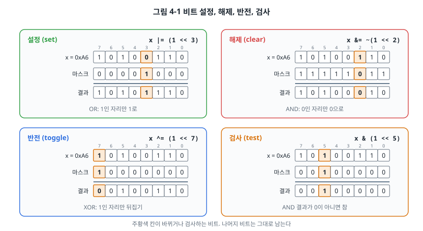
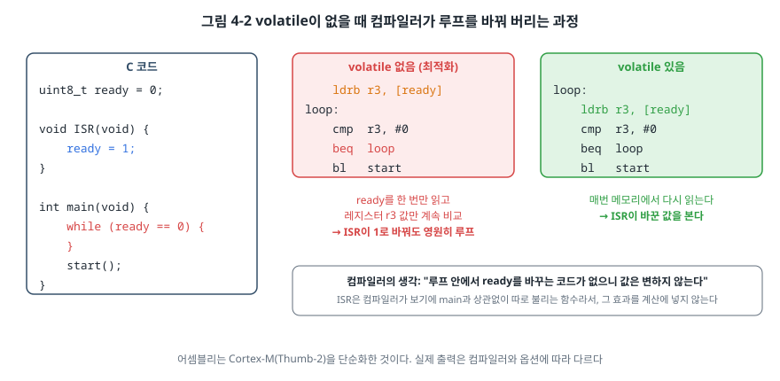
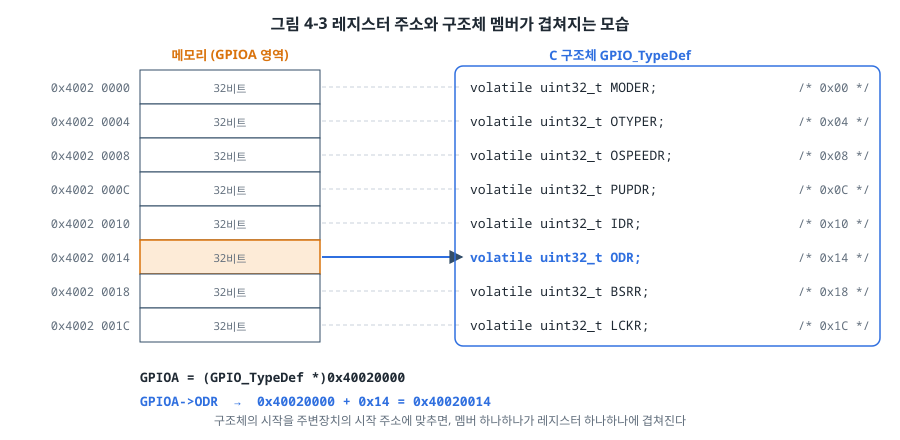

# 4장. 임베디드를 위한 C 언어

## 이 장에서 배우는 것

- 칩마다 크기가 다른 `int` 대신 고정폭 정수를 쓰는 이유
- 비트 하나, 또는 여러 비트로 된 필드를 설정하고 읽는 방법
- `volatile`과 `const`가 임베디드에서 갖는 특별한 의미
- 포인터와 구조체로 레지스터를 다루는 방법
- 정수 승격, 부호 변환, 비트 필드처럼 버그를 숨기는 C의 함정

---

## 4.1 같은 C, 다른 세계

이 책은 독자가 C 언어의 기본 문법(변수, 함수, 배열, 포인터, 구조체)을 안다고 가정합니다. 그런데 PC에서 C를 써 온 개발자가 처음 펌웨어를 쓰면 이상한 일을 겪습니다. PC에서 잘 돌던 코드가 AVR에서는 엉뚱한 값을 내고, 디버그 빌드에서 잘 되던 코드가 최적화를 켜면 멈춥니다.

원인은 대부분 세 가지입니다. 첫째, 자료형의 크기가 칩마다 다릅니다. 둘째, 하드웨어 레지스터는 보통의 변수와 다르게 행동하는데 컴파일러는 그것을 모릅니다. 셋째, PC에서는 드러나지 않던 C 언어의 미묘한 규칙(정수 승격, 부호 변환)이 비트를 다루는 코드에서 집중적으로 터집니다.

이 장에서는 이 세 가지를 차례로 다룹니다. 예제의 상당수는 하드웨어 없이 PC에서 실행할 수 있도록 `code/ch04-c-for-embedded/`에 모아 두었습니다.

## 4.2 고정폭 정수

C 표준은 `int`의 크기를 정확히 정하지 않습니다. "최소 16비트"라고만 할 뿐입니다. 그래서 칩마다 크기가 다릅니다.

| 자료형 | AVR (avr-gcc) | Cortex-M (arm-none-eabi-gcc) | 64비트 PC (Linux) |
| --- | --- | --- | --- |
| `char` | 8비트 | 8비트 | 8비트 |
| `short` | 16비트 | 16비트 | 16비트 |
| `int` | **16비트** | 32비트 | 32비트 |
| `long` | 32비트 | 32비트 | **64비트** |
| `long long` | 64비트 | 64비트 | 64비트 |
| 포인터 | 16비트 | 32비트 | 64비트 |

AVR에서 `int`는 16비트라서 최댓값이 32767입니다. PC에서 `int count = 40000;`은 아무 문제가 없지만 AVR에서는 음수가 됩니다. 반대로 `long`은 PC에서 64비트, Cortex-M에서 32비트입니다.

이런 차이를 피하려고 C99부터 `<stdint.h>` 헤더가 **고정폭 정수(fixed-width integer)** 를 제공합니다.

| 자료형 | 크기 | 범위 | 주로 쓰는 곳 |
| --- | --- | --- | --- |
| `uint8_t` / `int8_t` | 8비트 | 0~255 / −128~127 | 8비트 레지스터, 바이트 버퍼 |
| `uint16_t` / `int16_t` | 16비트 | 0~65535 / −32768~32767 | ADC 값, 16비트 타이머 |
| `uint32_t` / `int32_t` | 32비트 | 0~약 43억 / 약 ±21억 | 32비트 레지스터, 시간(ms) |
| `uint64_t` / `int64_t` | 64비트 | 매우 큼 | 긴 시간 누적, 고유 ID |

이 책의 예제는 하드웨어와 맞닿는 곳에서는 항상 고정폭 정수를 씁니다. 레지스터의 크기가 정해져 있으니 변수의 크기도 정확히 맞춰야 하기 때문입니다. 반복문의 카운터처럼 크기가 중요하지 않은 곳에서는 `int`나 `unsigned`를 써도 됩니다.

> 💡 팁: 8비트 MCU에서는 변수 크기가 곧 속도입니다. AVR은 8비트씩 계산하므로 `uint32_t` 덧셈 하나에 명령 네 개가 필요합니다. 0~255로 충분한 값이라면 `uint8_t`를 쓰세요. 반대로 Cortex-M에서는 32비트가 기본 단위라서 `uint8_t` 변수가 오히려 자릿수 정리 명령을 추가로 만들 수도 있습니다. 크기만 맞으면 되는 지역 변수에는 `uint_fast8_t`처럼 "적어도 8비트이면서 그 칩에서 가장 빠른 형"을 고르는 자료형도 있습니다.

## 4.3 비트 연산과 마스크

레지스터를 다루는 일의 대부분은 **다른 비트는 건드리지 않고 특정 비트만 바꾸는 일**입니다. 1장에서 본 `PORTB |= (1 << PORTB5);`가 그 예입니다. 여기서 `(1 << 5)`처럼 원하는 비트만 1인 값을 **마스크(mask)** 라고 부릅니다.



네 가지 기본 연산을 외워 두세요.

```c
x |=  (1u << n);    /* 설정: n번 비트를 1로 */
x &= ~(1u << n);    /* 해제: n번 비트를 0으로 */
x ^=  (1u << n);    /* 반전: n번 비트를 뒤집기 */
if (x & (1u << n))  /* 검사: n번 비트가 1이면 참 */
```

- **OR(`|`)** 는 마스크에서 1인 자리만 1로 만들고, 0인 자리는 원래 값을 남깁니다.
- **AND(`&`)** 는 마스크에서 0인 자리만 0으로 만듭니다. 그래서 해제할 때는 `~`로 마스크를 뒤집어서, 바꿀 비트만 0이고 나머지는 1인 마스크를 만듭니다.
- **XOR(`^`)** 는 마스크에서 1인 자리만 뒤집습니다.
- **검사**는 AND의 결과가 0인지 아닌지를 봅니다. 결과는 0 또는 `(1u << n)`이지, 0 또는 1이 아니라는 점에 주의하세요. 1로 받고 싶으면 `(x >> n) & 1u`처럼 씁니다.

### 여러 비트로 된 필드

레지스터에는 비트 하나가 아니라 여러 비트가 모여 하나의 값을 이루는 **필드(field)** 도 많습니다. STM32의 GPIOx_MODER는 핀 하나에 2비트씩을 써서 00(입력), 01(출력), 10(대체 기능), 11(아날로그)을 고릅니다. PA5의 모드는 10번과 11번 비트에 있습니다.

필드를 바꿀 때는 반드시 **먼저 지우고, 그다음 씁니다.**

```c
GPIOA->MODER &= ~(3u << (5 * 2));   /* 1) PA5의 두 비트를 00으로 지우고 */
GPIOA->MODER |=  (1u << (5 * 2));   /* 2) 01을 쓴다 */
```

지우는 단계를 빼먹으면 어떻게 될까요? 원래 값이 10(대체 기능)인 핀에 OR로 01을 쓰면 결과는 11(아날로그)이 됩니다. 출력으로 바꾸려던 핀이 아날로그 핀이 되어 버린 것입니다. STM32F411의 MODER 리셋 값은 대부분 0이지만, 디버그 핀 때문에 GPIOA는 `0xA800 0000`(PA13, PA14, PA15가 10), GPIOB는 `0x0000 0280`(PB3, PB4가 10)입니다(RM0383 8.4.1절). 그래서 이 실수는 "다른 핀에서는 되는데 이 핀만 안 된다"는 형태로 나타납니다.

> ⚠️ 주의: PA13(SWDIO)과 PA14(SWCLK)는 디버거가 칩과 통신하는 선입니다. 이 두 핀의 모드를 바꾸면 그 순간 디버거 연결이 끊기고, 다음 업로드도 실패할 수 있습니다. 이때 복구하는 방법은 5장에서 다룹니다.

자주 쓰는 연산은 매크로로 만들어 두면 편합니다. 예제 폴더의 `bits.h`에 정리해 두었습니다.

```c
#define BIT(n)                (1u << (n))
#define SET_BIT(reg, n)       ((reg) |=  BIT(n))
#define CLEAR_BIT(reg, n)     ((reg) &= ~BIT(n))
#define FIELD_MASK(pos, width)        (((1u << (width)) - 1u) << (pos))
#define FIELD_SET(reg, pos, width, v) \
    ((reg) = ((reg) & ~FIELD_MASK(pos, width)) | (((v) << (pos)) & FIELD_MASK(pos, width)))

FIELD_SET(GPIOA->MODER, 5 * 2, 2, 1u);   /* PA5 모드 = 01 */
```

매크로의 인자마다 괄호를 씌운 것은 `SET_BIT(x, a + 1)`처럼 식이 들어와도 연산 순서가 깨지지 않게 하기 위해서입니다.

### `1 << n`의 함정

위의 코드에서 `1` 대신 `1u`를 쓴 데는 이유가 있습니다. C에서 그냥 `1`은 부호 있는 `int`입니다.

- AVR에서 `int`는 16비트이므로 `1 << 15`는 32768이 되어야 하지만 `int`의 범위(최대 32767)를 넘습니다. C 표준에서 이것은 **정의되지 않은 동작(undefined behavior)** 이고, 실제로는 대개 −32768이 나옵니다. `1 << 16`이라면 결과는 0이 되거나 아예 예측할 수 없습니다.
- Cortex-M에서도 `1 << 31`은 같은 이유로 정의되지 않은 동작입니다.

`1u`는 `unsigned int`라서 이 문제가 없습니다. AVR에서 16비트를 넘는 위치(예: 32비트 변수의 20번 비트)를 다룰 때는 `1ul`(32비트 `unsigned long`)을 써야 합니다.

> ⚠️ 주의: AVR 코드에서 `uint32_t flags = (1 << 20);`은 컴파일러 경고와 함께 0이 될 수 있습니다. 왼쪽 변수가 32비트여도 오른쪽 계산은 `int`(16비트)로 먼저 이루어지기 때문입니다. `(1ul << 20)`으로 써야 합니다.

## 4.4 `volatile`: 컴파일러에게 "이 값은 저절로 바뀐다"고 알리기

다음 코드는 인터럽트 서비스 루틴(ISR, 7장)이 `ready`를 1로 바꿀 때까지 기다립니다.

```c
uint8_t ready = 0;

void ISR(void) {
    ready = 1;
}

int main(void) {
    while (ready == 0) {
    }
    start();
}
```

디버그 빌드에서는 잘 동작합니다. 그런데 최적화를 켜면(`-O2`, `-Os`) 영원히 멈춥니다.



컴파일러는 `main`을 최적화하면서 이렇게 생각합니다. "루프 안에서 `ready`를 바꾸는 코드가 없다. 그러니 `ready`를 매번 메모리에서 읽을 필요 없이 한 번만 읽으면 된다." ISR은 하드웨어가 아무 때나 끼어들어 실행하는 함수인데, 컴파일러는 그 사실을 모릅니다.

예제 폴더에서 `make asm`을 실행하면 이 일이 실제로 일어나는 것을 볼 수 있습니다. 다음은 64비트 Arm 리눅스(라즈베리 파이)의 gcc 14로 `-O2` 빌드한 결과입니다.

```
; volatile 없음                    ; volatile 있음
wait_ready:                        wait_ready:
    adrp  x0, ready                    adrp  x1, ready
    ldrb  w0, [x0, ...]  ; 한 번 읽기     add   x1, x1, ...
    cbz   w0, .L5                  .L4:
    ret                                ldrb  w0, [x1]       ; 매번 읽기
.L5:                                   tst   w0, 255
    b     .L5            ; 무한 루프    beq   .L4
                                       ret
```

왼쪽은 `ready`를 한 번 읽어서 0이면 `.L5`로 뛰어가 자기 자신으로 영원히 점프합니다. 오른쪽은 루프를 돌 때마다 메모리에서 `ready`를 다시 읽습니다.

**`volatile`** 은 "이 변수는 프로그램이 모르는 사이에 바뀔 수 있으니, 접근할 때마다 실제로 메모리를 읽고 쓰라"고 컴파일러에게 알리는 한정자입니다. 다음 세 가지 경우에 반드시 씁니다.

1. **하드웨어 레지스터**: 상태 레지스터의 값은 하드웨어가 바꿉니다. 또 레지스터에 쓰는 행위 자체가 하드웨어를 움직이므로, 같은 값을 두 번 쓰는 코드도 지워져서는 안 됩니다. avr-libc와 CMSIS의 레지스터 정의에는 모두 `volatile`이 붙어 있습니다.
2. **ISR과 메인 코드가 함께 쓰는 변수**: 위의 `ready`처럼.
3. **RTOS에서 여러 태스크가 함께 쓰는 변수**: 다만 이 경우에는 `volatile`만으로 부족하고 27장의 동기화 기법이 필요합니다.

> ⚠️ 주의: `volatile`은 "매번 메모리에 접근하라"는 뜻일 뿐, 접근이 **쪼개지지 않는다(원자적이다)** 는 보장은 하지 않습니다. AVR에서 `volatile uint16_t` 변수를 읽는 일은 8비트 읽기 두 번으로 나뉩니다. 첫 바이트를 읽은 직후 ISR이 끼어들어 값을 바꾸면, 위아래 바이트가 서로 다른 시점의 값인 엉뚱한 숫자를 읽게 됩니다. 이 문제와 해결 방법은 7장에서 다룹니다.

## 4.5 `const`: 읽기 전용, 그리고 Flash에 두기

`const`는 "이 값을 바꾸지 않겠다"는 약속입니다. PC에서는 주로 실수를 막는 용도지만, 임베디드에서는 **메모리 위치**를 바꾸는 효과가 있습니다.

Cortex-M에서 전역 `const` 변수는 Flash의 `.rodata` 영역에 놓입니다. SRAM을 차지하지 않으므로, 큰 표(사인 테이블, 폰트, 보정값)는 `const`로 선언하는 것이 좋습니다.

```c
static const uint16_t sine_table[256] = { 2048, 2098, 2148, /* ... */ };   /* Flash에 놓인다 */
```

AVR은 3장에서 본 하버드 구조 때문에 사정이 다릅니다. avr-gcc는 `const` 변수도 SRAM에 복사해 둡니다. Flash에 그대로 두려면 `PROGMEM`을 붙이고, 읽을 때도 전용 함수를 써야 합니다.

```c
#include <avr/pgmspace.h>

static const uint16_t sine_table[256] PROGMEM = { 2048, 2098, 2148, /* ... */ };

uint16_t v = pgm_read_word(&sine_table[i]);   /* Flash에서 읽기 (LPM 명령) */
```

아두이노에서 `Serial.print(F("hello"))`처럼 쓰는 `F()` 매크로도 같은 일을 합니다. 문자열을 SRAM에 복사하지 않고 Flash에서 바로 읽게 합니다.

> 🔍 깊이 보기: 최신 avr-gcc는 `__flash`라는 이름 공간 한정자를 지원해서 `const __flash uint16_t table[] = {...};`처럼 쓰면 `pgm_read_word()` 없이 보통 배열처럼 읽을 수 있습니다. 다만 C++(아두이노 스케치)에서는 쓸 수 없어서, 이 책은 양쪽에서 모두 쓸 수 있는 `PROGMEM` 방식을 씁니다.

`const`와 `volatile`은 함께 쓸 수 있습니다. 어색해 보이지만 정확한 표현입니다. 입력 데이터 레지스터(GPIOx_IDR)는 프로그램이 쓰면 안 되지만(`const`), 하드웨어가 값을 바꿉니다(`volatile`).

```c
#define GPIOA_IDR (*(const volatile uint32_t *)0x40020010u)
```

## 4.6 포인터로 메모리 주소 다루기

1장에서 이런 코드를 보았습니다.

```c
#define GPIOA_ODR (*(volatile uint32_t *)0x40020014u)
```

안쪽부터 풀어 보겠습니다.

1. `0x40020014u`: 그냥 숫자입니다.
2. `(volatile uint32_t *)0x40020014u`: 이 숫자를 "32비트 `volatile` 정수가 있는 곳의 주소"로 바꿉니다(형 변환).
3. `*(...)`: 그 주소에 있는 값 자체를 가리킵니다(역참조).

그래서 `GPIOA_ODR = 0x20;`은 "주소 `0x40020014`에 32비트 값 `0x20`을 써라"가 됩니다. 정수를 포인터로 바꾸는 일은 C 표준에서 "구현에 따라 정의된 동작"이지만, 임베디드 컴파일러들은 모두 숫자를 그대로 주소로 쓰도록 정해 두었습니다.

포인터의 자료형은 **접근하는 크기**를 정합니다. 같은 주소라도 `uint8_t *`로 쓰면 1바이트, `uint32_t *`로 쓰면 4바이트를 씁니다. 주변장치 중에는 정해진 크기로만 접근해야 하는 레지스터가 있습니다. STM32의 GPIO 레지스터는 32비트, 16비트, 8비트 접근을 모두 허용합니다(RM0383 8.4절 첫머리). 그러나 32비트 접근만 허용하는 주변장치(예: ADC, RM0383 11.12절 첫머리)에 다른 크기로 접근하면 값이 잘못 쓰이거나 버스 오류가 날 수 있습니다. RM0383의 각 주변장치 레지스터 절 첫머리에 허용되는 접근 크기가 적혀 있습니다.

주소를 정수로 다뤄야 할 때(예: 주소를 계산하거나 출력할 때)는 `uintptr_t`를 씁니다. 포인터를 담을 수 있을 만큼 큰 정수형으로, AVR에서는 16비트, Cortex-M에서는 32비트입니다.

## 4.7 구조체로 레지스터 맵 표현하기

3장에서 본 것처럼, 주변장치 하나의 레지스터들은 정해진 간격으로 이어져 있습니다. 이 배치를 구조체로 옮겨 적으면 코드가 훨씬 읽기 좋아집니다.



```c
typedef struct {
    volatile uint32_t MODER;     /* 0x00 */
    volatile uint32_t OTYPER;    /* 0x04 */
    volatile uint32_t OSPEEDR;   /* 0x08 */
    volatile uint32_t PUPDR;     /* 0x0C */
    volatile uint32_t IDR;       /* 0x10 */
    volatile uint32_t ODR;       /* 0x14 */
    volatile uint32_t BSRR;      /* 0x18 */
    volatile uint32_t LCKR;      /* 0x1C */
    volatile uint32_t AFR[2];    /* 0x20, 0x24 */
} GPIO_TypeDef;

#define GPIOA ((GPIO_TypeDef *)0x40020000u)

GPIOA->ODR |= (1u << 5);
```

구조체 포인터를 주변장치의 시작 주소에 맞추면, 멤버 하나하나가 레지스터 하나하나에 정확히 겹쳐집니다. CMSIS 디바이스 헤더가 바로 이 방식으로 모든 주변장치를 정의합니다.

이 방식이 성립하려면 구조체 멤버 사이에 컴파일러가 빈 공간(패딩)을 넣지 않아야 합니다. 모든 멤버가 같은 크기(`uint32_t`)이고 4바이트 경계에 놓이므로 실제로 패딩은 생기지 않습니다. 그래도 레지스터 사이에 비어 있는 주소가 있으면 직접 `uint32_t RESERVED[2];`처럼 자리를 채워 넣어야 합니다. 3장의 `RCC_TypeDef`에서 이렇게 했습니다.

실수를 막는 좋은 방법은 C11의 `_Static_assert`로 오프셋을 **컴파일할 때** 확인하는 것입니다. 데이터시트와 다르면 빌드가 실패합니다.

```c
#include <stddef.h>

_Static_assert(offsetof(GPIO_TypeDef, ODR) == 0x14, "ODR offset");
_Static_assert(sizeof(GPIO_TypeDef) == 0x28, "GPIO size");
```

> 🔧 ATmega128에서는: AVR의 레지스터는 주변장치별로 연속해 있지 않고 흩어져 있는 경우가 많아서, avr-libc는 구조체 대신 레지스터마다 매크로(`PORTB`, `DDRB`, `PINB`)를 정의합니다. ATmega128도 같은 방식입니다. 다만 포트 F의 `DDRF`, `PORTF`와 포트 G의 레지스터 전체는 확장 I/O 영역(데이터 주소 0x60 이상)에 있어서 `SBI`, `CBI` 같은 비트 명령을 쓸 수 없고, 컴파일러가 읽기-수정-쓰기 명령 세 개로 바꿉니다. 7장에서 이 차이가 인터럽트와 만날 때 생기는 문제를 다룹니다.

## 4.8 정수 승격과 부호의 함정

C에는 계산하기 전에 작은 정수형을 `int`로 바꾸는 **정수 승격(integer promotion)** 규칙이 있습니다. `uint8_t`, `int8_t`, `uint16_t`(int가 32비트인 칩에서)는 계산에 쓰일 때 모두 `int`로 바뀝니다. 대부분은 눈치채지 못하고 지나가지만, 비트 연산에서는 자주 문제가 됩니다. 예제 폴더에서 `make run`을 실행해 결과를 직접 확인해 보세요.

**함정 1: `~`의 결과가 커진다**

```c
uint8_t mask = 0x0F;
if (~mask == 0xF0) {    /* 거짓! */
}
```

`mask`는 `int`로 승격되어 `0x0000000F`가 되고, `~`를 적용하면 `0xFFFFFFF0`이 됩니다. 이것은 `0xF0`과 다릅니다. 8비트로 비교하고 싶으면 `(uint8_t)~mask == 0xF0`처럼 명시적으로 잘라야 합니다.

**함정 2: 부호 있는 수와 부호 없는 수의 비교**

```c
int minus_one = -1;
unsigned int one = 1;
if (minus_one < one) {  /* 거짓! */
}
```

부호 있는 수와 부호 없는 수를 비교하면 부호 있는 쪽이 부호 없는 수로 바뀝니다. −1은 `0xFFFFFFFF`, 즉 약 43억이 되어 1보다 큽니다. 함수의 반환값이 오류일 때 −1인데 길이를 `unsigned`로 받아 비교하는 코드에서 자주 일어납니다.

**함정 3: 오버플로가 언제 일어나는가**

```c
uint8_t a = 200, b = 100;
uint8_t sum8 = a + b;   /* 44 */
int     sum  = a + b;   /* 300 */
```

`a + b` 자체는 `int`로 계산되어 300입니다. 이것을 `uint8_t`에 담는 순간 잘려서 300 − 256 = 44가 됩니다. 계산 중간에는 넘치지 않다가 저장할 때 넘친다는 점을 기억하세요.

두 함정 모두 컴파일러 경고 옵션 `-Wall -Wextra`를 켜면 경고로 알려 줍니다. 예제를 빌드하면 실제로 두 줄에서 `-Wsign-compare` 경고가 나옵니다. **경고를 끄지 말고 하나씩 이해하고 고치는 습관**이 이런 버그를 막는 가장 싼 방법입니다. 35장에서 MISRA C 같은 코딩 표준이 이 문제를 어떻게 규칙으로 막는지 다룹니다.

## 4.9 비트 필드의 위험

C에는 구조체 멤버의 크기를 비트 단위로 정하는 **비트 필드(bit-field)** 문법이 있습니다. 레지스터 표현에 딱 맞아 보입니다.

```c
typedef struct {
    uint32_t mode0 : 2;
    uint32_t mode1 : 2;
    /* ... */
} MODER_Bits;
```

그런데 하드웨어 레지스터에는 비트 필드를 쓰지 않는 것이 좋습니다. 이유는 다음과 같습니다.

- **비트의 배치 순서가 표준으로 정해져 있지 않습니다.** 첫 멤버가 0번 비트부터 놓일지, 31번 비트부터 놓일지는 컴파일러가 정합니다. 같은 코드가 다른 컴파일러에서 다르게 동작할 수 있습니다.
- **접근 크기를 제어할 수 없습니다.** 2비트 필드 하나를 쓰려고 컴파일러가 8비트, 16비트, 32비트 중 어느 크기로 읽고 쓸지 알 수 없습니다. 접근 크기가 정해진 레지스터에서는 문제가 됩니다.
- **읽기-수정-쓰기가 숨겨집니다.** 필드 하나를 쓰는 코드가 실제로는 레지스터 전체를 읽고, 고치고, 다시 씁니다. 읽으면 지워지는 상태 플래그가 섞인 레지스터에서는 의도하지 않은 플래그가 지워질 수 있습니다.

그래서 CMSIS와 이 책은 비트 필드 대신 4.3절의 마스크 방식을 씁니다. 비트 필드는 통신 패킷처럼 같은 컴파일러로만 다루는 메모리 안의 자료 구조에서, 그 한계를 알고 쓸 때만 고려하세요.

## 4.10 실습: PC에서 함정 확인하기

`code/ch04-c-for-embedded/`는 하드웨어 없이 PC에서 실행하는 예제입니다. 리눅스, macOS, 윈도우의 WSL에서 `gcc`와 `make`만 있으면 됩니다.

```bash
cd code/ch04-c-for-embedded
make run
```

실행 결과는 다음과 같습니다.

```
[구조체] fake_gpio[5] = 0x00000020 (ODR은 0x14 / 4 = 5번째 워드)
[비트] set 3    : 0xAE
[비트] clear 2  : 0xAA
[비트] toggle 7 : 0x2A
[비트] read 5   : 1
[비트] MODER    : 0xFFFFF7FF
[승격] uint8_t 합 = 44, int 합 = 300
[승격] ~mask == 0xF0 : 거짓! (~mask = 0xFFFFFFF0, int로 승격된 뒤 반전)
[승격] (uint8_t)~mask == 0xF0 : 참
[부호] -1 < 1u : 거짓! (-1이 unsigned로 바뀌어 0xFFFFFFFF)
[크기] 16비트 int에서 1 << 15 = -32768 (AVR에서는 이렇게 된다)
[크기] 이 PC에서 sizeof(int) = 4, AVR은 2, Cortex-M은 4
```

첫 줄은 PC 메모리의 배열 위에 `GPIO_TypeDef` 구조체를 겹쳐 놓고 `ODR`에 쓴 결과입니다. 0x14 바이트 떨어진 5번째 워드에 값이 들어갔습니다. 실제 하드웨어 없이도 레지스터 접근 코드의 논리를 확인할 수 있다는 점이 중요합니다. 이 아이디어는 31장의 호스트 기반 단위 테스트로 이어집니다.

이어서 `make asm`을 실행하고 `volatile_no.s`와 `volatile_yes.s`에서 `wait_ready` 함수를 비교해 보세요. 4.4절의 어셈블리가 여러분의 PC에서도 나타나는지 확인합니다. Cortex-M용 어셈블리를 보고 싶다면 5장에서 툴체인을 설치한 뒤 `make asm CC=arm-none-eabi-gcc`처럼 컴파일러를 바꿔 실행합니다(옵션은 `volatile_demo.c`의 주석 참고).

---

## 정리

- `int`와 `long`의 크기는 칩마다 다르므로, 하드웨어와 맞닿는 곳에서는 `uint8_t`, `uint32_t` 같은 고정폭 정수를 씁니다.
- 비트는 `|=`로 설정, `&= ~`로 해제, `^=`로 반전, `&`로 검사합니다. 여러 비트로 된 필드는 먼저 지우고 씁니다.
- 시프트할 1에는 `1u`(AVR에서 16비트를 넘으면 `1ul`)를 써서 부호 있는 정수의 오버플로를 피합니다.
- 하드웨어 레지스터와 ISR이 바꾸는 변수에는 `volatile`을 붙입니다. 다만 `volatile`은 원자성을 보장하지 않습니다.
- Cortex-M에서 `const` 전역 변수는 Flash에 놓이지만, AVR에서는 `PROGMEM`이 필요합니다.
- 레지스터 맵은 구조체로 표현하고, `_Static_assert`로 오프셋을 검사합니다. 비트 필드는 레지스터에 쓰지 않습니다.
- 정수 승격과 부호 변환의 함정은 `-Wall -Wextra` 경고로 대부분 잡을 수 있습니다.

## 연습 문제

1. AVR에서 다음 코드의 결과를 예측하고, 올바르게 고치세요.
   ```c
   uint32_t big = 1000 * 100;
   uint32_t bit20 = (1 << 20);
   ```
2. 8비트 레지스터 `REG`의 4번~6번 비트(3비트 필드)에 값 5를 쓰고, 나머지 비트는 그대로 두는 코드를 마스크를 써서 작성하세요. 그다음 이 필드의 값을 읽는 코드도 작성하세요.
3. 다음 코드는 디버그 빌드에서는 약 1초를 기다리지만 `-O2`로 빌드하면 거의 기다리지 않습니다. 이유를 설명하고 고치세요.
   ```c
   void delay(void) {
       for (uint32_t i = 0; i < 1000000; i++) {
       }
   }
   ```
4. STM32F411의 USART 레지스터는 SR(0x00), DR(0x04), BRR(0x08), CR1(0x0C), CR2(0x10), CR3(0x14), GTPR(0x18)입니다. 이 배치를 `USART_TypeDef` 구조체로 정의하고, `_Static_assert`로 CR1과 GTPR의 오프셋을 검사하는 코드를 작성하세요.
5. 다음 함수는 버퍼에 남은 공간이 있는지 검사합니다. `used`가 `size`보다 클 때 어떤 일이 일어나는지 설명하고, 안전하게 고치세요.
   ```c
   int has_space(uint16_t used, uint16_t size) {
       return (size - used) > 0;
   }
   ```
   (힌트: `uint16_t`가 `int`로 승격되는 칩과 그렇지 않은 칩에서 결과가 같을까요?)
6. (실습) 예제의 `main.c`에 `uint16_t`끼리의 곱셈 `uint16_t a = 300, b = 300; uint32_t r = a * b;`를 추가하고 PC에서 결과를 확인하세요. 같은 코드가 AVR에서는 어떤 결과를 낼지 정수 승격 규칙으로 예측해 보세요.
