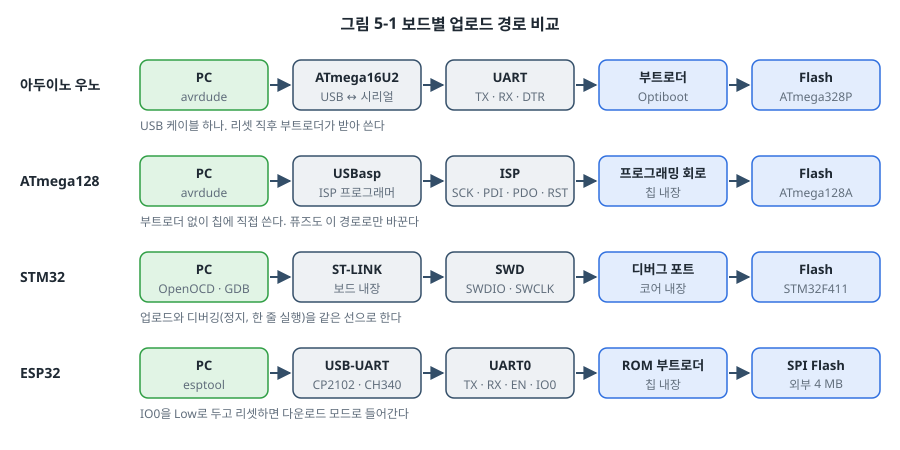
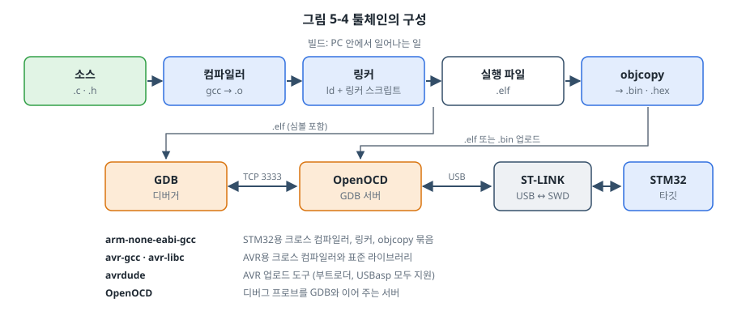
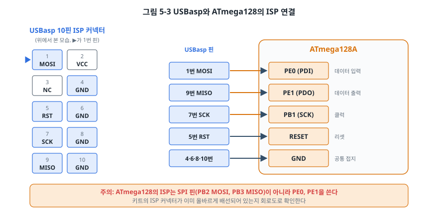
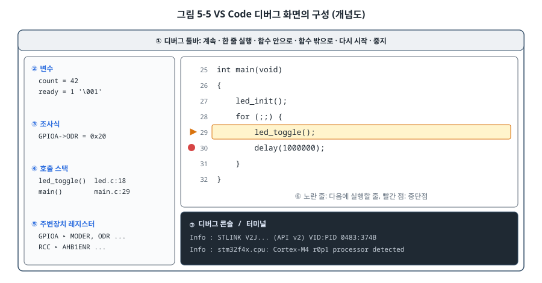

# 5장. 개발 환경 구축: 아두이노에서 레지스터까지

## 이 장에서 배우는 것

- 툴체인을 이루는 도구들(컴파일러, 링커, objcopy, 업로드 도구, 디버거)의 역할
- 아두이노 IDE가 [업로드] 버튼 뒤에서 하는 일과, 같은 일을 명령줄로 하는 방법
- USBasp로 ATmega128에 프로그램과 퓨즈를 쓰는 방법
- arm-none-eabi-gcc, OpenOCD, GDB로 STM32를 빌드하고 디버깅하는 방법
- ESP32를 아두이노 IDE와 ESP-IDF로 시작하는 방법, VS Code로 디버깅 환경을 꾸미는 방법

---

## 5.1 이 장의 목표

1장에서 펌웨어 개발은 "작성 → 크로스 컴파일 → 플래싱 → 디버깅"의 반복이라고 했습니다. 이 장에서는 네 보드 모두에서 이 반복을 직접 돌려 봅니다. 목표는 각 보드에서 LED 하나를 깜빡이는 것입니다. 단순한 목표지만, 이것이 되면 이후의 모든 장을 따라올 준비가 끝납니다.



그림 5-1처럼 네 보드는 프로그램을 받아들이는 경로가 모두 다릅니다. 우노는 USB-시리얼 변환 칩과 부트로더를 거치고, ATmega128은 ISP 프로그래머로 칩에 직접 쓰며, STM32는 디버그 프로브(ST-LINK)를, ESP32는 칩 안의 ROM 부트로더를 씁니다. 이 차이를 알면 업로드가 실패했을 때 어디를 봐야 할지 알 수 있습니다.

이 장의 예제는 `code/ch05-blink/`에 보드별로 나누어 두었습니다. 도구의 설치 방법은 운영체제와 버전에 따라 자주 바뀌므로, 여기서는 핵심 명령과 확인 방법을 중심으로 설명하고 세부 사항은 각 도구의 공식 문서를 함께 참고하도록 안내합니다.

> 💡 팁: 이 책의 명령줄 예제는 리눅스(우분투, 데비안)를 기준으로 합니다. 윈도우에서는 WSL2(Windows Subsystem for Linux)를 쓰면 같은 명령을 그대로 쓸 수 있습니다. 다만 WSL2에서 USB 장치(보드)를 쓰려면 usbipd-win으로 장치를 WSL에 연결해 주어야 합니다. macOS는 Homebrew로 대부분의 도구를 설치할 수 있습니다.

### 이 책이 기준으로 삼는 도구 버전

| 도구 | 버전 | 비고 |
| --- | --- | --- |
| 아두이노 IDE | 2.3 이상 | [확인 필요: 출간 시점 버전] |
| avr-gcc | 7.3 이상 | 아두이노 IDE에 포함된 버전과 같음 |
| Arm GNU Toolchain | 13.2 이상 | `arm-none-eabi-gcc` |
| OpenOCD | 0.12 이상 | |
| ESP-IDF | 5.x | [확인 필요: 출간 시점 버전] |
| 아두이노 ESP32 코어 | 3.x | [확인 필요: 출간 시점 버전] |

## 5.2 툴체인이란

**툴체인(toolchain)** 은 소스 코드를 타깃 보드에서 실행되는 바이너리로 바꾸고, 보드에 올리고, 디버깅하는 데 쓰는 도구들의 묶음입니다.



- **컴파일러(compiler)**: C 소스 파일 하나를 기계어가 담긴 목적 파일(`.o`)로 바꿉니다. 아직 다른 파일의 함수나 변수가 어디에 있는지는 모릅니다.
- **링커(linker)**: 여러 목적 파일과 라이브러리를 하나로 합치고, 각 함수와 변수에 실제 주소를 정해 줍니다. 어느 주소에 무엇을 둘지는 **링커 스크립트**가 알려 줍니다. 3장에서 본 Flash `0x0800 0000`, SRAM `0x2000 0000` 같은 정보가 여기에 들어 있습니다(21장).
- **실행 파일(`.elf`)**: 링커의 결과물입니다. 기계어뿐 아니라 함수 이름, 변수 이름, 소스 줄 번호 같은 디버그 정보(심볼)도 담겨 있습니다.
- **objcopy**: `.elf`에서 기계어만 뽑아 `.bin`(순수한 바이트 덩어리)이나 `.hex`(주소가 함께 적힌 텍스트 형식)로 바꿉니다. 업로드 도구에 따라 필요한 형식이 다릅니다.
- **업로드 도구**: AVR은 `avrdude`, STM32는 `OpenOCD`(또는 STM32CubeProgrammer), ESP32는 `esptool`을 씁니다.
- **디버거**: `GDB`가 `.elf`의 심볼 정보를 이용해 "12번째 줄에서 멈춰라", "변수 `count`의 값을 보여 달라" 같은 명령을 기계어 수준의 동작으로 바꿉니다. GDB는 보드와 직접 이야기하지 못하므로, OpenOCD가 중간에서 GDB 서버 역할을 하며 디버그 프로브(ST-LINK)를 움직입니다.

AVR용 컴파일러는 `avr-gcc`, Cortex-M용은 `arm-none-eabi-gcc`입니다. 이름 앞의 `arm-none-eabi-`는 "Arm용, 운영체제 없음(none), 임베디드 ABI"라는 뜻입니다. 둘 다 PC용 `gcc`와 같은 GCC를 바탕으로 만든 **크로스 컴파일러**라서 옵션 대부분이 같습니다.

## 5.3 아두이노 우노: IDE에서 시작하기

### 첫 업로드

아두이노 IDE를 설치하고 우노를 USB로 연결합니다.

1. [도구] → [보드]에서 "Arduino Uno"를 고릅니다.
2. [도구] → [포트]에서 우노가 연결된 포트를 고릅니다. 리눅스는 `/dev/ttyACM0`, 윈도우는 `COM3` 같은 이름이고, macOS는 `/dev/cu.usbmodem...`입니다.
3. [파일] → [예제] → [01.Basics] → [Blink]를 열고 [업로드] 버튼을 누릅니다.

보드의 L 표시 LED가 1초 간격으로 깜빡이면 성공입니다.

> ⚠️ 주의: 리눅스에서 포트가 보이지 않거나 "Permission denied"가 나오면 사용자 계정이 시리얼 포트 그룹에 속해 있지 않은 것입니다. `sudo usermod -aG dialout $USER`를 실행하고 다시 로그인하세요. 정품이 아닌 호환 보드는 USB-시리얼 칩으로 CH340을 쓰는 경우가 많아서, 윈도우와 macOS에서 별도의 드라이버가 필요할 수 있습니다.

### [업로드] 버튼 뒤에서 일어나는 일

![그림 5-2 아두이노 IDE가 [업로드] 버튼 뒤에서 하는 일](../figures/ch05/fig5-2-arduino-build.svg)

아두이노 IDE는 친절한 껍데기일 뿐, 안에서는 이 장에서 설명하는 도구들이 그대로 돌아갑니다.

1. **전처리**: 스케치(`.ino`)에 `#include <Arduino.h>`를 붙이고, 함수 원형을 자동으로 만들어 `.cpp` 파일로 바꿉니다. 그래서 스케치에서는 함수를 쓰기 전에 선언하지 않아도 됩니다.
2. **컴파일**: `avr-g++`로 스케치와 아두이노 코어(`digitalWrite`, `Serial` 등이 들어 있는 라이브러리)를 컴파일합니다. 스케치에는 `main()`이 없지만, 코어 안의 `main()`이 `setup()`을 한 번, `loop()`를 무한히 호출합니다.
3. **링크와 변환**: 링크한 `.elf`를 `avr-objcopy`로 `.hex`로 바꿉니다.
4. **업로드**: `avrdude`가 보드를 리셋하고, 리셋 직후 잠깐 실행되는 부트로더(Optiboot)에게 115200 bps로 `.hex`를 보냅니다.

IDE의 [파일] → [기본 설정]에서 "다음 동안 자세한 출력 표시"의 컴파일과 업로드를 모두 켜면, 실제로 실행되는 명령과 옵션이 전부 출력됩니다. 한 번은 꼭 켜고 읽어 보세요. "IDE가 마법을 부린다"는 느낌이 사라집니다.

> 🔍 깊이 보기: 우노의 USB 커넥터 옆에는 ATmega16U2라는 또 하나의 AVR이 있습니다. 이 칩이 USB를 시리얼(UART)로 바꿔 ATmega328P에 전달합니다. PC에서 포트를 열면 이 칩이 DTR 신호를 이용해 ATmega328P를 리셋하고, 그 덕분에 부트로더가 업로드를 받을 준비를 합니다. 시리얼 모니터를 열 때마다 우노가 리셋되는 이유도 이것입니다.

## 5.4 아두이노 우노: 명령줄로 빌드하고 올리기

같은 일을 이번에는 IDE 없이 해 보겠습니다. 이 책의 AVR 예제는 모두 이 방식으로 빌드합니다.

### 설치

| 운영체제 | 설치 명령 |
| --- | --- |
| 우분투, 데비안 | `sudo apt install gcc-avr avr-libc avrdude make` |
| macOS | `brew tap osx-cross/avr` 후 `brew install avr-gcc avrdude` |
| 윈도우 | WSL2를 쓰거나, 아두이노 IDE에 포함된 도구의 경로를 PATH에 추가 |

설치가 끝나면 버전을 확인합니다.

```bash
avr-gcc --version
avrdude -?
```

### 빌드와 업로드

`code/ch05-blink/avr/main.c`는 레지스터로 LED를 반전시키고 `_delay_ms()`로 0.5초를 기다립니다.

```c
#include <avr/io.h>
#include <util/delay.h>

int main(void)
{
    DDRB |= (1 << PB5);

    for (;;) {
        PORTB ^= (1 << PB5);
        _delay_ms(500);
    }
}
```

`_delay_ms()`는 avr-libc가 제공하는 함수로, 컴파일할 때 `F_CPU`(CPU 클럭 주파수) 값을 보고 필요한 반복 횟수를 계산합니다. 그래서 반드시 `-DF_CPU=16000000UL`처럼 클럭을 알려 주고, 최적화를 켜야(`-Os`) 정확한 시간이 나옵니다. 이 값이 실제 클럭과 다르면 지연 시간도 그만큼 틀어집니다.

Makefile이 실행하는 명령을 하나씩 직접 쳐 보면 다음과 같습니다.

```bash
# 1) 컴파일과 링크
avr-gcc -mmcu=atmega328p -DF_CPU=16000000UL -std=c11 -Os -Wall -Wextra -o blink.elf main.c

# 2) .hex로 변환 (EEPROM 영역은 빼고)
avr-objcopy -O ihex -R .eeprom blink.elf blink.hex

# 3) 크기 확인
avr-size --format=avr --mcu=atmega328p blink.elf

# 4) 부트로더로 업로드
avrdude -c arduino -p m328p -P /dev/ttyACM0 -b 115200 -U flash:w:blink.hex:i
```

`avrdude`의 옵션은 "누구를 통해(`-c arduino`: 아두이노 부트로더 방식), 어떤 칩에(`-p m328p`), 어느 포트로(`-P`), 무엇을 할지(`-U flash:w:파일:i` = Flash에 Intel hex 파일을 쓰기)"를 차례로 적은 것입니다.

`avr-size`의 출력을 보면 이 프로그램이 Flash와 SRAM을 얼마나 쓰는지 알 수 있습니다. 같은 동작을 하는 아두이노 Blink 스케치와 비교해 보세요. 아두이노 버전은 타이머 초기화와 `digitalWrite`의 핀 번호 변환 표 때문에 크기가 훨씬 큽니다. 어느 쪽이 나쁘다는 뜻이 아니라, 편리함에는 비용이 따른다는 뜻입니다.

> 💡 팁: `make disasm`을 실행하면 `blink.lst`에 C 코드와 그에 해당하는 AVR 어셈블리가 함께 나옵니다. `PORTB ^= (1 << PB5);` 한 줄이 어떤 명령 몇 개로 바뀌는지 찾아보세요. 6장에서 이것을 명령 하나로 줄이는 방법을 배웁니다.

## 5.5 ATmega128: ISP 프로그래머로 직접 쓰기

ATmega128 교육용 키트에는 대개 부트로더가 없습니다. 대신 **ISP(In-System Programming)** 라는 방법으로 칩의 Flash에 직접 씁니다. 가장 흔히 쓰는 ISP 프로그래머는 값싼 오픈소스 하드웨어인 **USBasp**입니다.



USBasp의 10핀 커넥터를 키트의 ISP 커넥터에 꽂습니다. 대부분의 키트는 같은 핀 배치의 10핀 커넥터를 갖추고 있지만, 6핀 커넥터를 쓰는 키트도 있으니 키트의 회로도를 확인하세요.

> 🔧 ATmega128에서는: 다른 AVR(ATmega328P 등)은 ISP에 SPI 핀(MOSI, MISO, SCK)을 쓰지만, ATmega128은 **PE0(PDI)과 PE1(PDO)** 를 데이터 선으로 씁니다. SCK만 PB1로 SPI와 같습니다(ATmega128A 데이터시트, Memory Programming 장의 SPI Serial Programming 절). 키트를 직접 만들거나 브레드보드로 연결할 때 PB2, PB3에 연결하면 "칩을 찾을 수 없다"는 오류만 보게 됩니다. 또 PE0, PE1은 UART0의 RXD0, TXD0이기도 해서, 이 핀에 다른 장치를 연결해 두면 ISP가 방해받을 수 있습니다.

### 업로드

```bash
cd code/ch05-blink/avr
make flash BOARD=m128
```

실제로 실행되는 명령은 다음과 같습니다.

```bash
avrdude -c usbasp -p m128 -P usb -B 10 -U flash:w:blink.hex:i
```

`-B 10`은 ISP 통신 속도를 낮추는 옵션입니다. ISP 클럭은 칩 클럭의 1/4보다 느려야 하는데, 공장에서 출하된 ATmega128은 내부 RC 1 MHz로 동작하므로 기본 속도로는 통신이 실패할 수 있습니다. 퓨즈를 바꿔 16 MHz로 동작하게 만든 뒤에는 이 옵션을 빼도 됩니다. USBasp에 따라 속도를 낮추는 점퍼(JP3 등)가 있는 제품도 있습니다.

> ⚠️ 주의: 윈도우에서 USBasp를 쓰려면 libusb 드라이버가 필요합니다. Zadig 같은 도구로 USBasp 장치에 libusb-win32 또는 WinUSB 드라이버를 설치합니다. 리눅스에서는 udev 규칙을 추가하지 않으면 `sudo` 없이 장치에 접근할 수 없습니다.

### 퓨즈 읽고 쓰기

3장에서 AVR의 클럭 소스는 퓨즈로 정한다고 했습니다. ISP 프로그래머가 있으면 퓨즈를 읽고 쓸 수 있습니다. 먼저 **읽기**부터 합니다.

```bash
make fuses BOARD=m128
# 실제 명령: avrdude -c usbasp -p m128 -B 10 -U lfuse:r:-:h -U hfuse:r:-:h -U efuse:r:-:h
```

공장에서 출하된 ATmega128A의 퓨즈에는 처음 쓰는 사람을 당황하게 하는 설정이 세 가지 있습니다(ATmega128A 데이터시트, Memory Programming 장의 Fuse Bits 절).

| 퓨즈 | 공장 출하 상태 | 영향 |
| --- | --- | --- |
| CKSEL, SUT | 내부 RC 1 MHz | 키트에 16 MHz 크리스털이 있어도 1 MHz로 동작한다 |
| JTAGEN | 켜짐(programmed) | PF4~PF7이 JTAG 핀으로 쓰여서 일반 입출력으로 쓸 수 없다 |
| M103C | 켜짐(programmed) | 구형 ATmega103 호환 모드. 일부 레지스터와 메모리 배치가 달라진다 |

16 MHz 외부 크리스털을 쓰고, JTAG와 ATmega103 호환 모드를 끄는 설정의 예는 다음과 같습니다.

```bash
avrdude -c usbasp -p m128 -B 10 -U lfuse:w:0xFF:m -U hfuse:w:0xC9:m -U efuse:w:0xFF:m
```

[확인 필요: 퓨즈 값은 키트의 크리스털과 데이터시트의 퓨즈 표로 다시 계산해 확인할 것]

> ⚠️ 주의: 퓨즈는 이 책에서 가장 위험한 명령입니다. 특히 SPIEN 비트를 끄면 ISP로 다시는 접근할 수 없고, 고전압 병렬 프로그래머가 있어야 복구할 수 있습니다. 클럭 소스를 잘못 고르면 그 클럭이 들어올 때까지 칩과 통신할 수 없습니다. 퓨즈 값은 온라인 퓨즈 계산기와 데이터시트의 표로 두 번 확인하고, **바꾸기 전에 현재 값을 꼭 기록해 두세요.** 퓨즈에서 1은 "꺼짐(unprogrammed)", 0은 "켜짐(programmed)"이라는 반대 논리도 실수의 원인입니다.

퓨즈를 바꾼 뒤 `make fuses`로 다시 읽어서 원하는 값이 들어갔는지 확인하고, Blink를 다시 올려 보세요. 클럭이 1 MHz에서 16 MHz로 바뀌었으므로, `F_CPU`를 16 MHz로 정해 빌드한 프로그램이 이제 정확히 0.5초 간격으로 깜빡입니다. 퓨즈를 바꾸기 전에 같은 프로그램을 올렸다면 16배 느리게 깜빡였을 것입니다.

## 5.6 STM32: Arm GNU Toolchain과 OpenOCD

STM32를 다루는 가장 쉬운 방법은 ST가 무료로 제공하는 통합 개발 환경인 **STM32CubeIDE**입니다. 그런데 이 책은 본문에서 명령줄 도구를 씁니다. 이유는 세 가지입니다. 각 도구가 하는 일이 그대로 보이고, 특정 IDE에 묶이지 않으며, 36장의 자동 빌드(CI)에서 같은 명령을 그대로 쓸 수 있기 때문입니다. STM32CubeIDE를 쓰고 싶은 독자를 위해, 이 장 끝의 "더 알아보기"에 같은 예제를 가져오는 방법을 정리해 두었습니다.

### 설치

| 운영체제 | 설치 |
| --- | --- |
| 우분투, 데비안 | `sudo apt install gcc-arm-none-eabi gdb-multiarch openocd make` |
| macOS | `brew install --cask gcc-arm-embedded` 후 `brew install open-ocd` |
| 윈도우 | Arm 웹사이트의 Arm GNU Toolchain 설치 파일, xPack OpenOCD |

리눅스 배포판의 패키지는 버전이 오래된 경우가 있습니다. 최신 버전이 필요하면 Arm 웹사이트에서 Arm GNU Toolchain을 받아 압축을 풀고 PATH에 추가합니다. 이 경우 GDB는 `arm-none-eabi-gdb`라는 이름으로 들어 있고, 데비안 패키지를 쓰면 여러 아키텍처를 지원하는 `gdb-multiarch`를 씁니다.

```bash
arm-none-eabi-gcc --version
openocd --version
```

### 빌드와 업로드

```bash
cd code/ch05-blink/stm32
make            # build/ch05-blink.elf, build/ch05-blink.bin 생성
make flash      # OpenOCD로 업로드
```

이 책의 STM32 예제는 모두 `code/common/stm32f411/stm32.mk`라는 공통 규칙을 씁니다. 컴파일 명령의 핵심 옵션을 살펴보겠습니다.

```
-mcpu=cortex-m4 -mthumb               Cortex-M4용 Thumb 명령어로 만든다
-mfpu=fpv4-sp-d16 -mfloat-abi=hard    FPU를 쓰고, float 인자를 FPU 레지스터로 넘긴다
-ffunction-sections -fdata-sections   함수와 변수를 각각 별도 섹션에 넣는다
-Wl,--gc-sections                     (링크) 쓰이지 않는 섹션을 버린다 → 바이너리가 작아진다
-T stm32f411.ld                       (링크) 링커 스크립트 지정
-nostdlib                             (링크) 표준 라이브러리와 기본 스타트업을 쓰지 않는다
```

`make flash`가 실행하는 OpenOCD 명령은 이렇습니다.

```bash
openocd -f interface/stlink.cfg -f target/stm32f4x.cfg \
        -c "program build/ch05-blink.elf verify reset exit"
```

`-f interface/stlink.cfg`는 "ST-LINK 프로브를 쓴다", `-f target/stm32f4x.cfg`는 "타깃은 STM32F4 계열이다"라는 설정 파일입니다. `program` 명령은 Flash를 지우고, 쓰고, 검증하고, 리셋한 뒤 종료합니다.

> 💡 팁: NUCLEO 보드를 PC에 연결하면 `NODE_F411RE` 같은 이름의 USB 드라이브가 나타납니다. 보드의 ST-LINK가 제공하는 기능으로, 여기에 `.bin` 파일을 끌어다 놓기만 해도 업로드됩니다. 도구 설치가 잘 안 될 때 보드가 정상인지 확인하는 용도로 좋습니다.

### GDB로 디버깅하기

OpenOCD는 업로드뿐 아니라 GDB 서버 역할도 합니다. 터미널 두 개를 엽니다.

**터미널 1: OpenOCD 실행**

```bash
make debug
# openocd -f interface/stlink.cfg -f target/stm32f4x.cfg
# ...
# Info : Listening on port 3333 for gdb connections
```

**터미널 2: GDB 접속**

```
$ arm-none-eabi-gdb build/ch05-blink.elf      # 데비안 패키지는 gdb-multiarch
(gdb) target extended-remote :3333            OpenOCD에 접속
(gdb) monitor reset halt                      칩을 리셋하고 멈춘다
(gdb) load                                    프로그램을 Flash에 쓴다
(gdb) break main                              main에 중단점
(gdb) continue                                실행 → main에서 멈춘다
(gdb) next                                    한 줄 실행 (함수 안으로 들어가지 않음)
(gdb) step                                    한 줄 실행 (함수 안으로 들어감)
(gdb) print blink_count                       변수 값 보기
(gdb) print/x GPIOA->ODR                      레지스터 값을 16진수로
(gdb) watch blink_count                       값이 바뀔 때 멈추는 워치포인트
(gdb) info registers                          코어 레지스터 보기
```

`print/x GPIOA->ODR`을 실행한 뒤 `next`로 `GPIOA->ODR ^= (1u << 5);` 줄을 지나고 다시 찍어 보세요. 5번 비트가 바뀌는 순간 보드의 LED도 함께 바뀝니다. 레지스터에 쓰는 일이 곧 하드웨어를 움직이는 일이라는 것을 디버거로 직접 확인하는 순간입니다. 23장에서 GDB와 디버깅 기법을 더 깊이 다룹니다.

> ⚠️ 주의: 4장에서 PA13(SWDIO)과 PA14(SWCLK)의 모드를 바꾸면 디버거 연결이 끊긴다고 했습니다. 이런 프로그램이나 저전력 모드로 바로 들어가는 프로그램을 올리면, 다음 업로드 때 OpenOCD가 칩을 찾지 못합니다. 이때는 칩을 리셋 상태로 붙잡은 채 연결하는 **connect under reset** 방식을 씁니다. OpenOCD에서는 `-c "reset_config srst_only connect_assert_srst"`를 타깃 설정 뒤에 붙이고, STM32CubeProgrammer에서는 연결 모드를 "Under reset"으로 고릅니다. NUCLEO 보드는 ST-LINK의 리셋 선이 기본으로 타깃에 연결되어 있어서 이 방법이 동작합니다.

## 5.7 ESP32: 아두이노 IDE에서 ESP-IDF로

ESP32는 19장과 20장의 무선 통신에서 본격적으로 씁니다. 여기서는 개발 환경만 준비합니다.

### 아두이노 IDE

1. [파일] → [기본 설정]의 "추가 보드 관리자 URL"에 Espressif가 제공하는 ESP32 보드 패키지 주소를 넣습니다. 주소는 아두이노 ESP32 코어의 공식 설치 문서에서 확인합니다.
2. [도구] → [보드] → [보드 매니저]에서 "esp32"를 검색해 설치합니다.
3. 보드로 "ESP32 Dev Module"을 고르고, 포트를 고른 뒤 `code/ch05-blink/esp32-arduino/blink/blink.ino`를 업로드합니다.

ESP32-DevKitC에는 전원 표시 LED만 있고 사용자 LED가 없습니다. GPIO4에 LED와 330 Ω 저항을 직렬로 연결하고 GND로 이어 주세요. 우노에서 쓰던 `pinMode`, `digitalWrite`, `delay`가 그대로 동작합니다. 같은 아두이노 함수라도 아래에서는 전혀 다른 칩의 레지스터를 움직인다는 점이 흥미롭습니다.

> ⚠️ 주의: ESP32는 3.3 V로 동작하고 핀이 5 V를 견디지 못합니다(2장). 우노와 함께 쓰던 5 V 모듈을 그대로 연결하지 마세요. 또 GPIO0, GPIO2, GPIO12, GPIO15 같은 **스트래핑(strapping) 핀**은 전원이 들어올 때의 전압으로 부팅 방식을 정하므로, 여기에 풀업이나 풀다운이 걸린 회로를 연결하면 보드가 부팅하지 못할 수 있습니다. 이 책의 ESP32 예제가 GPIO4처럼 스트래핑과 무관한 핀을 쓰는 이유입니다.

업로드가 "Connecting........" 상태로 멈춘다면, 보드의 BOOT 버튼(GPIO0)을 누른 채로 업로드를 시작했다가 연결되면 손을 떼세요. 대부분의 DevKitC는 USB-UART 칩의 신호로 자동으로 다운로드 모드에 들어가지만, PC나 케이블에 따라 자동 전환이 실패하는 경우가 있습니다.

### ESP-IDF

**ESP-IDF(Espressif IoT Development Framework)** 는 Espressif의 공식 개발 환경입니다. 아두이노 ESP32 코어도 내부적으로 ESP-IDF 위에서 동작합니다. 무선, 보안, OTA 같은 고급 기능을 제대로 쓰려면 결국 ESP-IDF를 알아야 합니다.

설치 방법은 ESP-IDF 공식 문서의 "Get Started"를 따르세요. 리눅스와 macOS에서는 저장소를 받아 설치 스크립트를 실행하고, 터미널을 열 때마다 환경 변수를 불러오는 방식입니다. VS Code 확장(ESP-IDF Extension)으로 설치할 수도 있습니다.

```bash
. $HOME/esp/esp-idf/export.sh        # 터미널마다 한 번 (설치 경로에 따라 다름)
cd code/ch05-blink/esp32-idf
idf.py set-target esp32
idf.py build
idf.py -p /dev/ttyUSB0 flash monitor
```

`idf.py monitor`는 시리얼 출력을 보여 줍니다. `ESP32 blink start`가 찍히고 LED가 깜빡이면 성공입니다. 모니터를 빠져나오려면 `Ctrl+]`를 누릅니다.

```c
void app_main(void)
{
    gpio_reset_pin(LED_GPIO);
    gpio_set_direction(LED_GPIO, GPIO_MODE_OUTPUT);

    int level = 0;
    for (;;) {
        gpio_set_level(LED_GPIO, level);
        level = !level;
        vTaskDelay(pdMS_TO_TICKS(500));
    }
}
```

ESP-IDF 코드는 `main()`이 아니라 `app_main()`에서 시작합니다. `app_main()`이 불릴 때 이미 FreeRTOS(26장)가 실행 중이고, `app_main()` 자체가 하나의 태스크입니다. `vTaskDelay()`는 빈 루프로 시간을 보내는 대신, 그동안 CPU를 다른 태스크에 넘겨줍니다. ESP32에서 Wi-Fi가 동작하려면 Wi-Fi 태스크가 CPU를 쓸 시간이 있어야 하므로, ESP32에서는 빈 루프 지연을 쓰지 않습니다.

## 5.8 VS Code로 통합하기

명령줄 도구는 투명하지만, 매번 터미널 두 개를 띄워 GDB 명령을 치는 것은 번거롭습니다. **VS Code**에 확장을 몇 개 설치하면 명령줄 도구를 그대로 쓰면서 그래픽 디버거를 쓸 수 있습니다.

| 확장 | 용도 |
| --- | --- |
| C/C++ (Microsoft) | 코드 탐색, 자동 완성 |
| Cortex-Debug | OpenOCD와 GDB를 이용한 Cortex-M 디버깅, 주변장치 레지스터 보기 |
| ESP-IDF | ESP-IDF 설치, 빌드, 업로드, 모니터 |

`code/ch05-blink/stm32/.vscode/`에 Cortex-Debug용 설정 파일 두 개를 넣어 두었습니다. `tasks.json`은 `make`를 실행하고, `launch.json`은 OpenOCD를 띄운 뒤 GDB를 붙여 `main`에서 멈춥니다.

```json
{
    "name": "STM32 디버그 (OpenOCD)",
    "type": "cortex-debug",
    "request": "launch",
    "servertype": "openocd",
    "executable": "build/ch05-blink.elf",
    "configFiles": ["interface/stlink.cfg", "target/stm32f4x.cfg"],
    "runToEntryPoint": "main",
    "preLaunchTask": "make",
    "svdFile": "${workspaceFolder}/STM32F411.svd"
}
```

`code/ch05-blink/stm32` 폴더를 VS Code로 열고 F5를 누르면 빌드, 업로드, `main`에서 정지까지 한 번에 진행됩니다.



디버그 화면에서 자주 쓰는 영역은 그림 5-5와 같습니다. 그중 ⑤ 주변장치 레지스터 창은 **SVD(System View Description)** 파일이 있어야 나타납니다. SVD는 칩의 모든 레지스터와 비트 필드 이름을 담은 XML 파일로, 칩 제조사가 제공합니다. ST 웹사이트의 STM32F411 페이지에서 받아 `STM32F411.svd`라는 이름으로 프로젝트 폴더에 저장하세요. 이 창을 열어 두면 `GPIOA` → `ODR` → `ODR5` 비트가 코드 한 줄마다 바뀌는 모습을 볼 수 있습니다. 데이터시트를 펴 놓고 레지스터 창과 비교하며 코드를 한 줄씩 실행하는 것은 레지스터를 익히는 가장 좋은 방법입니다.

---

## 정리

- 툴체인은 컴파일러, 링커, objcopy, 업로드 도구, 디버거로 이루어지며, AVR은 `avr-gcc`와 `avrdude`, STM32는 `arm-none-eabi-gcc`와 OpenOCD를 씁니다.
- 아두이노 IDE의 업로드는 avr-g++ 컴파일, 코어 라이브러리 링크, hex 변환, 부트로더로 전송의 과정입니다. 자세한 출력 표시를 켜면 모두 보입니다.
- ATmega128은 USBasp로 ISP 업로드를 하며, 데이터 선으로 PE0(PDI)과 PE1(PDO)을 씁니다. 공장 출하 퓨즈(1 MHz 내부 RC, JTAG 켜짐, ATmega103 호환 모드)를 확인하고, 퓨즈는 읽고 기록한 뒤에 바꿉니다.
- STM32는 OpenOCD로 업로드하고, OpenOCD를 GDB 서버로 띄워 GDB로 디버깅합니다. SWD 핀을 잘못 건드렸을 때는 connect under reset으로 복구합니다.
- ESP32는 아두이노 IDE로 시작해 ESP-IDF로 넘어가며, ESP-IDF에서는 `app_main()`이 FreeRTOS 태스크로 실행됩니다.
- VS Code와 Cortex-Debug, SVD 파일을 쓰면 레지스터를 보며 한 줄씩 디버깅할 수 있습니다.

## 연습 문제

1. 아두이노 IDE에서 자세한 출력을 켜고 Blink를 업로드한 뒤, 출력에서 `avr-g++` 컴파일 명령과 `avrdude` 명령을 찾아 옵션의 뜻을 하나씩 적어 보세요.
2. `code/ch05-blink/avr`를 우노용으로 빌드하고 `make size`로 크기를 확인하세요. 아두이노 IDE의 Blink 예제와 Flash, SRAM 사용량을 비교하고, 차이가 나는 이유를 두 가지 이상 추측해 보세요.
3. `F_CPU`를 실제 클럭과 다르게 `8000000UL`로 정해 빌드하고 우노에 올리면 LED가 어떻게 깜빡일지 예측한 뒤, 실제로 확인하세요.
4. ATmega128 키트의 퓨즈를 읽어 lfuse, hfuse, efuse 값을 적고, 데이터시트의 퓨즈 표를 보고 각 비트의 의미를 해석하세요. (아직 쓰지는 마세요.)
5. GDB로 STM32 Blink를 디버깅하면서, `watch blink_count`를 설정하고 `continue`를 몇 번 실행해 보세요. 멈출 때마다 LED 상태와 `GPIOA->ODR`의 5번 비트를 비교해 보세요.
6. ESP-IDF 예제의 `vTaskDelay(pdMS_TO_TICKS(500))`를 빈 루프로 바꾸면 어떤 문제가 생길 수 있는지, `app_main()`이 FreeRTOS 태스크라는 사실과 연결해 설명하세요.

## 더 알아보기

- **STM32CubeIDE로 예제 가져오기**: STM32CubeIDE에서 [File] → [New] → [Makefile Project with Existing Code]를 고르고 `code/ch05-blink/stm32` 폴더를 지정하면, 이 책의 Makefile을 그대로 쓰면서 STM32CubeIDE의 디버거를 쓸 수 있습니다. [확인 필요: 출간 시점 메뉴 이름]
- **STM32CubeMX**: 핀 배치와 클럭 트리를 그림으로 설정하고 HAL 초기화 코드를 만들어 주는 도구입니다. 3장의 클럭 트리를 그림으로 확인할 때 특히 유용합니다.
- **PlatformIO**: VS Code 확장 하나로 AVR, STM32, ESP32의 툴체인을 자동으로 설치하고 관리해 줍니다. 이 책의 Makefile 방식과 함께 써도 됩니다.
