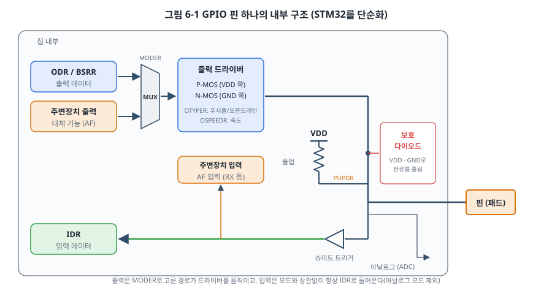
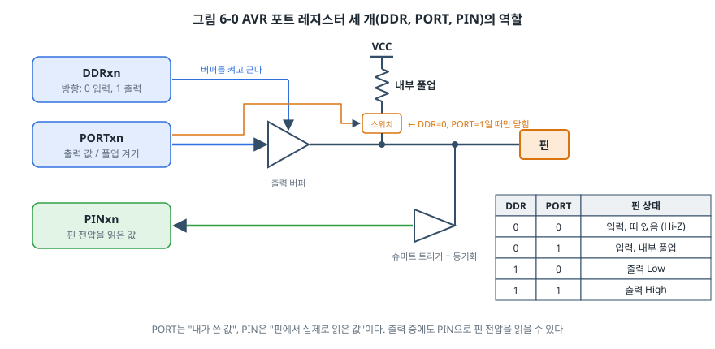
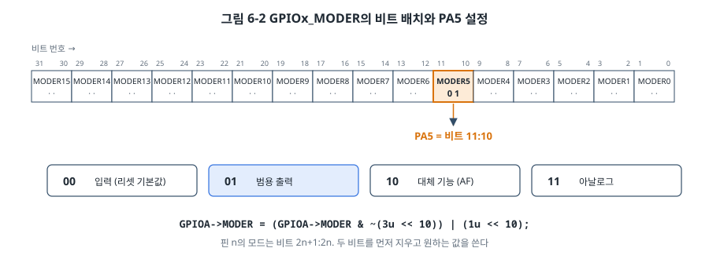
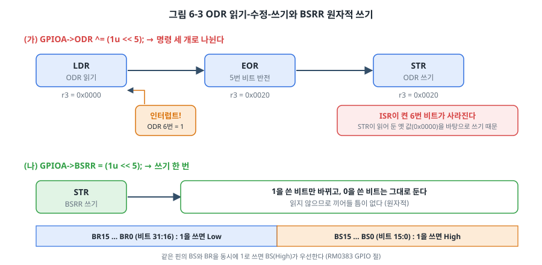
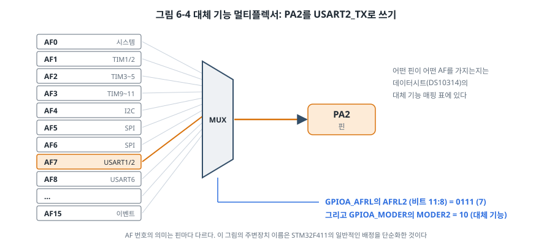

# 6장. GPIO: LED를 켜고 버튼을 읽다

## 이 장에서 배우는 것

- 아두이노 `digitalWrite()`가 내부에서 하는 일
- GPIO 핀 하나의 내부 구조와 입력·출력 경로
- AVR 포트 레지스터 DDRx, PORTx, PINx의 역할
- STM32 GPIO 레지스터 MODER, OTYPER, OSPEEDR, PUPDR, IDR, ODR, BSRR, AFR의 역할
- 읽기-수정-쓰기 문제와 원자적 비트 조작, 대체 기능(AF)

---

## 6.1 제2부를 시작하며

제1부에서 회로, MCU의 구조, C 언어, 개발 도구를 준비했습니다. 제2부에서는 MCU의 주변장치를 하나씩 다룹니다. 그 첫 번째가 **GPIO(General Purpose Input/Output, 범용 입출력)** 입니다. 핀 하나를 출력으로 써서 0이나 1을 내보내거나, 입력으로 써서 0인지 1인지 읽는 가장 기본적인 주변장치입니다.

제2부의 각 장은 같은 순서를 따릅니다. 먼저 개념과 그림으로 주변장치가 하는 일을 이해하고, 우노(AVR)의 레지스터로 구현한 뒤, 같은 기능을 STM32로 구현하고, 마지막에 8비트와 32비트 MCU의 차이를 정리합니다. 같은 일을 두 칩으로 해 보면 "칩마다 다른 것"과 "어느 칩에서나 같은 것"이 분명하게 보입니다.

## 6.2 `digitalWrite()`의 속을 열어 보기

아두이노에서 핀에 값을 쓰는 함수는 `digitalWrite(pin, value)`입니다. 이 함수의 소스는 아두이노 AVR 코어의 `wiring_digital.c`에 있고, 누구나 열어 볼 수 있습니다. 하는 일을 순서대로 정리하면 다음과 같습니다.

1. 핀 번호(예: 13)를 Flash에 저장된 표에서 찾아 **포트**(B)와 **비트 마스크**(`1 << 5`)로 바꿉니다.
2. 같은 표에서 그 핀이 PWM 타이머에 연결되어 있는지 찾고, 그렇다면 PWM 출력을 끕니다(8장).
3. 포트에 해당하는 출력 레지스터(`PORTB`)의 주소를 찾습니다.
4. 현재 인터럽트 상태(SREG)를 저장하고 인터럽트를 끕니다.
5. 값에 따라 `PORTB |= mask` 또는 `PORTB &= ~mask`를 실행합니다.
6. 인터럽트 상태를 되돌립니다.

1장에서 본 `PORTB |= (1 << PORTB5);` 한 줄이 하는 일은 5번 단계뿐입니다. 나머지는 "어느 핀이든, 어떤 상황에서든 안전하게 동작하기 위한" 준비입니다. 핀 번호를 실행 중에 바꿀 수 있고, PWM을 쓰던 핀이어도 동작하며, 인터럽트와도 충돌하지 않습니다. 그 대가로 레지스터를 직접 쓰는 것보다 수십 배 많은 클럭이 듭니다. 6.8절에서 실제로 얼마나 차이가 나는지 측정합니다.

어느 쪽이 옳다는 이야기가 아닙니다. 대부분의 상황에서 `digitalWrite()`의 속도는 충분하고, 안전장치는 고마운 것입니다. 하지만 수 µs 단위의 타이밍이 중요한 통신을 핀으로 직접 만들 때나, 4번 단계가 왜 필요한지 이해하지 못한 채 인터럽트를 쓸 때는 문제가 됩니다. 이 장의 목표는 그 안쪽을 이해하는 것입니다.

## 6.3 GPIO 핀 하나의 내부 구조

칩의 다리 하나 안쪽에는 생각보다 많은 회로가 있습니다.



- **출력 경로**: 출력 데이터 레지스터(STM32는 ODR/BSRR, AVR은 PORTx)의 값이 **출력 드라이버**를 움직입니다. 2장에서 본 푸시풀 또는 오픈 드레인 구조입니다. STM32는 주변장치(UART, 타이머 등)가 직접 드라이버를 움직이는 **대체 기능(AF)** 경로도 있어서, 멀티플렉서(MUX)가 둘 중 하나를 고릅니다.
- **입력 경로**: 핀의 전압은 **슈미트 트리거(Schmitt trigger)** 를 거쳐 입력 데이터 레지스터(STM32는 IDR, AVR은 PINx)로 들어갑니다. 슈미트 트리거는 0→1로 바뀌는 문턱과 1→0으로 바뀌는 문턱을 다르게 두어(히스테리시스), 천천히 변하거나 잡음이 낀 신호가 문턱 근처에서 0과 1 사이를 떨지 않게 합니다.
- **풀업, 풀다운**: 2장에서 본 내부 저항입니다. 스위치로 켜고 끕니다.
- **보호 다이오드**: 핀 전압이 VDD보다 높거나 GND보다 낮아지면 전류를 전원 쪽으로 흘려 내부 회로를 보호합니다. 정전기 정도는 견디지만, 2장에서 경고한 것처럼 3.3 V 칩에 5 V를 계속 걸면 이 다이오드로 큰 전류가 흘러 칩이 망가집니다.
- **아날로그 경로**: ADC(9장)로 가는 길입니다. 아날로그 모드에서는 디지털 입력 경로를 끊어 전력 소모와 잡음을 줄입니다.

중요한 점은 **입력 경로가 항상 열려 있다**는 것입니다. 핀을 출력으로 쓰는 동안에도 입력 레지스터로 핀의 실제 전압을 읽을 수 있습니다. 출력 레지스터에 1을 썼는데 입력 레지스터가 0을 읽는다면, 핀이 외부에서 GND에 단락되었거나 오픈 드레인 출력이 다른 장치에 의해 Low로 당겨지고 있다는 뜻입니다. 15장의 I2C에서 이 성질을 이용합니다.

## 6.4 AVR의 GPIO

### 세 개의 레지스터

AVR의 포트는 레지스터 세 개로 다룹니다. 포트 B라면 DDRB, PORTB, PINB이고, 각 레지스터의 비트 n이 핀 PBn 하나에 대응합니다.



- **DDRx(Data Direction Register)**: 방향을 정합니다. 0이면 입력, 1이면 출력입니다.
- **PORTx(Port Data Register)**: 출력일 때는 내보낼 값입니다. **입력일 때는 내부 풀업을 켜는 스위치**입니다.
- **PINx(Port Input Pins)**: 핀의 실제 전압을 읽은 값입니다. 읽기 전용처럼 보이지만, ATmega328P에서는 PINx의 비트에 1을 쓰면 PORTx의 해당 비트가 반전됩니다.

PORTx 비트가 입력일 때 풀업 스위치가 되는 규칙이 2장에서 이상하게 보였을 것입니다. 그림 6-0을 보면 이유가 보입니다. PORTx 비트는 원래 출력 버퍼에 값을 주는 선인데, 출력 버퍼가 꺼져 있을 때(DDR = 0) 그 선을 버려 두지 않고 풀업 스위치를 제어하는 데 재활용한 것입니다. 레지스터 하나를 아끼는 설계입니다.

| DDRxn | PORTxn | 핀 상태 |
| --- | --- | --- |
| 0 | 0 | 입력, 떠 있음(Hi-Z) |
| 0 | 1 | 입력, 내부 풀업 켜짐 |
| 1 | 0 | 출력 Low |
| 1 | 1 | 출력 High |

출처: ATmega328P 데이터시트, I/O-Ports 장의 Port Pin Configurations 표.

> ⚠️ 주의: 입력 핀을 출력으로 바꿀 때 순서에 주의하세요. 풀업이 켜진 입력(DDR=0, PORT=1)에서 DDR을 먼저 1로 바꾸면 그 순간 출력 High가 됩니다. 반대로 Low를 원했다면 PORT를 먼저 0으로 바꾸고 DDR을 1로 바꿔야, 짧은 순간이라도 원하지 않는 High가 나가지 않습니다. 모터 드라이버처럼 짧은 펄스에도 반응하는 회로에서는 이런 순간이 사고가 됩니다.

### 아두이노 핀 번호와 포트

아두이노 우노의 핀 번호는 칩의 포트와 다음과 같이 대응합니다.

| 아두이노 핀 | 칩의 핀 | 비고 |
| --- | --- | --- |
| D0 ~ D7 | PD0 ~ PD7 | D0, D1은 USB 시리얼(RX, TX)과 공유 |
| D8 ~ D13 | PB0 ~ PB5 | D13(PB5)에 보드 LED |
| A0 ~ A5 | PC0 ~ PC5 | 아날로그 입력, 디지털로도 사용 가능 |

PB6, PB7은 16 MHz 크리스털에, PC6은 리셋 핀에 쓰이므로 우노에서는 쓸 수 없습니다.

### 실습: 버튼을 누를 때마다 LED 반전

2장에서는 버튼을 누르는 **동안** LED를 켰습니다. 이번에는 버튼을 누를 때**마다** LED를 반전시킵니다. "누르고 있다"가 아니라 "누르는 순간"을 알아내야 하므로, 이전 값과 지금 값을 비교해 1에서 0으로 바뀌는 순간(**하강 에지**)을 찾습니다.

```c
uint8_t prev = 1;                         /* 풀업이므로 평소 값은 1 */

for (;;) {
    uint8_t now = (PIND >> BUTTON_BIT) & 1u;

    if (prev == 1 && now == 0) {          /* 1 → 0: 누르는 순간 */
        PINB = (1 << LED_BIT);            /* LED 반전 */
    }
    prev = now;
}
```

전체 코드는 `code/ch06-gpio/avr/`에 있습니다. LED 반전에 `PORTB ^= (1 << PB5);` 대신 `PINB = (1 << PB5);`를 썼습니다. 결과는 같지만 PINB 쓰기는 명령 하나로 끝납니다. `PORTB ^=`는 PORTB를 읽고, XOR하고, 다시 쓰는 세 단계가 필요합니다. 이 차이가 왜 중요한지는 6.6절에서 설명합니다.

실행해 보면 대부분은 잘 되지만, 가끔 버튼을 한 번 눌렀는데 LED가 두 번 바뀌거나(켜졌다 바로 꺼짐) 아예 안 바뀌는 것처럼 보일 때가 있습니다. 2장 끝에서 예고한 **바운싱** 때문입니다. 버튼 접점이 붙는 순간 수 ms 동안 붙었다 떨어지기를 반복하고, 루프가 그 짧은 변화를 모두 하강 에지로 잡아 버립니다. 7장에서 이 문제를 해결합니다.

> 🔧 ATmega128에서는: 포트가 A부터 G까지 있습니다(포트 G는 PG0~PG4의 5비트). 레지스터 이름 규칙은 같아서 DDRA, PORTA, PINA처럼 씁니다. 다만 **PINx에 1을 써서 출력을 반전시키는 기능이 없습니다.** 이 기능은 ATmega328P 같은 이후 세대 AVR에 추가된 것이라, ATmega128에서는 `PORTx ^= mask;`를 써야 합니다. 또 5장에서 본 것처럼 공장 출하 상태에서는 JTAG이 켜져 있어 PF4~PF7을 GPIO로 쓸 수 없습니다. JTAGEN 퓨즈를 끄거나, 프로그램 시작 부분에서 MCUCSR 레지스터의 JTD 비트를 4클럭 안에 두 번 써서 JTAG을 끕니다.

## 6.5 STM32의 GPIO

STM32의 GPIO는 AVR보다 레지스터가 많습니다. 그만큼 핀 하나하나를 더 세밀하게 설정할 수 있습니다. 포트마다 다음 레지스터가 있습니다(RM0383 8.4절).

| 레지스터 | 오프셋 | 핀당 비트 | 역할 |
| --- | --- | --- | --- |
| MODER | 0x00 | 2 | 모드: 00 입력, 01 출력, 10 대체 기능, 11 아날로그 |
| OTYPER | 0x04 | 1 | 출력 형태: 0 푸시풀, 1 오픈 드레인 |
| OSPEEDR | 0x08 | 2 | 출력 속도(신호가 바뀌는 빠르기): 00 저속 ~ 11 최고속 |
| PUPDR | 0x0C | 2 | 00 없음, 01 풀업, 10 풀다운 |
| IDR | 0x10 | 1 | 입력 데이터 (읽기 전용) |
| ODR | 0x14 | 1 | 출력 데이터 |
| BSRR | 0x18 | 2 | 비트 설정/해제 (쓰기 전용) |
| LCKR | 0x1C | 1 | 설정 잠금 |
| AFRL, AFRH | 0x20, 0x24 | 4 | 대체 기능 번호 (AF0~AF15) |

AVR의 DDR이 하던 일을 MODER가, PORT의 풀업 역할을 PUPDR이 맡는 식으로 역할이 나뉘어 있습니다.

### MODER: 핀 하나에 두 비트



MODER는 핀 하나에 2비트를 씁니다. 핀 n의 모드는 비트 2n+1과 2n에 있으므로, PA5는 비트 11:10입니다. 4장에서 배운 대로 두 비트를 먼저 지우고 값을 씁니다.

```c
GPIOA->MODER = (GPIOA->MODER & ~(3u << (5 * 2))) | (1u << (5 * 2));   /* PA5 = 01 (출력) */
```

### OSPEEDR: 속도는 빠를수록 좋은가

OSPEEDR는 출력이 0에서 1로, 1에서 0으로 바뀌는 **빠르기(slew rate)** 를 정합니다. 이름 때문에 "빠를수록 좋다"고 생각하기 쉽지만, 그렇지 않습니다. 신호가 급하게 바뀔수록 전자기 잡음(EMI)이 커지고, 긴 선에서는 신호가 튀어 오르는 현상(링잉)이 생깁니다. LED나 버튼처럼 느린 신호는 저속(00)으로 두고, 수 MHz 이상으로 동작하는 SPI 클럭처럼 빠른 신호에만 속도를 올립니다. 필요한 속도는 DS10314의 I/O AC 특성 표에서 부하 용량과 전원 전압에 따라 확인합니다.

### 실습: STM32로 같은 동작 만들기

NUCLEO-F411RE에는 사용자 LED(LD2, PA5)와 사용자 버튼(B1, PC13)이 있습니다. 버튼은 누르면 Low가 됩니다(NUCLEO-64 사용자 설명서 UM1724).

```c
static void gpio_init(void)
{
    RCC->AHB1ENR |= RCC_AHB1ENR_GPIOAEN | RCC_AHB1ENR_GPIOCEN;
    (void)RCC->AHB1ENR;     /* 클럭이 켜질 때까지 한 번 읽어 기다린다 */

    /* PA5: 범용 출력(01), 푸시풀, 저속, 풀업/풀다운 없음 */
    GPIOA->MODER   = (GPIOA->MODER & ~(3u << (5 * 2))) | (1u << (5 * 2));
    GPIOA->OTYPER &= ~(1u << 5);
    GPIOA->OSPEEDR &= ~(3u << (5 * 2));
    GPIOA->PUPDR  &= ~(3u << (5 * 2));

    /* PC13: 입력(00), 풀업(01) */
    GPIOC->MODER &= ~(3u << (13 * 2));
    GPIOC->PUPDR  = (GPIOC->PUPDR & ~(3u << (13 * 2))) | (1u << (13 * 2));
}
```

`(void)RCC->AHB1ENR;` 줄은 이상해 보입니다. 값을 읽고 버리기만 하니까요. STM32F411의 에라타 시트(ES0287)에는 "주변장치 클럭을 켠 직후에는 그 주변장치의 레지스터에 바로 접근하지 말고 잠깐 기다리라"는 항목이 있습니다. 클럭 활성화가 실제로 반영되기까지 버스 클럭 몇 번이 걸리기 때문입니다. 활성화 레지스터를 한 번 읽어 주면 그 시간을 확실하게 벌 수 있습니다. ST의 HAL도 같은 방법을 씁니다.

메인 루프는 AVR 버전과 같은 구조입니다. 전체 코드는 `code/ch06-gpio/stm32/`에 있습니다.

```c
uint32_t prev = 1;

for (;;) {
    uint32_t now = (GPIOC->IDR >> 13) & 1u;

    if (prev == 1 && now == 0) {
        led_toggle();
    }
    prev = now;
}
```

### 같은 일, 세 가지 방법

3장에서 STM32의 레지스터를 다루는 방법이 세 가지라고 했습니다. LED를 켜는 코드를 나란히 놓아 보겠습니다.

```c
/* 1) 주소 직접 */
*(volatile uint32_t *)0x40020018u = (1u << 5);       /* GPIOA_BSRR */

/* 2) CMSIS 구조체와 비트 이름 (ST의 stm32f4xx.h) */
GPIOA->BSRR = GPIO_BSRR_BS5;

/* 3) ST HAL */
HAL_GPIO_WritePin(GPIOA, GPIO_PIN_5, GPIO_PIN_SET);
```

세 줄은 결국 같은 레지스터에 같은 값을 씁니다. HAL 함수의 소스를 열어 보면, 인자 검사를 거친 뒤 BSRR에 값을 쓰는 한 줄이 나옵니다. 이 책의 예제는 2번 방식을 따르되, 비트 이름 대신 `(1u << 5)`처럼 비트 위치를 그대로 보여 주는 경우가 많습니다. 데이터시트의 비트 번호와 코드를 바로 맞춰 볼 수 있게 하기 위해서입니다.

## 6.6 원자적 비트 조작

### 읽기-수정-쓰기 문제

`GPIOA->ODR ^= (1u << 5);`는 C로는 한 줄이지만 CPU에서는 세 단계입니다. ODR을 레지스터로 읽고(LDR), 5번 비트를 뒤집고(EOR), ODR에 다시 씁니다(STR). 이것을 **읽기-수정-쓰기(read-modify-write, RMW)** 라고 합니다.



메인 코드가 ODR을 읽은 직후에 인터럽트가 걸리고, 그 ISR이 같은 포트의 6번 핀을 켰다고 해 봅시다. ISR이 끝나고 메인 코드로 돌아오면, 메인 코드는 ISR이 실행되기 **전에** 읽어 둔 값을 바탕으로 5번 비트만 바꿔서 씁니다. ISR이 켠 6번 비트는 이 쓰기로 다시 0이 됩니다. 이런 버그는 아주 드물게, 재현하기 어렵게 나타나서 찾기가 매우 어렵습니다.

이 문제를 피하려면 **한 번의 쓰기로 끝나는(원자적인, atomic)** 방법을 써야 합니다.

### STM32: BSRR

**BSRR(Bit Set/Reset Register)** 은 이 문제를 위해 만들어진 레지스터입니다. 32비트 중 아래 16비트(BS0~BS15)에 1을 쓰면 해당 핀이 High가 되고, 위 16비트(BR0~BR15)에 1을 쓰면 Low가 됩니다. **0을 쓴 비트는 아무 영향이 없습니다.** 그래서 ODR을 읽을 필요 없이 바꾸고 싶은 핀만 지정해서 쓰면 됩니다.

```c
GPIOA->BSRR = (1u << 5);          /* PA5 High. 다른 핀은 그대로 */
GPIOA->BSRR = (1u << (5 + 16));   /* PA5 Low */
GPIOA->BSRR = (1u << 3) | (1u << (7 + 16));   /* PA3 High와 PA7 Low를 동시에 */
```

마지막 줄처럼 여러 핀을 한 번에, 그것도 같은 순간에 바꿀 수 있다는 것도 장점입니다.

> 🔍 깊이 보기: Cortex-M3/M4에는 **비트 밴딩(bit-banding)** 이라는 기능도 있습니다. 주변장치 영역(0x4000 0000~0x400F FFFF)의 비트 하나하나를 별칭 영역(0x4200 0000부터)의 32비트 워드 하나에 대응시켜, 그 워드에 0이나 1을 쓰면 해당 비트 하나만 원자적으로 바뀝니다. 별칭 주소는 `0x4200 0000 + (바이트 오프셋 × 32) + (비트 번호 × 4)`로 계산합니다(PM0214의 Bit-banding 절). GPIO는 BSRR이 있어서 필요 없지만, BSRR 같은 레지스터가 없는 주변장치의 플래그 비트를 다룰 때 쓸 수 있습니다. 다만 Cortex-M7, M33 같은 이후 코어에는 이 기능이 없어서 이식성은 떨어집니다.

### AVR: SBI, CBI, 그리고 PINx

AVR에는 I/O 레지스터의 비트 하나를 바꾸는 명령 **SBI(Set Bit in I/O)** 와 **CBI(Clear Bit in I/O)** 가 있습니다. 이 명령은 명령 하나로 실행되므로 중간에 인터럽트가 끼어들 수 없습니다. avr-gcc는 다음 조건을 모두 만족하면 `PORTB |= (1 << 5);`를 SBI 한 개로 바꿔 줍니다.

- 레지스터의 I/O 주소가 0x00~0x1F 범위에 있다 (PORTB, DDRB, PINB 등)
- 바꾸는 비트가 하나이고, 비트 번호가 컴파일할 때 정해진 상수다
- 최적화가 켜져 있다

조건 중 하나라도 어기면(예: 두 비트를 한 번에 바꾸거나, 비트 번호를 변수로 지정하면) 컴파일러는 읽기-수정-쓰기 명령 세 개를 만듭니다. 그래서 같은 `|=` 코드라도 원자적일 때와 아닐 때가 있습니다. 5장의 `make disasm`으로 실제 명령을 확인하는 습관이 도움이 됩니다.

ATmega328P에서 `PINB = (1 << 5);`로 출력을 반전시키는 방법은 PINB에 값을 쓰는 것뿐이라 읽기가 없습니다. `PORTB ^= (1 << 5);`(읽기-수정-쓰기)보다 빠르고 안전합니다.

ISR과 메인 코드가 같은 포트의 서로 다른 핀을 건드린다면, 원자적이지 않은 접근은 인터럽트를 잠시 끄고 감싸야 합니다. 6.2절에서 본 `digitalWrite()`의 4번, 6번 단계가 바로 이 일을 합니다. 7장에서 이 방법을 자세히 다룹니다.

## 6.7 대체 기능

GPIO 핀은 단순한 입출력 외에 UART, SPI, I2C, 타이머 같은 주변장치의 신호선으로도 쓰입니다. 이것을 **대체 기능(alternate function)** 이라고 합니다.

AVR에서는 주변장치를 켜면 정해진 핀이 자동으로 그 주변장치의 신호선이 됩니다. 예를 들어 UART 송신을 켜면 PD1(D1)이 TXD가 됩니다. 핀마다 쓸 수 있는 기능이 정해져 있고, 고를 수는 없습니다.

STM32는 핀 하나에 최대 16개의 대체 기능(AF0~AF15)을 연결해 두고, 그중 하나를 고르게 합니다.



예를 들어 PA2를 USART2의 송신선(TX)으로 쓰려면 두 가지를 설정합니다.

1. MODER에서 PA2를 대체 기능 모드(10)로 바꿉니다.
2. AFRL에서 PA2의 필드(비트 11:8)에 7을 씁니다. DS10314의 대체 기능 매핑 표를 보면 PA2의 AF7이 USART2_TX입니다.

```c
GPIOA->MODER  = (GPIOA->MODER & ~(3u << (2 * 2)))   | (2u << (2 * 2));   /* PA2: AF 모드 */
GPIOA->AFR[0] = (GPIOA->AFR[0] & ~(0xFu << (2 * 4))) | (7u << (2 * 4));  /* PA2: AF7 */
```

AFRL(`AFR[0]`)은 핀 0~7, AFRH(`AFR[1]`)는 핀 8~15를 맡고, 핀 하나에 4비트를 씁니다. NUCLEO 보드에서 PA2와 PA3은 ST-LINK의 가상 시리얼 포트에 연결되어 있어서, 14장에서 PC와 통신할 때 바로 이 설정을 씁니다.

같은 주변장치 신호가 여러 핀에 나올 수 있다는 점도 STM32의 특징입니다. USART2_TX는 PA2 말고 다른 핀에서도 쓸 수 있어서, 보드를 설계할 때 배선이 편한 핀을 고를 수 있습니다. 어떤 핀에서 어떤 기능을 쓸 수 있는지는 데이터시트의 매핑 표나 STM32CubeMX의 핀 배치 화면에서 확인합니다.

## 6.8 측정: 핀은 얼마나 빨리 바뀌는가

이 장의 예제를 `make SPEED=1`로 빌드하면, LED 핀을 가능한 한 빨리 반전시키는 시험 버전이 됩니다. 오실로스코프나 로직 애널라이저를 우노의 D13, NUCLEO의 PA5(보드의 CN10 커넥터 또는 아두이노 호환 헤더의 D13)에 연결하고 주파수를 재 보세요.

예상 값은 직접 계산할 수 있습니다. `make disasm`으로 루프의 명령을 확인하고, 명령마다 걸리는 클럭 수를 더하면 한 번 반전하는 데 걸리는 클럭 수가 나옵니다. AVR의 명령별 클럭 수는 AVR 명령어 집합 매뉴얼에, Cortex-M4의 명령별 클럭 수는 Arm의 Cortex-M4 기술 참조 매뉴얼에 있습니다.

그다음 같은 루프를 `digitalWrite(13, HIGH); digitalWrite(13, LOW);`로 바꾼 아두이노 스케치로 측정해 비교해 보세요. 6.2절에서 말한 "수십 배"가 실제로 몇 배인지 여러분의 측정값으로 확인할 수 있습니다.

> 💡 팁: 로직 애널라이저가 없다면, 값싼 USB 로직 애널라이저(8채널, 24 MHz급)와 오픈소스 소프트웨어 PulseView(sigrok)를 추천합니다. 3부의 통신 장에서 거의 필수 도구가 됩니다. 부록 C에서 계측 장비를 고르는 방법을 정리했습니다.

## 6.9 8비트와 32비트 비교

| 항목 | ATmega328P | STM32F411 |
| --- | --- | --- |
| 방향 설정 | DDRx (1비트/핀) | MODER (2비트/핀, 대체 기능·아날로그 포함) |
| 출력 형태 | 푸시풀만 | OTYPER로 푸시풀/오픈 드레인 선택 |
| 출력 속도 | 고정 | OSPEEDR로 4단계 선택 |
| 풀업/풀다운 | 풀업만, PORTx로 켬 | PUPDR로 풀업/풀다운 선택 |
| 원자적 설정/해제 | SBI/CBI (조건부), PINx 쓰기로 반전 | BSRR, 비트 밴딩 |
| 대체 기능 | 주변장치마다 핀 고정 | AFR로 핀마다 AF0~AF15 선택 |
| 클럭 | 항상 켜짐 | RCC에서 포트별로 켜야 함 |
| 핀 전압 | 5 V | 3.3 V (FT 핀은 5 V 입력 허용) |

AVR은 레지스터가 적어서 배우기 쉽고, 설정이 적은 만큼 실수할 여지도 적습니다. STM32는 설정할 것이 많지만, 그만큼 핀 하나를 회로에 정확히 맞출 수 있습니다. 두 칩 모두 결국 "어느 레지스터의 몇 번 비트가 무엇을 하는가"라는 같은 질문으로 귀결됩니다. 새로운 칩을 만나도 데이터시트의 GPIO 레지스터 절을 펴고 이 표의 항목을 하나씩 찾아 채우면 됩니다.

---

## 정리

- `digitalWrite()`는 핀 번호 변환, PWM 끄기, 인터럽트 보호를 거쳐 결국 출력 레지스터의 비트 하나를 바꿉니다.
- GPIO 핀 안에는 출력 드라이버, 슈미트 트리거 입력, 풀업/풀다운, 보호 다이오드가 있고, 입력 경로는 출력 중에도 열려 있습니다.
- AVR은 DDRx(방향), PORTx(출력 값 또는 풀업), PINx(입력 값) 세 레지스터로 포트를 다룹니다.
- STM32는 MODER, OTYPER, OSPEEDR, PUPDR로 핀을 설정하고, IDR로 읽고, ODR 또는 BSRR로 씁니다.
- 읽기-수정-쓰기는 인터럽트가 끼어들면 다른 비트의 변경을 덮어쓸 수 있습니다. STM32는 BSRR, AVR은 SBI/CBI나 PINx 쓰기로 원자적으로 바꿉니다.
- STM32는 AFR로 핀마다 대체 기능을 고르며, 어떤 핀에 어떤 기능이 있는지는 데이터시트의 매핑 표에서 확인합니다.

## 연습 문제

1. 우노의 A3 핀을 풀업이 켜진 입력으로 설정하는 코드를 레지스터로 작성하세요. (힌트: A3은 어느 포트의 몇 번 비트인가요?)
2. STM32의 PB8을 오픈 드레인 출력, 풀업 켜짐, 중간 속도(01)로 설정하는 코드를 작성하세요. 사용하는 레지스터와 비트 위치를 모두 주석으로 적으세요.
3. 다음 코드의 문제점을 설명하고 BSRR을 써서 고치세요. 이 함수는 메인 루프와 타이머 ISR에서 모두 불립니다.
   ```c
   void set_led(uint32_t pin, int on) {
       if (on) GPIOA->ODR |= (1u << pin);
       else    GPIOA->ODR &= ~(1u << pin);
   }
   ```
4. avr-gcc가 다음 세 줄 각각을 SBI/CBI 명령 하나로 만들 수 있는지 판단하고 이유를 설명하세요. 그다음 `make disasm`으로 확인하세요.
   ```c
   PORTB |= (1 << 5);
   PORTB |= (1 << 5) | (1 << 4);
   PORTB |= (1 << n);      /* n은 변수 */
   ```
5. STM32F411 데이터시트의 대체 기능 매핑 표에서 USART2_RX를 쓸 수 있는 핀과 AF 번호를 찾고, 그 핀을 USART2_RX로 설정하는 코드를 작성하세요.
6. (실습) 6.8절의 방법으로 우노와 STM32에서 최고 반전 주파수를 측정하고, 역어셈블 결과로 계산한 값과 비교하세요. STM32는 3장의 100 MHz 클럭 설정을 추가해서 다시 측정해 보고, 주파수가 클럭에 비례해서 늘어나는지 확인하세요.
