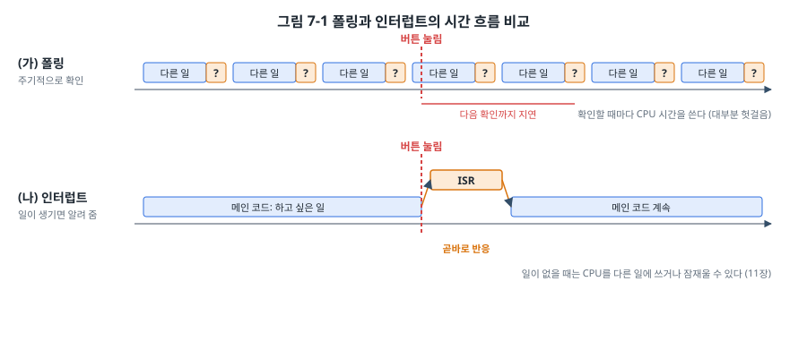
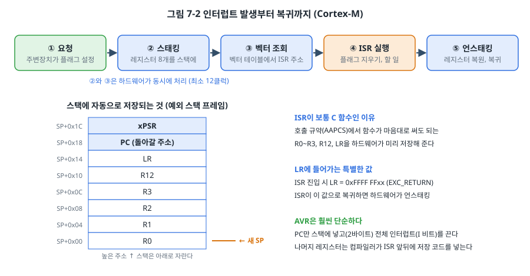
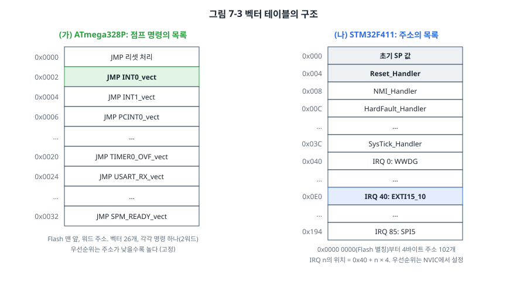
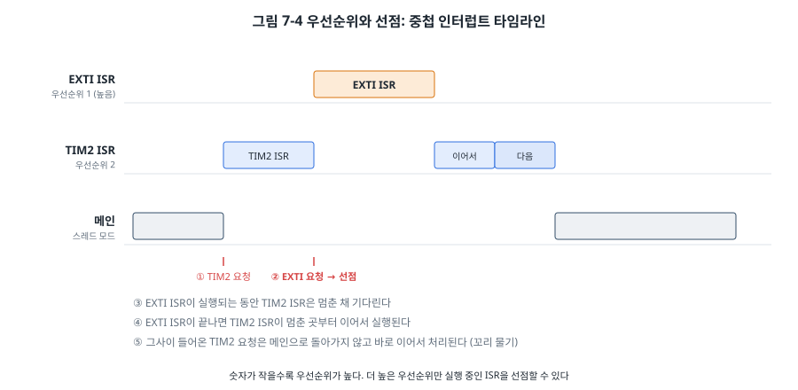
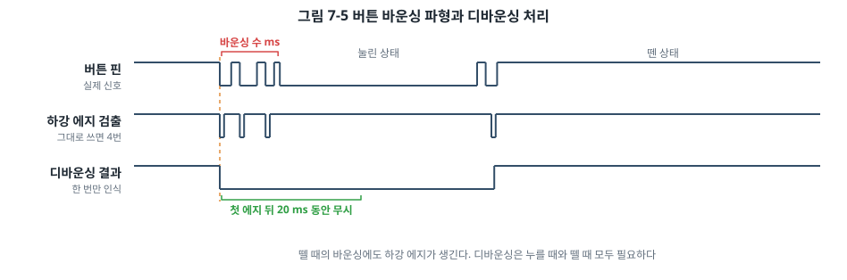

# 7장. 인터럽트

## 이 장에서 배우는 것

- 폴링과 인터럽트의 차이, 인터럽트가 필요한 이유
- 인터럽트가 걸렸을 때 CPU 안에서 일어나는 일과 벡터 테이블
- AVR의 고정 우선순위와 Cortex-M NVIC의 우선순위, 선점
- 외부 인터럽트: AVR의 INT0, STM32의 EXTI
- ISR 작성 규칙, ISR과 메인 코드가 변수를 공유할 때의 함정, 버튼 디바운싱

---

## 7.1 기다리는 방법 두 가지

6장의 버튼 예제에서 메인 루프는 쉬지 않고 버튼 핀을 읽었습니다. 버튼이 하루에 한 번 눌리더라도 CPU는 1초에 수백만 번씩 "눌렸나?"를 확인합니다. 이렇게 주기적으로 상태를 확인하는 방식을 **폴링(polling)** 이라고 합니다.



폴링은 단순하고 예측하기 쉽지만 두 가지 문제가 있습니다. 첫째, 확인하는 데 CPU 시간을 씁니다. 대부분의 확인은 헛걸음입니다. 둘째, 메인 루프가 다른 일을 오래 하면 그동안 생긴 일을 늦게 알아챕니다. 메인 루프가 100 ms짜리 계산을 하고 있다면 버튼 반응도 최대 100 ms 늦어집니다.

**인터럽트(interrupt)** 는 반대 방향입니다. CPU가 묻는 대신, 일이 생긴 주변장치가 CPU에게 알립니다. 알림을 받은 CPU는 하던 일을 잠시 멈추고, 그 일을 처리하는 함수인 **ISR(Interrupt Service Routine, 인터럽트 서비스 루틴)** 을 실행한 뒤, 멈췄던 곳으로 돌아가 하던 일을 이어서 합니다. 그 사이 메인 코드는 자신이 멈췄었다는 사실조차 모릅니다.

인터럽트를 쓰면 반응이 빨라지고, 일이 없을 때 CPU를 다른 일에 쓰거나 잠재워 전력을 아낄 수 있습니다(11장). 대신 "언제 끼어들지 모르는 코드"가 생기므로 새로운 종류의 버그가 생깁니다. 이 장의 절반은 그 버그를 피하는 방법에 관한 것입니다.

> 💡 팁: 폴링이 나쁜 것은 아닙니다. 상태가 자주 바뀌고 반응 시간이 중요하지 않다면 폴링이 더 단순하고 안전합니다. 35장에서 다루는 안전 규격 제품은 동작을 예측하기 쉽도록 인터럽트를 최소한으로 쓰고 정해진 주기의 폴링을 선호하기도 합니다. 둘 중 무엇을 쓸지는 상황에 따라 고르는 것입니다.

## 7.2 인터럽트가 걸리면 일어나는 일

인터럽트는 CPU 입장에서는 "갑작스러운 함수 호출"입니다. 보통의 함수 호출은 호출하는 쪽이 준비를 하지만, 인터럽트는 아무 준비 없이 아무 명령 사이에서나 일어납니다. 그래서 하드웨어가 대신 준비를 해 줍니다.



### Cortex-M의 경우

1. **요청**: 주변장치가 이벤트를 감지하고 자신의 플래그를 세웁니다. 해당 인터럽트가 허용되어 있으면 NVIC에 요청이 들어갑니다.
2. **스태킹(stacking)**: 지금 실행 중인 명령이 끝나면, 하드웨어가 레지스터 8개(R0~R3, R12, LR, PC, xPSR)를 스택에 자동으로 저장합니다. 이것을 **예외 스택 프레임**이라고 합니다.
3. **벡터 조회**: 스태킹과 동시에 벡터 테이블에서 ISR의 주소를 읽어 옵니다.
4. **ISR 실행**: LR에는 `0xFFFFFFF9` 같은 특별한 값(EXC_RETURN)이 들어갑니다. ISR이 끝나면서 이 값으로 복귀하면, CPU는 "보통의 함수 복귀가 아니라 인터럽트 복귀"라는 것을 압니다.
5. **언스태킹(unstacking)**: 저장했던 레지스터를 되살리고, 멈췄던 명령의 다음부터 실행을 이어 갑니다.

요청부터 ISR의 첫 명령까지 최소 12클럭이 걸립니다(Flash 대기 상태가 없을 때). 하드웨어가 저장하는 레지스터가 AAPCS 호출 규약에서 "함수가 마음대로 써도 되는" 레지스터와 정확히 일치한다는 점이 영리한 설계입니다. 덕분에 ISR을 보통의 C 함수로 쓸 수 있고, 특별한 키워드나 어셈블리가 필요 없습니다.

> 🔍 깊이 보기: Cortex-M4F에서 FPU를 쓰는 코드가 인터럽트를 받으면, 부동소수점 레지스터 S0~S15와 FPSCR까지 저장해야 합니다. 이것까지 매번 저장하면 느리므로, Cortex-M4F는 공간만 확보해 두고 ISR이 실제로 FPU를 쓸 때만 저장하는 **지연 스태킹(lazy stacking)** 을 기본으로 씁니다. 26장의 RTOS 컨텍스트 스위칭에서 이 동작이 다시 중요해집니다.

### AVR의 경우

AVR은 훨씬 단순합니다.

1. 지금 실행 중인 명령을 끝냅니다.
2. PC(돌아올 주소, 2바이트)만 스택에 넣습니다.
3. SREG의 I 비트(전체 인터럽트 허용)를 0으로 만듭니다. 그래서 ISR이 실행되는 동안에는 다른 인터럽트가 끼어들지 못합니다.
4. 벡터 테이블의 해당 위치로 점프합니다. 응답 시간은 최소 4클럭이고, 벡터의 점프 명령이 몇 클럭 더 걸립니다(ATmega328P 데이터시트, AVR CPU Core 장의 Interrupt Response Time).

나머지 레지스터(R0~R31, SREG)는 하드웨어가 저장하지 않습니다. 그래서 avr-gcc는 ISR 함수의 앞뒤에 그 ISR이 쓰는 레지스터를 저장하고 복원하는 코드를 자동으로 넣습니다. ISR이 복잡해질수록 저장할 레지스터가 늘어 진입과 복귀가 느려집니다. ISR의 끝은 보통의 `RET`가 아니라 `RETI` 명령으로, 복귀하면서 I 비트를 다시 1로 만듭니다.

## 7.3 벡터 테이블

CPU는 어떤 인터럽트가 어떤 ISR로 가야 하는지를 **벡터 테이블(vector table)** 에서 찾습니다.



AVR의 벡터 테이블은 Flash 맨 앞에 놓인 **점프 명령의 목록**입니다. ATmega328P는 벡터가 26개이고, 각 칸에는 `JMP ISR주소` 명령 하나가 들어 있습니다. 0번 칸이 리셋이라서, 전원이 들어오면 CPU는 0번지의 점프 명령을 따라 스타트업 코드로 갑니다. avr-gcc에서는 `ISR(INT0_vect) { ... }`처럼 정해진 벡터 이름으로 함수를 만들면 링커가 그 주소를 테이블의 해당 칸에 넣어 줍니다.

Cortex-M의 벡터 테이블은 명령이 아니라 **주소의 목록**입니다. 첫 칸은 특별하게 스택 포인터의 초깃값이고, 두 번째 칸이 리셋 처리기의 주소, 그 뒤로 코어 예외 14칸과 주변장치 인터럽트가 이어집니다. 3장에서 만든 `code/common/stm32f411/startup.c`의 `vector_table` 배열이 바로 이것입니다. 이 장에서 그 배열에 주변장치 인터럽트의 이름을 모두 붙였습니다.

```c
void EXTI15_10_IRQHandler(void) __attribute__((weak, alias("Default_Handler")));

const vector_t vector_table[16 + NUM_IRQ] = {
    (vector_t)&_estack,     /* 0: 초기 스택 포인터 */
    Reset_Handler,          /* 1: 리셋 */
    /* ... */
    EXTI15_10_IRQHandler,   /* IRQ 40 */
    /* ... */
};
```

`weak` 속성 덕분에, 사용자가 `EXTI15_10_IRQHandler`라는 이름의 함수를 만들면 그 함수가 테이블에 들어가고, 만들지 않으면 `Default_Handler`(무한 루프)가 들어갑니다. 인터럽트를 허용해 놓고 ISR 이름을 잘못 쓰면(예: `EXTI15_10_IRQHandle`) 컴파일 오류 없이 `Default_Handler`에 갇히게 되므로, 디버거로 멈췄을 때 `Default_Handler`에 있다면 먼저 ISR 이름의 철자를 확인하세요.

> 🔧 ATmega128에서는: 벡터가 35개이고, 외부 인터럽트가 INT0~INT7까지 8개 있습니다(INT0~INT3은 PD0~PD3, INT4~INT7은 PE4~PE7). 대신 ATmega328P의 핀 변화 인터럽트(PCINT)는 없습니다. INT0~INT3의 에지 설정은 EICRA, INT4~INT7은 EICRB에서 합니다.

## 7.4 우선순위와 중첩

여러 인터럽트가 동시에 요청되면 누구를 먼저 처리할까요? 또 ISR이 실행되는 도중에 다른 인터럽트가 오면 어떻게 될까요?

### AVR: 고정 우선순위, 기본적으로 중첩 없음

AVR의 우선순위는 벡터 테이블의 순서로 고정되어 있습니다. 주소가 낮은 벡터가 높은 우선순위를 가집니다. 동시에 요청된 인터럽트는 우선순위 순서로 하나씩 처리됩니다.

ISR에 들어가면 I 비트가 꺼지므로, ISR이 실행되는 동안에는 우선순위와 상관없이 어떤 인터럽트도 끼어들 수 없습니다. 그동안 들어온 요청은 플래그로 남아 있다가 ISR이 끝나면 처리됩니다. ISR 안에서 `sei()`로 I 비트를 다시 켜면 중첩을 허용할 수 있지만, 같은 인터럽트가 다시 들어와 스택이 넘칠 위험이 있어 특별한 이유가 없다면 쓰지 않습니다.

### Cortex-M: NVIC와 설정 가능한 우선순위

Cortex-M에는 **NVIC(Nested Vectored Interrupt Controller)** 가 있습니다. 이름 그대로 중첩(nested)을 기본으로 지원합니다.

- 인터럽트마다 우선순위를 설정할 수 있습니다. STM32F4는 우선순위 값으로 4비트를 써서 0~15의 16단계를 가집니다. **숫자가 작을수록 우선순위가 높습니다.**
- 실행 중인 ISR보다 **더 높은** 우선순위의 요청이 오면, 실행 중인 ISR을 멈추고 새 ISR을 먼저 실행합니다. 이것을 **선점(preemption)** 이라고 합니다.
- 같거나 낮은 우선순위의 요청은 기다렸다가 처리됩니다.



그림 7-4에서 TIM2 ISR(우선순위 2)이 실행되는 도중 EXTI 요청(우선순위 1)이 오면 EXTI ISR이 선점합니다. EXTI ISR이 끝나면 TIM2 ISR이 멈춘 곳부터 이어서 실행됩니다. 그사이 TIM2의 새 요청이 들어와 있었다면, Cortex-M은 메인 코드로 돌아가 레지스터를 복원했다가 다시 저장하는 낭비 없이 바로 다음 ISR로 넘어갑니다. 이것을 **꼬리 물기(tail-chaining)** 라고 합니다.

NVIC 레지스터는 코어 주변장치 영역(0xE000 E100부터)에 있습니다(PM0214 4.2절).

| 레지스터 | 역할 |
| --- | --- |
| NVIC_ISERx | 1을 쓴 비트의 인터럽트를 허용 |
| NVIC_ICERx | 1을 쓴 비트의 인터럽트를 금지 |
| NVIC_ISPRx, ICPRx | 대기(pending) 상태를 강제로 만들거나 지움 |
| NVIC_IPRx | 인터럽트마다 우선순위 1바이트. STM32F4는 상위 4비트만 씀 |

인터럽트 번호 n의 허용 비트는 ISER[n / 32]의 (n % 32)번 비트입니다. 이 책의 예제는 `stm32f411_regs.h`에 작은 함수로 정리해 두었습니다.

```c
static inline void nvic_enable_irq(uint32_t irqn)
{
    NVIC->ISER[irqn >> 5] = 1u << (irqn & 31u);    /* 1을 쓴 비트만 영향, 원자적 */
}

static inline void nvic_set_priority(uint32_t irqn, uint32_t prio)
{
    NVIC->IP[irqn] = (uint8_t)(prio << (8 - 4));    /* 상위 4비트에 넣는다 */
}
```

CMSIS의 `NVIC_EnableIRQ()`, `NVIC_SetPriority()`가 같은 일을 합니다.

> ⚠️ 주의: 우선순위 값을 IPR 바이트의 **하위** 비트에 쓰는 실수가 흔합니다. STM32F4는 하위 4비트를 무시하므로, `NVIC->IP[n] = 5;`는 우선순위 0(가장 높음)이 됩니다. CMSIS 함수를 쓰거나, 위처럼 직접 시프트하세요.

> 🔍 깊이 보기: Cortex-M의 우선순위는 **그룹 우선순위**(선점 여부를 정함)와 **서브 우선순위**(같은 그룹 안에서 동시에 대기 중일 때의 순서)로 나눌 수 있습니다. 나누는 위치는 SCB_AIRCR 레지스터의 PRIGROUP 필드로 정합니다. 리셋 기본값에서는 STM32F4의 4비트가 모두 그룹 우선순위입니다. FreeRTOS(26장)는 이 기본값을 전제로 하므로, 특별한 이유가 없으면 바꾸지 않습니다.

## 7.5 외부 인터럽트: AVR

핀의 변화로 인터럽트를 거는 것을 **외부 인터럽트(external interrupt)** 라고 합니다. ATmega328P에는 두 종류가 있습니다.

- **INT0, INT1**: 각각 D2(PD2), D3(PD3) 한 핀에 연결된 인터럽트입니다. 하강 에지, 상승 에지, 양쪽 에지, Low 레벨 중에서 고를 수 있고, 벡터도 따로 있습니다.
- **핀 변화 인터럽트(PCINT)**: 거의 모든 핀에서 쓸 수 있지만, 포트 하나(8핀)가 벡터 하나를 공유하고 "어느 쪽으로든 바뀌었다"만 알려 줍니다. 어느 핀이 어떻게 바뀌었는지는 ISR에서 PIN 레지스터를 읽어 직접 알아내야 합니다.

INT0을 하강 에지로 설정하는 코드는 다음과 같습니다(ATmega328P 데이터시트, External Interrupts 장).

```c
EICRA = (EICRA & ~((1 << ISC01) | (1 << ISC00))) | (1 << ISC01);   /* ISC01:ISC00 = 10 → 하강 에지 */
EIFR  = (1 << INTF0);        /* 혹시 남아 있을 플래그 지우기 */
EIMSK |= (1 << INT0);        /* INT0 허용 */
sei();                       /* 전체 인터럽트 허용 */
```

마지막 줄의 `sei()`를 잊으면 아무 일도 일어나지 않습니다. AVR은 개별 허용(EIMSK)과 전체 허용(SREG의 I 비트)이 모두 켜져야 인터럽트가 걸립니다.

`EIFR = (1 << INTF0);`처럼 플래그 레지스터에는 **1을 써서 지웁니다.** 0을 쓰면 아무 일도 없습니다. 처음 보면 이상하지만, 이 방식 덕분에 다른 플래그를 건드리지 않고 원하는 플래그 하나만 원자적으로 지울 수 있습니다. 6장의 BSRR과 같은 발상입니다. 그래서 `EIFR |= (1 << INTF0);`처럼 쓰면 안 됩니다. 읽은 값에 이미 1인 다른 플래그가 있으면 그 플래그까지 지워 버립니다.

ISR은 `ISR()` 매크로로 만듭니다.

```c
ISR(INT0_vect)
{
    EIMSK &= ~(1 << INT0);       /* 바운싱 동안 더 이상 받지 않는다 */
    button_event = 1;
    press_count++;
}
```

INT0의 플래그(INTF0)는 ISR로 점프하는 순간 하드웨어가 자동으로 지웁니다. 모든 플래그가 그렇지는 않아서, UART 수신 플래그처럼 데이터를 읽어야 지워지는 것도 있습니다. 주변장치마다 데이터시트의 플래그 설명에서 "지우는 방법"을 꼭 확인하세요.

## 7.6 외부 인터럽트: STM32의 EXTI

STM32에서는 **EXTI(Extended Interrupts and Events Controller)** 가 핀의 변화를 감지합니다.

- EXTI에는 라인 0~15가 핀 번호에 대응합니다. 라인 13은 PA13, PB13, PC13, ... 중에서 **한 포트만** 고를 수 있습니다. 고르는 곳은 SYSCFG_EXTICR 레지스터입니다.
- 라인마다 상승 에지(RTSR), 하강 에지(FTSR), 또는 둘 다를 고를 수 있습니다.
- 라인 0~4는 각자 인터럽트 벡터가 있지만, 라인 5~9와 10~15는 각각 벡터 하나를 공유합니다. 그래서 PC13의 인터럽트는 `EXTI15_10_IRQHandler`(IRQ 40)로 들어오고, ISR 안에서 EXTI_PR을 보고 어느 라인인지 확인해야 합니다.

NUCLEO의 B1 버튼(PC13)을 하강 에지 인터럽트로 설정하는 순서는 다음과 같습니다.

```c
RCC->APB2ENR |= RCC_APB2ENR_SYSCFGEN;                    /* 1) SYSCFG 클럭 켜기 */
(void)RCC->APB2ENR;

SYSCFG->EXTICR[3] = (SYSCFG->EXTICR[3] & ~(0xFu << 4))   /* 2) 라인 13 ← 포트 C */
                  | (2u << 4);                            /*    EXTICR4의 비트 7:4 = 0010 */

EXTI->FTSR |=  (1u << 13);       /* 3) 하강 에지 */
EXTI->RTSR &= ~(1u << 13);
EXTI->PR    =  (1u << 13);       /* 4) 남아 있을 플래그 지우기 (1을 쓴다) */
EXTI->IMR  |=  (1u << 13);       /* 5) 라인 13 허용 */

nvic_set_priority(EXTI15_10_IRQn, 5);   /* 6) NVIC 우선순위와 허용 */
nvic_enable_irq(EXTI15_10_IRQn);
```

인터럽트 하나를 켜는 데 세 곳(SYSCFG, EXTI, NVIC)을 설정해야 합니다. 하나라도 빠지면 아무 반응이 없으므로, 동작하지 않을 때는 디버거로 각 레지스터를 차례로 확인합니다. EXTI_PR의 13번 비트가 1인데 ISR이 실행되지 않는다면 NVIC 설정을, PR이 0이라면 EXTI나 SYSCFG 설정을 의심하면 됩니다.

AVR과 달리 Cortex-M은 리셋 직후 전체 인터럽트가 이미 허용되어 있습니다(PRIMASK = 0). 대신 NVIC에서 개별 인터럽트가 모두 금지되어 있습니다.

ISR은 다음과 같습니다.

```c
void EXTI15_10_IRQHandler(void)
{
    if (EXTI->PR & (1u << 13)) {
        EXTI->PR   = 1u << 13;          /* 대기 플래그를 먼저 지운다 */
        EXTI->IMR &= ~(1u << 13);       /* 바운싱 동안 막기 */
        button_event = 1;
        press_count++;
    }
}
```

> ⚠️ 주의: Cortex-M에서 ISR의 **마지막 줄**에서 주변장치의 플래그를 지우면, 그 쓰기가 버스를 거쳐 주변장치에 도달하기 전에 ISR이 끝나 버릴 수 있습니다. 그러면 NVIC는 플래그가 아직 남아 있다고 보고 같은 ISR을 한 번 더 실행합니다. 특히 APB 버스처럼 느린 버스의 주변장치에서 일어납니다. 플래그는 ISR의 **앞부분**에서 지우세요. 꼭 마지막에 지워야 한다면 지운 뒤에 그 레지스터를 한 번 읽어 쓰기가 끝나기를 기다리게 합니다.

## 7.7 ISR 작성 규칙

ISR은 메인 코드를 멈추고 실행됩니다. ISR이 길어지면 메인 코드가 그만큼 멈추고, 같거나 낮은 우선순위의 다른 인터럽트도 기다려야 합니다. 그래서 ISR에는 지켜야 할 규칙이 있습니다.

1. **짧게.** ISR은 "무슨 일이 있었는지 기록하고, 하드웨어가 당장 필요로 하는 일만" 합니다. 데이터를 버퍼에 담고 플래그를 세우는 정도가 적당합니다. 시간이 걸리는 처리는 메인 코드(나중에는 RTOS 태스크)에 넘깁니다.
2. **기다리지 않기.** ISR 안에서 지연 함수(`_delay_ms`, 빈 루프)나 다른 이벤트를 기다리는 루프를 쓰지 않습니다. 그동안 다른 인터럽트가 막힙니다.
3. **`printf` 쓰지 않기.** `printf`는 느리고, 내부에서 버퍼나 UART를 쓰는데, 메인 코드가 마침 `printf`를 실행하던 중이었다면 버퍼가 엉킵니다. 이처럼 실행 도중에 같은 함수가 다시 불려도 안전한 성질을 **재진입 가능(reentrant)** 이라고 하는데, 표준 라이브러리 함수 중 상당수는 재진입 가능하지 않습니다.
4. **플래그를 지우기.** 플래그를 지우지 않으면 ISR이 끝나자마자 다시 실행되어 메인 코드가 영원히 실행되지 못합니다.
5. **공유 변수에는 `volatile`.** 4장에서 본 대로입니다.

이 장의 예제가 버튼 처리를 ISR이 아니라 메인 루프에서 하는 이유가 1번, 2번 규칙입니다. ISR은 `button_event = 1;`만 하고, LED 반전과 20 ms 대기는 메인 루프가 맡습니다.

## 7.8 공유 변수와 원자성

ISR과 메인 코드가 변수를 함께 쓸 때 `volatile`만으로는 충분하지 않습니다. 4장의 주의 박스에서 예고한 **원자성(atomicity)** 문제가 있기 때문입니다.

### 문제 1: 여러 번에 나뉘는 읽기

AVR에서 `uint16_t` 변수를 읽으려면 8비트 읽기를 두 번 해야 합니다. 메인 코드가 아래 바이트를 읽은 직후 ISR이 `press_count`를 `0x00FF`에서 `0x0100`으로 바꾸면, 메인 코드는 아래 바이트 `0xFF`와 위 바이트 `0x01`을 합쳐 `0x01FF`라는, 한 번도 존재한 적 없는 값을 읽습니다.

avr-libc의 `<util/atomic.h>`는 이 문제를 위한 매크로를 제공합니다.

```c
#include <util/atomic.h>

static uint16_t read_press_count(void)
{
    uint16_t n;
    ATOMIC_BLOCK(ATOMIC_RESTORESTATE) {   /* 블록 안에서는 인터럽트 금지 */
        n = press_count;
    }                                     /* 블록을 나가면 원래 상태로 복원 */
    return n;
}
```

`ATOMIC_RESTORESTATE`는 블록에 들어가기 전의 I 비트 상태를 저장했다가 되돌립니다. 인터럽트가 원래 꺼져 있던 곳에서 불려도 실수로 켜 버리지 않습니다.

Cortex-M에서는 4바이트 경계에 정렬된 32비트 이하 변수의 읽기와 쓰기 자체는 명령 하나로 이루어져 원자적입니다. 하지만 64비트 변수(`uint64_t`)나 구조체는 여러 번에 나뉘므로 같은 문제가 생깁니다.

### 문제 2: 읽고-고치고-쓰기

메인 코드의 `press_count = 0;`과 ISR의 `press_count++;`가 경쟁하는 경우를 봅시다. `press_count++`는 6장의 ODR처럼 읽고, 더하고, 쓰는 세 단계입니다. 메인 코드에서 "10 이상인지 확인하고 0으로 만드는" 일도 마찬가지로 여러 단계입니다. 확인과 쓰기 사이에 ISR이 끼어들어 카운트를 올렸다면, 메인 코드의 0 쓰기가 그 증가를 지워 버립니다.

이런 구간을 **임계 구역(critical section)** 이라고 하고, 그 동안 인터럽트를 막아 보호합니다. STM32 예제에서는 PRIMASK를 저장하고 인터럽트를 껐다가 되돌리는 함수를 만들어 썼습니다.

```c
uint32_t s = irq_save();            /* PRIMASK 저장 후 cpsid i */
if (press_count >= 10) {
    press_count = 0;
    GPIOA->BSRR = 1u << (5 + 16);
}
irq_restore(s);                     /* PRIMASK 복원 */
```

CMSIS에서는 `__get_PRIMASK()`, `__disable_irq()`, `__set_PRIMASK()`로 같은 일을 합니다. 임계 구역은 가능한 한 짧게 만들어야 합니다. 인터럽트를 막는 시간만큼 모든 인터럽트의 응답이 늦어지기 때문입니다. 27장에서는 RTOS 환경에서 이 문제를 더 체계적으로 다루고, 인터럽트를 막지 않는 방법(LDREX/STREX 명령)도 소개합니다.

## 7.9 버튼 디바운싱

6장에서 버튼을 한 번 눌렀는데 LED가 두 번 바뀌는 현상을 보았습니다. 인터럽트로 바꾸면 이 현상이 더 심해집니다. 인터럽트는 폴링보다 훨씬 빨리 반응해서 바운싱의 짧은 펄스까지 모두 잡아내기 때문입니다.



기계식 스위치는 접점이 붙거나 떨어지는 순간 수 ms 동안 붙었다 떨어지기를 반복합니다. 이 시간은 스위치의 종류와 상태에 따라 다르고, 낡을수록 길어집니다. 이 떨림을 걸러내는 것을 **디바운싱(debouncing)** 이라고 합니다. 방법은 크게 세 가지입니다.

1. **하드웨어 필터**: 저항과 커패시터로 RC 필터를 만들어 짧은 펄스를 없애고, 슈미트 트리거 입력으로 받습니다. 소프트웨어가 단순해지지만 부품이 늘어납니다.
2. **첫 에지 뒤 무시하기**: 첫 에지에서 바로 반응하고, 그 뒤 일정 시간(보통 10~50 ms) 동안 들어오는 변화를 무시합니다. 반응이 빠릅니다. 이 장의 예제가 이 방법입니다.
3. **주기적으로 샘플링하기**: 일정한 주기(예: 5 ms)로 핀을 읽어, 같은 값이 여러 번 연속으로 나와야 상태가 바뀐 것으로 인정합니다. 잡음에 강하고, 버튼이 많아도 하나의 타이머로 처리할 수 있습니다. 8장에서 타이머를 배운 뒤 이 방법으로 바꿉니다.

이 장의 예제는 2번 방법을 인터럽트와 결합했습니다.

```c
for (;;) {
    if (button_event) {
        button_event = 0;
        PINB = (1 << PINB5);             /* LED 반전 */

        _delay_ms(20);                   /* 바운싱이 끝날 때까지 기다린다 */
        EIFR  = (1 << INTF0);            /* 그동안 생긴 플래그를 지우고 */
        EIMSK |= (1 << INT0);            /* 다시 허용 */
    }
}
```

ISR은 첫 에지에서 인터럽트를 막고(`EIMSK &= ~(1 << INT0)`) 플래그만 세웁니다. 메인 루프는 LED를 반전하고 20 ms를 기다린 뒤, 그동안 바운싱으로 생긴 플래그를 지우고 인터럽트를 다시 허용합니다. 플래그를 지우는 단계를 빼먹으면, 인터럽트를 허용하는 순간 바운싱 때 세워진 플래그 때문에 ISR이 한 번 더 실행됩니다.

물론 메인 루프에서 20 ms를 기다리는 동안 다른 일을 못 한다는 문제가 남아 있습니다. 이 문제는 8장에서 타이머로 "20 ms가 지났는지"를 확인하는 방식으로 해결합니다. 전체 코드는 `code/ch07-interrupt/`에 있습니다. 버튼을 10번 누르면 LED를 끄고 카운트를 처음부터 셉니다. 7.8절의 원자성 처리가 어디에 들어갔는지 확인해 보세요.

> 🔧 ATmega128에서는: 같은 코드를 INT0으로 쓰려면 버튼을 PD0에 연결합니다. INT0~INT3은 EICRA, INT4~INT7은 EICRB로 에지를 설정하고, 허용 레지스터 이름은 EIMSK, 플래그 레지스터 이름은 EIFR로 같습니다. 벡터 이름도 `INT0_vect`로 같아서 핀과 레지스터만 확인하면 됩니다.

## 7.10 8비트와 32비트 비교

| 항목 | ATmega328P | STM32F411 |
| --- | --- | --- |
| 벡터 테이블 | 점프 명령 26개, Flash 맨 앞 고정 | 주소 102개(코어 16 + IRQ 86), 위치 변경 가능(VTOR) |
| 우선순위 | 벡터 순서로 고정 | NVIC에서 인터럽트마다 0~15 설정 |
| 중첩 | 기본적으로 없음 (진입 시 I 비트 꺼짐) | 더 높은 우선순위가 선점, 꼬리 물기 |
| 자동 저장 | PC만 | R0~R3, R12, LR, PC, xPSR (+FPU 지연 스태킹) |
| 응답 시간 | 최소 4클럭 + 점프 | 12클럭 |
| 전체 허용 | SREG의 I 비트, 리셋 후 꺼짐 (`sei()`) | PRIMASK, 리셋 후 허용됨 |
| 외부 인터럽트 | INT0, INT1 (전용 핀), PCINT (포트별) | EXTI 라인 0~15 (같은 번호의 핀 중 한 포트) |
| 플래그 지우기 | 대부분 1을 쓰거나 자동 | EXTI_PR은 1을 써서 지움 |

AVR의 인터럽트는 단순해서 동작을 머릿속으로 그리기 쉽고, Cortex-M의 NVIC는 복잡하지만 우선순위로 반응 시간을 설계할 수 있습니다. 표에 나온 VTOR(벡터 테이블 위치 레지스터)은 32장의 부트로더에서 다시 만납니다.

---

## 정리

- 폴링은 CPU가 주기적으로 묻는 방식, 인터럽트는 주변장치가 CPU에 알리는 방식입니다.
- 인터럽트가 걸리면 하드웨어가 레지스터를 저장하고 벡터 테이블에서 ISR 주소를 찾아 실행한 뒤 복귀합니다. Cortex-M은 레지스터 8개를 자동 저장하므로 ISR을 보통의 C 함수로 쓸 수 있습니다.
- AVR은 우선순위가 고정되고 기본적으로 중첩되지 않으며, Cortex-M은 NVIC에서 우선순위를 정하고 높은 우선순위가 선점합니다. STM32F4에서 우선순위 값은 IPR 바이트의 상위 4비트에 씁니다.
- STM32의 외부 인터럽트는 SYSCFG(포트 선택), EXTI(에지와 허용), NVIC(우선순위와 허용) 세 곳을 설정해야 합니다.
- ISR은 짧게, 기다리지 않게 쓰고, 플래그는 ISR 앞부분에서 지웁니다.
- ISR과 공유하는 변수는 `volatile`로 선언하고, 여러 번에 나뉘는 접근이나 읽고-고치고-쓰기는 임계 구역으로 보호합니다.
- 버튼 바운싱은 첫 에지 뒤 일정 시간 무시하거나, 주기적으로 샘플링해 걸러냅니다.

## 연습 문제

1. 다음 각 상황에 폴링과 인터럽트 중 어느 쪽이 알맞은지 고르고 이유를 쓰세요.
   (가) 1초에 한 번 온도 센서 값을 읽어 표시 (나) 비상 정지 버튼 (다) 115200 bps로 들어오는 UART 데이터 (라) 배터리로 동작하며 버튼을 누를 때만 깨어나는 리모컨
2. STM32에서 PA0과 PB0 모두에 버튼을 연결하고 각각 외부 인터럽트를 쓰고 싶습니다. 가능한지 설명하고, 불가능하다면 대안을 제시하세요.
3. 다음 ISR의 문제점을 모두 찾으세요.
   ```c
   void USART2_IRQHandler(void) {
       char c = USART2->DR;
       printf("received: %c\n", c);
       for (volatile int i = 0; i < 100000; i++) { }
       count++;   /* uint64_t count; */
   }
   ```
4. NVIC에서 TIM2(IRQ 28)의 우선순위를 3, USART2(IRQ 38)의 우선순위를 1로 설정하는 코드를 CMSIS 함수 없이 레지스터로 작성하세요. 두 인터럽트가 동시에 요청되면 어느 쪽이 먼저 실행되나요? TIM2 ISR 실행 중에 USART2 요청이 오면 어떻게 되나요?
5. 7.9절의 AVR 예제에서 `EIFR = (1 << INTF0);` 줄을 지우면 어떤 일이 일어날지 예측하고, 실제로 확인해 보세요.
6. (실습) 우노의 핀 변화 인터럽트(PCINT)로 A0~A2(PC0~PC2)에 연결한 버튼 세 개를 처리하는 프로그램을 작성하세요. ISR 안에서 어느 버튼이 눌렸는지 어떻게 알아낼 수 있을까요? (힌트: 이전 PINC 값을 저장해 두고 비교합니다.)
