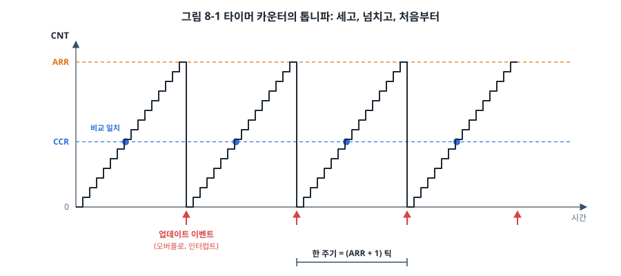
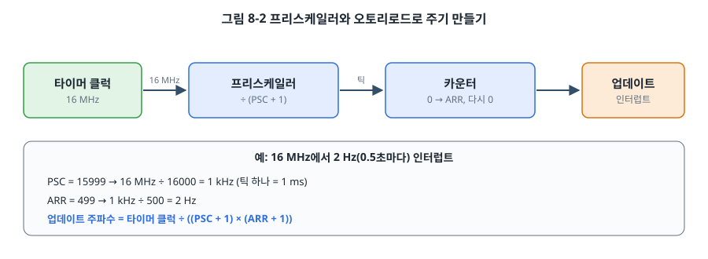
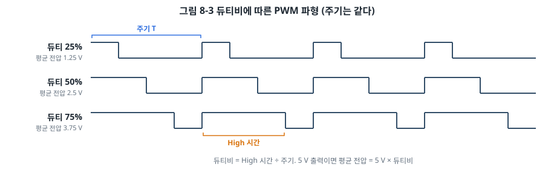
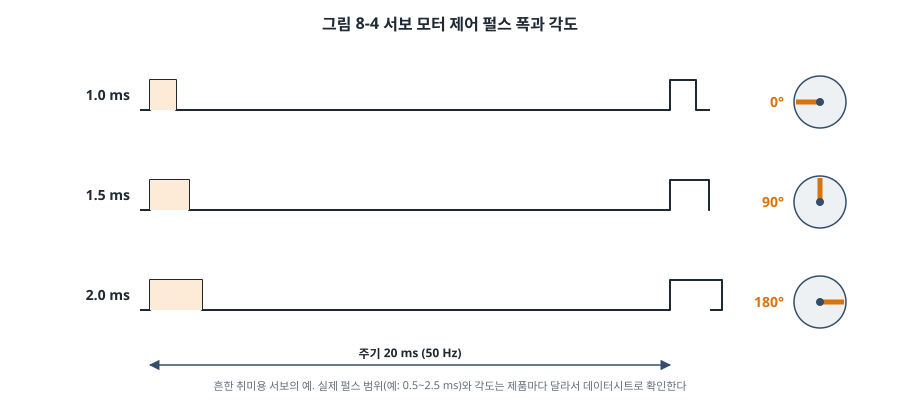
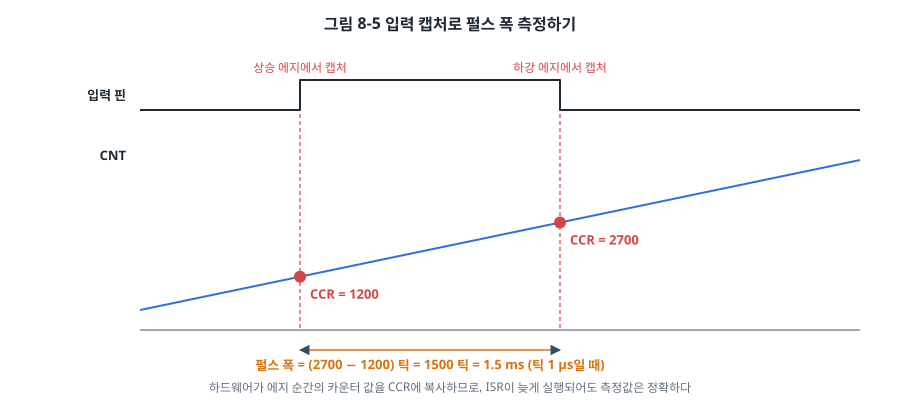

# 8장. 타이머와 PWM

## 이 장에서 배우는 것

- 타이머의 기본 구조: 카운터, 프리스케일러, 오토리로드, 비교 레지스터
- 일정한 주기의 인터럽트로 시간을 재는 방법(SysTick, 1 ms 틱)과 기다리지 않는 코드
- PWM으로 LED 밝기와 서보 모터를 제어하는 방법
- 입력 캡처로 펄스 폭을 정확하게 재는 방법
- AVR의 Timer0/1/2와 STM32 범용 타이머의 차이

---

## 8.1 빈 루프의 한계

지금까지 시간을 보낼 때는 빈 루프나 `_delay_ms()`를 썼습니다. 이 방법에는 세 가지 문제가 있습니다.

첫째, **정확하지 않습니다.** 3장에서 본 것처럼 빈 루프의 시간은 클럭, 최적화 옵션, Flash 대기 상태에 따라 달라집니다. 둘째, **그동안 다른 일을 못 합니다.** 7장의 디바운싱 예제는 20 ms 동안 메인 루프가 멈춰 있었습니다. 셋째, **인터럽트가 끼어들면 늘어납니다.** 빈 루프 도중에 ISR이 실행되면 그만큼 지연이 길어집니다.

**타이머(timer)** 는 이 문제를 해결하는 주변장치입니다. CPU와 상관없이 클럭에 맞춰 숫자를 세는 하드웨어 카운터라서, CPU가 무엇을 하든 정확하게 시간을 잽니다. 타이머는 시간 재기 말고도 정해진 모양의 신호를 만들어 내거나(PWM), 바깥 신호가 바뀐 순간을 기록하는(입력 캡처) 일도 합니다. MCU에서 가장 많이, 가장 다양하게 쓰이는 주변장치입니다.

## 8.2 타이머의 기본 구조

타이머의 핵심은 클럭이 들어올 때마다 1씩 늘어나는 **카운터(counter)** 입니다.



카운터 값(STM32는 CNT, AVR은 TCNTn)은 0부터 정해진 최댓값까지 올라간 뒤 다시 0으로 돌아갑니다. 시간에 따라 그리면 톱니 모양이 됩니다. 최댓값을 STM32에서는 **ARR(Auto-Reload Register)**, AVR에서는 TOP이라고 부릅니다. 카운터가 최댓값을 지나 0으로 돌아가는 순간을 **업데이트 이벤트(update event)** 또는 **오버플로(overflow)** 라고 하고, 이 순간 인터럽트를 걸 수 있습니다.

카운터 옆에는 **비교 레지스터(compare register, STM32는 CCRx, AVR은 OCRnx)** 가 있습니다. 카운터 값이 비교 레지스터 값과 같아지는 순간(비교 일치)에도 인터럽트를 걸거나 핀의 출력을 바꿀 수 있습니다. 이것이 8.5절의 PWM입니다.



카운터 앞에는 클럭을 나누는 **프리스케일러(prescaler)** 가 있습니다. 16 MHz 클럭으로 바로 세면 16비트 카운터도 4 ms면 넘쳐 버리므로, 클럭을 나눠 천천히 세게 합니다. 업데이트 주파수는 다음 식으로 정해집니다.

```
업데이트 주파수 = 타이머 클럭 ÷ ((PSC + 1) × (ARR + 1))
```

STM32의 PSC와 ARR은 "값 + 1"로 나눈다는 점에 주의하세요. 0을 쓰면 1로 나누고, 15999를 쓰면 16000으로 나눕니다. 그래서 16 MHz에서 1 kHz 틱을 만들려면 PSC = 15999, 2 Hz 인터럽트를 만들려면 ARR = 499입니다.

## 8.3 1 ms 틱: 시간의 기준 만들기

펌웨어에서 가장 먼저 만드는 타이머 인터럽트는 보통 **1 ms마다 한 번 실행되는 틱(tick)** 입니다. ISR에서 전역 변수를 1씩 늘려 두면, 프로그램 어디서든 그 변수로 "부팅 후 몇 ms가 지났는지" 알 수 있습니다. 아두이노의 `millis()`가 바로 이것입니다.

### STM32: SysTick

Cortex-M에는 시간 기준을 만들라고 코어에 들어 있는 24비트 타이머 **SysTick**이 있습니다. 칩 제조사와 상관없이 모든 Cortex-M에 같은 레지스터로 들어 있어서, RTOS(26장)도 이것을 틱으로 씁니다(PM0214 4.5절).

SysTick은 LOAD 값에서 0까지 **거꾸로** 셉니다. 0이 되면 인터럽트를 걸고 다시 LOAD 값부터 셉니다. 그래서 LOAD에 "주기 클럭 수 − 1"을 씁니다.

```c
static volatile uint32_t ms_ticks;

void SysTick_Handler(void)
{
    ms_ticks++;
}

static void systick_init(void)
{
    SYSTICK->LOAD = 16000000u / 1000u - 1u;      /* 16 MHz에서 16000 클럭 = 1 ms */
    SYSTICK->VAL  = 0;                            /* 현재 값 지우기 */
    SYSTICK->CTRL = SYSTICK_CTRL_CLKSOURCE        /* 프로세서 클럭 사용 */
                  | SYSTICK_CTRL_TICKINT          /* 0이 되면 인터럽트 */
                  | SYSTICK_CTRL_ENABLE;
}
```

CMSIS를 쓴다면 `SysTick_Config(SystemCoreClock / 1000);` 한 줄이 같은 일을 합니다. SysTick 예외는 NVIC의 IRQ가 아니라 코어 예외라서, `nvic_enable_irq()` 없이 CTRL의 TICKINT만 켜면 됩니다.

### AVR: Timer0 CTC 모드

AVR에는 SysTick이 없으므로 범용 타이머 하나를 씁니다. ATmega328P의 Timer0을 **CTC(Clear Timer on Compare match)** 모드로 쓰면, 카운터가 OCR0A 값에 도달할 때마다 0으로 돌아가며 인터럽트를 겁니다. OCR0A가 STM32의 ARR 역할을 하는 셈입니다.

```c
ISR(TIMER0_COMPA_vect)
{
    ms_ticks++;
}

static void tick_init(void)
{
    /* 16 MHz ÷ 64 ÷ (249 + 1) = 1000 Hz */
    TCCR0A = (1 << WGM01);                   /* CTC 모드 */
    TCCR0B = (1 << CS01) | (1 << CS00);      /* 프리스케일러 ÷64 */
    OCR0A  = 249;
    TIMSK0 = (1 << OCIE0A);                  /* 비교 일치 A 인터럽트 허용 */
}
```

AVR의 프리스케일러는 STM32처럼 아무 값이나 고를 수 없고 ÷1, ÷8, ÷64, ÷256, ÷1024 중에서 고릅니다(ATmega328P 데이터시트, Timer/Counter0의 Clock Select 표). 그래서 원하는 주기를 만들려면 프리스케일러와 TOP 값의 조합을 찾아야 합니다. ÷64를 고르면 틱이 4 µs이고, 250틱이 정확히 1 ms입니다.

> ⚠️ 주의: 아두이노 코어는 `millis()`와 `delay()`를 위해 Timer0을 이미 쓰고 있습니다. 아두이노 스케치에서 Timer0의 레지스터를 바꾸면 `millis()`와 `delay()`가 틀어집니다. 마찬가지로 Servo 라이브러리는 Timer1을, `tone()`은 Timer2를 씁니다. 이 책의 AVR 예제는 아두이노 코어 없이 빌드하므로 세 타이머를 모두 자유롭게 씁니다.

AVR에서 `ms_ticks`는 32비트라서 8비트 읽기 네 번으로 나뉩니다. 7장에서 배운 대로 `ATOMIC_BLOCK`으로 감싸서 읽습니다. STM32에서는 32비트 정렬 읽기가 원자적이라 그냥 읽어도 됩니다.

### 기다리지 않는 코드

틱이 생기면 "기다리는" 대신 "확인하는" 코드를 쓸 수 있습니다.

```c
uint32_t last = 0;

for (;;) {
    uint32_t now = millis();

    if (now - last >= 500) {     /* 500 ms가 지났으면 */
        last = now;
        toggle_led();
    }

    /* 기다리는 코드가 없으므로 여기서 다른 일을 계속할 수 있다 */
}
```

메인 루프는 쉬지 않고 돌면서 "시간이 됐는지"만 확인합니다. 여러 가지 일을 서로 다른 주기로 처리해도 서로를 막지 않습니다. 24장의 협력형 스케줄러는 이 방식을 일반화한 것입니다.

`now - last >= 500`처럼 **뺄셈으로 비교**하는 것이 중요합니다. 32비트 ms 카운터는 약 49.7일 뒤에 넘쳐서 0으로 돌아갑니다. `if (now >= last + 500)`으로 쓰면 넘치는 순간 비교가 틀어지지만, 부호 없는 정수의 뺄셈은 넘침이 있어도 정확한 차이를 줍니다. 예를 들어 `last = 0xFFFFFF00`, `now = 0x00000100`이면 `now - last = 0x200`(512)입니다. 현장에서 몇 달씩 켜져 있는 제품이라면 이 차이가 "50일마다 한 번씩 멈추는" 버그가 됩니다.

### 디바운싱 다시 보기

7장에서 약속한 대로, 틱을 이용해 디바운싱을 다시 만들어 보겠습니다. 5 ms마다 버튼을 읽고, 안정된 상태와 다른 값이 네 번(20 ms) 연속으로 나와야 상태가 바뀐 것으로 인정합니다.

```c
/* 5 ms마다 부른다 */
static uint8_t button_pressed_event(void)
{
    static uint8_t stable = 1, count = 0;
    uint8_t now = (PIND >> PIND2) & 1u;

    if (now != stable) {
        if (++count >= 4) {          /* 4번 연속 = 20 ms */
            stable = now;
            count = 0;
            return stable == 0;      /* 눌림으로 확정된 순간만 이벤트 */
        }
    } else {
        count = 0;                   /* 한 번이라도 원래 값이면 처음부터 */
    }
    return 0;
}
```

인터럽트도, 지연도 없습니다. 바운싱 동안의 짧은 변화는 `count`를 4까지 올리지 못하고 0으로 돌아갑니다. 버튼을 뗄 때의 바운싱도 같은 방식으로 걸러집니다. 버튼이 여러 개여도 같은 함수를 버튼마다 부르면 됩니다.

## 8.4 STM32의 범용 타이머

STM32F411에는 성격이 다른 타이머가 여러 개 있습니다(RM0383 12~15장).

| 타이머 | 카운터 | 채널 | 버스 | 특징 |
| --- | --- | --- | --- | --- |
| TIM1 | 16비트 | 4 | APB2 | 고급 타이머. 상보 출력과 데드 타임(모터 제어) |
| TIM2, TIM5 | **32비트** | 4 | APB1 | 범용. 긴 시간을 넘침 없이 잼 |
| TIM3, TIM4 | 16비트 | 4 | APB1 | 범용 |
| TIM9 | 16비트 | 2 | APB2 | 범용 |
| TIM10, TIM11 | 16비트 | 1 | APB2 | 범용 |

모두 같은 기본 구조(PSC, CNT, ARR, CCRx)를 가지므로 하나를 익히면 나머지도 쓸 수 있습니다.

### 타이머 클럭

타이머 클럭을 계산할 때 함정이 하나 있습니다. **APB 분주비가 1이 아니면 타이머 클럭은 APB 클럭의 2배**입니다(RM0383 6장 RCC의 클럭 트리 그림). 3장에서 SYSCLK 100 MHz, APB1 ÷2 = 50 MHz로 설정했다면, APB1에 있는 TIM2~TIM5의 클럭은 50 MHz가 아니라 100 MHz입니다. 리셋 기본 상태(HSI 16 MHz, 분주 없음)에서는 16 MHz입니다. 이 장의 예제는 리셋 기본 상태를 씁니다.

### 프리로드와 업데이트

STM32 타이머의 PSC, ARR, CCRx에는 **그림자 레지스터(shadow register)** 가 있습니다. 우리가 쓰는 값은 일단 프리로드 레지스터에 들어가고, 실제로 카운터가 쓰는 그림자 레지스터에는 다음 업데이트 이벤트 때 복사됩니다. 주기 중간에 값이 바뀌어 파형이 깨지는 것을 막기 위한 구조입니다.

- PSC는 항상 프리로드됩니다. 그래서 설정한 PSC를 바로 적용하려면 EGR 레지스터의 UG 비트에 1을 써서 업데이트 이벤트를 강제로 일으킵니다.
- ARR은 CR1의 ARPE 비트가 1일 때, CCRx는 CCMRx의 OCxPE 비트가 1일 때 프리로드됩니다.

예제 코드에서 설정 마지막에 `TIM2->EGR = TIM_EGR_UG;`를 쓰는 이유가 이것입니다. 이 줄을 빼면 첫 번째 주기는 프리스케일러 없이 16 MHz로 세어서 순식간에 지나갑니다.

## 8.5 PWM

### PWM의 원리

디지털 핀은 0 V와 5 V(또는 3.3 V) 두 가지만 낼 수 있습니다. 그런데 이 두 값을 아주 빠르게 번갈아 내면, 느리게 반응하는 장치(LED를 보는 사람의 눈, 모터, 히터)에게는 그 평균값처럼 보입니다. 이것이 **PWM(Pulse Width Modulation, 펄스 폭 변조)** 입니다.



한 주기 중 High인 시간의 비율을 **듀티비(duty cycle)** 라고 합니다. 5 V 출력에서 듀티비 25%면 평균 1.25 V, 75%면 3.75 V입니다. LED는 듀티비에 비례해 어둡거나 밝게 보이고, DC 모터는 듀티비에 비례하는 속도로 돕니다.

PWM 주파수는 장치에 맞춰 고릅니다. LED는 깜빡임이 보이지 않도록 수백 Hz 이상, DC 모터는 소음이 들리지 않도록 20 kHz 이상, 서보 모터는 규격상 50 Hz를 씁니다.

### 타이머로 PWM 만들기

타이머의 비교 레지스터를 쓰면 CPU 개입 없이 하드웨어가 PWM을 만듭니다. STM32의 **PWM 모드 1**에서 출력은 카운터가 CCR보다 작은 동안 High, 크거나 같아지면 Low입니다. 그림 8-1에서 카운터가 CCR 선 아래에 있는 동안 High라고 생각하면 됩니다. 그래서 다음과 같습니다.

```
PWM 주파수 = 타이머 클럭 ÷ ((PSC + 1) × (ARR + 1))
듀티비     = CCR ÷ (ARR + 1)
```

NUCLEO의 LD2(PA5)는 TIM2의 채널 1 출력(AF1)으로도 쓸 수 있습니다. 6장에서 GPIO로 켜고 끄던 그 LED의 밝기를 PWM으로 조절해 보겠습니다.

```c
gpio_set_af(GPIOA, 5, 1);                        /* PA5 = TIM2_CH1 (AF1) */

TIM2->PSC   = 15;                                /* 16 MHz ÷ 16 = 1 MHz 틱 */
TIM2->ARR   = 999;                               /* 1000틱 = 1 kHz PWM */
TIM2->CCR1  = 0;                                 /* 듀티비 0% */
TIM2->CCMR1 = (TIM2->CCMR1 & ~(TIM_CCMR1_OC1M_Msk | TIM_CCMR1_CC1S_Msk))
            | TIM_CCMR1_OC1M_PWM1                /* OC1M = 110: PWM 모드 1 */
            | TIM_CCMR1_OC1PE;                   /* CCR1 프리로드 */
TIM2->CCER |= TIM_CCER_CC1E;                     /* 채널 1 출력 켜기 */
TIM2->CR1  |= TIM_CR1_ARPE;
TIM2->EGR   = TIM_EGR_UG;
TIM2->CR1  |= TIM_CR1_CEN;                       /* 카운터 시작 */

TIM2->CCR1 = 200;                                /* 이후 이 값만 바꾸면 듀티비 20% */
```

AVR에서는 8비트 Timer2의 **고속 PWM(Fast PWM)** 모드를 씁니다. 카운터가 0~255를 반복하고, OCR2A 값에서 출력이 바뀝니다. 출력 핀은 OC2A, 우노의 D11(PB3)입니다.

```c
DDRB  |= (1 << DDB3);                                /* OC2A 핀을 출력으로 */
TCCR2A = (1 << COM2A1)                               /* 비반전 출력: 일치하면 Low, BOTTOM에서 High */
       | (1 << WGM21) | (1 << WGM20);                /* 모드 3: 고속 PWM, TOP = 0xFF */
TCCR2B = (1 << CS22);                                /* Timer2의 ÷64 */
OCR2A  = 64;                                         /* 듀티비 약 25% */
```

PWM 주파수는 16 MHz ÷ 64 ÷ 256 ≈ 977 Hz입니다. AVR 타이머의 출력 핀은 고정되어 있어서(OC0A = D6, OC0B = D5, OC1A = D9, OC1B = D10, OC2A = D11, OC2B = D3), 아두이노에서 `analogWrite()`를 쓸 수 있는 핀이 이 여섯 개뿐인 이유가 이것입니다.

> ⚠️ 주의: AVR의 고속 PWM에서 OCR을 0으로 써도 출력이 완전히 0이 되지 않고, 주기마다 타이머 클럭 한 개 폭의 짧은 펄스가 나옵니다(ATmega328P 데이터시트, Fast PWM Mode 절). LED에서는 거의 보이지 않지만, 모터 드라이버처럼 짧은 펄스에도 반응하는 회로라면 듀티비 0%일 때 PWM 출력을 끄고(COM 비트를 0으로) GPIO로 Low를 내야 합니다.

> 💡 팁: 사람의 눈은 밝기를 로그 스케일로 느낍니다. 듀티비를 0, 25, 50, 75, 100%로 바꾸면 밝기가 고르게 늘어나는 것이 아니라 처음에 확 밝아지고 나머지는 별 차이가 없어 보입니다. 예제에서 밝기 단계를 0, 8, 32, 96, 255처럼 곱절로 늘린 이유입니다. 이런 보정을 **감마 보정(gamma correction)** 이라고 합니다.

### 서보 모터

취미용 RC 서보 모터는 PWM 신호의 펄스 폭으로 각도를 정합니다.



주기는 20 ms(50 Hz)이고, 펄스 폭 1 ms가 한쪽 끝, 1.5 ms가 가운데, 2 ms가 반대쪽 끝인 제품이 많습니다. 정확한 범위는 제품마다 달라서 0.5~2.5 ms를 쓰는 제품도 있으니 데이터시트를 확인하세요. 범위를 넘는 펄스를 주면 서보가 기계적 한계에 부딪쳐 웅웅거리며 전류를 많이 먹고, 오래 두면 망가집니다.

20 ms 주기에서 0.5 µs 단위로 펄스 폭을 정하려면 16비트 타이머가 필요합니다. 우노에서는 Timer1을 **모드 14(고속 PWM, TOP = ICR1)** 로 씁니다.

```c
DDRB  |= (1 << DDB1);                                /* OC1A = D9 */
TCCR1A = (1 << COM1A1) | (1 << WGM11);
TCCR1B = (1 << WGM13) | (1 << WGM12) | (1 << CS11);  /* 모드 14, ÷8 → 틱 0.5 µs */
ICR1   = 39999;                                      /* 40000틱 = 20 ms */
OCR1A  = 3000;                                       /* 3000틱 = 1.5 ms */
```

STM32에서는 TIM3의 채널 1(PA6, AF2)을 씁니다. PSC = 15로 1 µs 틱을 만들고 ARR = 19999로 20 ms 주기를 만들면, CCR1에 µs 단위의 펄스 폭을 그대로 쓸 수 있습니다.

```c
TIM3->PSC  = 15;          /* 1 µs 틱 */
TIM3->ARR  = 19999;       /* 20 ms */
TIM3->CCR1 = 1500;        /* 1.5 ms */
```

> ⚠️ 주의: 서보 모터는 움직이는 순간 수백 mA에서 1 A 가까이 전류를 씁니다. 우노나 NUCLEO의 5 V 핀에서 전원을 끌어오면 전압이 떨어져 보드가 리셋되거나 USB 포트가 차단될 수 있습니다. 서보는 별도의 5 V 전원에 연결하고, **GND만** 보드와 공통으로 연결하세요(2장 2.4절의 주의).

> 🔍 깊이 보기: AVR의 16비트 레지스터(OCR1A, ICR1, TCNT1)는 8비트 버스로 두 번에 나누어 접근합니다. 칩 안의 임시 레지스터(TEMP)를 이용해 두 바이트가 동시에 반영되도록 하는데, 쓸 때는 상위 바이트를 먼저, 읽을 때는 하위 바이트를 먼저 접근해야 합니다. C에서 `OCR1A = 3000;`처럼 16비트로 쓰면 컴파일러가 순서를 지켜 줍니다. 다만 메인 코드와 ISR이 모두 16비트 타이머 레지스터를 건드리면, ISR이 TEMP를 덮어써서 메인 코드의 접근이 깨질 수 있습니다. 이 경우 7장의 `ATOMIC_BLOCK`으로 감쌉니다(ATmega328P 데이터시트, Accessing 16-bit Registers 절).

## 8.6 입력 캡처

PWM이 "정해진 폭의 펄스를 만드는" 기능이라면, **입력 캡처(input capture)** 는 반대로 "바깥에서 들어온 펄스의 폭이나 주기를 재는" 기능입니다.



입력 핀에 에지가 들어오는 순간, 하드웨어가 그 순간의 카운터 값을 캡처 레지스터(STM32는 CCRx, AVR은 ICR1)에 복사하고 인터럽트를 겁니다. 상승 에지에서 1200, 하강 에지에서 2700이 캡처되었다면 펄스 폭은 1500틱입니다. 틱이 1 µs라면 1.5 ms입니다.

에지가 들어온 순간에 GPIO 인터럽트로 카운터를 읽어도 될 것 같지만, 그러면 ISR이 실행되기까지의 지연(그리고 더 높은 우선순위 인터럽트가 실행 중이었다면 그 시간)만큼 오차가 생깁니다. 입력 캡처는 하드웨어가 에지 순간의 값을 붙잡아 두므로, ISR이 늦게 실행되어도 측정값은 정확합니다. 초음파 거리 센서의 에코 펄스, 회전 속도 센서의 펄스 간격, RC 수신기의 신호 같은 것을 잴 때 씁니다.

### STM32: TIM4 채널 1로 서보 펄스 재기

예제에서는 PA6의 서보 PWM을 점퍼선으로 PB6(TIM4_CH1, AF2)에 연결하고, TIM4로 그 펄스 폭을 잽니다. 자기 자신이 만든 신호를 재는 것이므로, 측정값이 TIM3의 CCR1 값과 같은지 바로 확인할 수 있습니다.

```c
TIM4->PSC   = 15;                        /* 1 µs 틱 */
TIM4->ARR   = 0xFFFF;                    /* 16비트 자유 실행 */
TIM4->CCMR1 = (TIM4->CCMR1 & ~(TIM_CCMR1_CC1S_Msk | TIM_CCMR1_IC1F_Msk))
            | TIM_CCMR1_CC1S_TI1;        /* CC1S = 01: 채널 1을 입력으로 */
TIM4->CCER |= TIM_CCER_CC1P | TIM_CCER_CC1NP   /* CC1NP:CC1P = 11: 양쪽 에지 */
            | TIM_CCER_CC1E;             /* 캡처 켜기 */
TIM4->DIER |= TIM_DIER_CC1IE;            /* 캡처 인터럽트 */
```

ISR에서는 캡처된 값이 상승 에지의 것인지 하강 에지의 것인지 핀의 현재 상태로 구분합니다.

```c
void TIM4_IRQHandler(void)
{
    static uint16_t rise;

    if (TIM4->SR & TIM_SR_CC1IF) {
        uint16_t ccr = (uint16_t)TIM4->CCR1;         /* 읽으면 CC1IF가 지워진다 */
        if (GPIOB->IDR & (1u << 6)) {
            rise = ccr;                              /* 상승 에지 */
        } else {
            pulse_width_us = (uint16_t)(ccr - rise); /* 하강 에지: 폭 계산 */
        }
    }
}
```

`(uint16_t)(ccr - rise)`도 8.3절의 넘침에 안전한 뺄셈과 같은 원리입니다. 16비트 카운터가 65535에서 0으로 넘어간 뒤 하강 에지가 들어와도, 16비트로 잘라서 빼면 올바른 폭이 나옵니다. 단, 펄스 폭 자체가 65535틱(이 설정에서 약 65 ms)보다 길면 잴 수 없습니다. 더 긴 펄스는 32비트 타이머인 TIM2나 TIM5를 쓰거나 틱을 길게 잡습니다.

GDB에서 `print pulse_width_us`를 실행해 보세요. 버튼을 누를 때마다 서보 펄스가 1000, 1250, 1500, 1750, 2000 µs로 바뀌는 것이 측정값에 그대로 나타납니다.

### AVR: Timer1의 입력 캡처

ATmega328P에서 입력 캡처는 16비트 Timer1에만 있고, 입력 핀은 ICP1(D8, PB0) 하나입니다. TCCR1B의 ICES1 비트로 캡처할 에지(0 하강, 1 상승)를 고르고, ICNC1 비트로 노이즈 제거 필터를 켤 수 있습니다. STM32처럼 양쪽 에지를 한 번에 잡을 수 없으므로, ISR에서 ICES1을 뒤집어 다음 에지를 기다립니다.

```c
ISR(TIMER1_CAPT_vect)
{
    static uint16_t rise;
    uint16_t icr = ICR1;

    if (TCCR1B & (1 << ICES1)) {         /* 상승 에지를 잡았다 */
        rise = icr;
        TCCR1B &= ~(1 << ICES1);         /* 다음은 하강 에지 */
    } else {
        pulse_width = icr - rise;
        TCCR1B |= (1 << ICES1);          /* 다음은 상승 에지 */
    }
    TIFR1 = (1 << ICF1);                 /* 에지를 바꾼 뒤 생길 수 있는 플래그 지우기 */
}
```

그런데 우노에는 16비트 타이머가 Timer1 하나뿐이라, 이 예제에서 서보에 Timer1을 쓰는 동안에는 입력 캡처를 함께 쓸 수 없습니다. 정확히 말하면 같은 타이머의 카운터를 공유하므로 주기와 틱을 함께 정해야 합니다. 이처럼 8비트 MCU에서는 **타이머가 부족한 자원**이라, 설계 초기에 어느 기능에 어느 타이머를 쓸지 미리 배정해 두어야 합니다. STM32F411은 범용 타이머가 8개 있어서 이 장의 예제처럼 기능마다 타이머를 하나씩 줄 수 있습니다.

> 🔧 ATmega128에서는: 8비트 타이머 두 개(Timer0, Timer2)와 16비트 타이머 두 개(Timer1, Timer3)가 있고, 16비트 타이머는 출력 비교 채널이 세 개(A, B, C)입니다. 입력 캡처도 ICP1(PD4)과 ICP3(PE7) 두 개라서 서보와 입력 캡처를 서로 다른 타이머로 나눌 수 있습니다. 다만 레지스터 구성이 다릅니다. Timer0의 설정 레지스터는 TCCR0 하나이고, 인터럽트 허용 비트는 TIMSK와 ETIMSK에 나뉘어 있으며, 비동기 동작을 지원하는 쪽이 Timer2가 아니라 Timer0이라 프리스케일러 선택표도 다릅니다. 이 장의 AVR 코드를 옮길 때는 ATmega128A 데이터시트의 각 타이머 장에서 레지스터 이름과 분주 표를 확인하세요.

## 8.7 실습: 버튼으로 밝기와 각도 바꾸기

`code/ch08-timer/`의 예제는 이 장의 내용을 모두 합친 것입니다.

- 1 ms 틱(AVR은 Timer0, STM32는 SysTick)
- 5 ms마다 버튼을 샘플링하는 디바운싱
- PWM으로 LED 밝기 조절(AVR은 Timer2와 D11의 외부 LED, STM32는 TIM2와 보드의 LD2)
- 서보 모터 제어(AVR은 Timer1과 D9, STM32는 TIM3과 PA6)
- STM32에서는 TIM4 입력 캡처로 서보 펄스 폭 측정(PA6과 PB6을 점퍼선으로 연결)

버튼을 누를 때마다 LED가 다섯 단계로 밝아지고 서보가 다섯 단계로 돌아갑니다. 메인 루프에 기다리는 코드가 하나도 없다는 점을 확인하세요. 메인 루프는 시간을 확인하고, 할 일이 있으면 하고, 없으면 바로 다음 바퀴를 돕니다.

오실로스코프나 로직 애널라이저가 있다면 PWM 출력 핀의 파형을 보면서 버튼을 눌러 보세요. 주기는 그대로이고 High 폭만 바뀌는 것이 보입니다. 로직 애널라이저 소프트웨어의 PWM 디코더를 쓰면 듀티비를 숫자로도 볼 수 있습니다.

## 8.8 8비트와 32비트 비교

| 항목 | ATmega328P | STM32F411 |
| --- | --- | --- |
| 타이머 수 | 3개 (8비트 2, 16비트 1) | 8개 (16비트 6, 32비트 2) + SysTick |
| 프리스케일러 | 정해진 몇 가지 (÷1, 8, 64, 256, 1024) | 1~65536 중 아무 값 (PSC + 1) |
| 주기 설정 | 모드에 따라 고정(0xFF 등) 또는 OCRnA, ICR1 | ARR에 아무 값 |
| 채널 | 타이머당 2개 (OCnA, OCnB) | 타이머당 최대 4개 |
| 출력 핀 | 고정 | AF로 여러 핀 중 선택 |
| 값 반영 | 모드에 따라 즉시 또는 이중 버퍼 | 프리로드 + 업데이트 이벤트(UG) |
| 입력 캡처 | Timer1만, 한 번에 한쪽 에지 | 대부분의 채널, 양쪽 에지 |
| 시스템 틱 | 범용 타이머를 빌려 씀 | 코어의 SysTick |

AVR 타이머는 모드 번호(WGM 비트)마다 동작이 정해져 있어 데이터시트의 모드 표를 보고 골라야 하고, STM32 타이머는 몇 가지 레지스터를 조합해 원하는 동작을 만드는 방식입니다. 처음에는 STM32 쪽이 설정할 것이 많아 보이지만, 구조가 일정해서 어떤 타이머든 같은 순서(클럭 켜기 → PSC/ARR → 채널 모드 → 출력/인터럽트 허용 → UG → CEN)로 설정할 수 있습니다.

---

## 정리

- 타이머는 클럭에 맞춰 세는 카운터에 프리스케일러, 오토리로드(최댓값), 비교 레지스터가 붙은 구조입니다. 업데이트 주파수는 타이머 클럭 ÷ ((PSC + 1) × (ARR + 1))입니다.
- 1 ms 틱을 만들어 두면 기다리지 않는 코드를 쓸 수 있습니다. 경과 시간은 `now - last`처럼 뺄셈으로 비교해야 카운터가 넘쳐도 안전합니다.
- STM32는 코어의 SysTick을, AVR은 Timer0의 CTC 모드를 틱으로 씁니다.
- PWM은 비교 레지스터로 듀티비를 정하며, LED 밝기, 모터 속도, 서보 각도 제어에 씁니다. 서보는 20 ms 주기에 1~2 ms 펄스를 쓰는 제품이 많습니다.
- STM32 타이머의 PSC는 업데이트 이벤트 때 반영되므로, 설정 뒤 EGR의 UG 비트로 즉시 반영합니다. APB 분주비가 1이 아니면 타이머 클럭은 APB 클럭의 2배입니다.
- 입력 캡처는 에지 순간의 카운터 값을 하드웨어가 붙잡으므로, 인터럽트 지연과 상관없이 펄스 폭을 정확히 잽니다.

## 연습 문제

1. STM32의 TIM3(16비트)으로 타이머 클럭 16 MHz에서 정확히 10 Hz 업데이트 인터럽트를 만들려고 합니다. PSC와 ARR 값의 조합을 두 가지 이상 찾으세요. 어느 조합이 더 좋은지, 그 기준은 무엇인지 설명하세요.
2. 우노의 Timer1로 1 kHz, 듀티비 30%의 PWM을 D10(OC1B)에 내려면 모드, 프리스케일러, TOP, 비교 값을 어떻게 정해야 하나요?
3. 3장의 100 MHz 클럭 설정(APB1 ÷2)을 이 장의 STM32 예제에 추가하면 LED PWM과 서보 펄스가 어떻게 바뀌나요? 원래대로 동작하게 하려면 어떤 값을 바꿔야 하나요? SysTick은 어떤가요?
4. 다음 코드는 49.7일마다 한 번 문제를 일으킵니다. 이유를 설명하고 고치세요.
   ```c
   uint32_t deadline = millis() + 1000;
   while (millis() < deadline) {
       do_something();
   }
   ```
5. 8.6절의 STM32 입력 캡처 ISR은 핀의 현재 상태로 에지 방향을 구분합니다. 펄스 폭이 매우 짧으면(수 µs) 어떤 문제가 생길 수 있나요? 이를 피하는 STM32 타이머의 기능을 RM0383에서 찾아보세요. (힌트: PWM 입력 모드)
6. (실습) 예제에 버튼을 길게 누르면(1초 이상) 밝기와 각도를 처음 단계로 되돌리는 기능을 추가하세요. 디바운싱 함수와 틱을 어떻게 활용하면 될까요?
