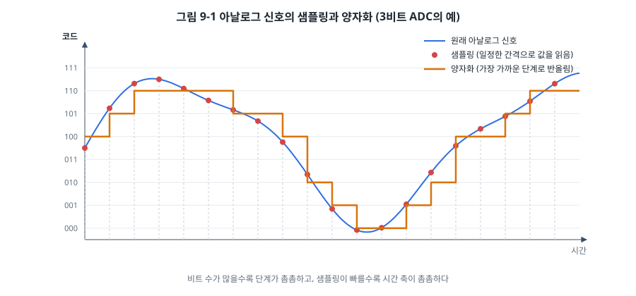
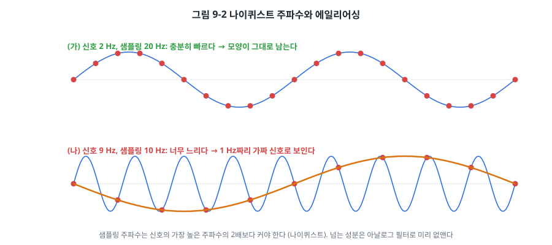
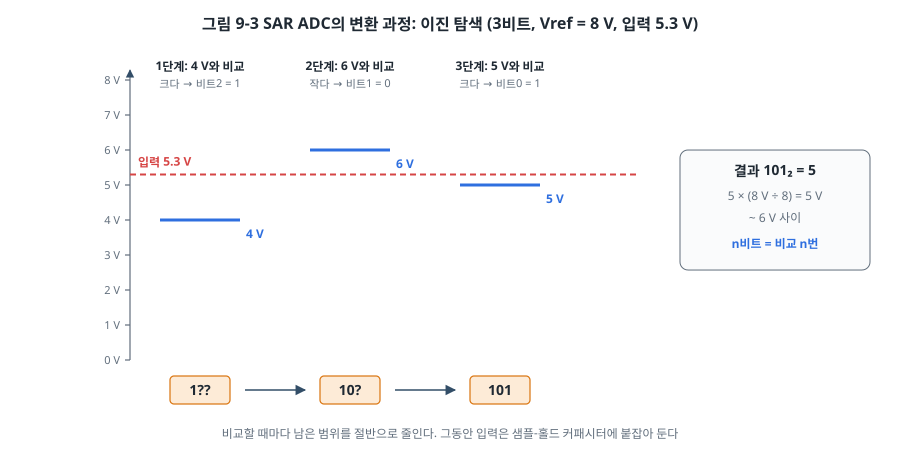
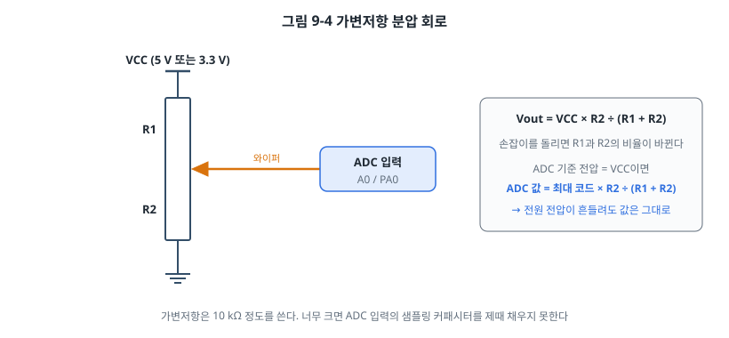
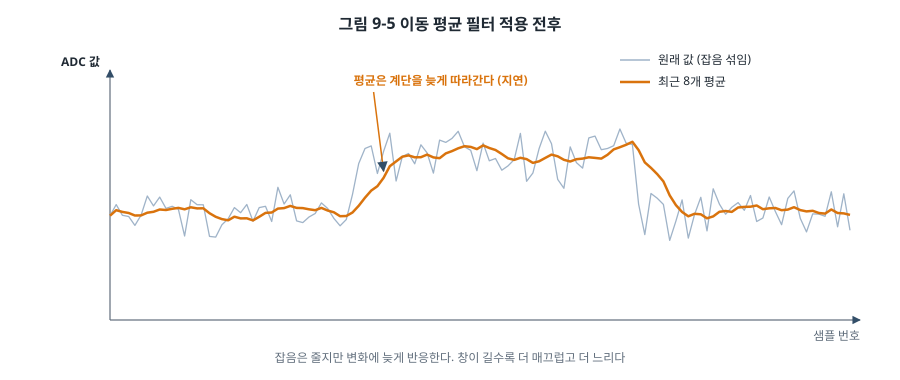

# 9장. ADC와 DAC: 아날로그 세계와 만나다

## 이 장에서 배우는 것

- 샘플링과 양자화, 분해능과 기준 전압의 의미
- 나이퀴스트 주파수와 에일리어싱
- SAR ADC가 전압을 숫자로 바꾸는 원리와 변환 시간
- AVR과 STM32의 ADC 레지스터, STM32 내부 온도 센서와 보정값
- 잡음을 줄이는 이동 평균 필터, 그리고 DAC가 없는 칩에서 아날로그 전압을 만드는 방법

---

## 9.1 세상은 아날로그다

지금까지 다룬 신호는 0과 1, 둘 중 하나였습니다. 하지만 바깥세상의 양은 대부분 연속적입니다. 온도는 23.4 °C에서 23.5 °C로 매끄럽게 변하고, 마이크의 전압은 소리를 따라 끊임없이 오르내립니다. 센서는 이런 물리량을 전압으로 바꿔 주는데, 그 전압도 연속적인 값입니다.

MCU가 이 전압을 다루려면 숫자로 바꿔야 합니다. 이 일을 하는 주변장치가 **ADC(Analog-to-Digital Converter)** 입니다. 반대로 숫자를 전압으로 바꾸는 장치는 **DAC(Digital-to-Analog Converter)** 입니다. 이 장에서는 주로 ADC를 다루고, 마지막에 DAC를 다룹니다.

## 9.2 샘플링과 양자화

ADC는 연속적인 신호를 두 단계를 거쳐 숫자로 바꿉니다.



- **샘플링(sampling)**: 시간 축을 자릅니다. 신호를 일정한 간격으로 한 번씩 읽습니다. 1초에 읽는 횟수가 **샘플링 주파수**(단위 Hz 또는 SPS, samples per second)입니다.
- **양자화(quantization)**: 값 축을 자릅니다. 읽은 전압을 정해진 단계 중 가장 가까운 것으로 반올림합니다. 단계의 수는 ADC의 비트 수로 정해집니다.

### 분해능과 기준 전압

n비트 ADC는 전압 범위를 2ⁿ 단계로 나눕니다. 그 범위의 위쪽 끝이 **기준 전압(Vref)** 입니다. 한 단계의 크기를 **LSB(Least Significant Bit)** 라고 부릅니다.

```
LSB = Vref ÷ 2ⁿ
ADC 값 = 입력 전압 ÷ LSB  (0 ~ 2ⁿ − 1)
입력 전압 = ADC 값 × Vref ÷ 2ⁿ
```

| 보드 | 비트 수 | 기준 전압 | LSB |
| --- | --- | --- | --- |
| 우노 (ATmega328P) | 10비트 (0~1023) | 5 V (AVCC) | 약 4.88 mV |
| NUCLEO (STM32F411) | 12비트 (0~4095) | 3.3 V (VDDA) | 약 0.81 mV |

12비트 ADC가 10비트보다 4배 촘촘하게 잽니다. 하지만 비트 수가 곧 정확도는 아닙니다. 기준 전압 자체가 1% 틀리면 모든 측정값이 1% 틀리고, 전원 잡음이 수 mV라면 아래쪽 몇 비트는 잡음일 뿐입니다. 데이터시트에는 오프셋 오차, 이득 오차, 비선형성(INL, DNL) 같은 정확도 항목이 따로 있으니, 정밀한 측정이 필요하면 그 표를 확인하세요.

> 💡 팁: 마지막 공식에서 2ⁿ으로 나눌지 2ⁿ − 1로 나눌지 헷갈리는 경우가 많습니다. 데이터시트의 변환식은 대부분 2ⁿ을 씁니다(코드 1023은 "5 V에서 1 LSB 모자란 값"). 실제로는 둘의 차이가 1 LSB보다 작아 거의 문제가 되지 않지만, 책이나 라이브러리를 비교할 때 숫자가 조금 다른 이유가 이것입니다.

### 나이퀴스트 주파수와 에일리어싱

샘플링을 얼마나 자주 해야 할까요?



**나이퀴스트-섀넌 표본화 정리**에 따르면, 신호에 들어 있는 가장 높은 주파수의 **2배보다 빠르게** 샘플링해야 원래 신호를 복원할 수 있습니다. 샘플링 주파수의 절반을 **나이퀴스트 주파수**라고 합니다.

이 조건을 어기면 그림 9-2(나)처럼 빠른 신호가 전혀 다른 느린 신호로 보입니다. 9 Hz 신호를 10 Hz로 샘플링하면 1 Hz 신호처럼 보입니다. 이것을 **에일리어싱(aliasing)** 이라고 합니다. 영화에서 달리는 마차의 바퀴가 거꾸로 도는 것처럼 보이는 것도 같은 현상입니다. 에일리어싱이 일단 일어나면 샘플만 보고는 진짜 신호와 가짜 신호를 구별할 수 없으므로, ADC 앞에 아날로그 저역 통과 필터(RC 필터 등)를 두어 나이퀴스트 주파수보다 높은 성분을 **미리** 없애야 합니다.

온도처럼 천천히 변하는 양은 1초에 몇 번만 읽어도 충분합니다. 반면 소리(사람이 듣는 범위 최대 약 20 kHz)를 다루려면 40 kHz 이상으로 샘플링해야 하고, 그래서 CD의 샘플링 주파수가 44.1 kHz입니다.

## 9.3 SAR ADC의 원리

MCU에 들어 있는 ADC는 대부분 **SAR(Successive Approximation Register, 축차 비교형)** 방식입니다.



SAR ADC는 숫자 맞히기 놀이처럼 동작합니다.

1. **샘플-홀드**: 먼저 입력 전압으로 작은 커패시터를 충전합니다. 이 시간을 **샘플링 시간**이라고 합니다. 충전이 끝나면 커패시터를 입력에서 떼어 내어, 변환하는 동안 입력이 바뀌어도 값이 흔들리지 않게 붙잡아 둡니다.
2. **이진 탐색**: 내부 DAC로 Vref의 절반 전압을 만들어 붙잡아 둔 전압과 비교합니다. 크면 최상위 비트를 1로, 작으면 0으로 정합니다. 그다음 남은 범위의 절반 전압과 비교해 다음 비트를 정합니다.
3. n비트 ADC라면 비교를 n번 하면 끝납니다.

그래서 변환 시간은 "샘플링 시간 + 비트 수만큼의 비교 시간"입니다.

| 항목 | ATmega328P | STM32F411 |
| --- | --- | --- |
| ADC 클럭 | 50~200 kHz 권장 (10비트 정확도) | 최대 36 MHz (VDDA 2.4 V 이상) |
| 변환 시간 | 13 ADC 클럭 (켠 뒤 첫 변환은 25) | 샘플링 시간(3~480 클럭) + 12 클럭 |
| 이 장 설정의 예 | 125 kHz → 약 104 µs | 8 MHz, 480 + 12 클럭 → 약 62 µs |
| 최대 속도 | 약 15 kSPS | 약 2.4 MSPS (36 MHz, 3 + 12 클럭) |

출처: ATmega328P 데이터시트 ADC 장의 Prescaling and Conversion Timing, DS10314의 ADC 특성 표, RM0383 11.5절.

### 샘플링 시간과 신호원 저항

샘플링 시간이 너무 짧으면 커패시터가 입력 전압까지 다 충전되지 못해 값이 낮게 나옵니다. 충전 속도는 신호원의 출력 저항에 따라 달라서, 저항이 큰 센서나 큰 가변저항일수록 샘플링 시간을 길게 잡아야 합니다. ATmega328P는 신호원 저항이 10 kΩ 이하가 되도록 권장하고, STM32는 DS10314의 표에 샘플링 시간별로 허용되는 최대 신호원 저항(RAIN)이 나와 있습니다. 이 장의 예제는 STM32에서 가장 긴 480 클럭을 써서 이런 걱정을 줄였습니다.

## 9.4 기준 전압과 비율 측정

가변저항으로 손잡이의 위치를 읽어 보겠습니다.



가변저항의 양 끝을 VCC와 GND에 연결하면 가운데 다리(와이퍼)에는 손잡이 위치에 비례하는 전압이 나옵니다. 2장의 옴의 법칙으로 보면 두 저항 R1, R2가 직렬로 연결된 **분압기(voltage divider)** 입니다.

여기서 중요한 성질이 있습니다. ADC의 기준 전압도 같은 VCC라면, VCC가 4.8 V든 5.1 V든 ADC 값은 R2 ÷ (R1 + R2)의 비율에만 따라 정해집니다. 분압기의 출력과 기준 전압이 함께 오르내리기 때문입니다. 이것을 **비율 측정(ratiometric measurement)** 이라고 합니다. 가변저항, 서미스터 분압 회로, 많은 압력 센서처럼 전원 전압에 비례하는 출력을 내는 센서는 기준 전압을 같은 전원으로 잡는 것이 정확합니다.

반대로 TMP36 같은 온도 센서는 "1 °C당 10 mV"처럼 전원과 상관없는 절대 전압을 냅니다. 이 경우 VCC를 기준 전압으로 쓰면 VCC의 오차가 그대로 측정 오차가 됩니다. 이때는 칩 내부의 정밀한 기준 전압(ATmega328P의 1.1 V 내부 기준)을 쓰거나, 9.6절처럼 VCC를 따로 재서 보정합니다.

## 9.5 AVR의 ADC

ATmega328P의 ADC는 10비트이고, 아날로그 입력 6개(A0~A5, 패키지에 따라 8개)를 멀티플렉서로 골라 하나씩 변환합니다. 레지스터는 세 개면 충분합니다(ATmega328P 데이터시트, Analog-to-Digital Converter 장).

| 레지스터 | 주요 비트 | 역할 |
| --- | --- | --- |
| ADMUX | REFS1:0, ADLAR, MUX3:0 | 기준 전압 선택(01 = AVCC, 11 = 내부 1.1 V), 정렬, 채널 |
| ADCSRA | ADEN, ADSC, ADATE, ADIF, ADIE, ADPS2:0 | ADC 켜기, 변환 시작, 자동 트리거, 완료 플래그, 인터럽트, 클럭 분주 |
| ADCL, ADCH | | 변환 결과 (ADCL을 먼저 읽는다) |
| DIDR0 | ADC5D~ADC0D | 아날로그로 쓰는 핀의 디지털 입력 버퍼 끄기 |

```c
static void adc_init(void)
{
    ADMUX  = (1 << REFS0);                                 /* 기준 = AVCC, 채널 0 */
    ADCSRA = (1 << ADEN)                                   /* ADC 켜기 */
           | (1 << ADPS2) | (1 << ADPS1) | (1 << ADPS0);   /* 16 MHz ÷ 128 = 125 kHz */
    DIDR0  = (1 << ADC0D);                                 /* A0 디지털 입력 끄기 */
}

static uint16_t adc_read(uint8_t ch)
{
    ADMUX = (ADMUX & 0xF0) | (ch & 0x0F);                  /* 채널 선택 */
    ADCSRA |= (1 << ADSC);                                 /* 변환 시작 */
    while (ADCSRA & (1 << ADSC)) {                         /* 끝나면 ADSC = 0 */
    }
    return ADC;                                            /* ADCL → ADCH 순서로 읽는 16비트 접근 */
}
```

ADC 클럭은 50~200 kHz 사이여야 10비트 정확도가 나오므로, 16 MHz에서는 ÷128(125 kHz)을 고릅니다. 결과 레지스터는 ADCL을 먼저 읽어야 합니다. ADCL을 읽으면 ADCH가 잠겨서 다음 변환 결과가 덮어쓰지 못하고, ADCH를 읽으면 풀립니다. avr-libc의 `ADC` 매크로로 16비트를 한 번에 읽으면 이 순서를 컴파일러가 지켜 줍니다.

DIDR0으로 디지털 입력 버퍼를 끄는 이유는 6장의 그림 6-1에 있습니다. 입력 경로의 슈미트 트리거는 문턱 근처의 아날로그 전압이 들어오면 0과 1 사이를 오가며 전류를 쓰고 잡음을 만듭니다. 아날로그로만 쓰는 핀이라면 꺼 두는 것이 좋습니다.

> 💡 팁: 아두이노의 `analogRead()`도 같은 일을 합니다. 다만 우노 보드의 AREF 핀에 외부 전압을 연결한 상태에서 `analogReference(EXTERNAL)`을 부르기 전에 `analogRead()`를 먼저 부르면, AVCC와 AREF가 칩 안에서 단락될 수 있습니다. 데이터시트도 경고하는 상황이니, 외부 기준 전압을 쓸 때는 설정 순서에 주의하세요.

> 🔧 ATmega128에서는: ADC 입력은 포트 F(PF0~PF7)의 8채널이고, 두 채널의 차이를 ×10이나 ×200으로 증폭해서 재는 차동 입력도 있습니다. 다만 5장과 6장에서 본 것처럼 공장 출하 상태에서는 JTAG이 PF4~PF7을 쓰므로, JTAG을 끄지 않으면 ADC4~ADC7은 제대로 측정되지 않습니다. 레지스터 이름은 ADMUX, ADCSRA로 같지만 자동 변환 기능이 다릅니다. ATmega328P의 ADCSRA 5번 비트는 ADATE(자동 트리거)이고 ADCSRB의 ADTS 비트로 타이머 등 트리거 소스를 고를 수 있지만, ATmega128의 같은 자리 비트는 ADFR(프리 러닝)이고 ADCSRB와 트리거 소스 선택이 없습니다. 그래서 ATmega128은 "한 번 변환" 아니면 "쉬지 않고 연속 변환" 두 가지만 됩니다(ATmega128A 데이터시트, ADC 장의 ADCSRA 설명).

## 9.6 STM32의 ADC

STM32F411에는 12비트 ADC가 하나(ADC1) 있고, 외부 입력 16채널과 내부 채널(온도 센서, 내부 기준 전압 VREFINT, 배터리 전압 VBAT)을 멀티플렉서로 고릅니다. AVR보다 기능이 훨씬 많습니다. 여러 채널을 정해진 순서로 연달아 변환하는 **스캔 모드**, 타이머 이벤트로 변환을 시작하는 **외부 트리거**, 결과를 DMA로 메모리에 바로 옮기는 기능(10장), 값이 범위를 벗어나면 인터럽트를 거는 **아날로그 워치독** 등이 있습니다. 여기서는 가장 기본인 단일 채널, 소프트웨어 시작 변환을 씁니다.

| 레지스터 | 역할 |
| --- | --- |
| ADC_CCR (공통) | ADC 클럭 분주(ADCPRE), 온도 센서와 VREFINT 켜기(TSVREFE) |
| ADC_CR1 | 분해능(12/10/8/6비트), 스캔 모드, 인터럽트 허용 |
| ADC_CR2 | ADC 켜기(ADON), 연속 변환(CONT), 정렬(ALIGN), DMA, 변환 시작(SWSTART) |
| ADC_SMPR1, SMPR2 | 채널별 샘플링 시간 (3비트, 3~480 클럭) |
| ADC_SQR1~3 | 변환할 채널의 순서와 개수 |
| ADC_SR | 변환 완료(EOC), 오버런(OVR) 플래그 |
| ADC_DR | 변환 결과 |

```c
GPIOA->MODER |= (3u << (0 * 2));                     /* PA0: 아날로그 모드(11) */

ADC_COMMON->CCR = (ADC_COMMON->CCR & ~(ADC_CCR_ADCPRE_Msk | ADC_CCR_VBATE))
                | ADC_CCR_TSVREFE;                   /* PCLK2 ÷2, 온도 센서와 VREFINT 켜기 */
ADC1->CR1 &= ~ADC_CR1_RES_Msk;                       /* 12비트 */
ADC1->SMPR2 = 0x3FFFFFFFu;                           /* 채널 0~9 모두 480 클럭 */
ADC1->SMPR1 = 0x07FFFFFFu;                           /* 채널 10~18 모두 480 클럭 */
ADC1->SQR1 = 0;                                      /* 변환 개수 1개 */
ADC1->CR2 |= ADC_CR2_ADON;                           /* ADC 켜기 */

uint16_t adc_read(uint32_t ch)
{
    ADC1->SQR3 = ch;                                 /* 첫 번째 변환 = ch */
    ADC1->CR2 |= ADC_CR2_SWSTART;
    while ((ADC1->SR & ADC_SR_EOC) == 0) {
    }
    return (uint16_t)ADC1->DR;                       /* DR을 읽으면 EOC가 지워진다 */
}
```

핀을 아날로그 모드(MODER = 11)로 두는 것을 잊지 마세요. 6장에서 말한 대로 이 모드에서는 디지털 입력 경로가 끊어집니다. AVR의 DIDR0과 같은 역할입니다.

### 내부 온도 센서와 보정값

STM32에는 칩 내부 온도를 재는 센서가 ADC 채널 18에 연결되어 있습니다. 이 센서의 출력은 온도에 따라 직선으로 변하지만, RM0383에 따르면 **직선의 위치(오프셋)가 칩마다 최대 45 °C까지 다를 수 있습니다.** 데이터시트의 대표값(25 °C에서 0.76 V, 기울기 2.5 mV/°C)으로 계산하면 칩에 따라 크게 틀립니다.

그래서 ST는 공장에서 칩마다 두 온도(30 °C, 110 °C)에서 센서 값을 재서 시스템 메모리에 기록해 둡니다(DS10314의 Temperature sensor calibration values 표).

| 이름 | 주소 | 내용 |
| --- | --- | --- |
| TS_CAL1 | 0x1FFF 7A2C | 30 °C, VDDA = 3.3 V에서의 ADC 값 |
| TS_CAL2 | 0x1FFF 7A2E | 110 °C, VDDA = 3.3 V에서의 ADC 값 |
| VREFINT_CAL | 0x1FFF 7A2A | 30 °C, VDDA = 3.3 V에서의 VREFINT ADC 값 |

이 두 점을 잇는 직선으로 온도를 계산하면 훨씬 정확합니다. 그런데 보정값은 VDDA가 정확히 3.3 V일 때 잰 것이고, 우리 보드의 VDDA는 3.3 V에서 조금 벗어나 있을 수 있습니다. 이때 **VREFINT**가 쓸모 있습니다. VREFINT는 전원 전압과 상관없이 약 1.21 V를 내는 내부 기준 전압이라서, 이것을 읽으면 거꾸로 지금의 VDDA를 계산할 수 있습니다.

```c
uint16_t vref = adc_read(17);                        /* VREFINT */
uint16_t ts   = adc_read(18);                        /* 온도 센서 */

vdda_mv = 3300u * VREFINT_CAL / vref;                /* 지금의 VDDA */

int32_t ts_3v3 = (int32_t)ts * (int32_t)vdda_mv / 3300;   /* 3.3 V 기준 값으로 환산 */
temp_c_x100 = 3000 + (ts_3v3 - TS_CAL1) * (11000 - 3000) / (TS_CAL2 - TS_CAL1);
```

부동소수점 대신 "온도 × 100"을 정수로 계산했습니다. Cortex-M4F에는 FPU가 있어서 `float`도 빠르지만, 정수 계산에 익숙해지면 FPU가 없는 칩(Cortex-M0, AVR)으로 옮기기 쉽습니다. 34장에서 고정소수점 연산을 더 다룹니다.

> ⚠️ 주의: 내부 온도 센서가 재는 것은 **칩 내부(다이)의 온도**입니다. 칩이 일을 많이 하거나 근처에 레귤레이터가 있으면 주변 공기보다 수 °C 높게 나옵니다. 칩의 발열 감시나 대략적인 온도 변화 감지에는 쓸 수 있지만, 실내 온도를 재는 온도계라면 외부 센서를 써야 합니다. 12장의 디지털 온도계 프로젝트가 외부 센서를 쓰는 이유입니다.

> 🔍 깊이 보기: 온도 센서 채널 18은 배터리 전압(VBAT) 측정과 같은 채널을 씁니다. ADC_CCR의 VBATE 비트가 켜져 있으면 VBAT가 우선하므로, 온도를 잴 때는 VBATE를 0으로 둡니다(RM0383 11.9절 Temperature sensor). 또 온도 센서는 최소 샘플링 시간(약 10 µs)이 데이터시트에 정해져 있어서, 이 장의 예제처럼 긴 샘플링 시간을 씁니다.

ATmega328P에도 내부 온도 센서가 있습니다(ADMUX의 MUX = 1000, 내부 1.1 V 기준). 하지만 데이터시트에 적힌 정확도가 ±10 °C 수준이고 공장 보정값도 없어서, 직접 보정하지 않으면 온도계로 쓰기 어렵습니다.

## 9.7 잡음 줄이기: 이동 평균 필터

ADC 값을 그대로 출력해 보면, 손잡이를 가만히 두어도 아래쪽 한두 비트가 계속 흔들립니다. 전원 잡음, 주변 회로의 간섭, ADC 자체의 잡음 때문입니다. 소프트웨어로 이 흔들림을 줄이는 가장 쉬운 방법이 **이동 평균(moving average)** 입니다.



최근 N개 샘플의 평균을 출력으로 씁니다. 잡음이 무작위라면 평균을 낼수록 서로 상쇄되어 줄어듭니다. 대신 그림 9-5처럼 값이 갑자기 바뀌어도 N개가 모두 바뀔 때까지 천천히 따라가므로, 반응이 늦어집니다. N이 클수록 매끄럽고 느립니다.

매번 N개를 다시 더할 필요는 없습니다. 합계를 유지하면서 가장 오래된 값을 빼고 새 값을 더하면, N과 상관없이 덧셈 한 번, 뺄셈 한 번이면 됩니다.

```c
#define AVG_N 8

static uint16_t buf[AVG_N];
static uint8_t  idx;
static uint32_t sum;

uint16_t moving_average(uint16_t sample)
{
    sum -= buf[idx];          /* 가장 오래된 값을 빼고 */
    buf[idx] = sample;        /* 새 값을 그 자리에 넣고 */
    sum += sample;            /* 더한다 */
    idx = (idx + 1) % AVG_N;
    return (uint16_t)(sum / AVG_N);
}
```

N을 2의 거듭제곱(8, 16, 32)으로 고르면 나눗셈이 시프트로 바뀌어 AVR처럼 나눗셈이 느린 칩에서 유리합니다.

> 🔍 깊이 보기: 버퍼 없이 쓸 수 있는 필터도 있습니다. **지수 이동 평균(EMA)** 은 `y = y + (x − y) ÷ K`처럼 새 값과 이전 출력의 차이를 조금씩 반영합니다. K를 8이나 16처럼 2의 거듭제곱으로 잡으면 시프트 연산 하나로 계산할 수 있고, 변수 하나만 있으면 됩니다. 정수로 계산할 때는 반올림 오차가 쌓이지 않도록 `y`를 실제 값의 K배로 저장해 두는 요령이 필요합니다. 이 필터의 특성은 34장의 신호 처리에서 다시 다룹니다.

## 9.8 실습: 가변저항으로 LED 밝기 조절하기

`code/ch09-adc/`의 예제는 8장의 PWM과 이 장의 ADC를 합칩니다.

1. 10 ms마다 가변저항의 전압을 ADC로 읽습니다.
2. 최근 8개의 이동 평균을 구합니다.
3. 평균값으로 PWM 듀티비를 정해 LED 밝기를 바꿉니다.

AVR은 10비트 값(0~1023)을 2비트 시프트해 8비트 OCR2A(0~255)에 넣습니다. STM32는 TIM2의 ARR을 4095로 잡아서 12비트 ADC 값을 그대로 CCR1에 넣습니다. 자료형의 크기를 맞추는 두 가지 방법입니다.

STM32 예제는 500 ms마다 내부 온도와 VDDA도 잽니다. GDB에서 `print temp_c_x100`과 `print vdda_mv`로 확인해 보세요. 칩을 손가락으로 잠시 감싸면 온도가 천천히 오르는 것을 볼 수 있습니다. 14장에서 UART를 배우면 이 값들을 PC 화면에 계속 출력하도록 바꿉니다.

필터 없이 `pot_raw`를 바로 PWM에 쓰도록 바꿔서 차이를 비교해 보세요. LED 밝기는 눈으로 차이를 느끼기 어렵지만, 디버거로 `pot_raw`와 `pot_avg`를 여러 번 찍어 보면 흔들림의 차이가 보입니다.

## 9.9 DAC: 숫자를 전압으로

이번에는 반대 방향입니다. 소리를 내거나, 다른 회로에 기준 전압을 주거나, 모터 드라이버에 속도 명령 전압을 줄 때는 원하는 아날로그 전압을 만들어야 합니다.

그런데 이 책의 두 보드에는 **DAC가 없습니다.** ATmega328P에는 처음부터 없고, STM32F411도 같은 STM32F4 계열의 F407이나 F446과 달리 DAC를 빼고 만든 칩입니다. 대신 세 가지 방법이 있습니다.

**1. PWM과 RC 저역 통과 필터.** 8장에서 PWM의 평균 전압이 듀티비에 비례한다고 했습니다. PWM 출력에 저항과 커패시터로 된 저역 통과 필터를 달면 빠른 변화가 걸러지고 평균 전압만 남습니다. 필터의 차단 주파수 fc = 1 ÷ (2πRC)를 PWM 주파수보다 충분히 낮게 잡을수록 출력이 평평해지지만, 전압을 바꿨을 때 따라오는 속도도 느려집니다. 예를 들어 우노의 Timer2를 분주 없이 쓰면 PWM이 62.5 kHz(16 MHz ÷ 256)가 되고, R = 10 kΩ, C = 1 µF(fc ≈ 16 Hz)로 거르면 출력 전압의 잔물결이 작아집니다. 8비트 PWM이라 분해능은 256단계입니다. 부품 두 개로 만들 수 있어 가장 흔히 쓰는 방법입니다.

**2. R-2R 사다리 회로.** GPIO 핀 여러 개에 R과 2R 값의 저항을 사다리 모양으로 연결하면, 핀들의 0과 1 조합에 비례하는 전압이 나옵니다. 빠르지만 핀을 많이 쓰고, 저항의 정밀도가 곧 DAC의 정확도입니다.

**3. 외부 DAC 칩.** 정확한 아날로그 전압이 필요하면 전용 DAC 칩을 씁니다. I2C로 연결하는 12비트 DAC(예: MCP4725)나 SPI로 연결하는 DAC(예: MCP4921)가 흔합니다. 15장(I2C)과 16장(SPI)에서 통신을 배운 뒤 이런 칩을 다루는 드라이버를 만듭니다.

> 💡 팁: PWM + RC 필터 DAC의 출력은 부하에 약합니다. 필터의 저항(10 kΩ)을 통해서만 전류가 나오므로, 출력에 무언가를 연결하면 전압이 떨어집니다. 다른 회로를 구동해야 한다면 출력 뒤에 OP 앰프 전압 팔로워(버퍼)를 둡니다.

---

## 정리

- ADC는 신호를 일정한 간격으로 샘플링하고, 2ⁿ 단계 중 가장 가까운 값으로 양자화합니다. 한 단계의 크기(LSB)는 Vref ÷ 2ⁿ입니다.
- 신호의 가장 높은 주파수의 2배보다 빠르게 샘플링해야 하며, 넘는 성분은 아날로그 필터로 미리 없앱니다.
- MCU의 ADC는 대부분 SAR 방식으로, 샘플-홀드 뒤 비트 수만큼 비교해 값을 정합니다. 신호원 저항이 크면 샘플링 시간을 늘립니다.
- 분압형 센서는 기준 전압을 같은 전원으로 잡는 비율 측정이 정확합니다.
- STM32 내부 온도 센서는 칩마다 오프셋이 크므로 공장 보정값(TS_CAL1, TS_CAL2)을 쓰고, VREFINT로 VDDA를 재서 보정합니다.
- 이동 평균은 잡음을 줄이지만 반응을 늦춥니다.
- 이 책의 두 보드에는 DAC가 없으므로 PWM + RC 필터나 외부 DAC 칩을 씁니다.

## 연습 문제

1. 12비트 ADC, 기준 전압 3.3 V에서 ADC 값이 2482일 때 입력 전압은 얼마인가요? 같은 전압을 10비트, 5 V 기준 ADC로 재면 값은 얼마로 나오나요?
2. 사람의 심전도 신호는 주로 0.5~150 Hz 성분을 가집니다. 샘플링 주파수를 얼마 이상으로 잡아야 하나요? ADC 앞의 아날로그 필터는 어떤 역할을 해야 하나요?
3. 10비트 SAR ADC가 입력 3.0 V, 기준 전압 5 V일 때 처음 세 번의 비교에서 각각 어떤 전압과 비교하고 어떤 비트 값을 정하는지 적으세요.
4. NTC 서미스터(25 °C에서 10 kΩ)와 10 kΩ 고정 저항으로 분압기를 만들어 온도를 재려고 합니다. 서미스터를 위쪽(VCC 쪽)에 둘 때와 아래쪽(GND 쪽)에 둘 때, 온도가 오르면 ADC 값은 각각 어떻게 변하나요? 이 회로는 비율 측정인가요?
5. 이 장의 이동 평균 함수에서 `AVG_N`을 64로 바꾸고 `buf`를 `uint16_t`로 둔다면, 12비트 ADC 값에서 `sum`이 넘칠 수 있나요? `sum`을 `uint16_t`로 선언하면 어떻게 되나요?
6. (실습) STM32 예제에서 VREFINT로 계산한 `vdda_mv`를 멀티미터로 잰 보드의 3.3 V 전압과 비교하세요. 그다음 가변저항 값으로부터 와이퍼 전압을 계산하는 코드를 추가하되, 3.3 V 대신 `vdda_mv`를 써서 계산한 값과 멀티미터 측정값을 비교해 보세요.
