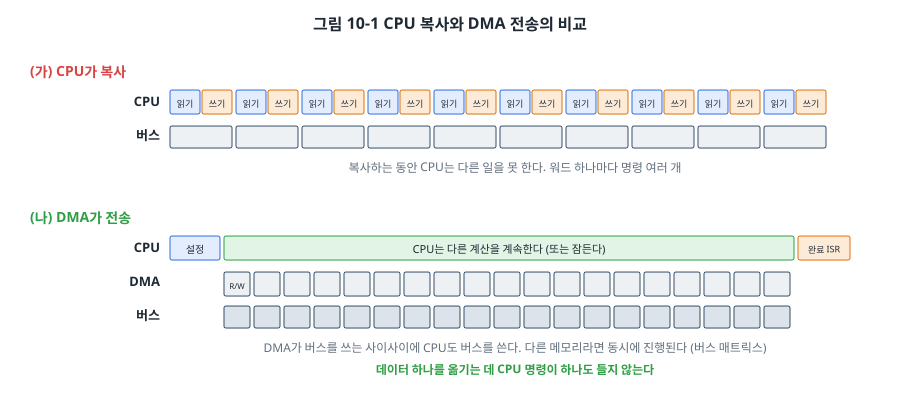
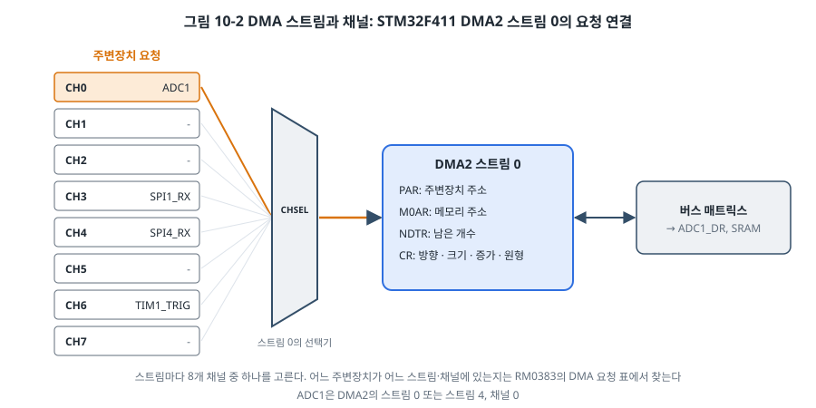
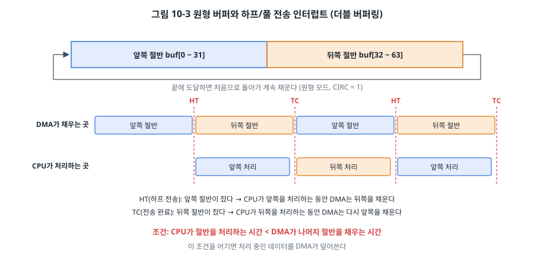

# 10장. DMA

## 이 장에서 배우는 것

- DMA가 무엇이고 CPU 복사와 무엇이 다른지
- STM32 DMA의 스트림, 채널, 요청 매핑
- 주변장치↔메모리, 메모리↔메모리 전송 설정
- 원형 버퍼와 하프/풀 전송 인터럽트로 끊김 없이 데이터를 받는 방법(더블 버퍼링)
- DMA를 쓸 때 주의할 점: 버퍼의 수명, 캐시, 동시 접근

---

## 10.1 AVR에는 없는 것

제2부의 다른 장과 달리, 이 장에는 AVR 구현이 없습니다. ATmega328P와 ATmega128에는 **DMA(Direct Memory Access)** 가 없기 때문입니다. 이 사실 자체가 8비트와 32비트 MCU의 차이를 잘 보여 줍니다.

AVR에서 UART로 들어온 바이트를 배열에 담으려면, 바이트 하나가 들어올 때마다 인터럽트가 걸리고 CPU가 ISR에서 그 바이트를 읽어 배열에 넣어야 합니다. 115200 bps라면 1초에 약 11,520번입니다. ADC 값을 빠르게 모으는 것도, 화면에 그림을 보내는 것도 모두 CPU가 한 바이트씩 옮겨야 합니다. 데이터의 양이 늘수록 CPU는 "짐 나르기"에 시간을 다 쓰게 됩니다.

DMA는 이 짐 나르기를 전담하는 하드웨어입니다. CPU가 "이 주소에서 저 주소로 몇 개를 옮겨라"라고 한 번 설정해 두면, DMA가 CPU 개입 없이 데이터를 옮기고 끝나면 알려 줍니다.

> 🔍 깊이 보기: 같은 AVR 계열이라도 ATxmega 시리즈나 최신 AVR Dx 계열 일부에는 DMA나 그와 비슷한 이벤트 시스템이 있습니다. 반대로 Cortex-M0 기반의 저가 32비트 MCU 중에는 DMA가 없는 것도 있습니다. 칩을 고를 때 DMA 유무와 채널 수는 데이터시트 첫 페이지의 특징 목록에서 확인할 수 있습니다.

## 10.2 CPU 복사와 DMA 전송



CPU가 메모리를 복사할 때는 워드 하나마다 "읽기 명령(LDR)으로 레지스터에 가져오기 → 쓰기 명령(STR)으로 내보내기 → 주소 늘리기 → 개수 확인하고 반복" 같은 명령 여러 개를 실행합니다. 그동안 CPU는 다른 일을 할 수 없습니다.

DMA는 같은 일을 전용 하드웨어로 합니다. 읽고 쓰는 일 자체는 똑같이 버스를 거치지만, 명령을 해석하고 실행하는 과정이 없습니다. 더 중요한 것은 그동안 CPU가 **자유롭다**는 점입니다. 3장의 그림 3-6에서 본 것처럼 STM32의 버스 매트릭스는 CPU와 DMA를 서로 다른 마스터로 연결합니다. 둘이 서로 다른 슬레이브(예: CPU는 Flash, DMA는 SRAM과 ADC)에 접근하면 동시에 진행되고, 같은 슬레이브를 두고는 중재를 받으며 번갈아 씁니다.

DMA가 특히 빛나는 곳은 **주변장치와 메모리 사이**의 전송입니다. UART 수신, ADC 연속 변환, SPI 디스플레이 전송처럼 "주변장치가 준비될 때마다 데이터 하나씩"을 옮겨야 하는 일에서, DMA는 주변장치의 요청 신호를 받아 정확히 그 순간에 데이터를 옮깁니다. CPU는 인터럽트 수천 번 대신 "다 옮겼다"는 인터럽트 한 번만 받으면 됩니다.

## 10.3 STM32 DMA의 구조

STM32F411에는 DMA 컨트롤러가 두 개(DMA1, DMA2) 있고, 각각 **스트림(stream)** 8개를 가집니다. 스트림 하나가 독립된 전송 하나를 맡습니다. 즉, 최대 16개의 전송을 동시에 진행할 수 있습니다.

| 컨트롤러 | 연결된 주변장치 | 메모리 → 메모리 |
| --- | --- | --- |
| DMA1 | APB1 주변장치 (USART2, I2C1~3, SPI2·3, TIM2~5 등) | 불가 |
| DMA2 | APB2 주변장치 (ADC1, USART1·6, SPI1·4·5, TIM1 등) | 가능 |

### 스트림과 채널

주변장치는 수십 개인데 스트림은 16개뿐이라, 어떤 주변장치의 요청이 어떤 스트림으로 갈 수 있는지가 미리 정해져 있습니다. 각 스트림에는 8개의 **채널(channel)** 입력이 있고, 각 채널에 서로 다른 주변장치의 요청이 연결되어 있습니다. 스트림의 CR 레지스터에 있는 CHSEL 필드로 그중 하나를 고릅니다.



이 연결 관계는 RM0383의 DMA1, DMA2 요청 매핑 표(9.3.3절)에 있습니다. 예를 들어 ADC1은 DMA2의 스트림 0 채널 0, 또는 스트림 4 채널 0으로 쓸 수 있습니다. USART2의 수신은 DMA1 스트림 5 채널 4입니다. 한 스트림은 한 번에 하나의 채널만 쓸 수 있으므로, 여러 주변장치에 DMA를 쓸 때는 이 표를 보고 겹치지 않게 배정해야 합니다. 8장에서 타이머를 배정했던 것과 같은 일입니다.

### 스트림 레지스터

스트림마다 같은 구성의 레지스터가 있습니다(RM0383 9.5절).

| 레지스터 | 역할 |
| --- | --- |
| DMA_SxCR | 켜기(EN), 채널(CHSEL), 방향(DIR), 원형 모드(CIRC), 주소 증가(PINC, MINC), 데이터 크기(PSIZE, MSIZE), 우선순위(PL), 인터럽트 허용(TCIE, HTIE, TEIE) |
| DMA_SxNDTR | 전송할 데이터 개수. 전송할 때마다 1씩 줄어든다 |
| DMA_SxPAR | 주변장치 쪽 주소 (예: `&ADC1->DR`) |
| DMA_SxM0AR | 메모리 쪽 주소 (예: 배열) |
| DMA_SxFCR | FIFO 설정 |
| DMA_LISR, HISR | 스트림 0~3, 4~7의 상태 플래그(완료, 절반, 오류) |
| DMA_LIFCR, HIFCR | 플래그 지우기 (1을 쓴다) |

주소 증가 설정이 중요합니다. ADC의 DR처럼 같은 주소에서 계속 읽어 오는 주변장치 쪽은 증가하지 않고(PINC = 0), 결과를 차례로 쌓을 메모리 쪽은 증가합니다(MINC = 1). 증가 폭은 데이터 크기(8, 16, 32비트)에 따라 자동으로 1, 2, 4바이트가 됩니다.

> ⚠️ 주의: 스트림의 설정 레지스터는 **스트림이 꺼져 있을 때만** 바꿀 수 있습니다. 그런데 CR의 EN 비트에 0을 써도 진행 중인 전송이 끝날 때까지 실제로 꺼지지 않을 수 있습니다. 그래서 다시 설정하기 전에는 EN을 끄고, EN이 실제로 0이 될 때까지 기다린 다음, 남아 있는 플래그를 모두 지웁니다. 남은 플래그를 지우지 않으면 스트림을 켜자마자 인터럽트가 걸리거나 아예 켜지지 않습니다.

```c
st->CR &= ~DMA_SxCR_EN;
while (st->CR & DMA_SxCR_EN) {          /* 실제로 꺼질 때까지 */
}
DMA2->LIFCR = 0x3D << shift;            /* 그 스트림의 플래그 5개 지우기 */
/* 이제 PAR, M0AR, NDTR, CR 설정 */
```

## 10.4 메모리에서 메모리로: 얼마나 빠른가

먼저 가장 단순한 메모리 → 메모리 복사로 DMA를 써 보겠습니다. 1024개의 32비트 워드를 CPU 루프와 DMA로 각각 복사하고, 걸린 클럭 수를 잽니다. 시간 측정에는 Cortex-M4 코어의 **DWT 사이클 카운터**를 씁니다. 클럭마다 1씩 늘어나는 32비트 카운터로, 34장의 성능 측정에서 자세히 다룹니다.

```c
DMA_Stream_TypeDef *st = &DMA2->S[1];   /* DMA2 스트림 1 */
st->PAR  = (uint32_t)src;               /* M2M에서는 PAR이 원본 */
st->M0AR = (uint32_t)dst;               /* M0AR이 대상 */
st->NDTR = 1024;
st->FCR  = (1u << 2) | 3u;              /* FIFO 사용 (M2M에서는 필수) */
st->CR   = DMA_SxCR_DIR_M2M | DMA_SxCR_PINC | DMA_SxCR_MINC
         | DMA_SxCR_PSIZE_32 | DMA_SxCR_MSIZE_32 | DMA_SxCR_PL_HIGH;
st->CR  |= DMA_SxCR_EN;                 /* 시작 */
```

메모리 → 메모리 전송은 DMA2만 할 수 있고, FIFO를 반드시 써야 합니다(직접 모드 불가). 주변장치 요청을 기다릴 필요가 없으므로 켜는 순간부터 최대 속도로 옮깁니다.

`code/ch10-dma/stm32/`를 실행하고 GDB로 `cpu_copy_cycles`와 `dma_copy_cycles`를 확인해 보세요. 예제의 CPU 루프는 `-Og`로 빌드되어 있어서 DMA가 몇 배 빠르게 나옵니다. 최적화 수준을 `-O2`로 올리면 컴파일러가 루프를 풀어 CPU 쪽도 꽤 빨라집니다. 순수한 메모리 복사 속도만 보면 잘 최적화된 `memcpy`와 DMA의 차이는 생각보다 크지 않을 수 있습니다. DMA의 진짜 이점은 속도가 아니라 **그동안 CPU가 다른 일을 할 수 있다**는 데 있습니다.

## 10.5 주변장치에서 메모리로: ADC와 DMA

이번에는 9장의 ADC 측정을 DMA로 바꿉니다. 목표는 CPU가 전혀 개입하지 않고 1 kHz로 ADC 값을 모으는 것입니다. 세 주변장치가 사슬처럼 이어집니다.

1. **TIM3**이 1 ms마다 업데이트 이벤트를 내보냅니다. CR2의 MMS 필드를 010으로 두면 업데이트 이벤트가 **TRGO(트리거 출력)** 신호로 나갑니다.
2. **ADC1**은 TIM3_TRGO의 상승 에지에서 변환을 시작하도록 설정합니다(CR2의 EXTEN, EXTSEL). 변환이 끝나면 DMA에 요청을 보냅니다(CR2의 DMA 비트).
3. **DMA2 스트림 0**이 ADC1_DR의 값을 배열에 옮기고, 다음 칸으로 주소를 늘립니다.

```c
/* DMA2 스트림 0, 채널 0 = ADC1 */
st->PAR  = (uint32_t)&ADC1->DR;
st->M0AR = (uint32_t)adc_buf;
st->NDTR = 64;
st->CR   = DMA_SxCR_CHSEL(0) | DMA_SxCR_DIR_P2M
         | DMA_SxCR_MINC                            /* 메모리 주소만 증가 */
         | DMA_SxCR_PSIZE_16 | DMA_SxCR_MSIZE_16    /* ADC 결과는 16비트로 */
         | DMA_SxCR_CIRC                            /* 원형 모드 */
         | DMA_SxCR_HTIE | DMA_SxCR_TCIE | DMA_SxCR_TEIE;

/* ADC1: TIM3_TRGO 상승 에지로 시작, 변환마다 DMA 요청 */
ADC1->CR2 = ADC_CR2_EXTEN_RISING | ADC_CR2_EXTSEL_TIM3_TRGO
          | ADC_CR2_DMA | ADC_CR2_DDS | ADC_CR2_ADON;

/* TIM3: 1 kHz, 업데이트 → TRGO */
TIM3->PSC = 15;
TIM3->ARR = 999;
TIM3->CR2 = (TIM3->CR2 & ~TIM_CR2_MMS_Msk) | TIM_CR2_MMS_UPDATE;
```

이렇게 연결해 두면 **ADC 샘플링 주기가 정확히 1 ms**가 됩니다. 9장처럼 메인 루프에서 `millis()`를 확인하며 변환을 시작하면, 메인 루프가 다른 일을 하느라 늦어지는 만큼 샘플링 간격이 흔들립니다. 신호 처리(필터, 주파수 분석)에서는 샘플링 간격이 일정하다는 것이 전제 조건이므로, 타이머로 ADC를 트리거하는 방식이 표준입니다.

ADC_CR2의 **DDS** 비트도 눈여겨보세요. 이 비트가 0이면 ADC는 DMA 전송이 NDTR만큼 끝난 뒤 더 이상 요청을 보내지 않습니다. 원형 모드로 계속 받으려면 1로 둡니다.

## 10.6 원형 버퍼와 더블 버퍼링

DMA가 64칸을 다 채우면 어떻게 할까요? **원형 모드(CIRC = 1)** 에서는 NDTR이 0이 되는 순간 처음 값(64)으로 다시 채워지고, 메모리 주소도 배열의 처음으로 돌아갑니다. DMA는 멈추지 않고 배열을 계속 돌며 덮어씁니다.

그러면 CPU는 언제 데이터를 읽어야 할까요? DMA가 쓰고 있는 칸을 CPU가 동시에 읽으면, 처리 도중에 값이 바뀌어 버립니다. 이를 위해 DMA는 두 번 알려 줍니다.



- **HT(Half Transfer, 하프 전송)**: 배열의 앞쪽 절반을 다 채웠을 때. 이제 DMA는 뒤쪽 절반을 채우기 시작합니다. CPU는 이 시간 동안 **앞쪽 절반**을 안전하게 처리할 수 있습니다.
- **TC(Transfer Complete, 전송 완료)**: 뒤쪽 절반까지 다 채웠을 때. DMA는 다시 앞쪽을 채우기 시작하고, CPU는 **뒤쪽 절반**을 처리합니다.

배열 하나를 둘로 나눠 한쪽은 DMA가 채우고 다른 쪽은 CPU가 처리하는 이 방식을 **더블 버퍼링(double buffering)** 이라고 합니다. 데이터가 끊김 없이 들어오면서도 CPU는 항상 완성된 절반을 다룹니다.

```c
void DMA2_Stream0_IRQHandler(void)
{
    uint32_t isr = DMA2->LISR;

    if (isr & DMA_HTIF0) {
        DMA2->LIFCR = DMA_HTIF0;
        process(&adc_buf[0], 32);           /* 앞쪽 절반 */
    }
    if (isr & DMA_TCIF0) {
        DMA2->LIFCR = DMA_TCIF0;
        process(&adc_buf[32], 32);          /* 뒤쪽 절반 */
    }
}
```

이 방식이 성립하려면 조건이 하나 있습니다. **CPU가 절반을 처리하는 시간이 DMA가 나머지 절반을 채우는 시간보다 짧아야** 합니다. 이 예제에서 절반(32샘플)이 채워지는 데는 32 ms가 걸리고, 32개를 더해 평균을 내는 데는 수 µs면 충분하므로 여유가 넉넉합니다. 하지만 샘플링이 빠르고 처리가 무거워지면(예: 수십 kHz 샘플링에 주파수 분석) 이 조건을 계산으로 확인해야 합니다. 28장에서 이런 시간 분석을 체계적으로 다룹니다.

예제의 메인 루프는 비어 있습니다. ADC 변환은 타이머가 시작하고, 데이터 이동은 DMA가 하고, 평균 계산과 LED 밝기 조절은 30여 ms마다 한 번 실행되는 ISR이 합니다. CPU는 대부분의 시간 동안 할 일이 없습니다. 11장에서는 이 빈 시간에 CPU를 잠재워 전력을 아낍니다.

> 💡 팁: STM32의 DMA에는 원형 모드 말고도 진짜 버퍼 두 개를 번갈아 쓰는 **더블 버퍼 모드(DBM)** 가 있습니다. M0AR과 M1AR에 서로 다른 배열을 주면 DMA가 두 배열을 번갈아 채우고, CR의 CT 비트로 지금 어느 쪽을 채우는지 알려 줍니다. 원형 모드 + HT/TC와 효과는 같지만, 두 버퍼가 떨어진 메모리에 있어도 되고 처리 중에 다음 버퍼의 주소를 바꿀 수도 있습니다.

## 10.7 DMA를 쓸 때 주의할 점

**1. 버퍼는 전송이 끝날 때까지 살아 있어야 합니다.** DMA는 주소만 알고 있습니다. 함수 안의 지역 변수 배열을 DMA 버퍼로 쓰고 함수가 끝나 버리면, 그 스택 영역은 다른 함수의 지역 변수가 쓰게 되고 DMA는 그 위에 계속 데이터를 씁니다. 원인을 찾기 아주 어려운 버그가 됩니다. DMA 버퍼는 전역 변수나 `static` 변수로 만드세요.

**2. 컴파일러는 DMA를 모릅니다.** 4장의 `volatile`이 여기서도 필요합니다. DMA가 채우는 배열을 CPU가 읽을 때, 컴파일러는 그 값이 프로그램 밖에서 바뀐다는 것을 모르므로 이전에 읽은 값을 재사용할 수 있습니다. 예제에서 `adc_buf`를 `volatile`로 선언한 이유입니다.

**3. 캐시가 있는 칩에서는 캐시 일관성을 챙겨야 합니다.** STM32F411(Cortex-M4)에는 데이터 캐시가 없어서 해당하지 않습니다. 하지만 Cortex-M7 기반의 STM32F7, H7에는 데이터 캐시가 있어서, CPU가 캐시에 쓴 데이터를 DMA가 메모리에서 읽거나(아직 메모리에 반영되지 않음), DMA가 메모리에 쓴 데이터를 CPU가 캐시에서 읽는(옛날 값) 문제가 생깁니다. 이런 칩에서는 캐시를 지우거나 무효화하는 함수를 DMA 전후에 불러야 합니다. 상위 칩으로 옮길 때 가장 많이 겪는 문제이니 기억해 두세요.

**4. DMA가 접근할 수 없는 메모리가 있습니다.** STM32F4 일부 칩의 CCM RAM(코어 결합 메모리)처럼 CPU만 접근할 수 있는 메모리가 있고, DMA1은 메모리 → 메모리를 못 하는 등 컨트롤러마다 제약이 있습니다. RM0383의 시스템 구조 그림에서 어느 마스터가 어느 슬레이브에 접근할 수 있는지 확인합니다.

**5. 오류 플래그를 확인하세요.** 잘못된 주소에 접근하면 전송 오류(TEIF)가, FIFO가 넘치거나 비는 등 FIFO 설정이 맞지 않으면 FIFO 오류(FEIF)가 납니다. 전송 오류는 EN 비트를 자동으로 꺼서 스트림을 멈추지만, FIFO 오류는 스트림을 끄지 않으므로 상태를 보고 직접 판단해야 합니다. 직접 모드 오류(DMEIF)의 처리 방식은 RM0383 DMA 장의 Error management 절을 따릅니다. [확인 필요: DMEIF 발생 시 스트림 정지 여부] "DMA가 한 번만 동작하고 멈춘다"면 오류 플래그부터 확인하세요.

## 10.8 8비트와 32비트 비교

| 항목 | ATmega328P | STM32F411 |
| --- | --- | --- |
| DMA | 없음 | DMA1, DMA2 (스트림 8개씩) |
| UART 수신 | 바이트마다 인터럽트, CPU가 복사 | DMA가 버퍼에 쌓고 HT/TC/유휴 때 한 번 알림 |
| ADC 연속 측정 | 변환마다 CPU가 읽음 | 타이머 트리거 + DMA 원형 버퍼 |
| 메모리 복사 | CPU (`memcpy`) | CPU 또는 DMA2 |
| CPU 부담 | 데이터 양에 비례 | 데이터 양과 거의 무관 (설정과 완료 처리만) |

8비트 MCU에서 데이터를 많이 다루면 CPU가 금방 바빠지고, 32비트 MCU에서는 DMA 덕분에 CPU 성능이 계산 자체에 쓰입니다. 14장의 UART, 16장의 SPI 디스플레이, 30장의 데이터 로거에서 DMA를 다시 씁니다.

---

## 정리

- DMA는 CPU 대신 데이터를 옮기는 하드웨어로, 전송하는 동안 CPU가 자유롭다는 것이 가장 큰 이점입니다. AVR에는 DMA가 없습니다.
- STM32F411은 DMA1, DMA2에 스트림이 8개씩 있고, 스트림마다 8개 채널 중 하나로 주변장치 요청을 고릅니다. 연결 관계는 RM0383의 요청 매핑 표에서 찾습니다.
- 스트림은 꺼진 상태에서 설정하고, EN이 실제로 0이 될 때까지 기다린 뒤 남은 플래그를 지웁니다.
- 타이머 → ADC → DMA로 연결하면 정확한 간격으로 CPU 개입 없이 샘플을 모을 수 있습니다.
- 원형 모드와 HT/TC 인터럽트로 버퍼를 절반씩 나눠 쓰면, DMA가 한쪽을 채우는 동안 CPU가 다른 쪽을 처리할 수 있습니다.
- DMA 버퍼는 전역이나 `static`으로, CPU가 읽는 쪽은 `volatile`로 선언합니다. 캐시가 있는 칩에서는 캐시 일관성을 챙깁니다.

## 연습 문제

1. AVR에서 115200 bps로 들어오는 UART 데이터를 바이트마다 인터럽트로 받을 때, ISR 하나가 진입·복귀 포함 50클럭 걸린다면 16 MHz CPU 시간의 몇 %가 수신 처리에 쓰이나요? (1바이트 = 10비트로 계산하세요.)
2. RM0383의 DMA 요청 매핑 표에서 USART2_TX, USART2_RX, SPI1_TX, SPI1_RX가 각각 어느 DMA의 어느 스트림·채널에 있는지 찾으세요. 네 개를 동시에 DMA로 쓸 수 있나요?
3. 이 장의 ADC 예제에서 TIM3을 10 kHz로 바꾸고 버퍼를 64칸 그대로 두면, HT와 TC 인터럽트는 몇 ms마다 걸리나요? `process()`가 처리에 쓸 수 있는 최대 시간은 얼마인가요?
4. 다음 코드의 문제점을 설명하고 고치세요.
   ```c
   void start_adc_capture(void) {
       uint16_t samples[128];
       DMA2->S[0].M0AR = (uint32_t)samples;
       DMA2->S[0].NDTR = 128;
       DMA2->S[0].CR |= DMA_SxCR_EN;
   }
   ```
5. 원형 모드에서 HT 인터럽트를 처리하는 ISR이 어떤 이유로 너무 늦게 실행되어, DMA가 이미 앞쪽 절반을 다시 쓰기 시작했다면 무엇이 문제인가요? 이런 상황을 감지하는 방법을 생각해 보세요. (힌트: ISR에서 NDTR 값을 읽으면 DMA가 지금 어디를 쓰고 있는지 알 수 있습니다.)
6. (실습) 예제의 ADC를 스캔 모드로 바꿔 채널 0(가변저항), 17(VREFINT), 18(온도 센서)을 차례로 변환하고, DMA가 세 값씩 묶어서 버퍼에 쌓도록 하세요. ADC_SQR1의 L 필드, SQR3의 SQ1~SQ3, CR1의 SCAN 비트를 어떻게 설정해야 하나요?
