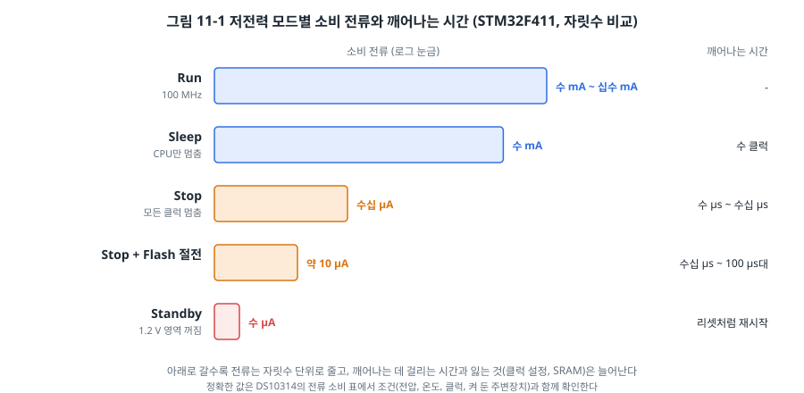
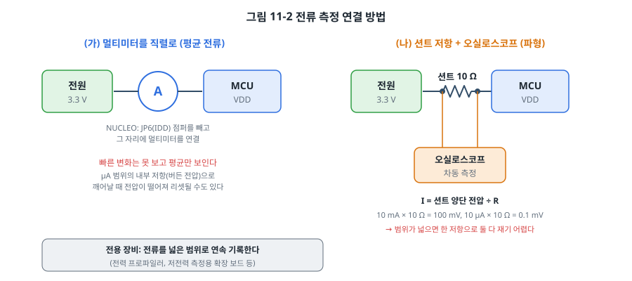
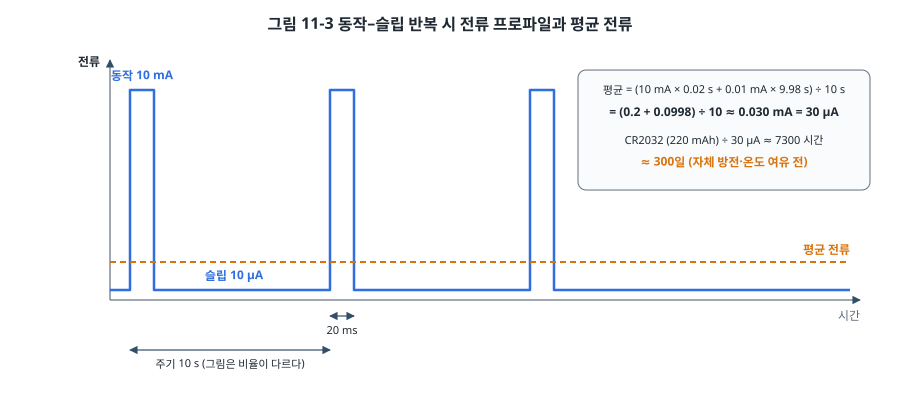

# 11장. 저전력 설계

## 이 장에서 배우는 것

- MCU가 전력을 쓰는 원리와 전력을 줄이는 세 가지 방향
- AVR의 슬립 모드와 STM32의 Sleep, Stop, Standby 모드
- 깨우는 방법(웨이크업 소스)과 각 모드에서 잃는 것
- 전류를 정확하게 재는 방법
- 평균 전류로 배터리 수명을 계산하는 방법

---

## 11.1 배터리로 1년

현관문 센서, 무선 온도계, 스마트 태그처럼 배터리로 동작하는 기기는 "얼마나 오래 가는가"가 제품의 가치를 결정합니다. 코인 전지 하나로 1년을 가야 하는 제품이라면, 평균 전류가 수십 µA를 넘으면 안 됩니다. 그런데 16 MHz로 열심히 일하는 우노의 ATmega328P는 수 mA를, 100 MHz STM32는 십수 mA를 씁니다. 수백 배 차이입니다.

비결은 **대부분의 시간 동안 잠들어 있는 것**입니다. 무선 온도계는 10초에 한 번, 20 ms 동안만 깨어나 온도를 재고 전송한 뒤 다시 잡니다. 깨어 있는 시간이 전체의 0.2%라면, 잠든 동안의 전류를 충분히 낮추는 것이 평균 전류를 결정합니다. 이 장에서는 MCU를 잠재우고, 필요할 때 깨우고, 그 전류를 재는 방법을 다룹니다.

## 11.2 전력은 어디에 쓰이는가

MCU 같은 CMOS 회로가 쓰는 전력은 크게 두 가지입니다.

- **동적 전력**: 트랜지스터가 0과 1 사이를 오갈 때마다 내부의 작은 커패시터를 충전하고 방전하면서 쓰는 전력입니다. 대략 **전압의 제곱 × 클럭 주파수**에 비례합니다. 클럭이 뛰지 않으면 거의 0이 됩니다.
- **정적 전력(누설 전류)**: 트랜지스터가 꺼져 있어도 조금씩 새는 전류입니다. 클럭과 상관없이 전원이 들어와 있으면 흐르고, 온도가 오르면 크게 늘어납니다.

여기서 전력을 줄이는 세 방향이 나옵니다.

1. **클럭을 낮추거나 멈춘다.** 동적 전력이 클럭에 비례하므로, 필요한 만큼만 빠르게 돌리고 일이 없으면 클럭을 멈춥니다. 3장의 클럭 게이팅(쓰지 않는 주변장치의 클럭 끄기)도 여기에 속합니다.
2. **전압을 낮춘다.** 동적 전력이 전압의 제곱에 비례하므로 효과가 큽니다. 3.3 V 대신 1.8 V로 동작시키거나, STM32처럼 내부 코어 전압을 낮추는(3장의 VOS, 저전력 레귤레이터) 방법입니다.
3. **전원을 끊는다.** 누설 전류까지 없애려면 회로의 전원 자체를 끊습니다. 대신 그 안에 있던 정보(레지스터, SRAM)도 사라집니다.

MCU의 저전력 모드는 이 세 가지를 단계적으로 조합한 것입니다. 깊은 모드일수록 전류가 줄지만, 깨어나는 데 오래 걸리고 잃는 것이 많아집니다.

## 11.3 AVR의 슬립 모드

ATmega328P에는 슬립 모드가 여섯 가지 있습니다(ATmega328P 데이터시트, Power Management and Sleep Modes 장).

| 모드 | 멈추는 것 | 깨울 수 있는 것 (주요) |
| --- | --- | --- |
| Idle | CPU와 Flash의 클럭 | 거의 모든 인터럽트 (타이머, UART, ADC 등) |
| ADC Noise Reduction | Idle + I/O 클럭 대부분 | ADC 변환 완료, 외부 인터럽트, Timer2 등 |
| Power-down | 모든 클럭과 오실레이터 | INT0/INT1 **레벨**, 핀 변화, 워치독, TWI 주소 일치 |
| Power-save | Power-down + Timer2는 동작 | Power-down의 원인 + Timer2 (32 kHz 시계 크리스털) |
| Standby | Power-down + 오실레이터는 켜 둠 | Power-down과 같음, 6클럭 만에 깸 |
| Extended Standby | Power-save + 오실레이터는 켜 둠 | Power-save와 같음 |

데이터시트 첫 페이지에는 1 MHz, 1.8 V, 25 °C 조건에서 동작 모드 0.2 mA, Power-down 0.1 µA, Power-save(32 kHz RTC 포함) 0.75 µA가 적혀 있습니다. 조건이 다르면 값도 크게 달라지므로, 설계할 때는 DC 특성 표와 그래프에서 실제 전압과 클럭의 값을 찾습니다.

Power-down에서는 모든 클럭이 멈추기 때문에 **에지를 감지하는 회로도 멈춥니다.** 그래서 INT0, INT1은 에지가 아니라 Low 레벨로만 깨울 수 있습니다. 7장에서 INT0을 하강 에지로 설정해 두었다면 Power-down에서 깨어나지 않습니다. 핀 변화 인터럽트(PCINT)는 클럭 없이 동작하므로 에지로 깨울 수 있습니다.

### 잠들기와 깨기

슬립 모드는 SMCR 레지스터에서 모드를 고르고 SE(Sleep Enable) 비트를 켠 뒤 `SLEEP` 명령을 실행하면 들어갑니다. avr-libc의 `<avr/sleep.h>`가 이 과정을 함수로 제공합니다.

```c
#include <avr/sleep.h>

set_sleep_mode(SLEEP_MODE_PWR_DOWN);
cli();
sleep_enable();
sleep_bod_disable();      /* 슬립 동안 BOD 끄기 */
sei();
sleep_cpu();              /* 여기서 잠든다 */
sleep_disable();          /* 깨어나면 ISR을 실행하고 이어서 여기부터 */
```

`cli()`와 `sei()`로 감싼 이유가 있습니다. "버튼이 눌렸는지 확인하고, 안 눌렸으면 잔다"는 코드를 생각해 보세요. 확인한 직후, 잠들기 직전에 버튼 인터럽트가 걸리면, ISR은 이미 실행되어 지나갔는데 CPU는 그 뒤에 잠들어서 다음 인터럽트가 올 때까지 깨어나지 못합니다. AVR은 `SEI` 명령 바로 다음 명령까지는 인터럽트를 받지 않도록 되어 있어서, `sei()` 직후의 `sleep_cpu()`가 반드시 먼저 실행됩니다. 그 사이에 들어온 인터럽트는 잠들자마자 바로 깨웁니다.

`sleep_bod_disable()`은 슬립 동안 **브라운아웃 감지기(BOD)** 를 끕니다. BOD는 3장의 리셋 원인에서 본 전원 감시 회로로, 켜 두면 Power-down에서도 수십 µA를 씁니다. MCUCR의 BODS, BODSE 비트를 정해진 시간 안에 차례로 써야 하는 보호 시퀀스라서 매크로를 쓰는 것이 안전합니다.

### 워치독으로 주기적으로 깨기

Power-down에서는 타이머가 멈추므로 "1초 뒤에 깨워 줘"를 타이머로 할 수 없습니다. 대신 **워치독 타이머(WDT)** 를 씁니다. 워치독은 칩 내부의 독립된 128 kHz 오실레이터로 동작하므로 Power-down에서도 셉니다. 원래 용도는 프로그램이 멈췄을 때 리셋하는 것이지만(35장), **인터럽트 모드**로 설정하면 리셋 대신 인터럽트를 걸어 칩을 깨웁니다.

```c
static void watchdog_interrupt_1s(void)
{
    cli();
    wdt_reset();
    MCUSR &= ~(1 << WDRF);
    WDTCSR = (1 << WDCE) | (1 << WDE);                  /* 1) 변경 허가 */
    WDTCSR = (1 << WDIE) | (1 << WDP2) | (1 << WDP1);   /* 2) 4클럭 안에: 인터럽트 모드, 약 1 s */
    sei();
}

ISR(WDT_vect)
{
    /* 깨우기만 하면 되므로 비어 있다 */
}
```

3장의 CLKPR처럼 워치독 설정도 두 단계 보호 시퀀스입니다. 워치독의 주기는 내부 오실레이터의 정확도에 따라 ±10% 이상 틀릴 수 있으므로, 정확한 시간이 필요하면 Power-save 모드와 Timer2에 32.768 kHz 시계 크리스털을 쓰는 방법을 씁니다.

### 잠들기 전에 꺼야 할 것들

슬립 모드에 들어가는 것만으로는 전류가 기대만큼 줄지 않는 경우가 많습니다. 다음을 확인하세요.

- **ADC**: ADEN이 켜져 있으면 슬립 중에도 전류를 씁니다. `ADCSRA = 0;`
- **아날로그 비교기**: ACSR의 ACD 비트로 끕니다.
- **주변장치 클럭**: PRR(Power Reduction Register)에 1을 쓰면 해당 주변장치의 클럭이 꺼집니다. 다시 쓸 때는 0으로 되돌립니다.
- **떠 있는 입력 핀**: 2장에서 본 떠 있는 입력은 전압이 문턱 근처를 오가며 입력 회로에 전류가 흐르게 합니다. 쓰지 않는 핀은 내부 풀업을 켠 입력으로 두거나 출력으로 고정합니다.
- **외부 회로**: LED, 풀업 저항, 센서가 계속 전류를 쓰고 있지 않은지 확인합니다. 10 kΩ 풀업 저항에 Low가 걸려 있으면 그것만으로 5 V에서 500 µA(3.3 V면 330 µA)가 흐릅니다.

> 🔧 ATmega128에서는: 슬립 모드 종류는 비슷하지만 설정 레지스터가 다릅니다. SMCR 대신 MCUCR의 SE, SM2:0 비트를 쓰고, PRR과 소프트웨어 BOD 끄기(BODS)가 없습니다. 핀 변화 인터럽트도 없으므로 Power-down에서는 외부 인터럽트로 깨웁니다. INT3:0은 비동기로 감지되어 에지와 레벨 모두로 깨울 수 있고, INT7:4는 레벨 인터럽트로만 깨울 수 있습니다(ATmega128A 데이터시트, 슬립 모드 표의 각주). 워치독도 인터럽트 모드가 없어 리셋만 할 수 있으므로, "주기적으로 깨기"는 Power-save 모드와 Timer0의 비동기 동작(32.768 kHz 크리스털)으로 만듭니다.

## 11.4 STM32의 저전력 모드

STM32F411에는 크게 세 가지 저전력 모드가 있습니다(RM0383 5.3절).



| 모드 | 들어가는 방법 | 멈추는 것 | 남는 것 | 깨우는 것 |
| --- | --- | --- | --- | --- |
| Sleep | `WFI` 또는 `WFE` | CPU 클럭 | 모든 주변장치, 클럭, SRAM | 아무 인터럽트 |
| Stop | SLEEPDEEP = 1, PDDS = 0 후 `WFI` | 1.2 V 영역의 모든 클럭, PLL, HSI, HSE | 레지스터와 SRAM 내용 | EXTI 라인 (핀, RTC, USB 웨이크업 등) |
| Standby | SLEEPDEEP = 1, PDDS = 1 후 `WFI` | 1.2 V 영역의 전원 | 백업 영역(RTC, 백업 레지스터)만 | WKUP 핀, RTC 알람/웨이크업, 리셋 핀, IWDG |

DS10314 첫 페이지에는 25 °C 대표값으로 Stop 모드(Flash도 Stop, 빠른 깨어남) 약 42 µA, Stop 모드(Flash 깊은 절전, 느린 깨어남) 약 9 µA, Standby 모드(RTC 없음) 약 1.8 µA 같은 값이 적혀 있습니다. 동작 모드는 클럭에 비례해서 "MHz당 약 100 µA" 수준입니다. 정확한 조건은 데이터시트의 전류 소비 표에서 확인하세요.

### Sleep: CPU만 쉰다

가장 가벼운 모드입니다. `WFI`(Wait For Interrupt) 명령 하나면 CPU 클럭이 멈추고, 인터럽트가 걸리면 그 ISR을 실행한 뒤 `WFI` 다음 명령부터 이어서 실행합니다. 주변장치는 모두 그대로 동작하므로 DMA, 타이머, UART가 계속 일합니다.

10장의 ADC + DMA 예제처럼 메인 루프가 할 일 없이 도는 코드라면, 루프 안에 `wfi()` 한 줄만 넣어도 전류가 줄어듭니다.

```c
for (;;) {
    wfi();      /* 다음 인터럽트까지 CPU 정지. ISR이 끝나면 다시 루프 */
}
```

더 나아가 SCB_SCR의 **SLEEPONEXIT** 비트를 켜면, ISR이 끝날 때 메인 코드로 돌아가지 않고 바로 다시 잠듭니다. 모든 일을 인터럽트에서 하는 프로그램이라면 메인 루프조차 필요 없어집니다.

### Stop: 클럭을 모두 멈춘다

Stop 모드는 PLL과 고속 오실레이터까지 모두 멈춥니다. SRAM과 레지스터는 전원이 유지되어 내용이 남으므로, 깨어나면 멈췄던 곳에서 이어서 실행합니다. 대신 클럭을 다시 켜야 하므로 깨어나는 데 수 µs에서 수십 µs가 걸립니다.

```c
static void enter_stop(void)
{
    PWR->CR = (PWR->CR & ~PWR_CR_PDDS)          /* PDDS = 0: Standby가 아니라 Stop */
            | PWR_CR_LPDS                        /* 저전력 레귤레이터 */
            | PWR_CR_FPDS                        /* Flash도 절전 */
            | PWR_CR_CWUF;                       /* 웨이크업 플래그 지우기 */
    SCB_SCR |= SCB_SCR_SLEEPDEEP;                /* WFI를 딥 슬립으로 */
    wfi();
    SCB_SCR &= ~SCB_SCR_SLEEPDEEP;
    /* 여기서부터 시스템 클럭은 HSI 16 MHz */
}
```

Stop에서 깨어나면 **시스템 클럭이 HSI로 돌아와 있습니다.** 3장에서 PLL로 100 MHz를 만들어 쓰고 있었다면, 깨어난 직후 PLL을 다시 켜고 전환해야 합니다. 이것을 잊으면 깨어난 뒤 모든 타이밍(UART 보레이트, 타이머 주기)이 6분의 1로 틀어집니다.

Stop 모드는 EXTI 라인으로만 깨울 수 있습니다. 7장의 버튼 EXTI가 그대로 깨우는 원인이 되고, RTC의 웨이크업 타이머는 EXTI 라인 22에 연결되어 있습니다.

### Standby: 거의 다 끈다

Standby는 코어와 SRAM이 있는 1.2 V 영역의 전원을 끕니다. 전류는 µA 수준으로 가장 낮지만, **깨어나면 리셋처럼 처음부터 시작합니다.** SRAM의 변수도, 주변장치 설정도 모두 사라집니다. 남는 것은 RTC와 백업 레지스터(32비트 레지스터 20개, 80바이트의 작은 저장소)뿐입니다.

그래서 Standby를 쓰는 프로그램은 시작할 때 "전원을 처음 넣은 것인지, Standby에서 깨어난 것인지"를 PWR_CSR의 SBF 플래그로 구분하고, 필요한 상태를 백업 레지스터에서 되살립니다. 일주일에 한 번 깨어나는 기기처럼 깨어나는 횟수가 아주 적다면, 재시작 비용을 감수하고 Standby를 쓰는 것이 유리합니다.

### RTC로 주기적으로 깨기

STM32에서 Stop 모드를 주기적으로 깨우는 표준 방법은 **RTC의 웨이크업 타이머**입니다. RTC는 32 kHz대의 저속 클럭(LSE 크리스털 또는 내부 LSI)으로 동작하는 백업 영역의 주변장치라서, Stop은 물론 Standby에서도 셉니다.

```c
PWR->CR |= PWR_CR_DBP;                          /* 백업 영역 쓰기 허용 */
RCC->CSR |= RCC_CSR_LSION;                      /* LSI 켜기 */
while ((RCC->CSR & RCC_CSR_LSIRDY) == 0) {
}
RCC->BDCR |= RCC_BDCR_RTCSEL_LSI | RCC_BDCR_RTCEN;   /* RTC 클럭 = LSI */

RTC->WPR = 0xCA;                                /* 쓰기 보호 해제 */
RTC->WPR = 0x53;
RTC->CR &= ~RTC_CR_WUTE;
while ((RTC->ISR & RTC_ISR_WUTWF) == 0) {       /* 웨이크업 타이머 설정 가능해질 때까지 */
}
RTC->WUTR = 2 - 1;                              /* 2초 */
RTC->CR |= RTC_CR_WUCKSEL_1HZ | RTC_CR_WUTIE | RTC_CR_WUTE;
RTC->WPR = 0xFF;                                /* 다시 잠금 */

EXTI->IMR  |= 1u << 22;                         /* RTC 웨이크업 = EXTI 라인 22, 상승 에지 */
EXTI->RTSR |= 1u << 22;
```

RTC는 실수로 시계가 바뀌는 것을 막기 위해 여러 겹으로 보호되어 있습니다. 백업 영역 쓰기 허용(DBP), RTC 레지스터 쓰기 보호 해제 키(0xCA, 0x53), 그리고 설정 중임을 알리는 플래그(WUTWF)를 차례로 거쳐야 합니다. 하나라도 빠지면 레지스터에 써도 값이 바뀌지 않습니다. 이 예제는 NUCLEO에 따로 부품이 필요 없도록 LSI를 썼지만, LSI는 오차가 커서(수 %) 시계 용도라면 LSE 크리스털(NUCLEO-F411RE에는 32.768 kHz 크리스털 X2가 달려 있습니다. MB1136 rev C 이후 [확인 필요: 보드 리비전별 X2 장착 여부])을 씁니다.

> ⚠️ 주의: STM32가 Stop이나 Standby에 들어가면 디버그 포트도 클럭을 잃어 디버거 연결이 끊깁니다. 저전력 코드를 디버깅하려면 DBGMCU_CR 레지스터에서 저전력 모드 중에도 디버그를 유지하도록 설정하는데(23장), 이 설정을 켜면 전류가 크게 늘어 측정값이 의미가 없어집니다. 전류를 잴 때는 디버거를 분리하고, 업로드가 안 되면 5장의 connect under reset을 씁니다.

## 11.5 깨어나는 원인과 잃는 것

저전력 설계의 핵심 질문은 "어떤 모드를 쓸까"보다 "**무엇이 나를 깨워야 하는가**"입니다. 깨워야 할 원인이 정해지면 쓸 수 있는 모드가 정해집니다.

| 깨워야 하는 것 | AVR | STM32 |
| --- | --- | --- |
| 일정한 주기 | 워치독(Power-down), Timer2 + 시계 크리스털(Power-save) | RTC 웨이크업 타이머(Stop, Standby) |
| 버튼, 센서의 신호선 | 핀 변화 인터럽트, INT0/1 레벨 | EXTI(Stop), WKUP 핀(Standby) |
| UART로 들어오는 데이터 | Idle 모드에서만 | Sleep 모드, 또는 수신 핀을 EXTI로 걸어 Stop에서 깨운 뒤 수신 |
| 타이머 주기 | Idle | Sleep |

UART처럼 클럭이 있어야 받을 수 있는 신호는 깊은 모드에서 놓치기 쉽습니다. 깨어나는 데 걸리는 시간 동안 들어온 바이트는 사라집니다. 이런 경우 통신 프로토콜 쪽에서 "깨우는 신호를 먼저 보내고 잠시 기다린 뒤 데이터를 보낸다" 같은 약속을 정합니다. 19장의 BLE도 이런 원리로 잠든 시간과 깨어난 시간을 약속합니다.

## 11.6 전류 측정

저전력 설계는 측정 없이는 할 수 없습니다. 계산상 10 µA여야 하는 회로가 실제로 300 µA를 쓰는 일은 흔하고, 원인은 대개 떠 있는 핀 하나, 꺼지지 않은 주변장치 하나, 잊고 있던 LED 하나입니다.



**멀티미터를 직렬로 연결**하는 것이 가장 쉬운 방법입니다(2장의 멀티미터 사용법). NUCLEO-F411RE에는 STM32의 전원 선에 **JP6(IDD)** 점퍼가 있어서, 점퍼를 빼고 그 두 핀에 멀티미터를 연결하면 보드의 다른 부품을 빼고 STM32만의 전류를 잴 수 있습니다. 다만 멀티미터는 수백 ms 동안의 평균만 보여 주므로, 깨어났다 잠드는 짧은 변화는 보이지 않습니다. 또 µA 범위에서는 멀티미터 내부 저항이 커서(버든 전압), 칩이 깨어나 갑자기 mA를 쓰는 순간 전압이 떨어져 리셋되는 경우도 있습니다.

**션트 저항과 오실로스코프**를 쓰면 전류의 파형을 볼 수 있습니다. 전원 선에 작은 저항(예: 10 Ω)을 직렬로 넣고, 그 양 끝의 전압을 오실로스코프로 봅니다. 전압 ÷ 저항이 전류입니다. 문제는 범위입니다. 10 mA는 100 mV로 잘 보이지만, 10 µA는 0.1 mV라서 잡음에 묻힙니다.

그래서 저전력 제품을 개발하는 곳에서는 nA부터 수백 mA까지를 연속으로 기록하는 **전용 전력 측정 장비**를 씁니다. 반도체 회사들이 개발 보드용 저전력 측정 키트를 내놓고 있고, 독립 제조사의 전력 프로파일러도 있습니다. 부록 C에서 이런 장비를 정리했습니다.

> ⚠️ 주의: 아두이노 우노 보드 전체의 전류를 재면 ATmega328P를 Power-down으로 재워도 수십 mA가 흐릅니다. USB 변환 칩(ATmega16U2), 전압 레귤레이터, 전원 LED, 연산 증폭기가 계속 전류를 쓰기 때문입니다. AVR의 진짜 슬립 전류를 보려면 ATmega328P를 우노에서 빼서(DIP 패키지 우노의 경우) 브레드보드에 꽂고, 16 MHz 크리스털과 커패시터, 리셋 풀업만 붙여 3.3~5 V를 직접 공급해야 합니다. 이렇게 하면 Power-down 전류가 µA 수준으로 떨어지는 것을 볼 수 있습니다.

## 11.7 배터리 수명 계산

동작과 슬립을 반복하는 기기의 평균 전류는 각 상태의 전류에 시간 비율을 곱해 더하면 됩니다.



```
평균 전류 = (I동작 × t동작 + I슬립 × t슬립) ÷ 주기
배터리 수명(시간) = 배터리 용량(mAh) ÷ 평균 전류(mA)
```

10초마다 20 ms 동안 10 mA를 쓰고 나머지는 10 µA로 자는 센서라면, 평균 전류는 약 30 µA이고, 220 mAh짜리 CR2032 코인 전지로 약 7300시간, 300일쯤 갑니다.

이 계산에서 두 가지를 눈여겨보세요.

첫째, **슬립 전류가 평균을 결정할 수도 있습니다.** 위의 예에서 동작 전류의 기여는 0.2 ÷ 10 = 20 µA, 슬립 전류의 기여는 약 10 µA입니다. 슬립 전류를 10 µA에서 1 µA로 줄이면 평균이 약 21 µA로 줄어 수명이 40% 이상 늘어납니다. 반대로 깨어나는 주기를 10초에서 1초로 바꾸면 동작 전류의 기여가 10배가 되어 평균은 200 µA를 넘습니다.

둘째, **계산값은 언제나 낙관적입니다.** 실제 배터리는 온도가 낮으면 용량이 줄고, 큰 펄스 전류를 뽑으면 전압이 떨어지며, 쓰지 않아도 조금씩 방전됩니다(자체 방전). 코인 전지는 특히 순간 전류에 약해서, 무선 송신처럼 수십 mA를 뽑는 순간 전압이 MCU의 BOD 문턱 아래로 떨어질 수도 있습니다. 실무에서는 계산값의 절반 정도를 목표로 잡고, 큰 커패시터를 병렬로 달아 순간 전류를 보충합니다. 배터리 제조사의 데이터시트에 온도와 방전 전류에 따른 용량 그래프가 있으니 함께 확인하세요.

## 11.8 실습: 잠자는 LED

`code/ch11-low-power/`의 예제는 두 보드에서 같은 동작을 합니다.

- 주기적으로 깨어나(AVR은 워치독 약 1초, STM32는 RTC 약 2초) LED를 아주 잠깐 켰다가 다시 잡니다.
- 버튼을 누르면 즉시 깨어나 LED를 길게 켭니다.

AVR 예제는 잠들기 전에 ADC, 아날로그 비교기, PRR의 모든 주변장치를 끄고, 쓰지 않는 핀을 풀업 입력으로 둡니다. STM32 예제는 쓰지 않는 핀을 모두 아날로그 모드로 둡니다. 아날로그 모드는 디지털 입력 회로를 끊으므로 핀에서 새는 전류가 가장 적습니다. 다만 PA13, PA14(SWD)는 남겨 두어야 디버거가 다시 붙을 수 있습니다.

NUCLEO의 JP6에 멀티미터를 연결하고, 다음을 차례로 바꿔 가며 전류를 기록해 보세요.

1. 예제 그대로 (Stop + 저전력 레귤레이터 + Flash 절전)
2. `PWR_CR_FPDS`를 빼고 (Flash 절전 끔)
3. `PWR_CR_LPDS`도 빼고 (주 레귤레이터 유지)
4. `enter_stop()` 대신 `wfi()`만 (Sleep 모드)
5. `unused_pins_analog()`를 빼고 (핀을 리셋 상태로)

각 설정이 전류를 얼마나 바꾸는지 직접 재 보면, 저전력 설계가 "한 가지 큰 결정"이 아니라 "작은 것들의 합"이라는 것을 실감하게 됩니다.

---

## 정리

- MCU의 전력은 클럭에 비례하는 동적 전력과 늘 새는 정적 전력으로 나뉘며, 클럭 낮추기, 전압 낮추기, 전원 끊기로 줄입니다.
- AVR은 Idle부터 Power-down까지 여섯 가지 슬립 모드가 있고, Power-down에서는 핀 변화 인터럽트, INT0/1 레벨, 워치독 인터럽트로 깨웁니다.
- STM32는 Sleep(CPU만 멈춤), Stop(모든 클럭 멈춤, SRAM 유지, EXTI로 깸), Standby(거의 모두 끔, 깨면 재시작)가 있습니다. Stop에서 깨어나면 클럭이 HSI로 돌아오므로 PLL을 다시 설정합니다.
- 잠들기 전에 ADC, 비교기, 쓰지 않는 주변장치 클럭, 떠 있는 핀, 외부 회로의 전류를 정리해야 슬립 전류가 기대만큼 낮아집니다.
- 평균 전류는 각 상태의 전류와 시간 비율로 계산하고, 배터리 수명은 용량 ÷ 평균 전류로 구하되 실제로는 여유를 크게 둡니다.
- 전류는 반드시 측정합니다. NUCLEO는 JP6에서 STM32만의 전류를 잴 수 있고, 우노 보드 전체는 다른 부품 때문에 칩의 슬립 전류를 볼 수 없습니다.

## 연습 문제

1. ATmega328P를 Power-down으로 재우고 INT0(D2)의 하강 에지로 깨우려 했는데 깨어나지 않습니다. 원인과 해결 방법 두 가지를 쓰세요.
2. 1분마다 깨어나 온도를 재고 50 ms 동안 15 mA로 무선 송신하는 센서가 있습니다. 슬립 전류가 5 µA일 때 평균 전류와 1000 mAh 배터리의 이론 수명을 계산하세요. 송신 주기를 5분으로 늘리면 어떻게 되나요?
3. STM32에서 3장의 100 MHz 클럭을 쓰다가 Stop 모드에서 깨어난 직후 UART로 문자를 보냈더니 글자가 깨졌습니다. 원인과 해결 방법을 설명하세요.
4. Standby 모드에서 깨어날 때마다 "몇 번째 깨어났는지"를 세고 싶습니다. SRAM의 전역 변수를 쓸 수 없는 이유와, 대신 쓸 수 있는 저장 공간을 RM0383에서 찾아 설명하세요.
5. 다음 코드는 가끔 영원히 잠들어 버립니다. 이유를 설명하고 고치세요.
   ```c
   while (!data_ready) {     /* data_ready는 UART ISR이 1로 만든다 */
       sleep_cpu();
   }
   ```
6. (실습) 11.8절의 다섯 가지 설정으로 NUCLEO의 전류를 측정해 표로 정리하고, DS10314의 전류 소비 표에서 가장 가까운 조건의 값과 비교하세요.
