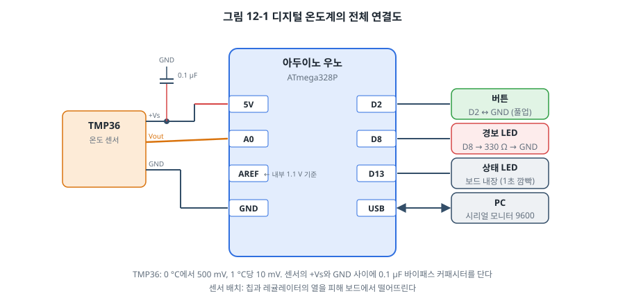
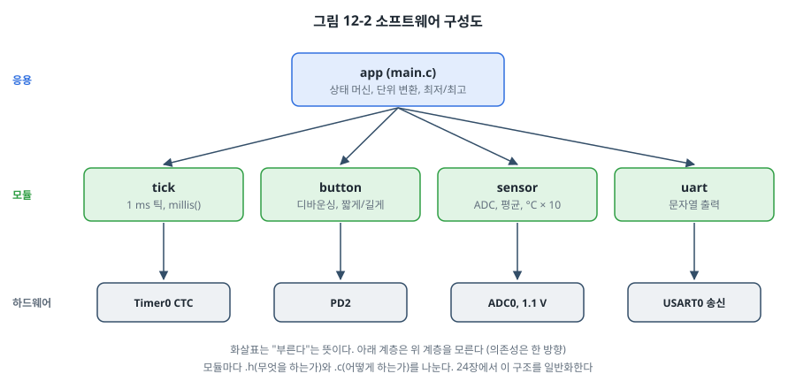
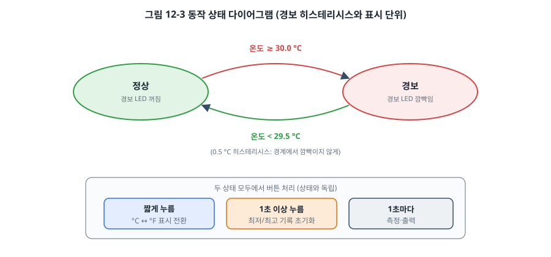

# 12장. 프로젝트: 디지털 온도계

## 이 장에서 배우는 것

- 요구사항을 정리하고 하드웨어와 소프트웨어 구조를 설계하는 과정
- 제2부의 GPIO, 인터럽트, 타이머, ADC를 하나의 프로그램으로 통합하는 방법
- 코드를 모듈로 나누고 모듈 사이의 경계를 정하는 방법
- 상태 머신과 히스테리시스로 경계값 근처의 떨림을 막는 방법
- 만든 것을 돌아보고 다음 단계로 개선할 점을 찾는 방법

---

## 12.1 제2부를 마무리하며

6장부터 11장까지 주변장치를 하나씩 배웠습니다. 각 장의 예제는 그 장의 주제를 보여 주기 위해 단순하게 만들었습니다. 실제 제품의 펌웨어는 여러 주변장치를 동시에 다루고, 정해진 요구사항을 만족해야 하며, 다른 사람이 읽고 고칠 수 있어야 합니다.

이 장에서는 작은 제품 하나를 처음부터 끝까지 만듭니다. 주제는 **디지털 온도계**입니다. 온도를 재서 PC에 출력하고, 버튼으로 표시 단위를 바꾸고, 너무 더우면 경보를 울립니다. 기능은 단순하지만 제2부에서 배운 거의 모든 것이 들어갑니다. 무엇보다 이 장의 목표는 코드 자체보다 **만드는 과정**을 경험하는 것입니다. 요구사항을 정리하고, 구조를 설계하고, 나누어 만들고, 합치고, 돌아보는 과정입니다.

보드는 우노를 씁니다. 같은 프로그램을 STM32로 옮기는 것은 연습 문제로 남겨 두었습니다. 두 칩의 차이를 이미 알고 있으니, 옮기는 과정 자체가 좋은 복습이 될 것입니다.

> 💡 팁: 이 장의 UART 출력 코드는 14장에서 배울 내용을 미리 짧게 씁니다. 지금은 `uart_puts("hello")`가 PC의 시리얼 모니터에 글자를 보낸다는 것만 알면 충분합니다. 원리와 수신, 인터럽트 방식은 14장에서 자세히 다룹니다.

## 12.2 요구사항 정리

무엇을 만들지 글로 먼저 적습니다. 머릿속에 있는 생각을 글로 쓰면 빠진 것과 모호한 것이 드러납니다. 요구사항에는 번호를 붙여 두면 나중에 코드와 시험을 요구사항에 연결하기 쉽습니다.

| 번호 | 요구사항 | 확인 방법 |
| --- | --- | --- |
| R1 | 1초마다 온도를 재서 0.1 °C 단위로 PC에 출력한다 | 시리얼 모니터에서 1초 간격 출력 확인 |
| R2 | 버튼을 짧게 누르면 °C와 °F 표시를 바꾼다 | 누를 때마다 단위가 한 번씩 바뀌는지 확인 |
| R3 | 버튼을 1초 이상 누르면 최저/최고 기록을 지운다 | 길게 누른 뒤 min, max가 현재값으로 시작하는지 확인 |
| R4 | 30.0 °C 이상이면 경보 LED가 깜빡이고, 29.5 °C 아래로 내려가면 끈다 | 센서를 손으로 쥐어 데우고 식히며 확인 |
| R5 | 동작 중임을 보드 LED의 1초 깜빡임으로 보여 준다 | 눈으로 확인 |

요구사항을 적다 보면 정해야 할 것들이 보입니다. "짧게"와 "길게"의 경계는 몇 초인가? 30 °C에서 경보를 켜면 끄는 것도 30 °C인가? 측정값이 29.9와 30.0 사이를 오가면 경보가 1초마다 켜졌다 꺼지지 않을까? 이런 질문에 답을 정해서 요구사항에 반영한 것이 R3의 "1초 이상", R4의 "29.5 °C 아래로"입니다.

> 💡 팁: "확인 방법" 칸을 함께 적는 습관이 중요합니다. 확인할 방법이 없는 요구사항은 만들었는지 아닌지 알 수 없습니다. "빠르게 반응한다"처럼 모호한 요구사항은 "버튼을 누른 뒤 50 ms 안에 단위가 바뀐다"처럼 잴 수 있게 고쳐 씁니다. 31장의 테스트, 35장의 기능 안전에서 이 습관이 기반이 됩니다.

## 12.3 하드웨어 설계

### 센서 고르기

온도를 재는 방법은 여러 가지입니다.

| 방법 | 예 | 장점 | 단점 |
| --- | --- | --- | --- |
| 아날로그 출력 IC | TMP36, LM35 | 연결이 쉽고 선형 | ADC와 기준 전압의 정확도에 의존 |
| 서미스터 | NTC 10 kΩ | 싸고 작음 | 비선형이라 계산이나 표가 필요 |
| 디지털 센서 | DS18B20(1-Wire), I2C 센서 | 정확, 보정됨 | 통신 프로토콜 필요 |

제2부에서는 아직 통신을 배우지 않았으므로 9장의 ADC로 바로 읽을 수 있는 **TMP36**을 씁니다. TMP36은 2.7~5.5 V로 동작하고, 0 °C에서 500 mV, 1 °C당 10 mV를 냅니다(TMP36 데이터시트). 출력이 0 V 아래로 내려가지 않도록 500 mV의 오프셋이 있어서 영하의 온도도 잴 수 있습니다. 비슷한 LM35는 0 °C에서 0 V이고 4 V 이상의 전원이 필요해서 3.3 V 보드로 옮기기 어렵습니다. 15장에서 I2C를 배운 뒤에는 디지털 온도 센서로 바꾸는 것도 해 봅니다.

### 기준 전압 고르기

9장에서 TMP36처럼 절대 전압을 내는 센서는 비율 측정이 아니므로 기준 전압의 정확도가 중요하다고 했습니다. 우노의 5 V는 USB 전원에 따라 4.7~5.2 V 정도로 흔들립니다. 그래서 ATmega328P의 **내부 1.1 V 기준**을 씁니다.

- 1.1 V 기준이면 1 LSB가 약 1.07 mV, 즉 약 0.1 °C입니다. 5 V 기준(1 LSB ≈ 4.9 mV ≈ 0.5 °C)보다 5배 촘촘합니다.
- 대신 잴 수 있는 최대 전압이 1.1 V이므로, TMP36으로 약 60 °C까지만 잴 수 있습니다. 실내 온도계로는 충분합니다.
- 내부 기준 전압은 칩마다 1.0~1.2 V로 다를 수 있습니다(ATmega328P 데이터시트의 VBG). 우노의 AREF 핀에는 이 기준 전압이 나오므로, 멀티미터로 재서 코드에 넣으면 칩마다의 차이를 보정할 수 있습니다.

### 연결



| 부품 | 연결 | 비고 |
| --- | --- | --- |
| TMP36 | +Vs → 5V, Vout → A0, GND → GND | +Vs와 GND 사이에 0.1 µF 바이패스 커패시터 |
| 버튼 | D2 ↔ GND | 내부 풀업 사용 |
| 경보 LED | D8 → 330 Ω → LED → GND | 2장의 전류 제한 저항 |
| 상태 LED | D13 | 보드 내장 |
| PC | USB | 9600 bps |

센서의 +Vs와 GND 사이, 센서 다리 가까이에 다는 0.1 µF **바이패스 커패시터**는 전원선의 잡음이 센서 출력에 섞이는 것을 줄입니다. 센서 데이터시트가 권장하는 부품입니다. 출력(Vout)에 커패시터를 직접 달면 센서가 구동할 수 있는 용량성 부하의 한계를 넘을 수 있으므로, 출력 쪽 잡음을 더 줄이고 싶다면 직렬 저항을 먼저 넣고 그 뒤에 커패시터를 다는 RC 필터로 구성합니다. [확인 필요: TMP36 출력 용량성 부하 한계] 또 센서를 보드의 레귤레이터나 MCU 가까이에 두면 그 열 때문에 실제보다 높게 잽니다. 전선으로 센서를 보드에서 몇 cm 떨어뜨리세요.

## 12.4 소프트웨어 설계

### 모듈로 나누기

지금까지의 예제는 대부분 `main.c` 하나에 모든 코드가 있었습니다. 기능이 늘면 이 방식은 금방 한계에 부딪힙니다. 어디를 고쳐야 할지 찾기 어렵고, 한 곳을 고치면 다른 곳이 망가집니다. 그래서 **하는 일에 따라 모듈로 나눕니다.**



| 모듈 | 하는 일 | 쓰는 하드웨어 | 공개 함수 |
| --- | --- | --- | --- |
| tick | 1 ms 틱, 경과 시간 | Timer0 | `tick_init()`, `millis()` |
| button | 디바운싱, 짧게/길게 구분 | PD2 | `button_init()`, `button_poll()` |
| sensor | ADC 측정, 평균, 온도 변환 | ADC0, 1.1 V 기준 | `sensor_init()`, `sensor_read_c10()` |
| uart | 문자열과 숫자 출력 | USART0 | `uart_init()`, `uart_puts()`, `uart_put_fixed1()` |
| app (main.c) | 요구사항 R1~R5, 상태 머신 | (모듈을 통해서만) | |

모듈마다 `.h` 파일과 `.c` 파일을 둡니다. `.h`에는 **무엇을 하는가**(함수 선언과 자료형)만 쓰고, `.c`에는 **어떻게 하는가**(레지스터 접근, 내부 변수)를 씁니다. `main.c`는 `.h`만 보고 모듈을 쓰므로, 예를 들어 센서를 TMP36에서 I2C 센서로 바꿔도 `sensor.c`만 고치면 되고 `main.c`는 그대로입니다.

그림 12-2의 화살표 방향도 중요합니다. 응용(app)은 모듈을 부르지만, 모듈은 응용을 모릅니다. 모듈끼리도 서로 부르지 않습니다. 이렇게 **의존성이 한 방향으로만 흐르면** 모듈 하나를 떼어 내 다른 프로젝트에 쓰거나, PC에서 따로 시험하기 쉬워집니다. 24장에서 이 원칙을 계층형 펌웨어 구조로 일반화합니다.

### 모듈 인터페이스 정하기

`sensor` 모듈의 인터페이스를 보겠습니다.

```c
/* sensor.h */
void    sensor_init(void);
int16_t sensor_read_c10(void);     /* 섭씨 × 10 (예: 234 = 23.4 °C) */
```

반환값을 `float` 대신 "섭씨 × 10"의 정수로 정했습니다. AVR에는 FPU가 없어서 `float` 연산이 느리고 코드도 커집니다. 0.1 °C 단위면 충분하므로 10을 곱한 정수로 다루면 정수 연산만으로 모든 일을 할 수 있습니다. 9장에서 STM32 온도를 "× 100"으로 다룬 것과 같은 방법입니다. 이런 결정은 인터페이스에 주석으로 분명히 남겨야 합니다. 단위를 오해하는 것은 흔한 버그의 원인이기 때문입니다.

`button` 모듈은 단순히 "눌렸다"가 아니라 **이벤트**를 돌려줍니다.

```c
typedef enum {
    BUTTON_NONE = 0,
    BUTTON_SHORT,       /* 1초 안에 뗌 */
    BUTTON_LONG         /* 1초 이상 누르고 있음 (누르는 동안 한 번만) */
} button_event_t;

button_event_t button_poll(uint32_t now_ms);   /* 5 ms마다 부른다 */
```

짧게 누름은 버튼을 **뗄 때** 알 수 있습니다. 누르는 순간에는 짧게 누를지 길게 누를지 모르기 때문입니다. 반대로 길게 누름은 1초가 지나는 순간, 아직 누르고 있을 때 알려 줍니다. 사용자가 1초를 채웠는지 확인하려고 언제 손을 떼야 할지 고민하지 않아도 되도록 하기 위해서입니다. 이런 세부 동작은 사용자 경험에 직결되므로 요구사항 단계에서 정하는 것이 좋습니다.

### 상태 머신과 히스테리시스

경보는 **상태 머신(state machine)** 으로 만듭니다. 시스템이 가질 수 있는 상태를 정하고, 어떤 조건에서 어느 상태로 옮겨 가는지를 정하는 방법입니다.



상태는 "정상"과 "경보" 두 가지입니다. 정상 상태에서 온도가 30.0 °C 이상이 되면 경보로, 경보 상태에서 29.5 °C 아래로 내려가면 정상으로 갑니다. 켜는 기준과 끄는 기준을 다르게 둔 이 0.5 °C의 간격을 **히스테리시스(hysteresis)** 라고 합니다. 6장의 슈미트 트리거가 하드웨어로 하는 일을 소프트웨어로 하는 것입니다.

히스테리시스가 없다면, 실제 온도가 30.0 °C 근처일 때 측정값이 잡음 때문에 29.9와 30.0을 오가고, 경보가 1초마다 켜졌다 꺼집니다. 보일러, 에어컨, 배터리 충전기처럼 문턱값으로 무언가를 켜고 끄는 거의 모든 제어에 히스테리시스가 들어갑니다.

```c
typedef enum { STATE_NORMAL, STATE_ALARM } state_t;

static void update_state(int16_t c10)
{
    switch (state) {
    case STATE_NORMAL:
        if (c10 >= ALARM_ON_C10) {        /* 300 = 30.0 °C */
            state = STATE_ALARM;
        }
        break;
    case STATE_ALARM:
        if (c10 < ALARM_OFF_C10) {        /* 295 = 29.5 °C */
            state = STATE_NORMAL;
            PORTB &= ~(1 << PORTB0);      /* 경보 LED 끄기 */
        }
        break;
    }
}
```

`switch`와 `enum`으로 쓴 상태 머신은 상태 다이어그램과 코드가 일대일로 대응합니다. 그림 12-3을 보면서 코드를 읽으면 빠진 전환이 없는지 쉽게 확인할 수 있습니다. 24장에서 세탁기처럼 상태가 많은 상태 머신을 다룹니다.

### 주기 작업

메인 루프는 8장에서 배운 "기다리지 않는 코드"의 모양입니다. 세 가지 일을 서로 다른 주기로 합니다.

```c
for (;;) {
    uint32_t now = millis();

    if (now - last_button >= 5) {        /* 5 ms: 버튼 */
        ...
    }
    if (now - last_measure >= 1000) {    /* 1 s: 측정, 상태 갱신, 출력 */
        ...
    }
    if (now - last_blink >= 250) {       /* 250 ms: 경보 LED 깜빡임 */
        ...
    }
}
```

어느 작업도 다른 작업을 기다리게 하지 않습니다. 다만 1초마다 실행되는 측정 작업이 얼마나 걸리는지는 확인해야 합니다. ADC 변환 16번(약 104 µs × 16 ≈ 1.7 ms)과 9600 bps로 약 40글자 출력(1글자 약 1 ms × 40 ≈ 40 ms)을 합치면 40 ms 정도입니다. 그동안 버튼 작업은 실행되지 못하고 밀립니다. 디바운싱은 20 ms 동안 같은 값이 유지되면 인정하는 방식이라, 40 ms 밀리면 그사이 들어온 짧은 누름 하나를 놓칠 수도 있습니다.

이 프로젝트에서는 문제가 될 정도는 아니지만, 이런 "작업이 서로를 얼마나 밀어내는가"는 시스템이 커질수록 중요한 문제가 됩니다. 해결 방법은 여러 가지입니다. UART 출력을 인터럽트와 버퍼로 바꿔 기다리지 않게 하거나(14장), 작업을 더 잘게 나누거나, RTOS로 작업마다 우선순위를 주는 것(26장)입니다. 지금은 문제가 있다는 것을 아는 것으로 충분합니다.

## 12.5 구현

전체 코드는 `code/ch12-thermometer/avr/`에 있습니다. 중요한 부분만 살펴보겠습니다.

### 온도 계산

```c
int16_t sensor_read_c10(void)
{
    uint32_t sum = 0;
    for (uint8_t i = 0; i < SAMPLES; i++) {      /* 16번 재서 더한다 */
        sum += adc_read();
    }
    uint32_t mv = (sum * VREF_MV + (SAMPLES * 1024u) / 2) / (SAMPLES * 1024u);
    return (int16_t)((int32_t)mv - 500);         /* TMP36: °C × 10 = mV − 500 */
}
```

16번 더한 값을 바로 전압으로 바꿉니다. 먼저 16으로 나눠 평균을 구한 뒤 전압으로 바꾸면 나눗셈에서 버려지는 나머지 때문에 오차가 생깁니다. 나눗셈은 가능한 한 마지막에 한 번만 하는 것이 정수 연산의 요령입니다. 분자에 더한 `(SAMPLES * 1024) / 2`는 버림 대신 반올림을 하기 위한 것입니다.

TMP36의 계산이 깔끔한 이유도 보세요. 1 °C가 10 mV이므로 "°C × 10"은 "mV − 500"과 같습니다. 단위를 잘 고르면 계산이 단순해집니다.

`sum`은 `uint32_t`입니다. ADC 최댓값 1023 × 16 = 16368, 여기에 `VREF_MV` 1100을 곱하면 약 1800만으로 16비트를 훨씬 넘습니다. 4장의 정수 승격 규칙을 떠올려 보세요. AVR에서 `int`는 16비트이므로, `sum`이 `uint16_t`였다면 곱셈이 16비트로 계산되어 넘쳤을 것입니다.

### 숫자 출력

`printf("%.1f", t)`를 쓰면 편하겠지만, AVR에서 부동소수점 `printf`는 코드를 수 KB 늘리고 avr-libc에서 따로 링크 옵션을 줘야 동작합니다. 대신 "× 10 정수"를 소수점 한 자리 문자열로 바꾸는 작은 함수를 만들었습니다.

```c
void uart_put_fixed1(int16_t value10)    /* 234 → "23.4", -52 → "-5.2" */
{
    ...
    buf[i++] = (char)('0' + v % 10);     /* 소수 첫째 자리 */
    v /= 10;
    buf[i++] = '.';
    do {
        buf[i++] = (char)('0' + v % 10); /* 정수 부분을 낮은 자리부터 */
        v /= 10;
    } while (v > 0);
    while (i > 0) {
        uart_putc(buf[--i]);             /* 거꾸로 출력 */
    }
}
```

음수 처리에서 `-(int32_t)value10`처럼 32비트로 바꾼 뒤 부호를 뒤집은 것도 4장의 함정을 피하기 위해서입니다. `int16_t`의 최솟값 −32768은 부호를 뒤집으면 16비트에 담기지 않습니다.

### 실행 결과

빌드해서 올리고 시리얼 모니터를 9600 bps로 열면 다음과 같이 출력됩니다.

```
Digital thermometer (ch12)
T=23.4 C  min=23.4 C  max=23.4 C
T=23.5 C  min=23.4 C  max=23.5 C
T=23.4 C  min=23.4 C  max=23.5 C
```

센서를 손가락으로 쥐면 온도가 오르고, 30 °C를 넘으면 `[ALARM]`이 붙고 경보 LED가 깜빡입니다. 버튼을 짧게 누르면 °F로 바뀌고, 1초 이상 누르면 `min/max reset`이 출력됩니다.

내부 기준 전압을 보정하려면 우노의 AREF 핀과 GND 사이 전압을 멀티미터로 잽니다(프로그램이 실행 중이어야 1.1 V 기준이 켜져 있습니다). 예를 들어 1.085 V가 나왔다면 다음과 같이 빌드합니다.

```bash
make flash VREF_MV=1085
```

## 12.6 시험

요구사항 표의 "확인 방법"대로 하나씩 확인합니다. 결과를 표로 남겨 두는 습관을 들이세요.

| 번호 | 시험 | 결과 | 비고 |
| --- | --- | --- | --- |
| R1 | 시리얼 모니터에서 10초 동안 출력 개수 세기 | 10줄 | 1초 간격 확인 |
| R2 | 버튼을 다섯 번 짧게 누르기 | C → F → C → F → C → F | |
| R3 | 버튼을 2초 동안 누르기 | `min/max reset` 한 번 출력 | 누르는 동안 한 번만 |
| R4 | 센서를 쥐어 30 °C 넘기기, 놓아서 식히기 | 30.0에서 켜짐, 29.4에서 꺼짐 | 29.5~29.9 사이에서는 경보 유지 확인 |
| R5 | 눈으로 확인 | 1초마다 반전 | |

시험 중에 예상과 다른 결과가 나오면 원인을 찾아 고친 뒤, 해당 항목만이 아니라 **모든 항목을 다시** 시험합니다. 한 곳을 고친 것이 다른 곳에 영향을 주는 일은 생각보다 흔합니다. 31장에서는 이 반복을 자동화하는 방법을 배웁니다.

또 하나 해 볼 만한 시험은 **정확도 확인**입니다. 믿을 만한 온도계를 센서 옆에 두고 값을 비교해 보세요. 차이가 일정하게 난다면(예: 항상 1.5 °C 높게) 기준 전압 보정이나 센서 오프셋 보정으로 줄일 수 있고, 들쑥날쑥하다면 잡음이나 배선 문제를 의심합니다. TMP36 자체의 정확도는 데이터시트에 25 °C에서 ±1 °C 수준으로 적혀 있으니, 그 이상의 정확도를 기대하면 안 됩니다.

## 12.7 회고

다 만들고 나서 잘된 점과 아쉬운 점을 돌아봅니다. 실무에서는 이것을 **회고(retrospective)** 라고 하고, 다음 프로젝트를 더 잘하기 위한 가장 값싼 방법입니다.

**잘된 점**

- 모듈로 나눈 덕분에 각 모듈을 따로 만들고 확인할 수 있었습니다. 버튼 모듈은 8장의 코드를 거의 그대로 가져왔습니다.
- 정수 연산만으로 0.1 °C 단위를 다뤄 코드가 작습니다. `avr-size`로 확인해 보면 32 KB Flash의 아주 작은 부분만 씁니다. 부동소수점 `printf`를 썼다면 몇 배로 커졌을 것입니다.
- 히스테리시스로 경보의 떨림을 막았습니다.

**아쉬운 점과 개선 방향**

| 문제 | 원인 | 개선 방법 | 다루는 장 |
| --- | --- | --- | --- |
| 출력하는 동안 버튼 처리가 밀린다 | 폴링 방식 UART 송신이 40 ms 동안 기다린다 | 송신 버퍼 + 인터럽트 | 14장 |
| 측정 중 ADC를 기다린다 | 변환 완료를 폴링 | ADC 인터럽트, 또는 타이머 트리거 | 9장, 10장 |
| 배터리로 쓰기에 전류가 크다 | 계속 깨어 있다 | 측정 사이에 슬립 | 11장 |
| 설정값(경보 온도)을 바꿀 수 없다 | 코드에 상수로 박혀 있다 | UART 명령으로 설정하고 EEPROM에 저장 | 14장 |
| 센서 정확도가 ±1 °C | 아날로그 센서의 한계 | 보정된 디지털 센서 | 15장 |
| 모듈을 PC에서 시험할 수 없다 | 모듈이 레지스터를 직접 쓴다 | 하드웨어 접근 분리, 호스트 테스트 | 31장 |

표의 마지막 열을 보면 앞으로 배울 내용이 대부분 이 온도계의 아쉬운 점과 연결됩니다. 30장의 데이터 로거 프로젝트에서 이 온도계를 RTOS, DMA, SD 카드, 저전력을 갖춘 제품 수준으로 다시 만듭니다.

---

## 정리

- 요구사항에 번호와 확인 방법을 함께 적으면 모호한 점이 드러나고, 시험과 연결하기 쉬워집니다.
- 절대 전압을 내는 센서는 정확한 기준 전압이 필요하고, 칩 내부 기준은 칩마다 다르므로 측정해서 보정합니다.
- 코드는 하는 일에 따라 모듈로 나누고, `.h`에는 무엇을, `.c`에는 어떻게를 씁니다. 의존성은 한 방향으로 흐르게 합니다.
- 문턱값으로 무언가를 켜고 끌 때는 히스테리시스를 두어 경계에서의 떨림을 막습니다.
- 주기 작업들이 서로를 얼마나 밀어내는지 계산해 봅니다.
- 다 만든 뒤에는 시험 결과를 기록하고 회고로 개선 방향을 정리합니다.

## 연습 문제

1. 요구사항 R6 "온도가 1분 동안 0.1 °C도 변하지 않으면 센서 고장 의심 메시지를 출력한다"를 추가하려고 합니다. 이 요구사항의 문제점을 찾아(정상 상황에서도 일어날 수 있는가?) 더 나은 요구사항으로 고쳐 쓰고, 확인 방법을 적으세요.
2. 경보 온도를 30 °C에서 50 °C로 바꾸면 이 설계에서 문제가 생깁니다. 무엇이 문제이고 어떻게 고쳐야 하나요? (힌트: 기준 전압)
3. TMP36 대신 10 kΩ NTC 서미스터와 10 kΩ 고정 저항의 분압 회로를 쓰도록 `sensor.c`만 고쳐 보세요. 서미스터의 B 상수 식을 쓰되, AVR에서 `log()` 계산을 피하는 방법(예: 미리 계산한 표)을 생각해 보세요. `main.c`를 고칠 필요가 있었나요?
4. 버튼을 길게 누르는 동안 `BUTTON_LONG`이 한 번만 나오도록 한 이유를 설명하세요. 1초마다 계속 나오게 바꾸면 R3에 어떤 문제가 생기나요?
5. 12.4절에서 측정 작업이 약 40 ms 걸린다고 계산했습니다. 이 동안 버튼을 50 ms 동안 짧게 눌렀다 떼면 인식될까요? 디바운싱 함수의 동작을 따라가며 설명하세요.
6. (실습) 이 프로젝트를 NUCLEO-F411RE로 옮기세요. TMP36의 +Vs를 3.3 V에 연결하고, 기준 전압은 VDDA(3.3 V)를 쓰되 9장의 VREFINT로 VDDA를 보정하세요. 1 ms 틱은 SysTick, 버튼은 B1(PC13), 경보 LED는 LD2(PA5)를 씁니다. UART는 NUCLEO의 가상 시리얼 포트(USART2, PA2)를 쓰는데, 14장을 미리 참고하거나 `uart.c`의 AVR 레지스터를 STM32의 USART2 레지스터로 바꿔 보세요. 모듈 구조 덕분에 `main.c`를 얼마나 적게 고쳤는지 확인하세요.
