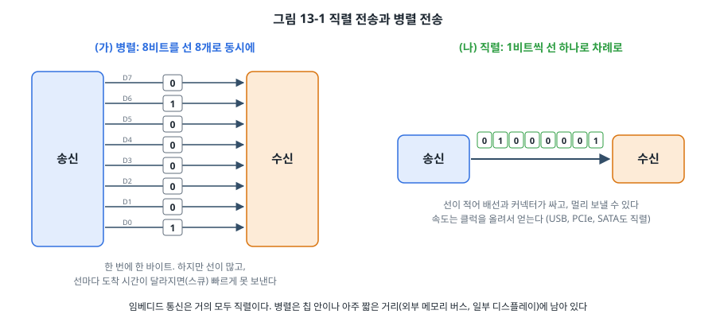
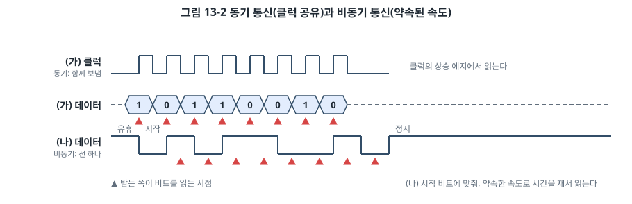
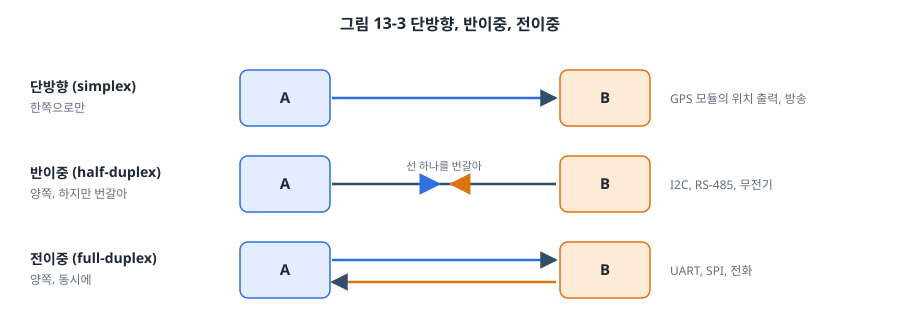
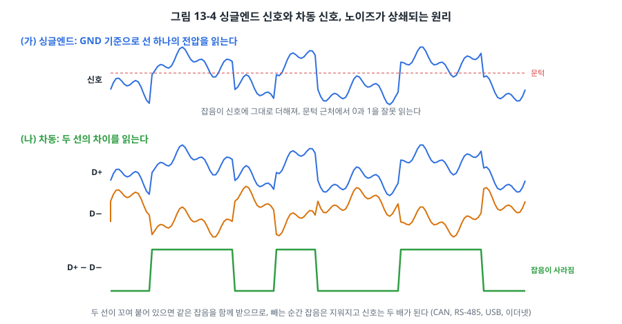
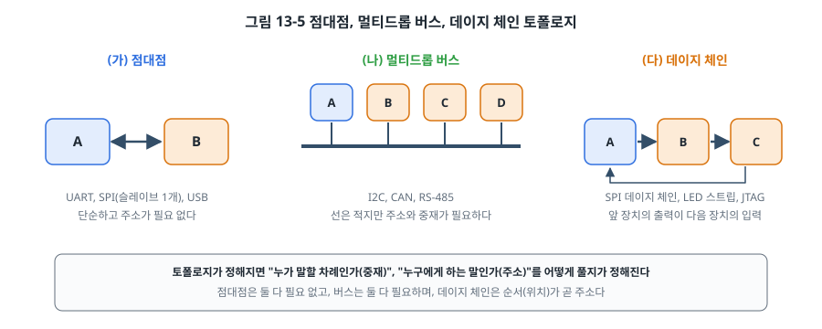
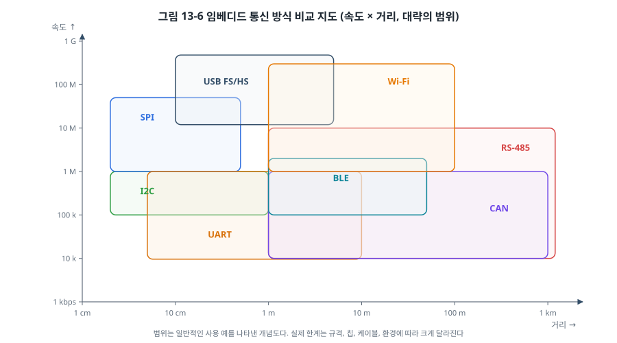

# 13장. 통신의 기초

## 이 장에서 배우는 것

- 직렬과 병렬, 동기와 비동기 통신의 차이
- 단방향, 반이중, 전이중의 의미
- 싱글엔드 신호와 차동 신호, 차동 신호가 잡음에 강한 이유
- 점대점, 버스, 데이지 체인 토폴로지와 주소·중재 문제
- 프로토콜 계층과 오류 검출(패리티, 체크섬, CRC), 상황에 맞는 통신 방식 고르기

---

## 13.1 제3부를 시작하며

MCU 혼자서 할 수 있는 일은 많지 않습니다. 온도 센서, 가속도 센서, 메모리 칩, 디스플레이, 무선 모듈, 다른 MCU, PC, 클라우드 서버. 임베디드 시스템의 일은 대부분 무언가와 데이터를 주고받는 일입니다. 제3부에서는 그 방법인 **통신**을 다룹니다.

14장부터는 UART, I2C, SPI, CAN, USB, 무선을 하나씩 다룹니다. 그런데 이 방식들은 서로 완전히 다른 것이 아니라, 몇 가지 기본 선택의 조합입니다. 선을 몇 개 쓸 것인가, 클럭을 함께 보낼 것인가, 양방향을 동시에 할 것인가, 전압을 어떻게 표현할 것인가, 여러 장치를 어떻게 연결할 것인가. 이 장에서는 이런 선택지와 그 장단점을 먼저 정리합니다. 이 장의 지도를 머릿속에 넣어 두면, 처음 보는 통신 규격을 만나도 "아, 이건 동기식 반이중 차동 버스구나" 하고 빠르게 성격을 파악할 수 있습니다.

통신 장에서는 그림을 특히 많이 씁니다. 통신은 **시간에 따라 선 위의 전압이 어떻게 바뀌는가**의 문제라서, 글보다 타이밍 다이어그램 한 장이 훨씬 많은 것을 알려 줍니다. 이 장에서 타이밍 다이어그램을 읽는 법에도 익숙해지기 바랍니다.

## 13.2 직렬과 병렬

데이터 8비트를 보내는 방법은 두 가지입니다.



**병렬(parallel)** 전송은 선 8개로 8비트를 동시에 보냅니다. 한 번에 한 바이트를 보내니 빠를 것 같습니다. 그런데 선이 많으면 커넥터와 케이블이 비싸지고, MCU의 핀도 많이 씁니다. 더 큰 문제는 속도를 올릴 때 생깁니다. 선마다 길이와 전기적 특성이 조금씩 달라서 비트들이 도착하는 시간이 미세하게 어긋나는데(**스큐**, skew), 클럭이 빨라질수록 이 어긋남이 비트 하나의 시간에 견줄 만큼 커져 데이터가 섞여 버립니다.

**직렬(serial)** 전송은 선 하나로 비트를 하나씩 차례로 보냅니다. 선이 적어 싸고 멀리 보낼 수 있으며, 스큐 문제가 없으니 클럭을 높여 속도를 얻을 수 있습니다. 옛날 PC의 프린터 포트(병렬)와 IDE 하드디스크(병렬)가 USB(직렬)와 SATA(직렬)로 바뀐 이유가 이것입니다.

임베디드 시스템의 통신은 거의 모두 직렬입니다. 병렬은 칩 안의 버스, 외부 메모리 인터페이스, 일부 디스플레이처럼 아주 짧은 거리에만 남아 있습니다. 이 책에서 다루는 통신 방식도 모두 직렬입니다.

직렬 전송에서는 **비트의 순서**를 약속해야 합니다. 가장 낮은 비트를 먼저 보내는 **LSB 먼저(LSB first)** 와 가장 높은 비트를 먼저 보내는 **MSB 먼저(MSB first)** 가 있습니다. UART는 LSB 먼저, I2C는 MSB 먼저, SPI는 장치마다 설정할 수 있습니다. 비트 순서를 잘못 맞추면 0x41('A')이 0x82로 읽히는 식의 이상한 값이 나옵니다.

## 13.3 동기와 비동기

받는 쪽은 언제 비트를 읽어야 할까요? 선 위의 전압은 계속 이어져 있으므로, 어디서 한 비트가 끝나고 다음 비트가 시작되는지 알아야 합니다.



**동기(synchronous)** 통신은 데이터와 함께 **클럭 신호**를 보냅니다. 받는 쪽은 클럭의 에지(예: 상승 에지)에서 데이터 선을 읽으면 됩니다. 보내는 쪽이 클럭을 빠르게 하든 느리게 하든, 심지어 중간에 잠시 멈추든 받는 쪽은 그대로 따라옵니다. 대신 선이 하나 더 필요합니다. I2C와 SPI가 동기 방식입니다.

**비동기(asynchronous)** 통신은 클럭을 보내지 않습니다. 대신 양쪽이 미리 **속도를 약속**합니다(예: 1초에 9600비트). 받는 쪽은 데이터의 시작을 알리는 신호(UART에서는 시작 비트)를 보고 자신의 클럭으로 시간을 재면서 비트를 읽습니다. 선이 적은 대신, 양쪽 클럭이 약속한 속도에서 조금이라도 벗어나면 읽는 시점이 점점 어긋납니다. 14장에서 이 오차가 얼마까지 허용되는지 계산합니다. UART가 대표적인 비동기 방식입니다.

> 🔍 깊이 보기: USB, 이더넷, CAN처럼 빠르거나 먼 거리의 통신은 클럭 선 없이도 동기를 맞춥니다. 데이터 신호 자체에 클럭 정보를 담는 방법을 쓰는데, 받는 쪽이 신호의 에지를 보며 자신의 클럭을 계속 미세하게 맞춥니다(**클럭 복원**). 에지가 너무 오래 없으면 맞출 수 없으므로, 같은 비트가 일정 개수 이상 이어지면 반대 비트를 일부러 끼워 넣는 **비트 스터핑(bit stuffing)** 같은 기법을 씁니다. 17장의 CAN과 18장의 USB에서 다시 만납니다.

## 13.4 단방향, 반이중, 전이중

데이터가 어느 방향으로, 어떻게 흐르는지도 통신 방식마다 다릅니다.



- **단방향(simplex)**: 한쪽으로만 보냅니다. 위치를 계속 내보내기만 하는 GPS 모듈이 그 예입니다.
- **반이중(half-duplex)**: 양쪽이 모두 보낼 수 있지만, 같은 선을 쓰므로 번갈아 보냅니다. 무전기처럼 "말하고 나면 듣는" 방식입니다. 둘이 동시에 보내면 신호가 충돌하므로, **누가 보낼 차례인지** 정하는 규칙이 필요합니다. I2C와 RS-485가 반이중입니다.
- **전이중(full-duplex)**: 보내는 선과 받는 선이 따로 있어 동시에 주고받습니다. 전화처럼 말하면서 들을 수 있습니다. UART와 SPI가 전이중입니다.

반이중은 선을 아끼는 대신 차례를 정하는 규칙(프로토콜)이 복잡해지고, 전이중은 선이 더 필요한 대신 단순합니다. 공학의 거의 모든 선택처럼 여기에도 맞바꿈이 있습니다.

## 13.5 싱글엔드 신호와 차동 신호

1과 0을 전압으로 표현하는 방법에도 두 가지가 있습니다.



**싱글엔드(single-ended)** 신호는 선 하나의 전압을 GND와 비교해서 읽습니다. 2장의 논리 레벨이 이 방식입니다. 단순하지만, 선이 길어지면 주변의 모터, 전원선, 형광등이 만드는 잡음이 신호에 그대로 더해지고, 보내는 쪽과 받는 쪽의 GND 전압이 조금씩 달라지는 문제도 생깁니다. 그래서 싱글엔드 신호는 대개 보드 안이나 수십 cm 이내에서 씁니다. UART(TTL 레벨), I2C, SPI가 이 방식입니다.

**차동(differential)** 신호는 선 두 개에 서로 반대인 신호를 보내고, 받는 쪽은 **두 선의 전압 차이**만 봅니다. D+가 높고 D−가 낮으면 1, 반대면 0입니다. 두 선을 꼬아서(트위스트 페어) 붙여 두면, 바깥에서 들어오는 잡음은 두 선에 거의 똑같이 들어옵니다. 받는 쪽에서 빼면 같은 잡음은 지워지고, 반대 방향인 신호는 오히려 두 배가 됩니다. 두 장치의 GND 전압이 조금 달라도 두 선이 함께 오르내리므로 차이는 그대로입니다.

그래서 차동 신호는 수십 m에서 1 km 넘게도 보낼 수 있고, 잡음이 많은 공장이나 자동차에서도 안정적입니다. RS-485(14장), CAN(17장), USB(18장), 이더넷이 모두 차동 신호입니다. 대신 선이 두 배로 들고, 신호를 차동으로 바꿔 주는 **트랜시버(transceiver)** 칩이 필요합니다.

## 13.6 토폴로지: 어떻게 연결하는가

장치가 둘 이상이면 연결 모양(**토폴로지**, topology)을 정해야 합니다.



**점대점(point-to-point)** 은 두 장치만 연결합니다. 상대가 하나뿐이니 "누구에게 보내는가"를 따질 필요가 없습니다. UART가 이 방식입니다.

**멀티드롭 버스(multi-drop bus)** 는 여러 장치가 같은 선을 나눠 씁니다. 선이 적게 들지만, 두 가지 문제를 풀어야 합니다.

- **주소(addressing)**: 보내는 데이터가 누구에게 가는 것인지 알려야 합니다. I2C는 장치마다 7비트 주소가 있고, CAN은 메시지마다 식별자가 있습니다.
- **중재(arbitration)**: 둘 이상이 동시에 보내려 할 때 누가 먼저 보낼지 정해야 합니다. I2C와 CAN은 2장의 오픈 드레인 와이어드 AND를 이용한 영리한 방법으로 이 문제를 풉니다(15장, 17장). 한 장치(마스터)만 통신을 시작할 수 있게 정해 두는 것도 중재 방법의 하나입니다.

**데이지 체인(daisy chain)** 은 장치들을 줄줄이 잇습니다. 앞 장치의 출력이 다음 장치의 입력이 됩니다. 장치의 위치가 곧 주소 역할을 하므로 주소 설정이 필요 없지만, 중간 장치 하나가 고장 나면 뒤쪽 전체가 끊깁니다. SPI 데이지 체인(16장), 주소 지정형 LED 스트립, JTAG 디버그 체인이 이 방식입니다.

SPI는 이 셋과 조금 다른 **스타형**에 가깝습니다. 데이터 선은 모두 공유하되 장치마다 선택 신호(CS)를 따로 주어, 선택 선으로 주소 문제를 하드웨어적으로 풉니다. 16장에서 자세히 봅니다.

## 13.7 프로토콜 계층

전선 위에서 전압이 바뀌는 것부터 "온도가 23.4 °C다"라는 의미가 전달되기까지는 여러 단계를 거칩니다. 이것을 층으로 나누어 생각하면 복잡한 통신도 정리됩니다.

| 계층 | 정하는 것 | 예 (UART로 온도를 보낼 때) |
| --- | --- | --- |
| 물리 계층 | 전압, 선의 수, 커넥터, 속도, 비트를 선 위에 싣는 방법 | 3.3 V 로직, TX/RX/GND, 9600 bps, 8N1 |
| 데이터 링크 계층 | 바이트를 묶어 프레임 만들기, 주소, 오류 검출, 흐름 제어 | 시작 바이트 + 길이 + 데이터 + CRC |
| 응용 계층 | 데이터의 의미와 형식 | "TEMP:23.4" 또는 2바이트 정수 234 |

인터넷의 OSI 7계층 모델을 들어 본 적이 있다면, 그것을 임베디드에 맞게 크게 줄인 것이라고 생각하면 됩니다. 14장부터 다루는 UART, I2C, SPI는 주로 물리 계층과 데이터 링크 계층의 일부를 정해 주는 규격입니다. 그 위에서 무엇을 어떤 형식으로 보낼지는 우리가 정해야 하는데, 40장의 최종 프로젝트에서 보드 간 프로토콜을 직접 설계해 봅니다.

### 오류 검출

선 위의 비트는 잡음 때문에 뒤집힐 수 있습니다. 받는 쪽이 오류를 알아챌 수 있도록, 보내는 쪽은 데이터로부터 계산한 **검사 값**을 함께 보냅니다. 받는 쪽은 같은 계산을 해서 결과가 다르면 오류로 판단합니다.

- **패리티(parity)**: 1의 개수가 짝수(또는 홀수)가 되도록 비트 하나를 덧붙입니다. 비트 하나가 뒤집히면 잡지만, 두 개가 뒤집히면 놓칩니다. UART 프레임에 선택적으로 붙일 수 있습니다(14장).
- **체크섬(checksum)**: 모든 바이트를 더한 값을 덧붙입니다. 계산이 쉽지만, 한 바이트가 1 늘고 다른 바이트가 1 줄거나, 바이트 순서가 바뀌면 합이 같아서 놓칩니다.
- **CRC(Cyclic Redundancy Check)**: 데이터를 이진 다항식으로 보고 정해진 다항식으로 나눈 나머지를 덧붙입니다. 계산은 조금 복잡하지만 연속된 비트 오류와 순서 바뀜까지 매우 잘 잡습니다. CAN, USB, 이더넷, SD 카드, 그리고 많은 센서가 CRC를 씁니다.

`code/ch13-error-detection/`의 예제를 PC에서 실행하면 세 방법의 차이를 직접 볼 수 있습니다.

```
'A'(0x41)의 짝수 패리티 비트 = 0
원래 메시지           체크섬=0x23  CRC-8=0xF4
비트 1개 오류         체크섬=0x22  CRC-8=0xDD
비트 2개 오류 (서로 상쇄) 체크섬=0x23  CRC-8=0x3D
바이트 순서 뒤바뀜 체크섬=0x23  CRC-8=0x4A
```

체크섬은 비트 하나의 오류는 잡지만, 서로 상쇄되는 두 비트 오류와 바이트 순서 바뀜에서는 원래 메시지와 같은 값(0x23)이 나와 오류를 놓칩니다. CRC-8은 네 경우 모두 다른 값을 냅니다.

```c
static uint8_t crc8(const uint8_t *d, size_t n)    /* 다항식 0x07 */
{
    uint8_t crc = 0x00;
    for (size_t i = 0; i < n; i++) {
        crc ^= d[i];
        for (int k = 0; k < 8; k++) {
            crc = (crc & 0x80u) ? (uint8_t)((crc << 1) ^ 0x07u) : (uint8_t)(crc << 1);
        }
    }
    return crc;
}
```

CRC에는 다항식, 초깃값, 비트 반사 여부, 최종 XOR 값 같은 매개변수가 여러 가지 있고, 이것이 하나라도 다르면 결과가 다릅니다. 센서나 통신 규격의 CRC를 구현할 때는 데이터시트에 적힌 매개변수와 검증값(보통 "123456789"를 넣었을 때의 결과)을 반드시 확인하세요. 위 함수의 매개변수에서 "123456789"의 CRC는 0xF4입니다. STM32에는 CRC를 계산하는 하드웨어 주변장치도 있습니다(32비트 CRC, RM0383 4장).

> 💡 팁: 오류 검출은 오류를 **알아채는** 것일 뿐 고치지는 않습니다. 오류를 알아챈 뒤 어떻게 할지(버리기, 다시 보내 달라고 요청하기)는 프로토콜이 정해야 합니다. 받았다는 확인(ACK)을 돌려보내고, 일정 시간 안에 ACK가 없으면 다시 보내는 방식이 가장 흔합니다. 15장의 I2C에는 바이트마다 ACK가 하드웨어로 들어 있고, CAN은 오류를 감지하면 하드웨어가 자동으로 다시 보냅니다.

## 13.8 어떤 통신을 고를까

이제 이 장의 내용을 지도 한 장으로 모아 보겠습니다.



| 방식 | 선 (GND 제외) | 동기/비동기 | 이중 | 신호 | 토폴로지 | 대략의 속도 | 거리 | 주 용도 | 장 |
| --- | --- | --- | --- | --- | --- | --- | --- | --- | --- |
| UART | 2 (TX, RX) | 비동기 | 전이중 | 싱글엔드 | 점대점 | ~1 Mbps | ~수 m | 디버그 콘솔, GPS, 모듈 | 14 |
| RS-485 | 2 (A, B) | 비동기 | 반이중 | 차동 | 버스 | ~10 Mbps (짧을 때) | ~1.2 km (느릴 때) | 산업용 센서망, Modbus | 14 |
| I2C | 2 (SDA, SCL) | 동기 | 반이중 | 싱글엔드, 오픈 드레인 | 버스 | 100 k / 400 k / 1 Mbps | 보드 안 | 센서, EEPROM, RTC | 15 |
| SPI | 4 (SCLK, MOSI, MISO, CS) | 동기 | 전이중 | 싱글엔드 | 스타, 데이지 체인 | 수~수십 MHz | 보드 안 | Flash, 디스플레이, ADC | 16 |
| CAN | 2 (CANH, CANL) | 비동기 | 반이중 | 차동 | 버스 | ~1 Mbps (CAN FD 더 빠름) | ~40 m (1 Mbps) | 자동차, 산업 기기 | 17 |
| USB | 2 (D+, D−) | 비동기(클럭 복원) | 반이중 | 차동 | 계층형 스타 | 12 / 480 Mbps | ~5 m | PC 연결 | 18 |
| BLE, Wi-Fi | 무선 | | | | | ~2 Mbps / 수백 Mbps | 수십 m | 스마트폰, 인터넷 | 19, 20 |

표의 속도와 거리는 일반적인 사용 범위이고, 실제 한계는 규격의 버전, 칩, 케이블, 환경에 따라 크게 달라집니다. 같은 RS-485라도 100 kbps라면 1 km 넘게 가지만 10 Mbps라면 수십 m로 줄어듭니다. 속도와 거리는 서로 맞바꾸는 관계입니다.

통신 방식은 대개 **상대방이 정합니다.** 쓰려는 센서가 I2C만 지원하면 I2C를 써야 합니다. 그래도 선택의 여지가 있다면 다음 질문을 차례로 던져 보세요.

1. **얼마나 멀리** 보내야 하는가? 보드 안이라면 I2C나 SPI, 케이블로 수 m라면 UART나 USB, 수십 m 이상이거나 잡음이 많다면 RS-485나 CAN입니다.
2. **얼마나 많이, 빨리** 보내야 하는가? 센서 값 몇 바이트라면 I2C로 충분하고, 화면 전체를 초당 수십 번 바꾸려면 SPI나 그보다 빠른 인터페이스가 필요합니다.
3. **장치가 몇 개**인가? 하나라면 UART나 SPI가 단순하고, 여러 개를 적은 선으로 묶으려면 I2C, RS-485, CAN 같은 버스가 좋습니다.
4. **얼마나 믿을 수 있어야** 하는가? 자동차처럼 오류가 위험한 곳은 CRC, 자동 재전송, 오류 상태 관리까지 하드웨어에 들어 있는 CAN이 표준입니다.
5. **MCU에 그 주변장치가 있는가?** 소프트웨어로 흉내 낼 수도 있지만(비트뱅잉), 하드웨어 주변장치가 있으면 훨씬 빠르고 CPU 부담이 적습니다.

---

## 정리

- 임베디드 통신은 거의 모두 직렬이며, 비트 순서(LSB 먼저, MSB 먼저)를 약속해야 합니다.
- 동기 통신은 클럭을 함께 보내고, 비동기 통신은 속도를 미리 약속하고 시작 신호에 맞춰 시간을 잽니다.
- 단방향, 반이중(번갈아), 전이중(동시에)은 선의 수와 프로토콜 복잡도를 맞바꿉니다.
- 차동 신호는 두 선의 차이를 읽어 같은 잡음을 지우므로 먼 거리와 잡음이 많은 환경에 강합니다.
- 버스 토폴로지는 선을 아끼는 대신 주소와 중재 문제를 풀어야 합니다.
- 통신은 물리, 데이터 링크, 응용 계층으로 나눠 생각하고, 오류 검출에는 패리티, 체크섬, CRC를 씁니다. CRC가 가장 강력하지만 매개변수를 정확히 맞춰야 합니다.

## 연습 문제

1. 0x41을 LSB 먼저로 보냈는데 받는 쪽이 MSB 먼저로 해석했다면 받은 값은 무엇인가요?
2. 비동기 통신에서 보내는 쪽 클럭이 약속보다 2% 빠르다면, 시작 비트에서 맞춘 뒤 10번째 비트를 읽을 때 읽는 시점이 비트 폭의 몇 %만큼 어긋나나요? 비트의 가운데에서 읽는다면 몇 %까지 어긋나도 괜찮을까요?
3. 다음 장치들을 연결하려 합니다. 각각 어떤 통신 방식이 알맞은지 고르고 이유를 쓰세요.
   (가) 같은 보드 위의 온도 센서 3개 (나) 공장 바닥에 300 m 간격으로 늘어선 센서 20개 (다) 보드 위의 2.4인치 컬러 디스플레이 (라) 개발 중 PC로 보내는 디버그 메시지
4. 체크섬이 놓치는 오류의 예를 13.7절의 실행 결과 말고 하나 더 만들어 보세요. 그 경우에 CRC-8은 오류를 잡나요? 예제 코드를 고쳐 확인하세요.
5. 반이중 버스에서 두 장치가 동시에 보내기 시작하면 무슨 일이 일어날 수 있나요? 푸시풀 출력과 오픈 드레인 출력인 경우를 나누어 설명하세요. (힌트: 2장 2.6절)
6. 이 장의 통신 방식 표에 "1-Wire"(DS18B20 온도 센서가 쓰는 방식)를 추가하려고 합니다. 데이터시트나 자료를 찾아 선의 수, 동기/비동기, 이중, 토폴로지, 속도를 채워 보세요.
