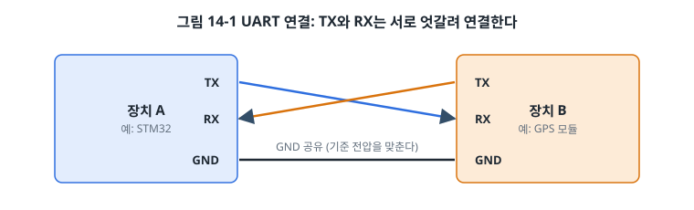
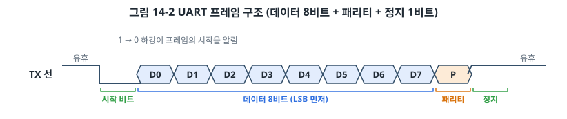
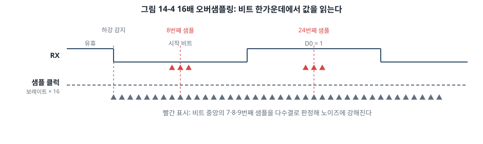
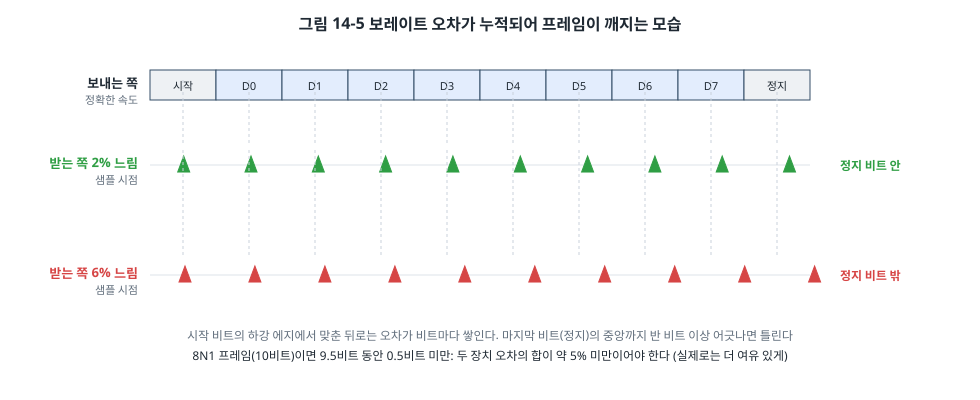
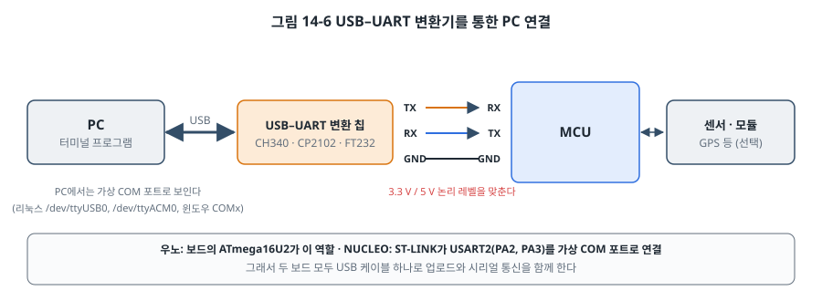
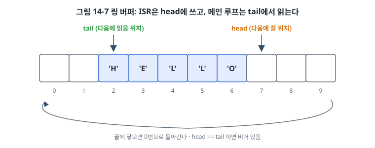
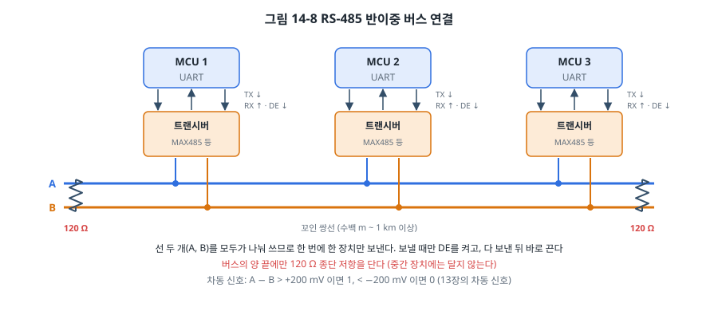

# 14장. UART

## 이 장에서 배우는 것

- UART의 연결 방법과 프레임 구조(시작 비트, 데이터, 패리티, 정지 비트)
- 보레이트, 오버샘플링, 보레이트 오차의 허용 범위
- AVR의 USART0과 STM32의 USART2 레지스터로 송수신하기
- `printf`를 UART로 연결하는 방법
- 수신 인터럽트와 링 버퍼, DMA 수신, 간단한 명령어 셸
- RS-232와 RS-485: 같은 UART를 더 멀리 보내는 방법

---

## 14.1 가장 오래되고 가장 흔한 통신

**UART(Universal Asynchronous Receiver/Transmitter)** 는 13장에서 본 비동기 직렬 통신을 하드웨어로 구현한 주변장치입니다. 수십 년 전 컴퓨터와 터미널을 잇던 시절부터 쓰였고, 지금도 거의 모든 MCU에 들어 있습니다. 펌웨어 개발자에게 UART는 특별한 의미가 있습니다. 개발 중에 MCU 안에서 무슨 일이 일어나는지 PC로 출력해 보는 **디버그 콘솔**이기 때문입니다. 이 장을 마치면 앞의 장들에서 디버거로 확인하던 변수들을 화면에 바로 찍어 볼 수 있습니다.

UART는 GPS 수신기, 블루투스 모듈, Wi-Fi 모듈, 지문 센서, 다른 MCU와의 연결에도 널리 쓰입니다. 주변장치 이름은 칩마다 조금씩 다릅니다. ATmega328P는 동기 모드도 지원한다는 뜻으로 **USART**라고 부르고, STM32도 USART와 UART를 함께 둡니다. 이 장에서 다루는 비동기 동작은 모두 같습니다.

### 연결



UART는 선 세 개로 연결합니다.

- 한쪽의 **TX(송신)** 를 다른 쪽의 **RX(수신)** 에, 반대쪽도 마찬가지로 **엇갈려** 연결합니다. TX끼리 연결하는 것은 가장 흔한 실수입니다.
- **GND**를 반드시 연결합니다. 13장에서 본 것처럼 싱글엔드 신호는 GND를 기준으로 전압을 읽기 때문입니다.
- 두 장치의 **논리 레벨**이 같아야 합니다. 5 V 우노의 TX를 3.3 V 모듈의 RX에 바로 연결하면 2장에서 경고한 대로 모듈이 망가질 수 있습니다.

> ⚠️ 주의: 오래된 장비나 산업용 기기의 "시리얼 포트"(9핀 D-sub 커넥터)는 **RS-232** 전압 규격을 씁니다. RS-232는 ±3~15 V를 쓰고 논리도 반대(음전압이 1)입니다. MCU의 UART 핀(TTL 레벨)에 RS-232를 직접 연결하면 MCU가 망가집니다. 반드시 MAX232 같은 레벨 변환 칩을 거칩니다(14.11절).

## 14.2 프레임 구조

UART는 데이터를 **프레임(frame)** 단위로 보냅니다.



- **유휴(idle)**: 아무것도 보내지 않을 때 선은 High입니다.
- **시작 비트(start bit)**: 1비트 동안 Low. 받는 쪽은 High에서 Low로 떨어지는 순간을 보고 프레임이 시작된 것을 압니다.
- **데이터 비트**: 보통 8비트, **LSB부터** 보냅니다. 5~9비트로 설정할 수도 있습니다.
- **패리티 비트(parity bit)**: 선택 사항입니다. 13장의 짝수 또는 홀수 패리티로 비트 하나의 오류를 검출합니다.
- **정지 비트(stop bit)**: 1비트(또는 2비트) 동안 High. 프레임의 끝을 알리고, 다음 시작 비트의 하강 에지가 확실히 보이게 합니다.

이 설정을 "데이터 비트 수, 패리티, 정지 비트 수"로 줄여 부릅니다. 가장 흔한 **8N1**은 데이터 8비트, 패리티 없음(None), 정지 비트 1개입니다. 이때 한 바이트를 보내는 데 시작 비트와 정지 비트를 합쳐 10비트가 듭니다. 그래서 115200 bps의 실제 데이터 속도는 초당 11,520바이트입니다.

문자 'A'(0x41)를 8N1로 보내면 선 위에는 다음과 같은 파형이 나타납니다.


0x41은 이진수로 0100 0001이지만, LSB부터 보내므로 선 위에는 1, 0, 0, 0, 0, 0, 1, 0 순서로 나갑니다. 로직 애널라이저로 UART 신호를 처음 볼 때 비트를 거꾸로 읽는 실수를 많이 하니 기억해 두세요. 9600 bps에서 한 비트는 1/9600초, 약 104 µs입니다.

## 14.3 보레이트와 수신 원리

### 보레이트

**보레이트(baud rate)** 는 1초에 보내는 비트(정확히는 심볼)의 수입니다. UART에서는 bps와 같은 뜻으로 씁니다. 양쪽이 같은 보레이트를 써야 하므로 표준 값을 주로 씁니다. 9600, 19200, 38400, 57600, 115200이 흔하고, 230400, 460800, 921600, 1 Mbps 이상도 씁니다.

### 오버샘플링

비동기 통신에서 받는 쪽은 시작 비트의 하강 에지에 맞춰 자기 클럭으로 시간을 재야 합니다. 이때 비트의 **가운데**에서 읽는 것이 가장 안전합니다. 가장자리에서 읽으면 조금만 어긋나도 옆 비트를 읽게 되기 때문입니다.



그래서 UART의 수신기는 보레이트의 16배(또는 8배) 빠른 클럭으로 선을 샘플링합니다. 하강 에지를 감지한 뒤 8번째 샘플(시작 비트의 가운데)에서 다시 확인하고, 그 뒤로 16샘플마다 비트를 읽습니다. 많은 UART는 가운데의 7, 8, 9번째 샘플 세 개를 다수결로 판정해 짧은 잡음에도 강해집니다. STM32는 세 샘플이 서로 다르면 잡음 플래그(NF)를 세워 알려 줍니다.

### 보레이트 오차의 허용 범위

양쪽의 보레이트가 정확히 같을 수는 없습니다. MCU의 클럭은 정확하지 않고(3장의 내부 RC는 ±1% 수준), 클럭을 나눠 보레이트를 만들 때도 정수로 나누어 떨어지지 않으면 오차가 생깁니다. 이 오차는 시작 비트에서 맞춘 뒤로 비트마다 쌓입니다.



수신기는 시작 비트의 하강 에지에서 시간을 맞추므로, 오차는 그 하강 에지부터 쌓입니다. 8N1 프레임이라면 하강 에지에서 정지 비트의 가운데까지 9.5비트 동안 읽는 시점이 반 비트 이상 어긋나면 안 됩니다. 0.5 ÷ 9.5 ≈ 5%입니다. 이것은 **보내는 쪽과 받는 쪽 오차의 합**이고, 실제로는 하강 에지를 감지하는 오차와 신호의 상승·하강 시간까지 고려해야 하므로, 한쪽의 오차를 **±2% 이내**로 유지하는 것이 일반적인 기준입니다. 데이터시트에는 오버샘플링 설정에 따른 정확한 허용 오차가 표로 나와 있습니다(ATmega328P 데이터시트의 USART 장, RM0383 19.3.5절).

### AVR의 보레이트 설정

ATmega328P는 UBRR0 레지스터 값으로 클럭을 나눠 보레이트를 만듭니다(ATmega328P 데이터시트 USART0 장의 보레이트 계산식 표).

```
일반 모드 (U2X0 = 0):  UBRR0 = F_CPU ÷ (16 × 보레이트) − 1
배속 모드 (U2X0 = 1):  UBRR0 = F_CPU ÷ (8 × 보레이트) − 1
```

16 MHz에서 계산해 보면 다음과 같습니다.

| 보레이트 | 일반 모드 UBRR0 | 오차 | 배속 모드 UBRR0 | 오차 |
| --- | --- | --- | --- | --- |
| 9600 | 103 | 0.2% | 207 | 0.2% |
| 57600 | 16 | 2.1% | 34 | −0.8% |
| 115200 | 8 | −3.5% | 16 | 2.1% |

115200 bps를 일반 모드로 쓰면 오차가 −3.5%로 위험하고, 배속 모드를 쓰면 2.1%로 줄어듭니다. 아두이노가 115200 bps에서 배속 모드를 쓰는 이유입니다. 그래도 2.1%는 상대 장치의 오차가 크면 문제가 될 수 있는 값입니다. 통신이 가끔 깨진다면 보레이트를 낮추거나, 오차가 0이 되는 클럭을 쓰는 방법이 있습니다. 예를 들어 14.7456 MHz 크리스털은 표준 보레이트로 정확히 나누어 떨어지도록 고른 "UART 친화적" 주파수입니다.

### STM32의 보레이트 설정

STM32의 USART는 BRR 레지스터에 정수부(12비트)와 소수부(4비트)를 함께 넣어 분수로 나눌 수 있어서 오차가 훨씬 작습니다(RM0383 19.3.4절). 16배 오버샘플링(OVER8 = 0)에서는 계산이 간단합니다.

```
BRR = fCK ÷ 보레이트   (반올림)
```

USART2는 APB1에 있으므로 fCK는 PCLK1입니다. 리셋 기본 상태(16 MHz)에서 115200 bps라면 16,000,000 ÷ 115,200 ≈ 138.9이므로 BRR = 139이고, 실제 보레이트는 약 115,108 bps(오차 −0.08%)입니다. 3장에서 APB1을 50 MHz로 바꿨다면 fCK도 50 MHz로 바꿔 계산해야 합니다. 클럭 설정을 바꾸고 나서 시리얼 출력이 깨진다면 가장 먼저 의심할 곳입니다.

## 14.4 PC와 연결하기

PC에는 이제 UART 포트가 없습니다. 대신 **USB–UART 변환기**를 씁니다.



USB–UART 변환 칩(CH340, CP2102, FT232 등)은 PC에서 **가상 COM 포트**로 보입니다. 이 책의 보드들은 이 칩을 이미 갖추고 있습니다.

- **우노**: 보드의 ATmega16U2가 ATmega328P의 USART0(D0, D1)과 연결되어 있습니다. 그래서 D0, D1에 다른 장치를 연결하면 업로드와 시리얼 모니터가 방해받습니다.
- **NUCLEO-F411RE**: ST-LINK가 STM32의 **USART2(PA2 = TX, PA3 = RX)** 를 가상 COM 포트로 연결합니다(UM1724). 그래서 이 장의 STM32 예제는 USART2를 씁니다.

PC 쪽에서는 **터미널 프로그램**으로 포트를 엽니다. 아두이노 IDE의 시리얼 모니터, PuTTY, Tera Term(윈도우), `screen`, `minicom`, `picocom`(리눅스, macOS), VS Code의 시리얼 모니터 확장 등이 있습니다. 보레이트와 프레임 설정(8N1)을 장치와 똑같이 맞추고, 줄바꿈 문자(CR, LF) 설정도 확인하세요.

```bash
picocom -b 115200 /dev/ttyACM0
```

> 💡 팁: 화면에 알 수 없는 문자가 쏟아진다면 십중팔구 보레이트가 틀린 것입니다. 아무것도 나오지 않는다면 TX/RX 교차, GND 연결, 포트 번호, 그리고 다른 프로그램(예: 아두이노 IDE의 시리얼 모니터)이 이미 포트를 열고 있지 않은지 확인하세요. 포트는 한 프로그램만 열 수 있습니다.

## 14.5 AVR: USART0으로 송수신하기

ATmega328P의 USART0 레지스터는 다음과 같습니다(ATmega328P 데이터시트 USART0 장).

| 레지스터 | 주요 비트 | 역할 |
| --- | --- | --- |
| UDR0 | | 송신 데이터 쓰기 / 수신 데이터 읽기 (같은 주소, 다른 버퍼) |
| UCSR0A | RXC0, TXC0, UDRE0, FE0, DOR0, UPE0, U2X0 | 수신 완료, 송신 완료, 송신 버퍼 빔, 프레임 오류, 데이터 넘침, 패리티 오류, 배속 |
| UCSR0B | RXCIE0, TXCIE0, UDRIE0, RXEN0, TXEN0 | 인터럽트 허용, 수신·송신 켜기 |
| UCSR0C | UPM01:0, USBS0, UCSZ01:0 | 패리티, 정지 비트, 데이터 비트 수 |
| UBRR0 | | 보레이트 분주 값 (16비트) |

가장 단순한 **폴링** 방식부터 보겠습니다. 12장의 온도계가 이 방식으로 보냈습니다.

```c
void uart_init(void)
{
    UBRR0  = 16;                                     /* 115200 bps (배속 모드) */
    UCSR0A = (1 << U2X0);
    UCSR0C = (1 << UCSZ01) | (1 << UCSZ00);          /* 8N1 */
    UCSR0B = (1 << RXEN0) | (1 << TXEN0);            /* 수신, 송신 켜기 */
}

void uart_putc(char c)
{
    while ((UCSR0A & (1 << UDRE0)) == 0) {           /* 송신 버퍼가 빌 때까지 */
    }
    UDR0 = c;
}

int uart_getc_blocking(void)
{
    while ((UCSR0A & (1 << RXC0)) == 0) {            /* 받은 바이트가 생길 때까지 */
    }
    return UDR0;
}
```

UDRE0(Data Register Empty)과 TXC0(Transmit Complete)의 차이를 알아 두세요. UDR0에 쓴 바이트는 곧바로 내부의 **시프트 레지스터**로 옮겨져 한 비트씩 나가고, UDR0은 다음 바이트를 받을 수 있게 비워집니다. UDRE0은 "다음 바이트를 써도 된다", TXC0은 "시프트 레지스터의 마지막 비트까지 선 위로 다 나갔다"는 뜻입니다. 연속으로 보낼 때는 UDRE0을 보고, 14.10절의 RS-485처럼 "다 나간 뒤에 무언가를 해야 할 때"는 TXC0을 봅니다.

> 🔧 ATmega128에서는: USART가 두 개(USART0, USART1) 있습니다. USART0은 PE0(RXD0), PE1(TXD0)에, USART1은 PD2(RXD1), PD3(TXD1)에 있고, 레지스터 이름은 UDR0, UCSR0A처럼 번호만 다릅니다. 5장에서 본 것처럼 **PE0, PE1은 ISP 프로그래밍 핀과 같습니다.** USART0에 다른 장치를 연결해 두면 ISP 업로드가 실패할 수 있으므로, 키트에서는 PC와의 통신에 USART1을 쓰는 경우가 많습니다. 또 UBRR이 UBRR0H, UBRR0L로 나뉘어 있어 16비트로 한 번에 쓸 수 없으니 상위 바이트를 먼저 씁니다.

## 14.6 STM32: USART2로 송수신하기

STM32F411의 USART 레지스터는 다음과 같습니다(RM0383 19.6절).

| 레지스터 | 주요 비트 | 역할 |
| --- | --- | --- |
| USART_SR | TXE, TC, RXNE, IDLE, ORE, NF, FE, PE | 송신 버퍼 빔, 송신 완료, 수신 데이터 있음, 유휴 감지, 넘침, 잡음, 프레임 오류, 패리티 오류 |
| USART_DR | | 송신 쓰기 / 수신 읽기 |
| USART_BRR | DIV_Mantissa, DIV_Fraction | 보레이트 |
| USART_CR1 | UE, M, PCE, TXEIE, TCIE, RXNEIE, IDLEIE, TE, RE | 켜기, 데이터 길이, 패리티, 인터럽트, 송수신 켜기 |
| USART_CR2 | STOP | 정지 비트 |
| USART_CR3 | DMAT, DMAR | DMA 송수신 |

이름은 다르지만 AVR과 거의 일대일로 대응합니다. TXE는 UDRE0, TC는 TXC0, RXNE는 RXC0에 해당합니다.

```c
static void uart_init(uint32_t baud)
{
    RCC->AHB1ENR |= RCC_AHB1ENR_GPIOAEN;
    RCC->APB1ENR |= RCC_APB1ENR_USART2EN;
    (void)RCC->APB1ENR;

    gpio_set_af(GPIOA, 2, 7);                         /* PA2 = USART2_TX (AF7, 6장) */
    gpio_set_af(GPIOA, 3, 7);                         /* PA3 = USART2_RX */

    USART2->BRR = (16000000u + baud / 2u) / baud;     /* 16 MHz, 반올림 */
    USART2->CR1 = USART_CR1_TE | USART_CR1_RE;        /* 8N1 */
    USART2->CR1 |= USART_CR1_UE;                      /* USART 켜기 */
}

static void uart_putc(char c)
{
    while ((USART2->SR & USART_SR_TXE) == 0) {
    }
    USART2->DR = (uint8_t)c;
}
```

6장의 대체 기능 설정이 여기서 쓰입니다. PA2, PA3을 AF7으로 바꾸지 않으면 USART2는 동작하지만 신호가 핀으로 나오지 않습니다.

> ⚠️ 주의: STM32에서 수신 오류 플래그(ORE, NF, FE, PE)는 "SR을 읽은 다음 DR을 읽는" 순서로 지웁니다. 특히 **ORE(Overrun Error)** 는 이전 바이트를 읽기 전에 다음 바이트가 도착했다는 뜻인데, RXNE 인터럽트만 켜 두고 ORE를 처리하지 않으면 ORE가 남아 있는 동안 인터럽트가 계속 걸려 프로그램이 멈춘 것처럼 보일 수 있습니다. 예제의 ISR이 RXNE와 ORE를 함께 보고 DR을 읽는 이유입니다.

## 14.7 printf를 UART로

문자열과 숫자를 출력할 때마다 `uart_putc()`로 한 글자씩 보내기는 번거롭습니다. C 표준 라이브러리의 `printf`를 UART로 연결하면 PC에서 쓰던 그대로 쓸 수 있습니다. 방법은 라이브러리마다 다릅니다.

**AVR(avr-libc)** 는 출력 스트림을 직접 만들어 `stdout`에 연결합니다.

```c
#include <stdio.h>

static int put_for_stdio(char c, FILE *f)
{
    (void)f;
    if (c == '\n') {
        uart_putc('\r');          /* 터미널에서 줄을 바꾸려면 \r\n */
    }
    uart_putc(c);
    return 0;
}

static FILE uart_stdout = FDEV_SETUP_STREAM(put_for_stdio, NULL, _FDEV_SETUP_WRITE);

stdout = &uart_stdout;            /* 이제 printf가 UART로 나간다 */
```

**STM32(Arm GNU Toolchain의 newlib)** 는 `printf`가 결국 `_write()`라는 함수를 부릅니다. 운영체제가 없으므로 이 함수는 우리가 만들어야 합니다. 이 책의 공통 파일 `code/common/stm32f411/syscalls.c`는 `_write()`가 `__io_putchar()`를 부르게 해 두었고, 예제에서는 `__io_putchar()`만 만들면 됩니다.

```c
int __io_putchar(int ch)
{
    if (ch == '\n') {
        uart_putc('\r');
    }
    uart_putc((char)ch);
    return ch;
}
```

지금까지의 STM32 예제는 표준 라이브러리 없이(`-nostdlib`) 빌드했습니다. `printf`를 쓰려면 newlib의 작은 버전인 **newlib-nano**를 링크해야 하므로, 예제의 Makefile에 `USE_NEWLIB = 1`을 넣었습니다. 공통 Makefile이 이 값을 보고 `--specs=nano.specs`로 링크하고 `syscalls.c`를 함께 빌드합니다. 22장에서 이 옵션들이 하는 일을 자세히 봅니다.

> ⚠️ 주의: `printf`는 생각보다 큽니다. AVR에서 `printf` 하나만 써도 Flash가 1.5~2 KB 늘고, 부동소수점(`%f`)을 지원하는 버전은 더 큽니다. avr-libc와 newlib-nano 모두 기본 `printf`는 `%f`를 지원하지 않아서, 쓰려면 링크 옵션(AVR은 `-Wl,-u,vfprintf -lprintf_flt`, newlib-nano는 `-u _printf_float`)을 따로 줘야 합니다. 12장처럼 정수로 바꿔 출력하는 습관이 Flash를 아낍니다. 또 `printf`는 ISR에서 쓰지 않습니다(7장).

## 14.8 수신 인터럽트와 링 버퍼

폴링 방식의 수신에는 큰 문제가 있습니다. 115200 bps에서 바이트는 약 87 µs마다 하나씩 도착합니다. 메인 루프가 다른 일을 하느라 그보다 오래 수신 레지스터를 읽지 않으면, 다음 바이트가 앞 바이트를 덮어써서 데이터가 사라집니다(오버런). AVR은 수신 버퍼가 2바이트, STM32는 1바이트뿐이라 여유가 거의 없습니다.

해결 방법은 7장의 인터럽트입니다. 바이트가 도착할 때마다 수신 인터럽트가 걸리고, ISR이 그 바이트를 메모리의 버퍼에 담아 둡니다. 메인 루프는 시간이 날 때 버퍼에서 꺼내 처리합니다. 이때 쓰는 자료 구조가 **링 버퍼(ring buffer, 원형 버퍼)** 입니다.



링 버퍼는 배열 하나와 인덱스 두 개로 이루어집니다.

- **head**: 다음에 쓸 위치. ISR(생산자)만 바꿉니다.
- **tail**: 다음에 읽을 위치. 메인 루프(소비자)만 바꿉니다.
- 인덱스가 배열 끝에 닿으면 0으로 돌아갑니다. 10장의 원형 DMA와 같은 발상입니다.
- `head == tail`이면 비어 있고, `head`를 하나 늘렸을 때 `tail`과 같아지면 꽉 찬 것입니다. 그래서 크기가 N인 배열에는 최대 N − 1개를 담습니다.

```c
#define RX_SIZE 64u                       /* 2의 거듭제곱: & 로 나머지를 계산 */

static volatile uint8_t rx_buf[RX_SIZE];
static volatile uint8_t rx_head, rx_tail;

ISR(USART_RX_vect)                        /* 생산자 */
{
    uint8_t status = UCSR0A;              /* 오류 플래그는 UDR0보다 먼저 읽는다 */
    uint8_t c = UDR0;
    if (status & ((1 << FE0) | (1 << DOR0) | (1 << UPE0))) {
        return;
    }
    uint8_t next = (rx_head + 1u) & (RX_SIZE - 1u);
    if (next == rx_tail) {
        rx_overflow = 1;                  /* 꽉 참: 새 바이트를 버린다 */
        return;
    }
    rx_buf[rx_head] = c;
    rx_head = next;
}

int uart_getc(void)                       /* 소비자 */
{
    if (rx_head == rx_tail) {
        return -1;                        /* 비어 있음 */
    }
    uint8_t c = rx_buf[rx_tail];
    rx_tail = (rx_tail + 1u) & (RX_SIZE - 1u);
    return c;
}
```

이 링 버퍼는 인터럽트를 끄지 않고도 안전합니다. 생산자와 소비자가 각자 자기 인덱스만 바꾸고 상대의 인덱스는 읽기만 하며, 인덱스의 읽기와 쓰기가 원자적(AVR에서 `uint8_t`, Cortex-M에서 `uint32_t`)이기 때문입니다. 7장의 임계 구역이 필요 없는, 생산자와 소비자가 하나씩인 경우의 고전적인 해법입니다. 데이터를 먼저 쓰고 인덱스를 나중에 바꾸는 순서도 중요합니다. 순서가 바뀌면 소비자가 아직 쓰이지 않은 칸을 읽을 수 있습니다.

배열 크기를 2의 거듭제곱으로 정하면 `% RX_SIZE` 대신 `& (RX_SIZE − 1)`로 나머지를 계산할 수 있습니다. AVR처럼 나눗셈 명령이 없는 칩에서는 차이가 큽니다.

**송신**도 같은 방식으로 만들 수 있습니다. `uart_putc()`는 송신 링 버퍼에 넣고 바로 돌아오고, "송신 데이터 레지스터가 비었다"는 인터럽트(AVR의 UDRE, STM32의 TXE)가 버퍼에서 하나씩 꺼내 보냅니다. 버퍼가 비면 인터럽트를 끕니다. AVR 예제(`code/ch14-uart/avr/uart.c`)가 이렇게 되어 있습니다. 12장의 온도계에서 출력하는 동안 40 ms씩 멈추던 문제가 이것으로 해결됩니다. 출력 문자열이 송신 버퍼보다 짧다면 `printf`가 즉시 돌아옵니다.

## 14.9 DMA로 받기

수신 인터럽트도 바이트마다 한 번씩 걸립니다. 1 Mbps로 데이터가 쏟아지면 초당 10만 번입니다. STM32에서는 10장의 DMA로 이 부담을 없앨 수 있습니다.

USART2의 수신은 DMA1 스트림 5, 채널 4에 연결되어 있습니다(RM0383 9.3.3절 표). 원형 모드 DMA를 설정해 두면 DMA가 받은 바이트를 계속 버퍼에 쌓고, CPU는 필요할 때 DMA의 NDTR 값으로 "지금 어디까지 받았는지"만 확인하면 됩니다.

남는 문제는 "언제 확인하는가"입니다. 10장의 HT/TC 인터럽트는 버퍼가 절반이나 끝까지 찼을 때만 걸리는데, UART 메시지는 길이가 제각각입니다. 5바이트짜리 명령이 왔는데 버퍼가 64바이트라면 HT 인터럽트는 한참 뒤에야 걸립니다. 이때 쓰는 것이 STM32 USART의 **유휴 라인 감지(IDLE)** 입니다. 수신 선이 1프레임 시간 이상 High로 머물면, 즉 상대가 보내기를 멈추면 IDLE 플래그가 서고 인터럽트를 걸 수 있습니다.

```c
/* DMA1 스트림 5 = USART2_RX, 원형 모드로 rx_dma_buf[] 에 계속 받는다 (10장과 같은 설정)
   USART2->CR3 |= USART_CR3_DMAR;  USART2->CR1 |= USART_CR1_IDLEIE; */

void USART2_IRQHandler(void)
{
    if (USART2->SR & USART_SR_IDLE) {
        (void)USART2->DR;                                 /* SR → DR 읽기로 IDLE 지우기 */
        uint32_t pos = RX_DMA_SIZE - DMA1->S[5].NDTR;     /* DMA가 지금 쓰고 있는 위치 */
        process_new_bytes(last_pos, pos);                 /* 지난번 위치부터 여기까지가 새 데이터 */
        last_pos = pos;
    }
}
```

DMA + IDLE 조합은 GPS나 Modbus처럼 메시지 단위로 오는 데이터를 받을 때 CPU 부담을 거의 0으로 만듭니다. 30장의 데이터 로거에서 이 방식을 씁니다.

## 14.10 실습: 명령어 셸

`code/ch14-uart/`의 예제는 UART로 명령을 받아 실행하는 작은 **셸(shell)** 입니다. 개발 중인 제품에 이런 셸을 넣어 두면, PC에서 명령을 쳐서 LED를 켜 보고, 센서 값을 읽어 보고, 설정을 바꿔 볼 수 있어 디버깅이 훨씬 쉬워집니다.

```
ch14 UART shell. type help
> help
help, led on|off, adc, uptime, echo <text>
> led on
LED on
> adc
A0 = 512 (2500 mV)
> uptime
15327 ms
```

메인 루프는 링 버퍼에서 한 글자씩 꺼내 줄 버퍼에 모으고, 줄바꿈 문자(CR 또는 LF)를 받으면 그 줄을 명령으로 해석합니다.

```c
int c = uart_getc();
if (c == '\n' && prev == '\r') {   /* CR+LF의 LF는 무시 */
    prev = c;
    continue;
}
prev = c;
if (c == '\r' || c == '\n') {
    if (len > 0) {
        line[len] = '\0';
        run_command(line);           /* strtok로 명령과 인자를 나누고 strcmp로 비교 */
        len = 0;
    }
    printf("> ");
} else if ((c == '\b' || c == 0x7F) && len > 0) {
    len--;                           /* 백스페이스: 화면에서도 지운다 */
    printf("\b \b");
} else if (c >= ' ' && len < LINE_MAX - 1) {
    line[len++] = (char)c;
    uart_putc((char)c);              /* 에코: 입력한 글자를 돌려 보내 화면에 보이게 */
}
```

`len < LINE_MAX − 1` 검사는 아주 중요합니다. 이 검사가 없으면 사용자가 긴 줄을 입력했을 때 `line` 배열 밖의 메모리를 덮어씁니다. 이것이 **버퍼 오버플로(buffer overflow)** 이고, 33장의 보안에서 다루는 가장 흔한 취약점 중 하나입니다. 바깥에서 들어오는 데이터는 언제나 길이를 확인하세요.

> 💡 팁: 터미널 프로그램마다 Enter 키가 보내는 문자가 다릅니다(CR만, LF만, CR+LF). 예제는 CR과 LF를 모두 줄의 끝으로 처리하되, CR 바로 뒤에 오는 LF는 무시해서 CR+LF를 보내는 터미널에서도 프롬프트가 두 번 찍히지 않게 했습니다.

## 14.11 RS-232와 RS-485

UART의 TTL 레벨 신호는 수십 cm에서 수 m가 한계입니다. 더 멀리 보내려면 전압 규격을 바꿉니다. UART 주변장치와 프로그램은 그대로 쓰고, 선에 나가는 전기 신호만 바꾸는 것입니다.

**RS-232**는 오래된 PC의 시리얼 포트 규격입니다. 1을 −3~−15 V, 0을 +3~+15 V로 표현해 잡음 여유를 늘렸습니다. 15 m 정도까지 쓸 수 있고, 지금도 산업용 장비, 계측기, 네트워크 장비의 관리 포트에 남아 있습니다. MCU와 연결할 때는 MAX232, MAX3232 같은 레벨 변환 칩을 씁니다. 이 칩은 내부의 전하 펌프로 단일 전원에서 ±전압을 만들어 냅니다.

**RS-485**는 13장의 **차동 신호**로 UART를 보냅니다.



- 선 두 개(A, B)의 전압 차이로 0과 1을 구분하므로 잡음에 강하고, 느린 속도에서는 1 km 넘게도 보낼 수 있습니다.
- 여러 장치(수신기 기준 보통 32대, 저부하 트랜시버는 더 많이)를 한 쌍의 선에 연결하는 **멀티드롭 버스**입니다.
- 선이 한 쌍뿐이므로 **반이중**입니다. 한 번에 한 장치만 보내야 하고, 누가 보낼지는 프로토콜이 정합니다. 보통 마스터 하나가 차례로 슬레이브에게 묻고 슬레이브는 질문을 받았을 때만 대답하는 방식(예: Modbus RTU)을 씁니다.
- 버스의 **양 끝에만** 120 Ω 종단 저항을 달아 신호가 끝에서 반사되지 않게 합니다.

MCU와 RS-485 버스 사이에는 MAX485, SP3485 같은 **트랜시버**를 둡니다. 트랜시버에는 송신 드라이버를 켜는 DE(Driver Enable) 핀이 있어서, MCU가 보낼 때만 DE를 켜고 나머지 시간에는 꺼서 버스를 다른 장치에 양보합니다.

여기서 흔한 실수가 하나 있습니다. 마지막 바이트를 UDR0이나 DR에 쓰자마자 DE를 끄면, 그 바이트는 아직 시프트 레지스터에서 나가는 중이라 뒷부분이 잘립니다. **송신 완료(TC, TXC0) 플래그**를 확인한 뒤에 DE를 꺼야 합니다. 14.5절에서 UDRE와 TXC의 차이를 강조한 이유가 이것입니다.

```c
void rs485_send(const uint8_t *data, uint32_t n)
{
    DE_HIGH();                                         /* 송신 드라이버 켜기 */
    for (uint32_t i = 0; i < n; i++) {
        while ((USART2->SR & USART_SR_TXE) == 0) {
        }
        USART2->DR = data[i];
    }
    while ((USART2->SR & USART_SR_TC) == 0) {          /* 마지막 비트까지 다 나갈 때까지 */
    }
    DE_LOW();                                          /* 버스 양보 */
}
```

## 14.12 8비트와 32비트 비교

| 항목 | ATmega328P | STM32F411 |
| --- | --- | --- |
| 개수 | USART 1개 (ATmega128은 2개) | USART 3개 (USART1, 2, 6) |
| 보레이트 분주 | 정수(UBRR), 오차가 생기기 쉬움 | 정수 + 소수(BRR), 오차가 작음 |
| 수신 버퍼 | 2바이트 | 1바이트 |
| 오버샘플링 | 16배 또는 8배(U2X) | 16배 또는 8배(OVER8) |
| 핀 | 고정 (PD0, PD1) | AF로 여러 핀 중 선택 |
| 유휴 라인 감지 | 없음 | IDLE 플래그와 인터럽트 |
| DMA | 없음 | 송수신 모두 가능 |
| 기타 | 동기(USART) 모드, SPI 마스터 모드 | 동기 모드, LIN, IrDA, 스마트카드, 하프 듀플렉스 단일선 모드 |

---

## 정리

- UART는 TX와 RX를 엇갈려 연결하고 GND를 공유하며, 양쪽의 논리 레벨과 설정(보레이트, 8N1)이 같아야 합니다.
- 프레임은 시작 비트(Low), LSB부터의 데이터, 선택적 패리티, 정지 비트(High)로 이루어집니다.
- 수신기는 16배 오버샘플링으로 비트의 가운데를 읽으며, 양쪽 보레이트 오차의 합이 수 % 안에 있어야 합니다. 한쪽 오차를 ±2% 이내로 유지하는 것이 일반적인 기준입니다.
- AVR은 UBRR0, STM32는 BRR로 보레이트를 정하며, STM32는 클럭(PCLK)을 바꾸면 BRR도 다시 계산해야 합니다.
- `printf`는 AVR에서는 출력 스트림을, STM32(newlib)에서는 `_write()`/`__io_putchar()`를 만들어 UART로 연결합니다.
- 수신은 인터럽트와 링 버퍼로 받아야 데이터를 놓치지 않습니다. 생산자와 소비자가 하나씩이면 링 버퍼는 인터럽트를 끄지 않고도 안전합니다.
- STM32에서는 DMA와 IDLE 감지를 조합해 길이가 다른 메시지를 CPU 부담 없이 받을 수 있습니다.
- RS-232와 RS-485는 같은 UART를 다른 전기 규격으로 멀리 보내는 방법이며, RS-485는 반이중이므로 TC 플래그를 확인한 뒤 송신 드라이버를 끕니다.

## 연습 문제

1. 8N1, 9600 bps로 100바이트를 보내는 데 걸리는 시간을 계산하세요. 8E2(짝수 패리티, 정지 비트 2개)라면 몇 % 더 걸리나요?
2. ATmega328P를 8 MHz로 동작시킬 때 57600 bps의 UBRR0 값과 오차를 일반 모드와 배속 모드에서 각각 계산하세요. 어느 쪽을 써야 하나요?
3. STM32의 APB2 클럭이 100 MHz일 때 USART1을 921600 bps로 쓰려면 BRR 값은 얼마인가요? 실제 보레이트와 오차를 계산하세요.
4. 링 버퍼에서 데이터를 쓰기 전에 head를 먼저 늘리면 어떤 문제가 생길 수 있는지, ISR과 메인 루프의 실행 순서를 예로 들어 설명하세요.
5. 14.10절의 셸에 `baud 9600`처럼 보레이트를 바꾸는 명령을 추가하려고 합니다. 명령을 받자마자 보레이트를 바꾸면 어떤 문제가 생길까요? 어떻게 해야 응답("OK")이 PC에 제대로 도착할까요?
6. (실습) 우노와 NUCLEO를 UART로 연결해서, NUCLEO의 셸 명령 `remote adc`를 입력하면 NUCLEO가 우노에게 ADC 값을 물어보고 그 답을 출력하게 만드세요. 우노(5 V)와 NUCLEO(3.3 V)의 논리 레벨은 어떻게 맞추나요? NUCLEO의 USART2는 PC와 연결되어 있으니 다른 USART(USART1 또는 USART6)와 핀을 골라야 합니다.
