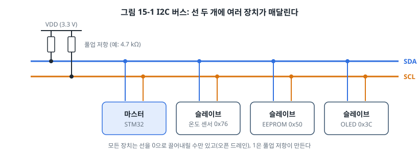
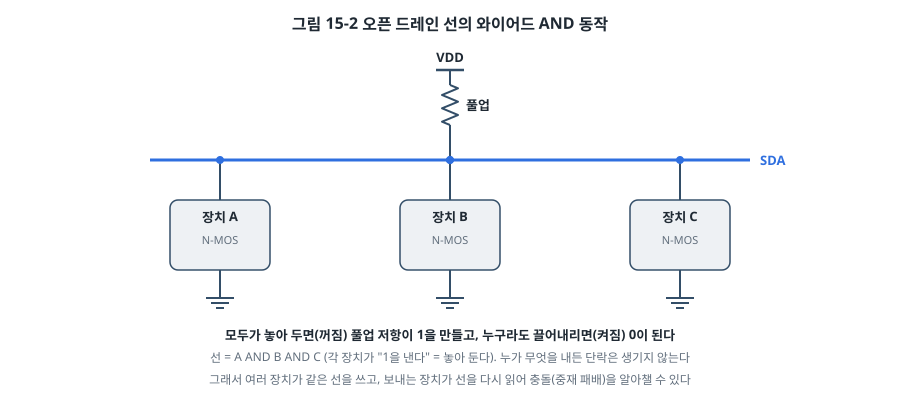
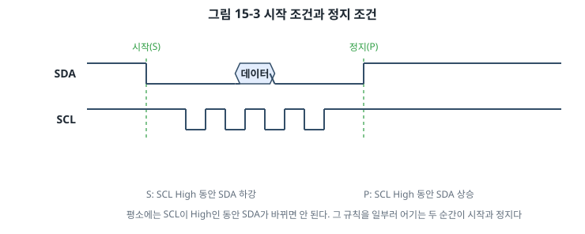
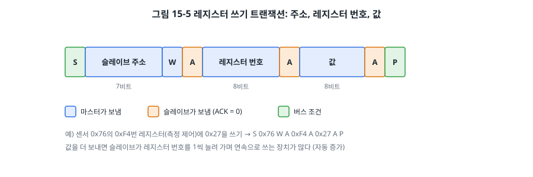
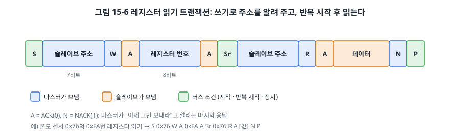
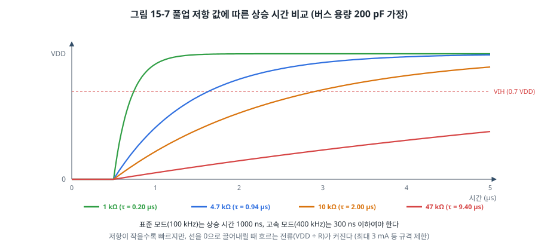
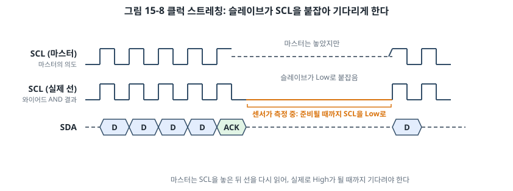
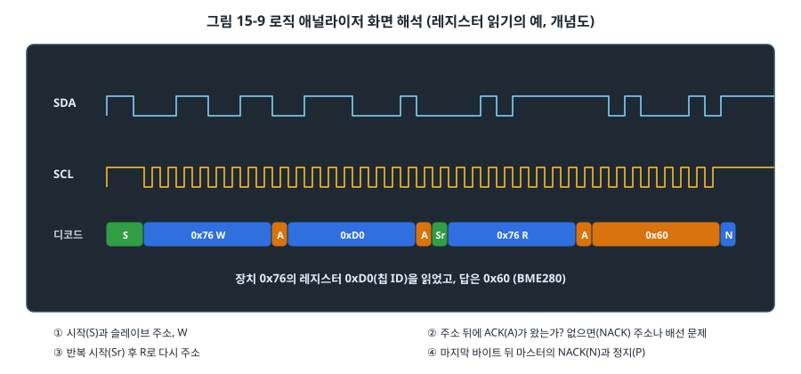

# 15장. I2C

## 이 장에서 배우는 것

- 선 두 개로 여러 장치를 연결하는 I2C 버스의 구조
- 오픈 드레인과 풀업 저항, 와이어드 AND가 I2C에서 하는 일
- 시작·정지 조건, 주소와 R/W 비트, ACK/NACK, 레지스터 읽기·쓰기 트랜잭션
- 풀업 저항 값 고르기, 클럭 스트레칭, 중재, 버스 잠김과 복구
- AVR의 TWI와 STM32의 I2C 주변장치로 센서 드라이버를 만들고, 드라이버를 보드와 분리하는 방법

---

## 15.1 선 두 개, 장치 여럿

12장의 온도계를 만들 때 온도 센서 하나에 ADC 핀 하나를 썼습니다. 온도, 습도, 기압, 가속도, 조도 센서를 모두 달고 시계 칩과 EEPROM, 작은 OLED 화면까지 붙이려면 핀이 얼마나 필요할까요? **I2C(Inter-Integrated Circuit)** 를 쓰면 이 모든 장치를 **선 두 개**에 연결할 수 있습니다.



I2C는 1980년대에 필립스(지금의 NXP)가 TV 안의 칩들을 잇기 위해 만든 규격입니다. 지금은 센서, 메모리, 시계, 오디오 코덱, 전원 관리 칩 등 수많은 칩이 I2C를 지원합니다. 일부 제조사는 상표 문제로 TWI(Two-Wire Interface)라고 부르는데, ATmega328P도 그렇습니다. 같은 규격입니다.

- **SDA(Serial Data)**: 데이터 선. 양방향.
- **SCL(Serial Clock)**: 클럭 선. 마스터가 만든다.
- 두 선 모두 **풀업 저항**으로 VDD에 연결되어 있고, 모든 장치는 **오픈 드레인** 출력으로 선을 끌어내리기만 합니다.

13장의 분류로 정리하면 I2C는 **동기식(클럭 공유), 반이중(SDA 하나를 번갈아), 싱글엔드, 멀티드롭 버스**입니다. 통신은 항상 **마스터**(보통 MCU)가 시작하고, 각 **슬레이브**(센서 등)는 고유한 7비트 주소로 구분합니다. 속도는 표준 모드 100 kbps, 고속 모드(Fast-mode) 400 kbps가 가장 흔하고, Fast-mode Plus 1 Mbps도 있습니다.

## 15.2 오픈 드레인과 와이어드 AND

I2C를 이해하는 열쇠는 2장에서 본 **오픈 드레인** 출력입니다.



모든 장치는 선을 0으로 끌어내리거나(트랜지스터 켜짐), 놓아 두는 것(꺼짐)만 할 수 있습니다. 1은 풀업 저항이 만듭니다. 그래서 선의 상태는 다음과 같습니다.

- 모든 장치가 놓아 두면 → 1
- 한 장치라도 끌어내리면 → 0

이것이 **와이어드 AND**입니다. 이 성질 덕분에 I2C는 세 가지를 할 수 있습니다.

1. **단락 걱정 없이 여러 장치가 한 선을 씁니다.** 푸시풀이었다면 한 장치가 1을, 다른 장치가 0을 낼 때 단락이 생겼을 것입니다.
2. **받는 쪽이 대답할 수 있습니다.** 마스터가 SDA를 놓아 두면 슬레이브가 끌어내려 "받았다"(ACK)고 알릴 수 있습니다(15.4절).
3. **보내는 쪽이 충돌을 알아챌 수 있습니다.** 보내면서 선을 다시 읽어, 자기는 1(놓아 둠)을 냈는데 선이 0이라면 누군가 다른 장치도 보내고 있다는 뜻입니다(15.9절의 중재). SCL에서도 같은 원리로 슬레이브가 클럭을 늦출 수 있습니다(15.8절의 클럭 스트레칭).

## 15.3 시작 조건과 정지 조건

I2C에는 데이터를 보내는 동안 지켜야 하는 규칙이 하나 있습니다. **SDA는 SCL이 Low일 때만 바뀌고, SCL이 High인 동안에는 그대로 있어야 합니다.** 받는 쪽은 SCL이 High인 동안 SDA를 읽기 때문입니다.

이 규칙을 일부러 어기는 두 순간이 통신의 시작과 끝을 알립니다.



- **시작 조건(START, S)**: SCL이 High인 동안 SDA가 High → Low. "지금부터 통신을 시작한다."
- **정지 조건(STOP, P)**: SCL이 High인 동안 SDA가 Low → High. "통신이 끝났다. 버스를 놓는다."

시작 조건부터 정지 조건까지를 하나의 **트랜잭션**이라고 합니다. 버스의 모든 장치는 시작 조건을 보면 이어지는 주소에 귀를 기울이고, 정지 조건을 보면 버스가 비었다는 것을 압니다. 트랜잭션 중간에 정지 없이 다시 시작 조건을 보내는 것을 **반복 시작(Repeated START, Sr)** 이라고 하는데, 버스를 놓지 않고 방향을 바꿀 때 씁니다(15.6절).

## 15.4 바이트 전송, 주소, ACK

시작 조건 뒤에는 바이트가 이어집니다. I2C는 바이트를 **MSB부터** 보내고, 바이트마다 아홉 번째 클럭에서 받는 쪽이 **ACK(Acknowledge)** 를 돌려줍니다.


시작 조건 바로 뒤의 첫 바이트는 **주소 바이트**입니다.

- 상위 7비트: 슬레이브의 **주소**. 그림의 예는 0x76(1110110)입니다.
- 최하위 1비트: **R/W 비트**. 0이면 마스터가 쓰기(Write), 1이면 읽기(Read).
- 아홉 번째 비트: 마스터는 SDA를 놓아 두고, 그 주소의 슬레이브가 있으면 SDA를 끌어내려 **ACK(0)** 를 보냅니다. 아무도 대답하지 않으면 풀업 저항 때문에 1, 즉 **NACK**가 됩니다.

그래서 주소 0x76에 쓰려면 첫 바이트는 0xEC(0x76 << 1 | 0), 읽으려면 0xED(0x76 << 1 | 1)입니다. 데이터시트에 따라 주소를 7비트(0x76)로 적기도 하고, R/W 비트를 붙인 8비트(0xEC/0xED)로 적기도 하므로 혼동하지 마세요. 이 책은 7비트 주소로 씁니다.

NACK는 두 가지 뜻으로 쓰입니다. 주소 뒤의 NACK는 "그 주소에 장치가 없다"(또는 장치가 바쁘다)는 뜻이고, 마스터가 읽기를 할 때 마지막 바이트 뒤에 보내는 NACK는 "이제 그만 보내라"는 뜻입니다.

> 💡 팁: 7비트 주소 중 0x00~0x07과 0x78~0x7F는 특수 용도로 예약되어 있어서 일반 장치는 0x08~0x77을 씁니다. 같은 주소의 장치 두 개는 한 버스에 둘 수 없으므로, 많은 센서는 주소 선택 핀을 둡니다. BMP280/BME280은 SDO 핀을 GND에 두면 0x76, VDD에 두면 0x77입니다. 그래도 겹친다면 I2C 멀티플렉서 칩으로 버스를 나눕니다.

## 15.5 레지스터 쓰기와 읽기

대부분의 I2C 센서는 내부에 **레지스터** 여러 개를 갖고 있습니다. MCU의 주변장치 레지스터와 같은 개념입니다. 설정 레지스터에 값을 써서 동작을 정하고, 데이터 레지스터를 읽어 측정값을 얻습니다. 그래서 I2C 통신의 대부분은 "몇 번 레지스터에 무엇을 쓴다", "몇 번 레지스터부터 몇 바이트를 읽는다"입니다.

**레지스터 쓰기**는 간단합니다. 주소(W), 레지스터 번호, 값을 차례로 보냅니다.



**레지스터 읽기**는 한 단계가 더 있습니다. 먼저 쓰기로 "몇 번 레지스터를 읽을 것인지" 알려 주고, 반복 시작 뒤 방향을 읽기로 바꿔 데이터를 받습니다.



1. S, 주소(W), 레지스터 번호: 슬레이브 안의 "읽을 위치"를 정합니다.
2. Sr, 주소(R): 버스를 놓지 않고 방향을 바꿉니다.
3. 슬레이브가 데이터를 보내고, 마스터는 바이트마다 ACK를 보냅니다. 마지막 바이트에는 NACK를 보내고 P로 끝냅니다.

여러 바이트를 연달아 읽으면 대부분의 센서는 레지스터 번호를 자동으로 1씩 늘려 다음 레지스터를 보냅니다. 온도처럼 여러 바이트로 된 값을 한 번의 트랜잭션으로 읽으면, 읽는 도중에 값이 갱신되어 위아래 바이트가 서로 다른 측정의 것이 되는 문제(7장의 원자성 문제와 같은 종류)를 막을 수 있습니다. BMP280 데이터시트도 측정값 레지스터를 한 번에 읽으라고 권합니다.

## 15.6 풀업 저항 고르기

오픈 드레인 버스에서 0 → 1 전환은 풀업 저항이 선의 **용량(capacitance)** 을 충전하는 일입니다. 선과 장치의 입력 핀은 작은 커패시터처럼 동작하고(보통 수십~수백 pF), 저항이 클수록 충전이 느려집니다. 2장의 RC 회로 그대로입니다.



I2C 규격(NXP UM10204)은 신호가 0.3 VDD에서 0.7 VDD까지 오르는 **상승 시간**의 최대값을 정해 둡니다.

| 모드 | 속도 | 최대 상승 시간 | 최대 버스 용량 | 0 출력 시 최소 흡수 전류 |
| --- | --- | --- | --- | --- |
| 표준 모드 | 100 kbps | 1000 ns | 400 pF | 3 mA |
| 고속 모드 | 400 kbps | 300 ns | 400 pF | 3 mA |
| Fast-mode Plus | 1 Mbps | 120 ns | 550 pF | 20 mA |

풀업 저항은 이 두 조건 사이에서 고릅니다.

- **최댓값**: 상승 시간을 지켜야 합니다. Rp(max) = tr ÷ (0.8473 × Cb). 버스 용량 200 pF, 고속 모드라면 300 ns ÷ (0.8473 × 200 pF) ≈ 1.8 kΩ, 표준 모드라면 약 5.9 kΩ입니다.
- **최솟값**: 장치가 선을 끌어내릴 때 흐르는 전류(VDD ÷ R)가 규격의 흡수 전류를 넘으면 안 됩니다. Rp(min) = (VDD − VOL) ÷ IOL = (3.3 V − 0.4 V) ÷ 3 mA ≈ 1 kΩ입니다.

센서 모듈 대부분에는 이미 4.7 kΩ이나 10 kΩ 풀업 저항이 달려 있습니다. 모듈 여러 개를 한 버스에 연결하면 풀업 저항이 **병렬로** 합쳐져서 값이 작아집니다. 4.7 kΩ 모듈 네 개라면 약 1.2 kΩ이 되어 최솟값에 가까워집니다. 반대로 모듈에 풀업이 없는데 MCU의 내부 풀업(20~50 kΩ)만 믿으면 상승이 너무 느려 100 kHz에서도 통신이 불안정합니다. 로직 애널라이저나 오실로스코프로 SCL의 모양을 보면 상승이 둥글게 늘어진 것을 확인할 수 있습니다.

> ⚠️ 주의: 5 V 우노에 3.3 V 센서 모듈을 연결할 때 주의하세요. 모듈의 풀업이 3.3 V에 연결되어 있으면 선의 High는 3.3 V인데, ATmega328P의 TWI 입력은 0.7 VCC(3.5 V) 이상을 High로 보장합니다(ATmega328P 데이터시트, 2-wire Serial Interface 특성 표). 대개 동작은 하지만 보장되지 않는 연결입니다. 반대로 우노의 내부 풀업(5 V)이 켜져 있으면 3.3 V 센서의 핀에 5 V가 걸립니다. 5 V 보드에는 레벨 변환 회로(MOSFET 방식 양방향 레벨 시프터)가 들어 있는 모듈을 쓰거나, 따로 레벨 시프터를 다세요. NUCLEO는 3.3 V라 이 문제가 없습니다.

## 15.7 클럭 스트레칭

SCL은 마스터가 만들지만, 슬레이브도 SCL을 붙잡을 수 있습니다. SCL 역시 오픈 드레인이기 때문입니다.



슬레이브가 데이터를 준비하는 데 시간이 필요하면(예: 측정이 끝나지 않음, 내부 처리 중), SCL을 Low로 붙잡아 둡니다. 마스터는 SCL을 놓은 뒤 선을 다시 읽어 실제로 High가 되었는지 확인하고, 아직 Low라면 기다립니다. 이것을 **클럭 스트레칭(clock stretching)** 이라고 합니다.

MCU의 I2C 하드웨어는 대개 클럭 스트레칭을 자동으로 처리합니다. 문제는 GPIO로 I2C를 흉내 내는 **비트뱅잉** 코드나, 클럭 스트레칭을 제대로 지원하지 않는 일부 장치(예: 라즈베리 파이의 일부 모델의 I2C 하드웨어)입니다. 이들과 스트레칭을 쓰는 센서를 연결하면 데이터가 깨집니다. 그리고 슬레이브가 SCL을 영원히 붙잡고 있는 경우에 대비해, 기다리는 코드에는 반드시 시간 제한을 둬야 합니다.

## 15.8 중재와 버스 잠김

### 중재

I2C에는 마스터가 여럿 있을 수도 있습니다(멀티 마스터). 두 마스터가 동시에 시작 조건을 보내면 어떻게 될까요? 둘 다 주소를 보내기 시작하는데, 와이어드 AND 덕분에 0이 1을 이깁니다. 각 마스터는 비트를 보낼 때마다 SDA를 다시 읽습니다. 자기는 1을 보냈는데 선이 0이면 "중재에서 졌다"는 것을 알고 즉시 보내기를 멈춥니다. 이긴 마스터는 아무 일도 없었던 것처럼 계속 보냅니다. 데이터가 깨지지 않는 영리한 방식이고, 17장의 CAN이 같은 원리를 씁니다. STM32의 I2C는 중재에서 지면 ARLO 플래그를 세웁니다.

### 버스 잠김과 복구

I2C에서 가장 골치 아픈 문제는 **버스 잠김**입니다. 예를 들어 마스터가 슬레이브에게서 데이터를 읽는 도중에 리셋되었다고 해 봅시다. 슬레이브는 바이트 하나를 보내는 중이었고, 하필 0을 내보내려고 SDA를 끌어내리고 있었습니다. 마스터가 다시 시작해도 SDA가 Low라서 시작 조건을 만들 수 없고, 슬레이브는 다음 SCL 클럭을 기다리며 SDA를 영원히 붙잡고 있습니다.

복구 방법은 규격에도 나와 있습니다. 마스터가 I2C 주변장치를 끄고 SCL을 GPIO로 직접 **최대 9번** 흔들어 줍니다. 슬레이브는 그 클럭에 맞춰 나머지 비트를 다 내보내고, 바이트가 끝나면 SDA를 놓습니다. 그다음 정지 조건을 만들어 버스를 깨끗한 상태로 돌려놓습니다.

```c
void i2c_bus_recover(void)
{
    I2C1->CR1 = 0;                                         /* 주변장치 끄기 */
    /* PB8(SCL), PB9(SDA)를 GPIO 오픈 드레인 출력으로 바꾸고 */
    for (int i = 0; i < 9 && (GPIOB->IDR & (1u << 9)) == 0; i++) {   /* SDA가 Low인 동안 */
        GPIOB->BSRR = 1u << (8 + 16);                      /* SCL Low */
        delay_us(5);
        GPIOB->BSRR = 1u << 8;                             /* SCL 놓기 */
        delay_us(5);
    }
    /* 정지 조건: SCL High 동안 SDA Low → High, 그다음 I2C 다시 초기화 */
}
```

제품 펌웨어라면 시작할 때마다 이 복구 절차를 한 번 실행하고, 통신 중 시간 초과가 나면 다시 실행하는 것이 좋습니다. 이 장의 예제도 그렇게 합니다.

## 15.9 AVR: TWI로 구현하기

ATmega328P의 TWI는 **상태 기계** 방식으로 동작합니다. 시작 조건, 주소 전송, 데이터 전송 같은 한 단계를 명령하면, 하드웨어가 그 단계를 끝내고 TWCR의 TWINT 플래그를 세웁니다. 그러면 TWSR의 **상태 코드**를 읽어 결과를 확인하고 다음 단계를 명령합니다(ATmega328P 데이터시트, 2-wire Serial Interface 장).

| 레지스터 | 역할 |
| --- | --- |
| TWBR | SCL 주파수 분주 값 |
| TWSR | 상태 코드(상위 5비트), 분주 선택(TWPS) |
| TWDR | 보낼 데이터, 받은 데이터 |
| TWCR | TWINT(단계 완료, 1을 써서 다음 단계 시작), TWEA(ACK 보내기), TWSTA(시작), TWSTO(정지), TWEN(켜기) |

SCL 주파수는 다음 식으로 정합니다.

```
SCL = F_CPU ÷ (16 + 2 × TWBR × 4^TWPS)
16 MHz, 100 kHz → TWBR = 72 (TWPS = 0)
16 MHz, 400 kHz → TWBR = 12
```

각 단계는 같은 모양입니다. TWCR에 명령을 쓰고, TWINT를 기다리고, 상태 코드를 확인합니다.

```c
static int twi_send(uint8_t byte, uint8_t ack_status)
{
    TWDR = byte;
    TWCR = (1 << TWINT) | (1 << TWEN);         /* TWINT에 1을 써서 다음 단계 시작 */
    if (twi_wait() != I2C_OK) {                /* TWINT가 다시 1이 될 때까지 (시간 제한) */
        return I2C_ERR_TIMEOUT;
    }
    return ((TWSR & 0xF8) == ack_status) ? I2C_OK : I2C_ERR_NACK;
}
```

주요 상태 코드는 0x08(시작 조건 보냄), 0x10(반복 시작 보냄), 0x18(주소+W 보냄, ACK 받음), 0x20(주소+W에 NACK), 0x28(데이터 보냄, ACK 받음), 0x40(주소+R 보냄, ACK 받음), 0x50(데이터 받고 ACK 보냄), 0x58(데이터 받고 NACK 보냄)입니다. 데이터시트에는 모든 상태 코드와 그다음에 할 수 있는 일이 표로 정리되어 있습니다. 전체 구현은 `code/ch15-i2c/avr/i2c_avr.c`에 있습니다.

우노에서 SDA는 A4(PC4), SCL은 A5(PC5)입니다. 우노 R3 이후 보드에는 AREF 옆에 SDA, SCL이라고 적힌 핀도 있는데, 같은 신호입니다.

> 🔧 ATmega128에서는: TWI의 레지스터와 상태 코드는 같고, 핀만 SCL = PD0, SDA = PD1로 다릅니다. PD0, PD1은 외부 인터럽트 INT0, INT1과도 겹치므로, 7장에서 INT0을 버튼에 쓰던 회로와 함께 쓸 수 없습니다.

## 15.10 STM32: I2C 주변장치로 구현하기

STM32F411의 I2C도 AVR처럼 단계마다 플래그를 확인하는 방식이지만, 레지스터가 더 많고 순서가 까다롭습니다(RM0383 18장).

| 레지스터 | 주요 비트 | 역할 |
| --- | --- | --- |
| I2C_CR1 | PE, START, STOP, ACK, POS, SWRST | 켜기, 시작·정지 조건, ACK 보내기, 리셋 |
| I2C_CR2 | FREQ | APB1 클럭(MHz) 알려 주기 |
| I2C_CCR | CCR, F/S, DUTY | SCL 주파수 |
| I2C_TRISE | | 최대 상승 시간 |
| I2C_SR1 | SB, ADDR, BTF, RXNE, TXE, BERR, ARLO, AF | 시작 보냄, 주소 끝남, 바이트 전송 끝남, 수신·송신, 오류 |
| I2C_SR2 | MSL, BUSY, TRA | 마스터 모드, 버스 사용 중, 송신 방향 |
| I2C_DR | | 데이터 |

```c
void i2c_init(uint32_t scl_hz)
{
    gpio_set_af(GPIOB, 8, 4);                  /* PB8 = I2C1_SCL (AF4) */
    gpio_set_af(GPIOB, 9, 4);                  /* PB9 = I2C1_SDA */
    GPIOB->OTYPER |= (1u << 8) | (1u << 9);    /* 반드시 오픈 드레인 */

    I2C1->CR1 = I2C_CR1_SWRST;                 /* 주변장치 리셋 */
    I2C1->CR1 = 0;
    I2C1->CR2 = 16;                            /* PCLK1 = 16 MHz */
    I2C1->CCR = 80;                            /* 16 MHz ÷ (2 × 100 kHz) */
    I2C1->TRISE = 17;                          /* 1000 ns ÷ 62.5 ns + 1 */
    I2C1->CR1 = I2C_CR1_PE;
}
```

핀을 **오픈 드레인**으로 설정하는 것을 잊지 마세요. 6장의 기본값인 푸시풀로 두면 ACK를 받을 때 슬레이브와 충돌합니다. NUCLEO에서는 아두이노 헤더의 D15(SCL), D14(SDA)가 PB8, PB9입니다(UM1724).

쓰기 순서는 다음과 같습니다. SR1과 SR2를 차례로 읽어야 ADDR 플래그가 지워진다는 점이 STM32 I2C의 특징입니다.

```c
I2C1->CR1 |= I2C_CR1_START;                 /* 1) 시작 조건 */
wait_sr1(I2C_SR1_SB);                       /*    SB: 시작 조건을 보냈다 */
I2C1->DR = addr << 1;                       /* 2) 주소 + W */
wait_sr1(I2C_SR1_ADDR);                     /*    ADDR: ACK 받음 (AF면 NACK) */
(void)I2C1->SR1; (void)I2C1->SR2;           /*    ADDR 지우기 */
for (각 바이트) {
    wait_sr1(I2C_SR1_TXE);                  /* 3) DR이 비면 다음 바이트 */
    I2C1->DR = data[i];
}
wait_sr1(I2C_SR1_BTF);                      /* 4) 마지막 바이트까지 다 나감 */
I2C1->CR1 |= I2C_CR1_STOP;                  /* 5) 정지 조건 */
```

읽기는 더 까다롭습니다. 마지막 바이트에 NACK를 보내고 정지 조건을 거는 시점을 정확히 맞춰야 하는데, STM32F4의 I2C는 받은 바이트가 DR과 시프트 레지스터에 이중으로 버퍼링되어서, "지금 ACK 비트를 바꾸면 어느 바이트에 적용되는가"가 읽을 바이트 수에 따라 달라집니다. 그래서 RM0383은 1바이트, 2바이트, 3바이트 이상일 때의 절차를 각각 따로 정해 두었습니다. 예제(`code/ch15-i2c/stm32/i2c_stm32.c`)의 `read_bytes()`가 그 절차를 그대로 구현했고, 시간에 민감한 구간은 7장의 방법으로 인터럽트를 잠시 막았습니다.

> 🔍 깊이 보기: STM32F1, F2, F4 세대의 I2C 주변장치는 이렇게 순서가 까다로워 개발자들 사이에 악명이 높고, 에라타 시트(ES0287)에도 관련 항목이 있습니다. ST는 이후 세대(F0, F3, F7, L4, G4, H7 등)에서 I2C를 새로 설계해, 전송할 바이트 수를 미리 알려 주면 하드웨어가 NACK와 정지 조건을 자동으로 처리하게 했습니다. 이 책의 F411 코드는 이전 세대 방식이므로, 다른 STM32로 옮길 때는 레퍼런스 매뉴얼의 I2C 장을 새로 확인하세요. 이렇게 같은 제조사 안에서도 주변장치 설계가 바뀌는 것이, 제조사들이 HAL을 제공하는 이유 중 하나입니다.

## 15.11 드라이버를 보드와 분리하기

이제 BMP280/BME280 기압·온도 센서의 드라이버를 만듭니다. 그런데 우노와 STM32에서 같은 드라이버를 두 번 만들 필요가 있을까요? 센서의 레지스터 번호와 보정 계산은 보드와 상관이 없고, 다른 것은 "I2C로 바이트를 주고받는 방법"뿐입니다.

그래서 12장의 모듈 구조를 한 단계 발전시켜, **I2C 인터페이스**를 정해 두고 보드마다 그것을 구현합니다.

```c
/* common/i2c.h: 드라이버가 아는 것은 이것뿐 */
void i2c_init(uint32_t scl_hz);
int  i2c_write(uint8_t addr, const uint8_t *data, size_t n);
int  i2c_write_read(uint8_t addr, const uint8_t *wdata, size_t wn, uint8_t *rdata, size_t rn);
int  i2c_probe(uint8_t addr);
void i2c_bus_recover(void);
```

| 파일 | 보드 의존 | 내용 |
| --- | --- | --- |
| `common/bmp280.c` | 없음 | 센서 레지스터, 보정 계산 |
| `common/app.c` | 없음 | 버스 스캔, 1초마다 출력 |
| `avr/i2c_avr.c` | 우노 | TWI로 `i2c.h` 구현 |
| `stm32/i2c_stm32.c` | NUCLEO | I2C1로 `i2c.h` 구현 |

`bmp280.c`와 `app.c`는 두 보드에서 한 글자도 바꾸지 않고 그대로 빌드됩니다. 24장에서 이 구조를 **하드웨어 추상화 계층(HAL)** 으로 일반화합니다.

### BMP280 드라이버

센서 데이터시트의 메모리 맵에서 필요한 레지스터를 찾습니다(Bosch BMP280 데이터시트).

| 레지스터 | 이름 | 내용 |
| --- | --- | --- |
| 0xD0 | chip_id | BMP280 = 0x58, BME280 = 0x60 |
| 0xF4 | ctrl_meas | 온도·기압 오버샘플링, 동작 모드 |
| 0xF5 | config | 측정 간격, 필터 |
| 0xFA~0xFC | temp | 20비트 온도 원시 값 |
| 0x88~0x8D | dig_T1~T3 | 칩마다 다른 공장 보정값 |

9장의 STM32 온도 센서처럼, 이 센서도 칩마다 공장에서 잰 **보정값**을 내부에 저장해 두었고, 원시 값을 보정값으로 계산해야 실제 온도가 나옵니다. 데이터시트에 정수 연산만으로 계산하는 식이 나와 있습니다.

```c
int32_t adc_t = ((int32_t)d[0] << 12) | ((int32_t)d[1] << 4) | (d[2] >> 4);   /* 20비트 */

int32_t t1 = (int32_t)dev->dig_t1;
int32_t var1 = ((((adc_t >> 3) - (t1 << 1))) * (int32_t)dev->dig_t2) >> 11;
int32_t dt = (adc_t >> 4) - t1;
int32_t var2 = (((dt * dt) >> 12) * (int32_t)dev->dig_t3) >> 14;
int32_t t_fine = var1 + var2;
*c100 = (t_fine * 5 + 128) >> 8;          /* 0.01 °C 단위 */
```

모든 변수를 `int32_t`로 명시한 이유는 4장에서 본 대로 AVR의 `int`가 16비트이기 때문입니다. 이 식을 `int`로 쓰면 PC와 STM32에서는 맞고 AVR에서만 틀린 값이 나옵니다.

### 하드웨어 없이 드라이버 시험하기

드라이버를 보드와 분리한 덕분에 얻는 보너스가 있습니다. `i2c.h`를 **가짜로** 구현하면 드라이버를 PC에서 시험할 수 있습니다. `code/ch15-i2c/test/test_bmp280.c`는 레지스터 배열을 흉내 내는 가짜 I2C 함수를 만들고, 데이터시트에 나오는 계산 예(보정값 dig_T1 = 27504, dig_T2 = 26435, dig_T3 = −1000, 원시 값 519888 → 25.08 °C)를 넣어 결과를 비교합니다.

```bash
cd code/ch15-i2c/test
make test
# 모두 통과
```

센서를 사기 전에, 또는 보드가 손에 없을 때도 드라이버의 계산과 레지스터 접근 순서를 확인할 수 있습니다. 31장에서 이 방법을 체계적인 단위 테스트로 발전시킵니다.

## 15.12 실습: 버스 스캔과 온도 측정

`code/ch15-i2c/`의 예제는 두 가지 일을 합니다.

1. **버스 스캔**: 주소 0x08부터 0x77까지 차례로 주소 바이트만 보내 보고, ACK가 오는 주소를 출력합니다. 처음 보는 모듈의 주소를 확인하거나 배선을 점검할 때 가장 먼저 하는 일입니다.
2. **온도 측정**: 0x76이나 0x77에서 BMP280/BME280을 찾아, 1초마다 온도를 출력합니다. 통신 오류가 나면 버스 복구를 실행합니다.

```
ch15 I2C
I2C scan: 0x76
sensor at 0x76, chip id 0x60 (BME280)
T = 24.31 C
T = 24.32 C
```

스캔에서 아무것도 나오지 않는다면 다음을 차례로 확인하세요. 전원과 GND, SDA와 SCL이 바뀌지 않았는지, 풀업 저항이 있는지(멀티미터로 SDA, SCL이 유휴 상태에서 VDD 근처인지), 모듈의 전원 전압과 레벨 변환. 그래도 안 되면 로직 애널라이저를 연결합니다.

### 로직 애널라이저로 확인하기



로직 애널라이저 소프트웨어(PulseView 등)에는 I2C 디코더가 있어서, 파형 아래에 시작 조건, 주소, ACK, 데이터를 글자로 보여 줍니다. 그림 15-9는 칩 ID 레지스터(0xD0)를 읽는 트랜잭션입니다. 확인할 순서는 다음과 같습니다.

1. 시작 조건 뒤의 주소가 의도한 주소인가? 8비트 주소(0xEC)를 7비트 함수에 넘겨 0xEC << 1이 나가는 실수가 흔합니다.
2. 주소 뒤에 ACK가 오는가? NACK라면 주소가 틀렸거나, 장치가 연결되지 않았거나, 장치가 아직 준비되지 않은 것입니다.
3. 반복 시작 뒤 R로 다시 주소를 보내는가?
4. 마지막 바이트 뒤에 마스터가 NACK와 정지 조건을 보내는가? 이것이 빠지면 슬레이브가 다음 바이트를 보내려고 SDA를 붙잡아 버스가 잠길 수 있습니다.

파형 자체의 모양도 보세요. 상승이 둥글게 늘어져 있다면 풀업이 약하거나 선이 너무 깁니다(15.6절).

## 15.13 8비트와 32비트 비교

| 항목 | ATmega328P | STM32F411 |
| --- | --- | --- |
| 이름과 개수 | TWI 1개 | I2C 3개 (I2C1, 2, 3) |
| 핀 | 고정 (PC4 SDA, PC5 SCL) | AF로 여러 핀 중 선택 (예: PB8, PB9) |
| 동작 방식 | 단계마다 TWINT + 상태 코드 | 단계마다 SR1/SR2 플래그 |
| 최대 속도 | 400 kHz | 400 kHz (Fast-mode) |
| 읽기 마무리 | TWEA로 ACK/NACK 지정, 단순 | 바이트 수별 절차(POS, BTF), 까다로움 |
| 오류 감지 | 상태 코드 | BERR, ARLO, AF, OVR, TIMEOUT 플래그 |
| DMA | 없음 | 있음 |
| 기타 | 슬레이브 모드 | 슬레이브 모드, SMBus, 디지털 노이즈 필터 |

---

## 정리

- I2C는 SDA와 SCL 두 선에 여러 장치를 연결하는 동기식 반이중 버스이며, 모든 장치는 오픈 드레인으로 선을 끌어내리기만 하고 1은 풀업 저항이 만듭니다.
- 와이어드 AND 덕분에 단락 없이 선을 공유하고, ACK, 중재, 클럭 스트레칭이 가능합니다.
- SDA는 SCL이 Low일 때만 바뀌며, 이 규칙을 일부러 어기는 순간이 시작 조건과 정지 조건입니다.
- 첫 바이트는 7비트 주소와 R/W 비트이고, 바이트마다 받는 쪽이 ACK를 돌려줍니다. 레지스터 읽기는 쓰기로 위치를 정한 뒤 반복 시작으로 방향을 바꿉니다.
- 풀업 저항은 상승 시간(최댓값)과 흡수 전류(최솟값) 사이에서 고르며, 모듈을 여러 개 연결하면 병렬로 합쳐집니다.
- 버스가 잠기면 SCL을 최대 9번 흔들고 정지 조건을 만들어 복구합니다. 기다리는 코드에는 시간 제한을 둡니다.
- I2C 인터페이스를 정해 드라이버를 보드와 분리하면, 같은 드라이버를 여러 보드에서 쓰고 PC에서 시험할 수 있습니다.

## 연습 문제

1. 7비트 주소 0x50인 EEPROM의 0x0010번지에서 4바이트를 읽는 트랜잭션을 그림 15-6처럼 적으세요. (이 EEPROM의 번지는 2바이트로 보냅니다.)
2. 3.3 V 버스, 버스 용량 300 pF에서 고속 모드(400 kHz)를 쓰려면 풀업 저항의 최댓값과 최솟값은 얼마인가요? 이 범위 안의 표준 저항 값을 고르세요.
3. 4.7 kΩ 풀업이 달린 센서 모듈 다섯 개를 한 버스에 연결했습니다. 합쳐진 풀업 저항은 얼마이고, 3.3 V에서 장치가 선을 끌어내릴 때 흐르는 전류는 얼마인가요? 규격을 만족하나요?
4. 버스 스캔 코드가 주소 0x00이나 0x78 이상을 건너뛰는 이유는 무엇인가요? 0x00(일반 호출 주소)에 주소 바이트를 보내면 어떤 일이 생길 수 있을까요?
5. BMP280 데이터시트의 기압 보정식을 찾아 `bmp280_read_press_pa()` 함수를 추가하고, 테스트 파일에 데이터시트의 기압 계산 예를 넣어 PC에서 시험하세요. 기압 계산에는 `t_fine`이 필요하다는 점에 주의하세요.
6. (실습) 예제를 실행하는 도중 센서의 SDA 선을 잠깐 GND에 닿게 했다가 떼어 보세요(GND에 직접 닿게 하는 것은 오픈 드레인 버스에서 안전합니다). 어떤 오류가 출력되고 복구되는지 관찰하고, 로직 애널라이저로 복구 절차의 SCL 펄스 9개를 확인하세요.
