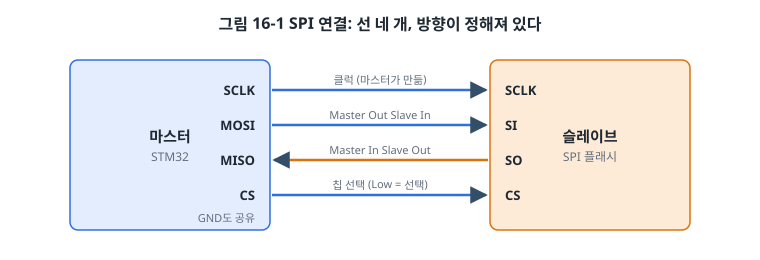
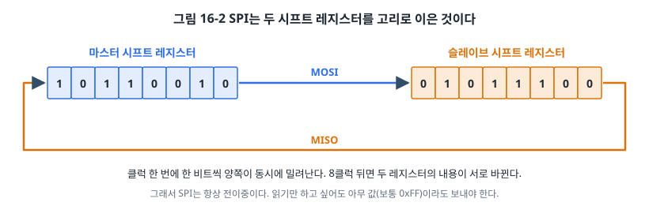
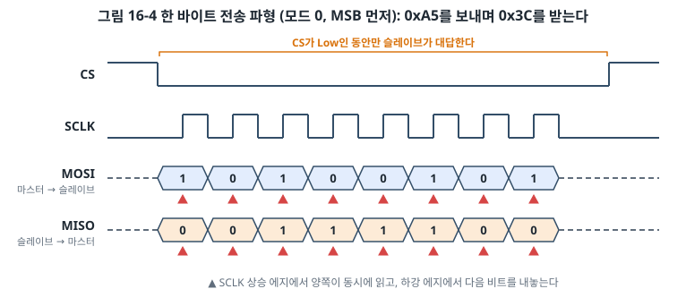
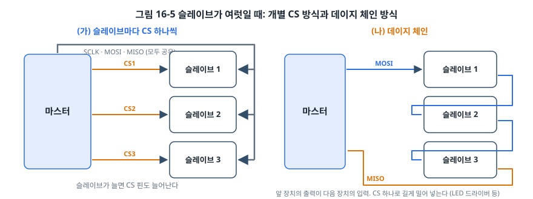
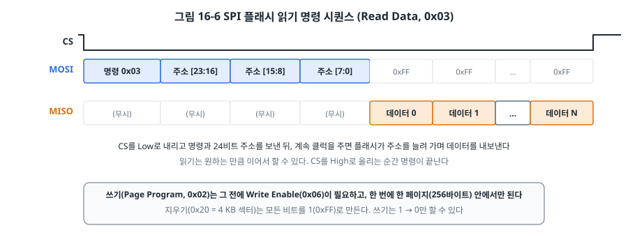
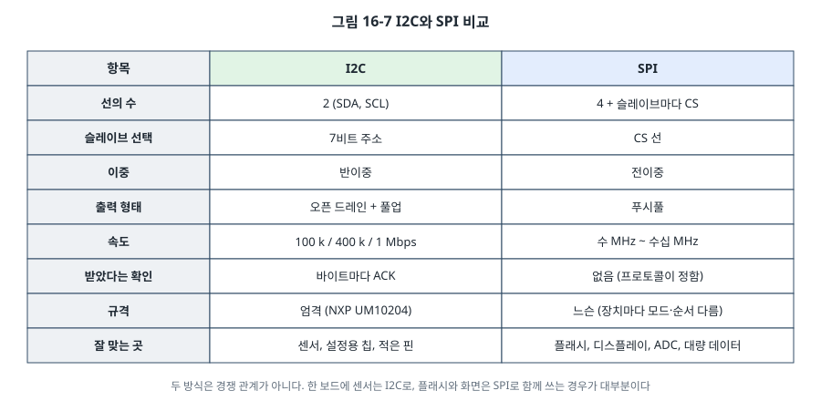

# 16장. SPI

## 이 장에서 배우는 것

- SPI의 네 선(SCLK, MOSI, MISO, CS)과 전이중 시프트 레지스터 원리
- 클럭 극성과 위상(CPOL, CPHA)으로 정해지는 SPI 모드 0~3
- 슬레이브가 여럿일 때의 연결 방법: 개별 CS와 데이지 체인
- AVR과 STM32의 SPI 주변장치, 그리고 SPI 플래시 메모리 드라이버
- 디스플레이 드라이버의 구조와 DMA 전송, I2C와 SPI 비교

---

## 16.1 빠르고 단순한 직렬 버스

15장의 I2C는 선 두 개로 여러 장치를 묶는 대신, 주소와 ACK, 오픈 드레인 때문에 속도가 수백 kHz에 머뭅니다. 플래시 메모리에서 수 MB를 읽거나, 컬러 화면에 초당 수십 장의 그림을 보내려면 훨씬 빠른 통신이 필요합니다. 이때 쓰는 것이 **SPI(Serial Peripheral Interface)** 입니다.



SPI는 선 네 개를 씁니다.

- **SCLK(Serial Clock)**: 마스터가 만드는 클럭.
- **MOSI(Master Out, Slave In)**: 마스터 → 슬레이브 데이터.
- **MISO(Master In, Slave Out)**: 슬레이브 → 마스터 데이터.
- **CS(Chip Select)**: 마스터가 통신할 슬레이브를 고르는 선. 보통 Low일 때 선택(액티브 로)입니다. SS(Slave Select), NSS, CE라고도 부릅니다.

13장의 분류로 정리하면 SPI는 **동기식, 전이중, 싱글엔드, 푸시풀** 통신입니다. 모든 선이 푸시풀이라 풀업 저항 없이 깨끗하고 빠른 신호를 만들 수 있어서, 수십 MHz로도 동작합니다. 주소가 없는 대신 CS 선으로 장치를 고르고, ACK도 없습니다. 규격이 느슨해서 "SPI"라는 이름 아래 장치마다 세부 동작이 조금씩 다르다는 점도 특징입니다.

> 💡 팁: MOSI, MISO라는 이름은 마스터와 슬레이브를 전제로 하는데, 최근에는 이 용어를 바꾸자는 흐름에 따라 COPI/CIPO(Controller Out Peripheral In / Controller In Peripheral Out), SDO/SDI 같은 이름을 쓰는 데이터시트도 늘고 있습니다. 칩 데이터시트에서는 DI(Data In)와 DO(Data Out)처럼 장치 기준으로 적기도 하므로, 연결할 때 "누구 기준의 In/Out인가"를 꼭 확인하세요. 마스터의 MOSI는 슬레이브의 DI(SI)에, 마스터의 MISO는 슬레이브의 DO(SO)에 연결합니다.

## 16.2 시프트 레지스터의 고리

SPI의 동작 원리는 놀랄 만큼 단순합니다.



마스터와 슬레이브는 각자 8비트 **시프트 레지스터**를 가지고 있고, MOSI와 MISO가 두 레지스터를 고리처럼 잇습니다. 클럭이 한 번 뛸 때마다 두 레지스터가 동시에 한 비트씩 밀려나, 마스터의 비트는 슬레이브로, 슬레이브의 비트는 마스터로 갑니다. 8클럭 뒤에는 두 레지스터의 내용이 서로 바뀌어 있습니다.

여기서 SPI의 중요한 성질 두 가지가 나옵니다.

- **보내기와 받기는 항상 동시에 일어납니다.** 그래서 SPI 함수는 보통 "1바이트를 보내면서 1바이트를 받는" 모양입니다. 이 장의 예제도 `uint8_t spi_xfer(uint8_t out)`입니다.
- **읽으려면 무언가를 보내야 합니다.** 클럭은 마스터만 만들 수 있으므로, 슬레이브에게서 데이터를 받으려면 마스터가 의미 없는 바이트(보통 0xFF나 0x00, 더미 바이트)라도 보내 클럭을 만들어야 합니다.

## 16.3 SPI 모드: CPOL과 CPHA

SPI에는 "클럭의 어느 에지에서 데이터를 읽는가"를 정하는 설정이 두 개 있습니다.


- **CPOL(Clock Polarity)**: 클럭이 쉬고 있을 때의 레벨. 0이면 Low, 1이면 High.
- **CPHA(Clock Phase)**: 데이터를 읽는 에지. 0이면 첫 번째 에지(유휴에서 벗어나는 에지), 1이면 두 번째 에지.

두 비트의 조합으로 모드 0~3이 됩니다.

| 모드 | CPOL | CPHA | 유휴 클럭 | 데이터를 읽는 에지 |
| --- | --- | --- | --- | --- |
| 0 | 0 | 0 | Low | 상승 |
| 1 | 0 | 1 | Low | 하강 |
| 2 | 1 | 0 | High | 하강 |
| 3 | 1 | 1 | High | 상승 |

마스터와 슬레이브의 모드가 같아야 합니다. 슬레이브의 데이터시트에 지원하는 모드가 적혀 있는데, 타이밍 그림만 있고 모드 번호가 없는 경우도 많으니 그림에서 유휴 클럭 레벨과 읽는 에지를 확인하세요. 대부분의 SPI 플래시와 센서는 모드 0과 모드 3을 모두 지원하고, 이 장의 예제는 모드 0을 씁니다. 모드가 틀리면 데이터가 한 비트씩 밀려 엉뚱한 값이 나오는데, 가끔은 우연히 맞는 것처럼 보여서 찾기 어렵습니다.

비트 순서도 맞춰야 합니다. 대부분의 장치는 **MSB 먼저**지만 LSB 먼저인 장치도 있어서, SPI 주변장치에는 이를 고르는 설정이 있습니다.

## 16.4 한 바이트 전송

모드 0으로 마스터가 0xA5를 보내면서 슬레이브에게서 0x3C를 받는 모습을 보겠습니다.



1. 마스터가 CS를 Low로 내려 슬레이브를 고릅니다. 슬레이브는 CS가 Low인 동안만 MISO를 구동하고, High일 때는 MISO를 놓아 둡니다(하이 임피던스). 그래서 여러 슬레이브가 MISO를 공유할 수 있습니다.
2. 양쪽이 첫 비트(MSB)를 선 위에 내놓습니다.
3. 클럭의 상승 에지에서 양쪽이 상대의 비트를 읽고, 하강 에지에서 다음 비트를 내놓습니다.
4. 8번 반복하면 한 바이트가 끝납니다. 여러 바이트를 보내려면 CS를 Low로 둔 채 계속합니다.
5. 마스터가 CS를 High로 올립니다. 많은 장치에서 **CS를 올리는 순간이 명령의 끝**이라는 의미가 있습니다(16.7절).

UART의 시작 비트, I2C의 시작 조건과 주소, ACK가 모두 없습니다. 그만큼 오버헤드가 적어 빠르지만, 받는 쪽이 제대로 받았는지 알 방법도 없습니다. 필요하면 상위 프로토콜에서 CRC나 상태 읽기로 확인합니다.

## 16.5 슬레이브가 여럿일 때



**개별 CS 방식**이 가장 흔합니다. SCLK, MOSI, MISO는 모든 슬레이브가 공유하고, CS만 슬레이브마다 따로 둡니다. 한 번에 하나의 CS만 Low로 내리면 그 슬레이브만 대답합니다. 슬레이브가 늘수록 MCU 핀이 하나씩 더 필요하다는 것이 단점입니다. 그래서 CS가 부족하면 디코더 칩이나 I/O 확장 칩으로 CS를 만들기도 합니다.

**데이지 체인 방식**은 앞 장치의 MISO(DO)를 다음 장치의 MOSI(DI)에 이어 하나의 긴 시프트 레지스터를 만듭니다. CS 하나로 모든 장치를 한꺼번에 다루므로 핀이 적게 들지만, 장치가 데이지 체인을 지원해야 합니다. LED 드라이버(74HC595 시프트 레지스터 등)를 여러 개 이을 때 많이 씁니다.

> ⚠️ 주의: 개별 CS 방식에서 MISO를 공유하는 슬레이브 중 하나가 CS와 상관없이 MISO를 계속 구동하면(잘못 설계된 모듈이나 일부 SD 카드 초기화 상태), 다른 슬레이브와 신호가 충돌합니다. 장치 하나씩은 되는데 같이 연결하면 안 된다면 이 문제를 의심하세요.

## 16.6 AVR: SPI 주변장치

ATmega328P의 SPI는 레지스터 세 개로 다룹니다(ATmega328P 데이터시트, SPI 장).

| 레지스터 | 주요 비트 | 역할 |
| --- | --- | --- |
| SPCR | SPE, DORD, MSTR, CPOL, CPHA, SPR1:0 | 켜기, 비트 순서, 마스터, 모드, 클럭 분주 |
| SPSR | SPIF, WCOL, SPI2X | 전송 완료, 쓰기 충돌, 클럭 2배 |
| SPDR | | 보낼 데이터 쓰기 / 받은 데이터 읽기 |

핀은 고정입니다. 우노에서는 SCK = D13(PB5), MISO = D12(PB4), MOSI = D11(PB3), SS = D10(PB2)입니다. 우노 보드 가운데의 6핀 ICSP 커넥터에도 같은 SPI 신호가 나와 있습니다.

```c
void spi_init(void)
{
    DDRB |= (1 << DDB5) | (1 << DDB3) | (1 << DDB2);   /* SCK, MOSI, SS: 출력 */
    DDRB &= ~(1 << DDB4);                               /* MISO: 입력 */
    PORTB |= (1 << PORTB2);                             /* CS High */
    SPCR = (1 << SPE) | (1 << MSTR);                    /* 모드 0, MSB 먼저, F_CPU/4 = 4 MHz */
}

uint8_t spi_xfer(uint8_t out)
{
    SPDR = out;                                         /* 쓰는 순간 8클럭이 나간다 */
    while ((SPSR & (1 << SPIF)) == 0) {
    }
    return SPDR;                                        /* 그사이 들어온 바이트 */
}
```

> ⚠️ 주의: AVR의 SPI에는 유명한 함정이 있습니다. 마스터 모드에서 **SS 핀(PB2)이 입력으로 설정되어 있고 외부에서 Low가 되면**, AVR은 "다른 마스터가 나를 슬레이브로 선택했다"고 판단해 스스로 슬레이브 모드로 바뀝니다. 그러면 SPI가 갑자기 멈춘 것처럼 보입니다. SS 핀을 CS로 쓰지 않더라도 반드시 출력으로 두세요. 이 장의 예제는 SS 핀을 그대로 CS로 씁니다.

> ⚠️ 주의: 이 장의 예제에서 쓰는 W25Q 계열 SPI 플래시는 3.3 V 칩입니다. 5 V 우노의 SCK, MOSI, CS를 직접 연결하면 플래시의 입력에 5 V가 걸립니다. 우노에서는 74LVC245나 74HC4050 같은 레벨 변환 칩(또는 레벨 변환이 내장된 모듈)을 거치세요. MISO 방향(3.3 V → 5 V)은 ATmega328P가 3.3 V를 High로 읽는 데 여유가 적지만(2장, VIH = 3.0 V) 대개 동작합니다. NUCLEO는 3.3 V라 바로 연결할 수 있습니다.

> 🔧 ATmega128에서는: SPI 레지스터와 비트는 같고, 핀은 SS = PB0, SCK = PB1, MOSI = PB2, MISO = PB3입니다. 5장에서 본 것처럼 ATmega128의 ISP 프로그래밍은 SPI 핀이 아니라 PE0, PE1을 쓰므로, ATmega328P와 달리 SPI 장치를 연결해도 ISP 업로드를 방해하지 않습니다.

## 16.7 STM32: SPI 주변장치

STM32F411에는 SPI가 다섯 개(SPI1~SPI5) 있습니다. 예제는 APB2에 있는 SPI1을 쓰고, 핀은 NUCLEO의 아두이노 헤더에서 우노와 같은 위치가 되도록 골랐습니다(UM1724).

| 신호 | STM32 핀 | 아두이노 헤더 | AF |
| --- | --- | --- | --- |
| SCK | PA5 | D13 | AF5 |
| MISO | PA6 | D12 | AF5 |
| MOSI | PA7 | D11 | AF5 |
| CS | PB6 | D10 | GPIO 출력 |

PA5는 보드의 LD2와 같은 핀이라, SPI 통신 중에는 LED가 희미하게 깜빡입니다. 고장이 아닙니다.

| 레지스터 | 주요 비트 | 역할 |
| --- | --- | --- |
| SPI_CR1 | CPHA, CPOL, MSTR, BR[2:0], SPE, LSBFIRST, SSI, SSM, DFF | 모드, 마스터, 클럭 분주(PCLK/2~PCLK/256), 켜기, 비트 순서, 소프트웨어 NSS, 8/16비트 |
| SPI_CR2 | RXDMAEN, TXDMAEN, SSOE | DMA, 하드웨어 NSS 출력 |
| SPI_SR | RXNE, TXE, MODF, OVR, BSY | 수신 있음, 송신 버퍼 빔, 모드 오류, 넘침, 사용 중 |
| SPI_DR | | 데이터 |

```c
SPI1->CR1 = SPI_CR1_MSTR                     /* 마스터 */
          | (1u << SPI_CR1_BR_Pos)           /* PCLK2 / 4 = 4 MHz */
          | SPI_CR1_SSM | SPI_CR1_SSI;       /* NSS를 소프트웨어로: 내부 NSS = High */
SPI1->CR1 |= SPI_CR1_SPE;

uint8_t spi_xfer(uint8_t out)
{
    while ((SPI1->SR & SPI_SR_TXE) == 0) {
    }
    *(volatile uint8_t *)&SPI1->DR = out;
    while ((SPI1->SR & SPI_SR_RXNE) == 0) {
    }
    return *(volatile uint8_t *)&SPI1->DR;
}
```

`SSM`과 `SSI`는 AVR의 SS 함정과 같은 문제를 푸는 설정입니다. STM32도 마스터 모드에서 NSS 입력이 Low가 되면 **모드 오류(MODF)** 를 내고 마스터 모드를 끕니다. SSM = 1로 NSS를 소프트웨어 관리로 바꾸고 SSI = 1로 내부 NSS를 High로 고정하면, CS는 GPIO로 자유롭게 다룰 수 있습니다. 이 두 비트를 빼먹고 "SPI가 한 번 동작하고 멈춘다"며 헤매는 일이 흔합니다.

CS를 올릴 때는 **BSY 플래그가 0이 될 때까지** 기다립니다. RXNE로 마지막 바이트를 받았다면 이미 끝났지만, 받기를 기다리지 않고 보내기만 하는 코드(예: 16.9절의 화면 전송)에서는 마지막 비트가 다 나가기 전에 CS를 올려 버릴 수 있습니다. 14장의 RS-485에서 TC 플래그를 기다린 것과 같은 이유입니다.

## 16.8 SPI 플래시 드라이버

SPI의 대표적인 쓰임은 **SPI NOR 플래시** 메모리입니다. 칩 하나에 수 MB에서 수십 MB를 담을 수 있어서, 데이터 로그, 글꼴과 그림, 펌웨어 업데이트 파일(32장)을 저장하는 데 씁니다. 여기서는 흔히 쓰는 Winbond의 W25Q 계열(W25Q32, W25Q64, W25Q128 등)의 드라이버를 만듭니다.

### 명령

SPI 플래시는 **CS를 내리고 → 명령 바이트 → (주소) → (데이터) → CS를 올리는** 형식으로 다룹니다. 자주 쓰는 명령은 다음과 같습니다(Winbond W25Q64JV 데이터시트의 명령 표).

| 명령 | 코드 | 뒤따르는 것 | 하는 일 |
| --- | --- | --- | --- |
| JEDEC ID | 0x9F | 3바이트 읽기 | 제조사(0xEF = Winbond), 메모리 종류, 용량 |
| Read Data | 0x03 | 24비트 주소, 원하는 만큼 읽기 | 데이터 읽기 |
| Write Enable | 0x06 | 없음 | 쓰기·지우기 허가 (WEL = 1) |
| Read Status Register-1 | 0x05 | 1바이트 읽기 | BUSY(비트 0), WEL(비트 1) |
| Page Program | 0x02 | 24비트 주소, 1~256바이트 | 데이터 쓰기 |
| Sector Erase | 0x20 | 24비트 주소 | 4 KB 지우기 |

읽기 명령의 모습은 다음과 같습니다.



```c
void w25q_read(uint32_t addr, uint8_t *buf, size_t n)
{
    spi_cs_low();
    spi_xfer(0x03);                      /* Read Data */
    spi_xfer((uint8_t)(addr >> 16));     /* 24비트 주소, 상위 바이트부터 */
    spi_xfer((uint8_t)(addr >> 8));
    spi_xfer((uint8_t)addr);
    for (size_t i = 0; i < n; i++) {
        buf[i] = spi_xfer(0xFF);         /* 더미 바이트를 보내며 받는다 */
    }
    spi_cs_high();
}
```

### NOR 플래시의 규칙

플래시는 RAM처럼 아무렇게나 쓸 수 없습니다. 3장에서 MCU의 Flash가 "블록 단위로 지운 뒤 쓴다"고 했던 것과 같은 규칙이 있습니다.

1. **지우기는 섹터(4 KB) 단위**이고, 지우면 모든 비트가 1(바이트로는 0xFF)이 됩니다.
2. **쓰기(프로그램)는 1을 0으로 바꾸는 것만** 할 수 있습니다. 0을 1로 되돌리려면 섹터 전체를 지워야 합니다. 이미 쓴 곳에 다른 값을 쓰면 기존 값과 새 값의 AND가 남습니다.
3. **쓰기는 한 번에 한 페이지(256바이트) 안에서만** 됩니다. 페이지 끝을 넘어 보내면 다음 페이지로 넘어가지 않고 **같은 페이지의 처음으로 돌아가** 앞부분을 덮어씁니다.
4. 쓰기와 지우기 명령 앞에는 매번 **Write Enable(0x06)** 이 필요합니다. 명령이 끝나면 WEL이 자동으로 지워집니다. 실수로 데이터를 지우는 것을 막는 장치입니다.
5. 쓰기와 지우기는 CS를 올린 뒤에 칩 안에서 진행되고, 그동안 상태 레지스터의 **BUSY** 비트가 1입니다. 끝날 때까지 다른 명령을 보내면 안 됩니다. W25Q64JV 데이터시트 기준으로 페이지 쓰기는 대표값 1 ms 미만(최대 수 ms), 섹터 지우기는 대표값 수십 ms(최대 수백 ms)입니다.

3번 규칙 때문에 드라이버는 긴 데이터를 페이지 경계에서 잘라 여러 번 보내야 합니다.

```c
int w25q_write(uint32_t addr, const uint8_t *data, size_t n)
{
    while (n > 0) {
        size_t room = 256 - (addr % 256);          /* 이 페이지에 남은 칸 */
        size_t chunk = n < room ? n : room;
        int r = page_program(addr, data, chunk);   /* Write Enable → 0x02 → 주소 → 데이터 → BUSY 대기 */
        if (r != W25Q_OK) {
            return r;
        }
        addr += chunk;
        data += chunk;
        n -= chunk;
    }
    return W25Q_OK;
}
```

BUSY를 기다리는 코드에는 15장처럼 시간 제한을 둡니다. 칩이 고장 나거나 연결이 끊기면 BUSY가 영원히 1로 읽힐 수 있습니다(MISO가 끊어져 0xFF가 읽히는 경우).

### 가짜 플래시로 드라이버 시험하기

15장에서 가짜 I2C로 센서 드라이버를 시험한 것처럼, 이번에는 `spi.h`를 **가짜 플래시**로 구현합니다. `code/ch16-spi/test/test_w25q.c`의 가짜 플래시는 진짜 칩의 규칙을 흉내 냅니다. Write Enable 없이 온 쓰기는 무시하고, 쓰기는 AND로만 반영하고, 페이지 끝을 넘으면 같은 페이지의 처음으로 돌아갑니다. 그러면 드라이버가 페이지를 나누지 않거나 Write Enable을 빼먹는 실수를 PC에서 바로 잡아낼 수 있습니다.

```bash
cd code/ch16-spi/test
make test
# 모두 통과
```

시험해 보고 싶다면 `w25q.c`의 페이지 나누기를 일부러 지워 보세요. 0xF0번지부터 300바이트를 쓰는 시험이 "write/read verify" 실패로 바뀝니다.

### 실습

`code/ch16-spi/`의 예제는 JEDEC ID를 읽고, 섹터 하나를 지우고, 페이지 세 개에 걸친 300바이트를 쓴 뒤 읽어서 검증합니다.

```
JEDEC ID: EF 40 17
sector erase: ok (47 ms)
write 300 bytes: ok (2 ms)
verify: ok (0 mismatches)
```

JEDEC ID의 첫 바이트 0xEF는 Winbond, 0x40은 메모리 종류, 마지막 바이트는 용량(2^n바이트, 0x17 = 2^23 = 8 MB = 64 Mbit)입니다. ID가 00 00 00이나 FF FF FF로 나온다면 연결 문제입니다. 00이면 MISO가 Low에 붙어 있거나 칩에 전원이 없고, FF면 MISO가 끊어졌거나 CS가 내려가지 않은 것입니다.

## 16.9 디스플레이 드라이버와 DMA 전송

SPI의 또 다른 대표적인 쓰임은 **컬러 LCD**입니다. 1.3~3.5인치 크기의 작은 TFT LCD 모듈은 대부분 ST7735, ST7789, ILI9341 같은 컨트롤러 칩을 쓰고, SPI로 연결합니다. 이 컨트롤러들은 MIPI DCS라는 공통 명령 체계를 따르므로 기본 구조가 같습니다.

디스플레이에는 SPI 네 선 말고 **D/C(Data/Command)** 선이 하나 더 있습니다. D/C가 Low일 때 보낸 바이트는 명령, High일 때 보낸 바이트는 데이터로 해석됩니다. 화면의 사각형 영역을 채우는 순서는 다음과 같습니다.

```c
lcd_cmd(0x2A);  lcd_data16(x0); lcd_data16(x1);    /* CASET: 열 범위 */
lcd_cmd(0x2B);  lcd_data16(y0); lcd_data16(y1);    /* RASET: 행 범위 */
lcd_cmd(0x2C);                                     /* RAMWR: 이제부터 픽셀 데이터 */
for (각 픽셀) {
    lcd_data16(color);                             /* RGB565: 픽셀 하나에 2바이트 */
}
```

240 × 240 화면 하나는 240 × 240 × 2 = 115,200바이트입니다. 16 MHz SPI라도 한 장을 보내는 데 약 58 ms가 걸리고, CPU가 바이트마다 `spi_xfer()`를 부르면 그동안 CPU는 아무것도 못 합니다. 여기서 10장의 **DMA**가 다시 등장합니다. SPI의 CR2에서 TXDMAEN을 켜고 DMA 스트림이 메모리의 픽셀 버퍼를 SPI_DR로 옮기게 하면, CPU는 다음 화면을 그리는 동안 DMA가 지금 화면을 보냅니다. STM32F411에서 SPI1의 송신은 DMA2 스트림 3(또는 5)의 채널 3에 연결되어 있습니다(RM0383 9.3.3절 표).

DMA로 보낼 때 주의할 점은 앞서 말한 CS입니다. DMA의 전송 완료 인터럽트는 "DMA가 마지막 바이트를 SPI_DR에 넣었다"는 뜻이지, "SPI가 마지막 비트를 다 내보냈다"는 뜻이 아닙니다. 완료 인터럽트에서 TXE와 BSY가 0이 되기를 기다린 뒤에 CS를 올려야 마지막 픽셀이 잘리지 않습니다.

디스플레이 드라이버 전체(초기화 명령 순서, 회전, 글꼴 그리기)는 화면 모듈마다 달라서 이 장에서는 구조만 다루고, 30장의 데이터 로거와 40장의 최종 프로젝트에서 상태 화면을 만들 때 다시 다룹니다.

## 16.10 I2C와 SPI 비교



두 방식은 서로를 대신하는 것이 아니라 역할을 나눕니다. 센서와 설정용 칩처럼 데이터가 적고 장치가 많은 곳에는 I2C가, 플래시와 화면처럼 데이터가 많고 빨라야 하는 곳에는 SPI가 맞습니다. 실제 보드에서는 둘을 함께 쓰는 경우가 대부분입니다.

## 16.11 8비트와 32비트 비교

| 항목 | ATmega328P | STM32F411 |
| --- | --- | --- |
| 개수 | SPI 1개 (USART를 SPI 마스터로 쓰면 2개) | SPI 5개 (일부는 I2S 겸용) |
| 최대 클럭 | F_CPU / 2 = 8 MHz | PCLK / 2 (APB2에서 최대 50 MHz) |
| 데이터 크기 | 8비트 | 8비트 또는 16비트 |
| 핀 | 고정 | AF로 여러 핀 중 선택 |
| SS 함정 | 입력 SS가 Low면 슬레이브로 전환 | NSS가 Low면 MODF (SSM/SSI로 해결) |
| DMA | 없음 | 송수신 모두 가능 |
| 기타 | | 하드웨어 CRC 계산, TI 모드, I2S(오디오) |

---

## 정리

- SPI는 SCLK, MOSI, MISO, CS 네 선을 쓰는 동기식 전이중 통신이며, 푸시풀이라 수십 MHz까지 빠르게 동작합니다.
- 마스터와 슬레이브의 시프트 레지스터가 고리로 이어져 있어 보내기와 받기가 항상 동시에 일어나고, 읽으려면 더미 바이트를 보내야 합니다.
- CPOL과 CPHA로 정해지는 모드 0~3과 비트 순서를 슬레이브에 맞춰야 합니다.
- 슬레이브가 여럿이면 CS를 슬레이브마다 두거나 데이지 체인으로 잇습니다.
- AVR의 SS 핀과 STM32의 NSS는 마스터 모드를 꺼 버릴 수 있으므로, AVR은 SS를 출력으로, STM32는 SSM/SSI를 설정합니다. CS는 BSY가 0이 된 뒤에 올립니다.
- SPI NOR 플래시는 섹터 단위로 지우고(0xFF), 1 → 0만 쓸 수 있으며, 쓰기는 페이지 안에서만 되고, 매번 Write Enable과 BUSY 대기가 필요합니다.
- 화면처럼 큰 데이터는 DMA로 보내고, DMA 완료 뒤에도 SPI가 다 내보낼 때까지 기다린 다음 CS를 올립니다.

## 연습 문제

1. 어떤 센서의 데이터시트에 "클럭은 유휴 상태에서 High이고, 데이터는 클럭의 상승 에지에서 샘플링된다"고 적혀 있습니다. 이 센서는 SPI 모드 몇 번인가요?
2. 8 MHz SPI로 W25Q64의 전체(8 MB)를 읽는 데 걸리는 시간을 계산하세요(명령과 주소 4바이트는 무시). 같은 양을 400 kHz I2C EEPROM에서 읽는다면 대략 얼마나 걸리나요?
3. 이미 0x5A가 쓰인 플래시 주소에 지우지 않고 0xC3을 쓰면 어떤 값이 남나요? 그 값이 다시 0xC3이 되게 하려면 무엇을 해야 하나요?
4. 0x01F0번지부터 600바이트를 쓰면 `w25q_write()`는 Page Program 명령을 몇 번, 각각 몇 바이트씩 보내나요?
5. 플래시에 설정값 16바이트를 저장하는데, 값이 바뀔 때마다 섹터를 지우고 다시 쓰면 어떤 문제가 생길까요? (힌트: 지우기 횟수 한계, 지우는 도중 전원이 꺼지면) 섹터 하나 안에서 16바이트짜리 기록을 차례로 이어 쓰는 방법을 설계해 보세요. 이 아이디어는 32장의 펌웨어 업데이트와 연결됩니다.
6. (실습) `test_w25q.c`의 가짜 플래시에 "BUSY를 200번 읽을 때까지 1로 유지"하는 기능을 넣고, `board_millis()`가 실제로 시간을 돌려주도록 바꿔 드라이버의 시간 제한이 동작하는지 시험하세요.
