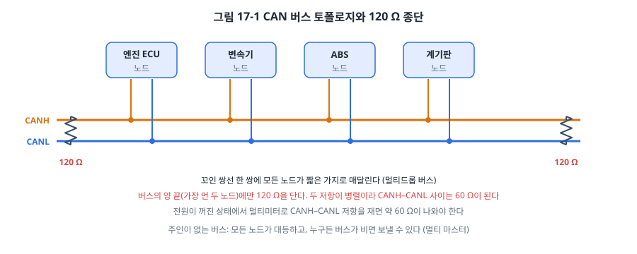
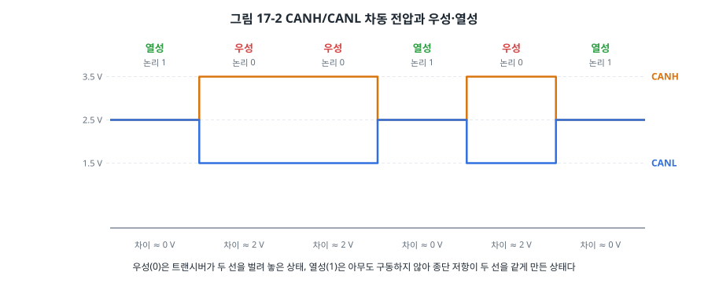
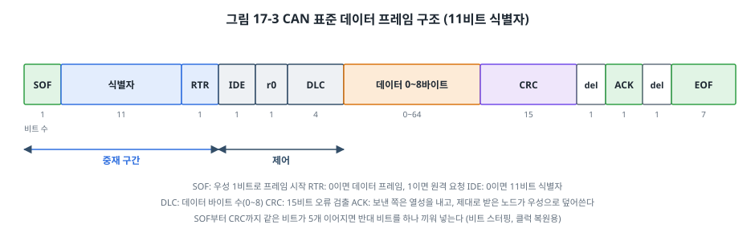
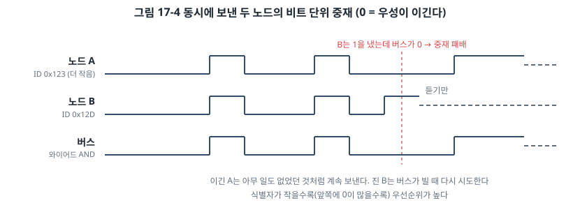
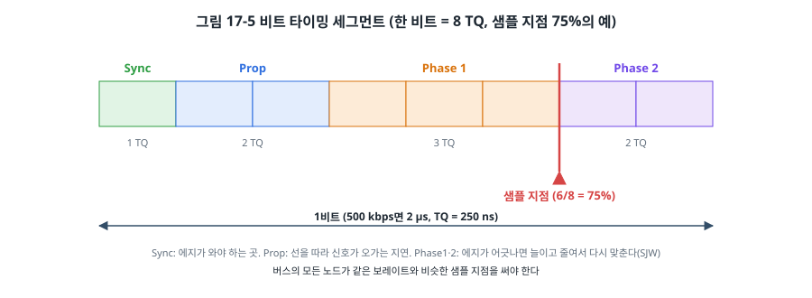
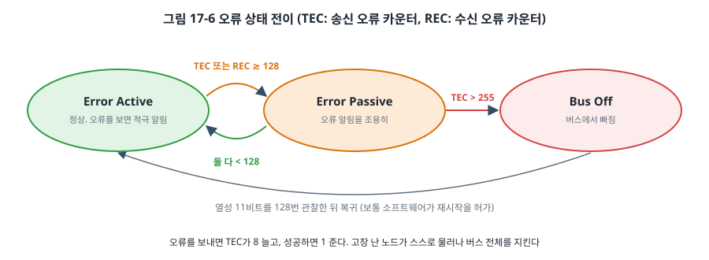
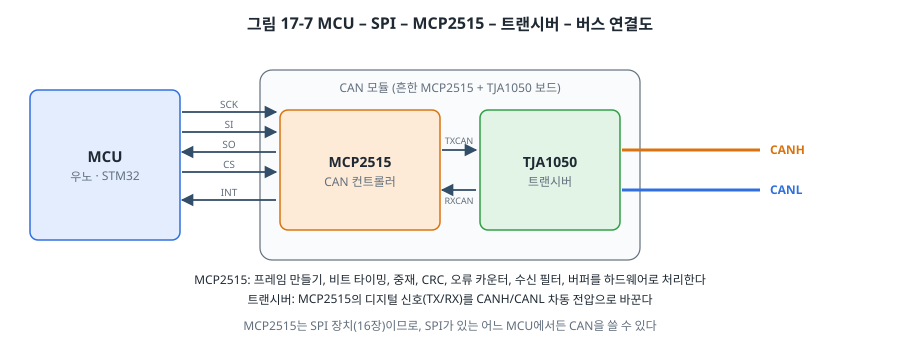

# 17장. CAN

## 이 장에서 배우는 것

- 자동차와 산업 현장에서 CAN을 쓰는 이유
- 차동 버스, 종단 저항, 우성과 열성 비트
- CAN 프레임의 구조와 식별자 기반 중재
- 비트 타이밍(TQ, 세그먼트, 샘플 지점)을 계산하는 방법
- 오류 검출과 오류 상태(Error Active, Error Passive, Bus Off)
- MCP2515 컨트롤러로 우노와 STM32에서 CAN 통신하기, CAN FD 소개

---

## 17.1 자동차 안의 네트워크

1장에서 최신 자동차에는 수십에서 백 개가 넘는 ECU가 들어 있다고 했습니다. 엔진 제어기는 회전수를, ABS는 바퀴 속도를, 계기판은 그 값들을 받아 보여 줍니다. 이 ECU들이 하나하나 전선으로 연결되어 있다면 차 한 대에 전선이 수 km가 들어가고 무게만 수십 kg이 됩니다. 1980년대 독일 보쉬(Bosch)가 이 문제를 풀기 위해 만든 것이 **CAN(Controller Area Network)** 입니다.



CAN은 꼬인 선 한 쌍(CANH, CANL)에 모든 ECU를 매다는 **버스**입니다. 13장의 분류로 정리하면 **비동기식, 반이중, 차동 신호, 멀티드롭 버스**이고, 다음과 같은 특징 때문에 자동차의 표준이 되었습니다.

- **잡음에 강합니다.** 차동 신호(13장)라서 점화 장치와 모터가 만드는 강한 잡음 속에서도 동작합니다.
- **주인이 없습니다(멀티 마스터).** 모든 노드가 대등하고, 버스가 비면 누구든 보낼 수 있습니다. 노드 하나가 고장 나도 나머지는 계속 통신합니다.
- **우선순위가 하드웨어에 들어 있습니다.** 브레이크 신호처럼 급한 메시지는 다른 메시지와 동시에 보내도 항상 먼저 나갑니다(17.4절).
- **오류에 철저합니다.** CRC, ACK, 비트 감시, 자동 재전송, 고장 난 노드의 자동 격리까지 하드웨어가 처리합니다(17.6절).

지금은 자동차뿐 아니라 산업용 기계, 엘리베이터, 의료 장비, 농기계, 배, 드론에도 쓰입니다. 속도는 최대 1 Mbps(고전 CAN)이고, 거리와 맞바꿔 1 Mbps에서 약 40 m, 125 kbps에서 약 500 m까지 씁니다.

## 17.2 우성과 열성

CAN의 신호는 두 선의 **전압 차이**로 표현됩니다.



- **우성(dominant)**: 트랜시버가 CANH를 약 3.5 V로 올리고 CANL을 약 1.5 V로 내려, 차이가 약 2 V가 됩니다. **논리 0**입니다.
- **열성(recessive)**: 아무도 구동하지 않으면 종단 저항이 두 선을 같은 전압(약 2.5 V)으로 만들어, 차이가 0 V가 됩니다. **논리 1**입니다.

이름 그대로 우성이 열성을 이깁니다. 한 노드라도 우성을 내면 버스는 우성이 되고, 모든 노드가 열성을 내야만 버스가 열성이 됩니다. 15장의 I2C 오픈 드레인과 똑같은 **와이어드 AND** 구조입니다. 여러 노드가 동시에 보내도 단락이 생기지 않고, 이 성질이 17.4절의 중재를 가능하게 합니다.

버스의 **양 끝에 120 Ω 종단 저항**을 답니다. 두 가지 역할을 합니다. 열성일 때 두 선을 같은 전압으로 묶어 주고, 빠른 신호가 선 끝에서 반사되어 돌아오는 것을 막습니다. 두 저항이 병렬이라 전원을 끈 버스에서 CANH와 CANL 사이 저항을 재면 약 60 Ω이 나와야 합니다. 120 Ω이 나오면 종단 하나가 빠진 것이고, 40 Ω이 나오면 하나가 더 붙은 것입니다. 현장에서 가장 먼저 하는 점검입니다.

## 17.3 프레임 구조

CAN은 데이터를 **프레임** 단위로 보냅니다. 가장 흔한 표준 데이터 프레임의 구조는 다음과 같습니다(ISO 11898-1, Bosch CAN 2.0 규격).



| 필드 | 비트 | 내용 |
| --- | --- | --- |
| SOF | 1 | 프레임 시작. 우성 1비트 |
| 식별자 | 11 | 메시지의 이름이자 우선순위 |
| RTR | 1 | 0 = 데이터 프레임, 1 = 원격 요청 프레임 |
| IDE | 1 | 0 = 표준(11비트) 식별자, 1 = 확장(29비트) 식별자 |
| r0 | 1 | 예약 |
| DLC | 4 | 데이터 바이트 수 (0~8) |
| 데이터 | 0~64 | 0~8바이트 |
| CRC | 15 + 1 | 오류 검출 코드와 구분 비트 |
| ACK | 1 + 1 | 확인 슬롯과 구분 비트 |
| EOF | 7 | 프레임 끝. 열성 7비트 |

CAN의 독특한 점은 **식별자가 "누구에게"가 아니라 "무엇인지"를 나타낸다**는 것입니다. 주소가 없습니다. 엔진 ECU는 "식별자 0x0C0 = 엔진 회전수"라는 프레임을 버스에 내보낼 뿐이고, 그 정보가 필요한 노드(계기판, 변속기)가 알아서 받습니다. 필요 없는 노드는 하드웨어 **수신 필터**로 걸러 냅니다. 하나의 메시지를 여러 노드가 동시에 받는 방송 방식이라, 새 노드를 추가해도 기존 노드를 고칠 필요가 없습니다. 어떤 식별자가 어떤 신호인지는 시스템 설계자가 정한 목록(자동차 업계에서는 DBC 파일로 관리)에 정리합니다.

**ACK 슬롯**도 영리합니다. 보내는 노드는 ACK 비트에서 열성(1)을 내보내고, 프레임을 CRC까지 문제없이 받은 노드는 **누구든** 그 비트를 우성(0)으로 덮어씁니다. 보내는 노드가 ACK 자리에서 우성을 읽으면 "적어도 한 노드는 제대로 받았다"는 뜻입니다. 거꾸로 버스에 노드가 하나뿐이면 아무도 ACK를 주지 않으므로 보내는 노드는 오류로 판단하고 계속 재전송합니다. 이 장의 실습에서 보드를 하나만 연결하면 실제로 이 현상을 보게 됩니다.

**비트 스터핑**도 기억해 두세요. CAN에는 클럭 선이 없어서 받는 쪽은 신호의 에지로 타이밍을 맞춥니다(13장의 클럭 복원). 같은 비트가 오래 이어지면 에지가 없어 맞출 수 없으므로, SOF부터 CRC까지 같은 비트가 5개 이어지면 보내는 쪽이 반대 비트 하나를 끼워 넣고, 받는 쪽은 그것을 빼냅니다. 이 일은 CAN 컨트롤러가 자동으로 하므로 소프트웨어는 신경 쓸 필요가 없지만, 로직 애널라이저로 파형을 볼 때 비트가 예상보다 많은 이유가 이것입니다.

## 17.4 식별자 기반 중재

두 노드가 동시에 프레임을 보내기 시작하면 어떻게 될까요?



각 노드는 비트를 보내면서 동시에 버스를 읽습니다. 식별자를 MSB부터 보내다가, 자기는 열성(1)을 냈는데 버스가 우성(0)이라면, 다른 노드가 더 작은 식별자를 보내고 있다는 뜻입니다. 그 노드는 그 자리에서 보내기를 멈추고 받는 쪽으로 돌아섭니다. 이긴 노드는 충돌이 있었다는 것조차 모른 채 프레임을 끝까지 보냅니다. 진 노드는 버스가 비면 자동으로 다시 시도합니다.

결과적으로 **식별자가 작을수록 우선순위가 높습니다.** 그리고 이 중재는 데이터를 하나도 망가뜨리지 않습니다(비파괴 중재). 그래서 CAN 시스템을 설계할 때 급한 메시지(에어백, 브레이크)에는 작은 식별자를, 덜 급한 메시지(실내 온도)에는 큰 식별자를 줍니다. 버스가 바빠져도 급한 메시지는 지연되지 않습니다. 28장의 실시간성 분석에서 이 성질을 이용해 메시지마다 최악의 지연을 계산하는 방법을 다룹니다.

15장의 I2C 멀티 마스터 중재와 같은 원리이지만, CAN은 이것을 처음부터 설계의 중심에 두었다는 점이 다릅니다. 같은 식별자를 두 노드가 동시에 보내면 중재가 끝나지 않으므로, **한 식별자는 한 노드만 보낸다**는 것이 CAN 시스템의 규칙입니다.

## 17.5 비트 타이밍

CAN 노드들은 같은 보레이트를 써야 하고, 한 비트 안의 어느 순간에 값을 읽을지(샘플 지점)도 비슷하게 맞춰야 합니다. CAN 컨트롤러는 한 비트를 **TQ(Time Quantum)** 라는 작은 시간 단위로 나눠 다룹니다.



한 비트는 네 구간으로 이루어집니다.

- **Sync Seg** (1 TQ): 비트가 바뀌는 에지가 오기를 기대하는 곳.
- **Prop Seg**: 신호가 버스 끝까지 갔다가 돌아오는 지연(선 길이, 트랜시버 지연)을 흡수하는 구간. 중재 중에는 먼 노드의 우성 비트가 도착할 때까지 기다려야 하기 때문에 필요합니다.
- **Phase Seg 1, 2**: 샘플 지점의 앞뒤. 에지가 예상보다 일찍 또는 늦게 오면 이 구간을 SJW(Synchronization Jump Width)만큼 늘이거나 줄여 타이밍을 다시 맞춥니다.

**샘플 지점**은 Phase Seg 1이 끝나는 곳이고, 보통 비트의 75~87.5% 위치에 둡니다. 자동차 업계(CiA 권장)는 87.5% 근처를 많이 씁니다. 버스의 모든 노드가 비슷한 샘플 지점을 쓰는 것이 좋습니다.

### MCP2515로 계산해 보기

이 장에서 쓰는 MCP2515의 비트 타이밍은 레지스터 CNF1~CNF3으로 정합니다(MCP2515 데이터시트, Bit Timing 장).

```
TQ = 2 × (BRP + 1) ÷ Fosc
한 비트의 TQ 수 = 1 + Prop + PS1 + PS2   (MCP2515: Prop 1~8, PS1 1~8, PS2 2~8)
```

CAN 모듈에 흔히 달린 8 MHz 크리스털로 500 kbps를 만들어 보겠습니다.

1. 한 비트는 1 ÷ 500 kbps = 2 µs입니다.
2. BRP = 0이면 TQ = 2 ÷ 8 MHz = 250 ns이므로, 한 비트는 2 µs ÷ 250 ns = **8 TQ**입니다.
3. 샘플 지점을 75%로 두려면 PS2 = 2 TQ, 나머지 5 TQ를 Prop 2, PS1 3으로 나눕니다. 샘플 지점 = (1 + 2 + 3) ÷ 8 = 75%입니다.
4. 레지스터 값: CNF1 = 0x00 (SJW 1 TQ, BRP 0), CNF2 = 0x91 (BTLMODE = 1, PS1 − 1 = 2, Prop − 1 = 1), CNF3 = 0x01 (PS2 − 1 = 1).

예제의 `mcp2515_calc_timing()` 함수가 이 계산을 합니다. `code/ch17-can/test/`에서 `make test`를 실행하면 손으로 계산한 값과 함수의 결과를 비교합니다. 8 MHz 크리스털로 1 Mbps는 한 비트가 4 TQ밖에 안 되어 MCP2515의 최소(5 TQ)보다 작으므로 만들 수 없다는 것도 확인할 수 있습니다. 1 Mbps가 필요하면 16 MHz 크리스털 모듈을 씁니다.

> ⚠️ 주의: CAN에서 통신이 전혀 안 되는 가장 흔한 원인은 **모듈의 크리스털 주파수**입니다. 값싼 MCP2515 모듈은 8 MHz가 많지만 16 MHz짜리도 있어서, 코드가 가정한 주파수와 다르면 보레이트가 두 배로 틀어집니다. 모듈 위의 크리스털에 적힌 숫자(8.000 또는 16.000)를 꼭 확인하세요.

## 17.6 오류 처리

CAN의 신뢰성은 오류 처리에서 나옵니다. CAN 컨트롤러는 다섯 가지 오류를 하드웨어로 검사합니다.

| 오류 | 검사하는 것 |
| --- | --- |
| 비트 오류 | 보낸 비트와 버스에서 읽은 비트가 다름 (중재 구간과 ACK 슬롯은 제외) |
| 스터프 오류 | 같은 비트가 6개 이어짐 (비트 스터핑 규칙 위반) |
| CRC 오류 | 받은 CRC가 계산한 값과 다름 |
| 형식 오류 | 고정된 값이어야 하는 자리(구분 비트, EOF)가 틀림 |
| ACK 오류 | 보냈는데 아무도 ACK를 주지 않음 |

오류를 발견한 노드는 즉시 **오류 프레임**(우성 6비트 이상)을 내보내 모든 노드에게 "방금 프레임은 무효"라고 알립니다. 보내던 노드는 버스가 비면 자동으로 다시 보냅니다. 받은 노드 중 하나라도 문제를 발견하면 모든 노드가 그 프레임을 버리므로, 모든 노드가 같은 데이터를 갖는다는 일관성이 지켜집니다.

### 오류 상태와 버스 오프

그런데 노드 하나가 고장 나서 계속 엉뚱한 오류 프레임을 내보내면 버스 전체가 마비될 것입니다. 이를 막기 위해 노드마다 **송신 오류 카운터(TEC)** 와 **수신 오류 카운터(REC)** 가 있습니다.



- 오류가 나면 카운터가 늘고(송신 오류는 8씩), 성공하면 줄어듭니다(1씩).
- **Error Active**(정상): 두 카운터 모두 128 미만. 오류를 발견하면 우성 오류 프레임으로 적극적으로 알립니다.
- **Error Passive**: 어느 하나라도 128 이상. "내가 문제일 수도 있다"는 상태로, 오류를 열성 비트로 조용히 알려 다른 노드의 통신을 방해하지 않습니다.
- **Bus Off**: TEC가 255를 넘으면 노드는 스스로 버스에서 빠집니다. 열성 11비트를 128번 관찰한 뒤에 다시 참여할 수 있으며, 보통 소프트웨어가 복귀를 허가합니다.

이렇게 고장 난 노드는 점점 조용해지다 결국 스스로 물러나고, 나머지 버스는 계속 동작합니다. 실습에서 보드를 하나만 연결하고 보내면, ACK를 받지 못해 TEC가 계속 올라가 Error Passive까지 가는 것을 볼 수 있습니다(TEC가 128에서 멈추는 이유는 연습 문제로 남깁니다).

## 17.7 MCP2515와 트랜시버

STM32F411에는 CAN 컨트롤러가 없습니다(같은 F4 계열의 F405, F407, F446 등에는 bxCAN이 있습니다). ATmega328P에도 없습니다. 그래서 이 장에서는 SPI로 연결하는 외장 CAN 컨트롤러 **MCP2515**를 씁니다. 16장의 SPI 위에서 동작하므로 우노와 STM32에서 같은 드라이버를 쓸 수 있습니다.



CAN 노드는 두 부분으로 나뉩니다.

- **CAN 컨트롤러**(MCP2515): 프레임 만들기, 비트 타이밍, 비트 스터핑, 중재, CRC, ACK, 오류 카운터, 수신 필터, 송수신 버퍼를 하드웨어로 처리합니다. MCU는 SPI로 "이 프레임을 보내라", "받은 프레임을 달라"고만 하면 됩니다.
- **CAN 트랜시버**(TJA1050, MCP2551, SN65HVD230 등): 컨트롤러의 디지털 신호(TXCAN, RXCAN)를 CANH/CANL의 차동 전압으로 바꿉니다. 14장의 RS-485 트랜시버와 같은 역할입니다.

시중의 값싼 CAN 모듈은 MCP2515와 TJA1050이 한 보드에 붙어 있고, 크리스털(8 MHz 또는 16 MHz)과 120 Ω 종단 저항(점퍼로 켜고 끔)이 함께 있습니다.

| 모듈 핀 | 우노 | NUCLEO | 비고 |
| --- | --- | --- | --- |
| VCC | 5 V | (아래 주의 참고) | TJA1050은 5 V 트랜시버 |
| GND | GND | GND | |
| SCK | D13 | D13 (PA5) | 16장과 같음 |
| SI | D11 | D11 (PA7) | MOSI |
| SO | D12 | D12 (PA6) | MISO |
| CS | D10 | D10 (PB6) | |
| INT | (D2) | (선택) | 수신 인터럽트. 이 예제는 폴링 |

> ⚠️ 주의: TJA1050은 5 V 전원이 필요한 트랜시버라서, 흔한 모듈은 VCC 하나로 MCP2515와 TJA1050을 모두 5 V로 동작시킵니다. 그러면 MCP2515의 SO(MISO) 출력도 5 V가 되어, 3.3 V인 NUCLEO의 입력에 5 V가 걸립니다. STM32의 핀이 5 V를 견디는지(FT)는 DS10314의 핀 정의 표에서 그 핀마다 확인해야 합니다. 안전하게 하려면 다음 중 하나를 고르세요. (1) MCP2515를 3.3 V로, 트랜시버만 5 V로 쓸 수 있게 전원 핀이 나뉜 모듈을 쓴다. (2) 3.3 V 트랜시버(SN65HVD230 등)를 쓴 모듈을 쓴다. (3) SO 선에 레벨 변환을 넣는다. [확인 필요: STM32F411 PA6의 FT 여부와 MCP2515 모듈별 전원 구성]

### 드라이버

MCP2515는 SPI 명령과 레지스터로 다룹니다(MCP2515 데이터시트).

| 명령 | 코드 | 하는 일 |
| --- | --- | --- |
| RESET | 0xC0 | 리셋 (설정 모드로 시작) |
| READ | 0x03 | 레지스터 읽기 (주소부터 연속) |
| WRITE | 0x02 | 레지스터 쓰기 (주소부터 연속) |
| BIT MODIFY | 0x05 | 마스크로 레지스터의 일부 비트만 바꾸기 |
| RTS | 0x81 | 송신 버퍼 0의 프레임 보내기 |

초기화 순서는 다음과 같습니다.

```c
spi_cs_low(); spi_xfer(0xC0); spi_cs_high();   /* 1) 리셋 → 설정 모드 */
wait_ms(3);                                    /*    오실레이터 안정화 */
write_reg(CNF1, cnf[0]);                       /* 2) 비트 타이밍 (17.5절) */
write_reg(CNF2, cnf[1]);
write_reg(CNF3, cnf[2]);
write_reg(RXB0CTRL, 0x64);                     /* 3) 필터 끄고 모든 프레임 받기 */
modify(CANCTRL, 0xE0, 0x00);                   /* 4) 노멀 모드로 (루프백은 0x40) */
while ((read_reg(CANSTAT) & 0xE0) != 0x00) {   /*    바뀔 때까지 확인 (시간 제한) */
}
```

비트 타이밍은 **설정 모드**에서만 바꿀 수 있고, 모드를 바꾼 뒤에는 CANSTAT로 실제로 바뀌었는지 확인합니다. 칩이 연결되지 않았거나 SPI가 잘못되면 여기서 실패하므로, 가장 먼저 배선 문제를 알려 주는 지점이기도 합니다.

프레임을 보낼 때는 11비트 식별자를 SIDH(상위 8비트)와 SIDL(하위 3비트, 비트 7:5)로 나눠 송신 버퍼에 쓰고 RTS 명령을 보냅니다.

```c
b[0] = (uint8_t)(f->id >> 3);                  /* SIDH: 식별자 [10:3] */
b[1] = (uint8_t)((f->id & 0x07) << 5);         /* SIDL: 식별자 [2:0] */
b[2] = 0; b[3] = 0;                            /* 확장 식별자 (안 씀) */
b[4] = f->dlc;
/* b[5..] = 데이터 */
write_regs(TXB0SIDH, b, 5 + f->dlc);
spi_cs_low(); spi_xfer(0x81); spi_cs_high();   /* RTS: 송신 */
```

나머지 일(버스가 빌 때까지 기다리기, 중재, CRC, ACK 확인, 실패하면 재전송)은 모두 MCP2515가 합니다.

## 17.8 실습: 두 보드의 CAN 통신

`code/ch17-can/`의 예제는 먼저 **루프백 모드**로 자체 시험을 합니다. 루프백 모드에서 MCP2515는 버스와 연결을 끊고, 보낸 프레임을 자기 수신 버퍼로 바로 받습니다. 트랜시버나 버스 없이도 SPI 연결과 드라이버가 제대로 동작하는지 확인할 수 있습니다.

```
ch17 CAN
loopback: id=0x200 dlc=4 : DE AD BE EF
normal mode, 500000 bps, node 0x200
```

MCP2515와 통신이 되지 않으면 루프백 시험까지 가지 못하고 멈춥니다. 모듈을 연결하지 않은 우노에서 실제로 실행하면 다음과 같이 나옵니다.

```
ch17 CAN
MCP2515 init failed (-1): check SPI wiring, CS, crystal
```

그다음 노멀 모드로 바꿔 0.5초마다 자기 식별자로 카운터 값을 보냅니다. 우노를 `NODE_ID=0x100`, NUCLEO를 `NODE_ID=0x200`으로 빌드하고, 두 모듈의 CANH끼리, CANL끼리 연결하고, 두 모듈의 종단 점퍼를 모두 켭니다(버스의 양 끝이므로).

```
rx id=0x100 dlc=1 : 2A
rx id=0x100 dlc=1 : 2B
TEC=0 REC=0 EFLG=0x00
```

보드를 하나만 연결해 보세요. 아무도 ACK를 주지 않아 `tx busy`가 나오고, TEC가 올라가는 것을 볼 수 있습니다. CANH와 CANL을 바꿔 연결하거나, 한쪽 보드의 크리스털 설정을 틀리게 빌드해 보는 것도 좋은 실험입니다. 어떤 오류 상태가 되는지 관찰해 보세요.

> 💡 팁: CAN을 본격적으로 다룬다면 PC용 USB–CAN 어댑터와 버스 분석 소프트웨어가 큰 도움이 됩니다. 리눅스에는 SocketCAN이라는 표준 CAN 지원이 있어서, 지원되는 어댑터를 꽂으면 `candump`, `cansend` 명령으로 버스의 모든 프레임을 보고 보낼 수 있습니다. 로직 애널라이저에도 CAN 디코더가 있는데, 이때는 트랜시버 앞의 TXCAN/RXCAN 디지털 신호를 잽니다.

## 17.9 CAN FD와 그 너머

고전 CAN은 최대 1 Mbps에 데이터 8바이트로, 요즘 자동차의 데이터 양(카메라, 레이더, 소프트웨어 업데이트)에는 부족합니다. 그래서 2012년 보쉬가 **CAN FD(Flexible Data-rate)** 를 발표했습니다.

- **데이터 구간만 빠르게**: 중재 구간은 기존처럼 1 Mbps 이하로 해서 모든 노드가 중재에 참여할 수 있게 하고, 중재가 끝나면 데이터 구간만 2~8 Mbps로 빠르게 보냅니다.
- **데이터 최대 64바이트**: 프레임 하나에 더 많이 담아 오버헤드를 줄입니다.
- **더 강한 CRC**: 데이터가 길어진 만큼 17비트, 21비트 CRC를 씁니다.

같은 버스에 고전 CAN 노드와 CAN FD 노드를 섞으면 고전 노드가 FD 프레임을 오류로 판단하므로 주의해야 합니다. MCP2515는 고전 CAN만 지원하고, CAN FD를 쓰려면 MCP2518FD 같은 칩이나 CAN FD를 지원하는 MCU(STM32G4, STM32H7 등의 FDCAN)를 씁니다. 더 나아가 최신 자동차는 대역폭이 큰 장치끼리 차량용 이더넷으로 연결하고, CAN은 제어용 네트워크로 계속 함께 씁니다.

---

## 정리

- CAN은 꼬인 선 한 쌍에 모든 노드를 매다는 차동 멀티 마스터 버스이며, 양 끝에 120 Ω 종단 저항을 답니다(전원을 끄고 재면 약 60 Ω).
- 우성(0)이 열성(1)을 이기는 와이어드 AND 구조라서, 식별자가 작은 메시지가 비트 단위 중재에서 데이터 손실 없이 이깁니다.
- 식별자는 받는 노드가 아니라 메시지의 의미와 우선순위를 나타내며, 노드는 수신 필터로 필요한 메시지만 받습니다.
- 한 비트는 TQ 단위의 Sync, Prop, Phase1, Phase2로 나뉘며, 샘플 지점을 보통 75~87.5%에 둡니다. MCP2515 모듈은 크리스털 주파수를 반드시 확인합니다.
- CAN은 다섯 가지 오류를 하드웨어로 검사하고 자동 재전송하며, TEC/REC로 고장 난 노드를 Error Passive를 거쳐 Bus Off로 격리합니다.
- CAN 컨트롤러가 없는 MCU에서는 SPI로 연결하는 MCP2515와 트랜시버를 씁니다. 전원 전압과 논리 레벨을 확인합니다.
- CAN FD는 데이터 구간만 빠르게 보내고 최대 64바이트를 담습니다.

## 연습 문제

1. 노드 A가 식별자 0x2A0, 노드 B가 0x29F로 동시에 보내기 시작했습니다. 어느 노드가 이기고, 식별자의 몇 번째 비트에서 결정되나요?
2. 16 MHz 크리스털의 MCP2515로 250 kbps를 만들려고 합니다. BRP와 한 비트의 TQ 수, Prop, PS1, PS2, 그리고 CNF1~3 값을 계산하세요. `test_timing.c`에 이 경우를 추가해 확인하세요.
3. 8바이트 데이터를 담은 표준 데이터 프레임의 비트 수를 계산하세요(비트 스터핑은 무시, 프레임 사이 간격 3비트 포함). 500 kbps 버스에서 이 프레임을 1초에 최대 몇 개 보낼 수 있나요?
4. 버스에 노드가 하나뿐일 때 ACK 오류로 TEC가 올라가지만 Bus Off까지는 가지 않고 Error Passive에서 멈춥니다. CAN 규격의 어떤 예외 규칙 때문인지 찾아보세요.
5. 전원을 끈 CAN 버스의 CANH–CANL 저항이 각각 (가) 60 Ω (나) 120 Ω (다) 40 Ω (라) 무한대로 측정되었습니다. 각각 무엇을 뜻하나요?
6. (실습) MCP2515의 INT 핀을 우노의 D2(INT0)에 연결하고, CANINTE 레지스터에서 수신 인터럽트를 켜서 폴링 대신 인터럽트로 받도록 예제를 바꾸세요. ISR에서 SPI로 MCP2515를 읽어도 될까요? 메인 루프도 SPI를 쓰고 있다면 어떤 문제가 생길 수 있는지 7장의 공유 자원 문제와 연결해 생각해 보세요.
