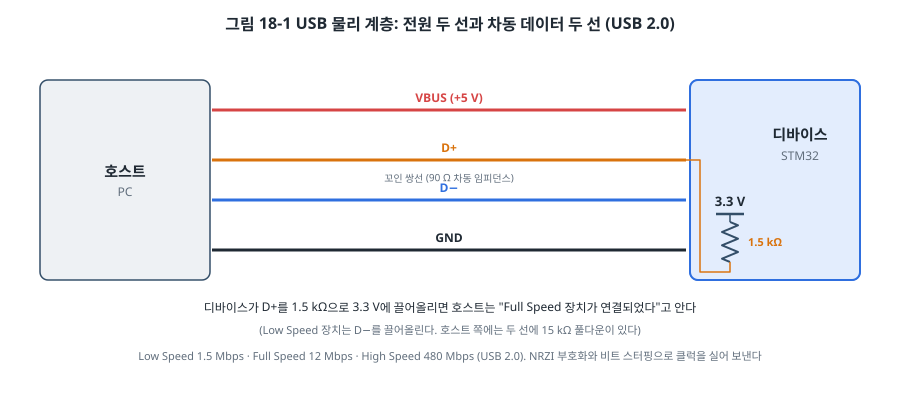
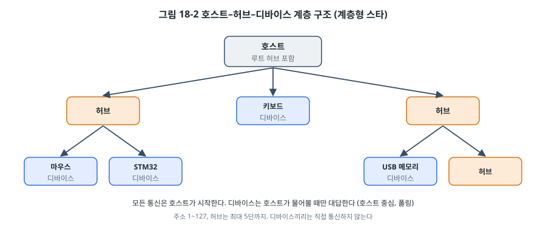
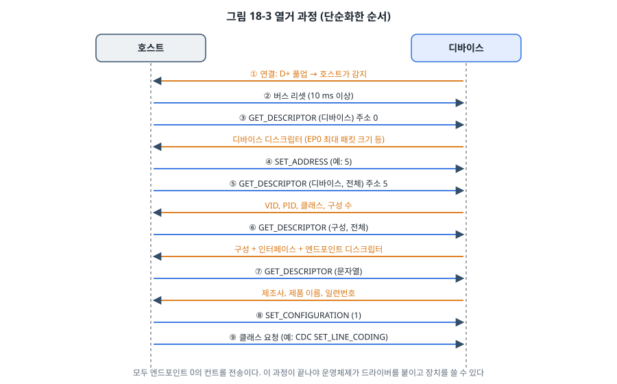
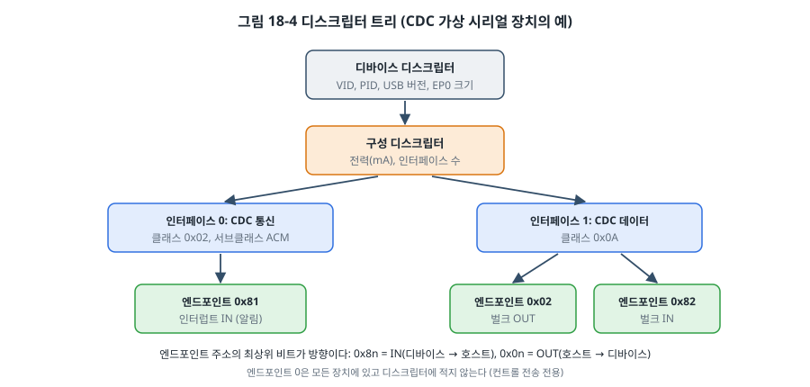
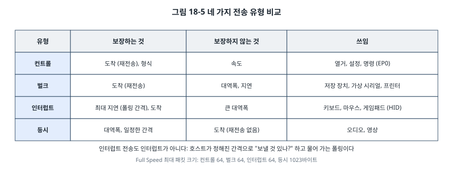

# 18장. USB

## 이 장에서 배우는 것

- USB의 물리 계층과 속도, 호스트 중심의 계층형 구조
- 장치를 꽂았을 때 일어나는 열거 과정
- 디바이스, 구성, 인터페이스, 엔드포인트 디스크립터
- 네 가지 전송 유형(컨트롤, 벌크, 인터럽트, 등시)과 쓰임
- USB 클래스(CDC, HID)와 TinyUSB로 STM32를 USB 가상 시리얼 장치로 만드는 방법
- VID/PID와 제품화할 때 알아야 할 것

---

## 18.1 가장 익숙하고 가장 복잡한 인터페이스

우리는 매일 USB를 씁니다. 키보드, 마우스, USB 메모리, 휴대폰 충전기, 그리고 이 책의 보드들도 USB로 PC와 연결합니다. 꽂으면 바로 동작하는 이 편리함 뒤에는 꽤 복잡한 규격이 있습니다. UART가 수십 쪽, I2C가 수십 쪽의 규격이라면, USB 2.0 규격 문서는 650쪽이 넘고 클래스마다 별도의 규격이 있습니다.

그래서 이 장은 다른 통신 장과 접근을 조금 달리합니다. USB의 원리(물리 계층, 열거, 디스크립터, 전송 유형)는 그림과 함께 자세히 다루되, 실습에서는 USB 프로토콜을 처음부터 레지스터로 구현하지 않고 검증된 오픈소스 USB 스택인 **TinyUSB**를 씁니다. 실무에서도 USB 스택을 직접 처음부터 만드는 일은 거의 없습니다. 대신 스택이 무엇을 하는지 이해하고, 디스크립터를 정확하게 쓰고, 문제가 생겼을 때 어디를 볼지 아는 것이 중요합니다.

## 18.2 물리 계층

USB 2.0 케이블에는 선 네 개가 있습니다.



- **VBUS**: 호스트가 공급하는 5 V 전원. 장치는 기본 100 mA, 설정 후 최대 500 mA까지 쓸 수 있습니다(USB 2.0).
- **D+, D−**: 차동 데이터 쌍(13장). 꼬인 쌍선으로, 90 Ω 차동 임피던스로 설계합니다.
- **GND**

USB 2.0의 속도는 세 가지입니다.

| 속도 | 비트 속도 | 주 용도 |
| --- | --- | --- |
| Low Speed | 1.5 Mbps | 키보드, 마우스 |
| Full Speed | 12 Mbps | 대부분의 MCU 장치 |
| High Speed | 480 Mbps | 저장 장치, 카메라 |

장치는 연결될 때 자기 속도를 알립니다. Full Speed 장치는 D+를 1.5 kΩ으로 3.3 V에 끌어올리고, Low Speed 장치는 D−를 끌어올립니다. 호스트는 양쪽 선에 15 kΩ 풀다운을 달아 두었다가, 어느 쪽이 올라가는지를 보고 장치가 연결되었다는 것과 그 속도를 압니다. STM32F411의 USB OTG FS는 이 풀업을 칩 안에 갖고 있어서, 소프트웨어가 풀업을 켜는 순간이 "장치를 꽂은 순간"이 됩니다.

USB에는 클럭 선이 없습니다. 비트를 **NRZI** 방식(0이면 선의 상태를 바꾸고 1이면 그대로 둠)으로 실어 보내고, 1이 6개 이어지면 0을 하나 끼워 넣는 **비트 스터핑**으로 에지를 보장해 받는 쪽이 클럭을 복원합니다. 13장, 17장에서 본 방법과 같은 발상입니다. 이 때문에 USB 장치는 클럭이 정확해야 합니다. Full Speed는 ±0.25% 이내여야 해서, 3장의 내부 RC 발진기(±1% 수준)로는 부족하고 크리스털이나 그에 준하는 정확한 클럭이 필요합니다.

## 18.3 호스트 중심의 계층 구조



USB는 **호스트** 하나와 여러 **디바이스**로 이루어진 계층형 스타 구조입니다. 허브를 거쳐 최대 127개의 장치를 연결할 수 있습니다.

USB를 이해하는 가장 중요한 원칙은 **모든 통신을 호스트가 시작한다**는 것입니다. 디바이스는 스스로 데이터를 보낼 수 없고, 호스트가 "보낼 것 있나?"(IN 토큰)라고 물을 때만 대답합니다. 마우스가 움직임을 PC에 알리는 것도 사실은 PC가 몇 ms마다 마우스에게 물어보는 것입니다. 디바이스끼리 직접 통신할 수도 없습니다. UART나 CAN처럼 대등한 관계가 아니라, 호스트가 모든 것을 관리하는 구조입니다.

호스트는 1 ms(Full Speed)마다 **프레임**을 시작하는 SOF(Start of Frame) 패킷을 보내고, 그 프레임 안에서 각 장치와의 전송을 일정에 따라 배치합니다.

> 🔍 깊이 보기: STM32F411의 USB 주변장치 이름은 OTG(On-The-Go) FS입니다. OTG는 하나의 장치가 상황에 따라 호스트도 되고 디바이스도 될 수 있게 하는 규격으로, 휴대폰에 USB 메모리를 꽂으면 휴대폰이 호스트가 되는 것이 그 예입니다. 이 장에서는 디바이스 모드만 씁니다.

## 18.4 열거: 장치를 꽂으면 일어나는 일

장치를 꽂으면 PC가 "이 장치는 무엇이고 어떻게 다뤄야 하는가"를 알아내는 과정을 거칩니다. 이것을 **열거(enumeration)** 라고 합니다.



1. **연결 감지**: 장치가 D+를 끌어올리면 호스트가 연결을 감지합니다.
2. **리셋**: 호스트가 버스를 리셋합니다. 장치는 주소 0으로 시작합니다.
3. **디바이스 디스크립터 요청**: 호스트가 주소 0으로 "너는 누구냐"고 묻습니다. 특히 엔드포인트 0의 최대 패킷 크기를 먼저 알아냅니다.
4. **주소 지정**: 호스트가 새 주소(1~127)를 정해 줍니다.
5. **디스크립터 전체 요청**: 새 주소로 디바이스 디스크립터, 구성 디스크립터(그 안의 인터페이스와 엔드포인트 디스크립터까지), 문자열 디스크립터를 차례로 받습니다.
6. **드라이버 선택**: 운영체제는 VID/PID와 클래스 정보를 보고 알맞은 드라이버를 붙입니다.
7. **구성 선택**: SET_CONFIGURATION으로 구성을 활성화합니다. 이제 장치를 쓸 수 있습니다.
8. **클래스 요청**: 가상 시리얼(CDC)이라면 보레이트 설정(SET_LINE_CODING) 같은 클래스 고유의 요청이 이어집니다.

이 과정은 모두 **엔드포인트 0의 컨트롤 전송**으로 이루어집니다. 장치를 꽂았는데 "알 수 없는 USB 장치(장치 설명자 요청 실패)" 같은 메시지가 뜬다면 이 단계 어딘가에서 실패한 것입니다. 클럭이 부정확하거나, 디스크립터의 길이나 형식이 틀렸거나, 장치가 제때 대답하지 못한 경우가 대부분입니다.

## 18.5 디스크립터

**디스크립터(descriptor)** 는 장치가 자신을 설명하는 데이터 구조입니다. 펌웨어 안에 상수 배열로 들어 있고, 호스트가 요청하면 그대로 보냅니다.



| 디스크립터 | 담는 내용 |
| --- | --- |
| 디바이스 | USB 버전, 클래스, 엔드포인트 0의 최대 패킷 크기, **VID**(제조사 ID), **PID**(제품 ID), 버전, 구성 개수 |
| 구성 | 인터페이스 개수, 전원(버스 전원/자체 전원), 최대 전류 |
| 인터페이스 | 인터페이스 번호, 클래스(CDC, HID, 저장 장치 등), 엔드포인트 개수 |
| 엔드포인트 | 주소와 방향, 전송 유형, 최대 패킷 크기, 폴링 간격 |
| 문자열 | 제조사 이름, 제품 이름, 일련번호 (UTF-16) |

**엔드포인트(endpoint)** 는 장치 안의 데이터 창구입니다. 호스트와 장치 사이의 모든 데이터는 어떤 엔드포인트를 통해 오갑니다. 엔드포인트 주소의 최상위 비트가 방향을 나타내서, 0x81은 "1번 엔드포인트, IN(장치 → 호스트)", 0x02는 "2번 엔드포인트, OUT(호스트 → 장치)"입니다. 방향은 언제나 **호스트 기준**이라는 점을 기억하세요. 엔드포인트 0은 모든 장치에 있는 양방향 컨트롤 엔드포인트라 디스크립터에 적지 않습니다.

하나의 장치가 여러 기능(예: 가상 시리얼 + 키보드)을 가질 수 있는데, 기능 하나하나가 **인터페이스**입니다. 그림 18-4의 CDC 가상 시리얼은 인터페이스 두 개(통신 제어용, 데이터용)로 이루어진 하나의 기능이라서, 둘을 묶어 주는 IAD(Interface Association Descriptor)를 함께 씁니다.

## 18.6 전송 유형

USB에는 네 가지 전송 유형이 있고, 엔드포인트마다 하나를 정합니다.



- **컨트롤(control)**: 설정, 명령, 열거. 형식이 정해져 있고(셋업 → 데이터 → 상태), 도착이 보장됩니다. 엔드포인트 0이 전용으로 씁니다.
- **벌크(bulk)**: 많은 데이터를 확실하게. 버스가 한가할 때 최대한 빨리 보내고, 오류가 나면 다시 보냅니다. 대신 언제 도착할지는 보장하지 않습니다. USB 메모리와 가상 시리얼이 씁니다.
- **인터럽트(interrupt)**: 적은 데이터를 늦지 않게. 호스트가 정해진 간격(예: 10 ms)마다 반드시 물어 가므로 최대 지연이 보장됩니다. 이름과 달리 7장의 인터럽트와는 상관없는 **폴링**입니다. 키보드와 마우스(HID)가 씁니다.
- **등시(isochronous)**: 대역폭과 일정한 간격은 보장하지만, 오류가 나도 다시 보내지 않습니다. 오디오처럼 "늦게 온 데이터는 쓸모없는" 경우에 씁니다.

이 구분은 13장의 "무엇을 보장하고 무엇을 포기하는가"라는 질문과 같습니다. 정확해야 하면 벌크, 늦으면 안 되면 인터럽트, 끊기면 안 되면 등시를 고릅니다.

## 18.7 USB 클래스

장치마다 드라이버를 따로 설치해야 한다면 불편하겠지요. 그래서 USB는 자주 쓰는 장치 종류를 **클래스(class)** 로 표준화했고, 운영체제는 표준 클래스의 드라이버를 기본으로 갖고 있습니다. 클래스를 따르는 장치는 드라이버 없이 꽂기만 하면 동작합니다.

| 클래스 | 코드 | 예 | 임베디드에서의 쓰임 |
| --- | --- | --- | --- |
| CDC(통신) | 0x02, 0x0A | 가상 시리얼 포트 | 디버그 콘솔, 설정 도구와 통신 |
| HID(사람 인터페이스) | 0x03 | 키보드, 마우스, 게임패드 | 맞춤 입력 장치, 드라이버 없는 데이터 교환 |
| MSC(대용량 저장) | 0x08 | USB 메모리 | 데이터 로거의 파일을 PC로 꺼내기, 드래그 앤 드롭 펌웨어 업데이트 |
| Audio | 0x01 | USB 마이크, 스피커 | 오디오 장치 |
| DFU | 0xFE | 펌웨어 업데이트 | USB로 펌웨어 올리기(32장) |

이 장의 실습은 **CDC ACM**, 즉 USB 가상 시리얼 포트를 만듭니다. PC에서 보면 14장의 USB–UART 변환기와 똑같은 시리얼 포트로 보이지만, 중간에 변환 칩 없이 STM32가 직접 USB로 대답합니다. 그래서 "보레이트"는 의미가 없고(호스트가 보내 주는 값은 그냥 무시해도 됩니다), 실제 속도는 USB Full Speed의 벌크 전송 속도로 정해집니다.

NUCLEO의 ST-LINK와 우노의 ATmega16U2도 바로 이 CDC 클래스로 동작합니다. 리눅스에서 `lsusb -v`로 이들의 디스크립터를 보면 이 장에서 설명한 구조가 그대로 보입니다. 직접 만들기 전에 이미 있는 장치의 디스크립터를 읽어 보는 것은 좋은 공부가 됩니다.

## 18.8 실습: STM32를 USB 가상 시리얼 장치로

### AVR과 USB

ATmega328P와 ATmega128에는 USB 주변장치가 없습니다. 우노가 USB로 통신할 수 있는 것은 옆에 붙은 ATmega16U2(USB가 있는 AVR) 덕분입니다. GPIO로 USB Low Speed를 흉내 내는 V-USB 같은 소프트웨어 구현도 있지만, CPU를 거의 다 써야 하고 Low Speed만 되며 USB 규격상 제약이 있어서 이 책에서는 다루지 않습니다. 그래서 이 장의 실습은 STM32만 있습니다.

### 연결

NUCLEO 보드의 USB 커넥터는 ST-LINK용이고, STM32 자신의 USB 핀(PA11 = D−, PA12 = D+)은 커넥터에 연결되어 있지 않습니다. 버리는 USB 케이블의 한쪽을 잘라 선을 연결하거나, USB 커넥터가 달린 작은 보드를 씁니다.

| USB 케이블 | NUCLEO | 비고 |
| --- | --- | --- |
| D+ (보통 초록) | PA12 | |
| D− (보통 흰색) | PA11 | |
| GND (보통 검정) | GND | 반드시 연결 |
| VBUS (보통 빨강) | 연결하지 않음 | 보드는 ST-LINK USB로 전원을 받는다 |

> ⚠️ 주의: 선 색은 케이블마다 다를 수 있으니 멀티미터로 커넥터 핀을 확인하세요. VBUS(5 V)를 STM32의 다른 핀에 잘못 연결하면 칩이 망가질 수 있습니다. 또 PA11, PA12를 다른 용도로 쓰는 실드나 회로가 연결되어 있지 않은지도 확인하세요.

### 클럭

18.2절에서 USB는 정확한 48 MHz 클럭이 필요하다고 했습니다. 그래서 이 장의 예제는 HSI 대신 **HSE**를 씁니다. 3장에서 본 것처럼 NUCLEO는 ST-LINK가 정확한 8 MHz 클럭을 STM32의 HSE 입력으로 공급하므로, HSE를 **바이패스 모드**(크리스털이 아니라 클럭 신호를 받음)로 켭니다.

```
HSE 8 MHz ÷ M(4) = 2 MHz → × N(192) = 384 MHz (VCO)
    ÷ P(4) = 96 MHz   → 시스템 클럭
    ÷ Q(8) = 48 MHz   → USB
```

100 MHz가 아니라 96 MHz를 쓰는 이유는 USB용 Q 출력이 정확히 48 MHz가 되어야 하기 때문입니다. 3장 연습 문제 3번의 답이 바로 이 설정입니다.

### TinyUSB

**TinyUSB**는 MIT 라이선스의 오픈소스 USB 스택으로, 수많은 MCU(STM32, nRF, RP2040, ESP32-S2/S3 등)를 지원합니다. 열거, 표준 요청 처리, 클래스 동작은 TinyUSB가 맡고, 우리는 세 가지만 준비하면 됩니다.

1. **설정 파일**(`tusb_config.h`): 장치 모드, 속도, 쓸 클래스와 버퍼 크기.
2. **디스크립터**(`usb_descriptors.c`): 디바이스, 구성, 문자열 디스크립터를 돌려주는 콜백 함수.
3. **하드웨어 준비와 주기적 호출**: 클럭, 핀, 인터럽트 연결, 그리고 메인 루프에서 `tud_task()`를 자주 부르기.

```c
int main(void)
{
    clock_init_96mhz_hse();               /* USB용 정확한 48 MHz */
    usb_hw_init();                        /* PA11/PA12 AF10, OTG FS 클럭, VBUS 감지 끄기 */
    tud_init(BOARD_TUD_RHPORT);

    for (;;) {
        tud_task();                       /* USB 이벤트 처리 */

        if (tud_cdc_available()) {        /* PC에서 데이터가 왔으면 */
            uint8_t buf[64];
            uint32_t n = tud_cdc_read(buf, sizeof buf);
            for (uint32_t i = 0; i < n; i++) {
                buf[i] = (uint8_t)toupper(buf[i]);
            }
            tud_cdc_write(buf, n);        /* 대문자로 바꿔 돌려준다 */
            tud_cdc_write_flush();
        }
    }
}

void OTG_FS_IRQHandler(void)
{
    tud_int_handler(0);                   /* USB 인터럽트는 TinyUSB에 넘긴다 */
}
```

TinyUSB는 USB 인터럽트에서는 이벤트를 기록만 하고, 실제 처리는 `tud_task()`에서 합니다. 7장의 "ISR은 짧게, 무거운 일은 메인 루프에서" 원칙을 USB 스택이 그대로 따르는 것입니다. 그래서 메인 루프가 다른 일로 오래 멈추면 USB 응답이 늦어지고, 열거 중이라면 호스트가 장치를 포기할 수도 있습니다. 26장에서 RTOS를 쓰면 `tud_task()`를 별도 태스크로 돌립니다.

디스크립터는 TinyUSB가 제공하는 매크로로 씁니다. CDC 하나짜리 구성 디스크립터는 이렇습니다.

```c
static const uint8_t desc_configuration[] = {
    TUD_CONFIG_DESCRIPTOR(1, ITF_NUM_TOTAL, 0, CONFIG_TOTAL_LEN, 0x00, 100),        /* 최대 100 mA */
    TUD_CDC_DESCRIPTOR(ITF_NUM_CDC, 4, 0x81, 8, 0x02, 0x82, 64),                  /* 알림 EP 0x81, 데이터 EP 0x02/0x82 */
};
```

그림 18-4의 트리가 이 두 줄에 들어 있습니다.

### 실행

```bash
cd code/ch18-usb/stm32
./get_tinyusb.sh          # 처음 한 번: TinyUSB와 STM32F4 헤더 받기
make flash
```

USB 케이블을 PC에 연결하면 새 시리얼 포트가 생깁니다. 리눅스라면 `dmesg`에 `cdc_acm ... ttyACM1: USB ACM device` 같은 메시지가 보이고, `lsusb`에 `1209:0001 ... ch18 CDC Demo`가 나타납니다. 터미널로 그 포트를 열면 안내 문구가 나오고, 입력한 글자가 대문자로 돌아옵니다. 보드의 LD2는 열거가 끝나면 1초 간격으로, 아니면 0.25초 간격으로 깜빡여 상태를 알려 줍니다.

> 💡 팁: 열거가 안 될 때는 다음을 확인하세요. (1) D+와 D−가 바뀌지 않았는가, (2) GND가 연결되었는가, (3) HSE와 PLL이 실제로 48 MHz를 만들고 있는가(디버거로 RCC 레지스터 확인), (4) VBUS 감지를 껐는가. VBUS 감지가 켜져 있으면 PA9에 5 V가 없다는 이유로 장치가 연결되지 않은 것으로 처리됩니다. 리눅스의 `usbmon`이나 윈도우의 USBPcap과 Wireshark를 쓰면 열거 과정의 패킷을 그대로 볼 수 있어서, 어느 단계에서 실패하는지 알 수 있습니다.

## 18.9 제품으로 만들 때

### VID와 PID

모든 USB 장치에는 **VID**(Vendor ID, 16비트)와 **PID**(Product ID, 16비트)가 있고, 운영체제는 이 둘로 장치를 구분합니다. VID는 USB 규격 단체인 USB-IF가 유료로 배정하며, 그 VID 아래의 PID는 VID를 가진 회사가 정합니다. 다른 회사의 VID/PID를 허락 없이 쓰면 안 됩니다.

이 장의 예제는 오픈소스 하드웨어를 위해 PID를 나눠 주는 pid.codes의 **시험용 번호(0x1209/0x0001)** 를 썼습니다. 혼자 시험할 때만 쓰고, 제품으로 내보낼 때는 회사의 VID를 쓰거나, 칩 제조사가 고객에게 나눠 주는 PID(ST, Microchip 등이 운영)를 받거나, 오픈소스 프로젝트라면 pid.codes에 PID를 신청합니다. 출판물의 예제를 그대로 제품에 쓰지 않도록 주의하세요.

### 그 밖의 확인 사항

- **전류**: 구성 디스크립터에 적은 최대 전류를 넘게 쓰면 안 됩니다. 열거가 끝나기 전에는 100 mA까지만 쓸 수 있습니다.
- **서스펜드**: 호스트가 3 ms 동안 아무것도 보내지 않으면 장치는 서스펜드 상태가 되어 전류를 2.5 mA 이하로 줄여야 합니다(USB 2.0). 11장의 저전력 설계와 연결됩니다.
- **인증과 시험**: USB 로고를 쓰려면 USB-IF의 적합성 시험을 통과해야 합니다. 로고를 쓰지 않더라도 전자파(EMC) 시험에서 USB 신호선의 배선과 차폐가 문제가 되는 경우가 많습니다.
- **ESD 보호**: 사람이 직접 꽂고 빼는 커넥터라 정전기에 노출됩니다. D+, D−, VBUS에 USB용 ESD 보호 소자를 둡니다.

---

## 정리

- USB 2.0은 VBUS, D+, D−, GND 네 선을 쓰고, 장치는 D+(Full Speed) 또는 D−(Low Speed)의 풀업으로 연결과 속도를 알립니다. 클럭 선이 없어 정확한 클럭이 필요합니다.
- 모든 통신은 호스트가 시작하며, 디바이스는 호스트가 물을 때만 대답합니다.
- 장치를 꽂으면 엔드포인트 0의 컨트롤 전송으로 열거가 일어나고, 호스트는 디스크립터로 장치를 알아내 드라이버를 붙입니다.
- 디스크립터는 디바이스 → 구성 → 인터페이스 → 엔드포인트의 트리이고, 엔드포인트 방향은 호스트 기준(0x8n = IN)입니다.
- 전송 유형은 컨트롤(설정), 벌크(정확하게), 인터럽트(늦지 않게, 실제로는 폴링), 등시(끊기지 않게)입니다.
- 표준 클래스(CDC, HID, MSC 등)를 따르면 드라이버 없이 동작합니다.
- STM32F411은 HSE와 PLL로 정확한 48 MHz를 만들고, TinyUSB로 CDC 장치를 만들 수 있습니다. 제품에는 정당하게 받은 VID/PID를 씁니다.

## 연습 문제

1. Full Speed USB의 비트 시간은 얼마인가요? 클럭 오차가 ±1%인 HSI로 48 MHz를 만들었다면, 한 패킷(예: 64바이트 데이터 + 오버헤드 약 100비트) 동안 몇 비트만큼 어긋날 수 있나요?
2. 엔드포인트 주소 0x83과 0x03은 각각 무엇을 뜻하나요? 한 장치에 둘이 동시에 있을 수 있나요?
3. 다음 장치에 알맞은 USB 클래스와 전송 유형을 고르세요. (가) 1초에 한 번 센서 값을 보내는 장치 (나) 녹음용 마이크 (다) 측정 데이터 1 GB를 PC로 옮기는 로거 (라) 버튼 8개짜리 맞춤 입력 장치
4. 리눅스 PC에 NUCLEO를 꽂고 `lsusb -v -d 0483:` 명령으로 ST-LINK의 디스크립터를 출력하세요. 인터페이스가 몇 개이고 각각 어떤 클래스인지, 엔드포인트는 어떤 유형인지 그림 18-4처럼 트리로 정리해 보세요. [윈도우라면 USB Device Tree Viewer 같은 도구를 씁니다.]
5. 이 장의 예제에서 메인 루프에 `for (volatile int i = 0; i < 10000000; i++) {}`처럼 오래 걸리는 코드를 넣으면 어떤 증상이 나타날지 예측하고, 그 이유를 TinyUSB의 구조로 설명하세요.
6. (실습) TinyUSB의 HID 클래스를 추가해서, NUCLEO의 B1 버튼을 누르면 PC에 키보드 글자 'A'가 입력되게 만드세요. 구성 디스크립터에 인터페이스를 추가하고(CDC + HID 복합 장치), HID 리포트 디스크립터를 정의해야 합니다. TinyUSB 저장소의 `examples/device/hid_composite`를 참고하세요.
