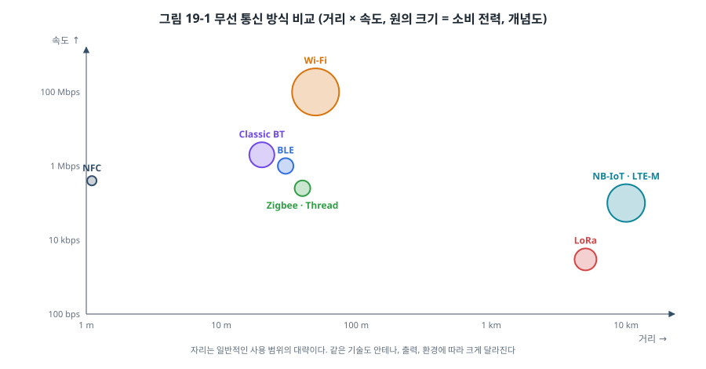
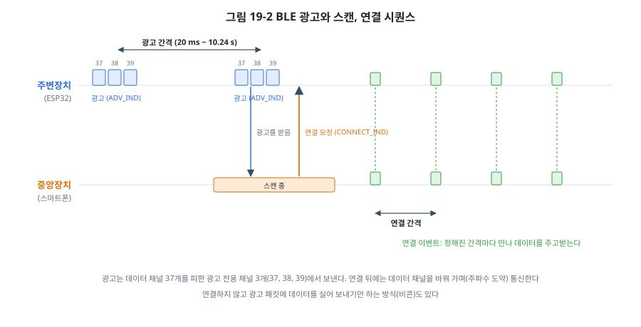
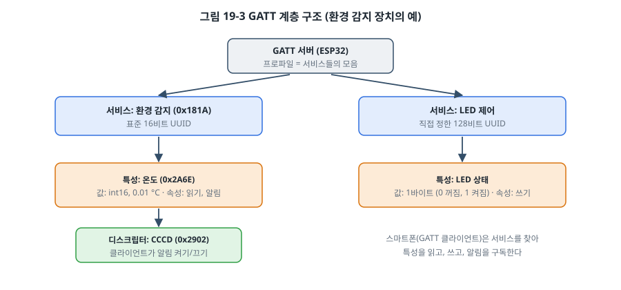
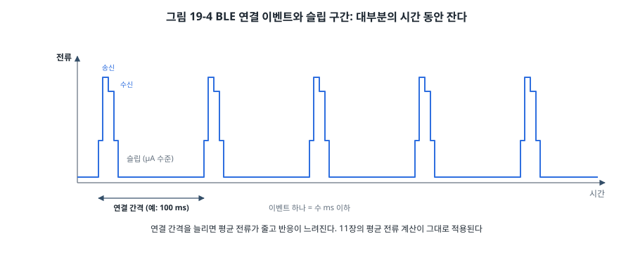
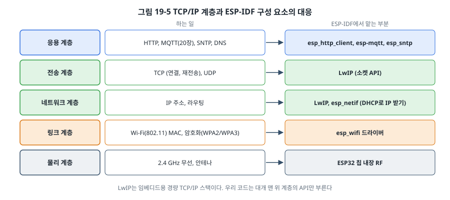

# 19장. 무선 통신: BLE와 Wi-Fi

## 이 장에서 배우는 것

- 무선 통신의 기초: 주파수 대역, dBm과 RSSI, 거리·속도·전력의 맞바꿈
- BLE의 광고와 연결, GAP과 GATT, 서비스와 특성
- BLE가 적은 전력으로 동작하는 원리
- Wi-Fi 스테이션 모드와 TCP/IP 스택(LwIP)
- ESP32로 BLE 주변장치와 Wi-Fi 장치를 만드는 방법: 아두이노 IDE에서 ESP-IDF로
- 무선 제품을 내놓을 때 알아야 할 전파 인증

---

## 19.1 선을 없애다

지금까지의 통신은 모두 선으로 연결했습니다. 스마트폰으로 조작하는 조명, 집 안 곳곳의 온도 센서, 손목의 운동 기록기처럼 선을 연결할 수 없거나 연결하기 싫은 곳에는 **무선** 통신이 필요합니다. 이 장에서는 임베디드 시스템에서 가장 많이 쓰는 두 무선 기술인 **BLE(Bluetooth Low Energy)** 와 **Wi-Fi**를 ESP32로 다룹니다.

무선은 선 대신 전파를 쓴다는 것 말고도 유선과 다른 점이 많습니다. 신호가 벽과 사람에 막히고, 다른 기기의 전파와 섞이고, 같은 거리라도 날마다 품질이 달라집니다. 송신에 큰 전류가 들어 배터리 수명을 좌우합니다. 그리고 전파는 공공 자원이라 법으로 관리되므로, 제품으로 내놓으려면 인증을 받아야 합니다. 이 장은 프로토콜과 함께 이런 현실적인 면도 다룹니다.

## 19.2 무선의 기초

### 주파수 대역

BLE, 클래식 블루투스, Wi-Fi(2.4 GHz), Zigbee, Thread는 모두 **2.4 GHz ISM 대역**을 씁니다. ISM(Industrial, Scientific, Medical) 대역은 허가 없이 쓸 수 있는 대신 출력 제한이 있는 대역이라, 전자레인지까지 포함해 수많은 기기가 함께 씁니다. 그래서 2.4 GHz 무선 기술들은 모두 혼잡한 환경에서 살아남는 방법(채널 바꾸기, 재전송)을 갖추고 있습니다. LoRa 같은 장거리 저속 기술은 1 GHz 아래(sub-GHz) 대역을 써서 더 멀리 가고 벽을 잘 통과합니다.

### dBm과 RSSI

무선에서는 전력을 **dBm**(1 mW를 기준으로 한 데시벨)으로 표현합니다. 0 dBm = 1 mW, +10 dBm = 10 mW, +20 dBm = 100 mW이고, −10 dBm = 0.1 mW입니다. 10 dB마다 10배씩 차이가 나는 로그 단위라서, 아주 작은 수신 전력부터 큰 송신 전력까지 같은 눈금으로 다룰 수 있습니다.

받는 쪽에서 측정한 신호 세기를 **RSSI(Received Signal Strength Indicator)** 라고 하고, 역시 dBm으로 표시합니다. 일반적인 Wi-Fi와 BLE에서 RSSI가 −50 dBm이면 아주 좋고, −70 dBm이면 쓸 만하고, −85 dBm 아래로 내려가면 통신이 자주 끊깁니다. 거리가 두 배가 되면 RSSI는 이상적인 공간에서 약 6 dB 떨어지고, 벽 하나에 수 dB에서 십수 dB가 더 떨어집니다.

### 거리, 속도, 전력



무선 기술은 거리, 속도, 전력을 한꺼번에 모두 가질 수 없습니다. 13장의 유선 통신에서 속도와 거리를 맞바꾼 것과 같습니다.

| 기술 | 대략의 거리 | 대략의 속도 | 전력 | 대표 쓰임 |
| --- | --- | --- | --- | --- |
| BLE | 수~수십 m | 최대 2 Mbps | 아주 적음 | 웨어러블, 센서, 스마트폰 연동 |
| Wi-Fi | 수십 m | 수십~수백 Mbps | 큼 | 인터넷 연결, 영상, 대용량 |
| Zigbee, Thread | 수십 m (메시로 확장) | 250 kbps | 적음 | 스마트홈 메시 네트워크 |
| LoRa | 수 km | 수백 bps~수십 kbps | 아주 적음 | 원격 검침, 농업 |
| NB-IoT, LTE-M | 이동통신망 | 수십~수백 kbps | 중간 | 넓은 지역의 IoT, 통신사 요금 |

이 책의 ESP32는 BLE와 Wi-Fi를 모두 갖고 있어서, 스마트폰과는 BLE로 짧게, 인터넷과는 Wi-Fi로 연결하는 제품을 칩 하나로 만들 수 있습니다.

## 19.3 BLE의 기본 구조

블루투스에는 두 가지가 있습니다. 무선 이어폰처럼 음성과 오디오를 계속 흘려보내는 **클래식 블루투스(BR/EDR)** 와, 적은 데이터를 가끔 주고받으며 배터리를 아끼는 **BLE**입니다. 이름만 같고 사실상 다른 기술이라 서로 직접 통신하지 못합니다. ESP32는 둘 다 지원하고, 이 장은 BLE만 다룹니다.

BLE 장치는 역할에 따라 나뉩니다.

- **주변장치(peripheral)**: 자신을 알리고(광고) 연결을 기다리는 쪽. 센서, 웨어러블. 이 장의 ESP32입니다.
- **중앙장치(central)**: 주변을 찾아(스캔) 연결을 거는 쪽. 스마트폰, PC.

BLE는 2.4 GHz 대역을 2 MHz 간격의 **40개 채널**로 나눕니다. 그중 3개(37, 38, 39번)는 **광고 전용**이고, 나머지 37개는 연결 후 데이터를 주고받는 데 씁니다. 연결된 뒤에는 정해진 규칙에 따라 채널을 계속 바꾸며(주파수 도약) 통신해서, 특정 채널에 잡음이 있어도 피해 갈 수 있습니다.

## 19.4 광고와 연결 (GAP)

장치가 서로를 찾고 연결하는 규칙을 **GAP(Generic Access Profile)** 이라고 합니다.



1. **광고(advertising)**: 주변장치는 정해진 간격(20 ms~10.24 s)마다 광고 채널 세 개에서 짧은 광고 패킷을 보냅니다. 광고 패킷에는 장치 이름, 지원하는 서비스 UUID, 제조사 데이터 등을 최대 31바이트(BLE 4.x 기준)까지 담습니다.
2. **스캔(scanning)**: 중앙장치는 광고 채널을 듣다가 광고를 받으면 목록에 보여 줍니다. 스마트폰의 블루투스 화면에 장치 이름이 나타나는 순간입니다.
3. **연결(connection)**: 중앙장치가 연결 요청을 보내면 두 장치는 **연결 간격**(7.5 ms~4 s)을 정하고, 그 간격마다 만나 데이터를 주고받습니다.

광고 간격은 "얼마나 빨리 발견되는가"와 "얼마나 전력을 쓰는가"를 맞바꿉니다. 100 ms 간격이면 금방 발견되지만 1초 간격보다 전력을 10배 가까이 씁니다.

연결하지 않고 **광고 패킷 자체에 데이터를 실어** 보내는 방법도 있습니다. 근처의 모든 스마트폰이 연결 없이 받을 수 있어서 비콘(위치 알림), 온습도 센서의 방송형 데이터에 씁니다.

## 19.5 GATT: 서비스와 특성

연결된 뒤 데이터를 어떤 구조로 주고받을지는 **GATT(Generic Attribute Profile)** 가 정합니다. 데이터를 가진 쪽(보통 주변장치)이 **GATT 서버**, 데이터를 읽고 쓰는 쪽(보통 스마트폰)이 **GATT 클라이언트**입니다.



- **서비스(service)**: 관련된 데이터의 묶음. 예: 환경 감지 서비스, 배터리 서비스.
- **특성(characteristic)**: 실제 값 하나. 예: 온도, 습도, 배터리 잔량. 특성마다 **속성(property)** 이 있어서 읽기(read), 쓰기(write), 알림(notify), 표시(indicate) 중 무엇을 허용하는지 정합니다.
- **디스크립터(descriptor)**: 특성의 추가 정보. 가장 중요한 것이 **CCCD(Client Characteristic Configuration Descriptor, 0x2902)** 로, 클라이언트가 여기에 써서 그 특성의 알림을 켜고 끕니다.

서비스와 특성은 **UUID**로 구분합니다. 블루투스 표준화 단체(Bluetooth SIG)가 정한 표준 서비스와 특성은 16비트 UUID를 씁니다. 예를 들어 환경 감지 서비스는 0x181A, 온도 특성은 0x2A6E(부호 있는 16비트, 0.01 °C 단위), 배터리 서비스는 0x180F입니다. 표준을 따르면 범용 앱과 운영체제가 값을 알아서 해석해 줍니다. 표준에 없는 데이터는 직접 만든 128비트 UUID를 씁니다.

**읽기와 알림**의 차이를 알아 두세요. 읽기는 클라이언트가 원할 때 묻는 것(폴링)이고, 알림은 값이 바뀌면 서버가 먼저 보내는 것입니다. 1초마다 바뀌는 온도라면 알림을 쓰는 것이 클라이언트가 1초마다 묻는 것보다 전력과 무선 시간을 아낍니다. 알림은 받았다는 확인이 없고, 표시(indicate)는 확인을 받습니다.

한 번에 보낼 수 있는 데이터 크기도 기억해 두세요. 기본 ATT MTU는 23바이트라서 특성 값 하나에 20바이트까지 실을 수 있습니다. 연결 후 MTU를 늘리도록 협상하면 더 많이 보낼 수 있습니다.

## 19.6 BLE가 전력을 적게 쓰는 이유



BLE의 비결은 11장에서 본 "대부분의 시간 동안 잔다"는 원리 그대로입니다. 연결 상태에서도 두 장치는 연결 간격마다 잠깐(수 ms 이하) 깨어나 데이터를 주고받고, 나머지 시간은 무선부를 끄고 잡니다. 연결 간격이 100 ms이고 한 번 깨어날 때 1 ms 동안 수 mA를 쓴다면, 11장의 계산대로 평균 전류는 수십 µA 수준이 됩니다. 연결 간격을 늘리면 전력이 줄고 반응이 느려집니다.

다만 ESP32는 BLE와 Wi-Fi가 같은 무선부를 써서 BLE로 송수신할 때도 무선 전류가 약 100 mA 안팎으로 큽니다(19.10절). 그래서 같은 연결 간격이라도 BLE 전용 저전력 칩(Nordic nRF52 시리즈 등, 무선 전류 수 mA)보다 평균 전류가 훨씬 큽니다. 코인 전지로 몇 년을 가야 하는 BLE 센서라면 BLE 전용 저전력 칩을 고르는 것이 맞고, ESP32는 전원이 있거나 Wi-Fi도 필요한 제품에 어울립니다.

## 19.7 실습: BLE 온도 주변장치

`code/ch19-wireless/esp32-arduino/ble_sensor/`의 예제는 ESP32를 BLE 주변장치로 만듭니다. 5장에서 준비한 아두이노 IDE와 ESP32 코어를 씁니다.

- **환경 감지 서비스(0x181A)** 의 **온도 특성(0x2A6E)**: GPIO34에 연결한 가변저항 값을 0~40 °C로 바꾼 "가짜 온도"를 1초마다 알림으로 보냅니다. 40장에서는 진짜 센서로 바꿉니다.
- **LED 제어 서비스**(직접 만든 128비트 UUID): 1바이트를 쓰면 GPIO4의 LED를 켜거나 끕니다.

```cpp
BLEDevice::init("ch19-ble");
BLEServer *server = BLEDevice::createServer();

BLEService *ess = server->createService(BLEUUID((uint16_t)0x181A));
tempChar = ess->createCharacteristic(BLEUUID((uint16_t)0x2A6E),
                                     BLECharacteristic::PROPERTY_READ | BLECharacteristic::PROPERTY_NOTIFY);
tempChar->addDescriptor(new BLE2902());          /* CCCD: 알림 켜기/끄기 */
ess->start();

BLEDevice::getAdvertising()->addServiceUUID(BLEUUID((uint16_t)0x181A));
BLEDevice::getAdvertising()->start();
```

값은 **리틀 엔디언**으로 보냅니다. BLE의 다중 바이트 값은 하위 바이트가 먼저입니다. 23.45 °C는 2345 = 0x0929이므로 바이트 순서는 0x29, 0x09입니다.

```cpp
int16_t c100 = (int16_t)(raw * 4000L / 4095);            /* 0.01 °C 단위 */
uint8_t le[2] = { (uint8_t)(c100 & 0xFF), (uint8_t)(c100 >> 8) };
tempChar->setValue(le, 2);
tempChar->notify();
```

스마트폰에 nRF Connect 같은 범용 BLE 앱을 설치하고 "ch19-ble"에 연결해 보세요. 환경 감지 서비스 아래의 온도 특성을 앱이 표준대로 해석해 °C로 보여 줍니다. 알림 버튼을 누르면 CCCD에 쓰기가 일어나고, 가변저항을 돌리면 값이 바뀝니다. LED 서비스의 특성에 01을 쓰면 LED가 켜집니다.

> 💡 팁: 가변저항을 GPIO34에 연결한 데는 이유가 있습니다. ESP32의 ADC는 ADC1(GPIO32~39)과 ADC2로 나뉘는데, **ADC2는 Wi-Fi 드라이버와 함께 쓸 수 없습니다.** 지금은 BLE만 쓰지만, 같은 보드에서 Wi-Fi를 켜는 순간 ADC2 핀의 값이 읽히지 않게 됩니다. 무선을 쓰는 프로젝트에서는 아날로그 입력을 ADC1 핀에 배정하세요(ESP32 기술 참조 매뉴얼 ADC 장).

## 19.8 Wi-Fi와 TCP/IP

### Wi-Fi의 기본

Wi-Fi(IEEE 802.11)는 무선 랜입니다. ESP32는 2.4 GHz 대역의 802.11 b/g/n을 지원합니다(5 GHz는 지원하지 않으므로 공유기의 2.4 GHz 네트워크에 접속해야 합니다).

- **스테이션(STA) 모드**: 공유기(AP, Access Point)에 접속하는 장치. 노트북, 스마트폰처럼 동작합니다. 이 장의 예제입니다.
- **AP 모드**: ESP32가 직접 공유기 역할을 해서 스마트폰이 ESP32에 접속합니다. 처음 설치할 때 Wi-Fi 설정을 받는 데 자주 씁니다(20장의 프로비저닝).
- **STA + AP 모드**: 둘을 동시에.

접속하려면 네트워크 이름(**SSID**)과 암호가 필요하고, 암호화 방식(WPA2, WPA3)은 공유기와 맞아야 합니다. 접속이 끝나면 공유기의 DHCP 서버에서 **IP 주소**를 받아 와야 비로소 인터넷 통신을 할 수 있습니다.

### TCP/IP 계층



Wi-Fi는 13장의 계층으로 보면 물리 계층과 링크 계층입니다. 그 위의 IP(주소와 경로), TCP(연결과 재전송, 순서 보장)와 UDP(가볍지만 보장 없음), 그리고 HTTP, MQTT 같은 응용 프로토콜은 **TCP/IP 스택**이 처리합니다. PC에서는 운영체제가 이 일을 하지만, MCU에서는 펌웨어에 스택을 넣어야 합니다. ESP-IDF는 임베디드용 경량 TCP/IP 스택인 **LwIP**를 씁니다. LwIP는 PC와 같은 BSD 소켓 API를 제공해서, PC에서 네트워크 프로그램을 짜 본 사람이라면 익숙한 `socket()`, `connect()`, `send()`로 코딩할 수 있습니다.

## 19.9 실습: 아두이노에서 ESP-IDF로

### 아두이노 IDE로 시작하기

`code/ch19-wireless/esp32-arduino/wifi_scan/`은 주변 AP를 신호 세기와 함께 보여 주고, 지정한 AP에 접속해 IP 주소를 출력합니다.

```cpp
WiFi.mode(WIFI_STA);
int n = WiFi.scanNetworks();
for (int i = 0; i < n; i++) {
    Serial.printf("%2d  %-32s  %4d dBm  ch%2d\n", i + 1, WiFi.SSID(i).c_str(), WiFi.RSSI(i), WiFi.channel(i));
}

WiFi.begin(WIFI_SSID, WIFI_PASS);
while (WiFi.status() != WL_CONNECTED) {
    delay(250);
}
Serial.println(WiFi.localIP());
```

아두이노 방식은 간단하지만, `WiFi.status()`를 돌면서 기다리는 폴링 구조입니다. 접속이 끊겼다 다시 붙는 상황, 여러 일을 동시에 하는 상황을 다루기 어렵습니다.

### ESP-IDF: 이벤트로 생각하기

ESP-IDF는 Wi-Fi를 **이벤트** 중심으로 다룹니다. 드라이버가 "시작했다", "접속했다", "끊겼다", "IP를 받았다" 같은 이벤트를 이벤트 루프에 올리고, 우리 코드는 처리기(핸들러)를 등록해 반응합니다. 7장의 인터럽트와 비슷하지만 ISR이 아니라 별도 태스크에서 실행되므로 무거운 일도 할 수 있습니다.

```c
static void on_event(void *arg, esp_event_base_t base, int32_t id, void *data)
{
    if (base == WIFI_EVENT && id == WIFI_EVENT_STA_START) {
        esp_wifi_connect();                                   /* 드라이버가 시작되면 접속 */
    } else if (base == WIFI_EVENT && id == WIFI_EVENT_STA_DISCONNECTED) {
        esp_wifi_connect();                                   /* 끊기면 다시 접속 */
    } else if (base == IP_EVENT && id == IP_EVENT_STA_GOT_IP) {
        xEventGroupSetBits(s_events, GOT_IP_BIT);             /* IP를 받으면 메인 태스크에 알림 */
    }
}
```

`code/ch19-wireless/esp32-idf/`의 전체 흐름은 다음과 같습니다.

1. **NVS 초기화**: Wi-Fi 드라이버는 RF 보정값과 설정을 NVS(Flash의 키-값 저장소)에 저장하므로 먼저 초기화합니다.
2. **네트워크 인터페이스와 이벤트 루프**: `esp_netif_init()`, `esp_event_loop_create_default()`.
3. **Wi-Fi 드라이버 초기화와 처리기 등록**.
4. **SSID와 암호 설정, 시작**: `esp_wifi_start()` → STA_START 이벤트 → 접속 → GOT_IP 이벤트.
5. **메인 태스크**는 GOT_IP를 기다렸다가 10초마다 HTTP GET을 합니다.

SSID와 암호는 코드에 쓰지 않고 `idf.py menuconfig`의 "Example configuration"에서 입력합니다(`Kconfig.projbuild`). 암호를 소스 코드에 넣어 저장소에 올리는 실수를 막는 방법입니다. 실제 제품에서는 20장의 프로비저닝으로 사용자에게서 받습니다.

```
I (2345) ch19: got IP 192.168.0.27
I (2351) ch19: RSSI -58 dBm
I (2810) ch19: HTTP 200, content length 1256
```

> ⚠️ 주의: 이 예제의 HTTP는 암호화되지 않은 평문 통신입니다. 공유기 안의 다른 기기가 내용을 볼 수 있습니다. 실제 제품에서는 HTTPS(TLS)를 써야 하고, 20장과 33장에서 다룹니다.

## 19.10 전력 비교

무선을 쓰면 전력 설계가 완전히 달라집니다. ESP32 데이터시트에 나온 대표적인 소비 전류의 크기를 정리하면 다음과 같습니다(조건에 따라 크게 다르므로 자릿수로 보세요).

| 상태 | 대략의 전류 |
| --- | --- |
| Wi-Fi 송신 (최대 출력 근처) | 200 mA 이상 (순간) |
| Wi-Fi 수신, 듣기 | 약 100 mA |
| BLE 송수신 | 약 100 mA 안팎 (송신 0 dBm 약 130 mA) |
| CPU만 동작 (무선 끔) | 수십 mA |
| 모뎀 슬립 (Wi-Fi 접속 유지, 무선부 쉼) | 수십 mA 이하 |
| 라이트 슬립 | 1 mA 안팎 |
| 딥 슬립 (RTC만) | 수~수십 µA |

[확인 필요: ESP32 데이터시트의 전력 소비 표 값과 조건]

Wi-Fi 송신의 순간 전류는 200 mA를 넘어서, 전원이 약하면(얇은 USB 케이블, 작은 레귤레이터) 전압이 순간적으로 떨어져 ESP32가 브라운아웃 리셋을 일으킵니다. "Wi-Fi만 켜면 재부팅된다"는 증상의 가장 흔한 원인입니다. 전원 근처에 큰 커패시터(수백 µF)를 달고 충분한 전류를 낼 수 있는 레귤레이터를 씁니다.

배터리로 Wi-Fi 장치를 오래 쓰려면 11장의 원리대로 대부분의 시간을 딥 슬립으로 보내고, 가끔 깨어나 Wi-Fi에 접속해 데이터를 보낸 뒤 다시 잡니다. 이때 Wi-Fi 접속(인증, DHCP)에만 수백 ms~수 초가 걸려서 그동안의 전류가 평균을 좌우합니다. 고정 IP를 쓰고 AP의 채널과 BSSID를 기억해 두면 접속 시간을 크게 줄일 수 있습니다.

## 19.11 무선 제품과 전파 인증

전파를 내보내는 제품은 판매하기 전에 각 나라의 전파 인증을 받아야 합니다. 우리나라에서는 전파법에 따른 **적합성평가**(KC 인증)를 받아야 하고, 미국은 FCC, 유럽은 CE(RED) 인증이 필요합니다. 인증 시험에서는 정해진 주파수와 출력을 지키는지, 다른 기기를 방해하지 않는지를 확인합니다.

처음부터 무선 회로를 설계해 인증을 받는 것은 비용과 시간이 많이 듭니다. 그래서 소량 생산 제품은 대개 **이미 인증받은 무선 모듈**(예: ESP32-WROOM 같은 모듈)을 씁니다. 모듈 인증이 있으면 최종 제품의 시험 부담이 줄어듭니다. 다만 모듈 인증을 유지하려면 모듈 제조사가 정한 조건(안테나 종류, 출력 설정, 배치)을 지켜야 하고, 최종 제품에 필요한 시험은 나라와 제품에 따라 다르므로 시험 기관과 미리 상의해야 합니다.

**안테나 배치**도 성능을 크게 좌우합니다. PCB 안테나가 있는 모듈은 안테나 부분 아래와 주변에 구리(접지면, 배선)를 두지 않아야 하고, 금속 케이스 안에 넣으면 전파가 거의 나가지 않습니다. 모듈 데이터시트의 배치 지침을 따르세요.

---

## 정리

- 무선 기술은 거리, 속도, 전력을 맞바꾸며, BLE는 근거리 저전력, Wi-Fi는 고속 인터넷 연결에 맞습니다. 다만 ESP32의 BLE는 무선 전류가 커서, 코인 전지로 수년을 가야 하는 제품에는 BLE 전용 저전력 칩을 고릅니다. 신호 세기는 dBm 단위의 RSSI로 봅니다.
- BLE 주변장치는 광고 채널 세 개에서 광고하고, 중앙장치가 스캔해서 연결하며, 연결 뒤에는 연결 간격마다 만나 통신하고 나머지 시간은 잡니다.
- GATT는 데이터를 서비스와 특성으로 구조화하고 UUID로 구분합니다. 표준 UUID를 쓰면 범용 앱이 값을 해석하며, 알림은 CCCD로 켭니다.
- ESP32의 Wi-Fi는 2.4 GHz 전용이며, 접속 후 DHCP로 IP를 받아야 통신할 수 있습니다. TCP/IP는 LwIP가 처리합니다.
- ESP-IDF는 Wi-Fi를 이벤트 중심으로 다루며, 끊김과 재접속을 처리기에서 처리합니다.
- Wi-Fi 송신의 순간 전류는 매우 크므로 전원을 충분히 설계하고, 무선 제품은 판매 전에 전파 인증을 받아야 합니다. 인증받은 모듈을 쓰면 부담이 줄어듭니다.

## 연습 문제

1. 송신 출력 +20 dBm은 몇 mW인가요? 수신 신호 −70 dBm은 몇 mW인가요? 둘의 차이는 몇 배인가요?
2. BLE 온도 특성(0x2A6E)으로 −5.30 °C를 보내려면 어떤 두 바이트를 어떤 순서로 보내야 하나요?
3. 연결 간격 50 ms, 이벤트마다 2 ms 동안 8 mA, 나머지는 10 µA인 BLE 장치의 평균 전류를 계산하세요. 연결 간격을 500 ms로 늘리면 어떻게 되나요? 이 변경으로 사용자가 느끼는 차이는 무엇일까요?
4. 이 장의 ESP-IDF 예제에서 공유기를 껐다 켜면 어떤 이벤트가 어떤 순서로 일어나고, 프로그램은 어떻게 반응하나요? 공유기의 암호를 바꾸면 무한히 재접속을 시도하게 되는데, 이를 개선하는 방법을 생각해 보세요.
5. 배터리로 동작하며 10분마다 온도를 Wi-Fi로 보내는 장치를 설계하려 합니다. 딥 슬립 10 µA, 깨어나 Wi-Fi 접속과 전송에 평균 120 mA로 3초가 걸린다면 평균 전류는 얼마인가요? 접속 시간을 0.5초로 줄이면 어떻게 되나요?
6. (실습) BLE 예제에 배터리 서비스(0x180F)와 배터리 잔량 특성(0x2A19, 0~100%)을 추가하고, 가변저항 값을 잔량으로 보내 보세요. 스마트폰 앱이 이 서비스를 어떻게 표시하는지 확인하세요.
