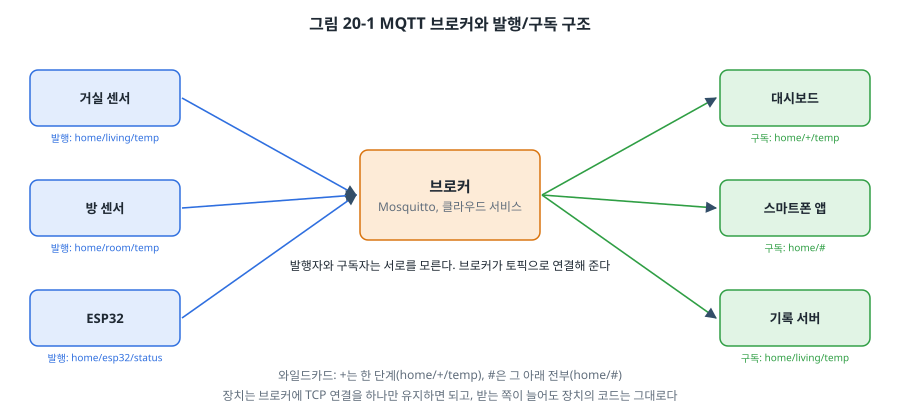
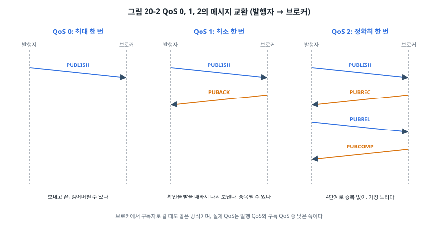
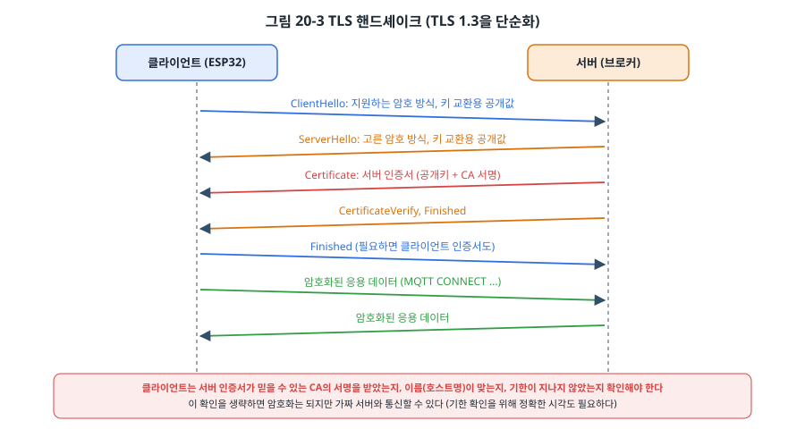
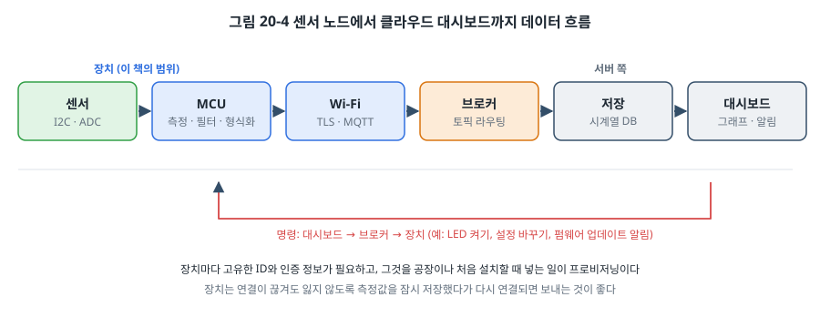

# 20장. IoT 프로토콜과 클라우드 연결

## 이 장에서 배우는 것

- IoT 장치에 HTTP보다 MQTT가 많이 쓰이는 이유
- MQTT의 발행/구독, 토픽, QoS, 보존 메시지, Last Will
- 제약된 장치를 위한 CoAP
- TLS 핸드셰이크와 인증서, 장치에서 보안 연결을 만들 때 확인할 것
- 장치 프로비저닝과 메시지 형식(JSON, CBOR, Protocol Buffers)
- ESP32로 MQTT 장치를 만드는 방법

---

## 20.1 장치와 클라우드 사이

19장에서 ESP32를 Wi-Fi에 연결하고 HTTP로 웹 페이지를 받아 왔습니다. 그렇다면 센서 장치가 측정값을 서버에 올릴 때도 HTTP를 쓰면 될까요? 가능하지만, IoT 장치에는 HTTP가 잘 맞지 않는 점이 몇 가지 있습니다.

- **요청-응답 구조**: HTTP는 클라이언트가 묻고 서버가 답합니다. 서버가 장치에게 "LED를 켜라"는 명령을 먼저 보낼 방법이 없어서, 장치가 계속 "명령 있나요?"를 물어야 합니다(폴링).
- **무거운 헤더**: 요청마다 수백 바이트의 텍스트 헤더가 붙습니다. 4바이트짜리 온도 값을 보내는 데 수백 바이트를 쓰는 셈입니다.
- **연결 비용**: 요청마다 TCP 연결(과 TLS 핸드셰이크)을 새로 맺으면 시간과 전력이 많이 듭니다.

그래서 IoT 분야에서는 장치를 위해 설계된 프로토콜을 많이 씁니다. 가장 널리 쓰이는 것이 **MQTT**이고, 더 작은 장치를 위한 **CoAP**도 있습니다. 이 장에서는 이 프로토콜들과 함께, 인터넷에 연결된 장치라면 반드시 갖춰야 할 **TLS 보안**, 그리고 수많은 장치를 실제로 배치할 때의 **프로비저닝**과 **메시지 형식**을 다룹니다.

## 20.2 MQTT: 발행과 구독

**MQTT**는 1999년 석유 파이프라인의 원격 감시를 위해 만들어진 가벼운 메시지 프로토콜로, 지금은 OASIS 표준(MQTT 3.1.1, 5.0)입니다. TCP 위에서 동작하고, 헤더가 2바이트부터 시작할 만큼 작습니다.



MQTT의 핵심은 **브로커(broker)** 를 가운데 둔 **발행/구독(publish/subscribe)** 구조입니다.

- 모든 장치와 서버는 브로커 하나에 TCP 연결을 맺고 유지합니다.
- 데이터를 보내는 쪽은 **토픽(topic)** 이라는 이름을 붙여 브로커에 **발행(publish)** 합니다. 예: `home/living/temp`.
- 데이터를 받고 싶은 쪽은 브로커에 그 토픽을 **구독(subscribe)** 해 둡니다.
- 브로커는 발행된 메시지를 그 토픽을 구독한 모든 클라이언트에게 전달합니다.

발행자와 구독자는 서로를 모릅니다. 센서는 "누가 내 값을 받는지" 신경 쓰지 않고 토픽에 발행하기만 하고, 대시보드나 기록 서버가 나중에 추가되어도 센서의 코드는 그대로입니다. 17장의 CAN이 "주소가 아니라 메시지의 의미(식별자)"로 통신한 것과 같은 발상입니다.

그리고 장치가 브로커에 맺은 연결은 양방향이라서, 서버가 장치에게 명령을 보낼 수도 있습니다. 장치가 `home/esp32/cmd`를 구독해 두면, 스마트폰 앱이 그 토픽에 "led on"을 발행하는 순간 장치에 전달됩니다. 장치가 폴링할 필요가 없습니다.

### 토픽 설계

토픽은 `/`로 계층을 나눈 문자열입니다. 구독할 때는 와일드카드를 쓸 수 있습니다.

- `+`: 한 단계. `home/+/temp`는 `home/living/temp`, `home/room/temp`와 맞습니다.
- `#`: 그 아래 전부. `home/#`은 `home`으로 시작하는 모든 토픽과 맞습니다.

토픽 구조는 처음에 잘 설계해야 합니다. 흔히 쓰는 모양은 `<서비스>/<장치 ID>/<종류>`입니다. 이 장의 예제는 다음과 같이 씁니다.

| 토픽 | 방향 | 내용 |
| --- | --- | --- |
| `embbook/<id>/telemetry` | 장치 → | 10초마다 측정값 (JSON) |
| `embbook/<id>/status` | 장치 → | "online" / "offline" |
| `embbook/<id>/cmd` | → 장치 | "led on" / "led off" |

### QoS

MQTT는 메시지마다 **전달 보장 수준(QoS)** 을 고를 수 있습니다.



- **QoS 0 (최대 한 번)**: 보내고 끝입니다. 확인이 없으므로 연결이 끊기는 순간의 메시지는 사라질 수 있습니다. 10초마다 오는 측정값처럼 하나쯤 잃어도 다음 값이 곧 오는 데이터에 씁니다.
- **QoS 1 (최소 한 번)**: 받는 쪽이 PUBACK을 돌려줄 때까지 다시 보냅니다. 확실히 전달되지만, ACK가 사라지면 같은 메시지가 두 번 갈 수 있습니다. 명령과 경보에 많이 씁니다. 받는 쪽은 중복을 견딜 수 있게 만들어야 합니다(예: "LED를 반전하라" 대신 "LED를 켜라").
- **QoS 2 (정확히 한 번)**: 네 단계 교환으로 중복 없이 한 번만 전달합니다. 가장 느리고 무겁습니다. 결제나 카운터처럼 중복이 문제가 되는 경우에만 씁니다.

TCP가 이미 재전송을 하는데 왜 QoS 1이 필요할까요? TCP는 **연결이 살아 있는 동안**만 보장합니다. 무선 장치는 연결이 자주 끊기고 다시 붙는데, 그 사이에 버퍼에 있던 데이터는 TCP가 책임지지 않습니다. MQTT의 QoS는 연결이 끊겼다 다시 붙는 상황까지 포함한 응용 수준의 보장입니다.

### 보존 메시지와 Last Will

**보존(retain) 메시지**: 발행할 때 보존 플래그를 켜면 브로커가 그 토픽의 마지막 메시지를 기억해 두었다가, 나중에 구독하는 클라이언트에게 바로 보내 줍니다. 대시보드를 새로 열어도 장치의 마지막 상태를 다음 발행까지 기다리지 않고 볼 수 있습니다.

**Last Will(유언) 메시지**: 장치가 브로커에 접속할 때 "내가 갑자기 사라지면 이 토픽에 이 메시지를 대신 발행해 달라"고 미리 맡겨 둡니다. 장치의 전원이 꺼지거나 Wi-Fi가 끊겨 **keepalive** 시간 안에 아무 소식이 없으면 브로커가 그 메시지를 발행합니다. 예제는 접속하면 `status`에 "online"(보존)을 발행하고, 유언으로 "offline"(보존)을 맡겨 둡니다. 그러면 누구든 `status` 토픽만 보면 장치가 지금 살아 있는지 알 수 있습니다.

## 20.3 CoAP

**CoAP(Constrained Application Protocol, RFC 7252)** 은 MCU처럼 자원이 아주 적은 장치를 위해 설계된 프로토콜입니다. HTTP처럼 GET, PUT, POST, DELETE와 URI(`/sensors/temp`)를 쓰는 요청-응답 구조라 웹 개발자에게 익숙하지만, TCP 대신 **UDP** 위에서 동작하고 헤더가 4바이트로 아주 작습니다.

| 항목 | MQTT | CoAP |
| --- | --- | --- |
| 전송 | TCP | UDP (DTLS로 보안) |
| 구조 | 브로커를 통한 발행/구독 | 장치 간 직접 요청/응답 (+ 관찰 기능) |
| 연결 | 계속 유지 | 연결 없음 |
| 신뢰성 | QoS 0/1/2 | 확인 메시지(CON)와 비확인 메시지(NON) |
| 잘 맞는 곳 | 인터넷 너머 클라우드와의 연결 | 저전력 무선 메시 네트워크 안(Thread 등) |

연결을 유지하지 않는 CoAP는 대부분의 시간 동안 자다가 가끔 깨어나는 배터리 장치에 유리하고, MQTT는 항상 켜져 있고 서버의 명령을 바로 받아야 하는 장치에 유리합니다. 스마트홈 표준인 Matter는 IPv6와 UDP 기반의 자체 메시지 계층을 씁니다. 하나의 정답이 있는 것이 아니라 장치와 네트워크의 성격에 맞게 고릅니다.

## 20.4 메시지 형식

토픽에 무엇을 담을지도 정해야 합니다. MQTT와 CoAP는 데이터를 그냥 바이트로 다루므로 형식은 우리가 정합니다.

**JSON**은 사람이 읽을 수 있고, 거의 모든 언어와 클라우드 서비스가 지원합니다. 디버깅이 쉬워 가장 흔히 씁니다.

```json
{"t":2345,"h":41}
```

**CBOR(RFC 8949)** 은 JSON과 같은 데이터 모델을 이진으로 표현합니다. 위와 같은 내용이 다음 10바이트가 됩니다.

```
A2                 맵, 원소 2개
   61 74           문자열 "t"
   19 09 29        정수 2345 (0x0929, 2바이트)
   61 68           문자열 "h"
   18 29           정수 41
```

JSON의 17바이트보다 작고, 숫자를 문자로 바꾸고 다시 읽는(파싱) 계산이 필요 없어 MCU에 유리합니다. CoAP와 함께 많이 씁니다.

**Protocol Buffers(protobuf)** 는 구글이 만든 형식으로, 메시지 구조를 `.proto` 파일에 미리 정의하고 도구로 각 언어의 코드를 생성합니다. 필드 이름을 보내지 않고 번호만 보내므로 가장 작고, 구조가 바뀌어도 호환성을 유지하는 규칙이 잘 정해져 있습니다. MCU용으로는 nanopb 같은 구현을 씁니다.

| 형식 | 크기 | 사람이 읽기 | 스키마 | MCU 부담 |
| --- | --- | --- | --- | --- |
| JSON | 큼 | 쉬움 | 없음 | 텍스트 처리, 파싱 |
| CBOR | 작음 | 도구 필요 | 없음 | 작음 |
| Protocol Buffers | 가장 작음 | 도구 필요 | 필요 (.proto) | 생성 코드 |

> 💡 팁: 12장에서 온도를 "× 10 정수"로 다뤘던 습관이 여기서도 쓸모 있습니다. 23.45 °C를 `23.45`(실수)로 보내면 JSON 파싱과 생성에 부동소수점 처리가 필요하고 표현 오차도 생길 수 있습니다. `2345`(0.01 °C 단위 정수)로 보내고 단위를 문서로 약속하면 장치 쪽이 단순해집니다. 19장의 BLE 온도 특성도 같은 방식이었습니다.

## 20.5 TLS: 인터넷에 나가기 전에

19장의 HTTP와 이 장의 예제가 쓰는 MQTT(포트 1883)는 **평문**입니다. 같은 네트워크의 누구든 내용을 볼 수 있고, 중간에서 내용을 바꾸거나, 가짜 브로커인 척할 수 있습니다. 인터넷을 거치는 통신이라면 반드시 **TLS(Transport Layer Security)** 로 암호화해야 합니다. HTTPS는 HTTP + TLS이고, MQTT + TLS는 보통 포트 8883을 씁니다.



TLS 연결을 시작할 때 **핸드셰이크**가 일어납니다.

1. 클라이언트와 서버가 쓸 암호 방식을 정하고, 키 교환으로 둘만 아는 세션 키를 만듭니다.
2. 서버는 **인증서**를 보냅니다. 인증서에는 서버의 공개키와 이름(도메인)이 들어 있고, 믿을 수 있는 **인증 기관(CA)** 이 서명해 두었습니다.
3. 클라이언트는 인증서의 서명을 자기가 가진 **CA 인증서**로 확인해, 상대가 진짜 그 서버인지 검증합니다.
4. 이후 데이터는 세션 키로 암호화되어 오갑니다.

장치에서 TLS를 쓸 때 꼭 확인해야 할 것이 있습니다.

- **서버 인증서를 검증해야 합니다.** 개발 중에 인증서 검증을 꺼 두는 경우가 많은데, 그 상태로 제품을 내보내면 암호화는 되지만 가짜 서버와도 통신하게 됩니다. 장치에 CA 인증서를 넣어 두고 반드시 검증합니다.
- **시각이 정확해야 합니다.** 인증서에는 유효 기간이 있어서, 장치의 시계가 틀리면 멀쩡한 인증서도 거부하거나 만료된 인증서를 받아들입니다. Wi-Fi에 접속한 뒤 SNTP로 시각을 맞추고 TLS를 시작합니다.
- **메모리와 시간이 듭니다.** TLS 핸드셰이크에는 수십 KB의 RAM과, MCU에 따라 수백 ms~수 초의 계산이 필요합니다. ESP32는 암호 가속기가 있어서 부담이 덜하지만, 작은 MCU에서는 TLS가 가능한지부터 따져야 합니다.
- **장치 자신을 증명해야 할 수도 있습니다.** 서버가 "이 장치가 진짜 우리 제품인가"를 확인하려면 장치마다 고유한 **클라이언트 인증서**와 비밀키를 넣어 둡니다(상호 TLS). AWS IoT 같은 클라우드 서비스는 이 방식을 기본으로 씁니다.

ESP-IDF에서는 브로커 주소를 `mqtts://호스트:8883`으로 바꾸고 CA 인증서를 지정하면 TLS가 켜집니다.

```c
extern const char ca_pem_start[] asm("_binary_ca_pem_start");   /* 빌드할 때 파일을 넣는다 */

esp_mqtt_client_config_t cfg = {
    .broker.address.uri = "mqtts://broker.example.com:8883",
    .broker.verification.certificate = ca_pem_start,               /* 서버 인증서 검증용 CA */
};
```

TLS와 암호의 원리, 비밀키를 장치에 안전하게 보관하는 방법은 33장에서 자세히 다룹니다.

## 20.6 프로비저닝

공장에서 장치 1,000대를 만들었다고 해 봅시다. 장치마다 무엇이 달라야 할까요? 고유한 ID, (상호 TLS라면) 고유한 인증서와 비밀키, 그리고 설치할 집의 Wi-Fi 이름과 암호. 이것들을 장치에 넣는 과정을 **프로비저닝(provisioning)** 이라고 합니다.

- **공장 프로비저닝**: 장치 ID와 인증서처럼 생산 시점에 정해지는 정보는 공장 시험 과정에서 넣습니다(36장). 비밀키는 장치 안에서 만들어 밖으로 나가지 않게 하는 것이 가장 안전합니다.
- **현장 프로비저닝**: Wi-Fi 정보처럼 설치 장소에서 정해지는 정보는 사용자가 넣어야 합니다. 화면도 키보드도 없는 장치에 Wi-Fi 암호를 어떻게 넣을까요? 흔한 방법은 두 가지입니다.
  - 장치가 처음 켜지면 **BLE**로 광고하고(19장), 스마트폰 앱이 BLE로 연결해 Wi-Fi 정보를 보냅니다.
  - 장치가 **AP 모드**로 자기 Wi-Fi를 만들고, 스마트폰이 거기 접속해 웹 페이지에서 정보를 입력합니다.

ESP-IDF에는 BLE나 AP 모드로 Wi-Fi 정보를 안전하게 받는 프로비저닝 구성 요소(`wifi_provisioning`)와 스마트폰 앱이 제공됩니다. 프로비저닝은 제품의 첫인상이라, 사용자가 처음 몇 분 안에 실패하면 반품으로 이어집니다. 실패했을 때 처음으로 돌아갈 수 있는 방법(버튼 길게 누르기로 설정 지우기 등)도 꼭 만들어 둡니다.

## 20.7 데이터 흐름 전체 그림



장치 쪽에서 보면 IoT 시스템은 다음과 같이 흐릅니다. 센서를 읽고(15장, 9장), 필터링하고 형식을 만들어(20.4절), 보안 연결(20.5절)로 브로커에 발행합니다. 그다음은 서버 쪽의 일입니다. 브로커에서 메시지를 받아 시계열 데이터베이스에 저장하고, 대시보드에서 그래프를 그리고, 조건이 맞으면 알림을 보냅니다. 거꾸로 사용자의 명령은 브로커를 거쳐 장치로 내려옵니다.

장치 개발자가 특히 신경 써야 할 것은 **연결이 끊긴 상황**입니다. 무선은 언제든 끊깁니다. 끊긴 동안의 측정값을 버릴 것인가, 메모리나 16장의 SPI 플래시에 쌓아 두었다가 다시 연결되면 보낼 것인가. 다시 연결을 시도하는 간격을 어떻게 늘려 갈 것인가(공유기가 다시 켜졌을 때 장치 1,000대가 동시에 접속해 서버를 마비시키지 않도록 무작위 지연을 섞는 것이 좋습니다). 이런 결정이 IoT 제품의 신뢰성을 좌우합니다.

## 20.8 실습: MQTT 장치

`code/ch20-iot/esp32-idf/`의 예제는 다음을 합니다.

1. 19장과 같은 방법으로 Wi-Fi에 접속합니다(`wifi.c`로 모듈화).
2. MAC 주소로 장치 ID를 만들고 토픽 이름을 정합니다.
3. Last Will을 맡기고 브로커에 접속합니다. 접속되면 `status`에 "online"을 보존 발행하고 `cmd`를 QoS 1로 구독합니다.
4. 10초마다 가동 시간, RSSI, 남은 힙 메모리를 JSON으로 `telemetry`에 QoS 0으로 발행합니다.
5. `cmd`로 "led on" / "led off"를 받으면 GPIO4의 LED를 켜고 끕니다.

```c
esp_mqtt_client_config_t cfg = {
    .broker.address.uri = CONFIG_EXAMPLE_BROKER_URI,
    .session.keepalive = 30,
    .session.last_will = {
        .topic = s_topic_status, .msg = "offline", .msg_len = 7, .qos = 1, .retain = 1,
    },
};
s_client = esp_mqtt_client_init(&cfg);
esp_mqtt_client_register_event(s_client, ESP_EVENT_ANY_ID, on_mqtt_event, NULL);
esp_mqtt_client_start(s_client);
```

ESP-IDF의 MQTT 클라이언트(esp-mqtt)도 19장의 Wi-Fi처럼 이벤트로 동작합니다. 접속, 끊김, 메시지 도착이 처리기로 들어오고, 끊기면 클라이언트가 알아서 다시 접속합니다. 받은 메시지의 토픽과 데이터는 **널 문자로 끝나지 않으므로** 반드시 길이와 함께 다뤄야 합니다. 14장의 명령어 셸에서 강조한 "바깥에서 들어온 데이터는 길이를 확인한다"는 원칙이 여기서도 그대로입니다.

시험할 브로커는 같은 네트워크의 PC에 **Mosquitto**를 설치해 띄우는 것이 가장 쉽습니다(예제 폴더의 README 참고). PC에서 구독해 두고 장치를 켜면 다음과 같이 보입니다.

```
$ mosquitto_sub -h localhost -t 'embbook/#' -v
embbook/a1b2c3/status online
embbook/a1b2c3/telemetry {"uptime":10,"rssi":-58,"heap":231456}
embbook/a1b2c3/telemetry {"uptime":20,"rssi":-57,"heap":231456}
```

다른 터미널에서 `mosquitto_pub -h localhost -t 'embbook/a1b2c3/cmd' -m 'led on'`을 실행하면 LED가 켜집니다. ESP32의 전원을 뽑으면, keepalive 시간(30초)의 1.5배쯤 지난 뒤 `status`에 "offline"이 나타납니다. Last Will이 동작하는 순간입니다.

> ⚠️ 주의: 인터넷의 공개 시험 브로커는 아무나 구독할 수 있어서, 여러분의 토픽과 데이터를 다른 사람도 볼 수 있습니다. 개인 정보나 위치, 집의 Wi-Fi 정보 같은 것은 절대 공개 브로커로 보내지 마세요. 시험은 자신의 PC에 띄운 브로커에서 하고, 실제 서비스는 인증과 TLS를 갖춘 브로커를 씁니다.

---

## 정리

- MQTT는 브로커를 가운데 둔 발행/구독 프로토콜로, 장치가 연결 하나를 유지하며 데이터를 보내고 명령을 받습니다. 토픽은 계층 구조이고 +, # 와일드카드로 구독합니다.
- QoS 0은 보내고 끝, QoS 1은 확인될 때까지 재전송(중복 가능), QoS 2는 정확히 한 번입니다. 연결이 끊겼다 붙는 상황까지 포함한 보장입니다.
- 보존 메시지는 마지막 값을 새 구독자에게 바로 주고, Last Will은 장치가 갑자기 사라졌을 때 브로커가 대신 알립니다.
- CoAP는 UDP 기반의 가벼운 요청/응답 프로토콜로, 연결을 유지하지 않는 저전력 장치에 맞습니다.
- 메시지 형식은 읽기 쉬운 JSON, 작은 CBOR, 가장 작고 스키마가 있는 Protocol Buffers 중에서 고릅니다.
- 인터넷을 거치는 통신은 TLS로 암호화하고, 서버 인증서를 반드시 검증하며, 정확한 시각을 맞춥니다.
- 장치 ID와 인증서는 공장에서, Wi-Fi 정보는 현장에서(BLE 또는 AP 모드) 프로비저닝합니다.

## 연습 문제

1. 다음 토픽들 중 `factory/+/line1/#`을 구독한 클라이언트가 받는 것을 모두 고르세요.
   (가) `factory/seoul/line1/temp` (나) `factory/seoul/line2/temp` (다) `factory/busan/line1` (라) `factory/busan/line1/motor/rpm`
2. "버튼을 누를 때마다 카운터를 1 늘린다"는 명령을 QoS 1로 보내면 어떤 문제가 생길 수 있나요? 명령의 설계를 바꿔 QoS 1로도 안전하게 만드는 방법을 제시하세요.
3. 측정값 `{"temp":2345,"humi":41,"batt":87}`을 JSON과 CBOR로 표현했을 때 각각 몇 바이트인지 계산하세요. 이 메시지를 1분마다 보내는 장치 10,000대가 하루에 보내는 데이터 양의 차이는 얼마인가요?
4. 장치의 시계가 2000년 1월 1일로 되어 있는 상태에서 TLS 연결을 시도하면 어떤 일이 일어날지 설명하세요. 이 문제를 해결하는 순서를 적으세요.
5. 공유기가 정전 후 다시 켜졌을 때, 같은 건물의 장치 500대가 동시에 브로커에 재접속을 시도합니다. 이런 상황을 피하기 위해 장치의 재접속 로직을 어떻게 설계해야 할까요?
6. (실습) 예제에 `embbook/<id>/config` 토픽을 추가해, `{"interval":5}`처럼 JSON으로 텔레메트리 주기를 바꿀 수 있게 만드세요. 받은 값은 범위(예: 1~3600초)를 검사하고, ESP-IDF의 NVS에 저장해 재부팅 뒤에도 유지되게 하세요.
