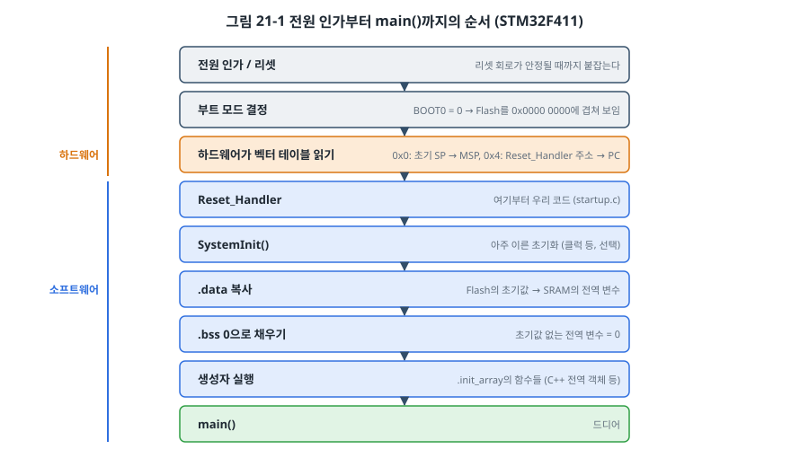
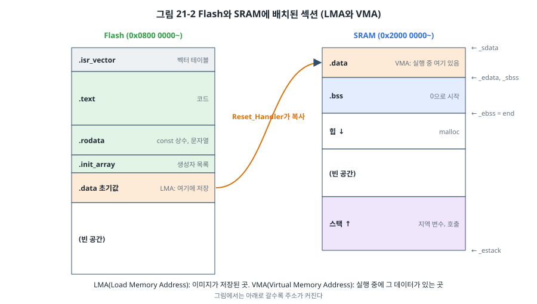
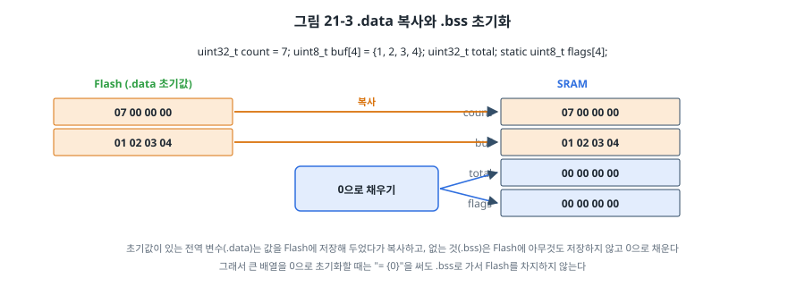
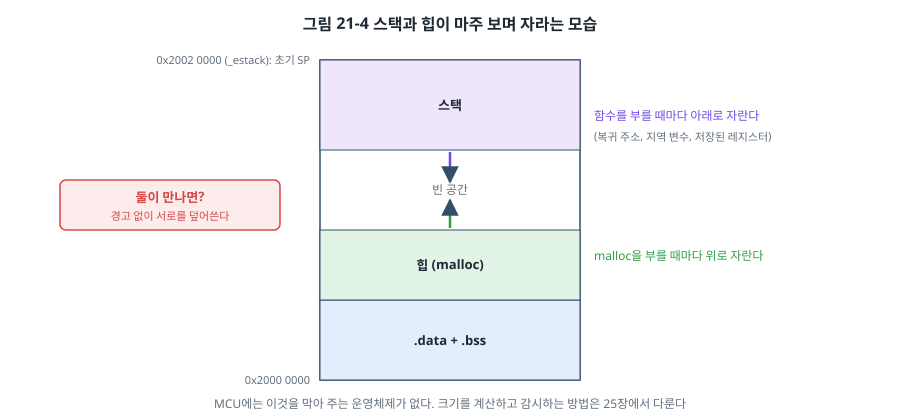

# 21장. 부트 과정과 링커 스크립트

## 이 장에서 배우는 것

- 전원을 넣은 순간부터 `main()`이 시작되기까지 일어나는 일
- 벡터 테이블과 리셋 처리기, 스타트업 코드의 역할
- 섹션(`.text`, `.rodata`, `.data`, `.bss`)과 LMA·VMA
- 링커 스크립트를 한 줄씩 읽는 방법
- 맵 파일과 `size`, `nm`으로 메모리 사용을 분석하는 방법
- 스택과 힙의 배치, 그리고 AVR에서 `main()` 전에 일어나는 일

---

## 21.1 제4부를 시작하며

제1부에서 제3부까지 우리는 주변장치와 통신을 다뤘습니다. 매번 `main()`부터 코드를 썼고, 그 앞에서 무슨 일이 일어나는지는 "스타트업 코드가 알아서 한다"며 넘어갔습니다. 제4부에서는 그 "알아서"의 정체를 밝힙니다. 펌웨어가 어떻게 메모리에 놓이고, 어떻게 빌드되고, 문제가 생기면 어떻게 찾고, 커지면 어떻게 구조를 잡는지를 다룹니다.

제3장부터 써 온 `code/common/stm32f411/`의 `startup.c`와 `stm32f411.ld`는 이 책에서 직접 만든 파일입니다. 제조사의 IDE가 만들어 주는 수백 줄짜리 파일 대신 꼭 필요한 것만 담아서, 이 장에서 처음부터 끝까지 읽을 수 있도록 했습니다.

## 21.2 main() 이전

C 언어 교과서는 "프로그램은 `main()`에서 시작한다"고 말합니다. PC에서는 운영체제가 프로그램을 메모리에 올리고, 전역 변수를 초기화하고, `main()`을 불러 줍니다. MCU에는 운영체제가 없으므로 그 일을 펌웨어 자신이 해야 합니다.



전원이 들어오면 다음 순서로 진행됩니다.

1. **리셋**: 전원 전압이 안정될 때까지 리셋 회로가 칩을 붙잡아 둡니다(3장의 POR, BOR).
2. **부트 모드 결정**: STM32F411은 BOOT0 핀(과 BOOT1 = PB2)을 보고 0x0000 0000 주소에 무엇을 보이게 할지 정합니다. BOOT0 = 0이면 Flash(0x0800 0000)를, BOOT0 = 1이고 BOOT1 = 0이면 칩에 내장된 ST의 부트로더(시스템 메모리)를 보이게 합니다. NUCLEO는 BOOT0이 저항으로 GND에 연결되어 있어 항상 Flash에서 시작합니다(RM0383 2.4절 Boot configuration).
3. **하드웨어가 벡터 테이블 두 칸을 읽습니다.** 0x0000 0000의 값을 MSP(스택 포인터)에, 0x0000 0004의 값을 PC에 넣습니다. 7장에서 본 벡터 테이블의 0번 칸이 "초기 SP 값", 1번 칸이 "Reset_Handler 주소"였던 이유가 이것입니다. 이 시점까지는 코드가 한 줄도 실행되지 않았습니다.
4. **Reset_Handler**: 여기부터가 우리 코드입니다. 스택이 이미 준비되어 있으므로 C 함수로 쓸 수 있습니다.
5. **SystemInit()**: 아주 이른 초기화(예: 클럭)를 넣을 자리입니다.
6. **.data 복사, .bss 지우기**: C 언어가 약속한 전역 변수의 초기값을 만듭니다.
7. **생성자 실행**: C++ 전역 객체나 C의 `__attribute__((constructor))` 함수.
8. **main()**

Cortex-M의 설계에서 눈여겨볼 점은 3번입니다. 초기 스택 포인터를 하드웨어가 설정해 주므로, 리셋 처리기를 어셈블리 없이 C로 쓸 수 있습니다. 많은 다른 아키텍처는 스택을 설정하는 몇 줄의 어셈블리가 반드시 필요합니다.

## 21.3 스타트업 코드 읽기

이 책의 `startup.c`에서 리셋 처리기는 다음이 전부입니다.

```c
void Reset_Handler(void)
{
    SystemInit();

    /* .data: Flash에 있는 초기값을 RAM으로 복사 */
    uint32_t *src = &_sidata;
    for (uint32_t *dst = &_sdata; dst < &_edata; ) {
        *dst++ = *src++;
    }
    /* .bss: 0으로 채우기 */
    for (uint32_t *dst = &_sbss; dst < &_ebss; ) {
        *dst++ = 0;
    }

    /* 생성자 실행 */
    for (init_fn_t *f = __init_array_start; f < __init_array_end; f++) {
        (*f)();
    }

    main();

    for (;;) {
    }
}
```

`_sidata`, `_sdata`, `_edata`, `_sbss`, `_ebss`, `__init_array_start` 같은 이름은 C 코드 어디에도 정의되어 있지 않습니다. 이것들은 **링커 스크립트가 만드는 기호**입니다. 링커가 섹션을 배치하면서 "여기가 .data의 시작", "여기가 .bss의 끝" 같은 주소에 이름을 붙여 주고, 스타트업 코드는 그 이름으로 주소를 얻습니다. 그래서 `extern uint32_t _sdata;`로 선언하고 `&_sdata`로 주소를 씁니다. 값이 아니라 **주소 자체**가 의미 있는 기호라는 점이 특이합니다.

> ⚠️ 주의: `SystemInit()`은 .data 복사와 .bss 지우기 **전에** 불립니다. 그래서 `SystemInit()` 안에서는 초기값이 있는 전역 변수를 읽어도 그 값이 아직 없고, 0이어야 할 변수도 아직 쓰레기 값입니다. 클럭 설정처럼 레지스터만 다루는 일만 하세요. CMSIS의 스타트업 파일도 같은 순서라서 흔히 겪는 버그입니다.

`main()`이 끝나면 어떻게 될까요? PC 프로그램이라면 운영체제로 돌아가지만, MCU에는 돌아갈 곳이 없습니다. 그래서 무한 루프로 붙잡아 둡니다. 1장에서 "펌웨어는 끝나지 않는다"고 했던 그 루프가, 만약 `main()`이 실수로 끝나더라도 여기서 한 번 더 지켜집니다.

> 🔍 깊이 보기: 14장에서 newlib을 링크할 때 `-nostartfiles` 옵션을 썼습니다. 원래 newlib은 자기 스타트업 파일(crt0)과 함께 쓰도록 되어 있고, 그 안의 `__libc_init_array()`가 생성자를 실행합니다. 그런데 `__libc_init_array()`는 내부에서 `_init()`이라는 함수를 부르는데, 이 함수는 우리가 빼 버린 시작 파일(crti.o)에 들어 있어 링크 오류가 납니다. 그래서 이 책의 스타트업은 링커 스크립트에 `.init_array` 섹션을 직접 두고, 그 안의 함수 포인터들을 직접 돌며 실행합니다. 더 단순하고, 무슨 일이 일어나는지 다 보입니다.

## 21.4 섹션

컴파일러는 코드와 데이터를 성격에 따라 **섹션(section)** 으로 나눠 목적 파일(`.o`)에 담습니다.

| 섹션 | 담는 것 | 예 | 놓이는 곳 |
| --- | --- | --- | --- |
| `.text` | 기계어 코드 | 함수 | Flash |
| `.rodata` | 읽기 전용 데이터 | `const` 전역 변수, 문자열 상수 | Flash |
| `.data` | 초기값이 있는 전역·정적 변수 | `uint32_t count = 7;` | 실행 중 SRAM, 초기값은 Flash |
| `.bss` | 초기값이 없거나 0인 전역·정적 변수 | `uint32_t total;` | SRAM (0으로 채움) |
| 스택 | 지역 변수, 함수 호출 정보 | 함수 안의 `int i;` | SRAM |
| 힙 | 동적 할당 | `malloc()` | SRAM |

여기서 `.data`가 특별합니다. 실행 중에는 값을 바꿀 수 있어야 하므로 SRAM에 있어야 하는데, SRAM은 전원이 꺼지면 내용이 사라집니다. 그래서 **초기값은 Flash에 저장해 두고, 시작할 때 SRAM으로 복사**합니다. 이렇게 한 섹션이 두 개의 주소를 갖게 됩니다.



- **LMA(Load Memory Address)**: 이미지 안에서 그 섹션의 내용이 저장된 곳. `.data`의 LMA는 Flash입니다.
- **VMA(Virtual Memory Address)**: 프로그램이 실행 중에 그 섹션을 쓰는 곳. `.data`의 VMA는 SRAM입니다. 코드 안의 `count`라는 변수 이름은 VMA로 번역됩니다.

`.text`와 `.rodata`는 LMA와 VMA가 같고(Flash에 있고 거기서 그대로 씀), `.bss`는 LMA가 없습니다(저장할 내용이 0뿐이므로 이미지에 넣을 필요가 없음).



이 구분에서 실용적인 교훈이 하나 나옵니다. **0이 아닌 초기값을 가진 큰 전역 배열은 Flash와 SRAM을 둘 다 차지합니다.** 예를 들어 `uint8_t lut[4096] = {1, 2, ...};`는 Flash에 4 KB(초기값), SRAM에 4 KB(실행 중 사본)를 씁니다. 그 배열을 실행 중에 바꿀 일이 없다면 `const`를 붙여 `.rodata`로 보내세요. SRAM 4 KB를 아끼고, 시작할 때 복사하는 시간도 줄어듭니다. 4장에서 "Cortex-M에서 `const` 전역 변수는 Flash에 놓인다"고 했던 이유입니다.

## 21.5 링커 스크립트 해부

컴파일러가 만든 여러 목적 파일의 섹션들을 모아, 어느 메모리의 어느 주소에 둘지 정하는 것이 **링커**이고, 그 규칙을 적은 파일이 **링커 스크립트**입니다. 이 책의 `stm32f411.ld`를 처음부터 읽어 보겠습니다.

### 진입점과 메모리

```ld
ENTRY(Reset_Handler)

MEMORY
{
    FLASH (rx)  : ORIGIN = 0x08000000, LENGTH = 512K
    RAM   (rwx) : ORIGIN = 0x20000000, LENGTH = 128K
}

_estack = ORIGIN(RAM) + LENGTH(RAM);
```

- `ENTRY`는 프로그램의 시작 함수를 디버거와 도구에 알려 줍니다. 실제 시작은 벡터 테이블이 정하지만, 이 줄이 있어야 `--gc-sections`가 Reset_Handler부터 따라가며 쓰이는 코드를 판단합니다.
- `MEMORY`는 칩의 메모리 지도입니다. 3장의 메모리 맵에서 본 Flash와 SRAM의 시작 주소와 크기를 그대로 적습니다(RM0383 2.3절). `rx`, `rwx`는 읽기·쓰기·실행 속성입니다. 코드가 이 크기를 넘으면 링커가 "region FLASH overflowed" 오류를 냅니다.
- `_estack`은 SRAM의 끝(0x2002 0000)입니다. 스택은 여기서 아래로 자랍니다. 벡터 테이블의 0번 칸이 이 값입니다.

### 벡터 테이블과 코드

```ld
SECTIONS
{
    .isr_vector :
    {
        . = ALIGN(4);
        KEEP(*(.isr_vector))
        . = ALIGN(4);
    } > FLASH

    .text :
    {
        . = ALIGN(4);
        *(.text*)
        *(.rodata*)
        . = ALIGN(4);
        _etext = .;
    } > FLASH
```

- 첫 섹션이 `.isr_vector`라서 벡터 테이블이 Flash의 맨 앞(0x0800 0000)에 놓입니다. 하드웨어가 0번지(= Flash 맨 앞)에서 초기 SP와 리셋 주소를 읽어야 하므로 반드시 맨 앞이어야 합니다. `startup.c`의 `vector_table` 배열에 `__attribute__((section(".isr_vector")))`를 붙여 이 섹션에 넣었습니다.
- `KEEP`은 "어디서도 참조하지 않는 것처럼 보여도 버리지 마라"는 뜻입니다. 벡터 테이블은 코드에서 부르는 곳이 없어서(하드웨어가 읽으므로), `KEEP`이 없으면 `--gc-sections`가 쓰이지 않는 데이터로 보고 버려 버립니다. 그러면 칩은 Flash에서 쓰레기 값을 SP와 PC로 읽어 아무것도 실행되지 않습니다.
- `*(.text*)`는 "모든 입력 파일의 `.text`로 시작하는 모든 섹션"입니다. `-ffunction-sections` 옵션 때문에 함수마다 `.text.main`, `.text.uart2_init`처럼 별도 섹션이 되므로 와일드카드가 필요합니다.
- `.` 은 **위치 카운터**, 즉 "지금 배치하고 있는 주소"입니다. `. = ALIGN(4)`는 다음 주소를 4의 배수로 맞추고, `_etext = .;`는 지금 주소에 `_etext`라는 이름을 붙입니다.

### 생성자 목록

```ld
    .init_array :
    {
        . = ALIGN(4);
        __init_array_start = .;
        KEEP(*(SORT(.init_array.*)))
        KEEP(*(.init_array))
        __init_array_end = .;
    } > FLASH
```

컴파일러는 생성자 함수의 주소를 `.init_array` 섹션에 넣어 둡니다. 링커는 그것들을 한곳에 모으고 시작과 끝에 이름을 붙이며, 스타트업 코드가 그 사이의 함수 포인터를 차례로 부릅니다. `SORT`는 우선순위가 붙은 생성자(`.init_array.00100` 등)를 순서대로 놓기 위한 것입니다.

### .data와 .bss

```ld
    _sidata = LOADADDR(.data);
    .data :
    {
        . = ALIGN(4);
        _sdata = .;
        *(.data*)
        . = ALIGN(4);
        _edata = .;
    } > RAM AT > FLASH

    .bss (NOLOAD) :
    {
        . = ALIGN(4);
        _sbss = .;
        *(.bss*)
        *(COMMON)
        . = ALIGN(4);
        _ebss = .;
    } > RAM

    end = _ebss;
```

- `> RAM AT > FLASH`가 21.4절의 LMA와 VMA를 표현합니다. "VMA는 RAM에(`> RAM`), LMA는 FLASH에(`AT > FLASH`)". 그래서 `_sdata`, `_edata`는 SRAM 주소이고, `LOADADDR(.data)`로 얻은 `_sidata`는 Flash 주소입니다. 스타트업 코드는 `_sidata`에서 `_sdata`로 `_edata − _sdata`바이트를 복사합니다.
- `ALIGN(4)`로 시작과 끝을 4바이트에 맞춘 이유는, 스타트업 코드가 32비트 단위로 복사하고 지우기 때문입니다. 정렬이 맞지 않으면 1~3바이트를 빼먹거나 넘어서 씁니다.
- `.bss`의 `NOLOAD`는 "이미지에 내용을 넣지 마라"는 뜻입니다. `*(COMMON)`은 옛 C 컴파일러 관습의 초기값 없는 전역 변수를 담습니다.
- `end`는 힙이 시작하는 곳입니다. 14장의 `syscalls.c`에 있는 `_sbrk()`가 이 기호에서부터 `malloc`용 메모리를 내줍니다.

### 버릴 것

```ld
    /DISCARD/ :
    {
        *(.ARM.exidx*)
    }
}
```

`.ARM.exidx`는 C++ 예외 처리용 정보입니다. 이 책은 C를 쓰므로 버립니다.

이 스크립트는 CubeIDE가 만들어 주는 것보다 훨씬 짧지만, 필요한 것은 다 들어 있습니다. 제조사의 링커 스크립트에는 이 밖에 C++ 지원용 섹션들, 스택과 힙의 최소 크기를 확인하는 부분(`._user_heap_stack`), CCM RAM 같은 추가 메모리 영역이 더 있습니다. 이 장을 읽고 나면 그 파일도 어렵지 않게 읽을 수 있습니다.

## 21.6 스택과 힙



이 책의 배치에서 스택은 SRAM의 맨 끝(0x2002 0000)에서 아래로, 힙은 `.bss` 바로 뒤에서 위로 자랍니다. 둘 사이의 빈 공간을 서로 나눠 쓰는 셈입니다.

PC라면 스택이 넘치면 운영체제가 "스택 오버플로"로 프로그램을 멈춰 주지만, MCU에서는 **아무 경고 없이** 스택이 힙이나 `.bss`의 전역 변수를 덮어씁니다. 그러면 전혀 상관없는 변수의 값이 가끔 이상하게 바뀌는, 찾기 아주 어려운 버그가 됩니다. 재귀 호출, 큰 지역 배열, 인터럽트 중첩(7장)이 스택을 많이 쓰는 주범입니다. 25장에서 스택 크기를 재고, 넘치는 순간을 잡아내는 방법(MPU, 카나리)을 다룹니다.

## 21.7 맵 파일과 분석 도구

빌드가 끝나면 무엇이 어디에 얼마나 들어갔는지 확인할 수 있습니다.

### size

```
$ arm-none-eabi-size build/ch21-boot.elf
   text    data     bss     dec     hex filename
   8656     104     480    9240    2418 build/ch21-boot.elf

$ arm-none-eabi-size -A build/ch21-boot.elf
section        size        addr
.isr_vector     408   134217728
.text          8248   134218136
.init_array       4   134226384
.data           100   536870912
.bss            480   536871012
...
```

(arm-none-eabi-gcc 13.2.1, 이 책의 공통 Makefile 기준. 크기와 주소는 툴체인 버전과 옵션에 따라 달라집니다.)

- `text`: 읽기만 하는 섹션(`.isr_vector` + `.text`, `.text` 안에 `.rodata` 포함)
- `data`: 쓰기 가능하고 초기값이 있는 섹션. `.data`는 **Flash와 SRAM을 둘 다 씁니다.** `.init_array`도 쓰기 가능 섹션이라 `size`는 여기에 넣지만, 실제로는 Flash에만 있습니다(위 예에서 104 = `.data` 100 + `.init_array` 4).
- `bss`: `.bss`의 크기. SRAM만 씁니다.

그래서 Flash 사용량은 대략 text + data, 정적 SRAM 사용량은 대략 data + bss입니다(스택과 힙은 빠져 있습니다). 다만 이 계산은 `.init_array`처럼 Flash에만 있는 쓰기 가능 섹션만큼 SRAM을 과대 계산하므로, 정확한 값은 `size -A`로 섹션별 크기를 보고 셉니다.

### nm

```
$ arm-none-eabi-nm -n build/ch21-boot.elf
08000000 R vector_table
080003b8 T uart2_init
08000504 T Reset_Handler
...
080021dc A _sidata
20000000 d static_local.0
20000004 D initialized
...
2000006c B zeroed
20000244 B _ebss
20020000 R _estack
```

`nm`은 기호와 주소를 보여 줍니다. 두 번째 열의 글자가 기호의 종류를 나타냅니다.

| 글자 | 뜻 |
| --- | --- |
| T | `.text` (코드) |
| R | 읽기 전용 데이터 (`.rodata` 등) |
| D | `.data` |
| B | `.bss` |
| A | 절대 기호: 섹션에 속하지 않고 값(주소)만 있는 기호. 링커 스크립트에서 섹션 밖에 정의한 기호가 흔히 이렇게 나온다 |
| 소문자 | 파일 안에서만 보이는 `static` 기호 (예: `d`, `b`, `t`) |

같은 링커 기호라도 어디에 정의했는지에 따라 종류가 다르게 나옵니다. `_estack`은 위 출력에서 R로 나왔습니다. 주소 순(`-n`)이나 크기 순(`--size-sort`)으로 정렬하면 메모리를 많이 차지하는 범인을 찾을 수 있습니다.

### 맵 파일

이 책의 공통 Makefile은 `-Wl,-Map=build/<이름>.map`으로 **맵 파일**을 만듭니다. 맵 파일에는 링커가 한 일이 전부 기록됩니다. 어느 목적 파일의 어느 섹션이 어느 주소에 몇 바이트로 놓였는지, 라이브러리에서 어떤 함수가 왜 끌려 들어왔는지(어떤 함수가 그것을 참조했는지), `--gc-sections`로 무엇이 버려졌는지.

```
.text.uart2_init
                0x080003b8       0x84 build/uart2.o
                0x080003b8                uart2_init
```

"Flash가 왜 이렇게 큰가?"라는 질문에 답할 때 맵 파일만큼 확실한 자료는 없습니다. 예를 들어 `printf` 한 번에 newlib의 부동소수점 처리, 메모리 할당, 로케일 처리 함수가 줄줄이 따라 들어온 것을 볼 수 있습니다. 22장에서 이 정보로 바이너리 크기를 줄이는 방법을 다룹니다.

## 21.8 실습: 섹션 들여다보기

`code/ch21-boot/stm32/`의 예제는 링커 기호와 여러 종류의 변수, 함수의 주소를 UART로 출력합니다.

```
ch21 boot & sections
linker symbols:
  _sidata (.data LMA)      0x080021DC  Flash
  _sdata  (.data VMA)      0x20000000  SRAM
  _edata                   0x20000064  SRAM
  _sbss                    0x20000064  SRAM
  _ebss / end (heap)       0x20000244  SRAM
  _estack (initial SP)     0x20020000  SRAM
  .data 100 bytes, .bss 480 bytes, constructors 1
objects:
  main (function)          0x0800....  Flash
  table (const)            0x0800....  Flash
  initialized (.data)      0x20000004  SRAM
  static_local (.data)     0x20000000  SRAM
  zeroed (.bss)            0x2000006C  SRAM
  local (stack)            0x2001F...  SRAM
values: initialized=0x12345678 zeroed=0 static_local=5
constructor ran before main: yes
```

(arm-none-eabi-gcc 13.2.1 기준. 주소는 툴체인 버전과 옵션에 따라 달라지므로 "...."로 남긴 곳은 직접 실행해서 확인하세요.) 함수 `main`의 주소를 출력하면 홀수로 나오는 것이 눈에 띌 것입니다. Cortex-M은 Thumb 명령어만 실행하는데, 함수 포인터의 최하위 비트를 1로 두어 "Thumb 코드"임을 표시하는 Arm의 규칙 때문입니다. 실제 코드는 그 바로 앞의 짝수 주소에 있습니다. 벡터 테이블에 들어 있는 처리기 주소들도 모두 홀수입니다(0번 칸의 초기 SP 값은 주소가 아니라 스택 위치이므로 제외).

함수 안의 `static` 변수(`static_local`)가 스택이 아니라 `.data`에 놓인 것도 확인하세요. `static` 지역 변수는 이름만 함수 안에서 보일 뿐, 수명과 위치는 전역 변수와 같습니다.

GDB로 `break Reset_Handler`를 걸고 시작해 보는 것도 좋은 공부입니다. `print/x $sp`로 SP가 이미 0x2002 0000인 것을 확인하고, `.data` 복사 루프 전후로 `print/x initialized`를 찍어 보면 복사 전에는 쓰레기 값이, 복사 뒤에는 0x12345678이 보입니다.

## 21.9 AVR에서 main() 전에 일어나는 일

AVR에도 같은 일이 있지만, 하는 쪽이 다릅니다. avr-gcc와 avr-libc가 기본으로 링크하는 시작 코드(crt 파일)가 모두 해 줍니다. 순서는 Flash 맨 앞의 `.init0`~`.init9`라는 작은 섹션들로 나뉘어 있습니다.

| 섹션 | 하는 일 |
| --- | --- |
| `.vectors` | 벡터 테이블 (7장): 0번이 리셋 점프 |
| `.init2` | 스택 포인터를 SRAM 끝으로, R1 레지스터를 0으로(avr-gcc의 약속) |
| `.init4` | `.data` 복사(Flash에서 LPM 명령으로 읽어), `.bss` 지우기 |
| `.init6` | C++ 생성자 |
| `.init9` | `main()` 호출 |
| `.fini*` | `main()`이 끝나면 인터럽트를 끄고 무한 루프 |

차이점 두 가지가 눈에 띕니다. 첫째, AVR은 하드웨어가 SP를 설정해 주지 않으므로 시작 코드가 먼저 SP를 설정합니다. 둘째, 3장의 하버드 구조 때문에 `.data`의 초기값을 Flash에서 읽을 때 일반 메모리 읽기가 아니라 LPM 명령을 씁니다. 원리는 같고 방법만 다릅니다. `avr-objdump -d`로 우노 예제를 역어셈블하면 `main` 앞에 `__do_copy_data`, `__do_clear_bss` 같은 함수가 보입니다.

---

## 정리

- 리셋되면 Cortex-M 하드웨어가 벡터 테이블의 0번 칸으로 SP를, 1번 칸으로 PC를 설정하고 Reset_Handler를 실행합니다.
- 스타트업 코드는 SystemInit, .data 복사, .bss 지우기, 생성자 실행을 거쳐 main을 부르고, main이 끝나면 무한 루프로 붙잡습니다. SystemInit에서는 전역 변수를 믿으면 안 됩니다.
- 코드와 상수는 Flash(.text, .rodata), 초기값 있는 변수는 SRAM에서 실행되고 초기값은 Flash에(.data, LMA ≠ VMA), 초기값 없는 변수는 SRAM에 0으로(.bss) 놓입니다.
- 링커 스크립트는 MEMORY로 메모리 지도를, SECTIONS로 배치를 정하고, 스타트업 코드가 쓰는 기호(_sdata, _ebss 등)를 만듭니다. 벡터 테이블처럼 참조되지 않는 섹션은 KEEP으로 지킵니다.
- size, nm, 맵 파일로 무엇이 어디에 얼마나 들어갔는지 분석합니다. Flash = text + data, 정적 SRAM = data + bss입니다.
- 스택과 힙은 마주 보며 자라고, 넘쳐도 경고가 없습니다.

## 연습 문제

1. 다음 각 변수가 어느 섹션에 놓이는지, Flash와 SRAM을 각각 몇 바이트 쓰는지 답하세요.
   ```c
   uint32_t a[100];
   uint32_t b[100] = { 1 };
   const uint32_t c[100] = { 1 };
   static uint32_t d[100] = { 0 };
   void f(void) { uint32_t e[100]; static uint32_t g = 3; }
   ```
2. 링커 스크립트에서 `.isr_vector`의 `KEEP`을 지우고 빌드하면 어떤 일이 일어날지 예측하고, `arm-none-eabi-nm`으로 `vector_table`이 남아 있는지 확인하세요.
3. `.data` 섹션의 `ALIGN(4)`를 모두 지우고, 크기가 3바이트인 초기값 있는 전역 변수를 하나만 둔 프로그램을 생각해 보세요. 스타트업 코드의 32비트 복사 루프는 어떻게 동작하나요?
4. STM32F411의 SRAM은 128 KB입니다. `size` 결과가 data 2 KB, bss 100 KB라면 스택과 힙에 남은 공간은 얼마인가요? 이 상태에서 4 KB짜리 지역 배열을 가진 함수를 재귀로 10번 부르면 어떻게 되나요?
5. 같은 STM32 프로그램을 SRAM에서 실행되도록(예: 디버깅 중 Flash를 쓰지 않으려고) 바꾸려면 링커 스크립트의 어느 부분을 고쳐야 하나요? 벡터 테이블의 위치는 어떻게 알려 줘야 할까요? (힌트: 7장의 VTOR)
6. (실습) 예제를 빌드한 뒤 맵 파일에서 `printf`가 끌어들인 함수들을 찾아 목록을 만들고, 그 크기의 합을 계산하세요. `printf`를 14장의 `uart_putc()`와 직접 만든 숫자 출력 함수로 바꾸면 text가 얼마나 줄어드나요?
