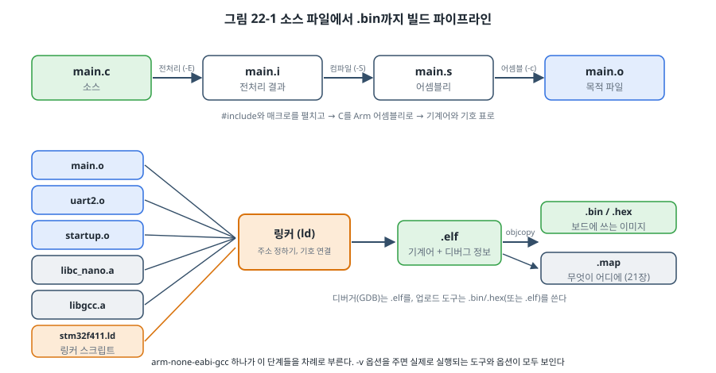
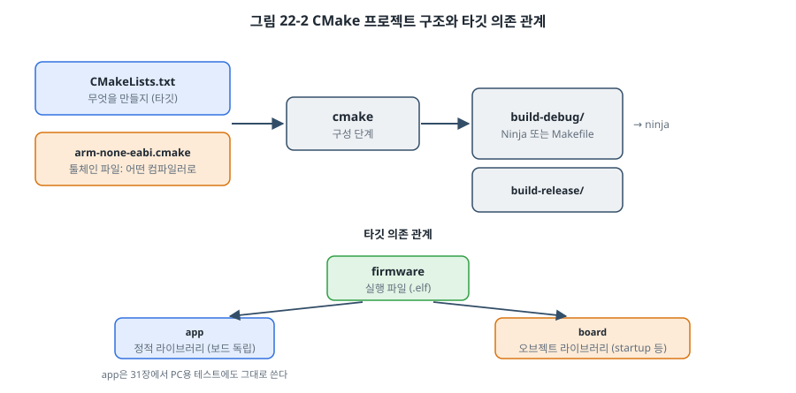

# 22장. 빌드 시스템과 크로스 컴파일

## 이 장에서 배우는 것

- 전처리, 컴파일, 어셈블, 링크의 네 단계와 각 단계의 결과물
- 임베디드에서 자주 쓰는 GCC 옵션의 의미
- Make의 원리와 헤더 의존성 추적
- CMake와 툴체인 파일로 크로스 컴파일 프로젝트를 구성하는 방법
- 디버그 빌드와 릴리스 빌드, 버전 정보 넣기, 재현 가능한 빌드
- 바이너리 크기를 분석하고 줄이는 방법

---

## 22.1 버튼 하나 뒤의 일

5장에서 `make` 한 번이면 펌웨어가 만들어졌고, 21장에서 링커 스크립트가 무엇을 하는지 봤습니다. 이 장에서는 그 사이를 채웁니다. 소스 파일이 어떤 단계를 거쳐 `.bin`이 되는지, 컴파일러 옵션 하나하나가 무엇을 바꾸는지, 파일이 수백 개로 늘어나도 빠르고 정확하게 빌드하려면 무엇이 필요한지.

빌드 시스템은 지루해 보이지만, 실무에서는 생각보다 많은 문제가 여기서 생깁니다. "내 PC에서는 되는데 동료 PC에서는 안 된다", "헤더를 고쳤는데 반영이 안 된다", "릴리스 빌드에서만 버그가 난다", "지난달에 배포한 펌웨어를 똑같이 다시 만들 수 없다". 이 장의 내용은 이런 문제를 예방하는 기술입니다.

## 22.2 빌드의 네 단계

`arm-none-eabi-gcc`는 사실 여러 도구를 차례로 부르는 지휘자입니다.



| 단계 | 하는 일 | 결과 | 직접 해 보기 |
| --- | --- | --- | --- |
| 전처리 | `#include` 붙여 넣기, `#define` 펼치기, `#if` 고르기 | `.i` (C 코드) | `gcc -E main.c -o main.i` |
| 컴파일 | C를 어셈블리로 번역, 최적화 | `.s` (어셈블리) | `gcc -S main.c` |
| 어셈블 | 어셈블리를 기계어로, 기호 표 만들기 | `.o` (목적 파일) | `gcc -c main.c` |
| 링크 | 목적 파일과 라이브러리를 합치고 주소 정하기 | `.elf` | `gcc main.o uart.o -T x.ld -o fw.elf` |

각 단계의 결과물을 직접 열어 보면 많은 것을 배울 수 있습니다.

- **`.i` 파일**에서는 매크로가 실제로 어떻게 펼쳐졌는지 보입니다. 4장의 `SET_BIT(reg, n)` 같은 매크로가 이상하게 동작할 때 확인합니다. `stm32f411_regs.h` 하나를 포함한 작은 파일도 수백 줄이 됩니다.
- **`.s` 파일**에서는 컴파일러가 만든 명령이 보입니다. 4장에서 `volatile`이 없을 때 루프가 사라지는 것을 확인할 때 이 방법을 썼습니다.
- **`.o` 파일**은 `arm-none-eabi-objdump -d`로 역어셈블하고, `arm-none-eabi-nm`으로 기호를 볼 수 있습니다. 아직 주소가 정해지지 않아 함수 호출 자리는 비어 있고, 대신 "여기에 `uart2_putc`의 주소를 넣어 달라"는 **재배치(relocation)** 정보가 들어 있습니다. 링커가 그 자리를 채웁니다.

`gcc`에 `-v` 옵션을 주면 각 단계에서 실제로 실행되는 프로그램(`cc1`, `as`, `collect2`/`ld`)과 옵션이 모두 출력됩니다. 툴체인이 기본으로 넣는 라이브러리나 시작 파일이 궁금할 때 확인하세요.

> 🔍 깊이 보기: 링커는 라이브러리(`.a`)를 다룰 때 독특하게 동작합니다. `.a`는 목적 파일 여러 개를 묶은 보관 파일인데, 링커는 그중 **지금까지 해결되지 않은 기호를 정의하는 파일만** 꺼내 씁니다. 그래서 링크 명령에서 라이브러리의 순서가 중요하고, 아무도 부르지 않는 함수만 든 파일은 들어오지 않습니다. 21장의 벡터 테이블처럼 "참조되지 않지만 꼭 필요한" 것을 라이브러리에 넣으면 빠져 버리는 이유입니다. 이 장의 CMake 예제가 스타트업 코드를 정적 라이브러리가 아니라 오브젝트 라이브러리로 묶은 것도 그 때문입니다.

## 22.3 GCC 옵션

이 책의 공통 Makefile(`code/common/stm32f411/stm32.mk`)이 쓰는 옵션을 분류해 보겠습니다.

### 타깃 옵션

```
-mcpu=cortex-m4 -mthumb -mfpu=fpv4-sp-d16 -mfloat-abi=hard
```

어떤 CPU용 코드를 만들지 정합니다. `-mfloat-abi`에는 세 가지가 있습니다.

| 값 | FPU 명령 | float 인자 전달 | 쓰임 |
| --- | --- | --- | --- |
| `soft` | 쓰지 않음 (소프트웨어 계산) | 정수 레지스터 | FPU 없는 칩 |
| `softfp` | 씀 | 정수 레지스터 | FPU 있지만 soft ABI 라이브러리와 섞어야 할 때 |
| `hard` | 씀 | FPU 레지스터 | FPU 있는 칩의 기본 |

**모든 목적 파일과 라이브러리가 같은 ABI여야** 링크됩니다. 미리 빌드된 라이브러리(예: 제조사가 바이너리로만 주는 무선 스택)를 쓸 때 "uses VFP register arguments" 같은 링크 오류가 나면 이 설정이 서로 다른 것입니다.

### 최적화

| 옵션 | 의미 | 쓰임 |
| --- | --- | --- |
| `-O0` | 최적화 없음 | 디버거에서 모든 변수가 보임. 코드가 크고 느림 |
| `-Og` | 디버깅을 해치지 않는 최적화 | 개발 중 기본 (이 책의 STM32 예제) |
| `-O2` | 속도 위주 최적화 | 성능이 중요한 코드 |
| `-Os` | 크기 위주 최적화 | Flash가 작은 MCU의 릴리스 빌드 (이 책의 AVR 예제) |
| `-O3` | 공격적인 속도 최적화 | 코드가 커질 수 있음 |

최적화 수준을 바꾸면 **숨어 있던 버그가 드러나기도** 합니다. `volatile`이 빠진 변수(4장), 초기화하지 않은 지역 변수, 정의되지 않은 동작(4장의 `1 << 31`)은 `-O0`에서는 우연히 맞게 동작하다가 `-O2`에서 갑자기 틀립니다. "릴리스 빌드에서만 버그가 난다"면 컴파일러 버그가 아니라 이런 코드 버그일 가능성이 압도적으로 높습니다. 그래서 개발 중에도 가끔 릴리스 옵션으로 빌드해 시험하는 것이 좋습니다.

### 경고

```
-Wall -Wextra
```

이 둘은 기본으로 켭니다. 4장에서 부호 비교 경고가 실제 함정을 잡아 주는 것을 봤습니다. 더 엄격하게 하려면 `-Wshadow`(바깥 변수를 가리는 지역 변수), `-Wconversion`(값이 잘릴 수 있는 형 변환), `-Wdouble-promotion`(`float`가 `double`로 바뀌어 FPU가 아니라 소프트웨어 계산이 되는 경우)을 더합니다. 팀 프로젝트라면 `-Werror`로 경고를 오류로 바꿔 경고가 쌓이지 않게 합니다. 35장의 정적 분석이 이 연장선에 있습니다.

### 크기 줄이기

```
-ffunction-sections -fdata-sections   (컴파일)
-Wl,--gc-sections                     (링크)
```

함수와 변수를 각각 별도 섹션에 넣고(21장의 `.text.main`처럼), 링커가 어디서도 참조하지 않는 섹션을 버리게 합니다. 라이브러리 모듈에 함수가 열 개 있어도 하나만 쓰면 하나만 들어갑니다. 대부분의 임베디드 프로젝트에서 기본으로 켭니다.

**LTO(Link Time Optimization, `-flto`)** 는 링크할 때 전체 프로그램을 한꺼번에 보고 최적화해서, 파일 사이의 함수 호출을 인라인으로 펼치는 등 더 작고 빠른 코드를 만듭니다. 다만 ISR처럼 "코드에서 부르지 않는" 함수를 버리지 않도록 주의해야 하고, 디버깅이 어려워집니다.

### 디버그 정보

```
-g3
```

디버그 정보(소스 줄 번호, 변수 이름과 위치, 매크로까지)를 `.elf`에 넣습니다. 디버그 정보는 `.elf`에만 들어가고 보드에 올라가는 `.bin`에는 들어가지 않으므로, **릴리스 빌드에서도 켜 두는 것이 좋습니다.** 현장에서 돌아온 크래시 정보(23장, 36장)를 분석하려면 그 펌웨어와 정확히 같은 빌드의 `.elf`가 필요합니다.

## 22.4 Make

**Make**는 "무엇을 만들려면 무엇이 필요하고, 어떻게 만드는가"를 규칙으로 적어 두면, 바뀐 것만 골라 다시 만들어 주는 도구입니다.

```make
build/main.o: main.c
	$(CC) $(CFLAGS) -c -o $@ $<
```

- `build/main.o`가 **목표**, `main.c`가 **의존 파일**입니다.
- Make는 목표 파일이 의존 파일보다 **오래되었으면**(수정 시각 비교) 아래의 명령을 실행합니다.
- `$@`는 목표, `$<`는 첫 번째 의존 파일입니다. 명령 줄은 반드시 탭으로 시작합니다.

이 책의 `stm32.mk`는 **패턴 규칙** `build/%.o: %.c`로 모든 `.c` 파일에 같은 규칙을 적용하고, `vpath`로 소스가 여러 폴더에 흩어져 있어도 찾게 했습니다.

### 헤더 의존성

위 규칙에는 빠진 것이 있습니다. `main.c`가 `stm32f411_regs.h`를 포함하는데, 이 헤더만 고치면 어떻게 될까요? 규칙에는 `main.c`만 의존 파일로 적혀 있으므로 Make는 `main.o`를 다시 만들지 않습니다. 고친 내용이 반영되지 않은 펌웨어가 만들어지고, 원인을 찾느라 시간을 버립니다. 이 장을 쓰면서 이 책의 공통 Makefile도 이 문제를 고쳤습니다.

```make
CFLAGS += -MMD -MP
...
-include $(OBJS:.o=.d)
```

- `-MMD`: 컴파일하면서, 그 소스가 실제로 포함한 헤더 목록을 `.d` 파일에 Make 규칙 형식으로 적어 둡니다. 예: `build/main.o: main.c stm32f411_regs.h uart2.h`.
- `-MP`: 헤더가 지워져도 오류가 나지 않게 빈 규칙을 함께 적습니다.
- `-include`: 그 `.d` 파일들을 Makefile에 포함합니다(처음에는 없으므로 `-`로 오류를 무시).

이제 헤더를 고치면 그 헤더를 포함한 소스만 다시 컴파일됩니다.

> 💡 팁: 빌드가 이상하게 동작하면 `make clean` 후 다시 빌드해 보세요. 그래도 같다면 빌드 시스템 문제가 아닙니다. 반대로 `make clean` 후에만 문제가 사라진다면 의존성이 빠진 것이니 원인을 찾아 고칩니다.

## 22.5 CMake

Make는 단순하고 강력하지만, 프로젝트가 커지면 Makefile을 관리하기가 점점 어려워집니다. 여러 폴더의 라이브러리, 운영체제마다 다른 명령, IDE 지원, PC용 테스트 빌드와 보드용 빌드를 함께 관리하려면 한 단계 위의 도구가 필요합니다. 현재 C/C++ 프로젝트에서 가장 널리 쓰이는 것이 **CMake**입니다. ESP-IDF(5장, 19장), Zephyr(29장), STM32CubeIDE의 새 버전, 그리고 대부분의 오픈소스 라이브러리가 CMake를 씁니다.

CMake는 직접 빌드하지 않고, Ninja나 Make용 **빌드 파일을 생성**합니다.



```bash
cmake -B build-debug -G Ninja -DCMAKE_TOOLCHAIN_FILE=cmake/arm-none-eabi.cmake -DCMAKE_BUILD_TYPE=Debug
cmake --build build-debug
```

첫 줄은 **구성 단계**로, `build-debug` 폴더에 Ninja 빌드 파일을 만듭니다. 둘째 줄이 실제 빌드입니다. 빌드 결과는 모두 `build-debug` 안에 생기고 소스 폴더는 깨끗하게 유지됩니다(소스 밖 빌드). 같은 소스로 `build-release`를 따로 만들 수도 있습니다.

### 툴체인 파일

CMake는 기본적으로 지금 PC를 위한 프로그램을 만들려고 합니다. 크로스 컴파일하려면 **툴체인 파일**로 "다른 시스템을 위한 빌드"라고 알려 줍니다.

```cmake
set(CMAKE_SYSTEM_NAME      Generic)              # 운영체제 없음
set(CMAKE_SYSTEM_PROCESSOR arm)
set(CMAKE_C_COMPILER       arm-none-eabi-gcc)

# 구성 단계의 컴파일러 시험에서 실행 파일을 링크하지 않는다
set(CMAKE_TRY_COMPILE_TARGET_TYPE STATIC_LIBRARY)

set(CPU_FLAGS "-mcpu=cortex-m4 -mthumb -mfpu=fpv4-sp-d16 -mfloat-abi=hard")
set(CMAKE_C_FLAGS_INIT          "${CPU_FLAGS} -ffunction-sections -fdata-sections")
set(CMAKE_EXE_LINKER_FLAGS_INIT "${CPU_FLAGS} -Wl,--gc-sections")
set(CMAKE_C_FLAGS_DEBUG_INIT    "-Og -g3")
set(CMAKE_C_FLAGS_RELEASE_INIT  "-Os -g -DNDEBUG")
```

`CMAKE_TRY_COMPILE_TARGET_TYPE` 줄이 중요합니다. CMake는 구성 단계에서 작은 프로그램을 빌드해 컴파일러가 동작하는지 시험하는데, 링커 스크립트 없이 Arm 실행 파일을 링크하면 실패합니다. 이 줄은 그 시험을 라이브러리 빌드로 바꿔 줍니다. CMake의 기본 릴리스 옵션(`-O3`)은 임베디드에 맞지 않으므로 빌드 종류별 옵션도 툴체인 파일에서 정했습니다.

### 타깃

CMake는 모든 것을 **타깃** 단위로 생각합니다. `code/ch22-cmake/CMakeLists.txt`는 세 타깃을 만듭니다.

```cmake
add_library(app STATIC src/average.c)                     # 보드와 상관없는 코드
target_include_directories(app PUBLIC src)

add_library(board OBJECT ${COMMON}/startup.c ${COMMON}/uart2.c ${COMMON}/syscalls.c)
target_include_directories(board PUBLIC ${COMMON})

add_executable(firmware src/main.c)
target_link_libraries(firmware PRIVATE app board)
target_link_options(firmware PRIVATE -T${COMMON}/stm32f411.ld --specs=nano.specs -nostartfiles)
```

- `app`: 보드와 상관없는 코드(이 예제에서는 9장의 이동 평균을 모듈로 정리한 것). 12장, 15장에서 강조한 "하드웨어와 분리된 코드"를 빌드 시스템에서도 분리해 둔 것입니다. 31장에서 이 라이브러리를 PC용 컴파일러로 빌드해 단위 테스트를 돌립니다.
- `board`: 스타트업, 벡터 테이블, UART처럼 보드에 묶인 코드. 22.2절의 깊이 보기에서 말한 이유로 **오브젝트 라이브러리**로 만들어, 참조되지 않는 벡터 테이블도 빠짐없이 링크되게 했습니다.
- `firmware`: 둘을 링크한 실행 파일.

`target_include_directories(... PUBLIC ...)`의 `PUBLIC`은 "이 라이브러리를 쓰는 타깃도 이 경로를 쓴다"는 뜻입니다. `firmware`가 `board`를 링크하면 `board`의 헤더 경로가 자동으로 따라옵니다. 경로와 옵션이 타깃 사이에서 전파되는 이 구조 덕분에 큰 프로젝트도 정리된 상태를 유지할 수 있습니다.

## 22.6 디버그, 릴리스, 그리고 버전

### 빌드 종류

| 항목 | 디버그 빌드 | 릴리스 빌드 |
| --- | --- | --- |
| 최적화 | `-Og` | `-Os` 또는 `-O2` |
| 디버그 정보 | `-g3` | `-g` (`.elf`에만, 보관) |
| `assert` | 켬 | `-DNDEBUG`로 끔 (또는 다른 처리, 35장) |
| 로그 | 자세히 | 필요한 것만 |
| 쓰임 | 개발, 디버거 | 시험, 배포 |

중요한 원칙은 **시험한 빌드와 배포하는 빌드가 같아야 한다**는 것입니다. 디버그 빌드로 시험하고 릴리스 빌드를 배포하면, 시험하지 않은 바이너리를 내보내는 셈입니다.

### 버전 정보 넣기

현장에서 돌아온 장치가 어떤 펌웨어를 쓰고 있는지 알 수 없다면 문제를 재현할 수 없습니다. 펌웨어에는 반드시 버전을 넣고, 시작할 때 출력하거나 명령으로 물어볼 수 있게 합니다. 이 장의 CMake 예제는 git에서 버전을 가져옵니다.

```cmake
execute_process(COMMAND git describe --tags --always --dirty
                OUTPUT_VARIABLE FW_GIT_VERSION OUTPUT_STRIP_TRAILING_WHITESPACE)
configure_file(src/version.h.in ${CMAKE_CURRENT_BINARY_DIR}/version.h @ONLY)
```

`git describe`는 `v1.2.0-5-g3a1b2c4-dirty`처럼 "가장 가까운 태그, 그 뒤 커밋 수, 커밋 해시, 커밋하지 않은 수정이 있는지"를 알려 줍니다. `-dirty`가 붙은 펌웨어는 정확히 같은 소스를 다시 찾을 수 없으므로 배포해서는 안 됩니다. `configure_file`은 `version.h.in`의 `@FW_GIT_VERSION@`을 실제 값으로 바꾼 헤더를 빌드 폴더에 만듭니다.

```
ch22 firmware v0.3.0-2-g9c1d2e7 (Release)
```

> ⚠️ 주의: 빌드 시각을 넣으려고 `__DATE__`, `__TIME__` 매크로를 쓰는 경우가 많은데, 그러면 같은 소스를 빌드할 때마다 바이너리가 달라집니다. 다음 절의 재현 가능한 빌드를 해치므로, 버전은 git 정보로 표현하는 것이 좋습니다. 이 방식의 한계도 알아 두세요. `execute_process`는 구성 단계에서만 실행되므로, 커밋을 새로 만든 뒤에는 `cmake`를 다시 실행해야 버전이 갱신됩니다. 36장의 CI에서는 매번 새로 구성하므로 문제가 되지 않습니다.

### 재현 가능한 빌드

**재현 가능한 빌드(reproducible build)** 란 같은 소스와 같은 도구로 빌드하면 언제 어디서나 비트 단위로 똑같은 바이너리가 나오는 것입니다. 1년 전에 배포한 펌웨어의 버그를 고쳐야 할 때, 먼저 그 펌웨어를 정확히 다시 만들 수 있어야 고친 부분만 달라졌음을 확신할 수 있습니다. 보안 측면에서도, 배포된 바이너리가 공개된 소스에서 나왔음을 누구나 확인할 수 있게 해 줍니다(33장).

이를 위해 다음을 지킵니다.

- **도구의 버전을 고정합니다.** 컴파일러 버전이 바뀌면 바이너리가 바뀝니다. 팀원과 CI가 같은 버전을 쓰도록 버전을 문서화하거나, 도구를 담은 컨테이너(36장)를 씁니다.
- **외부 라이브러리의 버전을 고정합니다.** 18장의 TinyUSB처럼 태그나 커밋 해시로 받습니다.
- **빌드 시각과 빌드한 컴퓨터의 경로를 바이너리에 넣지 않습니다.** 디버그 정보에는 소스 파일의 절대 경로가 들어가므로, `-ffile-prefix-map=$(PWD)=.` 같은 옵션으로 경로를 상대 경로로 바꿉니다.

## 22.7 바이너리 크기 분석과 줄이기

Flash가 부족해지면 무엇이 공간을 차지하는지부터 봅니다.

```bash
arm-none-eabi-size build-release/firmware.elf
arm-none-eabi-nm --size-sort -S build-release/firmware.elf | tail -20     # 큰 기호 20개
```

`nm --size-sort -S`는 기호를 크기 순으로 보여 주므로, 마지막 몇 줄이 범인입니다. 21장의 맵 파일에서 그 기호가 왜 들어왔는지(누가 참조했는지)를 찾습니다.

흔한 범인과 대책은 다음과 같습니다.

| 범인 | 대책 |
| --- | --- |
| `printf` 계열 (특히 `%f`) | 정수 출력 함수로 바꾸기, 가벼운 printf 구현(예: 오픈소스 tiny printf) 쓰기 |
| 부동소수점 연산 (FPU 없는 칩) | 고정소수점 정수 연산 (34장) |
| `malloc`과 그 의존 함수 | 정적 할당 (25장) |
| 큰 `const` 표 | 크기 줄이기, 계산으로 대체, 압축 |
| 쓰지 않는 코드 | `-ffunction-sections`, `--gc-sections` 확인 |
| 디버그용 로그 문자열 | 릴리스 빌드에서 매크로로 제거 |
| 최적화 수준 | `-Os`, LTO |

크기를 줄일 때도 측정이 먼저입니다. 감으로 고치면 시간만 쓰고 몇 바이트 줄지 않는 경우가 많습니다. 21장의 연습 문제 6번처럼 `printf` 하나를 바꾸는 것이 수십 줄을 다듬는 것보다 효과가 큰 경우가 흔합니다.

---

## 정리

- 빌드는 전처리(.i), 컴파일(.s), 어셈블(.o), 링크(.elf)의 네 단계이며, 각 결과물을 열어 보면 매크로, 최적화, 기호 문제를 진단할 수 있습니다.
- `-mcpu`, `-mfloat-abi`는 모든 목적 파일과 라이브러리에서 같아야 하고, 최적화 수준을 바꾸면 숨은 버그가 드러날 수 있습니다. 경고는 켜 두고, 디버그 정보는 릴리스에서도 .elf에 남깁니다.
- `-ffunction-sections`, `-fdata-sections`, `--gc-sections`로 쓰지 않는 코드를 버립니다.
- Make는 수정 시각으로 다시 만들 것을 고르며, `-MMD -MP`로 헤더 의존성을 추적해야 헤더 수정이 반영됩니다.
- CMake는 툴체인 파일로 크로스 컴파일을 설정하고, 타깃 단위로 라이브러리와 실행 파일을 정의합니다. 참조되지 않는 스타트업 코드는 오브젝트 라이브러리로 링크합니다.
- 펌웨어에 git 버전을 넣고, 시험한 빌드를 배포하며, 도구와 라이브러리 버전을 고정해 재현 가능한 빌드를 만듭니다.
- 크기 문제는 size, nm --size-sort, 맵 파일로 측정한 뒤 큰 것부터 줄입니다.

## 연습 문제

1. 다음 매크로를 쓴 코드를 `gcc -E`로 전처리해서, `SQUARE(a + 1)`이 어떻게 펼쳐지는지 확인하고 문제를 고치세요.
   ```c
   #define SQUARE(x) x * x
   int r = SQUARE(a + 1);
   ```
2. 이 책의 AVR 예제는 `-Os`, STM32 예제는 `-Og`를 씁니다. 각각의 선택 이유를 추측해 보세요. STM32 예제를 `-O2`로 빌드했을 때 text 크기와 GDB로 변수를 볼 때의 차이를 확인하세요.
3. `-MMD -MP`를 지운 Makefile로 빌드한 뒤 `stm32f411_regs.h`의 정의 하나를 바꾸고 다시 `make`를 실행하면 어떻게 되나요? 이것이 위험한 이유를 실제 버그의 예로 설명하세요.
4. `git describe --tags --always --dirty`의 결과가 `a1b2c3d`(태그 없음), `v2.0.0`(태그와 정확히 일치), `v2.0.0-3-ga1b2c3d-dirty`일 때 각각 무엇을 뜻하는지 설명하세요. 이 중 배포해도 되는 빌드는 무엇인가요?
5. 같은 소스를 두 번 빌드해서 `.bin` 파일이 같은지 `sha256sum`으로 확인하세요. 소스에 `__DATE__`를 넣으면 어떻게 되나요? 다른 폴더에서 빌드한 `.elf`도 같은가요?
6. (실습) 이 장의 CMake 예제에 15장의 BMP280 드라이버와 I2C 구현을 추가하세요. 보드 독립 코드(`bmp280.c`)는 `app`에, 보드 의존 코드(`i2c_stm32.c`)는 `board`에 넣어야 합니다. 31장에서 `app`만 PC로 빌드할 수 있는지가 이 구분의 기준입니다.
