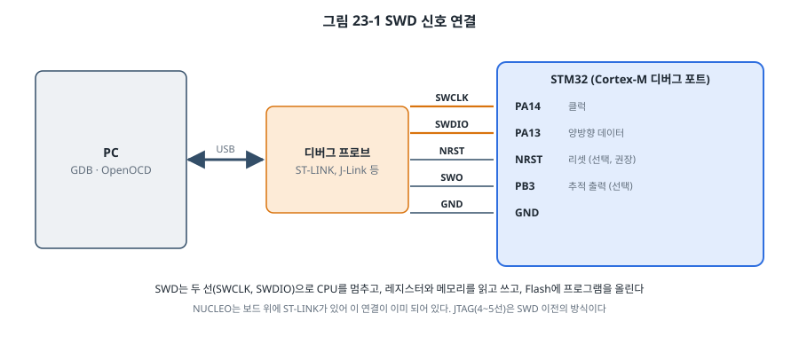
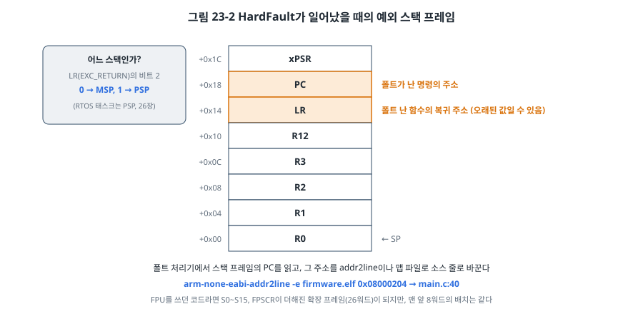
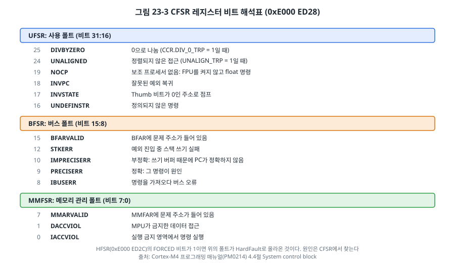
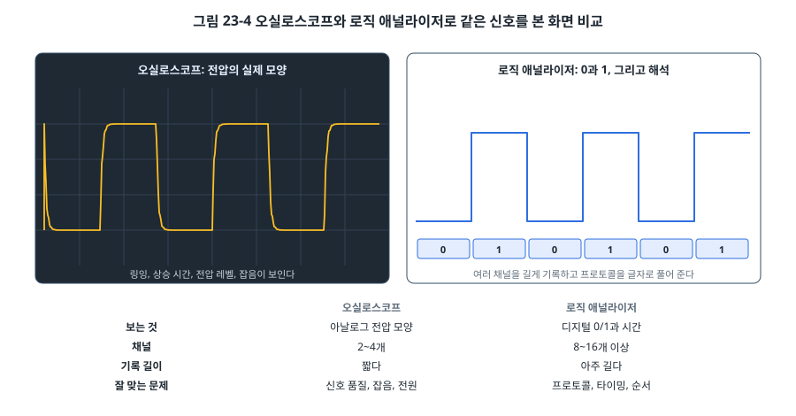

# 23장. 디버깅 기법

## 이 장에서 배우는 것

- 버그를 찾는 체계적인 방법
- SWD와 디버그 프로브, GDB와 OpenOCD를 제대로 쓰는 법: 브레이크포인트, 워치포인트, 메모리 보기
- HardFault가 났을 때 스택 프레임과 CFSR로 원인과 위치를 찾는 방법
- printf 디버깅의 한계와 SWO/ITM, 그리고 GPIO를 이용한 시간 측정
- 오실로스코프와 로직 애널라이저를 언제 쓰는가, AVR에서의 디버깅

---

## 23.1 디버깅은 과학이다

펌웨어 개발 시간의 상당 부분은 코드를 쓰는 시간이 아니라 "왜 안 되지?"를 찾는 시간입니다. 디버깅을 잘하는 사람과 못하는 사람의 차이는 도구를 아느냐보다 **방법**에 있습니다. 잘하는 사람은 과학 실험처럼 진행합니다.

1. **재현한다.** 버그를 확실히 일으키는 조건을 찾습니다. "가끔 멈춘다"는 고칠 수 없지만 "버튼을 누른 채 UART로 명령을 보내면 3초 안에 멈춘다"는 고칠 수 있습니다.
2. **가설을 세운다.** "UART ISR과 버튼 ISR이 같은 변수를 쓰는데 보호가 없다(7장)" 같은 구체적인 원인 후보를 정합니다.
3. **측정해서 확인한다.** 디버거, 로그, 계측기로 가설이 맞는지 확인합니다. 짐작으로 코드를 고치고 "이제 되네" 하고 넘어가는 것이 가장 위험합니다. 진짜 원인이 아니었다면 버그는 숨었다가 나중에 더 나쁜 때에 다시 나타납니다.
4. **범위를 반으로 줄인다.** 원인을 모르겠다면 코드나 조건을 절반씩 빼 가며 범위를 좁힙니다(이진 탐색). 어느 커밋부터 버그가 생겼는지 모를 때는 `git bisect`가 이 일을 해 줍니다.
5. **고친 뒤 원인이 맞았는지 확인한다.** 고치기 전에는 재현되고 고친 뒤에는 재현되지 않는 것을 확인합니다. 가능하면 그 버그를 잡는 시험(31장)을 남깁니다.

임베디드 디버깅이 PC 프로그램보다 어려운 이유는 **보이지 않기 때문**입니다. 화면도 없고, 프로그램을 멈추면 실시간 동작이 달라지고, 버그의 원인이 소프트웨어인지 하드웨어인지도 확실하지 않습니다. 그래서 "보이게 만드는" 도구들이 이 장의 중심입니다.

## 23.2 SWD와 디버그 프로브



Cortex-M 칩에는 **디버그 포트**가 들어 있습니다. 외부의 **디버그 프로브**가 이 포트를 통해 CPU를 멈추고, 레지스터와 메모리를 읽고 쓰고, Flash에 프로그램을 쓸 수 있습니다. 이때 쓰는 연결 방식이 **SWD(Serial Wire Debug)** 로, 선 두 개(SWCLK, SWDIO)면 충분합니다. 그보다 앞선 표준인 **JTAG**은 4~5개의 선을 쓰고, 여러 칩을 사슬처럼 이어 한꺼번에 디버깅하거나 보드 생산 시험(바운더리 스캔)에 씁니다.

STM32F411의 SWD 핀은 PA13(SWDIO)과 PA14(SWCLK)입니다. 4장과 5장에서 이 두 핀의 모드를 바꾸면 디버거 연결이 끊긴다고 경고한 이유가 이것입니다.

디버그 프로브는 여러 종류가 있습니다. NUCLEO 보드에 들어 있는 **ST-LINK**, 여러 제조사 칩을 지원하는 SEGGER의 **J-Link**, Arm이 표준화한 오픈 프로토콜의 **CMSIS-DAP** 프로브(라즈베리 파이 피코로도 만들 수 있음) 등입니다. OpenOCD는 이들 대부분을 지원합니다.

> 💡 팁: 제품 보드를 설계할 때는 SWD 핀(SWDIO, SWCLK, NRST, GND, 그리고 VDD 감지용 전원)을 반드시 커넥터나 테스트 포인트로 꺼내 두세요. 이 핀들이 없으면 현장에서 돌아온 보드를 디버깅할 방법이 없습니다. NRST까지 연결해 두면 5장의 connect under reset으로 SWD 핀을 잘못 건드린 펌웨어도 복구할 수 있습니다.

## 23.3 GDB 제대로 쓰기

5장에서 GDB의 기본 명령을 봤습니다. 여기서는 디버깅 시간을 크게 줄여 주는 기능들을 정리합니다.

### 브레이크포인트

```
(gdb) break uart.c:42                  파일과 줄 번호
(gdb) break uart2_putc                 함수 이름
(gdb) break main.c:57 if count > 100   조건부: count가 100을 넘을 때만 멈춤
(gdb) tbreak main                      한 번만 멈추는 브레이크포인트
(gdb) info breakpoints                 목록
(gdb) delete 2                         2번 지우기
```

브레이크포인트에는 두 종류가 있습니다. RAM에서 실행되는 코드라면 디버거가 그 자리의 명령을 BKPT 명령으로 바꿔치기하는 **소프트웨어 브레이크포인트**를 무제한 쓸 수 있습니다. 그런데 Flash의 코드는 그렇게 바꿀 수 없으므로, CPU 안의 비교기(FPB, Flash Patch and Breakpoint 유닛)를 쓰는 **하드웨어 브레이크포인트**를 씁니다. Cortex-M4의 FPB에는 명령 주소 비교기가 6개 있어서, Flash 코드에는 동시에 6개까지만 브레이크포인트를 걸 수 있습니다. 더 걸려고 하면 "Cannot insert hardware breakpoint" 오류가 납니다.

조건부 브레이크포인트는 편리하지만, 매번 CPU를 멈췄다가 조건을 검사하고 다시 실행하므로 실제 동작이 아주 느려집니다. 시간에 민감한 코드라면 조건을 코드에 넣고(`if (count > 100) { __asm volatile ("bkpt #0"); }`) 그 자리에서 멈추는 방법이 낫습니다.

### 워치포인트

```
(gdb) watch total                      total에 쓰는 순간 멈춤
(gdb) rwatch flags                     읽는 순간 멈춤
(gdb) awatch *(uint32_t *)0x20000100   읽거나 쓰는 순간 멈춤 (주소로)
```

**워치포인트**는 "어떤 코드가 이 변수를 바꾸는가"를 찾는 가장 강력한 도구입니다. 21장에서 경고한 "스택이 넘쳐 전혀 상관없는 전역 변수를 덮어쓰는" 버그를 생각해 보세요. 그 변수에 워치포인트를 걸면, 덮어쓰는 바로 그 명령에서 멈춰 `bt`(호출 경로)로 범인을 볼 수 있습니다. Cortex-M4에는 DWT 유닛의 비교기 4개로 하드웨어 워치포인트를 지원하므로, 실행 속도를 거의 떨어뜨리지 않습니다.

### 메모리와 레지스터 보기

```
(gdb) x/16xw 0x20000000          0x2000 0000부터 32비트 워드 16개를 16진수로
(gdb) x/32xb &rx_buf             rx_buf를 바이트 단위로
(gdb) x/8i $pc                   지금 위치부터 명령 8개 역어셈블
(gdb) p/x *GPIOA                 구조체 전체를 16진수로 (4장의 레지스터 구조체)
(gdb) p/t GPIOA->MODER           2진수로
(gdb) info registers             코어 레지스터
(gdb) display/x ms_ticks         멈출 때마다 자동으로 출력
```

`p/x *GPIOA`처럼 레지스터 구조체를 통째로 찍으면 주변장치 설정을 한눈에 볼 수 있습니다. 5장의 SVD 파일과 VS Code를 쓰면 같은 정보를 비트 이름과 함께 보여 줍니다.

### 호출 경로와 실행 제어

```
(gdb) bt                    호출 경로 (어떤 함수들을 거쳐 여기에 왔는가)
(gdb) frame 2               2단계 위 함수로 가서 그 지역 변수 보기
(gdb) finish                지금 함수가 끝날 때까지 실행
(gdb) until 80              80번 줄까지 실행 (루프 빠져나가기)
(gdb) monitor reset halt    OpenOCD 명령: 칩 리셋 후 멈춤
```

### 최적화된 코드를 디버깅할 때

`-O2`로 빌드한 코드를 한 줄씩 실행하면 실행 순서가 소스와 다르게 뛰어다니고, 변수가 "<optimized out>"으로 나옵니다. 컴파일러가 변수를 레지스터에만 두거나 아예 없앴기 때문입니다. 이 책의 STM32 예제가 `-Og`로 빌드하는 이유입니다. 릴리스 빌드에서만 나타나는 버그라면, 보고 싶은 변수를 잠시 `volatile`로 선언하거나, 의심되는 파일만 `-Og`로 빌드해서 범위를 좁힙니다.

## 23.4 HardFault 분석

Cortex-M에서 프로그램이 잘못된 일을 하면 **폴트(fault)** 예외가 일어납니다. 잘못된 주소 접근, 0으로 나누기, 정의되지 않은 명령, 스택 넘침 등이 원인입니다. 기본 설정에서는 이 폴트들이 모두 **HardFault**로 모이고, 3장의 기본 스타트업이라면 `Default_Handler`의 무한 루프에 갇힙니다. 보드는 그냥 "멈춘" 것처럼 보입니다.

이때 많은 사람이 막막해하지만, Cortex-M은 폴트의 원인과 위치를 친절하게 남겨 둡니다. 읽는 방법만 알면 대부분 몇 분 안에 원인을 찾을 수 있습니다.

### 1단계: 어디서 났는가 (스택 프레임)

7장에서 예외가 일어나면 하드웨어가 레지스터 8개를 스택에 쌓는다고 했습니다. 폴트도 예외이므로 똑같이 쌓이고, 그중 **PC는 폴트가 난 명령의 주소**입니다.



문제는 어느 스택에 쌓였는지입니다. 메인 코드와 ISR은 MSP를, RTOS 태스크는 PSP를 씁니다(26장). 예외에 들어올 때 LR에 들어가는 EXC_RETURN 값의 비트 2가 이것을 알려 줍니다. 그래서 HardFault 처리기의 앞부분은 어셈블리 몇 줄로 올바른 스택 포인터를 골라 C 함수에 넘깁니다.

```c
__attribute__((naked)) void HardFault_Handler(void)
{
    __asm volatile (
        "tst   lr, #4          \n"     /* EXC_RETURN의 비트 2 검사 */
        "ite   eq              \n"
        "mrseq r0, msp         \n"     /* 0이면 MSP */
        "mrsne r0, psp         \n"     /* 1이면 PSP */
        "b     hardfault_report\n"     /* r0 = 스택 프레임 주소를 인자로 */
    );
}

void hardfault_report(uint32_t *sf)    /* sf[0..7] = R0, R1, R2, R3, R12, LR, PC, xPSR */
{
    put_hex("PC   = ", sf[6]);
    put_hex("LR   = ", sf[5]);
    put_hex("CFSR = ", SCB_CFSR);
    ...
}
```

`naked` 속성은 컴파일러가 함수 앞뒤에 스택을 건드리는 코드를 넣지 않게 합니다. 그래야 LR과 스택 포인터가 예외 진입 직후 그대로 남아 있습니다.

이 책의 스타트업은 FPU를 켜 두므로(21.3절), 폴트가 나기 전에 부동소수점 명령을 쓴 코드였다면 하드웨어가 S0~S15와 FPSCR까지 더한 **확장 프레임**(26워드)을 쌓습니다. 그래도 맨 앞 8워드(R0~xPSR)의 배치는 같으므로 이 처리기는 그대로 동작합니다(그림 23-2 아래 설명).

출력된 PC를 **addr2line**으로 소스 줄로 바꿉니다.

```bash
arm-none-eabi-addr2line -f -e build/ch23-debug.elf 0x08000204
main
/home/.../ch23-debug/stm32/main.c:40
```

이를 위해서는 22장에서 말한 대로 **그 펌웨어와 정확히 같은 빌드의 `.elf`** 가 있어야 합니다. 현장 펌웨어의 `.elf`를 보관해야 하는 이유입니다.

### 2단계: 왜 났는가 (CFSR)

시스템 제어 블록의 **CFSR(Configurable Fault Status Register, 0xE000 ED28)** 은 폴트의 종류를 비트로 기록합니다.



CFSR은 세 부분으로 나뉩니다.

- **UFSR(사용 폴트)**: 프로그램이 잘못된 명령이나 상태를 만든 경우. 0으로 나누기(DIVBYZERO, 단 SCB_CCR의 DIV_0_TRP를 켰을 때), Thumb 비트가 없는 주소로 점프(INVSTATE), FPU를 켜지 않고 부동소수점 명령 실행(NOCP).
- **BFSR(버스 폴트)**: 메모리나 주변장치 접근이 버스에서 실패한 경우. 없는 주소 읽기, 클럭이 꺼진 일부 주변장치 접근. BFARVALID가 1이면 **BFAR**에 문제의 주소가 들어 있습니다.
- **MMFSR(메모리 관리 폴트)**: MPU가 막은 접근(25장).

**HFSR**의 FORCED 비트가 1이면, 위의 폴트가 각자의 처리기가 꺼져 있어서 HardFault로 올라온 것입니다. 이 책의 예제처럼 HardFault 하나에서 모두 처리해도 되고, SCB_SHCSR에서 각 폴트 처리기를 켜면 BusFault_Handler, UsageFault_Handler처럼 따로 처리할 수 있습니다.

> 🔍 깊이 보기: 버스 폴트 중 **IMPRECISERR**(부정확한 오류)는 골치 아픕니다. Cortex-M4는 쓰기를 버퍼에 넣고 다음 명령으로 넘어가므로, 쓰기가 실패했다는 것을 알았을 때는 이미 몇 명령 뒤에 있어서 스택 프레임의 PC가 진짜 원인이 아닙니다. 디버깅하는 동안만 보조 제어 레지스터(ACTLR, 0xE000 E008)의 DISDEFWBUF 비트(비트 1)를 1로 해서(`*(volatile uint32_t *)0xE000E008u |= 1u << 1;`) 쓰기 버퍼를 끄면, 같은 버그가 정확한 오류(PRECISERR)로 바뀌어 PC가 원인 명령을 가리킵니다. 성능이 떨어지므로 원인을 찾은 뒤에는 다시 켭니다.

### 흔한 HardFault 원인

| 증상 (CFSR) | 흔한 원인 |
| --- | --- |
| PRECISERR + BFAR = 0x0000 0000 근처 | NULL 포인터(구조체 포인터의 멤버 접근이면 작은 주소) |
| PRECISERR + BFAR = 이상한 큰 주소 | 초기화하지 않은 포인터, 배열 범위 밖 접근 |
| IMPRECISERR | 위와 같지만 쓰기에서 일어남 |
| INVSTATE | 함수 포인터가 망가짐, 벡터 테이블 오류 |
| STKERR, MSTKERR | 스택 넘침 (21장, 25장) |
| UNDEFINSTR | 데이터 영역으로 점프(망가진 복귀 주소), 잘못된 CPU 옵션 |
| NOCP | FPU를 켜지 않음 (스타트업에서 CPACR 설정 필요) |

> ⚠️ 주의: 마지막 줄의 NOCP는 직접 스타트업 코드를 쓸 때 흔히 만나는 함정입니다. Cortex-M4F의 FPU는 리셋 직후 **꺼져 있고**, 코프로세서 접근 제어 레지스터(CPACR, 0xE000 ED88)의 비트 23:20을 1로 해서 켜야 합니다. ST의 CMSIS `SystemInit()`이 이 일을 해 주고, 이 책의 `startup.c`도 리셋 처리기의 첫 줄에서 켭니다(21.3절). 이 줄을 빼고 `float` 연산을 하는 코드를 실행해 보면 NOCP 폴트를 직접 볼 수 있습니다.

## 23.5 printf 디버깅과 그 너머

### printf 디버깅의 한계

UART로 값을 출력하는 것은 가장 쉽고 강력한 디버깅 방법입니다. 하지만 한계를 알고 써야 합니다.

- **느립니다.** 115200 bps에서 40글자를 출력하면 약 3.5 ms가 걸립니다. 출력을 넣는 순간 프로그램의 타이밍이 바뀌어, 타이밍 버그라면 사라지거나(하이젠버그) 새로 생깁니다.
- **ISR에서 쓰면 안 됩니다**(7장). 그런데 버그는 대개 ISR 근처에 있습니다.
- **폴트가 나면 마지막 출력이 사라질 수 있습니다.** 송신 버퍼(14장)에 남은 내용은 폴트로 멈추면 나가지 못합니다. 그래서 이 장의 폴트 처리기는 버퍼 없는 폴링 송신을 씁니다.

### SWO와 ITM

Cortex-M3/M4에는 디버그 프로브로 데이터를 내보내는 전용 통로가 있습니다. **ITM(Instrumentation Trace Macrocell)** 의 자극 포트에 값을 쓰면, 칩이 **SWO(Serial Wire Output)** 핀(STM32F411은 PB3)으로 내보내고 디버그 프로브가 PC로 전달합니다. UART를 쓰지 않으므로 UART 핀이 다른 용도로 바쁠 때도 쓸 수 있고, 하드웨어가 처리해서 UART보다 훨씬 빠릅니다.

```c
#define ITM_STIM0 (*(volatile uint32_t *)0xE0000000u)   /* 자극 포트 0 */
#define ITM_TER   (*(volatile uint32_t *)0xE0000E00u)
#define ITM_TCR   (*(volatile uint32_t *)0xE0000E80u)

static void itm_putc(char c)
{
    if ((ITM_TCR & 1u) && (ITM_TER & 1u)) {           /* ITM과 포트 0이 켜져 있으면 */
        while (ITM_STIM0 == 0) {                       /* 포트가 받을 준비가 될 때까지 */
        }
        *(volatile uint8_t *)&ITM_STIM0 = (uint8_t)c;
    }
}
```

ITM과 SWO의 설정(클럭 분주, 프로토콜)은 보통 디버거가 해 줍니다. OpenOCD에서는 SWO 출력 설정 명령을, STM32CubeIDE에서는 "SWV" 창을 씁니다. NUCLEO의 ST-LINK는 SWO를 지원하며 PB3이 연결되어 있습니다. [확인 필요: OpenOCD 버전별 SWO 설정 명령, NUCLEO의 SWO 솔더 브리지 기본 상태]

### GPIO로 시간 재기

"이 ISR이 얼마나 오래 걸리는가", "이 함수가 얼마나 자주 불리는가"를 알고 싶을 때 가장 정확하고 부담이 적은 방법은 **GPIO 핀을 토글하는 것**입니다.

```c
void TIM2_IRQHandler(void)
{
    GPIOB->BSRR = 1u << 0;            /* PB0 High: ISR 시작 */
    ...
    GPIOB->BSRR = 1u << (0 + 16);     /* PB0 Low: ISR 끝 */
}
```

명령 하나(6장의 BSRR)라 거의 시간을 쓰지 않고, 오실로스코프나 로직 애널라이저로 보면 High 폭이 ISR의 실행 시간, 펄스 간격이 호출 주기입니다. 여러 핀으로 여러 ISR과 태스크를 동시에 보면, 무엇이 무엇을 밀어내는지(12장, 28장)가 눈에 보입니다. 34장의 DWT 사이클 카운터와 함께 가장 많이 쓰는 성능 측정 방법입니다.

## 23.6 계측 장비



소프트웨어 도구로 보이지 않는 문제, 특히 **하드웨어와 맞닿은 문제**는 계측 장비로 봅니다.

**로직 애널라이저**는 여러 신호의 0과 1을 길게 기록하고, I2C, SPI, UART, CAN을 글자로 해석해 줍니다. "MCU가 정말 그 바이트를 보냈는가", "응답이 왔는가", "순서와 간격이 맞는가"를 확인할 때 씁니다. 15장의 I2C에서 이렇게 썼습니다.

**오실로스코프**는 전압의 실제 모양을 보여 줍니다. 신호가 깨끗한가(링잉, 느린 상승), 전원이 안정적인가(순간 전압 강하, 잡음), 레벨이 맞는가(3.3 V와 5 V)를 확인할 때 씁니다. 15장의 풀업 저항 문제, 19장의 Wi-Fi 송신 순간 전압 강하는 로직 애널라이저로는 보이지 않고 오실로스코프로만 보입니다.

원칙은 간단합니다. 프로토콜과 순서가 의심되면 로직 애널라이저, 전기적인 문제가 의심되면 오실로스코프입니다. "가끔" 일어나는 문제라면 두 장비 모두 **트리거**를 잘 쓰는 것이 핵심입니다. 예를 들어 GPIO 하나를 "오류 발생" 표시로 정해, 펌웨어가 오류를 감지하는 순간 그 핀을 올리게 하고 그 에지에서 장비를 트리거하면, 오류 직전의 신호를 붙잡을 수 있습니다. 부록 C에서 장비를 고르고 쓰는 방법을 정리했습니다.

## 23.7 실습: 폴트 일으키고 원인 찾기

`code/ch23-debug/stm32/`의 예제는 시리얼 터미널의 한 글자 명령으로 일부러 폴트를 일으킵니다.

| 명령 | 하는 일 | 기대하는 출력 |
| --- | --- | --- |
| `d` | 0으로 나누기 (DIV_0_TRP를 켜 둠) | DIVBYZERO, FORCED |
| `b` | 0x6000 0000 읽기 (F411에는 외부 메모리가 없음) | PRECISERR, BFARVALID, BFAR = 0x6000 0000 [확인 필요: 보드 실측] |
| `t` | 짝수 주소로 함수 호출 | INVSTATE |
| `s` | 깊은 재귀로 스택 넘침 | 결과를 관찰 |

```
*** HardFault ***
PC   = 0x08000204
LR   = 0x08000211
xPSR = 0x01000000
R0   = 0x00000064
CFSR = 0x02000000
HFSR = 0x40000000
  DIVBYZERO: 0으로 나눔
  (FORCED: 위 폴트가 HardFault로 올라옴)
addr2line -e build/ch23-debug.elf <PC>  로 소스 줄을 찾으세요
```

(`d` 명령의 출력. 주소는 arm-none-eabi-gcc 13.2.1, `-Og` 빌드 기준이며 툴체인과 코드가 바뀌면 달라집니다.) `make line PC=0x08000204`로 PC를 소스 줄로 바꾸면 `main.c:40`, 나눗셈 줄이 나옵니다. R0의 0x64는 방금 받은 명령 글자 `d`의 코드입니다.

`t` 명령에는 함정이 하나 있습니다. INVSTATE 폴트에서 스택 프레임의 PC는 **점프한 목적지**(0x0800 0200)입니다. 이 주소는 우연히 `main` 함수 안이라서 addr2line이 엉뚱하게 나눗셈 줄을 가리킵니다. 잘못된 점프를 **한** 곳을 찾으려면 LR을 봐야 합니다. LR은 `blx` 명령 바로 다음 주소(0x0800 0281)이고, addr2line으로 바꾸면 `main.c:51`, 함수 포인터를 호출한 줄이 나옵니다. "PC가 가리키는 곳에 아무 문제가 없어 보이면 LR을 본다"는 것이 폴트 분석의 중요한 습관입니다.

`s` 명령은 특히 관찰할 만합니다. 스택이 SRAM을 다 써 버리면 어떤 일이 일어날까요? 스택이 `.bss`와 `.data`의 전역 변수를 덮어쓰다가, SRAM의 시작(0x2000 0000) 아래로 내려가는 순간 버스 폴트가 납니다. 그런데 그 폴트를 처리하려고 예외 스택 프레임을 쌓을 공간조차 없으므로 STKERR가 함께 나거나, 처리기가 실행되지도 못하고 잠겨 버릴 수도 있습니다. 25장에서 이런 상황을 일찍 잡아내는 방법을 다룹니다.

## 23.8 AVR 디버깅

ATmega328P에는 SWD가 없습니다. 대신 **debugWIRE**라는 단선 디버그 방식이 있습니다. RESET 핀 하나로 디버거와 통신하는데, 이를 위해 DWEN 퓨즈를 켜면 RESET 핀이 리셋 기능을 잃고 ISP 프로그래밍도 막힙니다. Microchip의 디버거(Atmel-ICE 등)가 필요하고, 우노 보드에서는 리셋 회로의 커패시터 때문에 그대로는 쓸 수 없는 등 제약이 많아 이 책에서는 다루지 않습니다.

ATmega128에는 **JTAG**이 있어서 JTAG 디버거로 브레이크포인트와 메모리 보기를 쓸 수 있습니다. 5장에서 공장 출하 상태의 JTAGEN 퓨즈가 PF4~PF7을 차지한다고 했던 그 기능입니다.

그래서 AVR에서는 다음 방법을 주로 씁니다.

- **UART 출력**(14장): 가장 기본.
- **GPIO 토글과 계측 장비**(23.5절): 타이밍 문제에 가장 효과적.
- **시뮬레이터**: simavr 같은 오픈소스 AVR 시뮬레이터는 GDB를 붙여 레지스터와 메모리를 보며 한 줄씩 실행할 수 있습니다. 주변장치 동작이 실제와 완전히 같지는 않지만 논리 오류를 찾는 데는 충분합니다.
- **PC에서 시험하기**: 15장과 16장에서 드라이버를 보드와 분리해 PC에서 시험한 것처럼, 하드웨어와 상관없는 로직은 PC에서 디버깅하는 것이 가장 빠릅니다(31장).

## 23.9 디버깅 체크리스트

막혔을 때 차례로 확인할 목록입니다.

1. **전원**: 전압이 맞는가? 부하가 걸릴 때 떨어지지 않는가? (2장, 19장)
2. **클럭**: 생각하는 클럭으로 돌고 있는가? 주변장치 클럭은 켰는가? (3장)
3. **핀**: 모드와 대체 기능이 맞는가? 다른 기능과 겹치지 않는가? (6장)
4. **배선**: TX/RX가 엇갈렸는가? GND를 연결했는가? 풀업이 있는가? (14장, 15장)
5. **인터럽트**: NVIC, 주변장치, 전체 허용을 모두 켰는가? 처리기 이름의 철자가 맞는가? 플래그를 지우는가? (7장)
6. **공유 변수**: `volatile`인가? 원자적으로 접근하는가? (4장, 7장)
7. **스택**: 충분한가? 큰 지역 배열이나 재귀가 있는가? (21장, 25장)
8. **최적화**: `-O0`과 `-O2`에서 동작이 다른가? 다르다면 정의되지 않은 동작이나 `volatile` 누락을 의심한다. (4장, 22장)
9. **에라타**: 칩의 에라타 시트에 이 증상이 있는가? (2장)
10. **처음으로 돌아가기**: 마지막으로 잘 동작하던 상태와 지금의 차이는 무엇인가? (`git diff`, `git bisect`)

---

## 정리

- 디버깅은 재현, 가설, 측정, 범위 좁히기, 확인의 순서로 하는 실험입니다. 짐작으로 고치지 않습니다.
- SWD 두 선으로 디버그 프로브가 CPU를 멈추고 메모리를 읽고 씁니다. 제품 보드에도 SWD 핀을 꺼내 둡니다.
- Flash 코드의 브레이크포인트와 워치포인트는 하드웨어 비교기를 써서 개수가 제한됩니다. 워치포인트는 메모리를 덮어쓰는 범인을 찾는 가장 강력한 도구입니다.
- HardFault가 나면 EXC_RETURN으로 스택을 고르고, 스택 프레임의 PC를 addr2line으로 소스 줄로 바꾸고, CFSR로 원인을 읽습니다. BFAR, MMFAR에 문제 주소가 남기도 합니다.
- printf는 타이밍을 바꾸고 ISR에서 쓸 수 없습니다. ITM/SWO, GPIO 토글과 계측 장비를 함께 씁니다.
- 프로토콜과 순서는 로직 애널라이저, 전기적 문제는 오실로스코프로 봅니다.

## 연습 문제

1. 어떤 장치가 "하루에 한두 번 멈춘다"고 합니다. 이 버그를 재현 가능한 상태로 만들기 위해 어떤 정보를 모으고 어떤 실험을 하겠습니까? 장치가 멈춘 순간의 정보를 남기는 방법도 생각해 보세요.
2. 전역 변수 `config.threshold`가 가끔 엉뚱한 값으로 바뀝니다. 코드 어디에서도 이 변수에 직접 쓰지 않습니다. GDB로 범인을 찾는 방법을 설명하고, 가능한 원인 세 가지를 쓰세요.
3. 폴트 처리기의 출력이 `CFSR = 0x00008200, BFAR = 0x00000008`이었습니다. 무슨 일이 일어났는지 해석하고, 소스 코드에서 어떤 모양의 버그를 찾아야 할지 추측하세요.
4. `CFSR = 0x00000400`(IMPRECISERR)이 나왔는데 PC가 가리키는 줄에는 아무 문제가 없어 보입니다. 원인을 찾기 위해 무엇을 해야 하나요?
5. 115200 bps UART로 ISR 안에서 `printf("x=%d\n", x)`(약 8글자)를 출력하면 그 ISR은 최소 얼마나 걸리나요? 같은 정보를 시간 영향 없이 얻는 방법 두 가지를 제시하세요.
6. (실습) 예제에 SCB_SHCSR로 UsageFault와 BusFault 처리기를 켜고, `UsageFault_Handler`와 `BusFault_Handler`를 따로 만들어 보세요. `d`와 `b` 명령을 실행했을 때 어느 처리기로 들어가는지, HFSR의 FORCED 비트는 어떻게 되는지 확인하세요.
