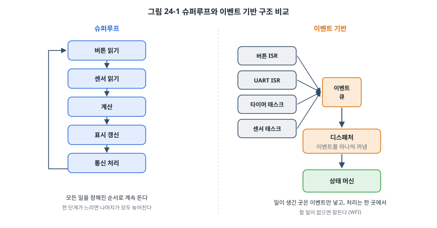
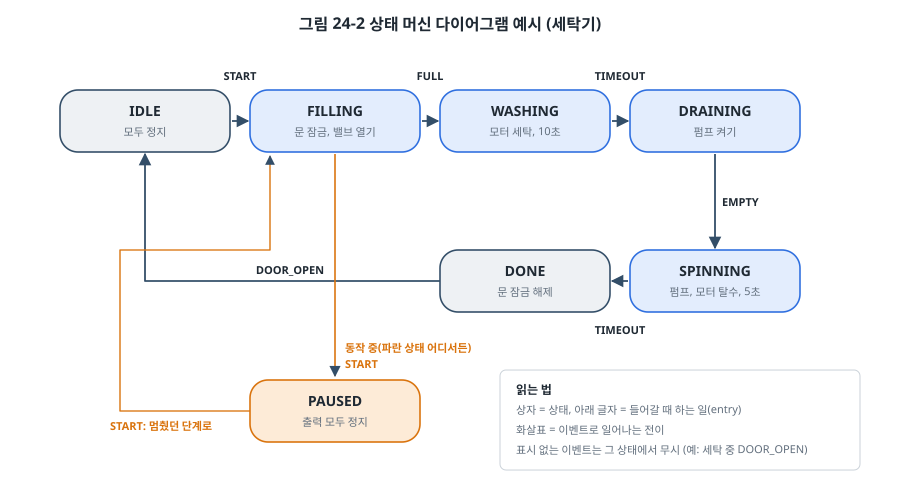
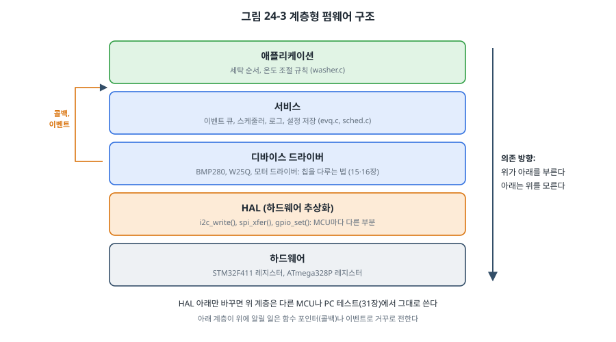

# 24장. 펌웨어 아키텍처

## 이 장에서 배우는 것

- 슈퍼루프의 장점과 한계, 그리고 협력형 스케줄러로 넘어가는 방법
- 유한 상태 머신으로 복잡한 동작 순서를 버그 없이 표현하는 방법
- 인터럽트와 메인 코드를 이벤트 큐로 연결하는 이벤트 기반 설계
- 계층 구조, 의존성 방향, 하드웨어 추상화 계층(HAL)
- 오래 쓸 수 있는 모듈 인터페이스를 설계하는 원칙

---

## 24.1 왜 구조가 필요한가

지금까지의 예제는 한 장에 한 가지 기능만 다뤘습니다. 버튼으로 LED를 켜고, 온도를 읽고, UART로 보냈습니다. 그런데 실제 제품은 이것들을 **동시에** 해야 합니다. 버튼을 보면서, 1초마다 센서를 읽고, 화면을 갱신하고, 통신 명령에 답하고, 오류가 나면 안전하게 멈춰야 합니다.

이 모든 것을 `main()` 하나에 이어 붙이면 처음에는 동작합니다. 하지만 기능이 열 개쯤 되면 한 곳을 고칠 때 다른 곳이 망가지고, 타이밍이 서로 얽혀서 "버튼이 가끔 안 먹는다" 같은 버그가 생기고, 다른 MCU로 옮기려면 처음부터 다시 써야 합니다.

**펌웨어 아키텍처**는 이 문제에 대한 답입니다. 코드를 어떤 단위로 나누고, 그 단위들이 언제 실행되며, 서로 어떻게 정보를 주고받는지를 정하는 것입니다. 이 장에서는 RTOS(26장) 없이도 쓸 수 있는 구조들을 단순한 것부터 차례로 봅니다. 대부분의 소형 제품은 이 장의 구조만으로 충분하고, RTOS를 쓰더라도 각 태스크 안은 이 장의 방법으로 짭니다.

## 24.2 슈퍼루프

가장 단순한 구조는 지금까지 써 온 **슈퍼루프(super loop)** 입니다.

```c
int main(void)
{
    init_all();
    for (;;) {
        read_buttons();
        read_sensors();
        update_control();
        update_display();
        handle_uart();
    }
}
```



슈퍼루프는 이해하기 쉽고, 실행 순서가 항상 같아서 예측 가능하고, 메모리를 거의 쓰지 않습니다. 하지만 근본적인 약점이 있습니다. **루프 한 바퀴의 시간이 모든 기능의 반응 시간을 결정합니다.** `update_display()`가 SPI로 화면 전체를 다시 그리느라 30 ms가 걸린다면, 버튼은 30 ms에 한 번밖에 읽히지 않고 UART 수신 버퍼는 그동안 넘칠 수 있습니다.

7장에서 이 문제를 일부 해결했습니다. 시간에 민감한 일(문자 수신, 에지 감지)은 ISR이 처리하고 플래그나 링 버퍼로 메인에 넘기는 방식입니다. 이것을 **전경/배경(foreground/background) 구조**라고 부르기도 합니다. ISR이 전경, 슈퍼루프가 배경입니다. 이 방식만으로도 많은 제품이 동작합니다.

남은 문제는 "모든 일을 매 바퀴 할 필요가 없다"는 것입니다. 센서는 1초에 한 번, 화면은 100 ms에 한 번, 버튼은 10 ms에 한 번이면 충분합니다. 매 바퀴 모두 하면 CPU와 전력을 낭비하고, 주기가 루프 속도에 따라 들쭉날쭉해집니다.

## 24.3 협력형 스케줄러

각 일을 **정해진 주기마다** 부르도록 바꾼 것이 **협력형 스케줄러(cooperative scheduler)** 입니다. 일 하나를 **태스크**라고 부르고, 표로 관리합니다.

```c
typedef struct {
    const char *name;
    void      (*fn)(void);
    uint32_t    period_ms;
    uint32_t    next_ms;        /* 다음 실행 시각 */
    uint32_t    max_us;         /* 가장 오래 걸린 실행 시간 (측정용) */
} task_t;

static task_t tasks[] = {
    { "plant", plant_task, 100, 0, 0 },
    { "timer", timer_task,  10, 0, 0 },
    { "uart ", uart_task,   10, 0, 0 },
    { "led  ", led_task,   100, 0, 0 },
};
```

스케줄러는 표를 돌며 시각이 된 태스크를 부릅니다.

```c
void sched_run_due(task_t *tasks, size_t n, uint32_t now_ms)
{
    for (size_t i = 0; i < n; i++) {
        task_t *t = &tasks[i];
        if (!time_reached(now_ms, t->next_ms)) {
            continue;
        }
        t->next_ms += t->period_ms;
        if (time_reached(now_ms, t->next_ms)) {
            t->next_ms = now_ms + t->period_ms;   /* 한 주기 이상 밀렸으면 다시 맞춘다 */
        }
        uint32_t start = port_us();
        t->fn();
        uint32_t used = port_us() - start;
        if (used > t->max_us) {
            t->max_us = used;
        }
    }
}
```

세 가지를 눈여겨보세요.

첫째, 다음 실행 시각을 `now + period`가 아니라 `next + period`로 정합니다. 태스크가 2 ms 늦게 불렸어도 다음 실행은 원래 일정대로 돌아오므로, 오래 돌려도 주기가 조금씩 밀리지 않습니다. 다만 한 주기 이상 밀렸을 때는 놓친 횟수만큼 연달아 부르지 않고 지금부터 다시 맞춥니다.

둘째, 시각 비교에 `time_reached()`를 씁니다.

```c
static inline bool time_reached(uint32_t now, uint32_t deadline)
{
    return (int32_t)(now - deadline) >= 0;
}
```

32비트 ms 카운터는 약 49.7일 뒤 넘쳐서 0으로 돌아갑니다. `now >= deadline`으로 비교하면 그 순간 deadline이 0xFFFF FFF0이고 now가 5인 경우를 "아직 안 됨"으로 판단해서, 장치가 49일째에 멈춥니다. 두 값의 **차이**를 부호 있는 수로 보면, 두 시각이 2^31 ms(약 24.8일) 이내로 떨어져 있는 한 넘침과 상관없이 맞게 비교됩니다. 실제 제품에서 "한 달 넘게 켜 두면 멈춘다"는 버그의 흔한 원인이므로 꼭 이 형태를 쓰세요. 8장에서 경과 시간을 `now - last`처럼 뺄셈으로 비교한 것과 같은 원리입니다.

셋째, 각 태스크의 최대 실행 시간을 잽니다. 협력형 스케줄러의 유일하고 가장 중요한 규칙 때문입니다.

> ⚠️ 주의: 협력형 스케줄러에서 태스크는 **스스로 빨리 돌아와야** 합니다. 한 태스크가 `delay_ms(500)`을 부르거나 UART 송신 완료를 `while`로 기다리면, 그동안 다른 모든 태스크가 멈춥니다. 다른 태스크를 끼어들게 할 방법이 없으므로(그래서 "협력형"입니다), 모든 태스크가 오래 걸리지 않겠다고 협력해야 동작합니다. 오래 걸리는 일은 여러 번에 나눠서 하거나(다음 절의 상태 머신), DMA(10장)나 인터럽트에 맡깁니다. 가장 긴 태스크의 실행 시간이 다른 태스크가 늦어질 수 있는 최대 시간이므로, `max_us` 같은 측정값을 개발 중에 늘 확인하세요.

협력형 스케줄러의 큰 장점은 **태스크끼리는 서로 끼어들지 않는다**는 것입니다. 태스크 A가 실행되는 도중에 태스크 B가 실행되는 일은 없으므로, 태스크끼리 공유하는 변수는 보호할 필요가 없습니다(ISR과 공유하는 변수만 7장처럼 보호합니다). RTOS의 선점형 스케줄링(26장)에서는 이 편리함이 사라지고 27장의 동기화 도구가 필요해집니다.

## 24.4 유한 상태 머신

"오래 걸리는 일을 나눠서 한다"는 것은 실제로 어떻게 할까요? 세탁기를 예로 들어 봅시다. 세탁 과정은 물 받기, 세탁 10초, 배수, 탈수 5초 순서로 진행됩니다. 이것을 그대로 코드로 옮기면 이렇게 됩니다.

```c
void wash_cycle(void)            /* 이렇게 쓰면 안 된다 */
{
    valve_on();
    while (!water_full()) { }    /* 물이 찰 때까지 기다림 */
    valve_off();
    motor_wash();
    delay_ms(10000);
    ...
}
```

이 함수가 도는 동안은 아무것도 할 수 없습니다. 일시정지 버튼도, 화면도, 통신도 멈춥니다. 해결책은 "지금 어느 단계에 있는가"를 변수에 기억해 두고, 불릴 때마다 그 단계에서 할 일만 하고 바로 돌아오는 것입니다. 이것이 **유한 상태 머신(FSM, Finite State Machine)** 입니다.



상태 머신은 세 가지로 이루어집니다.

- **상태(state)**: 지금 어느 단계인가. IDLE, FILLING, WASHING 등.
- **이벤트(event)**: 일어난 일. 버튼이 눌림(START), 물이 다 참(FULL), 타이머 끝(TIMEOUT).
- **전이(transition)**: 어떤 상태에서 어떤 이벤트가 오면 어느 상태로 가는가.

그리고 상태에 들어갈 때 하는 일(**entry 동작**)과 나갈 때 하는 일(**exit 동작**)을 정해 두면 코드가 깔끔해집니다. 예를 들어 WASHING에 들어갈 때 모터를 켜고 10초 타이머를 시작하고, 나갈 때 모터를 끄고 타이머를 멈춥니다. 그러면 WASHING을 **어떤 이유로 떠나든**(정상 종료든 일시정지든) 모터가 반드시 꺼집니다. 출력 끄기를 전이마다 따로 쓰다가 한 곳에서 빠뜨리는 버그가 구조적으로 사라집니다.

`code/ch24-architecture/app/washer.c`의 핵심은 다음과 같습니다.

```c
void washer_dispatch(washer_t *w, event_t ev)
{
    washer_state_t next = w->state;

    /* 동작 중 어느 단계에서든 START는 일시정지 */
    if (is_running(w->state) && ev == EV_START) {
        w->resume = w->state;
        next = WS_PAUSED;
    } else {
        switch (w->state) {
        case WS_IDLE:
            if (ev == EV_START) next = WS_FILLING;
            break;
        case WS_FILLING:
            if (ev == EV_FULL) next = WS_WASHING;
            break;
        case WS_WASHING:
            if (ev == EV_TIMEOUT) next = WS_DRAINING;
            break;
        ...
        case WS_PAUSED:
            if (ev == EV_START) next = w->resume;
            break;
        }
    }

    if (next != w->state) {        /* 전이가 일어날 때만 exit → entry */
        on_exit(w, w->state);
        w->state = next;
        on_entry(w, next);
    }
}
```

전이 규칙이 한 함수의 `switch` 한 곳에 모여 있어서, 그림 24-2와 한 줄씩 대조해 볼 수 있습니다. 그림에 없는 이벤트(예: 세탁 중의 DOOR_OPEN)는 아무 일도 일으키지 않습니다. 문이 잠겨 있으니 열릴 수 없다는 규칙이 코드로 자연스럽게 표현됩니다.

> 💡 팁: 상태 머신을 코드로 쓰기 **전에** 그림 24-2 같은 다이어그램을 먼저 그리세요. 그리면서 "일시정지 중에 문을 열면?", "물이 차는 중에 정전이 되었다 돌아오면?" 같은 질문이 저절로 떠오릅니다. 다이어그램에서 모든 상태와 이벤트의 조합을 검토하는 것은 코드에서 찾는 것보다 훨씬 쉽습니다. 이 다이어그램은 그대로 설계 문서이자 시험 항목이 됩니다.

### switch 방식과 표 방식

위 코드는 `switch`로 상태를 나눴습니다. 상태와 이벤트가 많아지면 **상태 전이 표**로 쓰는 방법도 있습니다.

```c
typedef struct {
    washer_state_t from;
    event_t        ev;
    washer_state_t to;
} transition_t;

static const transition_t table[] = {
    { WS_IDLE,     EV_START,     WS_FILLING  },
    { WS_FILLING,  EV_FULL,      WS_WASHING  },
    { WS_WASHING,  EV_TIMEOUT,   WS_DRAINING },
    ...
};
```

표 방식은 규칙이 데이터라서 한눈에 보이고 `const`로 Flash에 놓입니다. 반면 "되돌아갈 상태를 기억한다"나 "조건을 보고 갈 곳을 정한다(가드 조건)" 같은 예외적인 규칙을 넣기가 불편합니다. 상태가 열 개 안쪽이면 `switch`, 그보다 많고 규칙이 규칙적이면 표 방식이 대개 낫습니다. 더 복잡한 경우에는 상태 안에 상태를 두는 **계층형 상태 머신**(UML 상태도, QP 프레임워크 등)을 씁니다.

### 상태 머신은 어디에나 있다

이 책에서 이미 여러 번 상태 머신을 만났습니다. 7장의 디바운싱은 "대기, 확인 중, 눌림"의 세 상태로 볼 수 있고, 15장의 I2C 전송은 시작 조건, 주소, 데이터, 정지 조건의 순서를 따르는 상태 머신이며, 17장 CAN의 오류 상태(Error Active, Error Passive, Bus Off)는 칩 안에 들어 있는 상태 머신입니다. 20장에서 다룬 "연결이 끊기면 간격을 늘려 가며 다시 접속한다"는 동작도 연결 시도, 연결됨, 재시도 대기의 상태로 짜는 것이 자연스럽습니다. 통신 프로토콜, 사용자 인터페이스, 전원 관리처럼 "순서와 조건이 있는 동작"은 상태 머신으로 생각하는 습관을 들이면 코드가 단순해집니다.

## 24.5 이벤트 기반 설계

상태 머신에 이벤트를 누가, 어떻게 전달할까요? 버튼은 ISR에서, 물이 찼다는 신호는 센서 태스크에서, 타이머 만료는 타이머 태스크에서 생깁니다. 이들이 `washer_dispatch()`를 직접 부르면 문제가 생깁니다. 특히 ISR에서 부르면 상태 머신 전체가 인터럽트 문맥에서 실행되어, 메인에서 실행 중이던 상태 머신과 충돌합니다.

해결책은 그림 24-1 오른쪽처럼 **이벤트 큐**를 두는 것입니다. 이벤트를 만드는 쪽은 큐에 넣기만 하고, 메인 루프의 **디스패처**가 하나씩 꺼내 상태 머신에 전달합니다.

```c
void EXTI15_10_IRQHandler(void)
{
    if (EXTI->PR & (1u << BUTTON_PIN)) {
        EXTI->PR = 1u << BUTTON_PIN;
        uint32_t now = ms_ticks;
        if (now - button_ms >= DEBOUNCE_MS) {
            button_ms = now;
            evq_put(&events, EV_START);              /* ISR은 이벤트만 넣고 끝 */
        }
    }
}

int main(void)
{
    ...
    for (;;) {
        sched_run_due(tasks, N_TASKS, ms_ticks);

        int ev;
        while ((ev = evq_get(&events)) >= 0) {     /* 쌓인 이벤트를 모두 처리 */
            washer_dispatch(&washer, (event_t)ev);
        }

        wfi();     /* 다음 인터럽트까지 잠든다 */
    }
}
```

이벤트 큐는 14장의 링 버퍼와 같지만, 넣는 쪽이 여러 곳(여러 ISR과 태스크)이라는 점이 다릅니다. 그래서 `evq_put()`은 인터럽트를 잠시 막고 `head`를 갱신합니다(7장의 임계 구역). 꺼내는 쪽은 메인 루프 하나뿐이라 보호하지 않습니다.

이 구조에서 얻는 것은 다음과 같습니다.

- **상태 머신은 항상 메인 문맥에서 한 번에 하나의 이벤트만 처리합니다.** 이벤트 처리 도중에 다른 이벤트가 끼어드는 일이 없으므로(run-to-completion), 상태 머신 안에서는 동시성을 걱정하지 않아도 됩니다.
- **ISR이 아주 짧아집니다.** 이벤트 하나를 넣고 끝납니다.
- **이벤트 순서가 보존됩니다.** 버튼과 센서 이벤트가 거의 동시에 와도 일어난 순서대로 처리됩니다.
- **할 일이 없으면 잠듭니다.** 큐가 비었으면 WFI로 다음 인터럽트까지 CPU를 멈춰 전력을 아낍니다(11장).
- **기록하고 재현하기 쉽습니다.** 디스패처에서 이벤트를 로그로 남기면, 버그가 났을 때 어떤 이벤트 순서가 그 상태를 만들었는지 알 수 있고, 같은 순서를 PC 테스트에 넣어 재현할 수 있습니다(23.1절).

> ⚠️ 주의: 이벤트 큐가 가득 차면 이벤트를 잃습니다. 예제의 `evq_put()`은 버린 개수를 `dropped`에 세어 둡니다. 개발 중에 이 값이 0이 아니라면 큐가 너무 작거나, 디스패처가 너무 늦게 돌거나(긴 태스크), 이벤트를 너무 많이 만드는 것입니다. "버튼을 빨리 누르면 가끔 무시된다"는 버그는 이렇게 찾습니다.

> 🔍 깊이 보기: 이 장의 구조(이벤트 큐 + 실행 완료까지 처리하는 상태 머신)를 체계화한 것을 **액티브 객체(active object)** 패턴이라고 부릅니다. 각 객체가 자기 이벤트 큐와 상태 머신을 갖고, 객체끼리는 이벤트로만 대화합니다. Miro Samek의 QP 프레임워크가 대표적이며, RTOS 위에서 태스크마다 액티브 객체 하나를 두는 식으로도 씁니다. 공유 변수와 잠금 없이 동시성을 다룰 수 있어서 안전이 중요한 분야에서 많이 쓰입니다.

## 24.6 계층 구조와 의존성 방향

이제 코드를 **어떻게 나눌지**를 봅시다. 가장 널리 쓰이는 방법은 그림 24-3처럼 계층으로 나누는 것입니다.



- **애플리케이션**: 제품이 무엇을 하는가. 세탁 순서, 온도 제어 규칙. 제품마다 다릅니다.
- **서비스**: 여러 기능이 공통으로 쓰는 기반. 이벤트 큐, 스케줄러, 로그, 설정 저장, 통신 프로토콜.
- **디바이스 드라이버**: 외부 칩을 다루는 법. 15장의 BMP280, 16장의 W25Q 플래시. 칩마다 다르지만 MCU와는 무관합니다.
- **HAL**: MCU의 주변장치를 다루는 법. `i2c_write()`, `spi_xfer()`, `gpio_set()`. MCU마다 다릅니다.
- **하드웨어**: 레지스터.

계층 구조의 핵심 규칙은 **의존성 방향**입니다. 위 계층은 아래 계층을 부를 수 있지만, 아래 계층은 위 계층을 몰라야 합니다. BMP280 드라이버는 I2C HAL을 부르지만, 세탁기가 있다는 것은 모릅니다. 그래서 같은 드라이버를 온도계(12장)에서도, 세탁기에서도 그대로 씁니다.

그런데 아래 계층이 위에 알려야 할 일도 있습니다. "UART에 문자가 왔다", "변환이 끝났다" 같은 것입니다. 이때 아래 계층이 위 계층의 함수를 직접 부르면 규칙이 깨집니다. 대신 위 계층이 **함수 포인터(콜백)** 를 등록해 두거나, 아래 계층이 **이벤트**를 큐에 넣습니다. 그림 24-3 왼쪽의 주황색 화살표입니다.

### 의존성 역전: 인터페이스를 위에서 정한다

예제의 세탁기 상태 머신은 한 단계 더 나아갑니다. 상태 머신은 밸브, 펌프, 모터가 어느 핀에 붙어 있는지 모를 뿐 아니라, **어떤 함수를 불러야 하는지도** 직접 정하지 않습니다. 대신 자기가 필요한 동작을 구조체로 정의합니다.

```c
typedef struct {
    void (*valve)(bool on);
    void (*pump)(bool on);
    void (*motor)(uint8_t mode);
    void (*door_lock)(bool on);
    void (*timer_start)(uint32_t ms);
    void (*timer_stop)(void);
} washer_io_t;
```

그리고 보드 계층(`stm32/main.c`)이 이 구조체를 실제 함수로 채워서 넘겨 줍니다.

```c
static const washer_io_t board_io = {
    .valve       = io_valve,
    .pump        = io_pump,
    .motor       = io_motor,
    .door_lock   = io_door_lock,
    .timer_start = io_timer_start,
    .timer_stop  = io_timer_stop,
};

washer_init(&washer, &board_io);
```

이것을 **의존성 역전(dependency inversion)** 이라고 합니다. 보통은 위 계층이 아래 계층의 헤더를 포함해 거기에 의존하지만, 여기서는 위 계층(앱)이 인터페이스를 정하고 아래 계층(보드)이 그 인터페이스에 맞춰 구현합니다. 그 결과 `washer.c`는 `stm32f411_regs.h`를 한 번도 포함하지 않습니다.

효과는 바로 나타납니다. `code/ch24-architecture/test/test_washer.c`는 가짜 `washer_io_t`를 만들어 상태 머신을 PC에서 시험합니다.

```c
static bool valve, pump, locked, timer_on;
static uint8_t motor;

static void f_valve(bool on) { valve = on; }
...
static const washer_io_t fake = { f_valve, f_pump, f_motor, f_lock, f_tstart, f_tstop };

washer_dispatch(&w, EV_FULL);
CHECK(w.state == WS_WASHING && !valve && motor == MOTOR_WASH && timer_on);
```

보드를 연결하지 않고도 전이 규칙 전체와 "어떤 상태를 떠나든 모터가 꺼지는가"를 몇 밀리초 만에 확인할 수 있습니다. 31장에서 이 방법을 본격적으로 다룹니다.

> 💡 팁: 함수 포인터를 통한 호출은 직접 호출보다 약간 느리고, 컴파일러가 인라인으로 최적화할 수 없습니다. 대부분은 문제가 되지 않지만, 1 µs가 아까운 ISR 안의 GPIO 토글 같은 곳에는 쓰지 마세요. 그런 곳에는 링크 단계에서 구현을 고르는 방법(같은 이름의 함수를 보드마다 다른 `.c` 파일에 두고 Makefile에서 고르기)이 낫습니다. 15장의 `i2c.h` 하나에 `i2c_avr.c`와 `i2c_stm32.c` 두 구현을 둔 것이 이 방법입니다.

## 24.7 하드웨어 추상화 계층

**HAL(Hardware Abstraction Layer)** 은 MCU마다 다른 부분을 한곳에 모아 같은 함수 이름 뒤에 숨긴 계층입니다. 15장과 16장에서 이미 작은 HAL을 만들었습니다.

```c
/* i2c.h: 드라이버가 보는 인터페이스 */
int i2c_write(uint8_t addr, const uint8_t *data, size_t len);
int i2c_read(uint8_t addr, uint8_t *data, size_t len);
```

BMP280 드라이버는 이 두 함수만 부르므로, 같은 `bmp280.c`가 아두이노 우노와 STM32에서 그대로 동작했습니다.

좋은 HAL을 만드는 원칙은 다음과 같습니다.

- **필요한 만큼만 추상화합니다.** 모든 레지스터 기능을 감싸려 하면 HAL이 레지스터만큼 복잡해집니다. 이 제품의 드라이버가 실제로 쓰는 동작만 함수로 만듭니다.
- **추상화 수준을 맞춥니다.** "I2C 장치에 바이트를 쓴다"는 MCU와 무관한 개념이지만, "DMA 스트림 6을 쓴다"는 STM32만의 개념입니다. 후자가 HAL 인터페이스에 드러나면 다른 MCU로 옮길 수 없습니다.
- **오류를 돌려줍니다.** NACK, 시간 초과처럼 아래에서 일어난 문제를 위에 알릴 길이 있어야 합니다(24.8절).
- **시간 제한을 넣습니다.** HAL 안에서 플래그를 무한정 기다리면 하드웨어 고장 하나가 제품 전체를 멈춥니다(15장의 버스 잠김).

제조사도 HAL을 제공합니다. ST의 STM32Cube HAL과 LL 라이브러리, Microchip의 MCC, Nordic의 nrfx, ESP-IDF의 드라이버 계층 등입니다. 제조사 HAL은 빠르게 시작하기 좋지만, 그 제조사의 MCU 안에서만 이식성이 있고 API가 넓고 무거운 편입니다. 실무에서는 제조사 HAL을 쓰더라도 그 위에 이 절과 같은 **얇은 자체 인터페이스**를 한 겹 두어, 애플리케이션과 드라이버가 제조사 HAL에 직접 묶이지 않게 하는 경우가 많습니다. 칩 공급난으로 MCU를 갑자기 바꿔야 했던 2021~2022년에 이 한 겹이 있던 회사와 없던 회사의 차이가 크게 드러났습니다.

> 🔧 ATmega128에서는: 실습 키트에서 흔히 쓰는 ATmega128로 이 장의 예제를 옮긴다면, `app/`과 `service/`는 그대로 두고 보드 계층만 새로 쓰면 됩니다. SysTick 대신 타이머 0의 비교 일치 인터럽트로 1 ms 틱을 만들고(8장), 버튼은 INT0~INT7 중 하나(7장), 임계 구역은 `SREG`를 저장하고 `cli()` 한 뒤 복원하는 방식(`port.h`)으로 바꿉니다. 단, AVR에서 32비트 `ms_ticks`를 메인에서 읽는 것은 원자적이지 않으므로(4장, 7장) 인터럽트를 잠시 막고 읽는 함수로 감싸야 합니다. `port_us()`는 AVR에 사이클 카운터가 없으므로 타이머 값으로 만들거나 0을 돌려주게 해 두면 됩니다.

## 24.8 모듈 인터페이스 설계

계층을 나눈 뒤에는 각 모듈(보통 `.c`와 `.h` 한 쌍)의 **인터페이스**, 즉 헤더 파일을 잘 설계해야 합니다. 헤더는 모듈이 바깥과 맺는 약속입니다. 구현은 나중에 얼마든지 고칠 수 있지만, 여러 곳에서 쓰기 시작한 인터페이스는 바꾸기 어렵습니다.

**최소한만 공개합니다.** 모듈 밖에서 쓸 필요가 없는 함수와 변수는 모두 `static`으로 선언합니다. 예제의 `on_entry()`, `on_exit()`, `is_running()`은 `washer.c` 안에서만 보입니다. 공개된 것이 적을수록 바꿀 수 있는 것이 많아집니다.

**모듈 이름을 접두사로 씁니다.** C에는 네임스페이스가 없으므로 `washer_init()`, `evq_put()`, `sched_run_due()`처럼 모듈 이름을 앞에 붙여 이름 충돌을 막고, 어느 모듈의 함수인지 바로 알 수 있게 합니다.

**상태를 핸들로 넘깁니다.** 예제는 전역 변수 대신 `washer_t *w`를 받습니다. 그래서 세탁기 두 대(또는 테스트용 여러 개)를 동시에 만들 수 있고, 함수가 무엇을 읽고 바꾸는지 인자만 보고 알 수 있습니다.

**구조체 내부를 숨길 수도 있습니다.** 헤더에 `typedef struct washer washer_t;`만 선언하고 내용은 `.c`에 두면(불투명 타입, opaque type), 사용하는 쪽이 내부 필드를 직접 건드릴 수 없습니다. 다만 그러면 사용하는 쪽에서 `washer_t`를 변수로 만들 수 없어 동적 할당이나 모듈 안의 정적 풀이 필요하므로(25장), 임베디드에서는 예제처럼 구조체를 공개하되 "필드를 직접 건드리지 말 것"을 주석으로 약속하는 경우도 많습니다.

**오류를 일관되게 알립니다.** 함수가 실패할 수 있다면 반환값으로 알리고, 모든 모듈이 같은 규칙을 씁니다. 흔한 규칙은 "0이면 성공, 음수면 오류 코드"입니다.

```c
typedef enum {
    ERR_OK      =  0,
    ERR_TIMEOUT = -1,
    ERR_NACK    = -2,
    ERR_PARAM   = -3,
    ERR_BUSY    = -4,
} err_t;
```

그리고 반환값을 무시하지 않습니다. GCC의 `__attribute__((warn_unused_result))`를 중요한 함수에 붙이면 반환값을 버릴 때 경고가 납니다.

**단위를 이름에 넣습니다.** `timer_start(uint32_t ms)`, `delay_us()`, `temp_centi_c`처럼 단위를 이름에 드러내면 "이게 ms였나 tick이었나" 하는 버그를 막을 수 있습니다. 12장에서 온도를 "섭씨 × 10" 정수로 다루고 그 단위를 인터페이스 주석에 남긴 것도 같은 생각입니다.

**헤더는 혼자 컴파일되어야 합니다.** 헤더가 필요한 다른 헤더(`stdint.h`, `stdbool.h`)를 스스로 포함하고, 인클루드 가드(`#ifndef WASHER_H`)를 둡니다. 헤더를 쓰는 쪽이 포함 순서를 신경 쓰게 만들면 안 됩니다.

## 24.9 실습: 이벤트 기반 세탁기

`code/ch24-architecture/`는 지금까지 본 구조를 모두 담은 예제입니다.

```
ch24-architecture/
├── app/washer.c, washer.h      상태 머신 (하드웨어를 모름)
├── service/evq.c, evq.h        이벤트 큐
├── service/sched.c, sched.h    협력형 스케줄러, 소프트웨어 타이머
├── stm32/main.c, port.h        보드 계층: 핀, 인터럽트, washer_io_t 구현
└── test/test_washer.c, port.h  PC 테스트
```

실제 밸브와 모터 대신 `plant_task()`가 100 ms마다 물높이를 흉내 내며 수위 이벤트(FULL, EMPTY)를 만듭니다. 빌드하고 올린 뒤 시리얼 터미널(115200 bps)을 열고 B1 버튼을 누르거나 `s`를 보내면 다음과 같은 로그가 나옵니다.

```
24장 세탁기: B1 또는 's' 시작/일시정지, 'o' 문 열기, 't' 태스크 시간
1203 ms  door locked
1203 ms  valve on
1203 ms  state FILLING
2210 ms  valve off
2210 ms  motor wash
2210 ms  state WASHING
12210 ms  motor stop
12210 ms  pump on
12210 ms  state DRAINING
...
```

(시각은 예시입니다.) 세탁 중에 다시 버튼을 누르면 PAUSED로 가면서 모터가 멈추고, 다시 누르면 WASHING으로 돌아갑니다. DONE에서 `o`를 보내면 IDLE로 돌아갑니다. LD2는 상태에 따라 꺼짐, 빠른 깜박임, 느린 깜박임, 켜짐으로 바뀝니다. `t`를 보내면 각 태스크의 최대 실행 시간이 나옵니다. `uart` 태스크의 시간은 `t` 명령의 출력 자체 때문에 길게 나오는데, 이것이 바로 "태스크 안에서 폴링 송신으로 많이 출력하면 다른 태스크가 늦어진다"는 실례입니다. 14.8절의 인터럽트 송신 링 버퍼를 쓰면 이 시간이 크게 줄어듭니다.

PC 테스트는 보드 없이 실행됩니다.

```bash
cd code/ch24-architecture/test
make
```

```
all tests passed (0 failures)
```

테스트는 전체 세탁 과정, 일시정지와 재개, 이벤트 큐가 가득 찼을 때의 동작, 스케줄러의 호출 횟수, 그리고 ms 카운터가 0xFFFF FFFF에서 0으로 넘어가는 순간의 타이머 동작을 확인합니다. 마지막 시험은 보드에서 49.7일을 기다려야 확인할 수 있는 버그를 1 ms 만에 확인하는 셈입니다.

> ⚠️ 주의: 이 예제의 일시정지는 단순하게 만들었습니다. PAUSED에서 돌아가면 그 단계를 **처음부터** 다시 하므로, 세탁 8초째에 멈췄다가 재개하면 다시 10초를 셉니다. 실제 제품이라면 남은 시간을 기억해야 하고, 정전 뒤에 이어서 하려면 상태와 남은 시간을 비휘발성 메모리(16장의 SPI 플래시 등)에 저장해야 합니다. 연습 문제 4에서 고쳐 보세요.

---

## 정리

- 슈퍼루프는 단순하지만 가장 느린 일이 모든 반응 시간을 정합니다. 시간에 민감한 일은 ISR에, 나머지는 슈퍼루프에 두는 전경/배경 구조가 기본입니다.
- 협력형 스케줄러는 태스크를 주기마다 부릅니다. 태스크는 빨리 돌아와야 하며, 시각 비교는 `(int32_t)(now - deadline) >= 0`처럼 넘침에 안전한 형태로 씁니다.
- 유한 상태 머신은 오래 걸리는 순서 있는 동작을 짧은 단계로 나눕니다. 다이어그램을 먼저 그리고, entry와 exit 동작으로 출력을 관리합니다.
- 이벤트 큐를 두면 ISR은 이벤트만 넣고, 상태 머신은 메인 문맥에서 한 번에 하나씩 처리합니다. 할 일이 없으면 잠듭니다.
- 계층 구조에서 의존성은 위에서 아래로만 흐르고, 아래에서 위로는 콜백이나 이벤트로 알립니다. 위 계층이 인터페이스를 정하면(의존성 역전) 앱을 PC에서 시험할 수 있습니다.
- HAL은 필요한 만큼만, MCU와 무관한 수준으로 추상화합니다. 모듈 인터페이스는 최소한만 공개하고, 접두사, 핸들, 일관된 오류 코드, 단위가 드러난 이름을 씁니다.

## 연습 문제

1. 슈퍼루프에서 `update_display()`가 30 ms, 나머지가 합쳐 2 ms 걸립니다. 버튼 입력의 최대 반응 지연은 얼마인가요? 협력형 스케줄러로 바꾸면 이 값이 줄어드나요? 줄이려면 `update_display()`를 어떻게 바꿔야 하나요?
2. `now >= deadline`으로 비교하는 타이머 코드가 있습니다. ms 카운터가 넘칠 때 어떤 일이 일어나는지 구체적인 값으로 설명하고, `time_reached()`가 2^31 ms 이상 떨어진 두 시각에서는 왜 틀리는지도 설명하세요.
3. 그림 24-2에 "물이 FILLING 상태에서 3분 안에 차지 않으면 ERROR 상태로 가서 모든 출력을 끄고 LED를 빠르게 깜박인다"는 규칙을 추가하세요. 다이어그램을 고치고, `washer.c`와 테스트를 고쳐 보세요.
4. (실습) 일시정지 뒤 재개할 때 남은 시간부터 이어서 세도록 바꾸세요. `washer_io_t`에 어떤 함수가 더 필요한가요? 테스트도 추가하세요.
5. 예제의 `evq_put()`은 인터럽트를 막고 `head`를 바꿉니다. 이벤트를 넣는 곳이 ISR 한 곳뿐이라면 이 보호가 필요 없는 이유를 14장의 링 버퍼와 비교해 설명하세요. 지금 예제에서는 왜 필요한가요?
6. 15장의 BMP280 드라이버가 `i2c.h`의 함수를 직접 부르는 방식과, `washer_io_t`처럼 함수 포인터 구조체를 받는 방식을 비교하세요. 같은 보드에 BMP280이 두 개(서로 다른 I2C 버스) 달려 있다면 어느 방식이 유리한가요?
