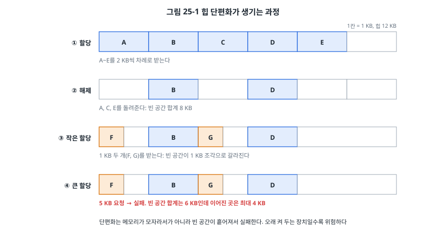
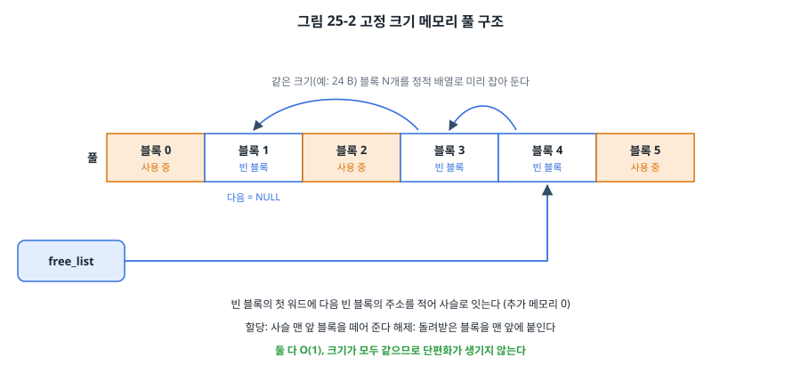
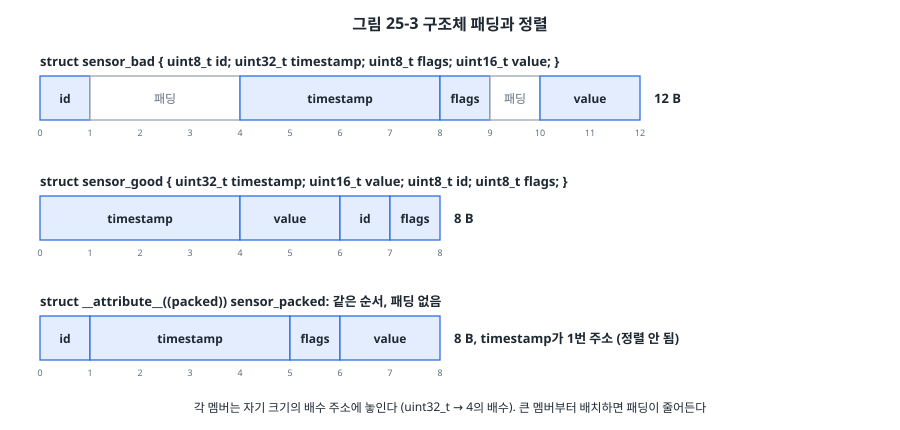

# 25장. 메모리 관리

## 이 장에서 배우는 것

- 정적 할당, 스택, 힙의 차이와 임베디드에서 `malloc`을 조심해야 하는 이유
- 힙 단편화가 생기는 과정과 고정 크기 메모리 풀로 피하는 방법
- 스택 크기를 산정하고, 실제로 얼마나 썼는지 재는 방법
- 스택 오버플로를 일찍 잡아내는 방법: 카나리와 MPU 가드 영역
- 구조체 정렬과 패딩, `packed`의 쓰임과 위험

---

## 25.1 MCU 메모리의 현실

PC 프로그램에서는 메모리를 거의 신경 쓰지 않습니다. 수 GB의 메모리가 있고, 모자라면 운영체제가 디스크로 내보내고(스왑), 프로그램이 끝나면 운영체제가 모두 회수하며, 잘못된 주소에 접근하면 운영체제가 그 프로그램만 종료시킵니다.

MCU에는 이런 안전망이 하나도 없습니다. STM32F411의 SRAM은 128 KB, ATmega328P는 2 KB입니다. 메모리가 모자라면 그냥 모자라고, 펌웨어는 끝나지 않고 몇 달씩 돌며, 스택이 넘쳐 다른 변수를 덮어써도 아무도 알려 주지 않습니다(21장, 23장). 그래서 임베디드 개발자는 **어떤 데이터가 어디에, 얼마나, 언제부터 언제까지** 있는지를 스스로 알고 있어야 합니다.

21장에서 본 SRAM의 배치를 다시 떠올려 봅시다. 아래부터 `.data`, `.bss`, 그 위에 힙이 위로 자라고, 맨 위에서 스택이 아래로 자랍니다. 힙과 스택 사이의 빈 공간이 둘의 여유이고, 둘이 만나는 순간 문제가 생깁니다.

## 25.2 정적 할당과 동적 할당

C 프로그램의 데이터는 세 곳 중 하나에 놓입니다.

| 종류 | 위치 | 언제 생기고 사라지나 | 크기가 정해지는 때 |
| --- | --- | --- | --- |
| 정적 할당 | `.data`, `.bss` | 프로그램 시작부터 끝까지 | 빌드할 때 |
| 자동 변수 | 스택 | 함수에 들어갈 때 생기고 나갈 때 사라짐 | 빌드할 때 (함수마다) |
| 동적 할당 | 힙 | `malloc()`부터 `free()`까지 | 실행 중 |

**정적 할당**은 전역 변수와 `static` 변수입니다. 빌드가 끝나면 `arm-none-eabi-size`(21장)가 정확한 사용량을 알려 주고, 링커가 SRAM을 넘으면 빌드가 실패합니다. 실행 중에 모자랄 일이 없습니다. 가장 안전합니다.

**동적 할당**은 `malloc()`으로 실행 중에 메모리를 받는 것입니다. 필요한 만큼만 쓸 수 있어 유연하지만, 임베디드에서는 다음 문제가 있습니다.

- **실패할 수 있습니다.** `malloc()`이 NULL을 돌려줄 때 어떻게 할 것인가? PC 프로그램처럼 오류 메시지를 내고 끝낼 수 없습니다.
- **단편화**: 빈 메모리가 충분해도 실패할 수 있습니다(25.3절). 그리고 이 실패는 몇 주 동안 잘 돌다가 어느 날 갑자기 일어납니다.
- **실행 시간을 예측하기 어렵습니다.** 빈 블록을 찾는 시간이 힙 상태에 따라 달라집니다. 실시간 제약(28장)이 있는 코드에는 맞지 않습니다.
- **누수**: `free()`를 빠뜨리면 메모리가 조금씩 사라지고, 몇 달 뒤에 장치가 멈춥니다.
- **ISR과 RTOS에서 안전하지 않을 수 있습니다.** newlib의 `malloc`은 기본적으로 인터럽트나 여러 태스크가 동시에 부르는 것을 막아 주지 않습니다.

그래서 안전이 중요한 분야의 코딩 규칙(MISRA C:2012 규칙 21.3 등, 35장)은 동적 할당을 아예 금지합니다. 실무의 흔한 절충은 다음과 같습니다.

> 💡 팁: **"초기화할 때만 할당하고, 절대 해제하지 않는다."** 시작할 때 설정에 따라 버퍼 크기를 정해 `malloc()`으로 받고, 그 뒤로는 `malloc()`과 `free()`를 부르지 않는 방식입니다. 해제하지 않으므로 단편화와 누수가 없고, 시작할 때 실패하면 그 자리에서 바로 알 수 있습니다. 실행 중에 필요한 것은 25.4절의 메모리 풀로 해결합니다. FreeRTOS의 `heap_1`(할당만 하고 해제가 없는 힙)이 이 생각을 구현한 것입니다(26장).

## 25.3 힙 단편화

**단편화(fragmentation)** 는 빈 메모리가 작은 조각들로 흩어져서, 합계는 충분한데 이어진 큰 공간이 없는 상태입니다.



그림 25-1에서 12 KB 힙에 2 KB 블록 다섯 개를 받은 뒤(①) 세 개를 돌려주면 빈 공간이 8 KB입니다(②). 여기에 1 KB 블록 두 개를 받으면 할당기가 빈 칸의 앞부분을 쪼개 쓰므로 1 KB 조각들이 생깁니다(③). 이제 5 KB를 요청하면, 빈 공간은 합계 6 KB인데 가장 큰 이어진 공간이 4 KB라서 실패합니다(④).

크기가 서로 다른 블록을 할당하고 해제하기를 오래 반복하면 이런 일이 쌓입니다. 통신 메시지 크기에 따라 버퍼를 `malloc()`하는 장치가 몇 주 동안 잘 돌다가 어느 날 큰 메시지를 받는 순간 멈추는 식입니다. 테스트 기간에는 거의 나타나지 않아서 특히 위험합니다.

예제의 `f` 명령으로 직접 확인해 볼 수 있습니다. 1 KB 블록으로 힙을 가득 채운 뒤 하나 건너 하나씩 돌려주면, 수십 KB가 비어 있는데도 2 KB 할당이 실패합니다.

```
allocated 118 x 1 KB, then 2 KB: FAILED
freed 59 KB in 1 KB pieces, malloc(2 KB): FAILED (fragmented)
after freeing all, malloc(2 KB): ok
```

(블록 개수는 빌드에 따라 조금 다릅니다. [확인 필요: 보드 실측])  마지막 줄처럼 모두 돌려주면 이웃한 빈 블록들이 합쳐져 다시 큰 할당이 됩니다. 문제는 실제 제품에서는 "모두 돌려주는" 순간이 오지 않는다는 것입니다.

> 🔍 깊이 보기: newlib-nano의 `malloc`은 빈 블록을 연결 리스트로 관리하고, 요청을 만족하는 첫 블록을 쓰는(first-fit) 단순한 할당기입니다. 해제할 때 주소가 이웃한 빈 블록과 합칩니다. 단편화를 줄이려고 크기별로 따로 관리하는 할당기(TLSF 등)도 있습니다. TLSF는 할당과 해제가 항상 일정한 시간에 끝나서 실시간 시스템에서 쓰입니다. 하지만 어떤 할당기도 크기가 다른 블록의 단편화를 완전히 없애지는 못합니다.

## 25.4 메모리 풀

실행 중에 메모리를 받고 돌려줘야 한다면 **고정 크기 메모리 풀(memory pool)** 을 씁니다. 같은 크기의 블록 여러 개를 미리 정적으로 잡아 두고, 빈 블록을 나눠 주고 돌려받습니다.



모든 블록의 크기가 같으므로 어떤 빈 블록이든 어떤 요청에나 맞습니다. 단편화가 원리적으로 생기지 않습니다. 빈 블록은 **free list**로 관리하는데, 빈 블록은 어차피 내용이 필요 없으므로 그 첫 워드에 다음 빈 블록의 주소를 적어 둡니다. 관리용 메모리가 따로 필요 없는 영리한 방법입니다.

`code/ch25-memory/common/pool.c`의 핵심은 몇 줄입니다.

```c
void *pool_alloc(pool_t *p)
{
    void **blk = (void **)p->free_list;
    if (blk == NULL) {
        p->failures++;
        return NULL;
    }
    p->free_list = *blk;             /* 리스트 머리를 다음 빈 블록으로 */
    p->used++;
    if (p->used > p->max_used) {
        p->max_used = p->used;
    }
    return blk;
}

bool pool_free(pool_t *p, void *blk)
{
    uint8_t *b = (uint8_t *)blk;
    size_t span = p->block_size * p->count;
    /* 다른 곳의 포인터나 블록 중간을 가리키는 포인터를 거른다 */
    if (b < p->base || b >= p->base + span || (size_t)(b - p->base) % p->block_size != 0) {
        return false;
    }
    *(void **)blk = p->free_list;
    p->free_list = blk;
    p->used--;
    return true;
}
```

할당과 해제 모두 반복문이 없어 항상 같은 시간에 끝납니다(O(1)). 저장 공간은 정적 배열이므로 빌드할 때 크기가 확정됩니다.

```c
typedef struct {
    uint8_t  type;
    uint16_t len;
    uint8_t  data[20];
} msg_t;

#define N_MSG 8
POOL_STORAGE(msg_mem, sizeof(msg_t), N_MSG);    /* static uint64_t msg_mem[...]: 8바이트 정렬 */
static pool_t msg_pool;

pool_init(&msg_pool, msg_mem, sizeof(msg_t), N_MSG);
msg_t *m = pool_alloc(&msg_pool);
...
pool_free(&msg_pool, m);
```

저장 공간을 `uint64_t` 배열로 잡은 이유는 정렬입니다. `uint8_t` 배열로 잡으면 시작 주소가 4의 배수라는 보장이 없어서, 블록에 `uint32_t`나 `double`을 담을 때 문제가 생길 수 있습니다(25.7절).

풀을 쓸 때 기억할 점이 있습니다.

- **풀 크기를 측정으로 정합니다.** `max_used`는 지금까지 동시에 가장 많이 쓴 블록 수입니다. 최악의 상황(통신 폭주, 모든 기능 동시 동작)을 시험한 뒤 이 값에 여유를 더해 풀 크기를 정합니다. `failures`가 0이 아니라면 풀이 모자랐던 것입니다.
- **크기가 여러 가지라면 풀을 여러 개 둡니다.** 32 B, 128 B, 512 B 풀을 두고 요청 크기에 맞는 가장 작은 풀에서 받습니다. 블록 안에서 조금 낭비되지만(내부 단편화) 예측 가능합니다.
- **ISR이나 다른 태스크와 함께 쓰면 보호합니다.** 이 모듈은 단순함을 위해 보호하지 않았습니다. ISR에서도 쓴다면 24장의 `port_crit_enter()`로 감싼 함수를 따로 둡니다. FreeRTOS를 쓴다면 큐(27장)로 블록 포인터를 주고받는 것이 흔한 방법입니다.
- **돌려준 블록을 계속 쓰면 안 됩니다.** 해제한 블록의 첫 워드는 free list의 연결 정보로 바뀝니다. 해제한 뒤에도 그 포인터로 데이터를 쓰면 free list가 망가져서, 나중에 엉뚱한 주소를 할당해 주는 버그가 됩니다. 해제한 직후 포인터를 NULL로 만드는 습관이 도움이 됩니다.

## 25.5 스택 크기 산정

스택은 힙보다 더 자주 문제를 일으킵니다. 스택은 함수 호출마다 자동으로 쓰이고, 얼마나 쓰는지가 실행 경로에 따라 달라지기 때문입니다. 스택 크기는 다음을 더한 값입니다.

1. 메인 코드에서 **가장 깊은 호출 경로**의 스택 사용량
2. 그 위에 겹칠 수 있는 **ISR의 스택 사용량**. 우선순위가 다른 ISR이 중첩될 수 있으면(7장) 중첩되는 만큼 더합니다.
3. 예외마다 하드웨어가 쌓는 프레임: 기본 32바이트, FPU를 쓰던 중이었다면 확장 프레임 104바이트(23장)
4. 여유분

### 컴파일러에게 묻기

GCC는 함수마다 스택을 얼마나 쓰는지 알려 줍니다.

```bash
arm-none-eabi-gcc ... -fstack-usage -c main.c     # main.su 파일이 생긴다
```

```
main.c:122:17:recurse  72      static
main.c:129:13:cmd_watermark    16      static
main.c:140:13:cmd_fragment     16      static
main.c:186:13:cmd_pool 48      static
```

(arm-none-eabi-gcc 13.2.1, `-Og` 기준. 각 줄은 "파일:줄:열:함수", 바이트 수, 종류가 탭으로 나뉘어 있습니다.) `static`은 크기가 고정이라는 뜻이고, `dynamic`이 나오면 가변 길이 배열이나 `alloca()`처럼 실행 중에 크기가 정해지는 부분이 있다는 뜻입니다. `-Wstack-usage=256`을 주면 256바이트를 넘게 쓰는 함수마다 경고가 나서, 큰 지역 배열을 실수로 만든 곳을 빌드할 때 찾을 수 있습니다.

함수별 값을 호출 관계에 따라 더하면 가장 깊은 경로를 구할 수 있습니다. 이 일을 해 주는 도구(GCC의 `-fcallgraph-info`와 분석 스크립트, 상용 정적 분석 도구 등)도 있습니다. 다만 함수 포인터로 부르는 곳(24장의 `washer_io_t`)과 재귀는 정적으로 추적할 수 없으므로 직접 따져야 합니다. 그래서 임베디드 코드에서는 **재귀를 쓰지 않는 것**이 원칙입니다. 재귀의 깊이가 입력에 따라 달라진다면 스택 사용량의 상한이 없습니다.

### 실제로 재기: 스택 칠하기

계산과 함께 **측정**도 합니다. 가장 널리 쓰는 방법은 **스택 칠하기(stack painting)** 입니다. 시작할 때 아직 쓰지 않은 스택 전체를 알려진 값(예: 0xA5A5A5A5)으로 채워 두고, 나중에 바닥부터 그 값이 남아 있는 곳을 세면 지금까지 가장 깊이 쓴 위치, 즉 **최고 수위(high-water mark)** 를 알 수 있습니다.

```c
static void stack_paint(void)
{
    uint32_t *p = (uint32_t *)STACK_BOTTOM;
    uint32_t *sp;
    __asm volatile ("mov %0, sp" : "=r" (sp));
    while (p < sp - 16) {            /* 지금 쓰고 있는 부분(과 여유 64 B)은 건드리지 않는다 */
        *p++ = PAINT;
    }
}

static uint32_t stack_high_water(void)
{
    const uint32_t *p = (const uint32_t *)STACK_BOTTOM;
    while (p < (const uint32_t *)STACK_TOP && *p == PAINT) {
        p++;
    }
    return (uint32_t)(STACK_TOP - (uintptr_t)p);    /* 가장 깊이 썼던 바이트 수 */
}
```

예제의 `w` 명령은 최고 수위를, `d` 명령은 재귀 20단계를 실행한 뒤의 최고 수위를 보여 줍니다. 재귀 한 단계마다 수위가 `recurse()` 하나의 스택 사용량(72 B)만큼 올라가는 것을 확인할 수 있습니다.

```
stack: 412 / 8192 bytes used (high-water)
recurse(20) = 210
stack: 1940 / 8192 bytes used (high-water)
```

(값은 예시입니다.) 이 방법은 측정한 시간 동안 **실제로 일어난** 최악만 알려 줍니다. 드물게 일어나는 경로(오류 처리, 특정 통신 명령)가 시험 중에 실행되지 않았다면 그 경로의 사용량은 반영되지 않습니다. 그래서 계산과 측정을 함께 하고, 둘 중 큰 값에 여유(흔히 25% 이상)를 더합니다. FreeRTOS도 태스크마다 같은 방법으로 남은 스택을 알려 줍니다(26장의 `uxTaskGetStackHighWaterMark()`).

## 25.6 스택 오버플로 탐지

산정을 잘해도 실수는 생깁니다. 스택이 넘쳤을 때 **조용히 다른 메모리를 망가뜨리는 대신 즉시 멈추게** 만드는 것이 목표입니다. 조용한 메모리 손상은 원인과 증상이 멀리 떨어져 있어서 23장의 도구로도 찾기 가장 어려운 버그이기 때문입니다.

### 카나리

**카나리(canary)** 는 스택 바닥에 알려진 값을 써 두고 주기적으로 확인하는 방법입니다. 탄광에서 유독 가스를 먼저 알아채도록 데려갔던 카나리아에서 온 이름입니다.

```c
#define CANARY 0xDEADBEEFu
static volatile uint32_t *const canary = (uint32_t *)STACK_BOTTOM;

*canary = CANARY;                         /* 시작할 때 */

if (*canary != CANARY) {                  /* 메인 루프에서 주기적으로 */
    log_error("stack overflow");
    system_reset();
}
```

간단하고 어느 MCU에서나 쓸 수 있지만 한계가 있습니다. 확인하는 순간까지 넘친 사실을 모르므로, 그 사이에 이미 다른 데이터가 망가졌을 수 있습니다. 또 큰 지역 배열이 카나리를 건너뛰어 그 아래를 쓰면 카나리는 멀쩡합니다. FreeRTOS의 `configCHECK_FOR_STACK_OVERFLOW`도 컨텍스트 스위칭 때 이런 확인을 합니다.

> ⚠️ 주의: GCC의 `-fstack-protector`도 "카나리"를 쓰지만 목적이 다릅니다. 이것은 함수의 지역 배열이 넘쳐서 **복귀 주소를 덮어쓰는 것**(버퍼 오버플로, 33장의 보안 문제)을 함수가 끝날 때 검사합니다. 스택 전체가 모자라는 문제는 잡지 못합니다. 둘은 서로 다른 버그를 잡으므로 함께 쓸 수 있습니다.

### MPU 가드 영역

Cortex-M4에는 **MPU(Memory Protection Unit)** 가 있습니다. 메모리를 최대 8개의 영역으로 나누고 영역마다 "읽기 가능", "쓰기 가능", "실행 가능" 같은 권한을 줄 수 있습니다. 권한에 어긋난 접근은 그 즉시 **MemManage 폴트**(23장)가 됩니다.

이것으로 스택 바로 아래에 **접근 금지 영역(가드 영역)** 을 두면, 스택이 넘치는 바로 그 명령에서 폴트가 납니다. 데이터가 망가지기 전에 멈추므로 카나리보다 훨씬 확실합니다.

예제는 SRAM을 다음처럼 나눕니다.

```
0x2002 0000  _estack: 스택 꼭대기
             스택 8 KB (아래로 자람)
0x2001 E000  스택 바닥
             가드 영역 256 B: MPU로 접근 금지
0x2001 DF00
             힙 (위로 자람, _sbrk가 가드 앞에서 멈춤)
             .bss, .data
0x2000 0000
```

```c
static void mpu_stack_guard(void)
{
    MPU_CTRL = 0;                                    /* 설정하는 동안 끈다 */
    MPU_RNR  = 0;                                    /* 영역 0 */
    MPU_RBAR = GUARD_BASE;                           /* 256의 배수여야 한다 */
    MPU_RASR = MPU_RASR_XN | (0u << MPU_RASR_AP_Pos) /* AP = 000: 누구도 접근 불가 */
             | MPU_RASR_S | MPU_RASR_C
             | (7u << MPU_RASR_SIZE_Pos)             /* 2^(7+1) = 256 B */
             | MPU_RASR_ENABLE;
    MPU_CTRL = MPU_CTRL_PRIVDEFENA | MPU_CTRL_ENABLE; /* 나머지 영역은 기본 메모리 맵 */
    __asm volatile ("dsb\n isb" ::: "memory");
    SCB_SHCSR |= SCB_SHCSR_MEMFAULTENA;              /* HardFault 대신 MemManage로 */
}
```

Cortex-M4 MPU 영역의 규칙(PM0214 4.2절)을 눈여겨보세요. 영역 크기는 32바이트 이상의 2의 거듭제곱이어야 하고, 시작 주소는 그 크기의 배수여야 합니다. RASR의 SIZE 필드에는 "크기 = 2^(SIZE+1)"이 되도록 값을 씁니다. `PRIVDEFENA`를 켜면 어떤 영역에도 속하지 않은 주소는 기본 메모리 맵을 따르므로, 가드 영역 하나만 정의해도 나머지는 평소처럼 동작합니다.

`_sbrk`도 바꿨습니다. 공통 `syscalls.c`의 `_sbrk`는 `weak`이므로, 예제가 같은 이름의 함수를 만들면 그쪽이 쓰입니다. 예제의 `_sbrk`는 힙이 가드 영역에 닿기 전에 멈춥니다. 힙이 가드를 지나 스택 쪽으로 자라면 가드의 의미가 없기 때문입니다.

폴트 처리기에는 함정이 하나 있습니다. 스택이 넘쳐서 폴트가 났다면 SP는 이미 가드 안을 가리키고 있으므로, 처리기가 스택을 쓰는 순간 또 폴트가 납니다. 그래서 처리기 첫머리에서 SP를 스택 꼭대기로 옮긴 뒤 출력 함수로 넘어갑니다. 어차피 복귀하지 않을 처리기이므로 원래 스택 내용을 덮어써도 됩니다.

```c
__attribute__((naked)) void MemManage_Handler(void)
{
    __asm volatile (
        "mrs   r0, msp         \n"     /* 폴트 순간의 SP (기록용) */
        "ldr   r1, =_estack    \n"
        "msr   msp, r1         \n"     /* 새 스택에서 출력 함수를 실행 */
        "b     memfault_report \n"
    );
}
```

예제의 `o` 명령은 끝없이 재귀해서 스택을 넘치게 합니다.

```
recurse forever...

*** MemManage fault: stack overflow? ***
CFSR  = 0x00000092 DACCVIOL MSTKERR MMARVALID
MMFAR = 0x2001DFF8 (guard 0x2001DF00 ~ 0x2001DFFF)
SP    = 0x2001DFD8
```

(값은 예시입니다. [확인 필요: 보드 실측]) 스택이 가드에 닿는 명령에서 DACCVIOL이 나는 순간 SP는 가드 경계에 있으므로, 예외 진입 때 하드웨어가 쌓는 프레임도 가드 안으로 들어가 MSTKERR가 거의 항상 함께 나옵니다. MSTKERR이면 스택 프레임의 내용은 믿을 수 없지만 처리기 자체는 실행됩니다. 그래서 처리기 첫머리에서 SP를 옮기는 이 설계가 필요합니다. MMFAR가 가드 영역 안의 주소를 가리키므로 스택 오버플로가 확실합니다. 가드가 없던 23장의 `s` 명령에서는 스택이 전역 변수와 힙을 모두 덮어쓰며 SRAM 바닥까지 내려간 뒤에야 폴트가 났던 것과 비교해 보세요.

> ⚠️ 주의: 가드 영역은 **가장 큰 스택 프레임보다 커야** 합니다. 함수가 1 KB짜리 지역 배열을 만들면 SP가 한 번에 1 KB 내려가고, 그 배열의 아래쪽 일부만 쓰인다면 256 B 가드를 건너뛰어 그 아래의 힙을 쓰게 됩니다. 이것이 예제의 가드를 최소 크기인 32 B가 아니라 256 B로 잡은 이유이고, `-Wstack-usage`로 큰 프레임을 막아야 하는 또 하나의 이유입니다. Cortex-M33 같은 Armv8-M 코어에는 이 문제를 하드웨어로 해결하는 **스택 한계 레지스터**(MSPLIM, PSPLIM)가 있어서, SP가 한계 아래로 내려가는 순간 폴트가 납니다.

> 🔧 ATmega128에서는: AVR에는 MPU가 없습니다. ATmega128의 SRAM은 4 KB(ATmega328P는 2 KB)라서 스택과 힙이 부딪히기가 훨씬 쉽습니다. avr-libc의 `malloc`은 스택과의 거리가 `__malloc_margin`(기본 32바이트)보다 가까워지면 할당을 거부하지만, 할당 **뒤에** 스택이 자라서 힙을 덮는 것은 막지 못합니다. 그래서 AVR에서는 카나리와 스택 칠하기가 주된 방법이고, 무엇보다 동적 할당을 쓰지 않고 정적 할당만으로 설계하는 것이 일반적입니다. 8비트 MCU에서 `printf`(14장)나 큰 지역 배열 하나가 스택을 얼마나 쓰는지 항상 확인하세요.

## 25.7 정렬과 패킹

### 정렬

32비트 CPU는 메모리를 4바이트 단위로 읽는 것을 가장 잘합니다. 그래서 컴파일러는 각 변수를 **자기 크기의 배수 주소**에 놓습니다. `uint32_t`는 4의 배수, `uint16_t`는 2의 배수, `double`은 8의 배수 주소입니다. 이것을 **정렬(alignment)** 이라고 합니다.

구조체 안에서도 같은 규칙이 적용되므로, 멤버 사이에 빈 바이트(**패딩**)가 들어갑니다.



```c
struct sensor_bad {          /* 12 B */
    uint8_t  id;             /* 0      */
                             /* 1~3: 패딩 */
    uint32_t timestamp;      /* 4~7    */
    uint8_t  flags;          /* 8      */
                             /* 9: 패딩 */
    uint16_t value;          /* 10~11  */
};

struct sensor_good {         /* 8 B */
    uint32_t timestamp;
    uint16_t value;
    uint8_t  id;
    uint8_t  flags;
};
```

같은 멤버인데 순서만 바꿔서 12바이트가 8바이트로 줄었습니다. 이 구조체를 1,000개 배열로 만들면 4 KB 차이입니다. **큰 멤버부터 선언하는 습관**만으로 SRAM을 아낄 수 있습니다. 구조체 크기는 `sizeof`로, 멤버의 위치는 `offsetof`로 확인합니다. 예제의 `a` 명령과 PC 테스트가 이 값을 출력합니다.

구조체 전체의 크기도 가장 큰 멤버의 정렬 단위의 배수로 맞춰집니다. 배열로 늘어놓았을 때 다음 원소의 멤버도 정렬되어야 하기 때문입니다.

### 정렬되지 않은 접근

정렬 규칙을 어긴 접근, 예를 들어 0x2000 0001 주소에서 `uint32_t`를 읽으면 어떻게 될까요? CPU마다 다릅니다.

- **Cortex-M3/M4**: 보통의 `LDR`, `STR`, `LDRH`, `STRH`는 정렬되지 않은 주소도 처리합니다. 다만 하드웨어가 접근을 둘로 나누므로 느립니다. 그리고 여러 워드를 한꺼번에 다루는 `LDM`, `STM`, `LDRD`, `STRD`는 정렬되지 않으면 **항상 UsageFault(UNALIGNED)** 가 납니다. SCB_CCR의 UNALIGN_TRP를 켜면 모든 정렬되지 않은 접근을 폴트로 만들어 개발 중에 찾아낼 수 있습니다(23장).
- **Cortex-M0/M0+**: 정렬되지 않은 접근은 모두 HardFault입니다.
- **AVR**: 8비트 CPU라 모든 접근이 바이트 단위이므로 정렬 문제가 없습니다. 그래서 AVR에서 잘 돌던 코드가 Arm으로 옮기면 폴트가 나기도 합니다.

정렬되지 않은 접근이 생기는 흔한 경로는 **바이트 버퍼를 다른 타입 포인터로 바꿔 읽는 것**입니다.

```c
uint8_t rx[64];                                  /* UART로 받은 프레임 */
uint32_t ts = *(uint32_t *)&rx[1];               /* 위험: rx+1은 정렬되지 않았다 */
```

이 코드는 정렬 문제 말고도 C의 엄격한 별칭 규칙(strict aliasing)을 어기는 정의되지 않은 동작이고, 바이트 순서(엔디언, 4장)도 보장하지 않습니다. 올바른 방법은 바이트를 직접 조립하는 것입니다.

```c
uint32_t ts = (uint32_t)rx[1]
            | ((uint32_t)rx[2] << 8)
            | ((uint32_t)rx[3] << 16)
            | ((uint32_t)rx[4] << 24);           /* 리틀 엔디언 프레임 */
```

또는 `memcpy(&ts, &rx[1], 4)`를 씁니다. 컴파일러는 이런 `memcpy`를 대개 함수 호출 없이 적절한 명령 몇 개로 바꿔 줍니다. 15장의 BMP280 드라이버가 센서 레지스터 값을 바이트 단위로 조립한 것도 이 때문입니다.

### packed 구조체

통신 프레임이나 파일 형식처럼 바이트 배치가 정해진 데이터를 구조체로 표현하고 싶을 때가 있습니다. GCC의 `__attribute__((packed))`는 패딩을 모두 없앱니다.

```c
struct __attribute__((packed)) sensor_packed {   /* 8 B, timestamp가 1번 주소 */
    uint8_t  id;
    uint32_t timestamp;
    uint8_t  flags;
    uint16_t value;
};
```

컴파일러는 packed 구조체의 멤버가 정렬되지 않았을 수 있다는 것을 알고 있으므로, 멤버에 직접 접근할 때는 안전한 명령(Cortex-M0라면 바이트 단위 읽기 여러 번)을 만들어 줍니다. 위험한 것은 **멤버의 주소를 꺼내 쓸 때**입니다.

```c
struct sensor_packed pk;
uint32_t *p = &pk.timestamp;      /* GCC 경고: -Waddress-of-packed-member */
*p = 123;                         /* 컴파일러는 p가 정렬되었다고 믿는다 → M0에서 폴트 */
```

> 💡 팁: packed 구조체는 **경계에서만** 씁니다. 프레임을 받은 직후 packed 구조체에서 보통 구조체로 멤버를 하나씩 복사하고, 프로그램 안에서는 보통 구조체만 씁니다. 바이트 순서가 장치와 다를 수 있으므로 멀티바이트 멤버는 복사하면서 변환합니다. 그리고 `_Static_assert(sizeof(struct sensor_packed) == 8, "frame size");`로 크기를 빌드할 때 확인해 두면, 누군가 멤버를 바꿨을 때 바로 알 수 있습니다.

### DMA 버퍼의 정렬

DMA(10장)는 정렬에 더 까다롭습니다. STM32F4의 DMA는 전송 단위(바이트, 하프워드, 워드)에 맞게 메모리 주소가 정렬되어 있어야 하고, 캐시가 있는 Cortex-M7(STM32F7, H7)에서는 DMA 버퍼를 캐시 라인(32바이트) 단위로 정렬해야 캐시 관리가 올바르게 됩니다. 이런 버퍼에는 `__attribute__((aligned(32)))`처럼 정렬을 명시합니다.

## 25.8 실습: 메모리 들여다보기

`code/ch25-memory/`의 예제를 빌드해 올리고 시리얼 터미널(115200 bps)에서 명령을 보내 봅니다.

| 명령 | 하는 일 |
| --- | --- |
| `w` | 스택 최고 수위와 힙 사용량 |
| `d` | 재귀 20단계 뒤 최고 수위 |
| `o` | 끝없는 재귀 → MPU 가드에 닿아 MemManage 폴트 |
| `f` | 힙 단편화 실험 |
| `p` | 메모리 풀: 8개를 다 쓰고 9번째 할당 실패 확인 |
| `a` | 구조체 크기와 멤버 위치 |

PC 테스트는 메모리 풀과 구조체 배치를 확인합니다.

```bash
cd code/ch25-memory/test
make
```

```
sensor_bad    size 12  (id@0 timestamp@4 flags@8 value@10)
sensor_good   size  8
sensor_packed size  8
all tests passed (0 failures)
```

실습하면서 다음을 확인해 보세요.

1. `w`를 여러 번 보내도 최고 수위가 변하지 않다가, `f`나 `d` 뒤에 올라가는 것. `printf`를 처음 부른 뒤의 수위도 눈여겨보세요. newlib의 `printf`는 생각보다 스택을 많이 씁니다.
2. 링커 맵 파일(21장)에서 `msg_mem`이 `.bss`에 놓인 크기와 주소. 메모리 풀이 정적 할당이라는 뜻입니다.
3. `o`의 폴트 출력에서 MMFAR가 가드 영역 안에 있는 것.

---

## 정리

- MCU에는 메모리를 지켜 주는 운영체제가 없습니다. 데이터가 어디에, 얼마나, 언제까지 있는지 개발자가 알아야 합니다.
- 정적 할당이 가장 안전합니다. 동적 할당은 실패, 단편화, 예측 어려운 실행 시간, 누수의 위험이 있어 "초기화할 때만 할당" 같은 규칙으로 제한합니다.
- 단편화는 빈 메모리가 흩어져서 큰 할당이 실패하는 현상입니다. 같은 크기 블록의 메모리 풀은 O(1)이고 단편화가 없습니다.
- 스택 크기는 가장 깊은 호출 경로, ISR 중첩, 예외 프레임, 여유를 더해 정합니다. `-fstack-usage`로 계산하고 스택 칠하기로 측정합니다. 재귀는 쓰지 않습니다.
- 스택 오버플로는 카나리로 사후에, MPU 가드 영역으로 그 즉시 잡을 수 있습니다. 가드는 가장 큰 스택 프레임보다 커야 합니다.
- 구조체 멤버는 큰 것부터 선언해 패딩을 줄입니다. 바이트 버퍼를 다른 타입 포인터로 바꿔 읽지 말고 바이트를 조립하거나 `memcpy`를 씁니다. packed 구조체는 경계에서만 씁니다.

## 연습 문제

1. 다음 구조체의 크기와 각 멤버의 오프셋을 Cortex-M4 기준으로 구하고, 크기가 가장 작아지도록 순서를 바꾸세요. `struct { uint8_t a; double b; uint16_t c; uint32_t d; uint8_t e; }`
2. 통신 메시지 버퍼를 `malloc(len)`으로 받고 처리 후 `free()`하는 코드가 있습니다. 메시지 길이는 8~512바이트입니다. 이 설계의 위험을 설명하고, 메모리 풀로 바꾼다면 블록 크기와 개수를 어떻게 정할지 제안하세요.
3. 메인 코드의 가장 깊은 호출 경로가 1,200바이트, SysTick ISR이 80바이트, UART ISR이 120바이트를 씁니다. 두 ISR의 우선순위가 다르고 둘 다 FPU를 쓰는 코드를 선점할 수 있다면 스택은 최소 얼마가 필요한가요? 여유 25%를 더한 값도 구하세요.
4. 스택 칠하기로 잰 최고 수위가 1.5 KB였습니다. 스택을 2 KB로 정해도 안전하다고 말할 수 있나요? 측정을 믿기 위해 무엇을 더 해야 하는지 쓰세요.
5. MPU 가드 영역을 32 B로 줄이면 예제의 `o` 명령은 여전히 MemManage 폴트를 일으킬까요? `recurse()` 안의 배열을 `uint8_t pad[512]`로 바꾸면 어떻게 될지 예측하고 실험해 보세요.
6. (실습) `pool.c`에 "해제한 블록을 다시 해제하는(double free)" 실수를 잡는 기능을 추가하세요. 블록마다 상태를 기록할 비트맵을 두는 방법과, 해제한 블록의 두 번째 워드에 표시 값을 써 두는 방법을 비교하세요.
