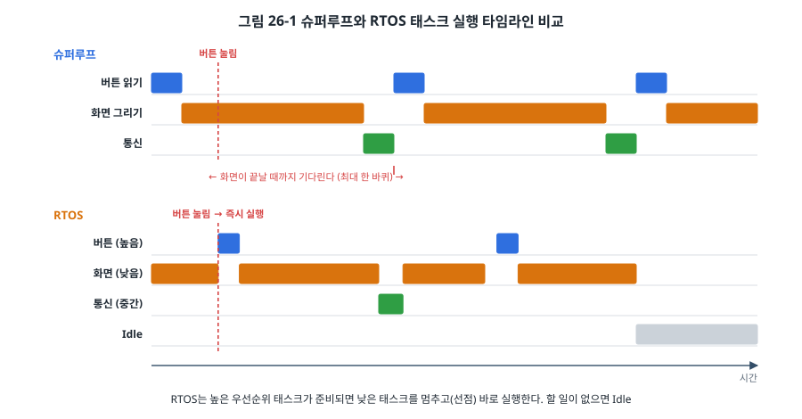
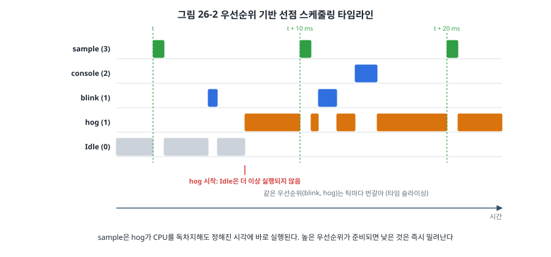
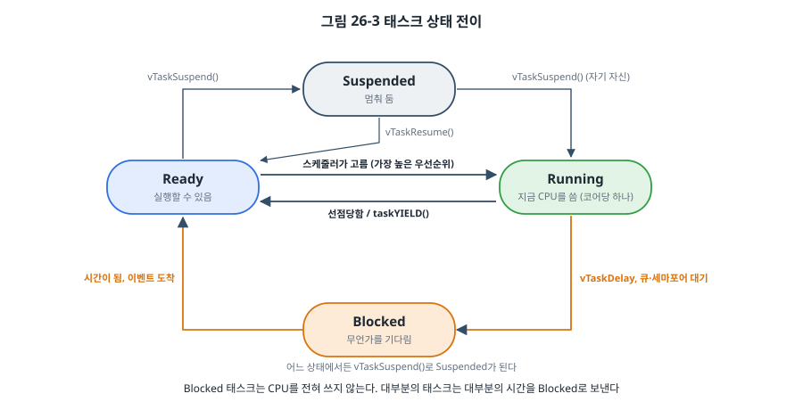
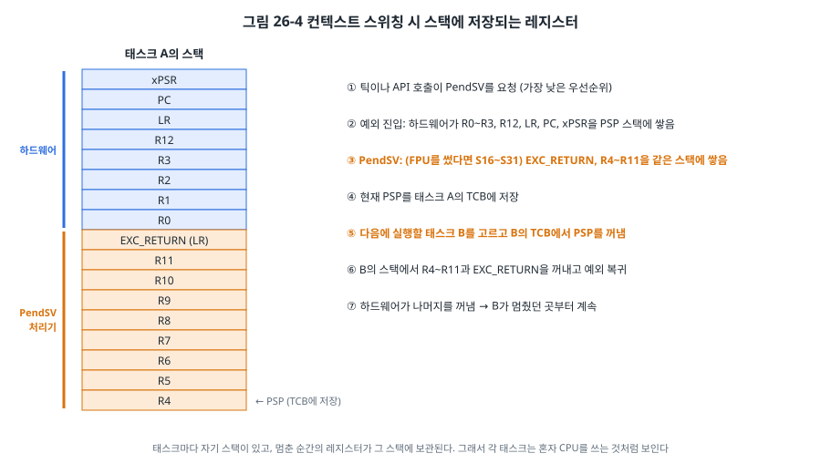

# 26장. RTOS와 FreeRTOS

## 이 장에서 배우는 것

- RTOS가 필요한 순간과 필요 없는 순간
- 태스크, 우선순위 기반 선점 스케줄링, 틱
- 태스크의 네 가지 상태와 상태가 바뀌는 계기
- Cortex-M에서 컨텍스트 스위칭이 일어나는 원리 (PendSV, PSP)
- FreeRTOS를 STM32에 직접 올리고 설정하는 방법

---

## 26.1 RTOS가 필요한 순간

24장의 협력형 스케줄러와 상태 머신으로 꽤 복잡한 제품도 만들 수 있습니다. 그런데 그 구조에는 하나의 큰 약속이 있었습니다. **모든 태스크가 빨리 돌아와야 한다**는 것입니다. 이 약속을 지키기 어려운 순간이 옵니다.

- **오래 걸리는 계산**: 영상 한 장의 압축, FFT, 암호 연산(33장)처럼 수십 ms가 걸리는 일을 상태 머신으로 잘게 쪼개기는 매우 번거롭습니다.
- **기다리는 라이브러리**: Wi-Fi, TCP/IP(LwIP), BLE, 파일 시스템 같은 큰 라이브러리는 대부분 "응답이 올 때까지 기다리는" 방식으로 쓰여 있습니다. 19장의 ESP-IDF가 처음부터 FreeRTOS 위에서 도는 이유입니다.
- **서로 다른 시간 요구**: 1 kHz 제어 루프, 100 ms마다 화면, 수 초에 한 번 통신처럼 시간 요구가 다른 일들이 섞여 있으면, 가장 긴 일이 가장 급한 일을 늦춥니다.



그림 26-1 위쪽에서 버튼이 눌린 순간 슈퍼루프는 화면 그리기를 하고 있습니다. 버튼은 화면 그리기가 끝나야 처리됩니다. 아래쪽의 **RTOS(Real-Time Operating System)** 는 버튼 태스크의 우선순위가 높으므로, 화면 태스크를 그 자리에서 멈추고 버튼 태스크를 먼저 실행합니다. 이것을 **선점(preemption)** 이라고 합니다. 화면 태스크는 자기가 멈췄다는 사실도 모른 채 나중에 이어서 그립니다.

RTOS가 주는 것은 결국 세 가지입니다.

1. **선점**: 급한 일이 덜 급한 일을 언제든 밀어낼 수 있습니다. 반응 시간이 다른 태스크의 길이와 무관해집니다.
2. **블로킹**: 태스크가 "500 ms 기다린다", "데이터가 올 때까지 기다린다"고 쓸 수 있고, 기다리는 동안 CPU는 다른 태스크에 넘어갑니다. 순서대로 읽히는 자연스러운 코드를 쓸 수 있습니다.
3. **동기화와 통신 도구**: 큐, 세마포어, 뮤텍스 같은 도구로 태스크와 ISR이 안전하게 협력합니다(27장).

대가도 있습니다. 태스크마다 스택이 필요해 메모리를 더 쓰고(25장), 태스크끼리 서로 끼어들 수 있으므로 공유 데이터를 보호해야 하며(27장), 타이밍을 분석하기가 어려워집니다(28장). 그래서 단순한 제품, SRAM이 몇 KB인 MCU, 동작을 완벽히 예측해야 하는 안전 제품에는 24장의 구조가 여전히 더 나은 선택일 수 있습니다.

> 💡 팁: "RTOS를 쓸까?"의 실용적인 기준은 이렇습니다. 상태 머신을 쪼개는 일이 코드의 대부분을 차지하기 시작했거나, 블로킹 방식의 큰 라이브러리(네트워크, 파일 시스템, USB 호스트)를 써야 하거나, 서로 독립적인 시간 요구가 셋 이상이라면 RTOS를 검토할 때입니다.

이 장과 27장, 28장은 가장 널리 쓰이는 RTOS인 **FreeRTOS**로 설명합니다. FreeRTOS는 MIT 라이선스의 작은 커널로, 수십 종의 CPU에 이식되어 있고 ESP-IDF, 여러 제조사의 SDK에 기본으로 들어 있습니다. 29장에서는 다른 설계 철학을 가진 Zephyr를 봅니다.

## 26.2 태스크

FreeRTOS에서 **태스크(task)** 는 끝나지 않는 함수 하나입니다.

```c
static void blink_task(void *arg)
{
    (void)arg;
    for (;;) {
        GPIOA->ODR ^= 1u << LED_PIN;
        vTaskDelay(pdMS_TO_TICKS(500));      /* 기다리는 동안 CPU를 다른 태스크에 */
    }
}
```

24장의 태스크와 달리 이 함수는 돌아오지 않습니다. `vTaskDelay()`에서 500 ms 동안 멈춰 있다가, 그다음 줄부터 이어서 실행됩니다. 마치 이 태스크 혼자 CPU를 쓰는 것처럼 코드를 씁니다.

태스크는 `xTaskCreate()`로 만듭니다.

```c
xTaskCreate(blink_task,   /* 태스크 함수 */
            "blink",      /* 이름 (디버깅용) */
            128,          /* 스택 크기: 워드 단위! 128 × 4 = 512 B */
            NULL,         /* 태스크 함수에 넘길 인자 */
            1,            /* 우선순위: 클수록 급함 */
            NULL);        /* 만들어진 태스크의 핸들을 받을 곳 */
```

각 태스크는 자기만의 **스택**과 **TCB(Task Control Block)** 를 가집니다. TCB에는 태스크의 이름, 우선순위, 상태, 그리고 멈췄을 때의 스택 포인터가 들어 있습니다. 둘 다 FreeRTOS의 힙(26.7절)에서 할당됩니다.

> ⚠️ 주의: FreeRTOS의 스택 크기는 **바이트가 아니라 워드**(`StackType_t`, Cortex-M에서 4바이트) 단위입니다. 512바이트를 주려고 512를 쓰면 2 KB가 할당됩니다. 반대로 다른 RTOS나 ESP-IDF의 `xTaskCreate()`는 바이트 단위입니다(ESP-IDF는 FreeRTOS를 고쳐서 씀). 코드를 옮길 때 자주 틀리는 부분이므로, 스택 크기 옆에 바이트로 환산한 값을 주석으로 남기세요.

> ⚠️ 주의: 태스크 함수는 절대 `return`하면 안 됩니다. 끝내고 싶다면 `vTaskDelete(NULL)`로 자기 자신을 지웁니다. 그냥 돌아오면 FreeRTOS의 포트는 오류 처리 함수로 가서 멈춥니다(`configASSERT`가 켜져 있다면 거기서 걸립니다).

## 26.3 스케줄러와 선점

**스케줄러**는 지금 어느 태스크를 실행할지 정하는 커널의 부분입니다. FreeRTOS의 규칙은 단순합니다.

> **실행할 수 있는 태스크 중 우선순위가 가장 높은 것을 실행한다.**

이 규칙이 언제든, 심지어 낮은 태스크가 명령을 실행하는 도중에도 적용되는 것이 **선점형(preemptive)** 스케줄링입니다(`configUSE_PREEMPTION = 1`). 높은 우선순위 태스크가 기다리던 시간이 되거나 데이터를 받으면, 다음 틱이나 그 사건을 일으킨 ISR이 끝나는 즉시 실행됩니다.



그림 26-2는 이 장의 예제가 실제로 하는 일입니다. 우선순위 3의 `sample` 태스크는 10 ms마다 깨어나서 잠깐 일합니다. 우선순위 1의 `hog` 태스크는 블록하지 않고 계속 계산만 합니다. hog가 CPU를 독차지하고 있어도 sample은 정확히 제시각에 실행됩니다. 높은 우선순위가 낮은 우선순위를 밀어내기 때문입니다.

같은 우선순위의 태스크가 여럿 실행 가능하면, 틱마다 번갈아 실행합니다(**타임 슬라이싱**, `configUSE_TIME_SLICING = 1`). 그림에서 blink와 hog가 그렇습니다.

할 일이 있는 태스크가 하나도 없으면 커널이 스스로 만든 **Idle 태스크**(우선순위 0)가 실행됩니다. Idle 태스크는 지워진 태스크의 메모리를 정리하고, 설정에 따라 **Idle 훅** 함수를 부르거나 저전력 모드로 들어갑니다(11장의 WFI, 그리고 틱까지 멈추는 tickless idle).

이 규칙에서 RTOS 설계의 가장 중요한 원칙이 나옵니다.

> ⚠️ 주의: **높은 우선순위 태스크는 반드시 블록해야 합니다.** 높은 우선순위 태스크가 `while (!flag) {}`처럼 기다리면, 그보다 낮은 모든 태스크와 Idle 태스크가 영원히 실행되지 못합니다(**기아**, starvation). 기다릴 때는 항상 `vTaskDelay()`, 큐, 세마포어처럼 **블로킹 API**를 써서 CPU를 내놓아야 합니다. 예제의 hog 태스크가 우선순위 1인 이유도 이것입니다. hog를 우선순위 3으로 만들면 sample과 번갈아 실행되어 sample의 주기가 흔들리고, 우선순위 4로 만들면 다른 태스크는 아예 멈춥니다.

우선순위를 정하는 기본 원칙은 **마감 시간이 짧은 태스크일수록 높게**입니다. 1 ms 안에 반응해야 하는 모터 제어가 가장 높고, 수 초 단위의 통신 보고가 낮습니다. "중요한" 태스크가 아니라 "급한" 태스크가 높은 우선순위를 받습니다. 28장에서 이 원칙(RMS, Rate Monotonic Scheduling)을 수학적으로 따져 봅니다.

## 26.4 틱

RTOS의 시간은 **틱(tick)** 으로 흐릅니다. FreeRTOS는 SysTick 타이머(8장)로 주기적인 인터럽트를 만들고, 그때마다 시간을 하나 늘리고 기다리던 태스크 중 시간이 된 것을 깨웁니다. `configTICK_RATE_HZ = 1000`이면 틱이 1 ms입니다.

시간을 다룰 때는 항상 `pdMS_TO_TICKS()` 매크로로 ms를 틱으로 바꿉니다. 틱 주기를 바꿔도 코드가 그대로 맞게 동작합니다.

```c
vTaskDelay(pdMS_TO_TICKS(500));      /* 좋음 */
vTaskDelay(500);                      /* 틱이 1 ms일 때만 맞음 */
```

기다리는 API는 두 가지입니다.

```c
/* 지금부터 10 ms 뒤까지 블록: 상대 시간 */
vTaskDelay(pdMS_TO_TICKS(10));

/* 지난번 깨어난 시각 + 10 ms까지 블록: 절대 시간 */
TickType_t last_wake = xTaskGetTickCount();
for (;;) {
    vTaskDelayUntil(&last_wake, pdMS_TO_TICKS(10));
    sample_and_filter();
}
```

주기적인 일에는 반드시 `vTaskDelayUntil()`을 씁니다. `vTaskDelay(10)`을 쓰면 "일하는 시간 + 10 ms"마다 실행되므로 주기가 일하는 시간만큼 늘어나고, 그 시간이 선점 때문에 매번 달라지면 주기도 흔들립니다. `vTaskDelayUntil()`은 24장의 스케줄러처럼 예정 시각을 기준으로 다음 시각을 정하므로 주기가 밀리지 않습니다.

> 🔍 깊이 보기: 틱 단위로 기다리면 정밀도는 ±1틱입니다. `vTaskDelay(1)`은 "다음 틱까지"이므로, 틱 직전에 부르면 거의 0 ms, 틱 직후에 부르면 거의 1 ms를 기다립니다. 그래서 FreeRTOS 문서는 `vTaskDelay(n)`의 실제 대기 시간을 n-1틱에서 n틱 사이라고 설명합니다. 1 ms보다 정밀한 타이밍이 필요하면 RTOS 틱이 아니라 하드웨어 타이머(8장)와 그 인터럽트를 씁니다. 틱을 10 kHz처럼 빠르게 하면 정밀도는 오르지만 틱 인터럽트 처리에 CPU를 많이 쓰게 됩니다. 1 kHz가 흔한 절충입니다.

## 26.5 태스크 상태

FreeRTOS의 태스크는 항상 네 가지 상태 중 하나입니다.



- **Running**: 지금 CPU에서 실행 중. 단일 코어라면 언제나 하나뿐입니다.
- **Ready**: 실행할 수 있지만, 더 높은(또는 같은) 우선순위 태스크가 CPU를 쓰고 있어 기다리는 중.
- **Blocked**: 무언가를 기다리는 중. 시간(`vTaskDelay`), 큐의 데이터, 세마포어, 알림 등. 기다리는 일이 일어나거나 지정한 시간 제한이 지나면 Ready가 됩니다.
- **Suspended**: `vTaskSuspend()`로 멈춰 둔 상태. 시간 제한이 없고, `vTaskResume()`으로만 돌아옵니다.

잘 설계된 시스템에서 **대부분의 태스크는 대부분의 시간을 Blocked 상태로 보냅니다.** 사건이 일어나면 깨어나 짧게 일하고 다시 기다립니다. Blocked 태스크는 CPU를 전혀 쓰지 않으므로, 실행할 태스크가 없는 시간은 Idle 태스크가 저전력 모드로 보냅니다. 예제의 `l` 명령으로 태스크 목록을 보면 대개 콘솔 자신만 Running이고 나머지는 Blocked입니다.

## 26.6 컨텍스트 스위칭

실행 중인 태스크를 멈추고 다른 태스크를 실행하는 것을 **컨텍스트 스위칭(context switching)** 이라고 합니다. "컨텍스트"는 태스크가 실행되던 순간의 CPU 상태, 즉 레지스터 전체입니다. 태스크 A를 멈출 때 레지스터를 어딘가에 저장해 두고, 나중에 다시 실행할 때 그대로 되돌리면 A는 멈췄던 사실을 모릅니다.

Cortex-M은 이 일을 위해 잘 설계된 장치들을 갖추고 있습니다.

**두 개의 스택 포인터.** 23장에서 보았듯이 Cortex-M에는 MSP와 PSP가 있습니다. FreeRTOS는 커널과 ISR이 MSP를, 태스크들이 PSP를 쓰게 합니다. 태스크마다 스택이 따로 있고, 지금 실행 중인 태스크의 스택 꼭대기를 PSP가 가리킵니다. ISR은 언제나 MSP의 공용 스택을 쓰므로 태스크 스택마다 ISR용 여유를 둘 필요가 없습니다.

**PendSV 예외.** 실제 전환은 PendSV라는 예외에서 일어납니다. 틱 인터럽트나 API(예: 큐에 데이터를 넣어 높은 태스크를 깨움)가 "전환이 필요하다"고 판단하면 PendSV를 대기 상태로 만들기만 합니다. PendSV는 가장 낮은 우선순위로 설정되어 있으므로, 다른 모든 ISR이 끝난 뒤에야 실행됩니다. 그래서 ISR 도중에 태스크가 바뀌는 일이 없습니다.



그림 26-4의 순서를 따라가 봅시다. PendSV 예외에 들어갈 때 하드웨어가 R0~R3, R12, LR, PC, xPSR을 태스크 A의 스택(PSP)에 쌓습니다(7장의 예외 진입과 같습니다). PendSV 처리기는 나머지 레지스터 R4~R11과 EXC_RETURN 값을 같은 스택에 쌓고, 그 결과의 PSP 값을 태스크 A의 TCB에 저장합니다. 그리고 다음 태스크 B를 고른 뒤, B의 TCB에서 PSP를 꺼내 R4~R11을 되돌리고 예외에서 복귀합니다. 복귀하면서 하드웨어가 B의 스택에서 나머지 레지스터를 꺼내므로, B는 지난번 멈췄던 바로 그 명령부터 이어서 실행됩니다.

**FPU 레지스터.** FPU를 쓰는 태스크라면 S0~S31과 FPSCR도 저장해야 합니다. 모든 전환마다 이것까지 저장하면 느리므로, Cortex-M4F는 **지연 저장(lazy stacking)** 을 지원합니다. 예외 진입 때 S0~S15를 저장할 자리만 잡아 두고, 처리기가 실제로 FPU를 쓸 때만 저장합니다. FreeRTOS의 PendSV는 EXC_RETURN의 비트 4를 보고 그 태스크가 FPU를 썼을 때만 S16~S31을 저장합니다. FPU를 쓰지 않는 태스크는 전환 비용이 늘지 않습니다.

**첫 번째 태스크.** `vTaskStartScheduler()`는 Idle 태스크(와 타이머 태스크)를 만들고 SysTick을 설정한 뒤, SVC 명령으로 첫 번째 태스크를 시작합니다. 이때 MSP를 벡터 테이블의 초기값으로 되돌리므로 `main()`의 스택은 버려집니다.

> ⚠️ 주의: 그래서 `main()`의 지역 변수를 태스크에 넘기면 안 됩니다. `int config = 5; xTaskCreate(task, "t", 128, &config, 1, NULL);`처럼 지역 변수의 주소를 인자로 넘기면, 스케줄러가 시작된 뒤 그 자리는 ISR의 스택으로 다시 쓰여 값이 망가집니다. 태스크에 넘기는 데이터는 전역 변수나 `static` 변수에 둡니다.

## 26.7 FreeRTOS 포팅과 설정

이 책의 예제는 제조사 도구 없이 FreeRTOS 커널 소스를 직접 받아 빌드합니다. 그래야 무엇이 들어가는지 정확히 알 수 있습니다.

```bash
cd code/ch26-freertos/stm32
./get_freertos.sh      # FreeRTOS-Kernel V11.1.0을 lib/에 받는다
make
```

빌드에 들어가는 파일은 많지 않습니다.

| 파일 | 역할 |
| --- | --- |
| `tasks.c` | 태스크와 스케줄러 |
| `queue.c` | 큐, 세마포어, 뮤텍스 (27장) |
| `list.c` | 커널 내부의 리스트 |
| `timers.c` | 소프트웨어 타이머 (27장) |
| `portable/GCC/ARM_CM4F/port.c` | Cortex-M4F용 포트: 컨텍스트 스위칭, SysTick, 임계 구역 |
| `portable/MemMang/heap_4.c` | 커널의 메모리 할당기 |
| `FreeRTOSConfig.h` | 우리가 쓰는 설정 파일 |

**포트**는 CPU마다 달라지는 부분입니다. 같은 `tasks.c`가 Cortex-M, RISC-V, AVR에서 모두 쓰이고, 그 CPU만의 컨텍스트 스위칭은 `port.c`와 `portmacro.h`에 들어 있습니다. 24장에서 본 "HAL 아래만 바꾼다"는 원칙을 커널이 그대로 따르는 셈입니다.

### 예외 처리기 연결

포트는 SVC, PendSV, SysTick 세 예외를 씁니다. 21장의 스타트업 코드는 이 처리기들을 `SVC_Handler`, `PendSV_Handler`, `SysTick_Handler`라는 이름으로 벡터 테이블에 넣어 두었으므로, 설정 파일에서 포트의 함수 이름을 이 이름으로 바꿔 줍니다.

```c
#define vPortSVCHandler     SVC_Handler
#define xPortPendSVHandler  PendSV_Handler
#define xPortSysTickHandler SysTick_Handler
```

FreeRTOS V11은 시작할 때 벡터 테이블에 이 처리기들이 제대로 들어 있는지 확인합니다(`configCHECK_HANDLER_INSTALLATION`). 이 연결을 빠뜨리면 `configASSERT`에서 멈추므로, 예전처럼 "스케줄러를 시작하자마자 HardFault"가 나는 대신 원인을 바로 알 수 있습니다. 그리고 SysTick을 FreeRTOS가 쓰므로, 지금까지처럼 예제 코드에서 `SysTick_Handler`를 따로 만들면 안 됩니다.

### 인터럽트 우선순위

설정 중 가장 많이 틀리는 부분입니다.

```c
#define configPRIO_BITS                              4
#define configLIBRARY_LOWEST_INTERRUPT_PRIORITY       15
#define configLIBRARY_MAX_SYSCALL_INTERRUPT_PRIORITY 5
#define configKERNEL_INTERRUPT_PRIORITY      (configLIBRARY_LOWEST_INTERRUPT_PRIORITY << (8 - configPRIO_BITS))
#define configMAX_SYSCALL_INTERRUPT_PRIORITY (configLIBRARY_MAX_SYSCALL_INTERRUPT_PRIORITY << (8 - configPRIO_BITS))
```

7장에서 STM32F4의 NVIC 우선순위는 4비트(0~15)이고 숫자가 작을수록 급하다고 했습니다. FreeRTOS는 커널 자신(PendSV, SysTick)을 가장 낮은 15로 두고, `configMAX_SYSCALL_INTERRUPT_PRIORITY`를 경계로 인터럽트를 둘로 나눕니다.

- **우선순위 5~15의 ISR**: `xQueueSendFromISR()`처럼 이름이 `FromISR`로 끝나는 API를 부를 수 있습니다. 대신 커널이 임계 구역에 있는 동안에는 잠시 막힙니다.
- **우선순위 0~4의 ISR**: 커널이 절대 막지 않습니다. 커널 때문에 반응이 늦어지는 일이 없지만, FreeRTOS API를 **하나도** 부를 수 없습니다.

Cortex-M3/M4 포트는 임계 구역에서 7장의 `cpsid i`(전체 금지) 대신 **BASEPRI** 레지스터로 우선순위 5 이하(숫자 5 이상)의 인터럽트만 막습니다. 그래서 모터 보호처럼 아주 급한 ISR은 0~4에 두면 RTOS가 있어도 지연 없이 반응합니다.

> ⚠️ 주의: STM32의 모든 인터럽트는 리셋 직후 우선순위가 **0**입니다. 그대로 두고 그 ISR에서 `FromISR` API를 부르면, 커널이 막을 수 없는 ISR이 커널 자료 구조를 건드리게 되어 아주 드물게, 재현하기 어렵게 망가집니다. FreeRTOS를 쓰는 프로젝트에서 "가끔 이상하게 멈춘다"의 대표적인 원인입니다. API를 부르는 모든 ISR은 `nvic_set_priority()`로 5~15 중 하나를 명시적으로 주세요. `configASSERT`를 켜 두면 포트가 `FromISR` 호출 때 이것을 검사해 줍니다.

### 메모리 할당 방식

FreeRTOS는 TCB, 스택, 큐를 `pvPortMalloc()`으로 할당하며, 그 구현을 다섯 가지 중에서 고릅니다.

| 파일 | 방식 | 쓰임 |
| --- | --- | --- |
| `heap_1.c` | 할당만, 해제 없음 | 시작할 때 모두 만들고 지우지 않는 시스템 (25장의 권장 방식) |
| `heap_2.c` | 해제 가능, 이웃 블록 합치지 않음 | 예전 방식. 지금은 heap_4를 권장 |
| `heap_3.c` | 표준 `malloc()`을 감싸서 씀 | C 라이브러리 할당기를 쓰고 싶을 때 |
| `heap_4.c` | 해제 가능, 이웃 블록 합침 | 가장 널리 쓰임 |
| `heap_5.c` | heap_4 + 떨어진 여러 메모리 영역 | 내부 SRAM과 외부 SDRAM을 함께 쓸 때 |

모두 `configTOTAL_HEAP_SIZE` 크기의 정적 배열 안에서 할당하므로, 그 크기가 `.bss`에 그대로 잡힙니다. 예제는 24 KB를 주었습니다. `xPortGetMinimumEverFreeHeapSize()`로 지금까지 가장 적게 남았던 크기를 확인해서(25장의 최고 수위와 같은 생각) 크기를 조정합니다. `configSUPPORT_STATIC_ALLOCATION`을 켜면 `xTaskCreateStatic()`으로 TCB와 스택을 직접 준 정적 배열에 만들 수 있어서, 힙 없이도 FreeRTOS를 쓸 수 있습니다.

### 디버깅을 돕는 설정

개발 중에는 다음을 반드시 켭니다.

- **`configASSERT`**: 커널이 잘못된 사용(잘못된 우선순위의 ISR에서 API 호출, NULL 핸들 등)을 발견하면 여기서 멈춥니다. 예제는 파일 이름을 출력하고 `bkpt`로 디버거를 멈춥니다.
- **`configCHECK_FOR_STACK_OVERFLOW = 2`**: 컨텍스트 스위칭 때마다 나가는 태스크의 스택 끝 16바이트가 처음 칠해 둔 값(0xA5) 그대로인지 확인하고, 아니면 `vApplicationStackOverflowHook()`을 부릅니다. 25장의 카나리와 같은 방식이라 한계도 같습니다. 넘친 뒤에 발견하므로 그 사이 다른 메모리가 이미 망가졌을 수 있습니다.
- **`configUSE_MALLOC_FAILED_HOOK`**: 힙이 모자라 태스크나 큐를 만들지 못하면 부릅니다.
- **`uxTaskGetStackHighWaterMark()`**: 태스크별로 스택이 가장 적게 남았던 크기(워드 단위). 25장의 스택 칠하기를 커널이 해 줍니다.

> 🔧 ATmega128에서는: FreeRTOS에는 AVR용 포트도 있습니다. 아두이노 우노(ATmega328P)에서는 `Arduino_FreeRTOS` 라이브러리로 쓸 수 있는데, 타이머를 아두이노 코어에 양보하려고 워치독 타이머를 틱으로 써서 틱이 약 15 ms로 거칩니다. 무엇보다 SRAM 2 KB에 태스크마다 스택을 주면 태스크 서너 개가 한계입니다. SRAM 4 KB인 ATmega128에서도 사정은 크게 다르지 않습니다. 8비트 AVR에서는 RTOS보다 24장의 협력형 구조가 대개 더 알맞고, RTOS가 필요할 만큼 일이 많아졌다면 그것이 32비트 MCU로 옮길 때라는 신호이기도 합니다.

> 💡 팁: 19장의 ESP32 예제도 사실 FreeRTOS 위에서 돌았습니다. ESP-IDF의 `app_main()`은 부트 과정에서 만든 "main" 태스크 안에서 실행되고, Wi-Fi와 TCP/IP 스택도 각자 태스크로 돕니다. ESP32는 코어가 두 개라서 ESP-IDF는 FreeRTOS를 다중 코어(SMP)용으로 고쳐서 쓰며, `xTaskCreatePinnedToCore()`로 태스크를 실행할 코어를 정할 수 있습니다. 이 장에서 배운 개념이 그대로 적용됩니다.

## 26.8 실습: 태스크와 선점 관찰하기

`code/ch26-freertos/stm32/`의 예제는 그림 26-2의 태스크 네 개를 만듭니다.

| 태스크 | 우선순위 | 하는 일 |
| --- | --- | --- |
| sample | 3 | `vTaskDelayUntil()`로 10 ms마다 실행, 주기를 DWT로 잼 |
| console | 2 | UART 명령 처리, 상태 출력 |
| blink | 1 | LD2를 500 ms마다 토글 |
| hog | 1 | 블록하지 않는 계산 (`h`로 켜고 끔) |

`l` 명령으로 태스크 목록을 봅니다.

```
task       state      prio free stack
console    Running       2   1568 B
IDLE       Ready         0    436 B
blink      Blocked       1    432 B
sample     Blocked       3    912 B
Tmr Svc    Blocked       4    920 B
hog        Suspended     1    444 B
heap free 17096 B (min ever 17096 B), idle loops 2093517
```

(값은 예시입니다. 스택 128워드인 태스크는 처음부터 초기 레지스터 프레임 17워드(68 B)가 쌓여 있으므로, 한 번도 실행되지 않은 hog도 남은 스택이 약 444 B입니다.) 직접 만들지 않은 `IDLE`과 `Tmr Svc`(타이머 태스크, 27장)가 있는 것, 그리고 대부분의 태스크가 Blocked인 것을 확인하세요. "free stack"은 지금까지 가장 적게 남았던 스택입니다. console의 스택이 가장 많이 쓰인 것은 `printf` 때문입니다.

이제 실험해 봅시다.

1. `j`로 sample 태스크의 주기를 봅니다. 최소와 최대가 10,000 µs에 아주 가깝게 나올 것입니다.
2. `h`로 hog를 켜고 몇 초 뒤 다시 `l`과 `j`를 봅니다. Idle 카운터는 더 이상 늘지 않고(Idle 태스크가 실행되지 못함), blink는 hog와 번갈아 실행되어 여전히 깜박이며, sample의 주기는 거의 그대로입니다. 높은 우선순위의 sample이 hog를 선점하기 때문입니다.
3. `FreeRTOSConfig.h`에서 `configUSE_PREEMPTION`을 0(협력형)으로 바꾸고 다시 빌드한 뒤 hog를 켜 보세요. hog가 CPU를 놓지 않으므로 sample, console, blink 모두 멈춥니다. 선점이 무엇을 해 주는지 가장 분명하게 보여 주는 실험입니다.
4. `o`를 보내면 512 B 스택에 512 B 지역 배열을 가진 태스크를 만듭니다. 다음 컨텍스트 스위칭에서 커널이 스택 끝의 무늬가 지워진 것을 발견하고 `vApplicationStackOverflowHook()`이 태스크 이름을 출력합니다.

```
*** stack overflow in task: tiny ***
```

(출력은 예시입니다. [확인 필요: 보드 실측])

이 마지막 실험은 26.7절에서 말한 한계도 보여 줍니다. 훅이 불리기 전에 배열이 이미 스택 아래쪽의 힙을 덮어썼으므로(heap_4는 낮은 주소부터 차례로 할당하므로 바로 앞에 만들어진 Tmr Svc 태스크의 TCB 끝부분과 힙 관리 헤더가 망가졌을 수 있습니다), 이 시점의 시스템은 계속 돌리면 안 되는 상태입니다. 훅에서 할 수 있는 일은 기록을 남기고 리셋하는 것뿐입니다.

---

## 정리

- RTOS는 선점, 블로킹, 동기화 도구를 줍니다. 오래 걸리는 계산, 블로킹 방식의 큰 라이브러리, 서로 다른 시간 요구가 섞일 때 필요합니다. 대가는 메모리, 동기화의 복잡함, 분석의 어려움입니다.
- FreeRTOS의 태스크는 끝나지 않는 함수이며 자기 스택과 TCB를 가집니다. 스택 크기는 워드 단위입니다.
- 스케줄러는 실행 가능한 태스크 중 가장 높은 우선순위를 실행합니다. 높은 우선순위 태스크는 반드시 블로킹 API로 기다려야 하며, 우선순위는 마감 시간이 짧을수록 높게 줍니다.
- 주기적인 일은 `vTaskDelayUntil()`로, 시간은 `pdMS_TO_TICKS()`로 씁니다. 틱 정밀도는 ±1틱입니다.
- 태스크는 Running, Ready, Blocked, Suspended 중 하나이며, 대부분의 시간을 Blocked로 보냅니다.
- Cortex-M의 컨텍스트 스위칭은 가장 낮은 우선순위의 PendSV에서 일어나며, 태스크는 PSP, 커널과 ISR은 MSP를 씁니다.
- FreeRTOS를 쓰는 ISR의 우선순위는 `configMAX_SYSCALL_INTERRUPT_PRIORITY` 이하의 급함(STM32에서 숫자 5~15)이어야 합니다. 개발 중에는 `configASSERT`, 스택 오버플로 검사, 힙 실패 훅을 켭니다.

## 연습 문제

1. 다음 중 RTOS가 특히 도움이 되는 경우를 고르고 이유를 쓰세요. (a) 버튼으로 LED 세 개를 켜는 장치 (b) 1 kHz 모터 제어, Wi-Fi 통신, SD 카드 기록을 함께 하는 장치 (c) 코인 전지로 5년 동안 1분마다 온도를 재서 BLE로 보내는 센서
2. 우선순위 3의 태스크가 UART 수신을 `while (uart2_getc() < 0) {}`로 기다립니다. 어떤 일이 일어나는지 설명하고, 이 장의 도구만으로(27장의 큐 없이) 고쳐 보세요.
3. `vTaskDelay(pdMS_TO_TICKS(10))`로 주기를 만든 태스크가 매번 3 ms 동안 일합니다. 실제 주기는 얼마인가요? 더 높은 우선순위의 태스크가 가끔 2 ms씩 선점한다면 주기는 어떻게 되나요? `vTaskDelayUntil()`로 바꾸면 어떻게 되나요?
4. `configTICK_RATE_HZ`를 1000에서 100으로 바꾸면 `vTaskDelay(pdMS_TO_TICKS(5))`는 얼마나 기다리나요? `pdMS_TO_TICKS()` 대신 숫자 5를 직접 썼다면요?
5. UART 수신 ISR에서 `xQueueSendFromISR()`를 부르는데, ISR의 우선순위를 설정하지 않았습니다. 어떤 문제가 생길 수 있는지, 왜 그 문제가 드물게만 나타나는지 설명하세요.
6. (실습) 예제에 우선순위 4의 태스크를 추가해서 1 ms마다 깨어나 200 µs 동안 바쁘게 일하게 해 보세요. sample 태스크의 주기 지터(`j`)는 어떻게 바뀌나요? 그 이유를 그림 26-2처럼 타임라인으로 그려 설명하세요.
