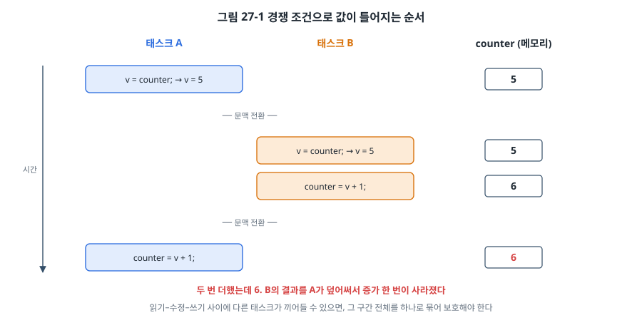
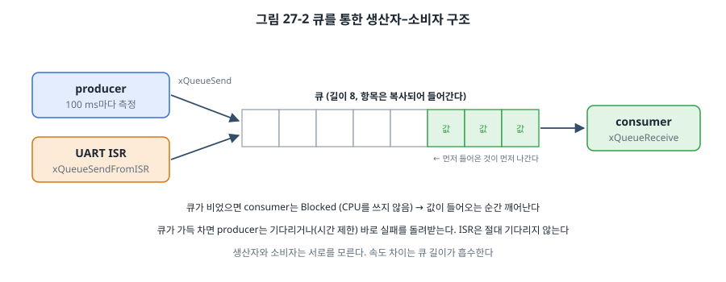
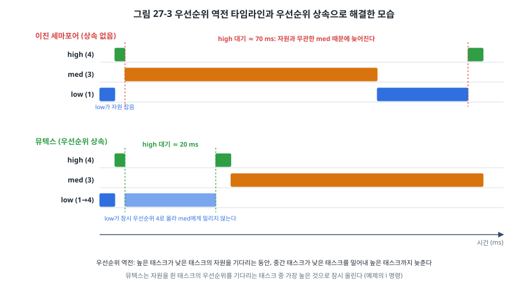
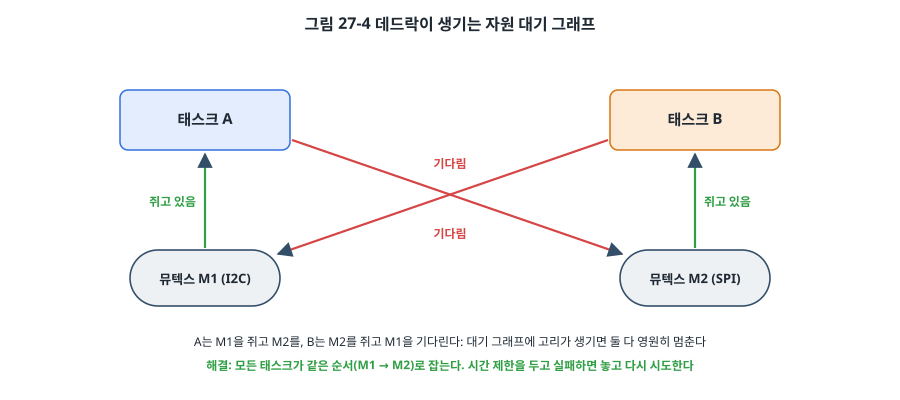
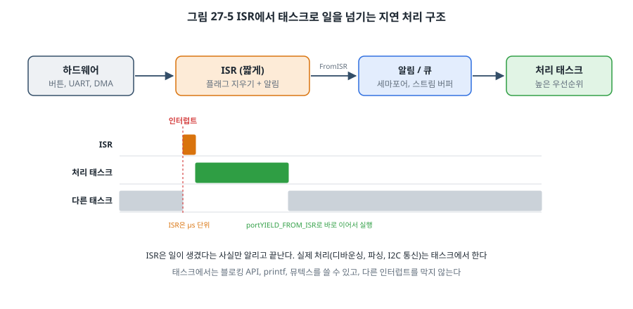

# 27장. 태스크 간 동기화와 통신

## 이 장에서 배우는 것

- 경쟁 조건이 생기는 원리와 크리티컬 섹션으로 막는 방법
- 큐로 데이터를 주고받는 생산자–소비자 구조
- 세마포어와 뮤텍스의 차이, 우선순위 역전과 우선순위 상속
- 이벤트 그룹과 태스크 알림, 소프트웨어 타이머
- ISR과 태스크가 일을 나누는 지연 처리, 그리고 데드락을 피하는 규칙

---

## 27.1 함께 쓰면 생기는 문제

26장에서 태스크마다 혼자 CPU를 쓰는 것처럼 코드를 쓸 수 있다고 했습니다. 그 말은 태스크가 **혼자인 것처럼 다른 태스크를 무시해도 된다는** 뜻이 아닙니다. 태스크들은 메모리, UART, I2C 버스, SD 카드 같은 자원을 함께 쓰고, 서로 데이터를 넘겨야 합니다. 그리고 선점형 스케줄러는 태스크를 **아무 명령 사이에서나** 멈출 수 있습니다.

이 장에서 다룰 도구는 많아 보이지만 질문은 두 가지뿐입니다.

1. **함께 쓰는 것을 어떻게 지키는가?** (상호 배제: 크리티컬 섹션, 뮤텍스)
2. **일이 생겼다는 것과 그 데이터를 어떻게 전하는가?** (동기화와 통신: 큐, 세마포어, 이벤트 그룹, 태스크 알림)

## 27.2 경쟁 조건

7장에서 ISR과 메인 코드가 같은 변수를 쓸 때의 문제를 보았습니다. 태스크끼리도 똑같은 일이 일어납니다. 두 태스크가 공유 카운터를 1씩 올린다고 해 봅시다.

```c
counter = counter + 1;
```

C에서는 한 줄이지만 CPU에서는 읽기(LDR), 더하기(ADDS), 쓰기(STR)의 세 명령입니다. 그 사이에 문맥 전환이 일어나면 어떻게 될까요?



태스크 A가 5를 읽은 직후 B로 넘어갑니다. B도 5를 읽어 6을 쓰고, 다시 A로 돌아오면 A는 자기가 읽어 둔 5에 1을 더해 6을 씁니다. 두 번 더했는데 결과는 6입니다. 이렇게 **실행 순서에 따라 결과가 달라지는 상황**을 **경쟁 조건(race condition)** 이라고 합니다.

경쟁 조건이 무서운 이유는 드물게 일어나기 때문입니다. 세 명령 사이에 틱이나 인터럽트가 걸릴 확률은 아주 작아서, 시험할 때는 몇 시간씩 멀쩡하다가 현장에서 몇 주에 한 번 값이 틀어집니다. 예제의 `r` 명령은 이 확률을 일부러 100%로 만듭니다. 읽기와 쓰기 사이에 `taskYIELD()`를 넣어 그 자리에서 반드시 다른 태스크로 넘어가게 한 것입니다.

```c
uint32_t v = shared_counter;       /* 읽기 */
taskYIELD();                       /* 하필 여기서 다른 태스크로 넘어간다면? */
shared_counter = v + 1u;           /* 쓰기 */
```

```
no lock  expected 2000, got 1001
mutex    expected 2000, got 2000
```

(값은 예시입니다.) 보호하지 않으면 증가의 절반가량이 사라집니다.

경쟁 조건이 생기려면 세 가지가 모두 필요합니다. 둘 이상의 실행 흐름이, 같은 데이터를, 적어도 하나는 **쓴다**. 그래서 피하는 방법도 셋입니다. 데이터를 한 태스크만 쓰게 하거나(소유권, 27.4절의 큐가 이 방식), 읽기만 하거나(`const` 데이터), 쓰는 구간을 **한 번에 하나만** 실행하게 하는 것(상호 배제)입니다.

## 27.3 크리티컬 섹션

**크리티컬 섹션(critical section)** 은 다른 흐름이 끼어들면 안 되는 코드 구간입니다. FreeRTOS에서 가장 간단한 방법은 인터럽트를 막는 것입니다.

```c
taskENTER_CRITICAL();
shared_counter++;
taskEXIT_CRITICAL();
```

Cortex-M 포트에서 이 매크로는 26장에서 본 BASEPRI로 `configMAX_SYSCALL_INTERRUPT_PRIORITY` 이하 급함의 인터럽트를 막습니다. 틱 인터럽트도 막히므로 문맥 전환도 일어나지 않습니다. 중첩해서 불러도 되며, 마지막 EXIT에서 원래대로 돌아옵니다. ISR 안에서는 `taskENTER_CRITICAL_FROM_ISR()`을 씁니다.

인터럽트를 막는 동안 시스템 전체의 반응이 멈추므로, 크리티컬 섹션은 **몇 µs 안에 끝나는 짧은 일**에만 씁니다. 변수 몇 개를 바꾸거나 링 버퍼의 포인터를 옮기는 정도입니다. 그 안에서 블로킹 API(`vTaskDelay`, 큐 대기)를 부르면 안 됩니다.

조금 긴 구간이라면 인터럽트는 그대로 두고 **스케줄러만** 멈추는 방법도 있습니다.

```c
vTaskSuspendAll();          /* 문맥 전환 금지. 인터럽트는 계속 동작 */
update_big_table();
xTaskResumeAll();
```

다른 태스크는 끼어들 수 없지만 ISR은 실행되므로, ISR과 공유하는 데이터는 이 방법으로 지킬 수 없습니다. 그리고 다른 태스크가 모두 멈추므로 역시 길게 쓰면 안 됩니다. 수 ms 이상 걸리는 구간, 기다릴 수도 있는 구간에는 27.6절의 뮤텍스를 씁니다.

## 27.4 큐

태스크끼리 데이터를 넘기는 가장 기본적인 도구는 **큐(queue)** 입니다. 14장의 링 버퍼와 같은 FIFO이지만, 커널이 관리하므로 비었거나 가득 찼을 때 **기다릴 수 있다**는 점이 다릅니다.



```c
typedef struct {
    uint32_t seq;
    uint32_t tick;
    int32_t  value;
} sample_t;

sample_q = xQueueCreate(8, sizeof(sample_t));     /* 항목 8개, 항목 크기 12 B */

/* 생산자 */
sample_t s = { seq++, xTaskGetTickCount(), read_sensor() };
if (xQueueSend(sample_q, &s, 0) != pdPASS) {       /* 가득 차면 기다리지 않고 실패 */
    dropped++;
}

/* 소비자 */
sample_t s;
xQueueReceive(sample_q, &s, portMAX_DELAY);       /* 값이 올 때까지 Blocked */
```

FreeRTOS의 큐는 **값을 복사**합니다. `xQueueSend()`가 돌아온 뒤에는 원래 변수 `s`를 바꾸거나 함수를 빠져나가도 큐 안의 값은 안전합니다. 26장에서 `main()`의 지역 변수 주소를 넘기면 안 된다고 했던 문제가 큐에서는 생기지 않습니다. 대신 큰 데이터(수백 바이트의 프레임)를 복사하면 느리고 큐 메모리도 크게 잡히므로, 그럴 때는 25장의 메모리 풀에서 받은 블록의 **포인터**를 큐로 넘기고, 받은 쪽이 다 쓴 뒤 풀에 돌려주는 방식을 씁니다. 이때 블록의 소유권은 큐를 통해 넘어가므로, 보낸 쪽은 보낸 뒤 그 블록을 건드리지 않아야 합니다.

큐는 경쟁 조건을 구조적으로 없앱니다. 데이터는 언제나 한 태스크만 가지고 있고, 큐를 통해 다른 태스크에게 **넘어가기** 때문입니다. 공유 변수와 잠금 대신 큐로 데이터를 넘기도록 설계하면 동기화 버그가 크게 줄어듭니다. 24장의 이벤트 큐와 같은 생각입니다.

기다리는 시간은 세 가지로 정합니다.

| 시간 제한 | 뜻 | 쓰는 곳 |
| --- | --- | --- |
| `0` | 기다리지 않고 바로 성공/실패 | 데이터를 잃어도 되는 곳, 바로 다른 일을 해야 하는 곳 |
| `pdMS_TO_TICKS(100)` | 최대 100 ms 기다림 | 대부분의 경우. 시간 초과는 오류로 처리 |
| `portMAX_DELAY` | 무한히 기다림 (`INCLUDE_vTaskSuspend = 1`일 때) | 일이 올 때까지 할 것이 없는 태스크 |

> 💡 팁: 큐 길이는 생산자와 소비자의 **일시적인** 속도 차이를 흡수하는 완충입니다. 평균적으로 소비자가 생산자보다 느리다면 큐가 아무리 길어도 언젠가 가득 찹니다. 예제의 `s` 명령으로 `dropped`와 대기 중인 항목 수를 확인하고, 25장의 풀처럼 최악의 상황에서 측정한 최대 대기 수로 길이를 정하세요.

FreeRTOS에는 큐의 변형도 있습니다. 길이 1인 큐에 `xQueueOverwrite()`로 항상 최신 값을 덮어쓰고 `xQueuePeek()`로 꺼내지 않고 읽으면, "가장 최근 측정값"을 여러 태스크가 공유하는 **메일박스**가 됩니다. 바이트 흐름(UART 수신 데이터)에는 **스트림 버퍼**, 길이가 다른 메시지에는 **메시지 버퍼**가 더 효율적입니다. 둘 다 쓰는 쪽과 읽는 쪽이 하나씩일 때를 위해 만들어졌습니다.

## 27.5 세마포어

**세마포어(semaphore)** 는 데이터 없이 "일이 일어났다"는 사실, 또는 "자원이 몇 개 남았다"는 수만 전하는 도구입니다.

**이진 세마포어(binary semaphore)** 는 0 또는 1의 값만 가집니다. 한쪽이 주고(give) 다른 쪽이 받는(take) 신호로 씁니다.

```c
SemaphoreHandle_t adc_done = xSemaphoreCreateBinary();   /* 처음에는 0 */

void ADC_IRQHandler(void)            /* 변환이 끝나면 */
{
    BaseType_t woken = pdFALSE;
    ADC1->SR = 0;
    xSemaphoreGiveFromISR(adc_done, &woken);
    portYIELD_FROM_ISR(woken);
}

void sensor_task(void *arg)
{
    for (;;) {
        start_adc();
        if (xSemaphoreTake(adc_done, pdMS_TO_TICKS(10)) == pdPASS) {
            process(ADC1->DR);
        } else {
            report_timeout();
        }
        ...
    }
}
```

**카운팅 세마포어(counting semaphore)** 는 0부터 정해진 최댓값까지 셉니다. 두 가지로 씁니다. 하나는 일어난 사건의 **횟수**를 세는 것(이진 세마포어는 두 번 연달아 주면 한 번으로 합쳐지지만 카운팅은 둘 다 기억), 다른 하나는 같은 자원 N개를 관리하는 것(버퍼 4개 중 남은 수)입니다. 예제의 `done_sem`은 실험 태스크 두 개가 끝날 때마다 하나씩 주고, 콘솔이 두 번 받아서 둘 다 끝난 것을 확인합니다.

## 27.6 뮤텍스와 우선순위 역전

**뮤텍스(mutex, mutual exclusion)** 는 자원을 한 번에 한 태스크만 쓰도록 지키는 잠금입니다. 겉보기에는 이진 세마포어와 같지만 결정적인 차이가 두 가지 있습니다.

1. **소유자가 있습니다.** 뮤텍스를 잡은(take) 태스크만 놓을(give) 수 있습니다. 세마포어는 아무나 줄 수 있으므로 신호용이고, 뮤텍스는 잠금용입니다. 그래서 뮤텍스는 ISR에서 쓸 수 없습니다(ISR은 소유자가 될 수 없음).
2. **우선순위 상속**을 합니다. 이것이 무엇인지 보려면 먼저 문제를 봐야 합니다.

예제의 출력 함수가 뮤텍스를 쓰는 전형적인 예입니다. 여러 태스크가 `printf`를 동시에 부르면 글자가 뒤섞이므로, 한 줄을 다 출력할 때까지 UART를 잠급니다.

```c
static void log_printf(const char *fmt, ...)
{
    va_list ap;
    xSemaphoreTake(print_lock, portMAX_DELAY);     /* 한 번에 한 태스크만 printf */
    va_start(ap, fmt);
    vprintf(fmt, ap);
    va_end(ap);
    xSemaphoreGive(print_lock);
}
```

### 우선순위 역전

세 태스크가 있다고 합시다. 높은(high), 중간(med), 낮은(low) 우선순위입니다. high와 low는 같은 자원(예: I2C 버스)을 쓰고, med는 그 자원과 아무 관계가 없습니다.

1. low가 자원을 잡고 일하기 시작합니다.
2. high가 깨어나 자원을 원하지만 low가 쥐고 있으므로 Blocked가 됩니다. 여기까지는 정상입니다. low가 일을 끝내고 놓을 때까지 잠깐 기다리면 됩니다.
3. 그런데 이때 med가 깨어납니다. med는 low보다 우선순위가 높으므로 low를 선점합니다. low는 자원을 쥔 채 멈춥니다.
4. med가 오래 일하는 동안 low는 실행되지 못하고, 따라서 자원을 놓지 못하고, high는 계속 기다립니다.

결과적으로 **자원과 아무 관계없는 med가 가장 급한 high를 늦춥니다.** 우선순위가 뒤집힌 것처럼 보여서 **우선순위 역전(priority inversion)** 이라고 합니다. med 같은 태스크가 여러 개라면 high가 기다리는 시간에 상한이 없어집니다.



**우선순위 상속(priority inheritance)** 은 이렇게 해결합니다. high가 low의 뮤텍스를 기다리기 시작하면, 커널이 low의 우선순위를 high와 같게 **잠시** 올립니다. 이제 med는 low를 선점하지 못하므로, low는 일을 빨리 끝내고 뮤텍스를 놓으며, 그 순간 원래 우선순위로 돌아갑니다. high가 기다리는 시간은 "low가 자원을 쥐고 하는 일의 길이"로 제한됩니다.

예제의 `i` 명령이 그림 27-3을 그대로 재현합니다. low가 자원을 쥐고 20 ms 일하고, med는 자원과 무관하게 50 ms 동안 CPU만 씁니다. 같은 실험을 이진 세마포어와 뮤텍스로 한 번씩 합니다.

```
binary semaphore: high waited 70412 us
mutex:            high waited 20218 us
```

(값은 예시입니다.) 이진 세마포어로는 high가 med의 50 ms까지 기다리고, 뮤텍스로는 low의 20 ms만 기다립니다. 상호 배제에는 **언제나 세마포어가 아니라 뮤텍스**를 쓰는 이유입니다.

> 🔍 깊이 보기: 우선순위 역전으로 가장 유명한 사건은 1997년 화성에 착륙한 패스파인더 탐사선입니다. 착륙 후 탐사선이 반복해서 리셋되었는데, 원인은 낮은 우선순위의 기상 데이터 태스크가 쥔 자원을 높은 우선순위의 버스 관리 태스크가 기다리는 동안 중간 우선순위의 통신 태스크가 끼어든 우선순위 역전이었습니다. 워치독(35장)이 "버스 관리가 제때 끝나지 않았다"고 판단해 시스템을 리셋한 것입니다. 개발팀은 지구에서 같은 환경을 재현해 원인을 찾았고, 사용하던 RTOS(VxWorks)의 해당 뮤텍스에 우선순위 상속 옵션을 켜는 설정 변경을 원격으로 올려 해결했습니다.

> ⚠️ 주의: 우선순위 상속은 역전을 **줄일** 뿐 없애지는 못합니다. high는 여전히 low가 자원을 쥔 시간만큼 기다립니다. 그래서 뮤텍스를 쥔 구간은 짧게 유지하고, 그 안에서 다른 것을 기다리거나(큐, `vTaskDelay`) 오래 걸리는 일을 하지 않습니다. 같은 태스크가 이미 쥔 뮤텍스를 다시 잡아야 하는 구조(함수가 함수를 부름)라면 **재귀 뮤텍스**(`xSemaphoreCreateRecursiveMutex()`)를 씁니다. 보통 뮤텍스를 두 번 잡으면 자기 자신을 기다리며 영원히 멈춥니다.

## 27.7 데드락

뮤텍스를 여러 개 쓰면 새로운 위험이 생깁니다. 태스크 A는 I2C 뮤텍스 M1을 쥐고 SPI 뮤텍스 M2를 기다리고, 태스크 B는 M2를 쥐고 M1을 기다리는 상황입니다.



둘 다 상대가 놓기를 기다리므로 영원히 진행하지 못합니다. 이것이 **데드락(deadlock, 교착 상태)** 입니다. 데드락은 다음 네 조건이 **모두** 성립할 때 생깁니다.

1. 상호 배제: 자원을 한 번에 하나만 쓸 수 있다.
2. 점유 대기: 자원을 쥔 채 다른 자원을 기다린다.
3. 비선점: 남이 쥔 자원을 빼앗을 수 없다.
4. 순환 대기: 기다림의 고리가 생긴다(그림의 X자).

넷 중 하나만 깨면 데드락은 생기지 않습니다. 임베디드에서 실용적인 방법은 다음과 같습니다.

- **잠금 순서를 정합니다.** 모든 태스크가 여러 뮤텍스를 잡을 때 항상 같은 순서(M1 → M2)로 잡으면 순환 대기가 생기지 않습니다. 가장 효과적인 방법이며, 순서를 문서와 주석으로 남깁니다.
- **한 번에 하나만 쥡니다.** 뮤텍스를 쥔 채 다른 뮤텍스를 잡지 않도록 설계합니다.
- **시간 제한을 둡니다.** `portMAX_DELAY` 대신 시간 제한을 주고, 실패하면 쥔 것을 모두 놓고 잠시 뒤 다시 시도합니다. 데드락을 원천적으로 막지는 못하지만 영원히 멈추지는 않고, 시간 초과를 기록해 두면 문제를 발견할 수 있습니다.
- **자원을 한 태스크가 맡게 합니다.** I2C 버스를 쓰는 일을 모두 "I2C 태스크" 하나가 하고, 다른 태스크는 큐로 요청을 보내게 하면 I2C 뮤텍스 자체가 필요 없습니다(27.4절의 소유권 방식). 큰 시스템에서 가장 깔끔한 해결책입니다.

## 27.8 이벤트 그룹과 태스크 알림

### 이벤트 그룹

**이벤트 그룹(event group)** 은 여러 비트의 묶음입니다. 태스크는 "이 비트들이 **모두** 1이 될 때까지" 또는 "**하나라도** 1이 될 때까지" 기다릴 수 있습니다. 여러 조건이 갖춰지기를 기다리는 데 알맞습니다. 예제의 콘솔 태스크는 생산자와 소비자가 모두 준비될 때까지 기다린 뒤 시작합니다.

```c
#define READY_PRODUCER (1u << 0)
#define READY_CONSUMER (1u << 1)

/* 각 태스크가 준비되면 */
xEventGroupSetBits(ready_bits, READY_PRODUCER);

/* 콘솔: 두 비트가 모두 1이 될 때까지 */
xEventGroupWaitBits(ready_bits, READY_PRODUCER | READY_CONSUMER,
                    pdFALSE,          /* 깨어날 때 비트를 지우지 않음 */
                    pdTRUE,           /* 모두(AND) 기다림. pdFALSE면 하나라도(OR) */
                    portMAX_DELAY);
```

"Wi-Fi 연결됨 그리고 시각 동기화됨 그리고 설정 읽음"처럼 시작 조건을 맞추거나, 19장의 ESP-IDF 예제에서 Wi-Fi 이벤트 처리기가 연결 비트를 세우고 앱 태스크가 그것을 기다린 것이 전형적인 쓰임입니다. 32비트 틱 설정에서 이벤트 그룹 하나는 24비트를 쓸 수 있습니다.

> ⚠️ 주의: `xEventGroupSetBitsFromISR()`은 ISR 안에서 바로 비트를 세우지 않고, 타이머 데몬 태스크에게 대신 해 달라고 요청합니다. 비트를 세우면 깨워야 할 태스크가 몇 개인지 미리 알 수 없어서, 그 일을 ISR에서 하면 ISR 시간이 정해지지 않기 때문입니다. 그래서 타이머 기능(`configUSE_TIMERS`)이 켜져 있어야 하고, 실제로 비트가 세워지는 것은 타이머 태스크가 실행된 뒤입니다.

### 태스크 알림

**태스크 알림(task notification)** 은 태스크마다 들어 있는 32비트 값을 이용한 가벼운 신호입니다. 따로 객체를 만들 필요가 없고, FreeRTOS 문서에 따르면 이진 세마포어보다 최대 45% 빠르고 RAM도 덜 씁니다. 받는 태스크가 정해져 있는 1:1 신호라면 세마포어 대신 알림을 쓰는 것이 좋습니다.

```c
/* ISR: 버튼 태스크에게 알림 */
vTaskNotifyGiveFromISR(button_handle, &woken);

/* 버튼 태스크: 알림이 올 때까지 */
ulTaskNotifyTake(pdTRUE, portMAX_DELAY);
```

`ulTaskNotifyTake()`는 알림 값을 카운팅 세마포어처럼 씁니다. `xTaskNotify()`를 쓰면 값을 덮어쓰거나, 비트를 OR하거나(작은 이벤트 그룹처럼), 값을 더할 수 있습니다. 제약은 받는 쪽이 **한 태스크**뿐이라는 것과, 큐처럼 여러 값을 쌓아 둘 수 없다는 것입니다.

### 소프트웨어 타이머

"500 ms 뒤에 LED를 끈다", "1초마다 상태를 보낸다"처럼 짧은 일을 정해진 시간에 실행하려고 태스크를 하나씩 만드는 것은 낭비입니다. **소프트웨어 타이머**는 콜백 함수를 지정한 시간 뒤에 한 번, 또는 주기적으로 실행합니다.

```c
static void led_off_cb(TimerHandle_t t) { (void)t; GPIOA->BSRR = 1u << (5 + 16); }

TimerHandle_t led_timer = xTimerCreate("ledoff", pdMS_TO_TICKS(500), pdFALSE, NULL, led_off_cb);
xTimerStart(led_timer, 0);
```

모든 타이머 콜백은 26장에서 본 **타이머 데몬 태스크**(`Tmr Svc`) 안에서 차례로 실행됩니다. 그래서 콜백은 24장의 협력형 태스크처럼 짧게 끝내야 하고, 블록하면 안 됩니다. 콜백 하나가 늦으면 다른 모든 타이머가 늦어집니다. 타이머 데몬의 우선순위(`configTIMER_TASK_PRIORITY`)에 따라 콜백이 다른 태스크보다 먼저 또는 나중에 실행된다는 점도 기억하세요.

### 무엇을 쓸까

| 하고 싶은 일 | 도구 |
| --- | --- |
| 데이터를 넘긴다 | 큐 (큰 데이터는 풀 블록의 포인터를) |
| 바이트 흐름을 넘긴다 (1:1) | 스트림 버퍼 |
| ISR이 특정 태스크를 깨운다 | 태스크 알림 |
| 사건을 알리되 받는 쪽이 여럿일 수 있다 | 이진/카운팅 세마포어 |
| 공유 자원을 지킨다 | 뮤텍스 (아주 짧으면 크리티컬 섹션) |
| 여러 조건을 함께 기다린다 | 이벤트 그룹 |
| 정해진 시간에 짧은 일을 한다 | 소프트웨어 타이머 |

## 27.9 ISR과 태스크의 협업: 지연 처리

7장에서 "ISR은 짧게, 플래그만 세우고 나머지는 메인에서"라고 했습니다. RTOS에서는 그 "메인"이 높은 우선순위의 태스크가 됩니다. 이것을 **지연 처리(deferred interrupt processing)** 라고 합니다.



예제의 버튼 처리가 이 구조입니다.

```c
void EXTI15_10_IRQHandler(void)
{
    BaseType_t woken = pdFALSE;
    if (EXTI->PR & (1u << BUTTON_PIN)) {
        EXTI->PR = 1u << BUTTON_PIN;
        vTaskNotifyGiveFromISR(button_handle, &woken);   /* ISR은 알리기만 한다 */
    }
    portYIELD_FROM_ISR(woken);
}

static void button_task(void *arg)
{
    for (;;) {
        ulTaskNotifyTake(pdTRUE, portMAX_DELAY);           /* ISR이 알릴 때까지 Blocked */
        vTaskDelay(pdMS_TO_TICKS(30));                     /* 바운싱이 가라앉기를 기다린다 */
        ulTaskNotifyTake(pdTRUE, 0);                       /* 그 사이 쌓인 알림은 버린다 */
        if ((GPIOC->IDR & (1u << BUTTON_PIN)) == 0) {      /* 아직 눌려 있으면 진짜 눌림 */
            log_printf("button pressed (%lu)\n", (unsigned long)++presses);
        }
    }
}
```

7장의 디바운싱은 ISR에서 인터럽트를 막고 타이머로 다시 여는 등 꽤 복잡했습니다. 태스크에서는 `vTaskDelay(30)`으로 기다리기만 하면 됩니다. 블로킹 API를 쓸 수 있다는 것이 지연 처리의 큰 장점입니다.

`portYIELD_FROM_ISR(woken)`이 중요합니다. `FromISR` API는 자기가 깨운 태스크가 지금 실행 중인 태스크보다 우선순위가 높으면 `woken`을 `pdTRUE`로 바꿉니다. 이 값을 `portYIELD_FROM_ISR()`에 넘기면 ISR이 끝나는 즉시 PendSV가 실행되어 깨어난 태스크로 바로 넘어갑니다. 빠뜨리면 그 태스크는 다음 틱(최대 1 ms 뒤)까지 기다리게 됩니다.

UART 수신도 같은 구조입니다. `uart_rtos.c`의 ISR은 받은 글자를 큐에 넣기만 하고, 콘솔 태스크는 `xQueueReceive()`로 기다립니다. 26장의 콘솔이 20 ms마다 폴링하던 것과 달리 글자가 오는 즉시 깨어나고, 기다리는 동안 CPU를 전혀 쓰지 않습니다.

ISR에서 RTOS를 쓸 때의 규칙을 정리하면 다음과 같습니다.

- ISR에서는 이름이 `FromISR`로 끝나는 API만 부릅니다. 기다리는 API는 없습니다.
- 그 ISR의 우선순위는 `configMAX_SYSCALL_INTERRUPT_PRIORITY` 이하의 급함(STM32에서 5~15)이어야 합니다(26장). 예제는 UART와 버튼 모두 6으로 정했습니다.
- `woken`을 받아 ISR 마지막에 `portYIELD_FROM_ISR()`에 넘깁니다.
- ISR이 큐에 넣지 못하면(가득 참) 기다리지 말고 버린 뒤 그 횟수를 셉니다.

> 🔧 ATmega128에서는: RTOS가 없는 AVR 코드에서도 이 장의 생각은 그대로 쓰입니다. ISR과 메인이 공유하는 여러 바이트 변수는 `cli()`/`sei()`나 avr-libc의 `ATOMIC_BLOCK(ATOMIC_RESTORESTATE)`로 감싸는 크리티컬 섹션으로 지키고(7장), ISR에서 메인으로 데이터를 넘길 때는 14장의 링 버퍼를 큐처럼 씁니다. 8비트 AVR에서는 16비트 변수의 읽기조차 두 명령이라 경쟁 조건이 32비트 MCU보다 더 쉽게 생긴다는 점을 기억하세요.

## 27.10 실습: 동기화 도구 비교하기

`code/ch27-sync/stm32/`의 예제는 이 장의 도구를 한곳에 모았습니다. FreeRTOS 커널은 26장 예제가 받아 둔 것을 함께 씁니다.

```bash
(cd code/ch26-freertos/stm32 && ./get_freertos.sh)
cd code/ch27-sync/stm32
make flash
```

| 입력 | 보는 것 |
| --- | --- |
| `r` | 경쟁 조건: 보호 없이 / 뮤텍스로 |
| `i` | 우선순위 역전: 이진 세마포어 / 뮤텍스 |
| `s` | 큐 상태 (생산, 소비, 버림, 대기 중) |
| B1 버튼 | ISR → 태스크 알림 → 디바운싱 → 출력 |

실험하면서 생각해 볼 것들입니다.

1. `r`의 "no lock" 결과가 왜 정확히 절반 근처로 나오는지 그림 27-1로 설명해 보세요.
2. `i`에서 med의 `burn_ms(50)`을 100으로 바꾸면 두 결과가 각각 어떻게 바뀔까요? 예측한 뒤 확인하세요.
3. B1 버튼을 아주 빠르게 여러 번 눌러 보세요. 바운싱으로 ISR은 수십 번 불릴 수 있지만 출력은 누른 횟수만큼만 나옵니다.
4. `log_printf()`의 뮤텍스를 빼고 버튼과 `s` 출력을 동시에 일으켜 보세요. 글자가 섞여 나오는 것을 볼 수 있습니다.

---

## 정리

- 선점형 RTOS에서는 태스크가 아무 명령 사이에서나 멈출 수 있습니다. 둘 이상이 같은 데이터를 쓰면 경쟁 조건이 생깁니다.
- 아주 짧은 구간은 크리티컬 섹션(`taskENTER_CRITICAL`)으로, 긴 구간은 뮤텍스로 지킵니다. 공유 대신 큐로 데이터를 넘기면 경쟁 조건이 구조적으로 사라집니다.
- 큐는 값을 복사하며, 비었거나 가득 찼을 때 시간 제한을 두고 기다릴 수 있습니다.
- 세마포어는 신호, 뮤텍스는 잠금입니다. 뮤텍스는 소유자가 있고 우선순위 상속으로 우선순위 역전을 줄입니다. 상호 배제에는 항상 뮤텍스를 씁니다.
- 데드락은 잠금 순서를 정하거나, 한 번에 하나만 쥐거나, 자원을 한 태스크가 맡게 해서 피합니다.
- 이벤트 그룹은 여러 조건, 태스크 알림은 가벼운 1:1 신호, 소프트웨어 타이머는 정해진 시간의 짧은 일에 씁니다.
- ISR은 `FromISR` API로 알리기만 하고, 처리는 높은 우선순위 태스크에서 합니다. `portYIELD_FROM_ISR()`을 잊지 않습니다.

## 연습 문제

1. 32비트 변수에 값을 **쓰기만** 하는 태스크 하나와 **읽기만** 하는 태스크 하나가 있습니다. Cortex-M4에서 보호가 필요한가요? 변수가 64비트(`uint64_t`)라면요? ATmega328P에서 16비트라면요?
2. 큐 길이 8, 생산자는 10 ms마다 하나, 소비자는 한 항목에 12 ms가 걸립니다. 큐가 가득 차기까지 얼마나 걸리나요? 해결책 세 가지를 제시하세요.
3. 이진 세마포어로 UART를 잠그는 코드가 있습니다. 어떤 상황에서 문제가 되는지 그림 27-3처럼 타임라인을 그려 설명하고 고치세요.
4. 태스크 A는 `lock(i2c); lock(flash);`, 태스크 B는 `lock(flash); lock(i2c);`로 두 자원을 씁니다. 데드락이 생기는 실행 순서를 쓰고, 세 가지 다른 방법으로 고쳐 보세요.
5. ISR에서 `xQueueSendFromISR()`를 부르고 `portYIELD_FROM_ISR()`을 빠뜨렸습니다. 기능은 동작하지만 무엇이 나빠지나요? 틱이 1 ms일 때 최악의 경우를 수치로 쓰세요.
6. (실습) 예제에 "I2C 태스크"를 만들어 다른 태스크들이 큐로 읽기 요청(주소, 길이, 응답을 받을 태스크 핸들)을 보내고, I2C 태스크가 처리한 뒤 태스크 알림으로 결과를 알려 주게 해 보세요. 뮤텍스 방식과 비교해 장단점을 쓰세요.
