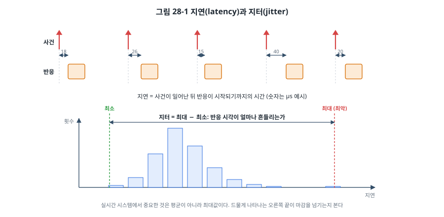
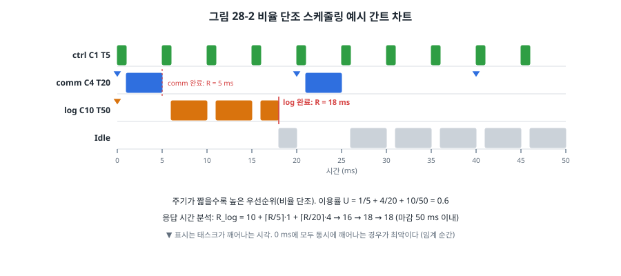
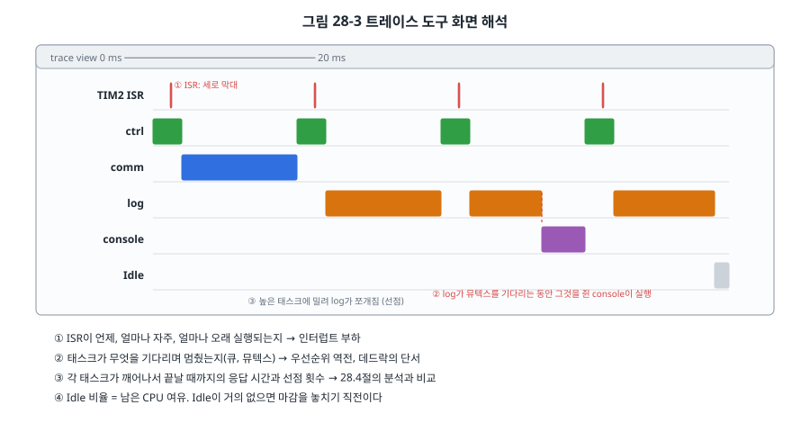

# 28장. 실시간성 분석

## 이 장에서 배우는 것

- "실시간"의 정확한 뜻: 빠름이 아니라 마감 시간을 지키는 것
- 최악 실행 시간(WCET)을 재고 추정하는 방법
- 인터럽트 지연과 지터를 측정하고 줄이는 방법
- 비율 단조 스케줄링과 응답 시간 분석으로 마감을 지킬 수 있는지 미리 계산하기
- 트레이스로 실제 실행 순서를 들여다보기

---

## 28.1 실시간이란

"실시간 시스템"이라고 하면 흔히 "빠른 시스템"을 떠올립니다. 하지만 실시간의 정확한 뜻은 **정해진 시간 안에 반드시 반응하는 시스템**입니다. 평균 1 µs에 반응하지만 가끔 100 ms가 걸리는 시스템은 빠르지만 실시간이 아닙니다. 항상 10 ms 안에 반응하는 시스템은 느려도 실시간입니다.

반응해야 하는 시간의 한계를 **마감 시간(deadline)** 이라고 하고, 마감을 놓쳤을 때의 결과에 따라 실시간 시스템을 나눕니다.

| 구분 | 마감을 놓치면 | 예 |
| --- | --- | --- |
| 경성 실시간 (hard) | 시스템이 실패한다. 사고, 손상 | 에어백, 모터 과전류 차단, 브레이크 제어 |
| 연성 실시간 (soft) | 품질이 떨어진다 | 오디오 재생의 끊김, 화면의 버벅임 |
| 준경성 (firm) | 늦은 결과는 쓸모없지만 가끔은 견딘다 | 센서 값 하나 놓침, 영상 프레임 하나 버림 |

경성 실시간에서 중요한 것은 **평균이 아니라 최악**입니다. 백만 번 중 한 번 늦는 것도 허용되지 않습니다. 이 장의 모든 도구는 "최악의 경우에도 마감을 지키는가?"라는 하나의 질문에 답하기 위한 것입니다. 26장과 27장이 RTOS를 **쓰는** 법이었다면, 이 장은 그 결과가 **맞는지 확인하는** 법입니다.

## 28.2 최악 실행 시간 (WCET)

모든 분석은 각 태스크와 ISR이 **최악의 경우 얼마나 걸리는가**에서 시작합니다. 이것을 **WCET(Worst-Case Execution Time)** 라고 합니다.

WCET를 구하기 어려운 이유는 실행 시간이 여러 이유로 달라지기 때문입니다.

- **입력에 따라 경로가 다릅니다.** `if`와 반복문이 입력에 따라 다른 길로 갑니다. 오류 처리 경로처럼 드물게 실행되는 길이 가장 오래 걸리는 경우가 많습니다.
- **하드웨어 상태에 따라 다릅니다.** STM32F4의 Flash는 클럭이 빠르면 대기 상태(wait state)가 필요하고, 이를 숨기는 프리페치와 명령 캐시(ART 가속기)는 적중하면 빠르고 빗나가면 느립니다. Cortex-M7처럼 데이터 캐시가 있으면 차이가 더 커집니다.
- **간섭이 있습니다.** DMA(10장)가 같은 버스를 쓰면 CPU의 메모리 접근이 기다립니다.

WCET를 구하는 방법은 두 가지입니다.

**측정**: 실제로 실행하면서 시간을 잽니다. 24장의 `max_us`, 23장의 GPIO 토글, DWT 사이클 카운터(34장)가 이 방법입니다. 쉽고 실용적이지만, 측정하는 동안 최악의 경로가 실행되었다는 보장이 없습니다. 그래서 측정할 때는 최악 조건(가장 긴 입력, 오류 경로, 동시에 일어나는 인터럽트, DMA 동작)을 일부러 만들고, 측정값에 여유(흔히 20~50%)를 더합니다.

**정적 분석**: 기계어를 분석해 모든 경로의 시간을 계산합니다. 반복 횟수의 상한을 알려 줘야 하고, 캐시와 파이프라인의 모델이 필요합니다. 항공, 자동차 분야에서 쓰는 상용 도구들이 있으며, 결과가 보장된 상한이라는 장점이 있지만 단순한 MCU가 아니면 상한이 매우 비관적으로 나옵니다.

실무에서는 측정을 기본으로 하되, WCET가 잘 정해지도록 **코드를 쓰는 습관**이 더 중요합니다.

- 반복문에는 상한이 있어야 합니다. `while (!(SR & FLAG))`처럼 하드웨어를 기다리는 반복문에는 15장처럼 시간 제한을 둡니다.
- 동적 할당(25장)과 재귀를 피합니다. 실행 시간을 예측할 수 없습니다.
- 마감이 짧은 코드는 경로가 단순하게, 오래 걸리는 일은 낮은 우선순위 태스크로 보냅니다.
- 시간이 중요한 함수는 RAM에서 실행하거나(Flash 대기 상태 제거), 캐시를 끄거나 잠가서 실행 시간의 변화를 줄이기도 합니다.

## 28.3 인터럽트 지연과 지터



**인터럽트 지연(interrupt latency)** 은 하드웨어가 인터럽트를 요청한 순간부터 ISR의 첫 명령이 실행되기까지의 시간입니다. **지터(jitter)** 는 이 시간이 얼마나 흔들리는가, 즉 최대와 최소의 차이입니다. 그림 28-1처럼 같은 사건이라도 매번 지연이 다르고, 그 분포의 오른쪽 끝(최대)이 실시간성을 결정합니다.

지연을 이루는 것들은 다음과 같습니다.

1. **하드웨어 진입 시간**: Cortex-M4는 대기 상태 없는 메모리에서 12클럭 만에 ISR의 첫 명령을 실행합니다(7장). 스택에 레지스터 8개를 쌓으면서 동시에 벡터 테이블을 읽기 때문입니다. FPU를 쓰던 중이라면 지연 저장(26장) 덕분에 진입 시간은 늘지 않고, ISR이 FPU를 쓸 때 저장 시간이 더해집니다. Flash 대기 상태가 있으면 그만큼 늘어납니다.
2. **실행 중이던 명령의 완료**: 대부분의 명령은 1클럭이지만, 여러 레지스터를 읽고 쓰는 명령이나 나눗셈은 더 걸립니다. Cortex-M4는 이런 명령의 일부를 중단했다가 다시 시작해 지연을 줄입니다.
3. **더 높은 우선순위의 ISR**: 실행 중이거나 동시에 요청된 더 급한 ISR이 끝날 때까지 기다립니다.
4. **인터럽트를 막은 구간**: `cpsid i`(7장), `taskENTER_CRITICAL()`(27장)로 인터럽트를 막은 구간이 끝날 때까지 기다립니다. **대부분의 경우 지터의 가장 큰 원인이 이것입니다.**

### 직접 재 보기

`code/ch28-realtime/stm32/`의 예제는 이 지연을 직접 잽니다. TIM2를 16 MHz 그대로 세게 하고 1 ms마다 갱신 인터럽트를 냅니다. 갱신 순간 카운터는 0부터 다시 세므로, ISR 첫머리에서 읽은 카운터 값이 곧 "인터럽트 발생부터 ISR 시작까지"의 클럭 수입니다.

```c
void TIM2_IRQHandler(void)
{
    uint32_t cnt = TIM2->CNT;                  /* 가장 먼저 읽는다 */
    TIM2->SR = ~TIM_SR_UIF;
    if (cnt < lat_min) lat_min = cnt;
    if (cnt > lat_max) lat_max = cnt;
    ...
}
```

이 값에는 하드웨어 진입 12클럭 말고도 ISR 앞부분의 명령과 APB1 버스를 거쳐 카운터를 읽는 시간이 들어 있으므로, 최소값은 12보다 조금 큽니다. 중요한 것은 최소와 최대의 차이입니다.

`l` 명령으로 결과를 봅니다. 그다음 `c`로 "5 ms마다 크리티컬 섹션에서 100 µs 동안 일하는" 태스크를 켜고 다시 봅니다.

```
TIM2 prio 6, 2000 interrupts: latency min 24 cyc (1500 ns), max 31 cyc (1937 ns)
...
critical-section task on
TIM2 prio 6, 2000 interrupts: latency min 24 cyc (1500 ns), max 1609 cyc (100562 ns)
  < 100 us : ...
  >=100 us : 3
```

(값은 예시입니다. [확인 필요: 보드 실측]) 크리티컬 섹션 하나가 최대 지연을 약 100 µs로 늘렸습니다. 평균은 거의 그대로라서, 평균만 봤다면 놓쳤을 문제입니다. 이제 `p`로 TIM2의 우선순위를 6에서 2로 올립니다.

```
TIM2 priority 2 (above configMAX_SYSCALL: never masked by the kernel)
TIM2 prio 2, 2000 interrupts: latency min 24 cyc (1500 ns), max 33 cyc (2062 ns)
```

26장에서 본 것처럼 FreeRTOS의 크리티컬 섹션은 BASEPRI로 우선순위 5~15만 막습니다. 우선순위 2의 ISR은 커널이 무엇을 하든 막히지 않으므로 지터가 다시 작아집니다. 대신 이 ISR에서는 FreeRTOS API를 하나도 부를 수 없습니다. 모터의 전류 보호처럼 **µs 단위로 반응해야 하고 RTOS의 도움이 필요 없는 일**을 이 범위에 둡니다.

### 지연과 지터를 줄이는 방법

- **인터럽트를 막는 구간을 짧게** 합니다. 크리티컬 섹션 안에서는 변수 몇 개만 바꾸고, 긴 일은 뮤텍스로 지킵니다.
- **급한 인터럽트에 높은 우선순위**를 줍니다. 필요하면 RTOS가 막지 않는 범위(STM32 FreeRTOS에서 0~4)에 둡니다.
- **ISR을 짧게** 합니다(27장의 지연 처리). 긴 ISR은 그보다 낮은 우선순위 ISR 모두의 지연이 됩니다.
- **하드웨어에 맡깁니다.** 정확한 시각에 핀을 바꿔야 하면 타이머의 출력 비교(8장), 정확한 주기로 샘플링해야 하면 타이머 트리거 ADC와 DMA(9장, 10장)를 씁니다. 하드웨어가 하는 일에는 소프트웨어 지터가 없습니다.

> 🔧 ATmega128에서는: AVR의 인터럽트 응답 시간은 최소 4클럭입니다(현재 PC를 스택에 넣고 벡터로 점프). 벡터의 `JMP` 명령과 ISR의 레지스터 저장이 더해지고, 실행 중이던 명령이 여러 클럭짜리라면 그것이 끝날 때까지 기다립니다. Cortex-M과 달리 레지스터 저장을 소프트웨어(컴파일러가 만든 `push` 명령들)가 하므로, ISR 안에서 함수를 부르면 컴파일러가 모든 임시 레지스터를 저장하게 되어 진입과 복귀가 수십 클럭 길어집니다. 또 AVR은 기본적으로 ISR 실행 중에 다른 인터럽트가 막히므로(7장), 긴 ISR 하나가 다른 모든 인터럽트의 지연이 됩니다.

## 28.4 비율 단조 스케줄링

여러 주기 태스크가 있을 때 우선순위를 어떻게 정해야 모두 마감을 지킬까요? 26장에서 "마감이 짧을수록 높게"라고 했습니다. 마감이 주기와 같다면 **주기가 짧을수록 높은 우선순위**를 주는 것이 되고, 이것을 **비율 단조 스케줄링(RMS, Rate Monotonic Scheduling)** 이라고 합니다.

1973년 Liu와 Layland는 다음 조건에서 RMS가 **고정 우선순위 방식 중 최적**임을 증명했습니다. 즉 어떤 고정 우선순위 배정으로 스케줄 가능한 태스크 집합이라면 RMS로도 스케줄 가능합니다.

- 태스크는 주기적이고, 마감은 주기와 같다.
- 태스크끼리 서로 기다리지 않는다(공유 자원 없음).
- 문맥 전환 시간은 무시한다.

현실은 이 조건과 조금 다르지만, RMS는 여전히 출발점으로 가장 좋은 우선순위 배정 방법입니다. 예제의 태스크 세 개를 봅시다.

| 태스크 | 주기 T | 실행 시간 C | 이용률 C/T | 우선순위 (RMS) |
| --- | --- | --- | --- | --- |
| ctrl | 5 ms | 1 ms | 0.2 | 4 (가장 높음) |
| comm | 20 ms | 4 ms | 0.2 | 3 |
| log | 50 ms | 10 ms | 0.2 | 2 |



그림 28-2는 세 태스크가 0 ms에 동시에 깨어난 경우입니다. 모두가 동시에 깨어나는 순간을 **임계 순간(critical instant)** 이라고 하며, 각 태스크의 응답 시간이 가장 길어지는 최악의 경우입니다. ctrl은 언제나 바로 실행되고, comm은 ctrl에 한 번 밀려 5 ms에 끝나며, log는 ctrl과 comm에 여러 번 밀려 18 ms에 끝납니다. 모두 마감(주기) 안입니다.

## 28.5 스케줄 가능성 분석

그림을 그리지 않고 계산으로 확인하는 방법이 두 가지 있습니다.

### 이용률 상한

태스크 n개의 전체 **이용률(utilization)** U는 각 태스크의 C/T를 더한 값으로, CPU를 얼마나 쓰는지를 나타냅니다. Liu와 Layland는 RMS에서 다음 조건을 만족하면 **반드시** 모든 마감을 지킨다는 것을 보였습니다.

U ≤ n(2^(1/n) − 1)

| 태스크 수 n | 1 | 2 | 3 | 4 | 5 | ∞ |
| --- | --- | --- | --- | --- | --- | --- |
| 상한 | 1.000 | 0.828 | 0.780 | 0.757 | 0.743 | ln 2 ≈ 0.693 |

예제는 U = 0.6 ≤ 0.780이므로 스케줄 가능합니다. 이 검사는 아주 간단하지만 **충분조건**일 뿐입니다. 상한을 넘었다고 스케줄 불가능한 것은 아니며, 그때는 다음의 더 정확한 분석을 합니다. 참고로 우선순위를 실행 중에 바꾸는 EDF(Earliest Deadline First, 마감이 가장 가까운 태스크를 먼저) 스케줄링은 U ≤ 1이면 스케줄 가능하지만, FreeRTOS 같은 대부분의 RTOS는 고정 우선순위를 씁니다.

### 응답 시간 분석

**응답 시간 분석(RTA, Response Time Analysis)** 은 각 태스크의 최악 응답 시간 R을 직접 계산합니다. 태스크 i가 깨어난 뒤 끝날 때까지 걸리는 시간은 자기 실행 시간에, 그동안 끼어드는 더 높은 우선순위 태스크들의 실행 시간을 더한 것입니다. R 동안 주기 T_j인 태스크 j는 최대 ⌈R / T_j⌉번 깨어나므로,

R_i = C_i + B_i + Σ_(j가 i보다 높은 우선순위) ⌈R_i / T_j⌉ · C_j

R이 양쪽에 있으므로 R = C_i에서 시작해 값이 변하지 않을 때까지 반복합니다. 도중에 마감 D_i를 넘으면 스케줄 불가능입니다. B_i는 27장의 공유 자원 때문에 **낮은 우선순위 태스크에게 막힐 수 있는 최대 시간**입니다. 우선순위 상속 뮤텍스를 쓰면 대략 "낮은 태스크들이 그 뮤텍스를 쥐는 가장 긴 구간"이 됩니다. 27장에서 뮤텍스를 쥔 구간을 짧게 하라고 한 이유가 이 식에 그대로 나타납니다.

log 태스크의 계산을 따라가 봅시다.

```
R = 10                              (C만)
R = 10 + ⌈10/5⌉·1 + ⌈10/20⌉·4 = 10 + 2 + 4 = 16
R = 10 + ⌈16/5⌉·1 + ⌈16/20⌉·4 = 10 + 4 + 4 = 18
R = 10 + ⌈18/5⌉·1 + ⌈18/20⌉·4 = 10 + 4 + 4 = 18   → 수렴, 18 ≤ 50
```

그림 28-2의 18 ms와 같습니다. 이 계산을 하는 작은 도구를 `code/ch28-realtime/host/`에 넣었습니다.

```bash
cd code/ch28-realtime/host
make test
./rta
```

```
utilization U = 0.600, Liu-Layland bound for n=3: 0.780 -> schedulable (sufficient test)
task          C      T      D      B        R
ctrl          1      5      5      0        1
comm          4     20     20      0        5
log          10     50     50      0       18
```

핵심은 반복 계산 몇 줄입니다.

```c
uint32_t rta_response_time(const rt_task_t *tasks, size_t i)
{
    const rt_task_t *t = &tasks[i];
    uint32_t r = t->C + t->B;
    for (;;) {
        uint32_t next = t->C + t->B;
        for (size_t j = 0; j < i; j++) {
            next += ceil_div(r, tasks[j].T) * tasks[j].C;
        }
        if (next > t->D) {
            return UINT32_MAX;          /* 마감을 넘는다: 스케줄 불가능 */
        }
        if (next == r) {
            return r;
        }
        r = next;
    }
}
```

테스트에는 이용률이 상한(n=2에서 0.828)을 넘는 U = 0.9인데도 RTA로는 스케줄 가능한 예가 들어 있습니다. 이용률 상한이 얼마나 보수적인지 보여 줍니다.

### 보드에서 확인하기

보드의 예제는 같은 세 태스크를 RMS 우선순위로 실행하고, 각 태스크가 깨어날 시각부터 일을 마칠 때까지의 최대 응답 시간을 잽니다. `r` 명령으로 예측과 비교합니다.

```
task   T(ms)  max R(ms)  RTA R(ms)  misses
ctrl       5          1          1       0
comm      20          5          5       0
log       50         18         18       0
```

(값은 예시입니다. [확인 필요: 보드 실측]) 측정값이 예측보다 1 ms 정도 크게 나올 수도 있습니다. 응답 시간을 1 ms 틱 단위로 재고, 분석에 넣지 않은 틱 인터럽트, TIM2 인터럽트, 문맥 전환 시간이 실제로는 CPU를 조금씩 쓰기 때문입니다. 실제 분석에서는 이런 **오버헤드**도 높은 우선순위의 "태스크"로 넣어 계산합니다(예: 1 ms마다 실행되고 몇 µs 걸리는 틱 ISR).

> ⚠️ 주의: 분석은 입력한 C 값만큼만 정확합니다. C에 측정한 평균을 넣으면 결과는 의미가 없습니다. 최악 조건에서 측정한 최대값에 여유를 더해 넣으세요. 그리고 분석 결과 이용률이 0.9처럼 높게 나왔다면, 계산상 가능하더라도 나중에 기능을 추가할 여유가 없다는 뜻입니다. 많은 프로젝트가 설계 목표로 이용률 상한보다 낮은 값(예: 0.6~0.7)을 정해 둡니다.

## 28.6 트레이싱

분석은 모델로 하는 계산입니다. 실제 시스템이 모델대로 움직이는지 보려면 **트레이스(trace)**, 즉 실제로 어떤 태스크와 ISR이 언제 실행되었는지의 기록이 필요합니다.

가장 간단한 트레이스는 23장의 GPIO 토글입니다. 태스크마다 핀 하나를 정해 실행 중에 High로 두고 로직 애널라이저로 보면, 그림 28-2 같은 간트 차트가 그대로 나타납니다. 핀 수의 제약이 있지만 시간 왜곡이 거의 없습니다.

FreeRTOS는 커널 곳곳에 **트레이스 훅 매크로**를 두었습니다. 태스크가 CPU를 받을 때(`traceTASK_SWITCHED_IN`), 큐에서 Blocked가 될 때, ISR에 들어갈 때 등의 자리에서 매크로가 불리고, 기본값은 비어 있습니다. 예제는 이 매크로로 문맥 전환 순간의 사이클 카운터와 태스크를 링 버퍼에 남깁니다.

```c
/* FreeRTOSConfig.h */
void trace_switched_in(void);
#define traceTASK_SWITCHED_IN() trace_switched_in()

/* main.c */
void trace_switched_in(void)                   /* 커널이 문맥 전환 중에 부른다: 아주 짧게 */
{
    if (trace_on) {
        uint32_t i = trace_head;
        trace_buf[i].cycles = DWT_CYCCNT;
        trace_buf[i].task = xTaskGetCurrentTaskHandle();
        trace_head = (i + 1u) & (TRACE_N - 1u);
    }
}
```

`t` 명령은 최근 문맥 전환 32개를 출력합니다.

```
    time(us)  task
           0  IDLE
         998  ctrl
        2004  comm
        5001  ctrl
        6005  comm
        ...
```

(값은 예시입니다.) 이 목록을 그림 28-2와 비교해 보세요. 훅 함수는 문맥 전환 중에, 인터럽트가 막힌 상태로 실행되므로 아주 짧아야 합니다. 여기서 `printf`를 하면 시스템 전체의 타이밍이 바뀝니다.

전문 트레이스 도구는 같은 일을 훨씬 자세하게 합니다. SEGGER SystemView, Percepio Tracealyzer 같은 도구는 FreeRTOS와 Zephyr의 트레이스 훅을 이용해 이벤트를 RAM에 기록하거나 디버그 프로브(J-Link, SWO/ITM)로 흘려보내고, PC에서 그림 28-3 같은 화면으로 보여 줍니다. [확인 필요: 각 도구의 무료 사용 조건]



트레이스 화면에서 볼 것은 다음과 같습니다.

1. **ISR**: 언제, 얼마나 자주, 얼마나 오래 실행되는가. 예상보다 자주 실행되는 ISR(노이즈로 인한 가짜 인터럽트, 지워지지 않는 플래그)이 흔히 발견됩니다.
2. **멈춘 이유**: 태스크가 무엇을 기다리며 Blocked가 되었는가. 높은 태스크가 뮤텍스를 기다리는 동안 낮은 태스크가 실행되는 모습은 우선순위 역전(27장)의 증거입니다.
3. **응답 시간과 선점**: 각 태스크가 깨어나서 끝날 때까지의 시간이 분석 결과와 맞는가. 측정된 최대값을 RTA에 다시 넣어 분석을 갱신합니다.
4. **CPU 부하**: Idle 태스크의 비율이 곧 남은 여유입니다. Idle이 거의 보이지 않는다면 마감을 놓치기 직전입니다.

> 💡 팁: 트레이스는 버그가 났을 때만 켜는 도구가 아닙니다. 기능을 추가할 때마다 트레이스를 찍어 이전과 비교하는 습관을 들이면, "새 기능 때문에 제어 태스크의 응답 시간이 3 ms 늘었다"를 버그가 되기 전에 발견할 수 있습니다. 링 버퍼 트레이스를 제품 펌웨어에 남겨 두고, 폴트(23장)나 워치독 리셋(35장) 직전의 기록을 비휘발성 메모리에 저장하는 제품도 많습니다.

## 28.7 실습 정리

| 명령 | 보는 것 |
| --- | --- |
| `l` | TIM2 인터럽트 지연의 최소, 최대, 분포 |
| `c` | 크리티컬 섹션(100 µs) 태스크 켜기/끄기 → 지터 변화 |
| `p` | TIM2 우선순위 6 ↔ 2 → 커널이 막는 범위 안/밖 |
| `r` | 태스크별 최대 응답 시간과 RTA 예측 |
| `t` | 최근 문맥 전환 32개 |

FreeRTOS 커널과 UART 드라이버는 26장, 27장 예제의 것을 함께 씁니다.

```bash
(cd code/ch26-freertos/stm32 && ./get_freertos.sh)
cd code/ch28-realtime/stm32
make flash
```

---

## 정리

- 실시간은 빠름이 아니라 마감을 지키는 것입니다. 경성 실시간에서는 평균이 아니라 최악이 중요합니다.
- WCET는 측정(최악 조건을 만들고 여유를 더함)이나 정적 분석으로 구합니다. 상한 있는 반복문, 동적 할당과 재귀 회피가 WCET를 정하기 쉽게 만듭니다.
- 인터럽트 지연은 하드웨어 진입, 더 높은 ISR, 인터럽트를 막은 구간으로 이루어지며, 지터의 가장 큰 원인은 막은 구간입니다. 아주 급한 ISR은 RTOS가 막지 않는 우선순위에 둡니다.
- 비율 단조 스케줄링은 주기가 짧을수록 높은 우선순위를 주며, 고정 우선순위 중 최적입니다.
- 이용률 상한 n(2^(1/n) − 1)은 간단한 충분조건이고, 응답 시간 분석은 각 태스크의 최악 응답 시간을 정확히 계산합니다. 막힘 시간 B로 공유 자원의 영향을 넣습니다.
- 트레이스로 실제 실행 순서를 보고, 분석의 가정이 맞는지 확인합니다.

## 연습 문제

1. 다음 태스크 집합의 이용률을 구하고 RMS 우선순위를 정한 뒤, 응답 시간 분석으로 스케줄 가능성을 판단하세요. A(C=2, T=10), B(C=4, T=15), C(C=10, T=35). `host/rta`의 태스크 목록을 바꿔 답을 확인하세요.
2. 문제 1에서 가장 낮은 우선순위 태스크가 쥐는 뮤텍스를 가장 높은 태스크도 쓰며, 쥐는 시간이 최대 3 ms입니다. 각 태스크의 B와 응답 시간은 어떻게 바뀌나요?
3. 이용률이 0.85인 태스크 4개가 있습니다. 이용률 상한 검사로 판단할 수 있나요? 다음에 무엇을 해야 하나요?
4. 인터럽트 지연을 쟀더니 평균 2 µs, 최대 340 µs였습니다. 최대값의 원인을 찾기 위해 무엇을 확인하겠습니까? 세 가지 이상 쓰세요.
5. 10 kHz로 정확하게 샘플링해야 하는 ADC가 있습니다. (a) 우선순위가 가장 높은 태스크에서 `vTaskDelayUntil()`로 (b) 타이머 ISR에서 소프트웨어로 변환 시작 (c) 타이머 트리거와 DMA로. 각 방법의 지터를 비교하고 이유를 쓰세요.
6. (실습) 예제의 크리티컬 섹션을 100 µs에서 500 µs로 바꾸고 `l`과 `r`을 다시 보세요. 지연 분포와 응답 시간이 어떻게 바뀌는지 기록하고, 그 결과를 RTA의 B 항으로 설명해 보세요.
