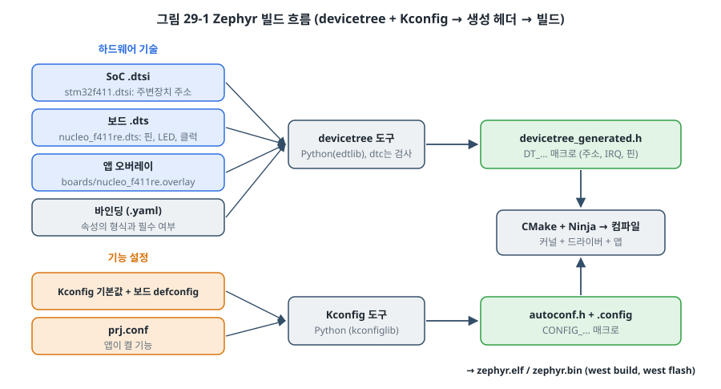
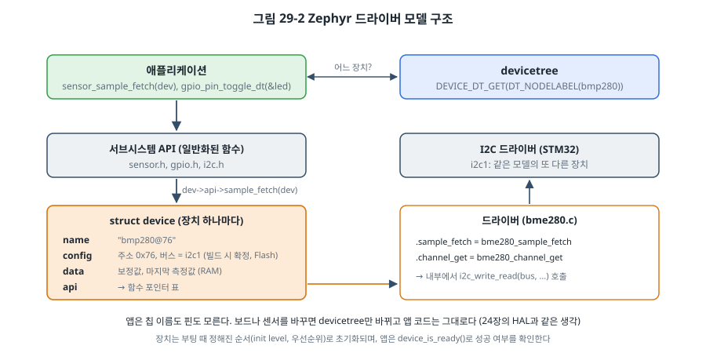

# 29장. Zephyr RTOS

## 이 장에서 배우는 것

- Zephyr가 FreeRTOS와 다른 점: 커널이 아니라 플랫폼
- west로 작업 공간을 만들고 빌드하는 방법
- devicetree로 하드웨어를, Kconfig로 기능을 기술하는 방법
- Zephyr의 드라이버 모델과 커널 객체
- 새 보드를 지원하는 방법과 FreeRTOS와의 비교

---

## 29.1 Zephyr의 철학

26~28장의 FreeRTOS는 **커널**입니다. 태스크, 큐, 세마포어, 타이머를 주지만, GPIO나 I2C를 다루는 법, 네트워크 스택, 파일 시스템은 각자 가져와 붙여야 합니다. 그래서 FreeRTOS 프로젝트는 제조사 HAL, LwIP, FatFs 같은 여러 출처의 코드를 조합한 모양이 됩니다.

**Zephyr**는 다른 길을 택했습니다. Linux Foundation이 운영하는 오픈소스 프로젝트(Apache 2.0 라이선스)로, 커널뿐 아니라 수백 종 보드의 지원, 통일된 드라이버 모델, TCP/IP와 BLE 스택, 파일 시스템, USB, 셸, 로그, 펌웨어 업데이트(32장의 MCUboot)까지 **한 저장소에서 함께 관리하는 플랫폼**입니다. 리눅스 커널에서 많은 아이디어를 가져왔습니다. 하드웨어를 **devicetree**로 기술하고, 기능을 **Kconfig**로 켜고 끄며, 드라이버가 같은 API 뒤에 숨는 것이 그렇습니다.

이 철학의 결과는 분명합니다.

- **이식성**: 보드를 바꾸면 devicetree와 설정만 바뀌고 앱 코드는 그대로입니다. 24장의 HAL 원칙을 플랫폼 전체가 따릅니다.
- **완성도**: BLE, Thread, Matter, LwM2M 같은 복잡한 스택을 바로 쓸 수 있고, 함께 시험되어 나옵니다.
- **대가**: 배울 것이 많습니다. 빌드 시스템이 크고, 설정이 여러 파일에 흩어지며, 오류 메시지를 이해하려면 이 장에서 다룰 구조를 알아야 합니다. 작은 프로젝트라면 FreeRTOS나 24장의 구조가 더 빠른 길일 수 있습니다.

> 🔧 ATmega128에서는: Zephyr는 32비트(와 64비트) CPU를 위한 플랫폼입니다. Arm Cortex-M/A/R, RISC-V, Xtensa(ESP32), x86 등을 지원하지만, AVR 같은 8비트 MCU는 지원하지 않습니다. 이 장의 내용은 STM32를 기준으로 합니다.

## 29.2 west와 작업 공간

Zephyr는 여러 저장소(커널, 제조사별 HAL, 외부 라이브러리)로 이루어져 있고, 이것들을 맞는 버전으로 함께 받고 관리하는 도구가 **west**입니다. 22장에서 CMake가 빌드를 관리한다고 했다면, west는 그 위에서 저장소, 빌드, 업로드, 디버깅을 묶어 줍니다.

설치 과정은 대략 다음과 같습니다. 정확한 명령은 Zephyr 버전마다 조금씩 바뀌므로 공식 문서의 "Getting Started Guide"를 함께 보세요. [확인 필요: 출간 시점 Zephyr 버전의 설치 명령]

```bash
python3 -m venv ~/zephyrproject/.venv           # Python 가상 환경
source ~/zephyrproject/.venv/bin/activate
pip install west
west init ~/zephyrproject                       # Zephyr 저장소와 manifest(west.yml) 받기
cd ~/zephyrproject
west update                                     # manifest에 적힌 모든 저장소 받기
west zephyr-export                              # CMake가 Zephyr를 찾을 수 있게 등록
west packages pip --install                     # Python 의존 패키지
cd zephyr && west sdk install                   # 툴체인(Zephyr SDK)
```

**manifest**(`west.yml`)에는 함께 쓸 저장소들과 그 버전(커밋)이 적혀 있습니다. 22장에서 "빌드를 재현할 수 있어야 한다"고 했던 원칙을 west가 저장소 단위로 지켜 줍니다. 제품 프로젝트에서는 자기 앱 저장소에 manifest를 두고 Zephyr의 특정 버전을 고정하는 방식을 많이 씁니다.

빌드와 업로드는 다음과 같습니다.

```bash
west build -p always -b nucleo_f411re path/to/code/ch29-zephyr
west flash                                      # 보드의 ST-LINK로 업로드
west debug                                      # GDB 연결 (23장)
```

`-b`로 보드를 고르는 것이 핵심입니다. 같은 앱을 `-b nrf52840dk/nrf52840`으로 빌드하면 Nordic 보드용 펌웨어가 됩니다(장치가 devicetree에 있다면). `-b native_sim`으로 빌드하면 **PC에서 실행되는 프로그램**이 되어 31장의 테스트에 쓸 수 있습니다.

## 29.3 devicetree: 하드웨어 기술

지금까지 핀 번호, 주변장치 주소, I2C 주소를 C 코드의 `#define`에 적었습니다. Zephyr는 이것을 **devicetree**라는 별도의 텍스트 파일에 씁니다. NUCLEO-F411RE의 보드 파일 일부를 봅시다.

```dts
/ {
	chosen {
		zephyr,console = &usart2;          /* printk가 나갈 곳 */
	};

	leds {
		compatible = "gpio-leds";
		green_led_2: led_2 {
			gpios = <&gpioa 5 GPIO_ACTIVE_HIGH>;   /* PA5, High = 켜짐 */
			label = "User LD2";
		};
	};

	gpio_keys {
		compatible = "gpio-keys";
		user_button: button {
			gpios = <&gpioc 13 GPIO_ACTIVE_LOW>;   /* PC13, 누르면 Low */
			zephyr,code = <INPUT_KEY_0>;
		};
	};

	aliases {
		led0 = &green_led_2;
		sw0 = &user_button;
	};
};

&i2c1 {
	pinctrl-0 = <&i2c1_scl_pb8 &i2c1_sda_pb9>;
	status = "okay";
	...
};
```

devicetree는 **노드**의 나무입니다. 각 노드는 하나의 장치이고, `compatible` 속성이 어떤 드라이버가 이 노드를 맡을지 정합니다. `&gpioa 5`처럼 다른 노드를 가리킬 수 있어서, "LD2는 GPIOA의 5번 핀에 있다"는 관계가 그대로 기술됩니다. 6장, 14장, 15장에서 한 줄씩 레지스터로 설정했던 정보가 여기에 모여 있습니다.

devicetree는 여러 파일이 겹쳐서 만들어집니다. SoC 파일(`stm32f411.dtsi`)이 주변장치의 주소와 인터럽트 번호를, 보드 파일이 핀과 보드 부품을, 그리고 앱의 **오버레이** 파일이 이 앱에서 추가로 연결한 부품을 기술합니다. 이 장의 예제는 15장의 BMP280을 오버레이로 붙입니다.

```dts
/* code/ch29-zephyr/boards/nucleo_f411re.overlay */
&i2c1 {
	clock-frequency = <I2C_BITRATE_STANDARD>;   /* 100 kHz: 15장과 같게 */

	bmp280: bmp280@76 {
		compatible = "bosch,bme280";
		reg = <0x76>;
	};
};
```

I2C1 노드 아래에 주소 0x76의 센서 노드를 하나 붙였을 뿐입니다. `compatible = "bosch,bme280"`인 드라이버가 BMP280도 지원하므로(칩 ID로 구분) 드라이버 코드는 한 줄도 쓰지 않습니다.

각 `compatible`에는 **바인딩**(`.yaml` 파일)이 있어서 그 노드에 어떤 속성이 필요하고 어떤 형식인지 정합니다. 속성을 빠뜨리거나 형식이 틀리면 빌드할 때 오류가 납니다.

### C 코드에서 devicetree 쓰기

빌드 시스템은 devicetree를 읽어 `devicetree_generated.h`라는 헤더를 만들고, C 코드는 매크로로 그 정보를 꺼냅니다.

```c
static const struct gpio_dt_spec led = GPIO_DT_SPEC_GET(DT_ALIAS(led0), gpios);
static const struct device *const bmp = DEVICE_DT_GET(DT_NODELABEL(bmp280));
```

`led`에는 "GPIOA 장치, 5번 핀, Active High"가 들어갑니다. 이 모든 것은 **빌드할 때** 상수로 정해집니다. 리눅스의 devicetree는 부팅할 때 읽는 데이터 파일이지만, Zephyr는 메모리와 시간을 아끼려고 컴파일 단계에서 매크로로 풀어 버립니다. 그래서 없는 노드를 가리키면 실행 중이 아니라 빌드 단계에서 오류가 납니다.

> ⚠️ 주의: devicetree 매크로의 오류 메시지는 처음 보면 매우 어렵습니다. `DT_N_S_soc_S_i2c_40005400_S_bmp280_76_P_...`처럼 긴 이름이 나오거나, `__device_dts_ord_42`가 정의되지 않았다는 링크 오류가 나옵니다. 대부분은 (1) 노드의 `status`가 `"okay"`가 아니거나, (2) 그 장치의 드라이버를 Kconfig에서 켜지 않았거나(`CONFIG_SENSOR=y` 등), (3) 노드 이름이나 별칭의 철자가 틀린 경우입니다. 빌드 폴더의 `build/zephyr/zephyr.dts`에 최종적으로 합쳐진 devicetree가 남으므로, 여기서 노드가 기대한 대로 들어갔는지 먼저 확인하세요.

## 29.4 Kconfig: 기능 설정

devicetree가 "무엇이 연결되어 있는가"라면, **Kconfig**는 "무엇을 쓸 것인가"입니다. 커널 기능, 드라이버, 라이브러리를 켜고 끄며 크기를 정합니다. 리눅스 커널에서 온 방식입니다.

```
# code/ch29-zephyr/prj.conf
# LD2
CONFIG_GPIO=y
# B1: gpio-keys 드라이버와 입력 서브시스템 (디바운싱 포함)
CONFIG_INPUT=y
# BMP280
CONFIG_I2C=y
CONFIG_SENSOR=y

CONFIG_PRINTK=y
CONFIG_MAIN_STACK_SIZE=1024
```

켜지 않은 기능은 아예 컴파일되지 않으므로 바이너리가 작아집니다. 설정 값은 Zephyr 전체의 기본값, 보드의 기본값(`nucleo_f411re_defconfig`), 앱의 `prj.conf` 순서로 겹쳐서 정해지고, 최종 결과는 `build/zephyr/.config`와 C 헤더 `autoconf.h`에 남습니다. 코드에서는 `#ifdef CONFIG_SENSOR`나 `IS_ENABLED(CONFIG_SENSOR)`로 씁니다.

설정 항목은 수천 개이므로, 무엇이 있는지는 메뉴 화면으로 찾아봅니다.

```bash
west build -t menuconfig        # 터미널 메뉴 (guiconfig는 창)
```

메뉴에서 `/`로 검색하면 각 항목의 설명, 의존 관계, 지금 값이 어디서 정해졌는지를 볼 수 있습니다. 메뉴에서 바꾼 값은 빌드 폴더에만 저장되므로, 마음에 들면 `prj.conf`로 옮겨 적어야 다음 빌드에도 남습니다.

> 💡 팁: `prj.conf`에서 값 뒤에 주석을 붙이지 마세요(`CONFIG_GPIO=y  # LED`). 주석은 줄 맨 앞의 `#`로만 씁니다. 그리고 어떤 항목을 `y`로 적었는데 최종 `.config`에서 꺼져 있다면, 그 항목이 의존하는 다른 항목이 꺼져 있거나 devicetree에 해당 장치가 없는 것입니다. 빌드 출력의 Kconfig 경고를 꼭 읽으세요.



그림 29-1은 이 두 갈래가 만나는 과정입니다. devicetree 쪽은 `DT_...` 매크로를, Kconfig 쪽은 `CONFIG_...` 매크로를 만들고, CMake와 Ninja(22장)가 커널, 켜진 드라이버, 앱을 함께 컴파일합니다.

## 29.5 드라이버 모델



Zephyr의 모든 장치는 `struct device` 하나로 표현됩니다. 여기에는 이름, devicetree에서 온 **설정**(주소, 버스, 핀: 빌드할 때 정해져 Flash에 놓임), 실행 중의 **데이터**(RAM), 그리고 **API**(함수 포인터 표)가 들어 있습니다.

앱은 `sensor_sample_fetch(dev)`처럼 서브시스템의 일반 함수를 부르고, 이 함수는 `dev->api->sample_fetch(dev)`로 실제 드라이버를 부릅니다. 24장에서 세탁기 상태 머신이 `washer_io_t` 함수 포인터 표로 하드웨어를 몰랐던 것과 정확히 같은 구조입니다. 그래서 BMP280을 다른 회사의 온도 센서로 바꿔도, 그 센서의 Zephyr 드라이버가 있다면 앱은 `SENSOR_CHAN_AMBIENT_TEMP`를 읽는 코드 그대로 동작합니다.

```c
if (!device_is_ready(bmp)) {
	printk("BMP280 not ready (wiring? address?)\n");
	return;
}
sensor_sample_fetch(bmp);                                   /* 측정 */
sensor_channel_get(bmp, SENSOR_CHAN_AMBIENT_TEMP, &s.temp); /* 결과 꺼내기 */
sensor_channel_get(bmp, SENSOR_CHAN_PRESS, &s.press);
```

장치들은 부팅할 때 커널이 정해진 **초기화 단계**(PRE_KERNEL_1, PRE_KERNEL_2, POST_KERNEL, APPLICATION)와 그 안의 우선순위 순서로 초기화합니다. I2C 버스가 센서보다 먼저 초기화되는 식입니다. 초기화가 실패한 장치(센서가 응답하지 않음)는 "준비되지 않음" 상태로 남으므로, 앱은 쓰기 전에 `device_is_ready()`로 확인합니다. 15장에서 칩 ID를 읽어 센서를 확인했던 일을 드라이버가 초기화 단계에서 대신 해 준 것입니다.

결과는 `struct sensor_value`로 나옵니다. 정수부 `val1`과 백만분의 1 단위 `val2`로 이루어져 있어서, FPU 없는 MCU에서도 `float` 없이 쓸 수 있습니다. 12장에서 온도를 정수로 다룬 것과 같은 이유입니다.

버튼은 Zephyr의 **입력 서브시스템**이 맡습니다. 보드 devicetree의 `gpio-keys` 노드를 보고 드라이버가 인터럽트 설정과 디바운싱까지 해 주며, 앱은 콜백만 등록합니다.

```c
static void button_cb(struct input_event *evt, void *user_data)
{
	if (evt->code == INPUT_KEY_0 && evt->value == 1) {    /* 눌림 */
		...
	}
}
INPUT_CALLBACK_DEFINE(NULL, button_cb, NULL);
```

7장에서 EXTI, 디바운싱 타이머, 플래그를 직접 만들었던 일이 이 몇 줄로 줄었습니다. 반대로 말하면 그 아래에서 무슨 일이 일어나는지는 7장의 지식으로 이해해야 합니다. 플랫폼은 일을 대신해 줄 뿐, 원리를 몰라도 되게 해 주지는 않습니다.

## 29.6 커널 객체

Zephyr 커널의 개념은 FreeRTOS와 거의 같고 이름만 다릅니다.

| 개념 | FreeRTOS | Zephyr |
| --- | --- | --- |
| 실행 단위 | 태스크 `xTaskCreate()` | 스레드 `k_thread_create()`, `K_THREAD_DEFINE()` |
| 우선순위 | 숫자가 클수록 높음 | 숫자가 **작을수록** 높음, 음수는 협력형 |
| 스택 크기 | 워드 단위 | 바이트 단위 |
| 기다리기 | `vTaskDelay()`, `vTaskDelayUntil()` | `k_msleep()`, `k_sleep(K_TIMEOUT_ABS_MS())` |
| 큐 | `xQueueCreate()` | `k_msgq` (`K_MSGQ_DEFINE()`) |
| 뮤텍스 | `xSemaphoreCreateMutex()` | `k_mutex` (우선순위 상속 포함) |
| 세마포어 | `xSemaphoreCreateBinary/Counting()` | `k_sem` |
| 이벤트 | 이벤트 그룹 | `k_event` |
| 지연 처리 | 태스크 알림 + 처리 태스크 | `k_work` (시스템 작업 큐) |
| 타이머 | 소프트웨어 타이머 | `k_timer` |

눈에 띄는 차이는 **정적 정의 매크로**입니다. Zephyr는 스레드, 큐, 뮤텍스를 대부분 `K_..._DEFINE()`으로 전역에 정의하고, 빌드할 때 메모리가 잡히며 부팅할 때 자동으로 만들어집니다. 25장의 "정적 할당이 가장 안전하다"는 원칙을 기본값으로 삼은 셈입니다.

```c
K_MSGQ_DEFINE(sample_q, sizeof(struct sample), 8, 4);   /* 항목 크기, 개수, 정렬 */

/* 스택 크기는 바이트 단위, 우선순위는 숫자가 작을수록 높다 (FreeRTOS와 반대) */
K_THREAD_DEFINE(blink_tid,  512,  blink_thread,  NULL, NULL, NULL, 7, 0, 0);
K_THREAD_DEFINE(sensor_tid, 1024, sensor_thread, NULL, NULL, NULL, 5, 0, 0);
```

> ⚠️ 주의: 우선순위 방향이 FreeRTOS와 **반대**입니다. FreeRTOS에서 5가 3보다 높지만, Zephyr에서는 3이 5보다 높습니다. 그리고 Zephyr의 음수 우선순위 스레드는 **협력형**이라 다른 스레드에게 선점되지 않습니다(ISR은 끼어듭니다). 26장의 코드를 옮길 때 가장 많이 틀리는 부분입니다.

27장의 지연 처리는 Zephyr에서 보통 **작업 큐(work queue)** 로 합니다. ISR에서 `k_work_submit(&my_work)`를 부르면, 커널의 시스템 작업 큐 스레드가 나중에 그 처리 함수를 실행합니다. 처리 함수가 많지 않다면 스레드를 따로 만들 필요가 없습니다. 다만 시스템 작업 큐는 여러 서브시스템이 함께 쓰므로, 그 안에서 오래 블록하면 다른 기능이 늦어집니다. 24장의 협력형 스케줄러와 같은 규칙입니다.

## 29.7 실습: 같은 일을 Zephyr로

`code/ch29-zephyr/`의 앱은 지금까지 레지스터로 했던 일을 Zephyr로 다시 합니다. LD2 깜박임(6장), B1 버튼(7장), BMP280 측정(15장), 그리고 측정값을 메시지 큐로 넘기기(27장)입니다.

```
ch29-zephyr/
├── CMakeLists.txt                  Zephyr를 찾아 앱 소스를 등록
├── prj.conf                        Kconfig: 켤 기능
├── boards/nucleo_f411re.overlay    devicetree 오버레이: BMP280 노드
└── src/main.c
```

```bash
cd ~/zephyrproject
west build -p always -b nucleo_f411re /path/to/embeddedsystem/code/ch29-zephyr
west flash
```

시리얼 터미널(115200 bps)에 다음과 같이 나옵니다.

```
*** Booting Zephyr OS build v4.4.2 ***
ch29 Zephyr on nucleo_f411re: B1 pauses sampling
#0 1003 ms  T = 24.87 C  P = 1012.3 hPa
#1 2003 ms  T = 24.88 C  P = 1012.3 hPa
sampling paused
```

(값은 예시입니다. [확인 필요: Zephyr v4.4 기준 빌드와 보드 실행]) 주목할 점을 정리합니다.

- `main.c`에는 핀 번호, I2C 주소, 레지스터가 하나도 없습니다. 모두 devicetree에서 옵니다.
- 클럭 설정도 없습니다. Zephyr의 NUCLEO-F411RE 보드 파일은 ST-LINK가 주는 8 MHz를 PLL로 올려 96 MHz로 동작하게 설정되어 있습니다. 지금까지의 예제(HSI 16 MHz)와 다르지만, UART 보레이트와 타이머는 드라이버가 클럭 트리(3장)를 읽어 알아서 맞춥니다.
- 15장의 BMP280 드라이버(보정 계산 포함)를 다시 쓰지 않았습니다. Zephyr의 드라이버가 같은 일을 합니다.
- 빌드 결과의 크기를 `west build -t rom_report`, `ram_report`로 보면, 같은 기능의 레지스터 예제보다 Flash를 훨씬 많이 쓰는 것을 확인할 수 있습니다. 플랫폼이 주는 편리함의 값입니다.

## 29.8 보드 이식

자기 회사의 보드에 Zephyr를 올리려면 **보드 정의**를 만듭니다. 이미 지원되는 SoC(예: STM32F411)를 쓴다면 일은 생각보다 적습니다. Zephyr의 `boards/st/nucleo_f411re/` 폴더가 좋은 출발점입니다.

| 파일 | 내용 |
| --- | --- |
| `board.yml` | 보드 이름, 제조사, 사용하는 SoC |
| `<보드>.dts` | 보드 devicetree: 클럭, 핀, LED, 버튼, 켤 주변장치 |
| `<보드>_defconfig` | 보드의 기본 Kconfig (예: 콘솔, GPIO) |
| `Kconfig.<보드>`, `Kconfig.defconfig` | 보드 선택과 보드별 기본값 |
| `board.cmake` | `west flash`, `west debug`가 쓸 도구 (OpenOCD, J-Link 등) |

순서는 보통 이렇습니다. (1) 비슷한 보드 폴더를 복사해 이름을 바꾸고, (2) devicetree에서 클럭 소스(외부 크리스털 주파수), 콘솔 UART, LED 핀부터 맞춰 `hello_world` 샘플이 출력되게 하고, (3) 주변장치를 하나씩 켜며 샘플로 확인합니다. 보드 폴더는 Zephyr 트리 밖, 자기 앱 저장소 안에 두고 빌드할 때 그 위치를 알려 줄 수 있으므로 Zephyr 자체를 고칠 필요가 없습니다.

시제품 단계에서 개발 보드에 부품 몇 개를 더 붙인 정도라면 보드 정의를 새로 만들 필요 없이, 이 장의 예제처럼 **오버레이**만으로 충분합니다.

> 💡 팁: 하드웨어 설계자에게 회로도와 함께 devicetree 오버레이를 받는 팀도 있습니다. "어느 핀에 무엇이 붙었는가"가 기계가 읽을 수 있는 하나의 파일로 정리되어 있으면, 펌웨어 쪽에서 핀 번호를 잘못 옮겨 적는 실수가 사라집니다.

## 29.9 FreeRTOS와 비교

| 항목 | FreeRTOS | Zephyr |
| --- | --- | --- |
| 범위 | 커널 (+ 별도 라이브러리) | 커널 + 드라이버 + 스택 + 도구 |
| 하드웨어 기술 | C 코드, 제조사 HAL | devicetree |
| 설정 | `FreeRTOSConfig.h` | Kconfig (`prj.conf`) |
| 빌드 | 아무 빌드 시스템 (Make, CMake, IDE) | CMake + west (정해져 있음) |
| 크기 | 커널 수 KB부터 | 최소 구성은 작지만 보통 수십 KB 이상 |
| 배우기 | 하루면 시작 | 구조를 익히는 데 시간이 걸림 |
| 이식 | 커널은 쉬움, 드라이버는 직접 | 지원 SoC라면 보드 정의만 |
| 네트워크, BLE | 별도 (LwIP, 제조사 스택) | 포함 |
| 쓰는 곳 | 제조사 SDK 기본 커널(ESP-IDF 등), 작은 제품 | 여러 SoC를 지원해야 하는 제품, 복잡한 통신 제품 |

어느 쪽이 낫다는 정답은 없습니다. 제조사 SDK가 FreeRTOS를 기본으로 제공하고 MCU를 바꿀 계획이 없다면 FreeRTOS가 자연스럽고, 여러 회사의 칩을 쓰거나 BLE, Thread 같은 표준 스택을 직접 관리하기 싫다면 Zephyr가 유리합니다. 어느 쪽이든 26~28장에서 배운 태스크, 동기화, 실시간 분석의 원리는 그대로 적용됩니다.

---

## 정리

- Zephyr는 커널, 드라이버, 통신 스택, 도구를 함께 관리하는 플랫폼입니다. 이식성과 완성도를 얻는 대신 배울 것이 많습니다.
- west는 여러 저장소와 빌드, 업로드, 디버깅을 관리합니다. `-b`로 보드를 고릅니다.
- devicetree는 하드웨어(무엇이 어디에 연결되었는가)를, Kconfig는 기능(무엇을 쓸 것인가)을 기술합니다. 둘 다 빌드할 때 C 매크로로 풀립니다.
- 드라이버 모델은 `struct device`와 API 함수 포인터 표로, 앱이 칩을 몰라도 되게 합니다. 쓰기 전에 `device_is_ready()`로 확인합니다.
- 커널 개념은 FreeRTOS와 같지만 이름, 스택 단위(바이트), 우선순위 방향(작을수록 높음)이 다릅니다.
- 지원되는 SoC라면 새 보드는 보드 정의나 오버레이로 지원합니다.

## 연습 문제

1. 예제의 BMP280을 I2C1이 아니라 I2C3(보드 파일의 기본 핀: PA8 = SCL, PB4 = SDA)에 연결했다고 합시다. 오버레이를 어떻게 바꿔야 하나요? `main.c`는 바꿔야 하나요? [힌트: 보드 파일의 i2c3 노드에는 `status = "okay"`가 없습니다.]
2. `prj.conf`에서 `CONFIG_SENSOR=y`를 지우고 빌드하면 어떤 오류가 나는지 예측하고 실제로 확인하세요. 오류 메시지에서 원인을 찾는 순서를 적어 보세요.
3. 26장의 `sample` 태스크(우선순위 3, 10 ms 주기)와 `blink` 태스크(우선순위 1)를 Zephyr로 옮기세요. 우선순위 숫자를 무엇으로 정하겠습니까?
4. 예제의 버튼 콜백은 어느 문맥(ISR, 어떤 스레드)에서 실행될까요? 그 안에서 `k_msleep()`을 부르면 어떤 문제가 생길 수 있는지 조사해 보세요. [확인 필요: Zephyr 입력 서브시스템의 콜백 실행 문맥 설정(CONFIG_INPUT_MODE)]
5. FreeRTOS와 Zephyr 중 하나를 골라야 하는 프로젝트 두 가지를 상상해 보고(예: 단일 MCU의 모터 컨트롤러, 여러 칩을 지원해야 하는 BLE 센서 제품군), 각각 어느 쪽을 고르겠는지 이유와 함께 쓰세요.
6. (실습) `west build -t rom_report`로 예제의 Flash 사용량을 보고, 가장 큰 항목 세 개가 무엇인지 확인하세요. `CONFIG_PRINTK=n`이나 로그 관련 설정을 바꿔 크기를 줄여 보세요.
