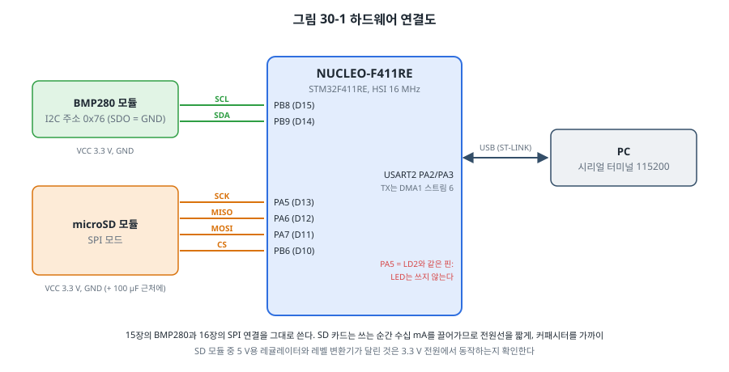
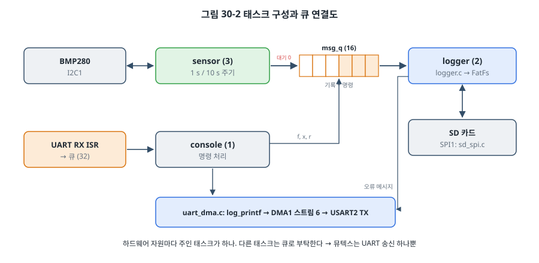
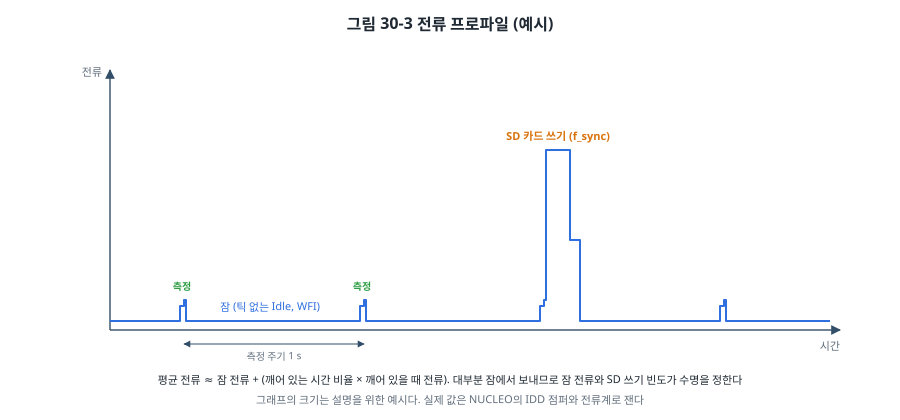

# 30장. 프로젝트: 환경 모니터링 데이터 로거

## 이 장에서 배우는 것

- 작은 제품 하나를 설계 문서부터 시험까지 끝내는 과정
- 요구 사항을 시험할 수 있는 문장으로 쓰는 방법
- SD 카드의 SPI 모드 프로토콜과 FatFs 파일 시스템
- 자원마다 주인 태스크를 두는 FreeRTOS 구조
- 틱 없는 Idle로 전력을 줄이고 전류 프로파일로 확인하기
- 하드웨어 없이 프로토콜부터 파일 시스템까지 시험하는 방법

---

## 30.1 무엇을 만드는가

제5부의 마지막 장에서는 지금까지 배운 것을 모아 실제로 쓸 수 있는 장치를 만듭니다. 실내 온도를 1초마다 재서 SD 카드에 CSV 파일로 남기는 **데이터 로거**입니다. 며칠 동안 켜 두었다가 카드를 빼서 PC의 스프레드시트로 열면 온도 그래프를 그릴 수 있습니다.

기능은 단순하지만 들어가는 기술은 많습니다.

| 기술 | 장 |
| --- | --- |
| BMP280 온도 센서, I2C, 버스 복구 | 15장 |
| SPI, SD 카드 | 16장, 이 장 |
| UART 송신을 DMA로 | 10장, 14장 |
| FreeRTOS 태스크, 큐, 뮤텍스 | 26장, 27장 |
| 계층 구조, 소유권, 오류 처리 | 24장, 27장 |
| 저전력 (틱 없는 Idle) | 11장, 26장 |
| PC 테스트 | 15장, 16장, 24장 |
| 빌드, 메모리, 디버깅 | 21~25장 |

이 장의 목표는 코드보다 **과정**입니다. 실무에서 펌웨어를 만드는 시간의 상당 부분은 무엇을 만들지 정하고, 잘못될 수 있는 경우를 생각하고, 그것이 정말 동작하는지 확인하는 데 쓰입니다.

## 30.2 설계 문서

코드를 쓰기 전에 **설계 문서**를 씁니다. 거창한 문서일 필요는 없습니다. 이 프로젝트의 설계 문서(`code/ch30-logger/DESIGN.md`)는 몇 쪽 분량이고, 다음 항목으로 이루어져 있습니다.

1. **목적**: 한두 문장. 누가, 무엇을 위해 쓰는가.
2. **요구 사항**: 번호를 붙인 목록과 확인 방법.
3. **하드웨어**: 부품과 연결.
4. **소프트웨어 구조**: 계층, 태스크, 자원의 주인.
5. **데이터 형식**: 파일과 통신의 정확한 모양.
6. **오류 처리**: 잘못될 수 있는 상황과 그때의 동작.
7. **전력**: 예상 전류와 측정 계획.
8. **시험 계획**: 각 요구 사항을 어떻게 확인하는가.

가장 중요한 것은 **요구 사항**입니다. 좋은 요구 사항은 시험할 수 있어야 합니다.

| 나쁜 요구 사항 | 좋은 요구 사항 |
| --- | --- |
| 온도를 자주 기록한다 | R1. 1초(설정에 따라 10초)마다 온도를 0.01 °C 단위로 기록한다 |
| 전원이 꺼져도 안전하다 | R3. 전원이 갑자기 끊겨도 최대 10개 기록만 잃는다 |
| SD 카드 오류에 강하다 | R6. SD 카드가 없거나 빠져도 멈추지 않고, 5초마다 다시 시도한다 |

오른쪽 문장은 각각 "어떻게 확인하는가"가 분명합니다. R3을 쓰는 순간 "그러려면 10줄마다 파일을 확정해야 한다"는 설계 결정이 따라 나오고, "전원 차단을 어떻게 시험하지?"라는 질문이 생깁니다. 이 질문에 대한 답이 30.7절의 시험입니다.

**범위 밖**을 적는 것도 중요합니다. 이 프로젝트는 시각(RTC), 무선 전송, 배터리 수명 최적화를 하지 않습니다. 적어 두지 않으면 개발 도중 "이것도 넣자"가 끝없이 늘어납니다.

> 💡 팁: 설계 문서는 처음에 완벽하게 쓰는 것이 아니라 **함께 자라는** 것입니다. 구현하면서 바뀐 결정은 문서에도 반영합니다. 코드와 같은 저장소에 마크다운으로 두면 코드 변경과 문서 변경을 한 커밋에 묶을 수 있고, 리뷰할 때 함께 볼 수 있습니다. 6개월 뒤의 자신이 "왜 10줄마다 sync하지?"라고 물을 때 답이 거기 있습니다.

## 30.3 하드웨어



15장의 BMP280 연결과 16장의 SPI 연결을 그대로 씁니다. SPI에는 W25Q 플래시 대신 microSD 카드 모듈을 연결합니다.

SD 카드는 원래 4비트 병렬 버스(SD 모드)로 통신하지만, 모든 카드는 **SPI 모드**도 지원합니다. 느리지만(이 예제는 8 MHz) 핀 네 개로 쓸 수 있어서 MCU 프로젝트에서 널리 씁니다. STM32F411에는 SD 모드 전용 주변장치(SDIO)도 있지만, 이 장은 어느 MCU로나 옮길 수 있는 SPI 모드를 씁니다.

전원에 주의해야 합니다. SD 카드는 쓰는 순간 수십 mA의 전류를 짧게 끌어갑니다. 전원선이 길거나 가늘면 그 순간 전압이 떨어져 카드가 리셋되고, 쓰기가 실패하거나 파일 시스템이 망가집니다. 카드 모듈의 전원 핀 가까이에 큰 커패시터(예: 10~100 µF)를 두고, 3.3 V 전원 경로를 짧게 합니다. 2장에서 다룬 전원 설계가 여기서 실제 문제가 됩니다.

> ⚠️ 주의: SPI1의 SCK가 PA5, 즉 보드의 LD2와 같은 핀입니다(16장). SD 카드와 통신할 때마다 LED가 깜박이고, LED 회로가 SCK 신호에 부하를 줍니다. 이 프로젝트는 LED를 쓰지 않습니다. 제품 보드라면 핀 배치 단계에서 이런 충돌을 정리합니다.

## 30.4 소프트웨어 구조



태스크는 세 개입니다.

| 태스크 | 우선순위 | 하는 일 | 주인인 자원 |
| --- | --- | --- | --- |
| sensor | 3 | 주기마다 온도를 재서 `msg_q`로 | I2C1, BMP280 |
| logger | 2 | `msg_q`에서 꺼내 SD 카드에 CSV로 | SPI1, SD 카드, FatFs |
| console | 1 | UART 명령 처리 | 없음 |

설계의 중심은 27장의 **소유권** 원칙입니다. I2C와 센서는 sensor 태스크만, SPI와 SD 카드와 FatFs는 logger 태스크만 건드립니다. console이 "지금 저장해"라고 하고 싶으면 SD 카드를 직접 만지지 않고 `msg_q`에 명령 메시지를 넣습니다. 그 결과 뮤텍스가 필요한 곳은 여러 태스크가 출력하는 UART 송신 하나뿐이고, FatFs도 재진입 보호 없이(`FF_FS_REENTRANT 0`) 쓸 수 있습니다.

```c
typedef enum { MSG_REC, MSG_FLUSH, MSG_CLOSE, MSG_RESTART } msg_type_t;
typedef struct {
    msg_type_t type;
    logrec_t   rec;
} msg_t;
```

우선순위는 28장의 원칙을 따릅니다. 마감이 가장 엄격한 것은 측정 주기(R1)이므로 sensor가 가장 높습니다. SD 카드 쓰기는 가끔 수십 ms가 걸리지만, 그동안에도 sensor는 제시간에 실행되어 큐에 기록을 넣습니다. 그리고 sensor는 큐에 넣을 때 **기다리지 않습니다**.

```c
/* 기다리지 않는다: SD 카드가 느려도 측정 주기는 지킨다. 대신 버린 사실을 다음 기록에 남긴다 */
dropped_before = (xQueueSend(msg_q, &m, 0) != pdPASS);
```

큐 길이 16은 1초 주기에서 SD 카드가 16초 동안 응답하지 않아도 기록을 잃지 않는 크기입니다. 그보다 오래 막히면 기록을 버리지만, 버렸다는 사실을 다음 기록의 `flags`에 남깁니다(R7). 데이터를 잃는 것보다 나쁜 것은 **잃은 줄도 모르는 것**입니다. 일련번호 `seq`도 같은 목적입니다. 파일에서 번호가 건너뛴 곳을 찾으면 무엇이 빠졌는지 알 수 있습니다.

UART 송신은 DMA(10장)로 합니다. 115200 bps에서 한 줄(약 60글자)을 보내는 데 5 ms가 걸리는데, 14장의 폴링 송신이라면 그동안 CPU가 기다립니다. DMA로 보내면 태스크는 완료 세마포어에서 Blocked가 되고, 그동안 다른 태스크가 실행되거나 CPU가 잠듭니다.

```c
st->M0AR = (uint32_t)tx_buf;
st->NDTR = (uint32_t)n;
st->CR   = DMA_SxCR_CHSEL(4) | DMA_SxCR_MINC | DMA_SxCR_DIR_M2P
         | DMA_SxCR_PSIZE_8 | DMA_SxCR_MSIZE_8 | DMA_SxCR_TCIE | DMA_SxCR_TEIE;
st->CR  |= DMA_SxCR_EN;
(void)xSemaphoreTake(tx_done, pdMS_TO_TICKS(100));   /* DMA 완료 ISR이 준다 */
```

USART2_TX는 DMA1 스트림 6의 채널 4에 연결되어 있습니다(RM0383의 DMA1 요청 매핑 표). DMA가 읽는 동안 버퍼 내용이 바뀌면 안 되므로, 보낼 문자열은 정적 버퍼 `tx_buf`에 복사한 뒤 보냅니다. 호출한 쪽의 지역 변수를 DMA에 바로 넘기면, 함수가 돌아간 뒤 그 스택 자리가 다른 값으로 덮여 엉뚱한 글자가 나갑니다.

## 30.5 SD 카드와 FatFs

### SD 카드 SPI 모드

`common/sd_spi.c`는 SD 카드 표준(SD Physical Layer Simplified Specification)의 SPI 모드 명령 일부를 구현합니다. 명령은 모두 6바이트입니다.

```
0x40 | 명령 번호,  인자 4바이트 (MSB 먼저),  CRC7 << 1 | 1
```

카드는 명령 뒤 1~8바이트 안에 **R1** 응답(1바이트, 최상위 비트 0)을 보냅니다. 초기화 순서가 이 드라이버의 핵심입니다.

| 단계 | 명령 | 기대 응답 | 뜻 |
| --- | --- | --- | --- |
| 1 | (CS High, 클럭 74개 이상) | | 카드가 깨어날 시간 |
| 2 | CMD0 | R1 = 0x01 | SPI 모드로, idle 상태 |
| 3 | CMD8 (0x1AA) | R1 = 0x01, 0x1AA를 되돌려줌 | 버전 2 카드, 3.3 V 지원 확인 |
| 4 | ACMD41 (HCS) 반복 | R1 = 0x00 | 카드 내부 초기화 끝 (최대 1초) |
| 5 | CMD58 | OCR의 CCS 비트 | 1이면 SDHC/SDXC: 블록 번호로 주소 지정 |
| 6 | (SDSC만) CMD16 (512) | R1 = 0x00 | 블록 길이 512 |

초기화는 100~400 kHz의 느린 클럭으로 해야 합니다. 그래서 드라이버는 처음에 `spi_init(250000)`으로 시작하고, 초기화가 끝나면 `spi_init(8000000)`으로 다시 설정합니다. 16장의 `spi.h` 인터페이스를 그대로 쓰므로 이 드라이버는 AVR에서도 동작합니다.

SPI 모드에서 CRC는 CMD0과 CMD8에만 필요합니다(그 둘은 고정값 0x95, 0x87). 단계 5의 **CCS** 비트도 중요합니다. 2 GB 이하의 오래된 SDSC 카드는 **바이트 주소**를, SDHC 이상은 **블록 번호**를 인자로 받습니다. 이것을 틀리면 SDHC 카드에서 블록 1을 읽으려다 블록 512를 읽게 됩니다.

블록 읽기(CMD17)는 R1 뒤에 **데이터 토큰** 0xFE가 오고 512바이트와 CRC 2바이트가 따라옵니다. 블록 쓰기(CMD24)는 반대로 MCU가 0xFE와 512바이트를 보내고, 카드가 **데이터 응답**(하위 5비트 0x05 = 받아들임)을 보낸 뒤, 카드 안의 Flash에 쓰는 동안 MISO를 Low로 붙잡습니다(busy). 이 busy 시간이 카드마다, 쓰기마다 크게 달라서 수 ms에서 수백 ms까지 갑니다. sensor가 큐에 넣을 때 기다리지 않게 한 이유입니다.

### FatFs

블록을 읽고 쓰는 것만으로는 PC가 읽을 수 있는 파일이 되지 않습니다. PC와 같은 **FAT 파일 시스템**을 써야 합니다. 이 프로젝트는 ChaN이 만든 **FatFs**를 씁니다. 작은 MCU를 위해 만들어졌고, 대부분의 제조사 SDK에 들어 있는 사실상의 표준입니다. 라이선스는 짧은 BSD 스타일이라 상용 제품에도 쓸 수 있습니다.

```bash
cd code/ch30-logger
./get_fatfs.sh            # FatFs R0.15a를 lib/fatfs에 받는다
```

FatFs는 저장 장치를 몰라도 되게 설계되어 있습니다. 우리가 `diskio.c`에 다섯 함수(`disk_initialize`, `disk_status`, `disk_read`, `disk_write`, `disk_ioctl`)를 구현해 주면, FatFs는 그 위에서 FAT를 다룹니다. 24장의 계층 구조 그대로입니다.

```c
DRESULT disk_read(BYTE pdrv, BYTE *buff, LBA_t sector, UINT count)
{
    if (pdrv != 0 || count == 0) return RES_PARERR;
    if (stat & STA_NOINIT) return RES_NOTRDY;
    for (UINT i = 0; i < count; i++) {
        if (sd_read_block((uint32_t)sector + i, buff + i * SD_BLOCK) != SD_OK) {
            return RES_ERROR;
        }
    }
    return RES_OK;
}
```

설정은 `ffconf.h`에서 합니다. 이 프로젝트는 8.3 짧은 이름만 쓰고(`FF_USE_LFN 0`, 긴 이름은 RAM과 Flash를 더 씀), RTC가 없으므로 파일 시각을 고정 날짜로 두고(`FF_FS_NORTC 1`), 파일마다 512바이트 버퍼를 두지 않고 볼륨 버퍼를 함께 쓰게(`FF_FS_TINY 1`) 했습니다.

> ⚠️ 주의: 32 GB를 넘는 SDXC 카드는 공장에서 **exFAT**으로 포맷되어 나옵니다. 이 프로젝트의 설정(`FF_FS_EXFAT 0`)으로는 exFAT를 마운트할 수 없으므로 `f_mount`가 실패합니다. PC에서 FAT32로 다시 포맷하거나, 32 GB 이하 카드를 쓰거나, exFAT를 켜야 합니다. exFAT는 원래 특허가 걸린 형식이었고 지금은 공개되었지만, 제품에 쓸 때는 라이선스 조건을 확인하세요. [확인 필요: 출간 시점 exFAT 라이선스 조건]

### 로거와 f_sync

`common/logger.c`는 FatFs 위에서 로그 파일을 다룹니다. 켤 때마다 비어 있는 다음 번호의 파일(`LOG00001.CSV`, `LOG00002.CSV`, …)을 새로 만들어(R4) 머리줄을 쓰고, 기록을 한 줄씩 덧붙입니다.

FatFs의 `f_write()`는 데이터를 섹터 버퍼에 모아 두었다가 섹터가 차면 카드에 씁니다. 그리고 **파일 크기와 FAT 테이블**은 `f_sync()`나 `f_close()`를 부를 때 갱신됩니다. 그 전에 전원이 끊기면, 데이터 일부가 카드에 쓰였더라도 디렉터리의 파일 크기는 예전 값이라 PC에서는 그 부분이 보이지 않습니다.

```c
FRESULT logger_write(logger_t *lg, const logrec_t *r)
{
    ...
    FRESULT fr = f_write(&lg->file, line, (UINT)len, &bw);
    ...
    if (++lg->unsynced >= lg->sync_every) {
        return logger_flush(lg);      /* f_sync: 여기까지는 전원이 끊겨도 남는다 */
    }
    return FR_OK;
}
```

`f_sync()`를 매 줄마다 부르면 가장 안전하지만, 그때마다 데이터 섹터, FAT 섹터, 디렉터리 섹터를 써야 해서 카드 쓰기가 몇 배로 늘어납니다. 전력을 쓰고(30.6절), 카드의 Flash 수명도 줄입니다(SD 카드 안의 컨트롤러가 웨어 레벨링을 하지만 무한하지 않습니다). R3에 따라 **10줄마다** sync합니다. 이 숫자는 "얼마나 잃어도 되는가"와 "얼마나 자주 쓸 것인가"의 절충이며, 그래서 요구 사항에 숫자로 적었습니다.

> 💡 팁: 카드를 빼기 전에는 `x` 명령으로 파일을 닫습니다. PC의 "안전하게 제거"와 같은 역할입니다. 제품이라면 버튼 하나를 "기록 중지"로 쓰고 LED로 "지금 빼도 됨"을 알려 주는 것이 좋습니다. 사용자는 설명서를 읽지 않고 카드를 뽑기 때문입니다.

## 30.6 저전력

이 로거는 1초에 한 번 1 ms쯤 일하고 나머지는 기다립니다. 26장에서 할 일이 없으면 Idle 태스크가 실행된다고 했는데, Idle이 빈 반복문을 도는 동안에도 CPU는 전력을 씁니다. 11장의 WFI로 CPU를 재우되, 1 ms마다 깨어나는 틱 인터럽트까지 멈추면 더 오래 잘 수 있습니다. FreeRTOS의 **틱 없는 Idle(tickless idle)** 이 이 일을 합니다.

```c
/* FreeRTOSConfig.h */
#define configUSE_TICKLESS_IDLE                 1
#define configEXPECTED_IDLE_TIME_BEFORE_SLEEP   2
```

모든 태스크가 Blocked이고 다음으로 깨어날 태스크가 2틱 이상 뒤라면, 포트의 `vPortSuppressTicksAndSleep()`이 SysTick을 그 시각까지 한 번에 세도록 다시 설정하고 WFI로 잠듭니다. 깨어나면 잠든 동안 놓친 틱 수만큼 커널의 시각을 보정합니다. UART 수신이나 DMA 완료 같은 다른 인터럽트가 오면 그 전에 깨어납니다.



전력을 볼 때는 **전류 프로파일**, 즉 시간에 따른 전류 변화를 봅니다. 평균 전류는 다음과 같이 어림합니다.

평균 전류 ≈ Σ (각 상태의 전류 × 그 상태의 시간 비율)

예를 들어 잠 3 mA, 측정 1 ms 동안 10 mA, 10초마다 SD 쓰기 30 ms 동안 60 mA라고 하면(숫자는 설명을 위한 예입니다),

- 잠: 3 mA × 약 0.996 ≈ 2.99 mA
- 측정: 10 mA × 0.001 = 0.01 mA
- SD 쓰기: 60 mA × 0.003 = 0.18 mA

합계 약 3.2 mA입니다. 이 계산에서 보듯 **잠 전류가 거의 전부**를 차지합니다. 그래서 다음 단계의 개선은 깨어 있는 시간을 줄이는 것이 아니라 잠 전류를 줄이는 것입니다. 11장의 STOP 모드(수십 µA)와 RTC 깨우기를 쓰면 MCU 전류를 크게 줄일 수 있지만, STOP 모드에서는 SysTick이 멈추므로 틱 없는 Idle을 RTC나 저전력 타이머로 다시 구현해야 하고, 깨어날 때 클럭을 다시 설정해야 합니다. 그리고 SD 카드 자체의 대기 전류(카드마다 수백 µA에서 수 mA)가 남으므로, 정말 오래 가야 하는 장치는 쓰지 않는 동안 카드의 전원을 MOSFET으로 끊습니다. [확인 필요: 이 구성의 잠, 측정, SD 쓰기 전류 실측값]

> ⚠️ 주의: NUCLEO 보드로 전류를 재면 ST-LINK 회로와 전원 LED의 전류까지 함께 잡힙니다. MCU만의 전류는 보드의 IDD 점퍼(JP6)를 빼고 그 자리에 전류계를 연결해 잽니다(NUCLEO 사용자 설명서 참고). SD 카드 모듈의 전류는 모듈의 전원선에 따로 전류계를 넣어 잽니다. 수 ms 동안의 순간 전류는 일반 멀티미터로는 보이지 않으므로, 작은 저항(예: 1 Ω)에 걸리는 전압을 오실로스코프로 보거나 전용 전류 측정 장비를 씁니다(부록 C).

## 30.7 단위 테스트: 카드 없이 카드를 시험하기

SD 카드와 파일 시스템 코드는 보드에서만 시험하면 시간이 오래 걸리고, 전원 차단 같은 상황은 재현하기 어렵습니다. 이 프로젝트는 **SPI 바이트 단위에서 SD 카드를 흉내 내는 가짜 카드**(`test/fake_sd.c`)를 만들어 PC에서 시험합니다.

가짜 카드는 16장의 `spi.h` 함수(`spi_xfer`, `spi_cs_low/high`)를 구현합니다. MOSI로 들어온 바이트에서 6바이트 명령을 모으면 응답 바이트를 출력 큐에 넣고, 이후의 `spi_xfer()`가 그것을 하나씩 MISO로 돌려줍니다. 30.5절의 표에 있는 명령을 실제 카드처럼 처리하고, 8 MB 메모리를 저장 공간으로 씁니다.

```c
if (c == 17) {                                       /* 블록 읽기 (SDHC: 인자 = 블록 번호) */
    if (arg >= FAKE_SD_SECTORS) { r1(0x40); return; }   /* 주소 오류 */
    r1(0x00); push(0xFF); push(0xFF); push(0xFE);
    for (int i = 0; i < 512; i++) push(img[arg * 512u + (uint32_t)i]);
    push(0xFF); push(0xFF);
    return;
}
```

이렇게 하면 **진짜 `sd_spi.c`, 진짜 `diskio.c`, 진짜 FatFs, 진짜 `logger.c`** 가 가짜 카드 위에서 그대로 실행됩니다. 바뀌는 것은 맨 아래 SPI 한 겹뿐입니다.

```bash
cd code/ch30-logger
./get_fatfs.sh
cd test && make
```

```
after power loss: 147 bytes kept (header + 10 lines)
all tests passed (0 failures)
```

시험하는 것은 다음과 같습니다.

| 시험 | 확인하는 것 | 요구 사항 |
| --- | --- | --- |
| `test_logrec` | CSV 형식, 음수 온도(-0.05), 센서 오류 표시, 버퍼 크기 | R2, R5 |
| `test_sd` | 초기화 순서, SDHC 판별, 블록 읽기/쓰기, CSD에서 용량 계산, 카드 없음 | |
| `test_logger` | 포맷 → 기록 25줄 → 다시 마운트해 읽기, 파일 번호 증가 | R2, R4 |
| `test_power_loss` | 15줄 쓰고 sync 없이 전원 차단 → 10줄까지만 남는가 | R3 |
| `test_card_removed` | 카드 없을 때 오류 처리 | R6 |

`test_power_loss`가 특히 가치 있습니다. 보드에서 이것을 시험하려면 정확한 순간에 전원을 끊어야 하고 몇 번이나 반복해야 하지만, PC에서는 `logger_stop()`을 부르지 않고 가짜 카드를 리셋하기만 하면 됩니다. 시험 결과 디렉터리의 파일 크기가 정확히 "머리줄 + 10줄"인 것을 확인했습니다. 설계 문서의 R3이 코드로 증명된 셈입니다.

가짜 카드를 만드는 데는 시간이 들지만, 한 번 만들면 FatFs 설정을 바꾸거나 로거를 고칠 때마다 1초 만에 전체를 다시 확인할 수 있습니다. 31장에서 이런 시험 방법을 체계적으로 다룹니다.

> 🔍 깊이 보기: 가짜 카드는 "사양에 맞게 동작하는 카드"만 흉내 냅니다. 실제 카드는 응답이 늦거나, busy가 수백 ms 계속되거나, 가끔 CRC 오류를 내거나, 사양을 조금씩 어깁니다. 그래서 PC 테스트는 보드 시험을 대신하지 않고 **줄여 줄** 뿐입니다. 실제 카드에서 발견한 이상한 동작(예: 특정 회사 카드는 ACMD41에 2초가 걸린다)은 가짜 카드에 옵션으로 넣어 다시 시험하면, 같은 문제가 다시 생기지 않게 막을 수 있습니다.

## 30.8 보드에서 통합 시험

FreeRTOS 커널과 FatFs를 받고 빌드합니다.

```bash
(cd code/ch26-freertos/stm32 && ./get_freertos.sh)
cd code/ch30-logger && ./get_fatfs.sh
cd stm32 && make flash
```

FAT32로 포맷한 microSD 카드를 꽂고 시리얼 터미널(115200 bps)을 엽니다.

```
ch30 data logger: s=status f=flush x=close r=restart p=period
logging to LOG00001.CSV
```

`s`로 상태를 봅니다.

```
file LOG00001.CSV open, lines 42, period 1000 ms
samples 42, sensor errors 0, dropped 0, card errors 0, queue 0
heap free 15104 (min 15104) B
```

(값은 예시입니다. [확인 필요: 보드 실측]) 그다음 설계 문서의 요구 사항을 하나씩 확인합니다.

| 요구 사항 | 시험 | 기대 결과 |
| --- | --- | --- |
| R1 | 몇 분 기록 후 파일 확인 | seq가 빠짐없이 1씩, uptime_s가 1초 간격 |
| R2 | PC에서 CSV 열기 | 머리줄과 열이 올바르게 나뉨 |
| R3 | 기록 중 USB 케이블을 뽑았다 꽂기 | 마지막 몇 줄(최대 10줄)만 없음, 파일 시스템 정상 |
| R4 | 리셋 버튼 두 번 | LOG00002, LOG00003 생성, 이전 파일 그대로 |
| R5 | 기록 중 센서 SDA 선을 뺐다 꽂기 | 값 칸이 빈 줄(flags = 1), 다시 꽂으면 정상 값 |
| R6 | 기록 중 카드를 뽑았다 꽂기 | 오류 메시지, 몇 초 안에 새 파일로 다시 기록 |
| R7 | 카드를 뺀 채 30초 기다린 뒤 꽂기 | dropped 증가, 다시 기록된 첫 줄 flags = 2 |
| R8 | `s`, `f`, `x`, `r`, `p` | 각각 설명대로 동작 |

R3과 R6은 실패하기 쉬운 시험입니다. 전원이 끊기거나 카드를 뽑는 순간이 FAT 테이블을 쓰는 도중이라면 파일 시스템이 망가질 수 있고, 그것은 FatFs나 이 코드로 완전히 막을 수 없습니다. PC에서 카드를 검사(`chkdsk`, `fsck.vfat`)해 보고, 문제가 자주 생긴다면 전원이 끊길 때 쓰기를 마칠 수 있도록 전압 감시(3장의 BOR, 그리고 설정한 전압 아래로 떨어지면 인터럽트를 내는 PVD, RM0383 5장 [확인 필요: PVD 절 번호])와 충분한 커패시터를 두는 하드웨어 대책을 검토합니다.

> 🔧 ATmega128에서는: 이 프로젝트의 `common/` 폴더(`sd_spi.c`, `logrec.c`, `logger.c`)와 FatFs는 하드웨어와 무관하므로 그대로 옮길 수 있습니다. 15장, 16장의 AVR용 `i2c_avr.c`, `spi_avr.c`를 쓰면 됩니다. 걸림돌은 RAM입니다. FatFs의 `FATFS` 구조체에 섹터 버퍼 512바이트가 들어 있어서, `FF_FS_TINY 1`로 해도 FatFs만 약 600바이트를 씁니다. ATmega128의 SRAM 4 KB라면 가능하지만 FreeRTOS까지 올리기는 빠듯하므로, AVR에서는 24장의 협력형 구조로 sensor와 logger를 상태 머신으로 만드는 것이 알맞습니다. ATmega328P(2 KB)에서는 FatFs 대신 같은 저자의 읽기·쓰기 기능을 크게 줄인 **Petit FatFs**를 검토합니다.

## 30.9 돌아보기

프로젝트를 끝내면 잘된 점과 아쉬운 점을 정리합니다. 다음 프로젝트의 설계 문서가 여기서 시작됩니다.

**잘된 점**

- 자원마다 주인을 두어 동기화가 단순해졌습니다. 뮤텍스는 하나뿐입니다.
- 하드웨어와 무관한 코드를 `common/`으로 분리해 PC에서 전원 차단까지 시험했습니다.
- 데이터를 잃는 상황마다 그 사실을 기록에 남깁니다.

**다음에 할 일**

- **시각**: RTC(11장)를 켜고 `get_fattime()`을 구현해 기록과 파일에 실제 날짜와 시각을 남깁니다.
- **워치독**: 태스크가 멈추면 리셋하도록 35장의 독립 워치독을 붙입니다. 각 태스크가 주기적으로 "살아 있음"을 알리고, 모두 알렸을 때만 워치독을 갱신합니다.
- **저전력**: STOP 모드와 RTC 깨우기, SD 카드 전원 차단으로 배터리 수명을 늘립니다.
- **설정**: 측정 주기, sync 간격을 카드의 설정 파일(`CONFIG.TXT`)에서 읽습니다. 바깥에서 들어온 데이터이므로 14장처럼 범위를 검사합니다.
- **현장 업데이트**: 32장의 부트로더로 SD 카드의 새 펌웨어 파일을 읽어 업데이트합니다.

이것으로 제5부를 마칩니다. 제2부에서 레지스터 한 비트를 켜는 것으로 시작해, 이제 RTOS 위에서 센서, 저장 장치, 통신, 전력, 시험을 함께 다루는 장치를 만들었습니다. 제6부에서는 이 장치를 **제품**으로 만들기 위해 필요한 것들, 즉 체계적인 시험, 현장 업데이트, 보안, 성능, 안전을 다룹니다.

---

## 정리

- 설계 문서는 목적, 시험할 수 있는 요구 사항, 구조, 데이터 형식, 오류 처리, 전력, 시험 계획으로 이루어지며 코드와 함께 자랍니다.
- 자원마다 주인 태스크를 두고 다른 태스크는 큐로 부탁하면 동기화가 단순해집니다. 측정처럼 마감이 있는 태스크는 큐에 넣을 때 기다리지 않고, 잃은 데이터는 표시합니다.
- SD 카드 SPI 모드는 느린 클럭에서 CMD0, CMD8, ACMD41, CMD58로 초기화하며, SDHC는 블록 번호, SDSC는 바이트 주소를 씁니다. 쓰기 뒤의 busy 시간은 예측할 수 없습니다.
- FatFs는 diskio 다섯 함수만 구현하면 동작합니다. `f_sync()`까지의 데이터만 전원 차단에서 살아남으며, sync 간격은 안전과 쓰기 횟수의 절충입니다.
- 틱 없는 Idle은 할 일이 없을 때 틱까지 멈추고 잠듭니다. 평균 전류는 대개 잠 전류가 정합니다.
- SPI 바이트 단위의 가짜 카드로 드라이버부터 파일 시스템까지 PC에서 시험하면, 전원 차단 같은 상황도 쉽게 재현할 수 있습니다.

## 연습 문제

1. R3을 "최대 1분 분량의 기록만 잃는다"로 바꾸면 측정 주기 1초와 10초에서 sync 간격을 각각 몇 줄로 해야 하나요? sync 간격을 줄로 정하는 것과 시간으로 정하는 것의 장단점을 쓰세요.
2. SD 카드 쓰기가 가끔 300 ms 동안 busy가 됩니다. 측정 주기 1초, 큐 길이 16일 때 기록을 잃을 수 있나요? 측정 주기를 100 ms로 바꾸면요? 필요한 큐 길이를 계산해 보세요.
3. console 태스크가 `s` 명령에서 `lg.name`과 `lg.lines`를 직접 읽습니다. 이것은 27장의 원칙에 어긋날까요? 어떤 경우에 잘못된 값이 출력될 수 있는지 설명하고, 고치는 방법 두 가지를 제시하세요.
4. 가짜 SD 카드에 "CMD24의 busy가 매번 1,000바이트 동안 계속되는" 옵션을 추가하고, `sd_write_block()`의 시간 제한이 제대로 동작하는지 시험을 추가해 보세요.
5. 이 장의 평균 전류 계산에서 잠 전류를 3 mA에서 50 µA로 줄이면(STOP 모드) 평균 전류는 얼마가 되나요? 2,000 mAh 전지로 몇 일 동안 동작할까요? SD 카드 대기 전류 500 µA를 더하면요?
6. (실습) RTC(11장)를 켜고 FatFs의 `get_fattime()`을 구현해 파일 시각이 실제 시각이 되게 하세요. CSV에도 `uptime_s` 대신 "YYYY-MM-DD hh:mm:ss" 열을 추가하고, `logrec` 시험을 먼저 고친 뒤 구현하세요.
