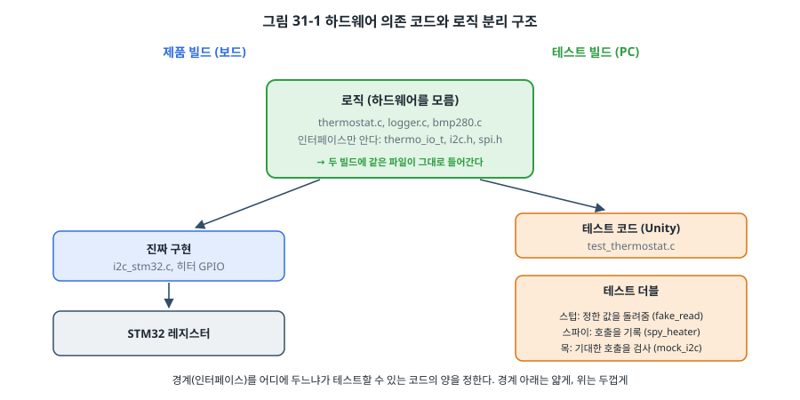
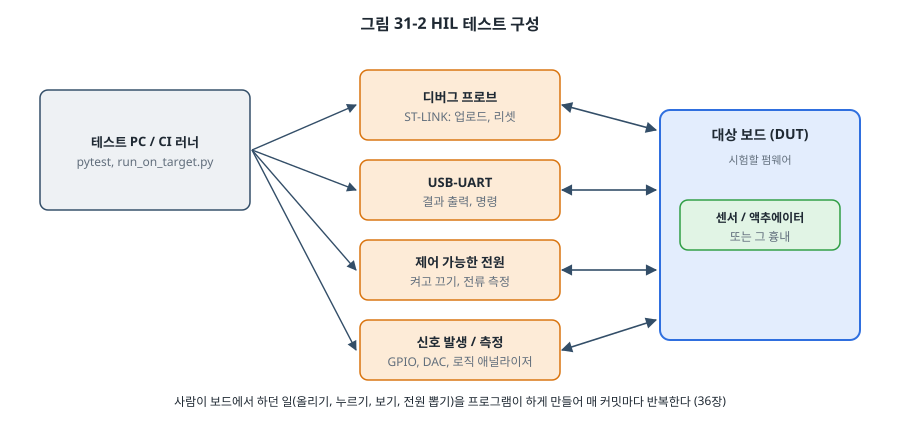

# 31장. 테스트 가능한 펌웨어

## 이 장에서 배우는 것

- 펌웨어를 PC에서 시험하는 이유와 한계
- Unity로 단위 테스트를 쓰고 실행하는 방법
- 테스트 주도 개발(TDD)의 리듬: 실패하는 테스트, 통과시키기, 다듬기
- 하드웨어 의존성을 끊는 방법과 테스트 더블(스텁, 스파이, 목, 페이크)
- 같은 테스트를 보드에서 실행하기, HIL 테스트, 커버리지

---

## 31.1 왜 PC에서 시험하는가

지금까지 여러 장에서 PC 테스트를 만들었습니다. 15장의 BMP280 보정식, 16장의 W25Q 드라이버, 24장의 세탁기 상태 머신, 25장의 메모리 풀, 30장의 SD 카드와 파일 시스템. 이 장에서는 그 방법을 체계적으로 정리합니다.

펌웨어를 보드에서만 시험하면 비용이 큽니다.

- **느립니다.** 고치고, 빌드하고, 올리고, 버튼을 누르고, 터미널을 보는 데 한 번에 1분이 걸린다면 하루에 수십 번밖에 시도하지 못합니다. PC 테스트는 1초 안에 수백 개를 실행합니다.
- **재현하기 어렵습니다.** 센서가 가끔 틀린 값을 내는 경우, 카드가 쓰는 도중에 전원이 끊기는 경우, ms 카운터가 49.7일 뒤 넘치는 경우(24장)를 보드에서 일부러 만들기는 어렵습니다. PC에서는 한 줄입니다.
- **자동화하기 어렵습니다.** 보드 시험은 사람이 보고 판단합니다. 사람은 지루한 확인을 건너뜁니다.
- **하드웨어가 없을 수도 있습니다.** 실무에서는 보드가 나오기 몇 달 전부터 펌웨어를 써야 하는 경우가 흔합니다.

물론 PC 테스트가 모든 것을 대신하지는 못합니다. 타이밍, 인터럽트, 주변장치의 실제 동작, 전기적인 문제는 보드에서만 볼 수 있습니다. 그래서 시험을 여러 층으로 나눕니다.

| 층 | 어디서 | 무엇을 | 속도 | 개수 |
| --- | --- | --- | --- | --- |
| 단위 테스트 | PC | 함수, 모듈의 논리 | ms | 많이 |
| 통합 테스트 | PC (가짜 하드웨어) | 여러 모듈의 조합 (30장의 SD + FatFs + 로거) | 초 | 적당히 |
| 보드 위 테스트 | 보드 | 같은 단위 테스트를 실제 컴파일러와 CPU로 | 초~분 | 적당히 |
| HIL 테스트 | 보드 + 장비 | 실제 입출력, 타이밍, 전원 | 분 | 적게 |
| 시스템 시험 | 완제품 | 요구 사항 전체 (30.8절의 표) | 시간 | 적게 |

아래층일수록 빠르고 많이, 위층일수록 느리고 적게 시험합니다. 이 모양을 흔히 **테스트 피라미드**라고 부릅니다. 버그는 가능한 한 아래층에서 잡는 것이 쌉니다.

## 31.2 Unity

지금까지의 PC 테스트는 `CHECK()` 매크로를 직접 만들어 썼습니다. 테스트가 많아지면 **테스트 프레임워크**가 편합니다. 임베디드 C에서 가장 널리 쓰는 것이 **Unity**(ThrowTheSwitch.org, MIT 라이선스)입니다. C 파일 하나와 헤더 두 개뿐이라 PC에서도 MCU에서도 그대로 컴파일됩니다.

```bash
cd code/ch31-testing
./get_unity.sh            # Unity v2.6.1을 lib/unity에 받는다
cd test && make
```

Unity 테스트는 다음 모양입니다.

```c
#include "unity.h"
#include "thermostat.h"

void setUp(void)     /* 각 테스트 전에 */
{
    ...
    thermo_init(&th, &io, 2000, 50);               /* 20.00 °C ± 0.50 */
}

void tearDown(void)  /* 각 테스트 후에 */
{
}

static void test_heater_turns_on_below_band(void)
{
    give(1949);                                    /* 19.49 < 19.50 */
    steps(1);
    TEST_ASSERT_TRUE(heater_on);
    TEST_ASSERT_EQUAL(TH_HEATING, thermo_state(&th));
}

int main(void)
{
    UNITY_BEGIN();
    RUN_TEST(test_heater_turns_on_below_band);
    ...
    return UNITY_END();
}
```

`TEST_ASSERT_...` 매크로가 실패하면 그 테스트는 즉시 끝나고 실패로 기록되며, 다음 테스트로 넘어갑니다. 정수, 16진수, 비트, 배열, 문자열, 범위(`TEST_ASSERT_INT_WITHIN`) 등을 비교하는 매크로가 있고, 실패하면 기대값과 실제값을 함께 보여 줍니다.

```
test_thermostat.c:151:test_init_turns_heater_off:PASS
test_thermostat.c:152:test_heater_turns_on_below_band:PASS
...
-----------------------
15 Tests 0 Failures 0 Ignored
OK
```

경계 조건 하나를 일부러 틀리게 고치면(`<`를 `<=`로) 이렇게 나옵니다.

```
test_thermostat.c:76:test_heater_does_not_turn_on_at_band_edge:FAIL: Expected FALSE Was TRUE
-----------------------
15 Tests 1 Failures 0 Ignored
FAIL
```

어느 파일의 몇 번째 줄, 어느 테스트가, 무엇을 기대했는데 무엇이 나왔는지 바로 보입니다. 그리고 `make`가 실패 코드를 돌려주므로 36장의 CI가 이것으로 빌드를 막을 수 있습니다.

## 31.3 테스트 주도 개발

**테스트 주도 개발(TDD, Test-Driven Development)** 은 테스트를 코드보다 **먼저** 쓰는 방법입니다. 짧은 리듬을 반복합니다.

1. **빨강**: 아직 없는 기능의 테스트를 하나 씁니다. 실행하면 실패합니다(컴파일조차 안 될 수도 있습니다).
2. **초록**: 그 테스트를 통과시키는 **가장 간단한** 코드를 씁니다.
3. **다듬기**: 테스트가 모두 통과하는 상태를 유지하면서 코드를 정리합니다.

이 장의 예제인 히터 온도 조절기(`src/thermostat.c`)를 이 리듬으로 만든 과정을 따라가 봅시다. 요구 사항은 다음과 같습니다.

- 온도가 (설정값 − 히스테리시스)보다 낮으면 히터를 켜고, (설정값 + 히스테리시스)보다 높으면 끈다.
- 센서 읽기가 3번 연속 실패하면 FAULT: 히터를 끄고 유지한다.
- FAULT에서 정상 값을 3번 연속 받으면 다시 동작한다.

**첫 테스트**: 가장 단순한 것부터. "초기화하면 히터가 꺼져 있다."

```c
static void test_init_turns_heater_off(void)
{
    TEST_ASSERT_FALSE(heater_on);
    TEST_ASSERT_EQUAL_INT(1, heater_calls);
    TEST_ASSERT_EQUAL(TH_IDLE, thermo_state(&th));
}
```

이 테스트를 쓰는 순간 여러 설계 결정이 필요해집니다. 히터를 어떻게 켜고 끄는가(→ `thermo_io_t`의 함수 포인터), 상태를 어떻게 확인하는가(→ `thermo_state()`). 컴파일되게 헤더를 만들고, `thermo_init()`에서 히터를 끄는 한 줄로 통과시킵니다. `heater_on`을 `setUp()`에서 일부러 `true`로 해 둔 것에 주목하세요. 그래야 "init이 정말 껐는지"를 확인할 수 있습니다.

**두 번째, 세 번째 테스트**: 히터를 켜는 조건과 경계값.

```c
static void test_heater_turns_on_below_band(void)          /* 19.49 → 켬 */
static void test_heater_does_not_turn_on_at_band_edge(void) /* 19.50 → 안 켬 */
```

경계값 테스트는 TDD에서 특히 중요합니다. "보다 낮으면"이 `<`인지 `<=`인지를 테스트가 정합니다. 요구 사항이 모호했다면 이 테스트를 쓰면서 질문하게 됩니다.

**히스테리시스**: "켜진 뒤 띠 안에서는 그대로."

```c
static void test_heater_stays_on_inside_band(void)
{
    give(1900); give(2000); give(2050);            /* 켜진 뒤 띠 안에서는 그대로 (히스테리시스) */
    steps(3);
    TEST_ASSERT_TRUE(heater_on);
    TEST_ASSERT_EQUAL_INT(2, heater_calls);        /* init 1번 + 켜기 1번: 같은 명령을 반복하지 않음 */
}
```

이 테스트는 히터를 몇 번 불렀는지까지 확인합니다. 매 주기 "켜라"를 다시 보내는 코드도 히터는 켜져 있으니 앞의 테스트는 통과하지만, 실제 장치가 릴레이라면 불필요한 명령이 문제가 될 수 있습니다. 테스트가 요구 사항을 더 정확하게 만들었습니다.

이렇게 오류 처리(3번 실패 → FAULT, 2번은 유지, 성공하면 실패 횟수 초기화, 범위 밖 값도 실패), 회복, 설정값 범위 검사까지 테스트 11개를 하나씩 추가했습니다. 결과는 `thermostat.c` 약 80줄과 테스트 약 160줄입니다. 테스트 코드가 더 깁니다. 이상한 일이 아닙니다.

> 💡 팁: TDD의 가장 큰 효과는 **설계**에 있습니다. 테스트를 먼저 쓰려면 하드웨어 없이 호출할 수 있어야 하므로, 자연스럽게 24장의 의존성 역전 구조가 됩니다. 반대로 레지스터를 직접 만지는 코드를 먼저 쓰고 나중에 테스트를 붙이려 하면 손댈 곳이 많습니다. 모든 코드를 TDD로 쓸 필요는 없지만, **규칙이 복잡한 로직**(상태 머신, 프로토콜 파서, 제어 알고리즘, 오류 처리)에는 특히 잘 맞습니다.

## 31.4 하드웨어 의존성 끊기

PC에서 테스트하려면 시험할 코드가 하드웨어를 직접 만지지 않아야 합니다. 그 경계를 만드는 방법은 몇 가지가 있고, 이 책에서 모두 써 보았습니다.



**함수 포인터 인터페이스** (24장 `washer_io_t`, 이 장 `thermo_io_t`): 로직이 필요한 동작을 구조체로 정의하고, 보드와 테스트가 각자 채워 넘깁니다. 실행 중에 바꿀 수 있어 가장 유연하지만, 호출이 간접적이라 조금 느립니다.

**링크 단계 바꾸기** (15장 `i2c.h`, 16장 `spi.h`, 30장 가짜 SD): 같은 헤더의 함수를 보드용 `.c`와 테스트용 `.c`가 각자 구현하고, Makefile이 어느 쪽을 링크할지 고릅니다. 실행 비용이 없고 코드가 단순해서 임베디드에서 가장 흔한 방법입니다. 이 장의 `mock_i2c.c`도 이 방법으로 `i2c_write_read()`를 대신합니다.

**전처리기**: `#ifdef UNIT_TEST`로 코드를 나누는 방법입니다. 쉽지만 테스트하는 코드와 제품 코드가 달라지므로 꼭 필요할 때만 씁니다.

**레지스터 흉내**: 레지스터를 직접 다루는 드라이버까지 PC에서 시험하고 싶다면, 레지스터 구조체 포인터(`GPIOA` 등)를 테스트에서는 RAM의 가짜 구조체를 가리키게 하는 방법이 있습니다. 4장의 레지스터 구조체 방식이 이것을 가능하게 합니다. 다만 "쓰기 1로 지우는" 비트나 하드웨어가 스스로 바꾸는 상태 비트는 흉내 내기 어렵고 테스트가 복잡해지므로, 대개는 드라이버를 얇게 만들고 그 아래는 보드에서 시험합니다.

경계를 어디에 두느냐가 중요합니다. 원칙은 그림 31-1 아래의 문장과 같습니다. **경계 아래(하드웨어를 만지는 코드)는 얇게, 위(로직)는 두껍게.** 레지스터를 다루는 코드는 판단을 하지 않고 시키는 일만 하게 하고, 판단은 모두 경계 위로 올립니다.

## 31.5 테스트 더블

테스트에서 진짜 의존 대상 대신 쓰는 것을 통틀어 **테스트 더블(test double)** 이라고 합니다. 영화의 대역 배우에서 온 말입니다. 하는 일에 따라 이름이 다릅니다.

| 종류 | 하는 일 | 이 책의 예 |
| --- | --- | --- |
| 더미 (dummy) | 자리만 채움. 쓰이지 않음 | `NULL` 컨텍스트 |
| 스텁 (stub) | 정해 둔 값을 돌려줌 | `fake_read`: 시나리오대로 온도를 돌려줌 |
| 스파이 (spy) | 불린 기록을 남김. 테스트가 나중에 확인 | `spy_heater`: 횟수와 마지막 값 |
| 목 (mock) | 기대한 호출을 미리 등록하고, 순서와 인자를 즉시 검사 | `mock_i2c.c` |
| 페이크 (fake) | 진짜처럼 동작하는 간단한 구현 | 16장 W25Q 가짜 플래시, 30장 가짜 SD 카드 |

스텁과 스파이는 "무엇을 돌려줄까", "무엇이 일어났나"를 다룹니다. 목은 한 걸음 더 나아가 **상호작용 자체**를 검사합니다. 15장의 BMP280 드라이버를 목으로 시험해 봅시다.

```c
static void test_init_reads_id_and_calibration_then_configures(void)
{
    const uint8_t id = 0x58;
    mock_i2c_init();
    i2c_write_read_ExpectAndReturn(0x76, 0xD0, &id, 1, I2C_OK);
    i2c_write_read_ExpectAndReturn(0x76, 0x88, calib, 6, I2C_OK);
    i2c_write_ExpectAndReturn(0x76, 0xF5, 0x00, I2C_OK);
    i2c_write_ExpectAndReturn(0x76, 0xF4, 0x27, I2C_OK);    /* osrs_t ×1, osrs_p ×1, 노멀 */

    TEST_ASSERT_EQUAL_INT(0, bmp280_init(&dev, 0x76));
    ...
    mock_i2c_verify();
}
```

이 테스트는 "칩 ID 레지스터(0xD0)를 읽고, 보정값(0x88부터 6바이트)을 읽고, config(0xF5)와 ctrl_meas(0xF4)를 이 순서로 쓴다"를 확인합니다. 드라이버가 다른 레지스터를 읽거나, 순서가 바뀌거나, 설정값이 틀리면 그 자리에서 실패합니다. 칩 ID가 틀린 경우 그 뒤로 아무것도 하지 않는지, NACK을 그대로 돌려주는지도 같은 방법으로 시험합니다. 데이터시트의 예제 값(adc_T = 519888 → 25.08 °C)으로 보정식도 확인합니다.

### CMock

이 장의 `mock_i2c.c`는 손으로 썼지만, 함수가 많아지면 지루한 일입니다. **CMock**(Unity와 같은 ThrowTheSwitch.org)은 헤더 파일을 읽어 이런 목을 자동으로 만들어 줍니다. `i2c.h`를 주면 `mock_i2c.c`와 `mock_i2c.h`가 생기고, 각 함수마다 `_Expect`, `_ExpectAndReturn`, `_IgnoreAndReturn`, `_ReturnThruPtr` 같은 함수가 만들어집니다. 이 장의 손으로 쓴 목은 그 이름 규칙을 흉내 냈습니다. CMock은 Ruby로 동작하며, 보통 **Ceedling**이라는 빌드 도구와 함께 써서 테스트 파일이 `#include "mock_i2c.h"`를 쓰면 자동으로 목을 만들고 링크하게 합니다. [확인 필요: 출간 시점 CMock/Ceedling 버전과 설치 방법]

> ⚠️ 주의: 목은 강력하지만 **구현에 묶이기 쉽습니다.** 위 테스트는 BMP280 드라이버가 레지스터를 쓰는 순서까지 고정합니다. 나중에 0xF4를 먼저 써도 동작에는 문제가 없도록 고치면 테스트가 실패합니다. 그래서 목은 "그 순서가 정말 중요한 곳"(장치가 요구하는 초기화 순서, 프로토콜)에 쓰고, 결과만 중요한 곳에는 스텁이나 페이크를 씁니다. 테스트가 동작이 아니라 구현을 시험하기 시작하면, 리팩터링할 때마다 테스트를 고쳐야 해서 테스트가 짐이 됩니다.

## 31.6 보드에서 테스트 실행하기

PC 테스트를 통과해도 보드에서 다르게 동작할 수 있습니다. 컴파일러가 다르고(x86용 GCC와 arm-none-eabi-gcc), `int`의 크기나 정렬 규칙이 다를 수 있고(4장, 25장), 정의되지 않은 동작은 컴파일러마다 다르게 나타납니다. 그래서 **같은 테스트 파일을 보드에서도** 실행합니다.

Unity는 출력을 한 글자씩 `UNITY_OUTPUT_CHAR()`로 내보내므로, 이것만 UART로 바꾸면 됩니다.

```c
/* stm32/unity_config.h (-DUNITY_INCLUDE_CONFIG_H 로 읽힌다) */
void uart2_putc(char c);
#define UNITY_OUTPUT_CHAR(a)   uart2_putc((char)(a))   /* 결과를 USART2로 */
#define UNITY_EXCLUDE_FLOAT                            /* 실수 비교를 빼서 Flash 절약 */
#define UNITY_EXCLUDE_DOUBLE
```

`stm32/main.c`는 `test/`의 테스트 파일을 그대로 링크해 실행합니다.

```bash
cd code/ch31-testing/stm32
make flash
```

시리얼 터미널에 PC와 같은 형식의 결과가 나옵니다. [확인 필요: 보드 실행 결과] 이 방법은 테스트 코드와 테스트할 코드가 Flash와 RAM에 들어갈 때만 쓸 수 있습니다. 큰 프로젝트에서는 테스트를 여러 펌웨어로 나눠 차례로 올립니다.

> 🔧 ATmega128에서는: Unity는 8비트 AVR에서도 동작합니다. `UNITY_OUTPUT_CHAR`를 14장의 `uart_putc()`로 바꾸고, `UNITY_INT_WIDTH 16`처럼 AVR의 정수 크기를 알려 주면 됩니다. 보드가 없다면 23장의 simavr 같은 시뮬레이터에서 테스트 펌웨어를 실행하고 출력을 받을 수도 있습니다. 4장에서 본 "AVR에서 `int`는 16비트" 같은 차이로 생기는 버그는 이렇게 보드(나 시뮬레이터)에서 같은 테스트를 돌려야 잡힙니다.

## 31.7 HIL 테스트

**HIL(Hardware-In-the-Loop) 테스트**는 실제 보드를 프로그램이 조작하며 시험하는 것입니다. 사람이 하던 일, 즉 펌웨어를 올리고, 버튼을 누르고, 신호를 넣고, 출력을 보고, 전원을 뽑는 일을 PC가 합니다.



가장 단순한 HIL은 31.6절의 보드 위 테스트를 자동으로 판정하는 것입니다. `hil/run_on_target.py`는 시리얼 포트를 열고, 펌웨어를 올리고, Unity의 요약 줄을 기다려 결과를 종료 코드로 돌려줍니다.

```bash
pip install pyserial
python3 code/ch31-testing/hil/run_on_target.py --port /dev/ttyACM0 --flash
```

```python
SUMMARY = re.compile(r"(\d+) Tests (\d+) Failures (\d+) Ignored")
...
m = SUMMARY.search(line)
if m:
    summary = tuple(int(x) for x in m.groups())
elif summary and line in ("OK", "FAIL"):
    ...
    return 0 if line == "OK" and failures == 0 else 1
```

여기서 한 걸음씩 확장해 갑니다.

- **명령과 응답**: 30장 로거에 `s` 명령을 보내고 "card errors 0"을 확인합니다. 14장의 명령어 셸이 HIL의 좋은 입구가 됩니다.
- **입력 흉내**: 다른 MCU나 USB-GPIO 장치로 버튼을 누르거나, DAC로 센서 전압을 흉내 냅니다.
- **전원 조작**: 제어 가능한 전원 공급기나 USB 전원 스위치로 전원을 끊고 켜서 30장의 R3(전원 차단)을 매일 자동으로 시험합니다. 전류도 함께 재서 30.6절의 잠 전류가 늘지 않았는지 확인합니다.
- **신호 측정**: 로직 애널라이저를 프로그램으로 제어해 SPI 클럭 주파수나 응답 시간을 확인합니다.

HIL 장비는 처음에는 테스트 PC 한 대와 보드 하나, USB 케이블 두 개로 충분합니다. 36장에서 이것을 CI에 연결해 커밋마다 자동으로 실행합니다.

## 31.8 커버리지

**커버리지(coverage)** 는 테스트가 코드의 어느 부분을 실행했는지 잽니다. GCC의 `--coverage` 옵션과 `gcov`로 PC 테스트의 커버리지를 볼 수 있습니다.

```bash
cd code/ch31-testing/test
make coverage
```

```
File '../src/thermostat.c'
Lines executed:100.00% of 45
```

TDD로 만든 코드는 대개 커버리지가 높습니다. 테스트 없이는 코드를 쓰지 않았기 때문입니다. 커버리지 숫자를 읽을 때는 두 가지를 기억하세요.

- **100%가 버그 없음을 뜻하지 않습니다.** 모든 줄을 실행했어도 모든 값의 조합을 시험한 것은 아닙니다. 경계값을 틀리게 구현한 코드도 줄 커버리지 100%가 나올 수 있습니다. 31.2절의 `<=` 실수를 잡은 것은 커버리지가 아니라 경계값 테스트였습니다.
- **낮은 커버리지는 분명한 신호입니다.** 실행되지 않은 줄은 시험되지 않은 줄입니다. 특히 오류 처리 경로가 빨갛게 남아 있는 경우가 많고, 버그는 대개 거기 있습니다.

안전 규격(35장)은 분기 커버리지나 MC/DC 같은 더 엄격한 기준을 요구하기도 합니다.

---

## 정리

- 테스트는 단위, 통합, 보드 위, HIL, 시스템 순으로 층을 이루며, 아래층일수록 빠르고 많이 합니다.
- Unity는 C 파일 하나로 된 테스트 프레임워크로, PC와 MCU에서 같은 테스트를 실행합니다.
- TDD는 실패하는 테스트, 통과시키는 최소 코드, 다듬기를 반복합니다. 경계값 테스트가 요구 사항을 정확하게 만들고, 테스트를 먼저 쓰면 하드웨어와 분리된 구조가 저절로 나옵니다.
- 하드웨어 의존성은 함수 포인터, 링크 단계 바꾸기, 레지스터 흉내로 끊습니다. 경계 아래는 얇게, 위는 두껍게 만듭니다.
- 테스트 더블은 스텁, 스파이, 목, 페이크로 나뉩니다. 목은 상호작용을 검사하지만 구현에 묶이기 쉽습니다. CMock은 헤더에서 목을 자동으로 만듭니다.
- 같은 테스트를 보드에서 실행하고, HIL로 실제 입출력과 전원까지 자동으로 시험합니다. 커버리지는 시험하지 않은 곳을 찾는 도구입니다.

## 연습 문제

1. `thermostat.c`에 "히터가 30분 넘게 계속 켜져 있으면 FAULT로 간다(히터 고장이나 창문 열림)" 기능을 TDD로 추가하세요. 시간을 어떻게 테스트에 넣을지(인터페이스에 시각 함수를 추가할지, `thermo_step()`의 주기를 세는지) 먼저 결정하고 이유를 쓰세요.
2. 24장 `test_washer.c`를 Unity로 옮기세요. `CHECK()` 매크로와 비교해 실패했을 때의 출력이 어떻게 달라지는지 확인하세요.
3. 15장 BMP280 드라이버의 `bmp280_read_temp_c100()`에 "I2C 오류가 나면 `*c100`을 바꾸지 않는다"는 요구 사항이 있다고 합시다. 이것을 확인하는 목 테스트를 쓰세요.
4. 다음 각 경우에 스텁, 스파이, 목, 페이크 중 무엇을 쓰겠습니까? (a) 시각 함수 (b) EEPROM 드라이버 위의 설정 저장 모듈 (c) "모터를 정지한 뒤에만 브레이크를 건다"는 순서 규칙 (d) 버튼 입력
5. 커버리지 100%인 테스트 집합이 있는데도 버그가 남을 수 있는 예를 `thermostat.c`에서 하나 찾아 설명하세요.
6. (실습) 30장 로거에 HIL 테스트를 만드세요. 로거를 켜고 15초 기다린 뒤 `s`를 보내 lines가 10 이상인지, card errors가 0인지 확인하는 Python 스크립트를 쓰세요.
