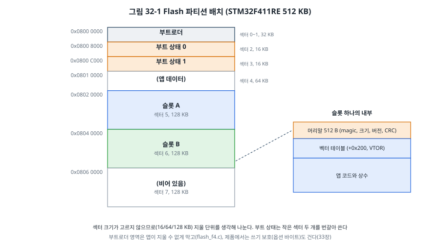
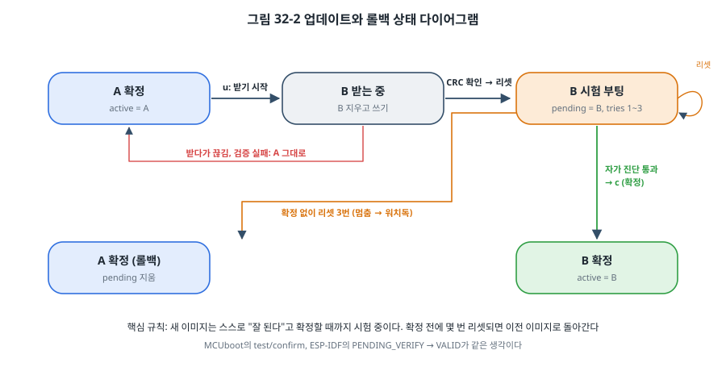
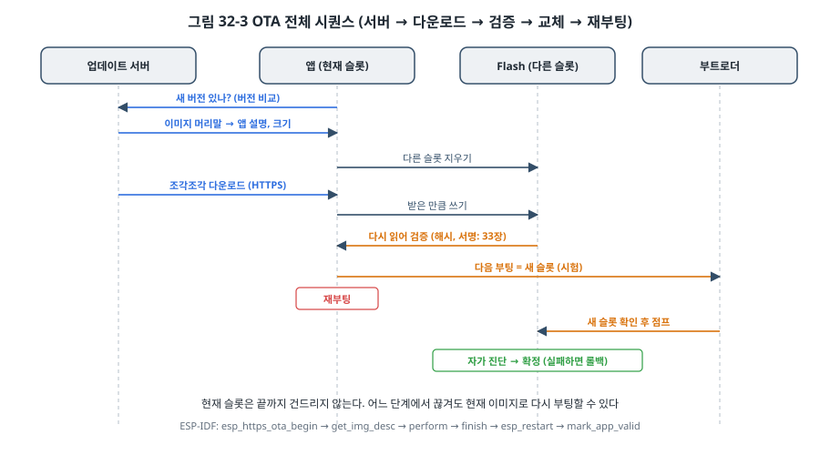

# 32장. 부트로더와 펌웨어 업데이트

## 이 장에서 배우는 것

- 아두이노 부트로더가 USB 케이블 하나로 펌웨어를 올리는 원리
- 부트로더를 설계할 때 정할 것들: Flash 배치, 이미지 형식, 점프 방법
- 벡터 테이블 재배치와 앱으로 점프하기
- A/B 슬롯, 시험 부팅과 확정, 롤백: 업데이트가 실패해도 장치가 살아남게 하기
- MCUboot, 그리고 ESP32의 OTA 파티션과 ESP-IDF OTA

---

## 32.1 왜 부트로더인가

제품이 출시된 뒤에 버그가 발견되거나 기능을 추가해야 할 때, 수천 대의 장치를 하나씩 디버그 프로브에 연결할 수는 없습니다. 현장에서 펌웨어를 바꾸려면 장치 스스로 새 펌웨어를 받아 Flash에 쓰는 능력이 있어야 합니다. 그 일을 맡는 작은 프로그램이 **부트로더(bootloader)** 입니다.

부트로더는 전원이 켜지면 가장 먼저 실행되고, 다음 둘 중 하나를 합니다.

1. 새 펌웨어를 받아 Flash에 씁니다(업데이트 모드).
2. 이미 있는 펌웨어(**애플리케이션**, 줄여서 **앱**)가 올바른지 확인하고 실행합니다.

부트로더는 장치에서 가장 바꾸기 어려운 코드입니다. 부트로더 자신을 현장에서 업데이트하다 실패하면 장치가 영구히 멈추기(**벽돌**, brick) 때문에, 대부분의 제품은 부트로더를 공장에서 한 번 쓰고 다시 바꾸지 않습니다. 그래서 부트로더는 **작고, 단순하고, 철저히 시험된** 코드여야 합니다.

## 32.2 아두이노 부트로더는 어떻게 동작하는가

아두이노 우노에 처음으로 업로드 버튼을 누른 순간을 떠올려 봅시다(5장). 디버그 프로브도 없이 USB 케이블 하나로 펌웨어가 올라갔습니다. 그것이 가능했던 것은 ATmega328P의 Flash 끝부분에 **Optiboot**이라는 작은 부트로더(약 500바이트)가 미리 들어 있기 때문입니다.

1. PC의 avrdude가 USB-시리얼 칩의 DTR 신호를 내립니다. 우노 보드는 이 신호를 100 nF 커패시터를 거쳐 ATmega328P의 RESET 핀에 연결해 두었으므로, MCU가 리셋됩니다.
2. 퓨즈 비트 BOOTRST가 켜져 있으므로, 리셋 뒤 CPU는 주소 0이 아니라 Flash 끝의 **부트 영역**에서 시작합니다. 영역의 크기는 BOOTSZ 퓨즈로 정합니다.
3. Optiboot은 UART에서 STK500이라는 간단한 프로토콜의 명령을 잠시(약 1초) 기다립니다.
4. avrdude가 명령을 보내면 Optiboot은 받은 데이터를 `SPM`(Store Program Memory) 명령으로 Flash에 씁니다. `SPM`은 부트 영역에서 실행될 때만 동작하므로, 앱이 실수로 자기 Flash를 망가뜨릴 수 없습니다.
5. 명령이 오지 않으면 주소 0으로 점프해 앱을 실행합니다.

부트로더의 본질이 모두 들어 있습니다. **리셋 뒤 먼저 실행되는 영역, 새 이미지를 받는 통로, Flash에 쓰는 능력, 앱으로 넘어가는 방법.** 다만 Optiboot은 받은 이미지를 검증하지 않고, 업데이트 도중 전원이 끊기면 앱이 망가진 채 남습니다. 책상 위의 개발 보드라면 다시 올리면 되지만, 현장의 제품이라면 그럴 수 없습니다. 이 장의 나머지는 그 문제를 푸는 방법입니다.

> 🔧 ATmega128에서는: ATmega128도 같은 구조입니다. Flash 끝에 최대 8 KB의 부트 영역을 BOOTSZ 퓨즈로 정하고, BOOTRST 퓨즈로 리셋 벡터를 그리로 옮깁니다. 부트 영역의 코드만 `SPM`을 쓸 수 있고, 부트 영역 자체를 앱이 덮어쓰지 못하게 잠그는 보호 비트(BLB)도 있습니다. avr-libc의 `<avr/boot.h>`가 페이지 지우기, 채우기, 쓰기 함수를 제공하므로 직접 부트로더를 만들 수 있습니다. 실습 키트에 따라 STK500 호환 부트로더가 이미 들어 있는 경우도 있습니다.

STM32에도 공장에서 ROM에 넣어 둔 **시스템 부트로더**가 있습니다. 21장에서 본 것처럼 BOOT0 핀을 High로 하고 리셋하면 실행되며, UART나 USB(DFU)로 펌웨어를 받습니다(ST의 AN2606). 생산 라인이나 복구에는 유용하지만, 현장에서 사용자가 BOOT0 핀을 조작할 수는 없으므로 제품의 업데이트에는 직접 만든 부트로더를 씁니다.

## 32.3 부트로더 설계: Flash 배치

먼저 Flash를 나눕니다. STM32F411RE의 512 KB Flash는 섹터 크기가 고르지 않습니다(RM0383 3.3절). 앞의 네 섹터는 16 KB, 다음은 64 KB, 나머지 셋은 128 KB입니다. Flash는 **섹터 단위로만 지울 수 있으므로**, 각 영역을 섹터 경계에 맞춰야 합니다.



| 영역 | 섹터 | 주소 | 크기 |
| --- | --- | --- | --- |
| 부트로더 | 0~1 | 0x0800 0000 | 32 KB |
| 부트 상태 기록 0, 1 | 2, 3 | 0x0800 8000, 0x0800 C000 | 16 KB × 2 |
| (앱 데이터) | 4 | 0x0801 0000 | 64 KB |
| 슬롯 A | 5 | 0x0802 0000 | 128 KB |
| 슬롯 B | 6 | 0x0804 0000 | 128 KB |
| (비어 있음) | 7 | 0x0806 0000 | 128 KB |

부트로더는 리셋 벡터가 있는 맨 앞에 둡니다. 앱을 넣을 **슬롯**은 두 개입니다. 하나에서 실행하는 동안 다른 하나에 새 이미지를 받으므로, 받다가 실패해도 실행 중인 이미지는 멀쩡합니다. 이것이 **A/B 슬롯** 방식입니다. 슬롯이 하나뿐이라면 새 이미지를 받기 위해 지금 이미지를 지워야 하고, 그 순간부터 업데이트가 끝날 때까지 장치는 무방비 상태가 됩니다.

### 이미지 머리말

부트로더가 슬롯의 내용을 믿으려면 확인할 수단이 필요합니다. 각 슬롯의 맨 앞 512바이트에 **이미지 머리말**을 둡니다(`common/image.h`).

```c
typedef struct {
    uint32_t magic;         /* 'IMG1' */
    uint32_t hdr_size;      /* 0x200 */
    uint32_t load_addr;     /* 이 이미지가 링크된 슬롯 주소 */
    uint32_t img_size;      /* 머리말 뒤의 바이트 수 */
    uint32_t version;       /* (major << 16) | (minor << 8) | patch */
    uint32_t crc32;         /* 머리말 뒤 img_size 바이트의 CRC-32 */
    uint32_t flags;
    uint32_t hdr_crc;       /* 위 7개 필드의 CRC-32 */
} image_hdr_t;
```

`tools/mkimage.py`가 빌드한 `.bin` 앞에 이 머리말을 붙입니다. 부트로더의 `image_check()`는 다음을 차례로 확인합니다.

1. magic과 머리말 크기: 비어 있는 슬롯(0xFF)이나 엉뚱한 데이터를 거릅니다.
2. 머리말의 CRC: 머리말 자체가 깨지지 않았는지.
3. `load_addr`: 이 슬롯용으로 링크된 이미지인지(32.4절).
4. 이미지 전체의 CRC-32: 받다가 끊기거나 Flash가 망가지지 않았는지. 13장의 CRC를 32비트로 쓴 것입니다.
5. 벡터 테이블의 상식: 초기 SP가 RAM 안에 있고, 리셋 처리기가 이 슬롯 안을 가리키며 Thumb 비트가 1인지.

머리말을 512바이트로 잡은 것은 정렬 때문입니다. 앱의 벡터 테이블은 머리말 바로 뒤(+0x200)에 오는데, Cortex-M의 VTOR은 벡터 테이블이 **그 크기 이상의 2의 거듭제곱 경계**에 놓이기를 요구합니다. STM32F411의 벡터 테이블은 102칸(408바이트)이므로 512바이트 경계에 맞춥니다.

> ⚠️ 주의: CRC는 **실수로 생긴 오류**를 잡을 뿐 **일부러 바꾼 이미지**는 막지 못합니다. 공격자는 내용을 바꾸고 CRC를 다시 계산해 넣으면 됩니다. 아무나 펌웨어를 바꿔 넣을 수 없게 하려면 **서명**이 필요하고, 33장에서 이 머리말에 서명을 더합니다.

### 부트 상태

부트로더는 "어느 슬롯이 확정된 이미지인가, 어느 슬롯이 시험 중인가"를 기억해야 합니다. 이 정보도 Flash에 저장하는데, Flash는 덮어쓸 수 없습니다(지우면 0xFF, 쓰기는 1을 0으로만). 그래서 `common/bootmeta.c`는 16바이트 기록을 **계속 뒤에 덧붙이고**, 읽을 때는 일련번호가 가장 큰 올바른 기록을 씁니다.

```c
typedef struct {
    uint32_t     magic;
    uint32_t     seq;          /* 일련번호 */
    boot_state_t st;           /* active, pending, tries */
    uint32_t     crc;          /* 앞 12 B의 CRC-32 */
} meta_rec_t;
```

섹터 하나(16 KB)가 기록 1,024개로 차면 **다른 섹터를 지우고** 거기에 이어 씁니다. 두 섹터를 번갈아 쓰는 이유는 전원 차단 때문입니다. 지우는 도중에 전원이 끊겨도 다른 섹터에 이전 기록이 남아 있고, 기록을 쓰는 도중에 끊기면 그 기록은 CRC가 맞지 않아 무시되고 이전 기록이 쓰입니다. 30장에서 본 "언제 끊겨도 마지막으로 확정된 상태가 남는다"는 원칙을 Flash 위에서 지키는 방법입니다. 이 방식은 Flash 수명에도 좋습니다. 상태가 1,024번 바뀔 때 섹터를 한 번 지우므로, STM32F411의 지우기 수명(섹터당 1만 번)을 생각하면 사실상 닳지 않습니다.

ESP32의 2단계 부트로더도 `otadata` 파티션의 두 섹터에 일련번호를 붙여 번갈아 쓰는, 같은 방식을 씁니다.

## 32.4 앱으로 점프하기

부트로더가 앱을 실행하는 과정은 21장에서 본 리셋 과정을 소프트웨어로 흉내 내는 것입니다. 리셋 때 하드웨어는 벡터 테이블의 0번 칸을 SP에, 1번 칸을 PC에 넣었습니다. 부트로더는 앱의 벡터 테이블에서 같은 일을 합니다.

```c
static void jump_to_app(uint32_t vt_addr)
{
    const uint32_t *vt = (const uint32_t *)vt_addr;

    __asm volatile ("cpsid i" ::: "memory");
    SYSTICK->CTRL = 0;
    for (int i = 0; i < 8; i++) {
        NVIC->ICER[i] = 0xFFFFFFFFu;       /* 모든 인터럽트 금지 */
        NVIC->ICPR[i] = 0xFFFFFFFFu;       /* 대기 중인 것도 지움 */
    }
    RCC->APB1RSTR |= RCC_APB1ENR_USART2EN; /* 부트로더가 쓴 주변장치를 리셋 상태로 */
    RCC->APB1RSTR &= ~RCC_APB1ENR_USART2EN;
    RCC->APB1ENR  &= ~RCC_APB1ENR_USART2EN;

    SCB_VTOR = vt_addr;                    /* 이제부터 예외는 앱의 벡터 테이블로 */
    __asm volatile ("dsb\n isb" ::: "memory");

    __asm volatile (
        "msr msp, %0 \n"                   /* 앱의 초기 SP */
        "cpsie i     \n"
        "bx  %1      \n"                   /* 앱의 리셋 처리기로 */
        :: "r" (vt[0]), "r" (vt[1]) : "memory");
}
```

순서마다 이유가 있습니다.

- **부트로더가 켠 것을 모두 되돌립니다.** 앱은 자신이 리셋 직후에 시작한다고 믿습니다. 부트로더가 켠 SysTick이나 UART 인터럽트가 살아 있으면, 앱의 벡터 테이블로 바뀐 뒤 앱이 준비하지 않은 인터럽트가 들어와 앱의 기본 처리기(무한 루프)에 갇힙니다. 주변장치는 RCC의 리셋 레지스터로 리셋 상태로 돌려놓는 것이 가장 확실합니다.
- **VTOR을 바꿉니다.** Cortex-M3/M4의 **VTOR(Vector Table Offset Register)** 은 벡터 테이블의 주소를 정합니다. 리셋 직후 0인 VTOR을 앱의 벡터 테이블 주소로 바꿔야 앱의 인터럽트 처리기가 불립니다. 7장에서 본 벡터 테이블이 이제 Flash의 아무 곳에나 있을 수 있게 된 것입니다. (Cortex-M0에는 VTOR이 없어서, 앱의 벡터 테이블을 RAM 맨 앞에 복사하고 메모리 재배치 기능으로 0번지에 보이게 하는 우회 방법을 씁니다.)
- **MSP를 앱의 초기값으로 바꿉니다.** 부트로더가 쓰던 스택은 버립니다.
- **인터럽트를 다시 허용합니다.** 리셋 직후 PRIMASK는 0(허용)이므로, 앱이 같은 상태에서 시작하게 `cpsie i`를 합니다. 모든 인터럽트를 NVIC에서 꺼 두었으므로 안전합니다.

### 앱의 링크

앱은 0x0800 0000이 아니라 슬롯 안에서 실행되므로, 그 주소에 맞게 **링크**해야 합니다. 21장의 링커 스크립트에서 MEMORY의 FLASH 시작 주소만 바꾸면 됩니다.

```
/* app_slot_B.ld */
MEMORY
{
    FLASH (rx)  : ORIGIN = 0x08040200, LENGTH = 128K - 0x200
    RAM   (rwx) : ORIGIN = 0x20000000, LENGTH = 128K
}
INCLUDE sections.ld
```

여기서 A/B 방식의 중요한 함정이 나옵니다. **슬롯 A용으로 링크한 이미지는 슬롯 B에서 실행할 수 없습니다.** 코드 안의 함수 주소, 상수 주소, 벡터 테이블의 값이 모두 슬롯 A의 주소이기 때문입니다. 해결 방법은 세 가지입니다.

| 방법 | 내용 | 쓰는 곳 |
| --- | --- | --- |
| 슬롯마다 따로 빌드 | 같은 소스를 A용, B용으로 두 번 링크하고, 업데이트할 때 지금 실행 중이지 않은 슬롯용 이미지를 보낸다 | 이 장의 예제 |
| 복사 또는 교환 | 새 이미지를 받는 슬롯은 보관용이고, 부트로더가 검증 후 실행 슬롯으로 옮긴다. 이미지는 하나만 빌드 | MCUboot의 swap, overwrite 방식 |
| 주소 변환 | 하드웨어(MMU, 외부 Flash 매핑)가 어느 슬롯이든 같은 주소로 보이게 한다 | ESP32, 일부 STM32의 뱅크 교환 |

이 장의 예제는 가장 이해하기 쉬운 첫 번째 방법을 씁니다. `mkimage.py`는 리셋 벡터가 지정한 슬롯 안을 가리키는지 확인하고, 부트로더는 머리말의 `load_addr`로 다시 확인하므로, 잘못된 슬롯에 잘못된 이미지가 들어가 실행되는 일은 없습니다.

## 32.5 A/B 슬롯과 롤백

새 이미지가 CRC 검사를 통과해도, **제대로 동작하는지는** 실행해 봐야 압니다. 새 버전에 버그가 있어 시작하자마자 멈춘다면? 네트워크 설정을 망가뜨려 다시는 업데이트를 받을 수 없다면? 그래서 새 이미지는 바로 확정하지 않고 **시험 부팅**합니다.



`common/bootlogic.c`의 규칙은 다음과 같습니다.

1. 앱이 새 이미지를 다른 슬롯에 받아 검증하면 `pending = 새 슬롯, tries = 0`으로 기록하고 리셋합니다(`boot_request`).
2. 부트로더는 pending이 있으면 `tries`를 하나 올려 **먼저 저장한 뒤** 새 슬롯으로 점프합니다(시험 부팅).
3. 새 앱은 자가 진단(센서 응답, 통신 확인 등)을 해 보고 문제가 없으면 `active = 새 슬롯, pending 없음`으로 기록합니다(`boot_confirm`). 이제 확정입니다.
4. 확정하지 못한 채 리셋이 반복되어 `tries`가 3에 이르면, 부트로더는 pending을 지우고 원래의 확정 슬롯으로 돌아갑니다(**롤백**).

2번에서 점프 **전에** 저장하는 것이 핵심입니다. 새 앱이 시작하자마자 멈추면 확정할 기회가 없고, 부트로더가 센 횟수만 남습니다. 그런데 앱이 멈춘 채 리셋되지 않으면 부트로더로 돌아올 수도 없습니다. 그래서 부트로더는 점프 직전에 **독립 워치독(IWDG)** 을 켭니다. 앱이 주기적으로 워치독을 갱신하지 못하면 약 4초 뒤 칩이 리셋됩니다. IWDG는 한 번 켜면 리셋 전까지 끌 수 없으므로 앱도 계속 갱신해야 합니다. 35장에서 워치독을 자세히 다룹니다.

```c
static void iwdg_start(void)
{
    /* LSI 약 32 kHz / 64 = 500 Hz, 2000 카운트 → 약 4초 */
    IWDG->KR  = IWDG_KEY_START;            /* 시작하면 리셋 전까지 멈출 수 없다 */
    IWDG->KR  = IWDG_KEY_ACCESS;
    IWDG->PR  = 4u;                        /* /64 */
    IWDG->RLR = 2000u;
    while (IWDG->SR != 0) {
    }
    IWDG->KR  = IWDG_KEY_RELOAD;
}
```

> 💡 팁: "자가 진단"을 무엇으로 할지가 롤백의 실제 가치를 정합니다. 시작만 하면 확정하는 앱은 "부팅은 되지만 서버에 접속하지 못하는" 버그를 막지 못합니다. 그렇다고 너무 엄격하면(예: 서버가 잠깐 꺼져 있었다) 정상 이미지가 롤백됩니다. 흔한 절충은 **장치 스스로 확인할 수 있는 것**(주요 센서 응답, 설정 읽기, 네트워크 연결)이 시간 제한 안에 성공하면 확정하는 것입니다.

### 업데이트 받기

예제의 앱은 `u` 명령으로 UART에서 새 이미지를 받습니다. 받기 규약은 단순합니다.

```
앱 → "READY"           PC → 길이 4바이트
앱 → "ERASED"          (다른 슬롯을 지운 뒤)
PC → 256바이트 묶음     앱 → '#' (Flash에 쓴 뒤)  … 반복
앱 → "OK ..." 또는 "ERROR ..."
```

묶음마다 응답을 기다리는 것이 **흐름 제어**입니다. 128 KB 섹터를 지우는 데 1~2초, 256바이트를 쓰는 데도 시간이 걸리는데, 그동안 PC가 계속 보내면 UART 수신 버퍼(14장)가 넘칩니다. [확인 필요: STM32F411 128 KB 섹터 지우기 시간 (DS10314)]

Flash 쓰기는 `stm32/flash_f4.c`가 합니다. RM0383 3.5절의 순서 그대로입니다. KEYR에 두 키를 차례로 써서 잠금을 풀고, 지울 때는 섹터 번호와 SER 비트를 쓴 뒤 STRT로 시작해 BSY가 내려가기를 기다리고, 쓸 때는 PG 비트를 켠 채 32비트씩 씁니다.

```c
unlock();
FLASH->CR = FLASH_CR_PSIZE_32 | FLASH_CR_SER | ((uint32_t)snb << FLASH_CR_SNB_Pos);
FLASH->CR |= FLASH_CR_STRT;
int r = wait_done();          /* BSY가 0이 될 때까지, 오류 플래그 확인 */
lock();
```

STM32F411은 Flash 뱅크가 하나라서, 지우거나 쓰는 동안 CPU가 Flash에서 명령을 가져오려 하면 끝날 때까지 멈춥니다. 그동안 인터럽트도 처리되지 않으므로, 실시간 동작이 중요한 장치라면 이 시간을 고려하거나 Flash 쓰기 함수를 RAM에서 실행합니다(21장의 `.data`에 함수를 두는 방법). 그리고 `flash_f4.c`는 부트로더가 있는 섹터 0, 1을 지우지 못하게 막아 둡니다. 앱의 버그로 부트로더가 지워지면 복구할 방법이 없기 때문입니다.

### 시험: 모든 경우를 PC에서

부트로더의 규칙은 틀리면 장치가 벽돌이 되므로, 31장의 방법으로 PC에서 철저히 시험합니다. `test/fake_flash.c`는 STM32F411의 섹터 배치와 NOR Flash의 규칙(지우면 0xFF, 쓰기는 1→0만)을 흉내 내고, 정해진 횟수만큼 쓴 뒤 "전원이 끊기게" 할 수 있습니다.

```bash
cd code/ch32-bootloader/test
make
```

| 시험 | 확인하는 것 |
| --- | --- |
| `test_crc32` | 표준 확인 값 `"123456789"` → 0xCBF43926, 나눠서 계산 |
| `test_image_check` | 빈 슬롯, 다른 슬롯용 이미지, 한 비트 손상 |
| `test_meta_records` | 기록 2,500개: 섹터를 두 번 넘겨도 최신 상태 유지 |
| `test_meta_power_loss` | 기록의 어느 워드에서 끊겨도 이전 상태 유지 |
| `test_update_confirm` | A → B 받기 → 시험 부팅 → 확정 → 이후 계속 B |
| `test_rollback` | 확정 없이 리셋 3번 → 네 번째 부팅에 A로 |
| `test_broken_download_and_recovery` | 깨진 새 이미지 무시, 확정 슬롯이 깨지면 다른 슬롯으로, 둘 다 없으면 대기 |
| `test_mkimage_file` | `mkimage.py`가 만든 파일을 C의 `image_check()`가 받아들이는가 |

마지막 시험은 Python 도구와 C 부트로더가 **같은 형식**을 쓰는지 확인합니다. 두 구현이 따로 놀아 "PC에서 만든 이미지를 장치가 거부하는" 일은 실제로 흔합니다.

## 32.6 보드에서 해 보기

```bash
cd code/ch32-bootloader/stm32/boot
make flash                                      # 부트로더 (섹터 0~1)
cd ../app
make clean && make SLOT=A VER=1.0.0 flash-img   # 처음 앱: 슬롯 A에 직접
make clean && make SLOT=B VER=1.1.0 image       # 새 버전: 슬롯 B용 이미지
python3 ../../tools/send_update.py --port /dev/ttyACM0 build/app-B.img
```

시리얼 터미널로 과정을 봅니다. (출력은 예시입니다. [확인 필요: 보드 실측])

```
[boot] ch32 bootloader
[boot] slot A: ok, version 00010000
[boot] slot B: empty or not an image
[boot] decision: normal
[boot] jumping to slot A
app 1.0.0 running from slot A (confirmed)
```

`send_update.py`로 1.1.0을 보낸 뒤 `r`로 리셋하면:

```
[boot] slot A: ok, version 00010000
[boot] slot B: ok, version 00010100
[boot] decision: trial
[boot] jumping to slot B
app 1.1.0 running from slot B (TRIAL, boot #1 of 3, press c to confirm)
```

여기서 두 가지를 해 보세요.

- `c`로 확정하고 리셋하면 이후 계속 B에서 시작합니다. 다음 업데이트는 슬롯 A용으로 빌드해야 합니다(`make SLOT=A VER=1.2.0 image`). `send_update.py`는 장치가 실행 중인 슬롯을 물어보고, 같은 슬롯용 이미지를 보내려 하면 거부합니다.
- 확정하지 않고 `x`(멈춘 척)를 세 번 반복하면, 워치독 리셋이 세 번 일어난 뒤 부트로더가 `decision: rollback`을 출력하고 A로 돌아갑니다.

## 32.7 MCUboot

직접 만든 부트로더는 원리를 배우기에 좋지만, 제품에는 검증된 부트로더를 쓰는 것이 안전합니다. **MCUboot**은 32비트 MCU를 위한 오픈소스 보안 부트로더(Apache 2.0)로, Zephyr(29장)의 기본 부트로더이며 다른 RTOS와 베어메탈에서도 쓰입니다. 이 장에서 만든 것과 같은 개념을 더 완성도 있게 구현합니다.

- **이미지 형식**: 머리말 + 이미지 + **트레일러**(TLV: 해시, 서명, 교환 상태). `imgtool`이 빌드 결과에 서명과 머리말을 붙입니다. 이 장의 `mkimage.py`에 해당합니다.
- **업그레이드 방식**: 두 슬롯의 내용을 **교환**하는 방식(swap using scratch, swap using move)은 이미지 하나만 빌드하면 되고, 교환 도중 전원이 끊겨도 다음 부팅에 이어서 교환합니다. 덮어쓰기(overwrite only), 슬롯에서 바로 실행(direct XIP) 방식도 고를 수 있습니다.
- **시험과 확정**: 새 이미지를 "test"로 표시하면 한 번 시험 부팅하고, 앱이 `boot_write_img_confirmed()`로 확정하지 않으면 다음 부팅에 되돌립니다. "permanent"로 표시하면 바로 확정합니다. 이 장의 `boot_request`/`boot_confirm`과 같습니다.
- **보안 부트**: 서명 검증(ECDSA, Ed25519, RSA)과 버전이 낮은 이미지를 거부하는 롤백 방지. 33장에서 다룹니다.

Zephyr에서는 `west build --sysbuild`로 앱과 MCUboot을 함께 빌드하고 서명까지 자동으로 처리할 수 있습니다. [확인 필요: 출간 시점 Zephyr sysbuild와 MCUboot 설정 방법]

## 32.8 ESP32의 OTA

ESP32는 이 장의 모든 것을 ESP-IDF가 기본으로 제공합니다. 19장, 20장에서 보지 못했던 아래층을 봅시다.

ESP32의 펌웨어는 외부 SPI Flash에 있고, 부팅은 3단계입니다. ROM의 1단계 부트로더가 Flash의 **2단계 부트로더**(ESP-IDF가 빌드해 주는 부트로더)를 읽어 실행하고, 2단계 부트로더가 **파티션 표**를 보고 실행할 앱을 고릅니다. Flash 주소를 CPU 주소로 바꿔 주는 MMU가 있어서, 앱이 어느 파티션에 있든 같은 주소에서 실행됩니다. 32.4절의 "주소 변환" 방식입니다.

OTA를 쓰려면 앱 파티션을 두 개 두고(`ota_0`, `ota_1`), 어느 쪽으로 부팅할지 기록하는 `otadata` 파티션을 둡니다.

```
# code/ch32-bootloader/esp32-ota/partitions.csv
# Name,    Type, SubType, Offset,   Size
nvs,       data, nvs,     0x9000,   0x4000
otadata,   data, ota,     0xd000,   0x2000
phy_init,  data, phy,     0xf000,   0x1000
ota_0,     app,  ota_0,   0x10000,  0x180000
ota_1,     app,  ota_1,   0x190000, 0x180000
```



`esp_https_ota` 컴포넌트가 그림 32-3의 과정을 몇 개의 함수로 묶어 줍니다.

```c
esp_https_ota_begin(&cfg, &h);                   /* 서버에 접속, 다른 OTA 파티션 준비 */
esp_https_ota_get_img_desc(h, &incoming);        /* 이미지 앞부분의 앱 설명(버전)만 먼저 읽기 */
if (strcmp(incoming.version, running->version) == 0) { ... 이미 최신 ... }
while ((err = esp_https_ota_perform(h)) == ESP_ERR_HTTPS_OTA_IN_PROGRESS) {
}                                                /* 조금씩 받아 쓰기 */
esp_https_ota_finish(h);                         /* 검증하고 다음 부팅 파티션을 바꿈 */
esp_restart();
```

롤백은 `CONFIG_BOOTLOADER_APP_ROLLBACK_ENABLE`로 켭니다. 새 이미지는 **PENDING_VERIFY** 상태로 처음 부팅하고, 앱이 자가 진단 후 `esp_ota_mark_app_valid_cancel_rollback()`을 부르면 **VALID**가 됩니다. 확인하기 전에 리셋되면 2단계 부트로더가 그 이미지를 무효로 표시하고 이전 파티션으로 돌아갑니다. 앱이 스스로 문제를 발견했다면 `esp_ota_mark_app_invalid_rollback_and_reboot()`로 즉시 돌아갈 수 있습니다.

```c
esp_ota_img_states_t state;
if (esp_ota_get_state_partition(running, &state) == ESP_OK && state == ESP_OTA_IMG_PENDING_VERIFY) {
    if (self_test()) {
        esp_ota_mark_app_valid_cancel_rollback();
    } else {
        esp_ota_mark_app_invalid_rollback_and_reboot();
    }
}
```

실습은 이렇게 합니다. (빌드와 실행은 [확인 필요: ESP-IDF 5.x 기준 빌드와 실행])

1. `idf.py menuconfig`에서 Wi-Fi와 업데이트 URL(같은 네트워크 PC의 주소)을 넣고, `idf.py build flash monitor`로 1.0.0을 올립니다.
2. 최상위 `CMakeLists.txt`의 `PROJECT_VER`를 "1.1.0"으로 바꿔 다시 빌드하고(`idf.py build`), `build` 폴더에서 `python3 -m http.server 8000`으로 웹 서버를 엽니다.
3. 1분 안에 장치가 새 버전을 받아 재부팅하고, `first boot of a new image: running self-test`, `image confirmed`를 출력합니다.
4. menuconfig에서 "Make the self-test fail"을 켜고 1.2.0으로 빌드해 같은 방법으로 보내면, 새 이미지가 자가 진단에 실패해 1.1.0으로 롤백되는 것을 볼 수 있습니다.

> ⚠️ 주의: 실습 설정은 HTTP를 허용했습니다(`CONFIG_ESP_HTTPS_OTA_ALLOW_HTTP`). 제품에서는 반드시 HTTPS로 서버를 인증하고(20장의 TLS), 이미지 자체도 서명을 검증해야 합니다(ESP32의 Secure Boot, 33장). 그렇지 않으면 같은 네트워크의 누구나 장치에 아무 펌웨어나 넣을 수 있습니다. 업데이트 기능은 장치의 가장 강력한 기능이자 가장 큰 공격 통로입니다.

---

## 정리

- 부트로더는 리셋 뒤 먼저 실행되어 새 이미지를 받거나 기존 앱을 검증하고 실행합니다. 작고 단순하고 철저히 시험해야 하며, 현장에서는 바꾸지 않는 것이 원칙입니다.
- 아두이노 Optiboot은 DTR 리셋, BOOTRST 퓨즈, STK500 프로토콜, `SPM`으로 동작합니다. 검증과 롤백은 없습니다.
- Flash는 섹터 단위로 지우므로 영역을 섹터 경계에 맞춰 나눕니다. A/B 슬롯은 실행 중인 이미지를 지키면서 새 이미지를 받게 합니다.
- 이미지 머리말(magic, 크기, 링크 주소, 버전, CRC)로 슬롯의 내용을 검증합니다. CRC는 실수를 잡고, 서명은 공격을 막습니다(33장).
- 앱으로 점프할 때는 부트로더가 켠 것을 되돌리고, VTOR과 MSP를 앱의 것으로 바꾼 뒤 리셋 처리기로 갑니다. 앱은 슬롯 주소에 맞게 링크해야 합니다.
- 새 이미지는 시험 부팅하고, 자가 진단 후 확정합니다. 확정하지 못하고 리셋이 반복되면 롤백하며, 멈춘 앱은 워치독이 리셋합니다. 부트 상태는 덧붙이기와 섹터 번갈아 쓰기로 전원 차단에도 안전하게 저장합니다.
- MCUboot과 ESP-IDF OTA는 같은 개념을 검증된 형태로 제공합니다.

## 연습 문제

1. 슬롯 하나만 있는 업데이트 방식과 A/B 방식을 비교하세요. 업데이트 중 전원이 끊기는 시점별로 장치가 어떻게 되는지 표로 정리하세요.
2. 예제의 벡터 테이블이 102칸이 아니라 150칸이라면 머리말 크기를 얼마로 해야 하나요? 그 이유를 VTOR의 정렬 규칙으로 설명하세요.
3. `jump_to_app()`에서 NVIC의 인터럽트를 끄지 않았다면 어떤 문제가 생길 수 있는지 구체적인 시나리오로 설명하세요(예: 부트로더가 USART2 수신 인터럽트를 켜 둔 상태에서 PC가 글자를 보냄).
4. 부트 상태를 섹터 하나에만 쓴다면(가득 차면 지우고 처음부터) 어떤 순간에 전원이 끊기면 상태를 잃나요? 두 섹터 방식은 그 문제를 어떻게 피하나요?
5. 새 버전이 "부팅은 되지만 10분 뒤에 메모리 누수로 멈추는" 버그를 가지고 있다면 이 장의 롤백 방식으로 막을 수 있나요? 막으려면 자가 진단과 확정 시점을 어떻게 바꿔야 할지 제안하세요.
6. (실습) 예제 앱에 "확정되지 않은 상태로 60초 동안 정상 동작하면 자동으로 확정"하는 기능을 추가하세요. 시간을 재는 방법과, 그 60초 사이에 다시 업데이트를 받으면 어떻게 할지 결정하고 시험(`test/`)을 먼저 추가하세요.
