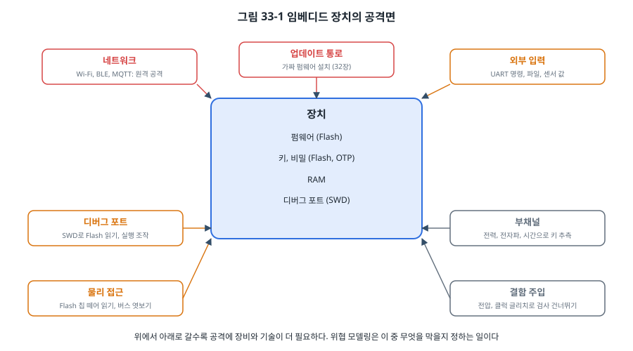
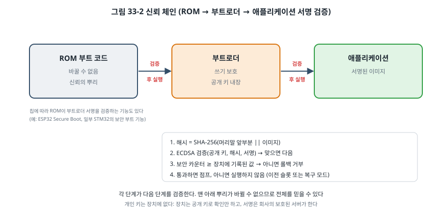
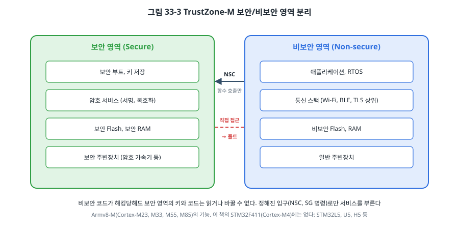

# 33장. 임베디드 보안

## 이 장에서 배우는 것

- 임베디드 장치의 공격면과 위협 모델링
- 해시, 대칭키, 공개키 암호의 역할을 구분하는 법
- 서명 검증으로 신뢰 체인을 만드는 보안 부트와 롤백 방지
- Mbed TLS를 MCU에 맞게 줄여 쓰는 방법
- 키 보관, 디버그 포트 잠금, TrustZone-M
- 부채널 공격과 결함 주입 공격의 개요와 기본 대책

---

## 33.1 왜 임베디드 보안인가

2016년, 인터넷에 연결된 카메라와 공유기 수십만 대가 **Mirai**라는 악성코드에 감염되어 대규모 서비스 거부 공격에 동원되었습니다. 감염 방법은 놀라울 만큼 단순했습니다. 공장 기본 비밀번호를 그대로 쓰는 장치에 텔넷으로 접속한 것입니다. 장치 하나하나는 값싸고 작지만, 수가 많고 오래 켜져 있으며 거의 업데이트되지 않는다는 점이 공격자에게는 매력입니다.

이제 보안은 선택이 아니라 규제 대상입니다. 영국은 2024년부터 소비자 IoT 장치에 기본 비밀번호 금지와 취약점 신고 창구, 보안 업데이트 기간 공개를 의무화했고, 유럽연합의 사이버 복원력법(Cyber Resilience Act)은 디지털 요소가 있는 제품 전반에 보안 요구 사항을 단계적으로 적용합니다. 국제 표준 ETSI EN 303 645가 이런 규제의 기준으로 자주 쓰입니다. [확인 필요: 출간 시점 각 규제의 적용 일정]

이 장은 보안 전문가를 위한 내용이 아니라, **펌웨어 개발자가 반드시 알아야 할 기본**입니다. 대부분의 사고는 고급 공격이 아니라 기본을 지키지 않아서 일어납니다.

## 33.2 위협 모델링

"우리 장치는 안전한가?"라는 질문에는 답할 수 없습니다. "무엇을, 누구로부터, 어디까지 지키는가?"라고 물어야 답할 수 있습니다. 이 질문에 답하는 과정이 **위협 모델링**입니다.

1. **지킬 것(자산)**: 펌웨어(회사의 지식 재산), 장치의 키와 인증서, 사용자 데이터, 장치의 동작 자체(예: 문 잠금, 모터 제어).
2. **공격자**: 인터넷 건너편의 자동화된 봇, 같은 네트워크의 사람, 장치를 손에 넣은 사람, 장비를 갖춘 전문가.
3. **공격면**: 공격자가 장치에 닿을 수 있는 모든 통로.



그림 33-1의 위쪽(네트워크, 업데이트 통로, 외부 입력)은 원격으로 많은 장치를 한꺼번에 공격할 수 있어 가장 위험합니다. 아래쪽(디버그 포트, 물리 접근, 부채널, 결함 주입)은 장치를 손에 넣고 장비와 시간을 들여야 하지만, 하나를 뚫어 얻은 것(예: 모든 장치가 공유하는 키)으로 전체를 공격할 수 있다면 역시 위험합니다.

위협 모델링의 결과는 표 한 장이면 됩니다. "원격 공격자가 업데이트 통로로 가짜 펌웨어를 넣는다 → 서명 검증(33.4절)", "장치를 훔친 사람이 SWD로 Flash를 읽는다 → RDP 레벨 1(33.7절)", "장비를 갖춘 사람이 전압 글리치로 서명 검사를 건너뛴다 → 이 제품에서는 받아들이는 위험"처럼, 위협마다 대책 또는 **받아들이는 위험**을 적습니다. 모든 위협을 막을 수는 없으므로, 무엇을 막지 않기로 했는지를 분명히 하는 것도 중요합니다.

> 💡 팁: 지금까지 이 책에서 강조한 원칙 중 상당수가 보안의 기본이기도 합니다. 바깥에서 들어온 데이터의 길이와 범위를 확인하기(14장, 20장), 버퍼 경계 지키기(4장, 25장), 시간 제한 두기(15장), 오류를 무시하지 않기(24장). 버퍼 오버플로와 정수 넘침은 지금도 가장 흔한 취약점입니다.

## 33.3 암호 기초

암호를 직접 구현하는 것은 금물이지만, 각 도구가 **무엇을 보장하는지**는 정확히 알아야 잘못 쓰지 않습니다.

| 도구 | 예 | 보장하는 것 | 보장하지 않는 것 |
| --- | --- | --- | --- |
| 해시 | SHA-256 | 데이터의 지문. 조금만 바뀌어도 완전히 달라짐 | 누가 만들었는지 (누구나 계산 가능) |
| MAC | HMAC-SHA256, AES-CMAC | 같은 비밀 키를 가진 쪽이 만들었고 바뀌지 않음 | 비밀 유지, 키를 가진 누구나 만들 수 있음 |
| 대칭키 암호 | AES-128/256 (GCM, CCM) | 내용을 숨김 (+ GCM/CCM은 변조 검출) | 키를 어떻게 나눠 가질지 |
| 디지털 서명 | ECDSA P-256, Ed25519 | 개인 키를 가진 쪽만 만들 수 있고, 공개 키로 누구나 확인 | 내용을 숨기지 않음 |
| 키 교환 | ECDH | 도청자가 있어도 두 쪽이 같은 비밀 키를 얻음 | 상대가 누구인지 (인증서와 함께 써야 함) |

13장의 CRC는 이 표에 없습니다. CRC는 **우연한** 오류를 잡도록 설계되어서, 일부러 바꾸고 CRC를 다시 계산하면 그만입니다. 32장의 부트로더에 서명이 필요한 이유입니다.

펌웨어 업데이트에 **서명**을 쓰는 것이 핵심입니다. MAC을 쓰면 장치마다 같은 비밀 키가 들어 있어야 하고, 장치 하나에서 그 키를 꺼내면 모든 장치용 가짜 펌웨어를 만들 수 있습니다. 서명은 장치에 **공개 키만** 있으므로, 장치를 뜯어도 서명을 만들 수 없습니다.

> ⚠️ 주의: 암호의 안전성은 **난수**에 달려 있습니다. 키를 만들거나 ECDSA로 서명할 때 예측 가능한 난수를 쓰면 키가 그대로 드러납니다. `rand()`나 타이머 값은 난수가 아닙니다. 하드웨어 진성 난수 발생기(TRNG)를 쓰세요. 이 책의 STM32F411에는 RNG 주변장치가 **없습니다**(STM32F405/407 등에는 있음). 그래서 이 장의 예제는 장치에서 서명하지 않고 검증만 합니다. 장치에서 키를 만들어야 한다면 RNG가 있는 MCU나 보안 칩(33.6절)을 씁니다.

## 33.4 보안 부트와 서명 검증

**보안 부트(secure boot)** 는 장치가 **허가된 펌웨어만 실행**하게 하는 것입니다. 원리는 **신뢰 체인(chain of trust)** 입니다.



각 단계는 다음 단계를 실행하기 전에 서명을 검증합니다. 맨 앞 단계(**신뢰의 뿌리**, root of trust)는 바뀔 수 없어야 합니다. 칩 안의 ROM이거나, 쓰기 보호를 건 부트로더입니다. 뿌리를 믿을 수 있고 각 단계가 다음을 검증하므로 전체를 믿을 수 있습니다. 32장의 부트로더가 CRC 대신 서명을 검사하면 이 체인의 두 번째 고리가 됩니다.

이 장의 예제(`code/ch33-security/`)는 32장의 머리말에 **보안 카운터**와 **ECDSA P-256 서명**을 더했습니다.

```c
typedef struct {
    uint32_t magic;            /* 'SIG1' */
    uint32_t hdr_size;
    uint32_t load_addr;
    uint32_t img_size;
    uint32_t version;
    uint32_t sec_counter;      /* 롤백 방지 */
    uint32_t reserved[10];
    uint8_t  sig[64];          /* ECDSA 서명 r || s */
} signed_hdr_t;
```

서명은 **PC의 도구**가 만듭니다. `tools/keygen.py`가 키 쌍을 만들어 개인 키는 파일로, 공개 키는 C 배열(`pubkey.h`)로 내보내고, `tools/sign_image.py`가 "머리말 앞 64바이트 + 이미지 본문"의 SHA-256 해시에 서명합니다. 장치의 `secure_verify()`는 같은 해시를 계산하고 공개 키로 서명을 확인합니다.

```c
mbedtls_sha256_starts(&sha, 0);
mbedtls_sha256_update(&sha, img, SIMG_SIGNED_HDR);            /* 머리말 앞부분 */
mbedtls_sha256_update(&sha, img + SIMG_HDR_SIZE, h->img_size); /* 본문 */
mbedtls_sha256_finish(&sha, hash);
...
mbedtls_ecp_group_load(&grp, MBEDTLS_ECP_DP_SECP256R1);
mbedtls_ecp_point_read_binary(&grp, &q, pubkey, 65);
mbedtls_mpi_read_binary(&r, h->sig, 32);
mbedtls_mpi_read_binary(&s, h->sig + 32, 32);
if (mbedtls_ecdsa_verify(&grp, hash, sizeof hash, &q, &r, &s) == 0) { ... }
```

머리말의 버전과 보안 카운터도 **서명 범위 안에** 넣은 것에 주목하세요. 그렇지 않으면 공격자가 서명은 그대로 두고 버전 숫자만 바꿀 수 있습니다. 반대로 서명 범위 밖의 값은 서명이 맞아도 믿으면 안 됩니다.

### 롤백 방지

서명만으로는 막지 못하는 공격이 있습니다. 회사가 정식으로 서명한 **옛 버전**에 보안 버그가 있었다면, 공격자는 그 옛 이미지를 다시 넣을 수 있습니다. 서명은 완벽하게 맞습니다. 이것을 막는 것이 **보안 카운터**입니다. 보안 버그를 고친 버전을 낼 때 카운터를 올리고, 장치는 지금까지 본 가장 큰 카운터보다 작은 이미지를 거부합니다.

```c
/* 서명이 맞은 뒤에야 머리말의 값을 믿을 수 있다: 보안 카운터 확인 */
if (res == SV_OK && h->sec_counter < min_counter) {
    res = SV_ROLLBACK;
}
```

장치가 기억하는 카운터 자체도 지켜야 합니다. 일반 Flash에 두면 공격자가 지울 수 있으므로, 한 번 쓰면 바꿀 수 없는 **OTP(One-Time Programmable)** 영역의 비트를 하나씩 태우는 방식을 흔히 씁니다. STM32F411에는 512바이트의 OTP 영역이 있고, ESP32는 eFuse로 같은 일을 합니다. [확인 필요: STM32F411 OTP 영역 크기와 구조 (RM0383 3.7절)] 32장의 롤백(시험 부팅 실패 시 이전 이미지로)과 이 롤백 방지는 이름이 비슷하지만 서로 다른 것입니다. 롤백 방지 카운터는 **보안 수정이 있을 때만** 올려서, 일반적인 시험 부팅 롤백은 계속 가능하게 합니다.

### PC에서 시험하기

31장의 방법으로 서명 검증을 시험합니다. 테스트를 실행할 때마다 새 키를 만들기 때문에 개인 키가 저장소에 남지 않습니다.

```bash
cd code/ch33-security
./get_mbedtls.sh
cd test && make
```

```
wrote build/signing_key.pem (keep secret) and build/pubkey.h
build/good.simg: v1.2.0, counter 3, 4096 bytes, sha256 838a0160b140a256...
build/old.simg: v1.0.0, counter 1, 4096 bytes, sha256 e620b840962ba578...
all tests passed (0 failures)
```

(해시 값은 실행마다 다릅니다.) 테스트는 본문 한 비트, 머리말의 버전, 서명 한 비트를 바꾸면 모두 `SV_BAD_SIGNATURE`가 되고, 다른 키로 서명한 이미지도 거부되며, 옛 버전(카운터 1)은 서명이 맞아도 카운터 2 이상을 요구하면 `SV_ROLLBACK`이 되는 것을 확인합니다.

## 33.5 Mbed TLS

**Mbed TLS**(Apache 2.0)는 임베디드를 위해 만들어진 암호 라이브러리입니다. TLS 전체(20장의 MQTT over TLS)부터 해시 하나까지 기능을 골라 쓸 수 있습니다. ESP-IDF와 Zephyr에도 들어 있습니다.

핵심은 **설정 파일**입니다. 기본 설정은 거의 모든 기능을 켜서 수백 KB가 되지만, 이 예제는 서명 검증에 필요한 것만 켭니다.

```c
/* common/mbedtls_config_min.h */
#define MBEDTLS_SHA256_C
#define MBEDTLS_BIGNUM_C
#define MBEDTLS_ECP_C
#define MBEDTLS_ECP_DP_SECP256R1_ENABLED
#define MBEDTLS_ECDSA_C
#define MBEDTLS_ASN1_PARSE_C
#define MBEDTLS_ASN1_WRITE_C
#define MBEDTLS_ECP_NIST_OPTIM            /* P-256 전용 빠른 나머지 연산 */
```

`-DMBEDTLS_CONFIG_FILE='"mbedtls_config_min.h"'`로 기본 설정 대신 이 파일을 쓰게 하고, 필요한 소스 파일 열 개만 빌드합니다. 22장에서 본 대로, 켜지 않은 기능은 컴파일조차 되지 않습니다.

MCU에서 쓸 때 알아 둘 점이 있습니다.

- **힙을 씁니다.** 큰 정수 연산(bignum)이 `calloc()`으로 메모리를 받습니다. 25장의 원칙과 맞지 않는다면 `MBEDTLS_MEMORY_BUFFER_ALLOC_C`로 정해진 정적 배열 안에서만 할당하게 할 수 있습니다.
- **시간이 걸립니다.** ECDSA P-256 검증은 16 MHz Cortex-M4에서 1초 안팎이 걸릴 수 있습니다. 보드 예제가 시간을 재어 보여 줍니다. [확인 필요: 보드 실측] 부팅 시간에 그대로 더해지므로, 클럭을 올리거나(3장), 하드웨어 가속기가 있는 MCU를 쓰거나, 더 빠른 라이브러리(예: P-256 전용 구현)를 검토합니다.
- **새 API가 있습니다.** Mbed TLS 3.x부터는 **PSA Crypto API**를 표준 인터페이스로 밀고 있습니다. 키를 핸들로 다뤄 하드웨어 보안 모듈이나 TrustZone(33.8절) 안의 키와 같은 코드로 쓸 수 있습니다. 이 장은 원리를 보이려고 저수준 API를 썼습니다.

## 33.6 키와 비밀 보관

암호가 아무리 강해도 키가 새면 끝입니다. 펌웨어 개발자가 흔히 저지르는 실수는 다음과 같습니다.

- **모든 장치에 같은 비밀**: 펌웨어에 박아 둔 API 키, 공유 비밀번호, 공통 TLS 개인 키. 장치 하나를 뜯거나 펌웨어 파일 하나를 분석하면 모든 장치가 뚫립니다. 비밀은 **장치마다 다르게** 만들어 생산 단계에서 넣습니다(36장의 프로비저닝).
- **저장소에 올린 개인 키**: 서명용 개인 키가 Git 기록에 한 번이라도 들어가면 지워도 남습니다. 이 장의 예제는 키를 빌드할 때 만들고 `.gitignore`로 막아 둡니다. 실제 제품의 서명 키는 HSM(하드웨어 보안 모듈)이나 클라우드 키 관리 서비스에 두고, 빌드 서버가 서명을 요청하는 방식으로만 씁니다.
- **기본 비밀번호**: 첫 사용 때 바꾸게 하거나, 장치마다 다른 값을 라벨에 인쇄합니다(Mirai의 교훈).

장치 쪽에서 키를 지키는 가장 확실한 방법은 **보안 칩(secure element)** 입니다. Microchip ATECC608 같은 칩은 개인 키를 칩 안에서 만들고 절대 밖으로 내보내지 않은 채 서명과 키 교환을 해 줍니다. MCU의 Flash가 통째로 읽혀도 키는 안전합니다. I2C로 연결하므로 15장의 지식으로 쓸 수 있습니다.

## 33.7 디버그 포트 잠금

23장의 SWD는 개발자에게는 최고의 도구지만, 장치를 손에 넣은 공격자에게도 마찬가지입니다. 디버거를 연결하면 Flash 전체를 읽어 펌웨어와 그 안의 키를 가져가고, 실행을 멈춰 서명 검사를 건너뛸 수 있습니다. 그래서 제품은 출하 전에 디버그 접근을 제한합니다.

STM32F4는 옵션 바이트의 **RDP(Read-out Protection)** 로 세 단계를 고릅니다.

| 수준 | 옵션 바이트 RDP | 효과 |
| --- | --- | --- |
| 0 | 0xAA | 보호 없음 (개발 중) |
| 1 | 0xAA, 0xCC 외의 값 | 디버거, 시스템 부트로더, RAM에서 실행한 코드는 Flash를 읽을 수 없음. 0으로 되돌리면 Flash 전체가 지워짐 |
| 2 | 0xCC | 디버그 포트 영구 비활성, 옵션 바이트 변경 불가. **되돌릴 수 없음** |

레벨 1은 펌웨어를 읽지 못하게 하면서도, 전체를 지우고 다시 시작할 수 있어 복구가 가능합니다. 레벨 2는 가장 강하지만 불량 분석조차 할 수 없게 되므로, 신중한 결정이 필요합니다. 그리고 레벨 1에도 알려진 우회 공격 연구들이 있으므로 그것만 믿지 않습니다. [확인 필요: RDP 수준 1, 2의 세부 동작 (RM0383 3.6.3절)]

옵션 바이트는 `FLASH->OPTCR`로 읽고 쓰지만, 이 책의 예제는 **읽기만** 합니다. 실습 보드에서 레벨 2를 잘못 걸면 그 보드는 다시 프로그래밍할 수 없습니다. 레벨을 바꿀 때는 STM32CubeProgrammer 같은 도구로 확인하며 합니다.

```c
uint32_t rdp = (FLASH->OPTCR >> 8) & 0xFFu;   /* RDP[15:8] */
```

함께 쓰는 보호 기능으로, 특정 섹터를 지우거나 쓰지 못하게 하는 **쓰기 보호(WRP)** 가 있습니다. 부트로더 섹터(32장)에 걸어 두면 앱의 버그나 공격으로 부트로더가 바뀌는 것을 막아, 신뢰의 뿌리를 지킬 수 있습니다.

> 🔧 ATmega128에서는: AVR은 **잠금 비트(lock bit)** 로 같은 일을 합니다. LB1, LB2를 프로그래밍하면 ISP와 JTAG으로 Flash와 EEPROM을 읽거나 쓸 수 없고, 칩 전체 지우기(chip erase)로만 풀 수 있습니다. 부트 영역용 잠금 비트(BLB)는 앱이 부트로더 영역을 `SPM`으로 바꾸거나 읽지 못하게 합니다(32장). 그리고 JTAGEN 퓨즈를 끄면(5장) JTAG 디버그 접근이 막힙니다. 다만 8비트 AVR에는 암호 가속기가 없어서, ECDSA 같은 공개키 연산은 수 초 이상 걸릴 수 있습니다. [확인 필요: ATmega128에서 ECDSA P-256 검증 시간] 그래서 AVR 제품은 보안 칩을 함께 쓰거나, 서명 대신 업데이트 통로 자체를 물리적으로 제한하는 방법을 쓰기도 합니다.

ESP32는 eFuse로 JTAG을 영구히 끄고, **Flash 암호화**를 켜서 외부 Flash 칩을 떼어 읽어도 내용을 알 수 없게 하며, **Secure Boot**로 ROM이 부트로더의 서명을 검증하게 합니다. 이 기능들도 eFuse를 태우는 되돌릴 수 없는 설정이므로, 개발 단계에서는 "개발 모드"로 시험한 뒤 양산에 적용합니다.

## 33.8 TrustZone-M

지금까지의 대책은 "공격자가 펌웨어 안으로 들어오지 못하게" 하는 것이었습니다. 그런데 Wi-Fi 스택의 버그 하나로 공격자가 코드 실행 권한을 얻으면, 같은 메모리에 있는 키도 함께 넘어갑니다. **TrustZone-M**은 MCU 안을 두 세계로 나눠 이 문제를 줄입니다.



Armv8-M 코어(Cortex-M23, M33, M55, M85)는 메모리와 주변장치를 **보안(Secure)** 과 **비보안(Non-secure)** 영역으로 나눕니다. 보안 영역에는 보안 부트, 키, 암호 서비스처럼 작고 철저히 검토한 코드만 두고, 애플리케이션과 RTOS, 통신 스택은 비보안 영역에서 실행합니다. 비보안 코드가 보안 영역의 메모리를 직접 읽으려 하면 폴트(SecureFault 예외)가 납니다. 보안 서비스는 정해진 입구, 즉 **NSC(Non-Secure Callable)** 영역의 `SG` 명령으로 시작하는 함수로만 부를 수 있습니다. 어느 주소가 어느 영역인지는 SAU(Security Attribution Unit)와 칩마다 정해진 IDAU가 정합니다.

Arm이 제공하는 오픈소스 **TF-M(Trusted Firmware-M)** 이 보안 영역의 표준 구현으로, 보안 부트(MCUboot 기반), PSA Crypto, 보안 저장소 서비스를 제공합니다. 비보안 쪽 앱은 PSA API로 이 서비스를 부릅니다.

이 책의 STM32F411(Cortex-M4)에는 TrustZone이 없습니다. STM32L5, U5, H5 계열이나 Nordic nRF5340, nRF9160 같은 Cortex-M33 MCU에서 쓸 수 있습니다. TrustZone이 없는 MCU에서는 25장의 MPU로 태스크마다 접근할 수 있는 메모리를 제한하는 것이 비슷한 방향의 대책입니다.

## 33.9 부채널과 결함 주입

장치를 손에 넣고 장비를 갖춘 공격자는 더 교묘한 방법을 씁니다.

**부채널 공격(side-channel attack)** 은 계산 결과가 아니라 계산하는 **방식**에서 비밀을 알아냅니다. 가장 간단한 예가 시간입니다.

```c
/* 위험: 처음 틀린 바이트에서 바로 돌아온다 */
bool check_password(const uint8_t *in, const uint8_t *secret, size_t n)
{
    return memcmp(in, secret, n) == 0;
}
```

`memcmp`는 앞에서부터 비교하다 다른 바이트를 만나면 바로 끝납니다. 첫 바이트가 맞으면 아주 조금 더 오래 걸리므로, 응답 시간을 정밀하게 재면 비밀을 한 바이트씩 알아낼 수 있습니다. 비밀을 비교할 때는 항상 같은 시간이 걸리는 **상수 시간 비교**를 씁니다.

```c
bool equal_ct(const uint8_t *a, const uint8_t *b, size_t n)
{
    uint8_t diff = 0;
    for (size_t i = 0; i < n; i++) {
        diff |= a[i] ^ b[i];       /* 다른 비트를 모두 모은다: 중간에 멈추지 않는다 */
    }
    return diff == 0;
}
```

Mbed TLS의 `mbedtls_ct_memcmp()`가 이런 함수입니다. 전력 소비(SPA, DPA)나 전자파를 재서 AES 키를 알아내는 공격도 있는데, 이것은 펌웨어만으로 막기 어려워 보안 칩이나 대책이 들어간 암호 가속기를 씁니다.

**결함 주입(fault injection)** 은 전원 전압을 아주 짧게 떨어뜨리거나(글리치), 클럭을 흔들거나, 레이저를 쏘아 CPU가 명령 하나를 건너뛰거나 잘못 실행하게 만듭니다. 서명 검사의 `if` 하나를 건너뛰게 하면 보안 부트가 무력해집니다. 펌웨어로 할 수 있는 기본 대책은 다음과 같습니다.

- **중요한 판단을 두 번 합니다.** 서명 검사 결과를 다른 방식으로 한 번 더 확인하고, 두 결과가 다르면 멈춥니다.
- **성공 값을 단순하게 두지 않습니다.** "0이면 성공"은 레지스터가 0으로 지워지는 결함에 약합니다. 성공을 0x5AA5C33C 같은 특이한 값으로 표현하기도 합니다.
- **흐름을 확인합니다.** 반드시 거쳐야 하는 단계마다 카운터를 올리고 마지막에 기대한 값인지 봅니다.
- **하드웨어를 켭니다.** 3장의 BOR(전압 감시), 클럭 감시(CSS) 같은 기능이 일부 글리치를 잡습니다.

이 대책들은 공격을 어렵게 할 뿐 완전히 막지는 못합니다. 위협 모델(33.2절)에서 이 수준의 공격자를 막아야 한다고 정했다면, 그것을 막도록 인증받은 보안 칩을 쓰는 것이 현실적인 답입니다.

## 33.10 실습: 보드에서 서명 검증

보드 예제는 슬롯 B(0x0804 0000)에 올린 서명된 이미지를 검증하고 걸린 시간을 재며, 지금 RDP 수준을 보여 줍니다.

```bash
cd code/ch33-security
./get_mbedtls.sh
cd stm32
make keys          # ../keys 에 키 쌍 (개인 키는 저장소에 올리지 않는다)
make flash
make signed-test   # 시험용 데이터 4 KB에 서명해 슬롯 B에 올린다
```

```
ch33 security demo
RDP: level 0 (no protection: debugger can read Flash)
slot B: ok (v1.2.0, counter 3)
verify took ... ms at 16 MHz
```

(출력은 예시입니다. [확인 필요: 보드 실측]) `make keys`를 다시 실행해 키를 바꾼 뒤 펌웨어만 다시 올리면(이미지는 옛 키로 서명된 그대로) `SIGNATURE INVALID`가 나옵니다. 키를 잃어버리면 그 키로 서명을 확인하는 장치들에 다시는 업데이트를 보낼 수 없다는 뜻이기도 합니다. 서명 키는 반드시 안전하게 **백업**해야 합니다.

---

## 정리

- 보안은 위협 모델링에서 시작합니다. 자산, 공격자, 공격면을 정하고, 위협마다 대책 또는 받아들이는 위험을 적습니다.
- 해시, MAC, 대칭키, 서명, 키 교환은 보장하는 것이 다릅니다. 펌웨어 업데이트에는 장치에 공개 키만 두는 서명을 씁니다. CRC는 보안 도구가 아니며, 난수는 하드웨어 RNG로 만듭니다.
- 보안 부트는 바뀔 수 없는 뿌리에서 시작해 각 단계가 다음 단계의 서명을 검증하는 신뢰 체인입니다. 버전과 보안 카운터를 서명 범위에 넣고, 카운터로 옛 버전으로의 롤백을 막습니다.
- Mbed TLS는 설정 파일로 필요한 기능만 켜서 씁니다. 힙과 실행 시간을 확인합니다.
- 비밀은 장치마다 다르게, 개인 키는 장치와 저장소 밖에 둡니다. 보안 칩은 키를 칩 밖으로 내보내지 않습니다.
- 출하 전에 RDP, 잠금 비트, eFuse로 디버그 접근을 제한하고 부트로더 영역을 쓰기 보호합니다.
- TrustZone-M은 MCU를 보안과 비보안 세계로 나눕니다. 부채널과 결함 주입에는 상수 시간 비교, 이중 확인 같은 기본 대책을 쓰고, 높은 수준의 위협에는 보안 칩을 씁니다.

## 연습 문제

1. 30장 데이터 로거의 위협 모델을 표로 만드세요. 자산, 공격자, 공격면, 대책 또는 받아들이는 위험을 각각 세 가지 이상 쓰세요.
2. 업데이트 이미지를 HMAC-SHA256으로 보호하는 설계와 ECDSA 서명으로 보호하는 설계를 비교하세요. 장치 하나의 Flash가 통째로 유출되었을 때 각각 어떤 일이 생기나요?
3. 머리말의 `sec_counter`가 서명 범위 밖에 있다면 어떤 공격이 가능한지 구체적으로 설명하세요.
4. 장치가 기억하는 최소 보안 카운터를 일반 Flash의 한 워드에 저장했습니다. 공격자가 할 수 있는 일은 무엇이고, OTP 비트를 하나씩 태우는 방식은 이것을 어떻게 막나요? OTP 비트가 다 떨어지면 어떻게 하나요?
5. 다음 코드의 문제를 두 가지 이상 찾고 고치세요. `if (strcmp(rx_password, "admin1234") == 0) { unlock(); }`
6. (실습) 32장 부트로더의 `image_check()`를 이 장의 `secure_verify()`로 바꿔 보안 부트로더를 만들어 보세요. 부트로더 영역(32 KB)에 Mbed TLS가 들어가는지 `arm-none-eabi-size`로 확인하고, 모자라면 Flash 배치를 어떻게 바꿀지 제안하세요.
