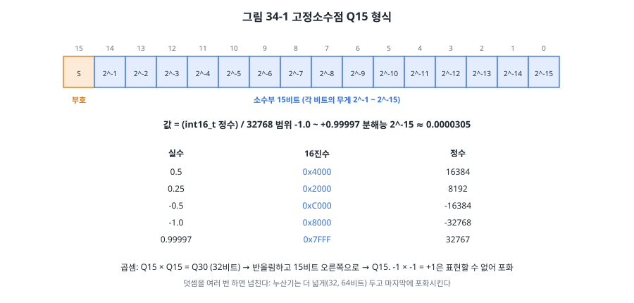
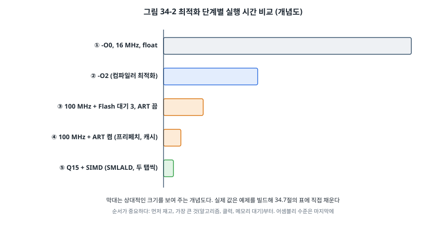

# 34장. 성능 최적화

## 이 장에서 배우는 것

- 최적화의 첫 번째 규칙: 먼저 재기 (DWT 사이클 카운터)
- 컴파일러 최적화 수준과 그 함정
- 클럭, Flash 대기 상태, 캐시와 TCM이 실행 시간에 주는 영향
- 컴파일러가 만든 Thumb-2 명령을 읽는 방법
- 고정소수점(Q15)과 SIMD 명령, CMSIS-DSP

---

## 34.1 먼저 재라

"이 코드가 느리다"는 느낌으로 최적화를 시작하면 대개 엉뚱한 곳을 고칩니다. 실행 시간의 대부분은 아주 작은 부분에서 쓰이고, 그 부분은 짐작과 다른 경우가 많습니다. 그래서 최적화의 첫 번째 규칙은 **먼저 재는 것**입니다.

1. **목표를 정합니다.** "필터가 1 ms 안에 끝나야 한다"(28장의 마감), "평균 전류를 줄이려면 깨어 있는 시간을 절반으로"(30장). 목표 없는 최적화는 끝이 없습니다.
2. **잽니다.** 어디서 시간이 쓰이는지 확인합니다.
3. **가장 큰 것부터** 고칩니다.
4. **다시 잽니다.** 정말 빨라졌는지, 결과가 같은지 확인합니다.

이 책에서 여러 번 쓴 **DWT 사이클 카운터**가 가장 정확한 도구입니다. Cortex-M3/M4/M7에 있는 32비트 카운터로, CPU 클럭마다 1씩 늘어납니다.

```c
static inline void cycle_counter_init(void)
{
    DEMCR |= DEMCR_TRCENA;          /* 추적 기능 켜기 */
    DWT_CYCCNT = 0;
    DWT_CTRL |= DWT_CTRL_CYCCNTENA; /* 사이클 카운터 시작 */
}

uint32_t t0 = DWT_CYCCNT;
fir_q15_fast(xq, hq, yq, N, TAPS);
uint32_t cycles = DWT_CYCCNT - t0;   /* 넘침에 안전한 뺄셈 (24장) */
```

재는 방법에도 요령이 있습니다. 같은 코드를 여러 번 재서 **가장 짧은 값**을 쓰면 인터럽트 같은 잡음을 걸러낼 수 있습니다(예제의 `measure()`). 반대로 28장의 실시간 분석처럼 **가장 긴 값**이 중요한 경우도 있습니다. 무엇을 알고 싶은지에 따라 고릅니다. 23장의 GPIO 토글과 오실로스코프는 인터럽트를 포함한 실제 시간을 보여 주므로 함께 쓰면 좋습니다.

> 🔧 ATmega128에서는: AVR에는 사이클 카운터가 없습니다. 16비트 타이머를 분주 없이(클럭 그대로) 돌려 그 값의 차이로 재거나(8장), GPIO 토글로 잽니다. avr-gcc가 만든 `.lss` 역어셈블 파일에서 명령마다의 클럭 수를 데이터시트의 명령어 표와 맞춰 보면 짧은 코드는 정확히 계산할 수도 있습니다. 8비트 AVR에서 가장 큰 효과는 대개 **자료형**에서 나옵니다. `int`(16비트) 대신 `uint8_t`로 충분한 곳은 `uint8_t`로, `float`는 정수로(12장) 바꾸는 것만으로 몇 배씩 빨라집니다.

## 34.2 컴파일러 최적화

가장 먼저 시도할 것은 컴파일러에게 맡기는 것입니다. 22장에서 본 최적화 수준을 다시 정리합니다.

| 옵션 | 목표 | 쓰는 때 |
| --- | --- | --- |
| `-O0` | 최적화 없음. 소스와 명령이 1:1 | 거의 쓰지 않음 (느리고 크다) |
| `-Og` | 디버깅을 해치지 않는 최적화 | 개발 중 (이 책의 기본) |
| `-O1`, `-O2` | 속도 (코드 크기를 크게 늘리지 않음) | 릴리스의 일반적인 선택 |
| `-O3` | 공격적인 속도 (루프 펼치기, 벡터화) | 측정해서 이득이 있을 때만 |
| `-Os`, `-Oz` | 크기 | Flash가 모자랄 때 |

예제의 Makefile은 `OPT` 변수로 수준을 바꿀 수 있게 했습니다. 공통 규칙의 `-Og` **뒤에** 붙여서 GCC가 마지막 `-O` 옵션을 쓰게 한 것입니다.

```bash
cd code/ch34-performance/stm32
make clean && make OPT=-O0 flash
make clean && make OPT=-O2 flash
```

### 최적화의 함정

최적화 수준을 올렸더니 프로그램이 이상하게 동작한다면, 컴파일러의 버그보다는 **코드가 C 언어의 약속을 어긴 것**일 가능성이 훨씬 큽니다. `-O0`에서 우연히 동작하던 코드가 최적화로 드러난 것입니다.

**`volatile`을 빠뜨린 경우** (4장, 7장): ISR이 바꾸는 플래그를 메인 루프가 `while (!flag) {}`로 기다리는데 `volatile`이 없으면, 컴파일러는 "루프 안에서 flag를 바꾸는 코드가 없다"고 판단해 flag를 한 번만 읽고 무한 루프를 만듭니다.

**빈 지연 루프**:

```c
for (uint32_t i = 0; i < 1000000; i++) { }        /* -O2에서 통째로 사라진다 */
for (volatile uint32_t i = 0; i < 1000000; i++) { } /* 남지만 시간은 컴파일러와 클럭에 따라 다르다 */
```

결과에 아무 영향이 없는 계산은 지워도 된다는 것이 C의 규칙입니다. 시간 지연은 타이머(8장)나 RTOS의 지연(26장)으로 합니다.

**정의되지 않은 동작**: 부호 있는 정수의 넘침, 배열 범위 밖 접근, 엄격한 별칭 규칙 위반(25장), 초기화하지 않은 변수 읽기. 컴파일러는 "이런 일은 일어나지 않는다"고 가정하고 최적화하므로, 그런 코드는 최적화 수준에 따라 다르게 동작합니다. 예를 들어 `if (x + 1 < x)`로 넘침을 검사하는 코드는 `x`가 `int`라면 컴파일러가 "항상 거짓"으로 보고 지울 수 있습니다.

**벤치마크 자체가 사라지는 경우**: 결과를 쓰지 않는 계산은 지워지므로, 벤치마크의 결과는 전역 배열에 쓰거나 출력합니다. 예제가 결과를 `static` 전역 배열 `yq`, `yf`에 쓰는 이유입니다.

> 💡 팁: 31장의 단위 테스트를 `-O0`과 `-O2` 양쪽으로 돌려 보세요. 결과가 다르다면 정의되지 않은 동작이 숨어 있다는 강한 신호입니다. GCC의 `-fsanitize=undefined`(PC에서)도 이런 코드를 찾아 줍니다.

## 34.3 클럭, Flash, 캐시

같은 코드라도 **메모리를 기다리는 시간**에 따라 실행 시간이 크게 달라집니다.

STM32F411은 리셋 직후 HSI 16 MHz로 동작하고, 이때 Flash는 대기 상태 0으로 한 클럭에 읽힙니다. 3장에서 PLL로 100 MHz까지 올렸는데, Flash 자체는 그렇게 빠르지 않아서 **대기 상태(wait state)** 를 3으로 늘려야 했습니다. 명령 하나를 Flash에서 가져올 때마다 CPU가 3클럭을 더 기다린다는 뜻입니다. 클럭은 6배가 넘게 빨라졌는데 Flash 대기 때문에 그만큼 빨라지지 않는 것입니다.

이 대기를 숨기는 것이 ST의 **ART 가속기**입니다(RM0383 3.4절).

- **프리페치**: Flash는 한 번에 128비트(명령 4~8개)를 읽습니다. CPU가 지금 줄을 실행하는 동안 다음 줄을 미리 읽어 둡니다. 직선으로 흐르는 코드에 효과적입니다.
- **명령 캐시**: 최근에 읽은 Flash 줄(128비트 × 64줄)을 기억해 두었다가, 반복문처럼 같은 코드로 다시 점프하면 대기 없이 꺼냅니다.
- **데이터 캐시**: Flash에 있는 상수(`const` 배열, 25장)를 읽을 때를 위한 작은 캐시(128비트 × 8줄)입니다.

예제는 같은 FIR 필터를 세 조건에서 잽니다. 16 MHz, 100 MHz에 ART를 켠 것, 100 MHz에 ART를 끈 것입니다. ART를 끄면 100 MHz의 이득이 상당 부분 사라지는 것을 직접 볼 수 있습니다. 3장의 클럭 설정에서 `FLASH_ACR`에 프리페치와 캐시를 함께 켠 이유입니다.

### 캐시와 TCM이 있는 MCU

Cortex-M7(STM32F7, H7)은 ART 대신 Arm의 **L1 캐시**(명령, 데이터 각각 수 KB~수십 KB)를 가지고, 캐시 없이 항상 한 클럭에 접근하는 **TCM(Tightly Coupled Memory)** 을 가집니다. 이런 MCU에서는 두 가지를 알아야 합니다.

- **시간이 중요한 코드와 데이터는 TCM에** 둡니다. 캐시는 평균을 빠르게 하지만, 캐시가 빗나가는 순간 실행 시간이 크게 늘어나 28장의 최악 실행 시간 분석을 어렵게 합니다. TCM은 항상 같은 속도입니다. 링커 스크립트(21장)에서 함수를 `.itcm` 같은 섹션에 넣고 시작할 때 복사합니다.
- **DMA와 데이터 캐시는 서로 모릅니다.** DMA(10장)가 RAM에 데이터를 쓴 뒤 CPU가 읽으면, CPU는 캐시에 남은 **옛 값**을 읽을 수 있습니다. 반대로 CPU가 쓴 값이 아직 캐시에만 있으면 DMA는 옛 값을 보냅니다. DMA 전후로 캐시를 비우거나(clean) 무효화(invalidate)하거나, DMA 버퍼를 캐시하지 않는 영역(MPU, 25장)에 둡니다. 25장에서 DMA 버퍼를 32바이트로 정렬하라고 한 것은 캐시 줄 크기 때문입니다.

STM32F411에는 TCM이 없습니다. (STM32F405/407에는 CPU만 접근할 수 있는 64 KB의 CCM RAM이 있어 비슷하게 씁니다.)

## 34.4 Thumb-2 어셈블리 읽기

어셈블리로 코드를 쓸 일은 거의 없지만, **컴파일러가 만든 명령을 읽을 줄 알면** 최적화가 훨씬 쉬워집니다. "왜 느리지?"의 답이 거기 있기 때문입니다.

```bash
make disasm          # arm-none-eabi-objdump -d -S → build/ch34-performance.lst
```

`-S`는 소스 줄을 명령 사이에 섞어 보여 줍니다. 자주 보는 명령은 많지 않습니다.

| 명령 | 뜻 | 예 |
| --- | --- | --- |
| `ldr`, `ldrh`, `ldrsh`, `ldrb` | 메모리에서 읽기 (32, 16, 부호 있는 16, 8비트) | `ldrsh r3, [r1], #2` (읽고 r1을 2 증가) |
| `str`, `strh`, `strb` | 메모리에 쓰기 | |
| `add`, `sub`, `mul`, `mla` | 산술, 곱셈, 곱해서 더하기 | `mla r0, r2, r3, r0` (r0 += r2 × r3) |
| `smlal`, `smlald` | 64비트에 곱해서 더하기, 16비트 두 쌍을 한 번에 | |
| `vldr`, `vfma.f32` | FPU 레지스터로 읽기, float 곱해서 더하기 | |
| `cmp`, `b`, `bne`, `cbz` | 비교와 분기 | |
| `bl`, `bx lr` | 함수 호출, 돌아가기 | |
| `push`, `pop` | 레지스터를 스택에 저장, 복원 | |

함수의 인자는 `r0`~`r3`, 결과는 `r0`으로 주고받습니다(AAPCS, 26장의 컨텍스트 저장과 23장의 스택 프레임에서 본 그 규칙). 역어셈블을 보며 확인할 것은 이런 것들입니다.

- **안쪽 루프에 명령이 몇 개인가?** 탭 하나에 명령 10개라면 줄일 여지가 많습니다.
- **불필요한 메모리 접근이 있는가?** 같은 값을 매번 메모리에서 다시 읽는다면, 포인터 별칭 때문에 컴파일러가 확신하지 못하는 것일 수 있습니다. 포인터 인자에 `restrict`를 붙이면 "이 포인터들은 겹치지 않는다"고 알려 줄 수 있습니다.
- **함수 호출이 있는가?** 안쪽 루프에서 `bl`이 보인다면 인라인되지 않은 것입니다. 나눗셈(`__aeabi_idiv`)이나 `double` 연산(`__aeabi_dmul`)이 라이브러리 호출로 들어가 있는 경우가 흔합니다.
- **`double`이 숨어 있는가?** Cortex-M4F의 FPU는 단정밀도(`float`)만 하드웨어로 처리합니다. `0.5` 같은 상수에 `f`를 빠뜨리면(`x * 0.5`) `double` 연산이 되어 소프트웨어 루틴으로 수십 배 느려집니다. 22장의 `-Wdouble-promotion`이 이것을 잡아 줍니다.

## 34.5 고정소수점

FPU가 없는 MCU(Cortex-M0/M3, AVR)에서 `float` 연산은 소프트웨어로 처리되어 매우 느립니다. FPU가 있어도 정수 연산은 SIMD로 여러 개를 한 번에 처리할 수 있어 더 빠를 수 있습니다. 그래서 신호 처리에서는 **고정소수점**을 씁니다. 12장에서 온도를 "섭씨 × 10"의 정수로 다룬 것도 고정소수점의 한 형태입니다.



**Q15**는 `int16_t` 하나로 -1.0부터 거의 +1.0까지를 나타냅니다. 값은 정수를 32768(2^15)로 나눈 것입니다. 0.5는 16384, -1.0은 -32768입니다. 오디오, 센서 신호처럼 크기를 -1~+1로 맞출 수 있는 데이터에 알맞습니다. 비슷하게 Q31(`int32_t`), Q7(`int8_t`)도 씁니다.

고정소수점 연산의 규칙 세 가지를 기억하면 됩니다.

```c
/* Q15 × Q15 = Q30 → 반올림해 Q15로. -1 × -1 = +1은 표현할 수 없으므로 포화 */
static inline q15_t q15_mul(q15_t a, q15_t b)
{
    int32_t p = (int32_t)a * b;           /* Q30 */
    return q15_sat((p + (1 << 14)) >> 15);
}
```

1. **곱하면 소수 자리가 늘어납니다.** Q15 × Q15는 Q30이 되므로 15비트 오른쪽으로 옮겨 Q15로 돌아옵니다. 그냥 자르지 않고 반 LSB를 더해 반올림하면 오차가 줄어듭니다.
2. **더하면 넘칠 수 있습니다.** 0.75 + 0.75 = 1.5는 Q15로 나타낼 수 없습니다. 여러 번 더하는 누산기는 더 넓은 자료형(32비트, 64비트)으로 두고 마지막에 한 번 줄입니다.
3. **넘치면 포화시킵니다.** 넘친 값이 반대 부호로 돌아가면(32767 + 1 = -32768) 오디오에서는 큰 잡음, 제어에서는 반대 방향 출력이 됩니다. 가장 큰 값에 붙잡아 두는 **포화(saturation)** 가 훨씬 안전합니다.

## 34.6 SIMD와 CMSIS-DSP

Cortex-M4와 M7에는 **DSP 확장** 명령이 있습니다. 32비트 레지스터 하나에 16비트 값 두 개(또는 8비트 네 개)를 담아 한 명령으로 함께 처리하는 **SIMD(Single Instruction, Multiple Data)** 명령입니다. 예제의 `fir_q15_fast()`는 그중 `SMLALD`를 씁니다.

```c
/* SMLALD acc, a, b : acc += a.lo × b.lo + a.hi × b.hi  (64비트 누산) */
uint32_t xx = load2(&xp[j]);            /* 표본 두 개 */
uint32_t hh = pack(h[k + 1], h[k]);     /* 계수 두 개 */
acc = __smlald(xx, hh, acc);            /* 곱셈 두 번과 덧셈 두 번을 한 명령으로 */
```

`__smlald()`는 GCC가 제공하는 **내장 함수(intrinsic)** 로, `<arm_acle.h>`(Arm C Language Extensions)에 선언되어 있으며 `SMLALD` 명령 하나로 컴파일됩니다. 어셈블리를 직접 쓰지 않고도 특수 명령을 쓸 수 있습니다. 예제는 `__ARM_FEATURE_DSP`가 정의된 경우(Cortex-M4 등)에만 이 명령을 쓰고, PC에서는 같은 계산을 C로 해서 31장처럼 PC 테스트를 할 수 있게 했습니다. PC 테스트는 빠른 구현이 기준 구현과 **비트 단위로 같은지** 확인합니다.

```bash
cd code/ch34-performance/test
make
```

```
max |q15 - float| = 0.000034 (1.1 LSB)
all tests passed (0 failures)
```

Q15 결과와 `float` 결과의 차이가 약 1 LSB(2^-15)라는 것은 고정소수점으로 바꿔도 정밀도를 거의 잃지 않았다는 뜻입니다. 최적화할 때는 이렇게 **결과가 같은지를 함께 시험**해야 합니다. 빠르지만 틀린 코드는 쓸모가 없습니다.

### CMSIS-DSP

FIR, IIR, FFT, 행렬, 통계 같은 신호 처리 함수를 직접 최적화할 필요는 없습니다. Arm의 **CMSIS-DSP**(Apache 2.0)가 Cortex-M의 DSP 확장과 FPU, Helium(M55/M85)에 맞춰 최적화한 함수를 `float`, Q31, Q15, Q7로 제공합니다.

```c
#include "arm_math.h"

arm_fir_instance_q15 fir;
static q15_t state[BLOCK + TAPS - 1];
arm_fir_init_q15(&fir, TAPS, coeffs, state, BLOCK);   /* Q15 FIR은 탭 수가 짝수, 4 이상 */
arm_fir_q15(&fir, input, output, BLOCK);               /* 블록 단위로 처리 */
```

CMSIS-DSP의 FIR은 이전 블록의 표본을 상태 버퍼에 기억하므로, 연속된 신호를 블록 단위로 나눠 처리하기 편합니다. 직접 만든 함수보다 대개 빠르고, 많은 사람이 시험한 코드라는 장점이 있습니다. 실무에서는 이 장처럼 직접 구현해 원리를 이해하고, 제품에는 CMSIS-DSP를 쓰는 경우가 많습니다. [확인 필요: 출간 시점 CMSIS-DSP 저장소와 빌드 방법]

## 34.7 실습: 단계별로 재기



예제를 최적화 수준별로 빌드해 올리고, 시리얼 터미널(115200 bps)에 나오는 값으로 아래 표를 채워 보세요. 그림 34-2은 값의 크기 관계를 짐작해 그린 개념도이며, 실제 비율은 직접 잰 값으로 확인해야 합니다.

```
ch34 FIR benchmark: 256 samples x 32 taps (build: -O2)

16 MHz HSI, 0 wait states
  fir_f32      ....... cycles  ...... us  ....cycles/tap
  ...
```

| 빌드 | 조건 | fir_f32 | fir_q15_ref | fir_q15_fast |
| --- | --- | --- | --- | --- |
| `-O0` | 16 MHz | (직접 측정) | | |
| `-O2` | 16 MHz | | | |
| `-O2` | 100 MHz, ART 켬 | | | |
| `-O2` | 100 MHz, ART 끔 | | | |
| `-O3` | 100 MHz, ART 켬 | | | |
| `-Os` | 100 MHz, ART 켬 | | | |

[확인 필요: 보드 실측값으로 표와 그림 34-2 갱신]

표를 채운 뒤 생각해 볼 질문입니다.

1. **사이클 수**와 **µs** 중 무엇이 클럭에 따라 바뀌나요? 16 MHz와 100 MHz(ART 켬)에서 사이클 수가 같지 않다면 그 차이는 무엇 때문인가요?
2. `fir_q15_fast`는 `fir_q15_ref`보다 얼마나 빠른가요? 탭당 사이클이 1보다 작아질 수 있나요?
3. `fir_f32`와 `fir_q15_fast` 중 어느 쪽이 빠른가요? FPU가 있는 M4F에서는 `float`가 생각보다 빠를 수 있습니다. 그렇다면 Q15를 쓰는 이유는 무엇일까요? (메모리 크기, DMA와 ADC가 주는 데이터 형식, FPU 없는 MCU로의 이식)
4. `-O3`가 `-O2`보다 빠른가요? 코드 크기(`arm-none-eabi-size`)는 얼마나 늘었나요?

---

## 정리

- 최적화는 목표를 정하고, 재고, 가장 큰 것부터 고치고, 다시 재는 순서로 합니다. DWT 사이클 카운터가 가장 정확한 도구입니다.
- 컴파일러 최적화가 가장 먼저 할 일입니다. 최적화로 동작이 바뀐다면 `volatile` 누락이나 정의되지 않은 동작을 의심합니다.
- 높은 클럭에서는 Flash 대기 상태가 실행 시간을 크게 늘리며, ART 가속기(프리페치와 캐시)가 이를 숨깁니다. 캐시가 있는 MCU에서는 시간이 중요한 코드를 TCM에 두고, DMA와 캐시의 일관성을 관리합니다.
- 역어셈블을 읽어 안쪽 루프의 명령 수, 불필요한 메모리 접근, 숨은 함수 호출과 `double` 연산을 찾습니다.
- 고정소수점 Q15는 정수로 소수를 다룹니다. 곱하면 자리를 옮기고, 누산기는 넓게, 넘치면 포화시킵니다.
- Cortex-M4의 SIMD 명령은 내장 함수로 쓸 수 있으며, 제품에서는 CMSIS-DSP를 씁니다. 빠른 구현은 기준 구현과 결과가 같은지 반드시 시험합니다.

## 연습 문제

1. 다음 코드에서 최적화 때문에 의도와 다르게 동작할 수 있는 곳을 찾고 고치세요. `uint8_t done; void ISR(void) { done = 1; } void wait(void) { while (!done); }` 그리고 `int32_t a = INT32_MAX; if (a + 1 < a) overflow();`
2. 100 MHz, Flash 대기 상태 3에서 캐시가 모두 빗나간다면 명령 하나를 가져오는 데 최대 몇 클럭이 걸리나요? 128비트 줄 하나에 Thumb 명령이 평균 6개 들어 있고 프리페치가 완벽하게 동작한다면 평균은 얼마가 되나요?
3. Q15 값 0.7과 0.6을 더하면 어떻게 되나요? 포화 덧셈과 그냥 더한 결과(넘침)를 각각 정수와 실수로 쓰세요.
4. 32탭 FIR의 누산기를 `int32_t`로 했을 때 넘칠 수 있는 최악의 입력을 구하세요. 왜 예제는 64비트 누산기를 쓰나요?
5. `fir_f32`의 안쪽 루프를 역어셈블해 보세요(`make disasm`). `vfma.f32`가 쓰였나요? `-O2`와 `-O3`에서 다르다면 어떻게 다른가요?
6. (실습) CMSIS-DSP의 `arm_fir_q15()`를 받아 예제에 넣고, 같은 입력에서 `fir_q15_fast()`와 결과와 속도를 비교하세요. 결과가 다르다면 반올림과 포화 방식의 차이를 조사하세요.
