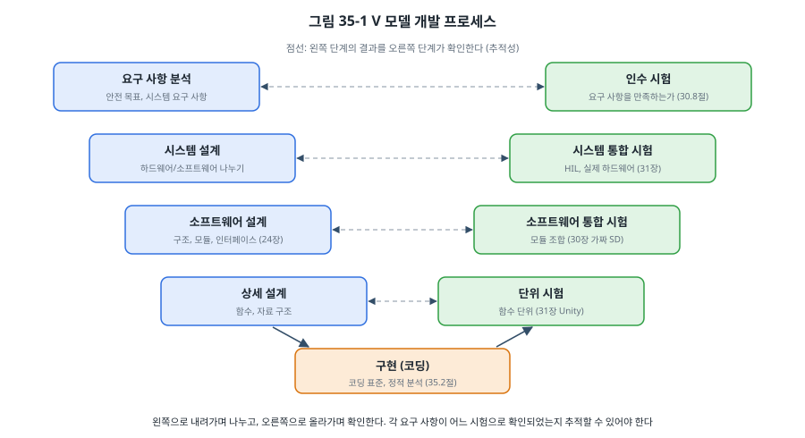
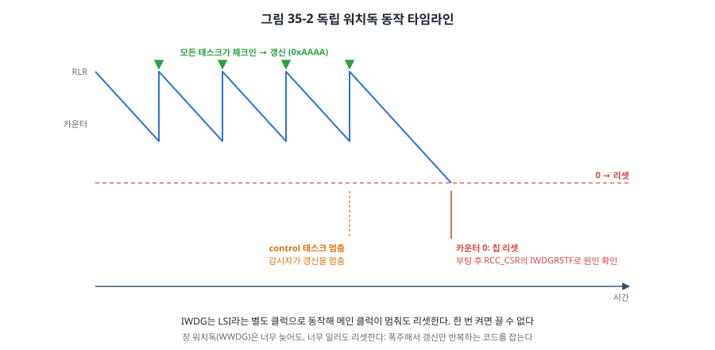

# 35장. 기능 안전과 코딩 표준

## 이 장에서 배우는 것

- 기능 안전이란 무엇이고, 어떤 표준이 있는가
- MISRA C와 CERT C 같은 코딩 표준이 금지하는 것과 그 이유
- 정적 분석 도구가 찾아 주는 버그
- 워치독을 제대로 쓰는 법: 태스크 감시와 리셋 원인 기록
- 방어적 프로그래밍과 오류 처리 전략, 시작 시 자가 시험

---

## 35.1 기능 안전이란

세탁기의 문이 회전 중에 열리면, 전기 자전거의 모터가 브레이크를 잡았는데도 계속 돌면, 인슐린 펌프가 약을 너무 많이 주면 사람이 다칩니다. 이런 장치에서 **펌웨어의 결함이나 하드웨어의 고장이 생겨도 위험한 상황으로 이어지지 않게** 하는 것이 **기능 안전(functional safety)** 입니다.

33장의 보안이 "누군가 일부러 공격할 때"를 다룬다면, 기능 안전은 "누구의 잘못도 없이 일이 잘못될 때"를 다룹니다. 우주선이 RAM의 비트 하나를 뒤집고, 센서 선이 끊기고, 프로그래머가 경계 조건 하나를 틀립니다. 기능 안전은 이런 일이 **반드시 일어난다고 가정하고** 설계합니다.

분야마다 표준이 있습니다.

| 표준 | 분야 | 위험 등급 |
| --- | --- | --- |
| IEC 61508 | 전기·전자 안전 시스템 일반 (다른 표준의 바탕) | SIL 1~4 |
| ISO 26262 | 자동차 | ASIL A~D |
| IEC 62304 | 의료기기 소프트웨어 | 클래스 A~C |
| IEC 60730 (부속서 H) | 가전제품의 제어 장치 | 클래스 A~C |
| DO-178C | 항공기 소프트웨어 | DAL A~E |
| EN 50128 | 철도 | SIL 0~4 |

위험이 클수록 등급이 높고, 등급이 높을수록 요구 사항이 엄격해집니다. 낮은 등급에서는 코딩 표준과 시험 정도를 요구하지만, 높은 등급에서는 개발 프로세스 전체, 요구 사항부터 시험까지의 추적성, 도구의 신뢰성, 독립적인 검증까지 요구합니다. 인증은 이 책의 범위를 넘지만, 그 바탕이 되는 기법은 안전 인증이 필요 없는 제품에도 그대로 좋은 습관입니다.

### V 모델

안전 표준들이 공통으로 요구하는 개발 흐름이 **V 모델**입니다.



왼쪽으로 내려가며 요구 사항을 설계로, 설계를 코드로 나누고, 오른쪽으로 올라가며 각 단계를 시험으로 확인합니다. 핵심은 **추적성(traceability)** 입니다. 요구 사항 하나하나가 어느 설계 요소로 구현되었고, 어느 시험으로 확인되었는지를 따라갈 수 있어야 합니다. 30장의 설계 문서에서 요구 사항에 R1, R2 번호를 붙이고 시험 표에 그 번호를 적은 것이 바로 이것입니다. 31장의 단위 시험과 HIL 시험이 오른쪽 아래와 가운데를 채웁니다.

## 35.2 코딩 표준

C 언어는 강력하지만 함정이 많습니다. 정의되지 않은 동작(34장), 암묵적 형 변환(4장), 버퍼 경계 없음, 포인터의 자유로움. **코딩 표준**은 "이 함정에 빠지기 쉬운 기능은 쓰지 않는다"는 약속의 목록입니다.

### MISRA C

자동차 산업에서 시작된 **MISRA C**는 임베디드 C 코딩 표준의 사실상 기준입니다. MISRA C:2012에 개정판들이 더해졌고, 2023년판이 이를 하나로 묶었습니다. 규칙은 반드시 지켜야 하는 것(mandatory), 지키되 근거가 있으면 벗어날 수 있는 것(required), 권고(advisory)로 나뉘며, 벗어날 때는 그 이유를 문서로 남기는 **편차(deviation)** 절차를 거칩니다.

규칙의 원문은 저작권이 있는 문서이므로 여기서는 성격만 소개합니다. 이 책에서 이미 이유를 설명한 것이 많습니다.

| MISRA C가 다루는 것 (예) | 이유 | 이 책 |
| --- | --- | --- |
| 동적 메모리 할당(`malloc`) 사용 금지 (규칙 21.3) | 실패, 단편화, 예측할 수 없는 시간 | 25장 |
| 재귀 금지 (규칙 17.2) | 스택 사용량의 상한이 없음 | 25장 |
| `switch`에 `default` 필요 (규칙 16.4) | 예상하지 못한 값을 처리하지 않고 지나침 | 24장 |
| 조건식은 진짜 불리언 (규칙 14.4) | `if (x = 5)` 같은 실수, 정수를 참거짓으로 쓰는 모호함 | 4장 |
| 본질적 자료형 모델 (규칙 10.x) | 부호 있는/없는 정수, 크기가 다른 정수를 섞을 때의 암묵적 변환 | 4장 |
| 정의되지 않은 동작 금지 | 컴파일러와 최적화 수준에 따라 다르게 동작 | 34장 |

MISRA C를 처음 적용하면 기존 코드에서 수많은 위반이 나옵니다. 대부분은 형 변환을 명시하라는 것(`(uint8_t)` 같은 캐스트)이고, 이것만으로도 4장에서 본 정수 승격 버그 상당수가 사라집니다. 새 프로젝트라면 처음부터 적용하는 것이 훨씬 쉽습니다.

### CERT C

카네기 멜런 대학의 SEI가 만든 **CERT C 코딩 표준**은 **보안**(33장) 관점에서 C의 위험을 정리했습니다. 무료로 공개되어 있고, 규칙마다 "나쁜 예"와 "고친 예"가 함께 있어 공부하기 좋습니다. 부호 있는 정수 넘침(INT32-C), 배열 범위 밖 접근(ARR30-C), 문자열 공간 부족(STR31-C), 해제한 메모리 사용(MEM30-C) 같은 규칙은 이 책의 예제들이 피하려고 노력한 바로 그 버그들입니다.

> 💡 팁: 코딩 표준은 규칙 목록을 외우는 것이 아니라 **도구로 검사**하는 것입니다. 사람의 리뷰로는 수백 개의 규칙을 일관되게 지킬 수 없습니다. 정적 분석 도구에 규칙을 맡기고, 사람은 도구가 볼 수 없는 것(설계, 요구 사항과의 일치)을 리뷰합니다.

## 35.3 정적 분석

**정적 분석**은 프로그램을 실행하지 않고 소스 코드를 분석해 버그를 찾습니다. 31장의 시험이 "실행한 경로"만 확인한다면, 정적 분석은 "가능한 모든 경로"를 따져 봅니다.

| 도구 | 종류 | 특징 |
| --- | --- | --- |
| 컴파일러 경고 (`-Wall -Wextra -Wconversion`) | 무료 | 가장 먼저, 항상. 경고 0을 유지 |
| GCC `-fanalyzer` | 무료 (GCC 10 이상) | 경로를 따라가며 메모리, 포인터 문제를 찾음 |
| cppcheck | 무료, 오픈소스 | 가볍고 오탐이 적음. MISRA 검사 애드온(규칙 원문은 별도 구입) |
| clang-tidy, Clang 정적 분석기 | 무료, 오픈소스 | 다양한 검사, 일부 자동 수정 |
| PC-lint Plus, Polyspace, Helix QAC, Coverity 등 | 상용 | MISRA 인증 검사, 안전 인증용 보고서 |

`code/ch35-safety/test/bad_examples.c`에는 일부러 넣은 버그 네 개가 있습니다. GCC의 분석기로 검사해 봅시다.

```bash
cd code/ch35-safety/test
make analyze
```

```
bad_examples.c:23:19: warning: pointer ‘f’ used after ‘free’  [-Wuse-after-free]
bad_examples.c:15:12: warning: dereference of possibly-NULL ‘f’ [CWE-690]  [-Wanalyzer-possible-null-dereference]
bad_examples.c:35:14: warning: use of uninitialized value ‘k’ [CWE-457]  [-Wanalyzer-use-of-uninitialized-value]
bad_examples.c:46:12: warning: leak of ‘copy’ [CWE-401]  [-Wanalyzer-malloc-leak]
```

(PC의 GCC 14.2 출력입니다.) `malloc` 결과를 확인하지 않은 것, 해제한 메모리를 다시 쓴 것, `mode`가 1, 2가 아닐 때 초기화되지 않는 변수, 해제하지 않은 메모리를 모두 찾았습니다. 경고 끝의 CWE 번호는 취약점 분류 체계(Common Weakness Enumeration)의 번호로, 33장의 보안 문제와 연결됩니다.

정적 분석 도구는 **오탐(false positive)** 도 냅니다. 실제로는 문제가 없는데 경고가 나는 경우입니다. 오탐을 무시하는 습관이 생기면 진짜 경고도 놓치므로, 오탐은 코드를 더 명확하게 바꿔 없애거나, 도구의 억제 주석으로 이유와 함께 표시합니다. 36장에서 이 검사를 CI에 넣어, 새 경고가 생기면 병합할 수 없게 합니다.

## 35.4 워치독

32장에서 새 펌웨어가 멈추면 리셋되도록 **독립 워치독(IWDG)** 을 썼습니다. 여기서는 워치독을 **제대로** 쓰는 법을 봅니다.



워치독은 거꾸로 세는 카운터입니다. 펌웨어가 정해진 시간 안에 "갱신"(키 0xAAAA 쓰기)하지 않으면 0이 되어 칩을 리셋합니다. STM32F411에는 두 가지 워치독이 있습니다.

- **IWDG(독립 워치독)**: 칩 안의 별도 저속 발진기(LSI, 약 32 kHz)로 동작합니다. 메인 클럭이 멈추거나 잘못 설정되어도 리셋할 수 있어 "최후의 안전망"입니다. 한 번 켜면 리셋 전까지 끌 수 없습니다. LSI의 정확도가 낮아(칩마다 17~47 kHz) 시간 여유를 넉넉히 둡니다.
- **WWDG(창 워치독)**: APB1 클럭으로 동작하며, **너무 늦어도, 너무 일러도** 리셋합니다. 폭주한 코드가 우연히 갱신 명령만 반복 실행하는 상황까지 잡을 수 있고, 리셋 직전에 인터럽트(early wakeup)로 마지막 기록을 남길 기회를 줍니다.

### 흔한 실수: 아무 데서나 갱신하기

```c
void SysTick_Handler(void)
{
    ms++;
    IWDG->KR = 0xAAAA;     /* 나쁜 예: 메인 루프가 멈춰도 인터럽트는 계속 돈다 */
}
```

타이머 ISR에서 워치독을 갱신하면, 메인 루프나 태스크가 멈춰도 인터럽트는 계속 실행되므로 워치독은 영원히 리셋하지 않습니다. 메인 루프 한 곳에서 갱신하는 것도, RTOS에서 태스크 하나만 멈춘 상황(나머지는 정상)을 잡지 못합니다.

### 태스크 감시자

해결책은 **모든 태스크가 살아 있을 때만** 갱신하는 것입니다. `common/supervisor.c`의 감시자는 각 태스크가 주기적으로 체크인하게 하고, 모든 태스크가 자기 기한 안에 체크인했을 때만 갱신을 허락합니다.

```c
int t_ctrl = sup_register(&sup, "control", 30, ms);    /* 30 ms 안에 한 번은 체크인 */
int t_sens = sup_register(&sup, "sensor", 300, ms);
int t_comm = sup_register(&sup, "comm", 1500, ms);
...
sup_checkin(&sup, t_ctrl, now);                         /* 각 태스크가 일을 마칠 때마다 */
...
if (sup_check(&sup, now)) {
    IWDG->KR = IWDG_KEY_RELOAD;                         /* 모두 살아 있을 때만 */
}
```

한 번 실패하면 감시자는 다시 회복하지 않고 리셋을 기다립니다. "잠깐 늦었다가 다시 돌아온" 태스크가 있다면 이미 무언가 잘못된 것이고, 리셋으로 알려진 상태에서 다시 시작하는 편이 안전하기 때문입니다. 26장의 FreeRTOS에서는 각 태스크가 이벤트 그룹의 비트를 세우고, 감시 태스크가 모든 비트가 섰는지 확인하는 방식으로 같은 구조를 만듭니다.

예제(`code/ch35-safety/stm32/`)에서 `h`를 보내면 control 태스크만 멈춥니다. 다른 태스크와 메인 루프는 계속 돌지만 감시자가 이를 알아채고 갱신을 멈추며, 약 1초 뒤 칩이 리셋됩니다.

```
task 'control' missed its deadline: stop feeding the watchdog

reset cause: INDEPENDENT-WATCHDOG reset-pin
RAM test (March C-, 4 KB): ok
```

(출력은 예시입니다. [확인 필요: 보드 실측]) 리셋 원인 플래그를 확인하는 방법은 다음 절에서 봅니다.

### 리셋 원인을 기록하라

현장의 장치가 가끔 리셋된다는 보고를 받았을 때 가장 먼저 알고 싶은 것은 **왜** 리셋되었는가입니다. STM32는 `RCC_CSR`에 마지막 리셋의 원인을 플래그로 남깁니다.

```c
uint32_t csr = RCC->CSR;
if (csr & RCC_CSR_IWDGRSTF) printf(" INDEPENDENT-WATCHDOG");
if (csr & RCC_CSR_BORRSTF)  printf(" brown-out");
...
RCC->CSR |= RCC_CSR_RMVF;           /* 플래그를 지워 두어야 다음 리셋의 원인을 구별할 수 있다 */
```

워치독(소프트웨어가 멈춤), 저전압(BOR, 전원 문제), 소프트웨어 리셋(의도한 재시작 또는 폴트 처리기), 리셋 핀, 전원 투입을 구별할 수 있습니다. 리셋 핀 플래그는 다른 원인으로 리셋될 때도 함께 서는 경우가 많으므로 다른 플래그와 함께 해석합니다. 이 정보를 23장의 폴트 정보(PC, CFSR)와 함께 비휘발성 메모리에 기록해 두면, 36장에서 다룰 현장 로그의 핵심이 됩니다.

> 🔧 ATmega128에서는: AVR의 워치독도 별도의 발진기(약 128 kHz, 1 MHz 등 칩마다 다름)로 동작하며, `<avr/wdt.h>`의 `wdt_enable(WDTO_1S)`와 `wdt_reset()`으로 씁니다. 리셋 원인은 MCUCSR(ATmega128) 또는 MCUSR(ATmega328P) 레지스터의 WDRF, BORF, EXTRF, PORF 비트로 확인합니다. 주의할 점이 하나 있습니다. 워치독 리셋 뒤에도 워치독은 **켜진 채로** 남아 있으므로, 시작 코드에서 아주 일찍 끄거나 갱신하지 않으면 부트로더나 초기화 도중에 다시 리셋되는 무한 반복에 빠집니다. avr-libc 문서는 `.init3` 섹션에서 MCUSR을 지우고 `wdt_disable()`을 부르는 방법을 권합니다.

## 35.5 방어적 프로그래밍과 오류 처리

**방어적 프로그래밍**은 "이 값은 절대 틀릴 리 없다"는 가정을 하지 않는 습관입니다.

**경계에서 확인합니다.** 모듈의 공개 함수는 받은 인자를 확인합니다. 바깥에서 들어온 데이터(통신, 파일, 센서)는 길이와 범위를 확인합니다(14장, 20장). 내부의 `static` 함수까지 모두 확인할 필요는 없습니다. 경계에서 걸러냈다면 안쪽은 믿을 수 있습니다.

**넘침을 정의된 방법으로 확인합니다.** 34장에서 본 것처럼 `if (a + b < a)`는 부호 있는 정수에서 정의되지 않은 동작입니다. GCC의 내장 함수는 넘침 여부를 안전하게 알려 줍니다.

```c
static inline bool add_i32(int32_t a, int32_t b, int32_t *out)
{
    return !__builtin_add_overflow(a, b, out);       /* true = 성공 */
}
```

**중요한 값은 여러 겹으로 지킵니다.** 히터의 목표 온도처럼 틀리면 위험한 값은 원래 값과 그 비트 반전(`~x`)을 함께 저장하고 쓸 때마다 둘을 맞춰 보면, RAM의 비트가 뒤집히는 고장을 잡을 수 있습니다. Flash에 저장한 설정에는 CRC를 붙입니다(13장, 32장).

**`switch`에 `default`를 둡니다.** 상태 변수가 망가져 정의되지 않은 값이 되었을 때, `default`에서 안전 상태로 가게 합니다(24장의 상태 머신).

### 오류 처리 전략

오류를 발견했을 때 무엇을 할지는 **시스템의 안전 상태**가 무엇이냐에 달려 있습니다.

| 전략 | 뜻 | 예 |
| --- | --- | --- |
| 안전 정지 (fail-safe) | 출력을 끄고 안전한 상태로 | 히터 끄기, 모터 정지, 문 잠금 유지 |
| 기능 저하 (degraded) | 일부 기능만으로 계속 | 센서 하나가 고장 나면 남은 센서로, 통신이 끊기면 마지막 설정으로 |
| 계속 동작 (fail-operational) | 이중화로 고장에도 계속 | 항공기 비행 제어 (여러 개의 컴퓨터) |
| 재시작 | 리셋해서 알려진 상태로 | 일시적인 오류, 소프트웨어 멈춤 |

31장의 온도 조절기가 좋은 예입니다. 센서 읽기가 연속으로 실패하면 FAULT 상태로 가서 히터를 끕니다(안전 정지). 30장의 로거는 SD 카드가 빠지면 기록을 멈추고 다시 시도하지만 측정은 계속합니다(기능 저하).

예제의 `safe_state()` 함수는 RAM 시험이 실패하면 인터럽트를 막고 안전 상태에 머뭅니다. 이때 워치독을 계속 갱신하는 것은 의도한 설계입니다. 하드웨어 고장이라면 리셋해도 같은 고장이 반복되므로, 리셋을 반복하며 출력이 켜졌다 꺼졌다 하는 것보다 안전 상태에 머무는 편이 낫다고 판단한 것입니다. 이런 결정은 위험 분석의 결과로 정하고 설계 문서에 남깁니다.

> ⚠️ 주의: `assert()`는 개발 중에 "일어날 수 없는 일"을 잡는 도구입니다. 릴리스 빌드에서 `NDEBUG`로 꺼지면 그 검사가 사라지므로, **현장에서 일어날 수 있는 오류**(센서 고장, 통신 오류)를 `assert`로 처리하면 안 됩니다. 그런 오류는 오류 코드와 안전 상태로 처리합니다. 반대로 릴리스에서도 `assert`를 켜 둔다면, 실패했을 때 무엇을 할지(기록하고 안전 정지 또는 리셋)를 정해 둡니다. 26장의 `configASSERT`가 그런 예입니다.

## 35.6 시작 시 자가 시험

안전 등급이 있는 제품은 하드웨어 고장을 스스로 찾기 위해 **자가 시험(self-test)** 을 합니다. 가전제품의 IEC 60730 클래스 B는 CPU 레지스터, 프로그램 카운터, 인터럽트, 클럭, RAM, Flash, 입출력 등의 시험을 요구합니다. MCU 제조사들은 이를 위한 시험 라이브러리를 제공합니다(ST의 X-CUBE-CLASSB 등). [확인 필요: 출간 시점 ST 클래스 B 라이브러리 이름과 지원 MCU]

대표적인 두 가지를 봅시다.

**Flash 시험**: 빌드할 때 펌웨어 전체의 CRC를 계산해 정해진 위치에 넣고, 시작할 때(그리고 주기적으로) 다시 계산해 비교합니다. 32장의 이미지 머리말 검사가 바로 이것입니다.

**RAM 시험**: **March 알고리즘**이 널리 쓰입니다. 정해진 순서로 메모리를 위로, 아래로 훑으며 0과 1을 쓰고 읽습니다. `common/march.c`의 March C-는 다음 순서입니다.

```
⇕(w0)  ⇑(r0, w1)  ⇑(r1, w0)  ⇓(r0, w1)  ⇓(r1, w0)  ⇕(r0)
```

`⇑`는 낮은 주소부터, `⇓`는 높은 주소부터, `r0`은 "0이 읽혀야 한다", `w1`은 "1을 쓴다"는 뜻입니다. 이 순서는 비트가 0이나 1에 붙어 버린 **고착 고장**, 한 칸에 쓸 때 다른 칸이 바뀌는 **결합 고장** 등을 잡습니다.

PC 테스트는 고장 난 메모리를 흉내 내어 March C-가 정말 고장을 찾는지 확인합니다.

```c
r.stuck_word = 5; r.stuck_mask = 1u << 7; r.stuck_val = 0;           /* 비트 7이 0에 고착 */
CHECK(march_c_minus(&m, 64) == 5);
...
r.stuck_word = -1; r.aggressor = 3; r.victim = 7;                     /* 결합 고장 */
CHECK(march_c_minus(&m, 64) == 7);
```

```bash
cd code/ch35-safety/test
make
```

```
all tests passed (0 failures)
```

March 시험은 메모리 내용을 지우므로, 시작할 때 `.data`와 `.bss`를 초기화하기 **전에**(21장의 스타트업 코드에서) 하거나, 실행 중에는 작은 구역씩 내용을 다른 곳에 옮겨 두고 시험한 뒤 되돌리는 방식으로 합니다. 예제는 단순하게 전용 4 KB 구역만 시험합니다. 시험 코드 자신이 쓰는 스택은 시험할 수 없다는 점도 고려해야 합니다.

---

## 정리

- 기능 안전은 결함과 고장이 반드시 일어난다고 가정하고, 그것이 위험으로 이어지지 않게 설계하는 것입니다. 분야별 표준(IEC 61508, ISO 26262, IEC 62304, IEC 60730 등)이 위험 등급에 따라 요구 사항을 정합니다.
- V 모델은 요구 사항에서 코드로 나누고 시험으로 확인하며, 그 사이의 추적성을 요구합니다.
- MISRA C와 CERT C는 C의 함정을 피하는 규칙 모음입니다. 규칙은 사람이 아니라 정적 분석 도구로 검사합니다.
- 정적 분석은 실행하지 않은 경로의 버그(NULL 역참조, 해제 후 사용, 초기화 안 된 변수, 누수)를 찾습니다. 컴파일러 경고 0부터 시작합니다.
- 워치독은 ISR이 아니라 모든 태스크가 살아 있을 때만 갱신합니다. IWDG는 독립 클럭의 최후 안전망, WWDG는 너무 이른 갱신도 잡습니다. 리셋 원인을 반드시 기록합니다.
- 방어적 프로그래밍은 경계에서 확인하고, 넘침을 정의된 방법으로 검사하고, 중요한 값을 여러 겹으로 지킵니다. 오류 처리는 시스템의 안전 상태에 맞춰 정합니다.
- 자가 시험은 Flash를 CRC로, RAM을 March 알고리즘으로 시험합니다.

## 연습 문제

1. 30장 데이터 로거와 31장 온도 조절기 각각에서 "안전 상태"는 무엇인가요? 센서 고장, 저장 장치 고장, 소프트웨어 멈춤에 대해 어떤 전략(안전 정지, 기능 저하, 재시작)을 쓰겠는지 표로 정리하세요.
2. 다음 코드에서 MISRA C나 CERT C가 문제 삼을 만한 곳을 네 군데 이상 찾고, 이유와 고친 코드를 쓰세요. `int avg(int *a, int n) { int s = 0; for (int i = 0; i <= n; i++) s += a[i]; return s / n; }`
3. 워치독을 SysTick 처리기에서 갱신하는 코드와 메인 루프에서 갱신하는 코드, 감시자를 통해 갱신하는 코드를 비교하세요. 각각 어떤 고장을 잡고 어떤 고장을 놓치나요?
4. IWDG의 LSI가 17~47 kHz 사이에서 달라질 수 있다면, 예제의 설정(분주 32, RLR 1000)으로 리셋까지 걸리는 시간의 범위는 얼마인가요? 가장 긴 태스크의 체크인 기한(1.5초)과 비교해 문제가 없나요?
5. March C-가 잡지 못하는 RAM 고장의 예를 하나 찾아보세요. (힌트: 주소 디코더 고장, 데이터 패턴에 따른 고장)
6. (실습) 예제에 "목표 온도"를 원래 값과 비트 반전 값으로 함께 저장하는 `safe_u32` 형식을 만들고, 읽을 때 둘이 맞지 않으면 안전 상태로 가게 하세요. PC 테스트에서 RAM 비트가 뒤집히는 상황을 흉내 내어 확인하세요.
