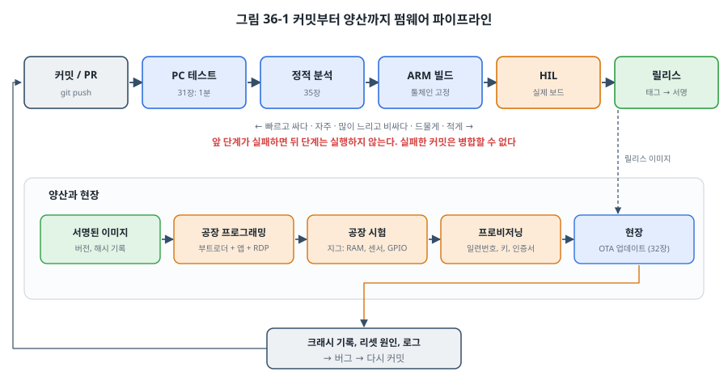
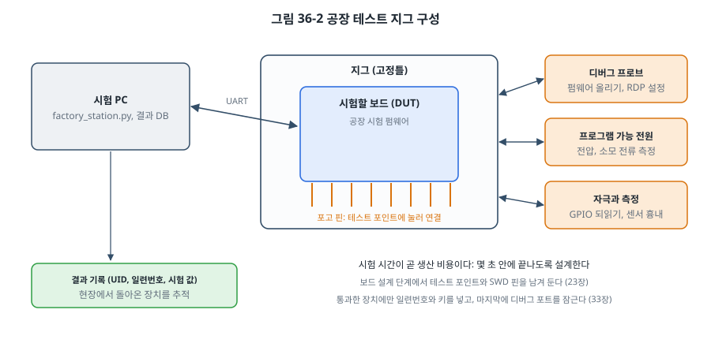

# 36장. CI/CD와 양산

## 이 장에서 배우는 것

- 커밋마다 빌드와 시험을 자동으로 돌리는 CI 파이프라인
- 몇 년 뒤에도 같은 펌웨어를 다시 만들 수 있는 재현 가능한 빌드
- 버전, 릴리스, 서명된 배포 이미지 관리
- 공장 시험 지그와 시험 펌웨어, 일련번호와 키를 넣는 프로비저닝
- 현장의 장치에서 크래시와 리셋 정보를 모으는 방법

---

## 36.1 내 PC에서는 되는데

펌웨어 개발에서 가장 흔한 말 중 하나입니다. 같은 소스인데 동료의 PC에서는 빌드가 안 되거나, 빌드는 되는데 동작이 다릅니다. 컴파일러 버전이 다르고, 라이브러리 버전이 다르고, 누군가 고친 파일을 커밋하지 않았고, 누군가는 시험을 돌리지 않고 병합했습니다.

**CI(Continuous Integration, 지속적 통합)** 는 이 문제를 기계에게 맡깁니다. 누군가 코드를 올릴 때마다 깨끗한 환경에서 빌드하고 시험하고, 실패하면 병합을 막습니다. **CD(Continuous Delivery, 지속적 배포)** 는 그 결과물을 언제든 배포할 수 있는 상태로 만들어 둡니다. 펌웨어에서 CD는 서명된 릴리스 이미지를 만들어 공장과 OTA 서버(32장)로 보낼 준비를 하는 것까지입니다.

이 장은 제6부의 마지막 장입니다. 31장의 시험, 32장의 업데이트, 33장의 서명, 35장의 정적 분석이 이 장의 파이프라인에서 하나로 이어집니다.

## 36.2 CI 파이프라인



파이프라인은 31장의 테스트 피라미드를 시간 순서로 늘어놓은 것입니다. 빠르고 싼 단계를 먼저, 느리고 비싼 단계를 나중에 두고, 앞 단계가 실패하면 뒤 단계는 실행하지 않습니다.

### 1단계: PC 테스트

가장 먼저, 가장 자주 돌리는 것이 PC 테스트입니다. 이 책의 저장소에는 장마다 PC 테스트가 있으므로, 그것을 한 번에 돌리는 스크립트를 만들었습니다(`code/ch36-cicd/ci/run_host_tests.sh`). 외부 라이브러리(FatFs, Unity, Mbed TLS)를 받은 뒤 각 `test/` 폴더의 Makefile을 실행하고, 하나라도 실패하면 0이 아닌 값으로 끝납니다.

```bash
sh code/ch36-cicd/ci/run_host_tests.sh
```

```
  ok    ch15-i2c/test
  ok    ch16-spi/test
  ok    ch17-can/test
  ok    ch24-architecture/test
  ok    ch25-memory/test
  ok    ch30-logger/test
  ok    ch31-testing/test
  ok    ch32-bootloader/test
  ok    ch33-security/test
  ok    ch34-performance/test
  ok    ch35-safety/test
  ok    ch36-cicd/test
  ok    ch28-realtime/host
host tests: 13 passed, 0 failed
```

책을 쓰는 동안 실제로 이 스크립트로 모든 예제를 확인했습니다. CI 서버에서 하는 일은 로컬에서도 똑같이 할 수 있어야 합니다. 그래야 CI가 실패했을 때 자기 PC에서 재현해 고칠 수 있습니다.

### GitHub Actions

GitHub의 CI 서비스인 **GitHub Actions**는 저장소의 `.github/workflows/` 폴더에 있는 YAML 파일을 읽어 파이프라인을 실행합니다. `code/ch36-cicd/ci/firmware.yml`은 이 책의 예제로 만든 파이프라인입니다. (책의 저장소에서는 실제로 실행되지 않게 `.github` 밖에 두었습니다. 자기 프로젝트에서는 그 폴더로 복사하면 됩니다.)

```yaml
jobs:
  host-tests:                        # 1단계: PC 테스트
    runs-on: ubuntu-24.04
    steps:
      - uses: actions/checkout@v4
      - run: sudo apt-get update && sudo apt-get install -y build-essential python3-cryptography
      - run: sh code/ch36-cicd/ci/run_host_tests.sh

  static-analysis:                   # 2단계: 정적 분석 (35장)
    ...
      - run: >
          cppcheck --error-exitcode=1 --enable=warning,portability --std=c11 ...

  arm-build:                         # 3단계: 보드용 빌드
    strategy:
      matrix:
        example: [ch24-architecture/stm32, ch25-memory/stm32, ch32-bootloader/stm32/boot, ch35-safety/stm32]
    steps:
      ...
      - run: sudo apt-get install -y gcc-arm-none-eabi libnewlib-arm-none-eabi
      - run: make -C code/${{ matrix.example }}
      - uses: actions/upload-artifact@v4       # .elf, .bin을 보관
```

몇 가지를 눈여겨보세요.

- **각 작업(job)은 깨끗한 가상 머신에서 시작합니다.** 필요한 도구를 매번 설치하므로, 누군가의 PC에만 있던 설정에 기대는 빌드는 여기서 실패합니다. 그것이 CI의 가치입니다.
- **매트릭스**로 여러 예제(제품이라면 여러 보드, 여러 빌드 설정)를 병렬로 빌드합니다.
- **결과물을 보관합니다.** `.elf`와 `.map`은 나중에 크래시 주소를 해석하는 데(23장, 36.7절) 꼭 필요합니다.
- **정적 분석은 새 경고를 막습니다.** 35장의 `bad_examples.c`처럼 일부러 넣은 예제는 제외합니다.

### HIL 단계

31장의 HIL 테스트는 보드가 연결된 PC가 필요하므로, 클라우드의 가상 머신이 아니라 **자체 러너(self-hosted runner)** 에서 실행합니다. 사무실의 PC 한 대에 NUCLEO 보드를 연결하고 GitHub Actions 러너 프로그램을 설치한 뒤, 작업에 `runs-on: [self-hosted, nucleo-f411re]` 같은 라벨을 붙이면 그 PC에서 실행됩니다.

```yaml
  hil:
    needs: [host-tests, arm-build]
    runs-on: [self-hosted, nucleo-f411re]
    steps:
      - uses: actions/checkout@v4
      - run: sh code/ch31-testing/get_unity.sh
      - run: python3 code/ch31-testing/hil/run_on_target.py --port /dev/ttyACM0 --flash
```

HIL 테스트에는 고유한 어려움이 있습니다. 보드가 응답하지 않거나, USB가 끊기거나, 이전 시험의 상태가 남아 있어서 **가끔만 실패하는(flaky)** 시험이 생기기 쉽습니다. 시험마다 전원을 껐다 켜서 깨끗하게 시작하고(31장의 제어 가능한 전원), 시험 장비 자체의 고장과 펌웨어 버그를 구별할 수 있게 기록을 남깁니다. 가끔 실패하는 시험을 그냥 다시 돌려 넘기는 습관이 생기면, 진짜 드물게 일어나는 버그(27장의 경쟁 조건)도 함께 놓칩니다.

> ⚠️ 주의: 자체 러너는 저장소의 코드를 실행하는 PC입니다. 공개 저장소에서는 누구나 보낸 PR의 코드가 그 PC에서 실행될 수 있으므로, 자체 러너는 **비공개 저장소**에만 연결하거나 외부 PR에서는 실행되지 않게 설정합니다. 그 PC에는 서명 키(33장) 같은 비밀을 두지 않습니다.

## 36.3 재현 가능한 빌드

22장에서 "빌드를 재현할 수 있어야 한다"고 했습니다. 현장에서 2년 전에 출하한 장치의 버그를 고쳐야 할 때, 그때와 **정확히 같은 바이너리**를 다시 만들 수 있어야 합니다. 그래야 크래시 주소를 해석하고, 고친 부분만 바뀐 새 버전을 낼 수 있습니다.

**툴체인 버전을 고정합니다.** 위의 예처럼 `apt-get install gcc-arm-none-eabi`를 하면 그날 우분투 저장소에 있는 버전이 설치됩니다. 우분투 24.04라면 지금은 GCC 13.2.1이지만, 운영체제 버전이 바뀌면 컴파일러도 바뀝니다. 제품에서는 다음 중 하나로 고정합니다.

- Arm이 배포하는 툴체인 압축 파일을 특정 버전으로 내려받아 쓰고, 그 해시를 확인한다.
- 툴체인을 넣은 **Docker 이미지**를 만들어 그 이미지의 해시(다이제스트)로 고정한다. ESP-IDF는 `espressif/idf:v5.x` 같은 공식 이미지를 제공합니다.

**외부 코드의 버전을 고정합니다.** 이 책의 `get_*.sh` 스크립트는 모두 특정 태그를 받습니다(FreeRTOS V11.1.0, FatFs R0.15a, Unity v2.6.1, Mbed TLS v3.6.7). `main` 브랜치를 받으면 언젠가 다른 코드가 들어옵니다. Git 서브모듈이나 29장의 west manifest도 커밋 단위로 고정합니다.

**버전을 바이너리에 넣습니다.** 22장의 `git describe`로 만든 버전 문자열을 펌웨어에 넣어 두면, 장치가 보고하는 버전으로 어느 커밋에서 빌드했는지 알 수 있습니다. 커밋하지 않은 변경이 있는 상태로 빌드했다면 `-dirty`가 붙으므로, 릴리스 빌드에서 `-dirty`를 발견하면 CI가 실패하게 합니다.

**결과물을 비교합니다.** 같은 커밋을 두 번 빌드해서 `.bin`의 해시가 같은지 확인합니다. 다르다면 빌드 시각(`__DATE__`, `__TIME__`), 빌드한 폴더 경로(22장의 `-ffile-prefix-map`), 파일 순서 같은 것이 섞여 들어간 것입니다.

## 36.4 버전과 릴리스

**버전 번호**는 흔히 `주.부.수`(major.minor.patch) 형식을 씁니다. 호환되지 않는 변경(설정 형식, 통신 프로토콜이 바뀜)은 주 번호, 기능 추가는 부 번호, 버그 수정은 수 번호를 올립니다. 32장의 이미지 머리말에 이 버전을 넣었고, 33장의 보안 카운터는 이와 별도로 보안 수정이 있을 때만 올립니다.

**릴리스**는 Git **태그**로 표시합니다(`v1.2.0`). 예제 파이프라인은 태그가 붙으면 릴리스 작업을 실행합니다. 릴리스 작업이 할 일은 다음과 같습니다.

1. 태그의 커밋에서 깨끗하게 빌드한다(위의 모든 시험 통과).
2. 이미지에 서명한다(33장). 서명 키는 HSM이나 키 관리 서비스에 있고, 빌드 서버는 서명을 **요청**만 한다.
3. 릴리스 묶음을 만든다. 서명된 이미지, `.elf`와 `.map`(디버깅용, 장치에는 보내지 않음), 각 파일의 SHA-256, 변경 내역.
4. 묶음을 보관한다. 이 묶음이 공장(36.5절)과 OTA 서버(32장)로 가는 유일한 출처가 된다.

> 💡 팁: 개발자의 PC에서 만든 바이너리를 공장이나 OTA로 보내지 않는 것을 원칙으로 삼으세요. 출시되는 모든 펌웨어는 CI가 태그에서 만든 것이어야 합니다. 그래야 "이 장치의 펌웨어는 어느 소스에서 나왔는가"라는 질문에 항상 답할 수 있습니다.

## 36.5 공장 시험과 프로비저닝

설계와 시험을 마친 펌웨어가 수천 개의 보드에 들어가는 곳이 공장입니다. 공장에서 펌웨어 개발자가 책임지는 것은 세 가지입니다. **올리기, 시험하기, 장치마다 다른 정보 넣기.**



**지그(jig)** 는 보드를 고정하고 **포고 핀**(스프링이 든 핀)으로 보드의 테스트 포인트에 닿는 시험 장치입니다. 지그에는 디버그 프로브, 프로그램 가능한 전원, 신호를 넣고 재는 장치가 연결되고, 시험 PC가 이것들을 제어합니다. 31장의 HIL 구성과 거의 같습니다. 다른 점은 **속도**입니다. 보드 하나의 시험 시간이 곧 생산 비용이므로, 몇 초 안에 끝나도록 설계합니다.

지그를 쓰려면 **보드 설계 단계에서** 준비해야 합니다. SWD 핀(23장), UART, 전원, 시험할 신호마다 포고 핀이 닿을 테스트 포인트를 보드에 남겨 둡니다. 나중에 덧붙이기 어려운 것이므로, 펌웨어 개발자도 회로 검토에 참여해 필요한 테스트 포인트를 요청합니다.

### 공장 시험 펌웨어

시험은 보통 전용 **공장 시험 펌웨어**로 합니다. `code/ch36-cicd/factory/stm32/main.c`는 시험 PC가 보내는 한 줄 명령에 JSON 한 줄로 답합니다.

| 명령 | 시험 | 답 (예) |
| --- | --- | --- |
| `ID` | 칩 고유 번호(96비트), Flash 크기 | `{"uid":"...","flash_kb":512,"fw":"factory-1.0"}` |
| `RAM` | March C- (35장) | `{"ram":"ok"}` |
| `I2C` | BMP280이 대답하는가 (15장) | `{"bmp280":"ok"}` |
| `GPIO` | 지그의 선으로 이은 PA0 → PA1 되읽기 | `{"gpio":"ok"}` |
| `SERIAL <값>` | 일련번호를 Flash에 기록 | `{"serial":"written"}` |
| `SERIAL?` | 기록된 일련번호 읽기 | `{"serial":"EM26000123"}` |

사람이 읽기 쉬운 출력보다 **기계가 읽기 쉬운 형식**(JSON, CSV)으로 답하게 하는 것이 요령입니다. 시험 PC의 프로그램이 정규식으로 문장을 뜯어내다 펌웨어의 출력 문구가 조금 바뀌어 공장이 멈추는 일은 실제로 흔합니다.

STM32는 칩마다 다른 **96비트 고유 번호(UID)** 를 공장에서 기록해 둡니다(STM32F411은 0x1FFF 7A10). 이 번호로 시험 결과를 기록하면, 일련번호를 넣기 전에 실패한 보드도 추적할 수 있습니다.

### 시험 PC와 프로비저닝

`factory/factory_station.py`가 시험 PC의 프로그램입니다. 시험 항목을 차례로 실행하고, 모두 통과하면 일련번호를 정해 장치에 기록한 뒤 **다시 읽어 확인**합니다.

```bash
python3 factory_station.py --port /dev/ttyACM0 --log results.csv --provision --prefix EM26
```

```
  RAM   ok
  I2C   ok
  GPIO  ok

==== PASS ==== uid 3036510E3436313338002B00 serial EM26000001
```

(출력은 예시입니다. [확인 필요: 보드 실측])

장치마다 다른 정보를 넣는 이 단계를 **프로비저닝(provisioning)** 이라고 합니다. 일련번호 외에도 다음 같은 것이 들어갑니다.

- **장치별 키와 인증서**: 33장에서 말한 "장치마다 다른 비밀"을 넣는 곳이 여기입니다. 장치가 키 쌍을 스스로 만들고(RNG가 있는 MCU나 보안 칩) 공개 키만 내보내면, 공장 서버가 그것에 대한 인증서를 발급해 다시 넣습니다. 개인 키는 장치 밖으로 나오지 않습니다. 클라우드 IoT 서비스(20장)에 장치를 등록하는 것도 이 단계에서 합니다.
- **보정값**: 센서의 오프셋, 발진기의 오차를 재서 기록합니다.
- **보안 설정**: 모든 시험과 기록이 끝난 **마지막에** 33장의 디버그 포트 잠금(RDP)과 쓰기 보호를 겁니다. 잠근 뒤에는 시험 펌웨어로 돌아갈 수 없기 때문입니다.

시험 결과는 UID, 일련번호, 각 시험 값, 시각과 함께 CSV(실제 공장에서는 데이터베이스)에 남깁니다. 현장에서 장치가 돌아왔을 때 그 장치가 언제 어떤 시험을 통과했는지, 같은 날 같은 지그에서 시험한 장치들은 괜찮은지를 이것으로 추적합니다. 35장의 추적성이 공장까지 이어지는 것입니다.

> ⚠️ 주의: 일련번호 같은 고유 값은 **두 번 쓰이면 안 됩니다.** 예제는 번호를 정하자마자 카운터 파일을 늘려, 기록에 실패한 번호도 다시 쓰지 않습니다(번호가 비는 것은 괜찮지만 겹치는 것은 안 됩니다). 공장에 시험 PC가 여러 대라면 번호는 한 곳(서버)에서 나눠 줍니다.

## 36.6 ESP32의 양산 도구

ESP32는 양산을 위한 도구를 ESP-IDF에 함께 제공합니다. 장치별 데이터는 **NVS 파티션 생성 도구**로 CSV에서 장치마다 바이너리를 만들어 Flash에 쓰고, eFuse에 Flash 암호화와 Secure Boot(33장)를 설정하며, 이 과정을 공장 PC에서 `esptool.py`로 자동화합니다. 장치의 고유 번호로는 공장에서 eFuse에 기록된 MAC 주소를 흔히 씁니다. [확인 필요: 출간 시점 ESP-IDF 양산 도구 이름과 사용법]

## 36.7 현장 로그와 크래시 리포트

출시 뒤에는 장치가 현장에서 어떻게 지내는지 알아야 합니다. 사용자가 "가끔 멈춘다"고 말할 때, 장치가 스스로 남긴 기록이 있다면 원인을 찾을 수 있습니다.

`code/ch36-cicd/crashlog/`는 리셋과 폴트의 정보를 Flash의 전용 섹터에 32바이트씩 덧붙이는 모듈입니다. 32장의 부트 상태 기록과 같은 방식(덧붙이기, CRC, 쓰다가 끊긴 기록은 건너뜀)이고, 섹터가 차면 지우고 처음부터 씁니다.

```c
typedef struct {
    uint32_t magic;
    uint32_t seq;
    uint16_t reason;        /* 워치독, HardFault, assert, 스택 넘침, 저전압 */
    uint16_t fw_version;
    uint32_t pc, lr, cfsr;  /* 폴트일 때 (23장) */
    uint32_t uptime_s;
    uint32_t crc;
} crash_rec_t;
```

기록할 때는 23장의 HardFault 처리기, 26장의 스택 오버플로 훅과 `configASSERT`, 35장의 리셋 원인을 이 함수로 모읍니다.

```c
crashlog_add(CRASH_HARDFAULT, FW_VERSION, sf[6], sf[5], SCB_CFSR, uptime_s);
```

폴트 처리기 안에서 Flash에 쓰는 것이 걱정된다면(스택이 망가졌을 수 있고, Flash 지우기는 오래 걸림), 폴트 정보는 리셋해도 지워지지 않는 RAM 구역(링커 스크립트의 `.noinit` 섹션)에 잠시 두었다가, 다시 시작한 뒤 안정된 상태에서 Flash로 옮기는 방법을 씁니다.

장치가 다음에 서버에 접속할 때(20장의 MQTT) 이 기록을 보내면, 서버에서 펌웨어 버전에 맞는 `.elf`로 PC와 LR을 소스 줄로 바꿉니다(23장의 addr2line). 36.4절에서 릴리스마다 `.elf`를 보관한 이유가 이것입니다. 이렇게 모은 정보로 "버전 1.2.0에서 `i2c_stm32.c:88`의 HardFault가 전체 장치의 0.3%에서 하루 한 번 일어난다" 같은 사실을 알 수 있고, 다음 릴리스가 그것을 고쳤는지 숫자로 확인할 수 있습니다.

```bash
cd code/ch36-cicd/test
make
```

```
all tests passed (0 failures)
```

PC 테스트는 32장의 가짜 Flash로 기록 추가, 쓰다가 끊긴 기록 건너뛰기, 섹터가 찼을 때 지우고 다시 쓰기를 확인합니다.

ESP-IDF는 같은 일을 기본으로 제공합니다. `esp_reset_reason()`이 리셋 원인을 알려 주고, **코어 덤프** 기능을 켜면(`CONFIG_ESP_COREDUMP_ENABLE_TO_FLASH`) 크래시 순간의 모든 태스크 스택을 Flash 파티션에 저장했다가 `idf.py coredump-info`로 해석할 수 있습니다. [확인 필요: 출간 시점 ESP-IDF 코어 덤프 설정 이름]

> 💡 팁: 현장에서 모으는 정보에 사용자의 개인 정보(위치, 사용 기록)가 섞이지 않게 주의하세요. 무엇을 수집하는지 사용자에게 알리고, 필요한 최소한만 모읍니다. 33장의 규제들은 보안뿐 아니라 이런 데이터 처리에도 요구 사항을 둡니다.

## 36.8 제6부를 마치며

제6부에서는 "동작하는 펌웨어"를 "출시할 수 있는 제품"으로 만드는 과정을 보았습니다.

| 장 | 질문 |
| --- | --- |
| 31장 | 동작한다는 것을 어떻게 증명하는가 |
| 32장 | 출시한 뒤에 어떻게 고치는가 |
| 33장 | 누군가 망가뜨리려 할 때 어떻게 지키는가 |
| 34장 | 충분히 빠른가, 어떻게 빠르게 하는가 |
| 35장 | 무언가 잘못되었을 때 위험하지 않은가 |
| 36장 | 이 모든 것을 매번, 수천 대에 똑같이 할 수 있는가 |

이 질문들에 답하는 코드는 대개 제품 기능보다 많습니다. 처음 펌웨어를 배울 때는 LED를 깜박이는 코드가 전부처럼 보이지만, 실제 제품의 펌웨어 저장소를 열어 보면 시험, 부트로더, 보안, 진단, 빌드 스크립트가 훨씬 큰 비중을 차지합니다. 그것이 임베디드 엔지니어의 실제 일입니다.

제7부에서는 시야를 넓혀, MCU를 넘어선 임베디드 리눅스, FPGA, 엣지 AI, 그리고 앞으로의 길을 살펴봅니다.

---

## 정리

- CI는 커밋마다 깨끗한 환경에서 빌드하고 시험해, 실패한 변경이 병합되지 않게 합니다. 파이프라인은 빠른 PC 테스트부터 정적 분석, ARM 빌드, HIL 순으로 둡니다.
- CI가 하는 일은 로컬에서도 같은 스크립트로 할 수 있어야 합니다. HIL은 보드가 연결된 자체 러너에서 하며, 비공개 저장소에만 연결합니다.
- 재현 가능한 빌드를 위해 툴체인과 외부 코드의 버전을 고정하고, 버전을 바이너리에 넣고, 같은 커밋의 결과물이 같은지 확인합니다.
- 릴리스는 태그에서 CI가 만들고, 서명하고, `.elf`와 함께 보관합니다. 개발자 PC의 바이너리는 출시하지 않습니다.
- 공장에서는 지그와 시험 펌웨어로 몇 초 안에 시험하고, 기계가 읽기 쉬운 형식으로 답합니다. 통과한 장치에만 일련번호, 장치별 키, 보정값을 넣고 마지막에 디버그 포트를 잠급니다. 결과는 UID와 함께 기록합니다.
- 현장에서는 리셋 원인과 폴트 정보를 기록해 서버로 보내고, 보관한 `.elf`로 해석해 다음 릴리스의 근거로 씁니다.

## 연습 문제

1. 30장 데이터 로거 프로젝트의 CI 파이프라인을 설계하세요. 어떤 단계를 어떤 순서로 두고, 각 단계에서 무엇을 확인하며, 실패하면 무엇을 막는지 쓰세요.
2. 같은 커밋을 두 번 빌드했는데 `.bin`의 해시가 다릅니다. 확인할 원인 네 가지를 쓰고, 각각 어떻게 확인하고 고칠지 설명하세요.
3. 공장 시험에 걸리는 시간이 보드 하나에 40초입니다. 하루 8시간에 몇 개를 시험할 수 있나요? 시험 시간을 줄이기 위해 펌웨어 쪽에서 할 수 있는 일을 세 가지 제안하세요.
4. 장치별 TLS 개인 키를 공장에서 "PC가 만들어서 장치에 써 넣는" 방식과 "장치가 스스로 만들고 공개 키만 내보내는" 방식을 비교하세요. 각 방식에서 키가 샐 수 있는 곳은 어디인가요?
5. 현장 장치 1만 대에서 하루에 HardFault 기록이 30개 올라옵니다. 그중 25개의 PC가 같은 주소입니다. 원인을 찾는 순서를 쓰세요. 그 주소를 해석하려면 무엇이 필요한가요?
6. (실습) `crashlog` 모듈을 23장의 HardFault 예제에 연결해, 폴트가 나면 정보를 기록하고 리셋한 뒤, 다시 시작했을 때 `c` 명령으로 기록을 출력하게 하세요. 폴트 처리기 안에서 바로 Flash에 쓰는 방법과 `.noinit` RAM을 거치는 방법 중 하나를 고르고 이유를 쓰세요.
