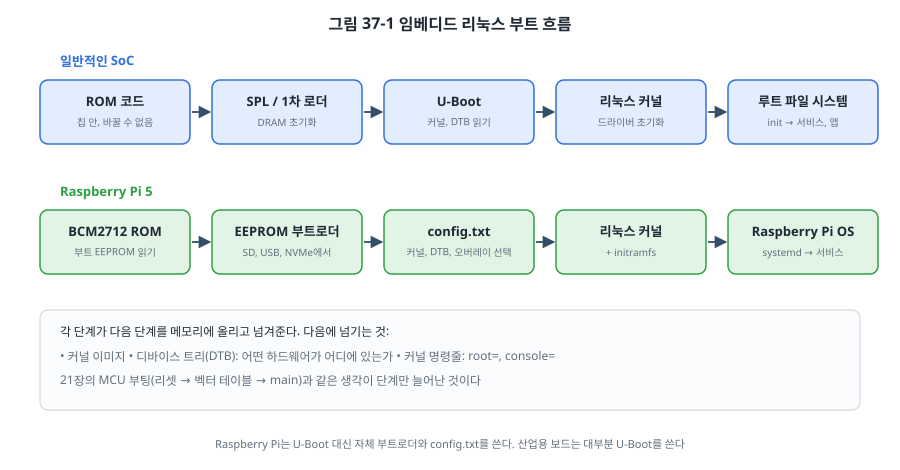
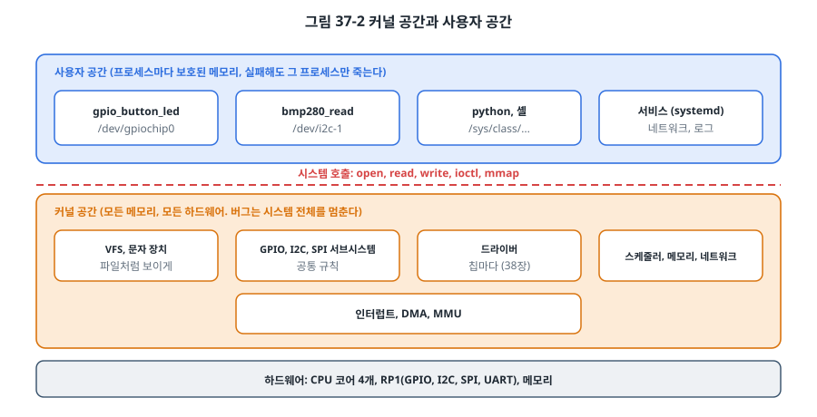
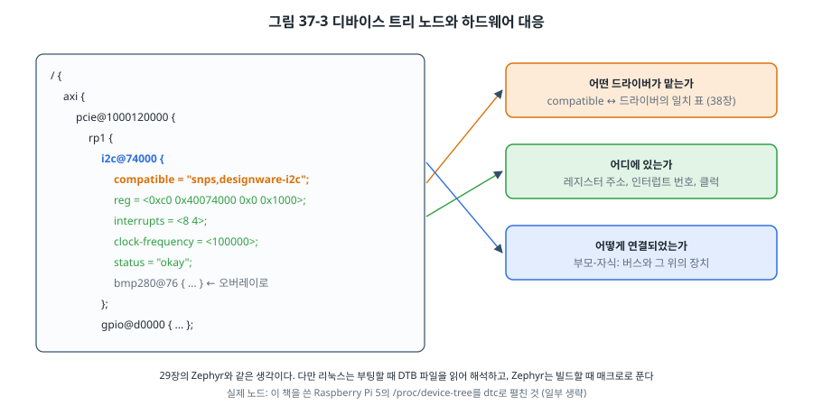

# 37장. 임베디드 리눅스

## 이 장에서 배우는 것

- MCU 시스템과 MPU(리눅스) 시스템은 무엇이 다르고, 언제 리눅스를 고르는가
- ROM에서 루트 파일 시스템까지의 부트 흐름
- 커널 공간과 사용자 공간, 그리고 디바이스 트리
- Raspberry Pi에서 사용자 공간 프로그램으로 GPIO와 I2C 다루기
- Buildroot와 Yocto로 제품용 리눅스 이미지 만들기, 교차 컴파일과 배포

---

## 37.1 MCU와 MPU

이 책은 지금까지 MCU, 즉 CPU와 Flash, RAM, 주변장치가 칩 하나에 들어 있고 펌웨어가 하드웨어를 직접 다루는 시스템을 다뤘습니다. 그런데 스마트 TV, 공유기, 산업용 게이트웨이, 자동차의 인포테인먼트 장치에는 리눅스가 돌아갑니다. 이런 시스템의 칩을 흔히 **MPU(Microprocessor Unit)** 또는 **애플리케이션 프로세서**라고 부릅니다.

| 항목 | MCU (STM32F411) | MPU (Raspberry Pi 5, BCM2712) |
| --- | --- | --- |
| CPU | Cortex-M4 1개, 100 MHz | Cortex-A76 4개, 2.4 GHz |
| 메모리 | 내장 SRAM 128 KB, Flash 512 KB | 외장 DRAM 수 GB, 저장 장치(SD, NVMe) |
| 주소 변환 | 없음 (MPU로 보호만, 25장) | MMU: 프로세스마다 가상 메모리 |
| 소프트웨어 | 베어메탈, RTOS | 리눅스 같은 범용 OS |
| 부팅 | 리셋 후 수 ms | 수 초~수십 초 |
| 실시간성 | µs 단위로 예측 가능 | 보통은 ms 단위, PREEMPT_RT로 개선 |
| 전력 | µA~mA | 수 W |
| 할 수 있는 것 | 센서, 모터, 저전력 | 화면, 카메라, 네트워크 서비스, 데이터베이스, AI |

리눅스를 고르는 이유는 **이미 있는 소프트웨어** 때문입니다. TCP/IP와 Wi-Fi, USB 호스트, 파일 시스템, 웹 서버, 데이터베이스, Python, 영상 처리 라이브러리가 모두 준비되어 있습니다. 반대로 리눅스는 부팅이 느리고, 전력을 많이 쓰고, µs 단위의 반응을 보장하기 어렵고, 관리할 소프트웨어가 엄청나게 많습니다(보안 업데이트를 포함해서).

그래서 많은 제품이 **둘을 함께** 씁니다. 리눅스 쪽이 화면, 네트워크, 기록을 맡고, MCU가 모터 제어와 안전 감시처럼 시간에 엄격한 일을 맡아 UART나 SPI로 대화합니다. 40장의 최종 프로젝트가 그런 구조입니다. STM32MP1처럼 Cortex-A와 Cortex-M을 한 칩에 넣은 제품도 있습니다.

이 장과 38장은 이 책의 원고를 쓴 **Raspberry Pi 5**로 실습합니다. 이 장의 출력 예는 그 장치에서 실제로 얻은 것입니다.

```
$ cat /proc/device-tree/model
Raspberry Pi 5 Model B Rev 1.1
$ uname -srm
Linux 6.18.50+rpt-rpi-2712 aarch64
```

## 37.2 부트 흐름



21장에서 MCU는 리셋 뒤 벡터 테이블을 읽고 `main()`까지 가는 데 몇 단계면 충분했습니다. 리눅스 시스템은 그 단계가 늘어납니다. 전원이 켜진 순간에는 DRAM조차 쓸 수 없기 때문입니다.

1. **ROM 코드**: 칩 안에 들어 있는 바꿀 수 없는 코드입니다. 정해진 저장 장치(SD 카드, eMMC, SPI Flash)에서 다음 단계를 칩 안의 작은 SRAM으로 읽어 옵니다. 33장의 신뢰의 뿌리가 여기에 있습니다.
2. **SPL(Secondary Program Loader)**: SRAM에 들어갈 만큼 작은 첫 로더입니다. 가장 중요한 일은 **DRAM을 초기화**하는 것입니다. DRAM 타이밍 설정은 보드마다 다릅니다.
3. **U-Boot**: 임베디드 리눅스에서 가장 널리 쓰는 부트로더입니다. 커널 이미지, 디바이스 트리(DTB), 초기 램디스크를 저장 장치나 네트워크에서 읽어 DRAM에 올리고, 커널 명령줄을 정해 커널로 점프합니다. 셸이 있어서 개발 중에 부팅 과정을 바꾸거나, 32장처럼 A/B 슬롯을 고르거나, 33장처럼 서명을 확인할 수 있습니다.
4. **리눅스 커널**: 하드웨어를 초기화하고 드라이버를 올린 뒤, 루트 파일 시스템을 마운트합니다.
5. **사용자 공간**: 첫 프로세스(`init`, 지금은 대개 `systemd`)가 서비스와 애플리케이션을 시작합니다.

Raspberry Pi는 U-Boot 대신 자체 부트로더를 씁니다. Pi 5의 ROM은 보드의 SPI EEPROM에 든 부트로더를 실행하고, 이 부트로더가 SD 카드나 USB, NVMe의 첫 파티션(`/boot/firmware`)에서 `config.txt`를 읽어 커널과 DTB, 오버레이를 고릅니다.

```
$ ls /boot/firmware
... bcm2712-rpi-5-b.dtb ... config.txt  initramfs_2712  kernel_2712.img  kernel8.img  overlays ...
```

`kernel_2712.img`가 Pi 5용 커널, `bcm2712-rpi-5-b.dtb`가 Pi 5 보드의 디바이스 트리, `overlays` 폴더에는 추가 하드웨어용 오버레이 파일이 수백 개 들어 있습니다. `config.txt`의 다음 줄들이 무엇을 켤지 정합니다.

```
dtparam=i2c_arm=on
dtparam=spi=on
dtparam=uart0=on
```

## 37.3 커널 공간과 사용자 공간



리눅스에서 가장 중요한 경계는 **커널 공간**과 **사용자 공간** 사이입니다. 커널은 모든 메모리와 하드웨어에 접근할 수 있고, 사용자 프로그램은 MMU가 지켜 주는 자기 메모리만 볼 수 있습니다. 사용자 프로그램이 하드웨어를 쓰려면 **시스템 호출**(`open`, `read`, `write`, `ioctl`)로 커널에 부탁해야 합니다.

이 구조는 MCU와 정반대의 장단점을 만듭니다. 사용자 프로그램이 잘못된 포인터를 쓰면 그 프로세스만 죽고(23장의 HardFault 대신 "Segmentation fault"), 시스템은 계속 동작합니다. 반면 레지스터를 직접 만질 수 없어서, 하드웨어를 다루려면 커널의 드라이버를 거쳐야 하고 그만큼 느립니다.

리눅스는 하드웨어를 **파일처럼** 보여 줍니다. 이것이 리눅스를 처음 배울 때 가장 중요한 생각입니다.

| 장치 | 파일 | 다루는 방법 |
| --- | --- | --- |
| GPIO | `/dev/gpiochip0` | GPIO 문자 장치 (`ioctl`) |
| I2C 버스 | `/dev/i2c-1` | `ioctl(I2C_RDWR)` |
| SPI | `/dev/spidev0.0` | `ioctl(SPI_IOC_MESSAGE)` |
| UART | `/dev/ttyAMA0` | `read`, `write` (14장의 터미널 설정은 `termios`) |
| 센서 (IIO) | `/sys/bus/iio/devices/iio:device0/in_temp_input` | 텍스트로 읽기 (38장) |

## 37.4 사용자 공간에서 GPIO 다루기

예전에는 `/sys/class/gpio`에 숫자를 쓰는 sysfs 방식으로 GPIO를 다뤘지만, 이 방식은 폐기 예정이 되었고 지금은 **GPIO 문자 장치**(`/dev/gpiochipN`)를 씁니다. 명령줄 도구로 먼저 살펴봅시다.

```
$ gpioinfo -c 0
gpiochip0 - 54 lines:
	line   0:	"ID_SDA"        	input
	line   1:	"ID_SCL"        	input
	line   2:	"GPIO2"         	input consumer="kernel"
	line   3:	"GPIO3"         	input consumer="kernel"
	...
	line  17:	"GPIO17"        	input
	...
	line  27:	"GPIO27"        	input
```

GPIO2와 GPIO3은 `consumer="kernel"`, 즉 커널의 I2C 드라이버가 이미 쓰고 있습니다(`dtparam=i2c_arm=on`). 리눅스에서는 이렇게 **누가 어느 핀을 쓰는지 커널이 관리**하므로, 6장처럼 다른 코드가 같은 핀의 MODER를 몰래 바꾸는 일이 생기지 않습니다.

`code/ch37-linux/gpio_button_led.c`는 라이브러리 없이 커널 헤더 `<linux/gpio.h>`만으로 버튼과 LED를 다룹니다. 핀을 요청하면 그 핀을 다룰 파일 기술자가 생깁니다.

```c
struct gpio_v2_line_request req;
memset(&req, 0, sizeof req);
req.offsets[0] = 27;                                   /* GPIO27 */
req.num_lines = 1;
req.config.flags = GPIO_V2_LINE_FLAG_INPUT | GPIO_V2_LINE_FLAG_BIAS_PULL_UP |
                   GPIO_V2_LINE_FLAG_EDGE_FALLING;     /* 입력, 풀업, 하강 에지 이벤트 */
strncpy(req.consumer, "ch37-button", sizeof req.consumer - 1);
ioctl(chip, GPIO_V2_GET_LINE_IOCTL, &req);
int btn = req.fd;
```

이제 그 파일에서 `read()`하면, 버튼이 눌릴 때까지 프로세스가 잠들었다가 이벤트가 오면 깨어납니다.

```c
struct gpio_v2_line_event ev;
read(btn, &ev, sizeof ev);          /* 에지가 올 때까지 잠든다 (CPU 0%) */
```

7장의 EXTI 인터럽트와 같은 일을 커널이 해 주는 것입니다. 커널의 인터럽트 처리기가 에지를 받아 시각(`ev.timestamp_ns`)과 함께 큐에 넣고, 기다리던 프로세스를 깨웁니다. 26장의 RTOS 태스크가 큐에서 Blocked로 기다린 것과 똑같은 구조입니다.

```bash
cd code/ch37-linux
make
./gpio_button_led
```

```
press the button (GPIO27) 10 times...
press 1 at 1234.567890123 s (kernel timestamp), LED on
...
```

(출력은 예시입니다. [확인 필요: 버튼과 LED를 연결한 실측]) 사용자가 `gpio` 그룹에 있어야 `/dev/gpiochip0`을 열 수 있습니다. Raspberry Pi OS의 기본 사용자는 이미 들어 있습니다.

> ⚠️ 주의: 사용자 공간에서 GPIO를 토글해 정확한 타이밍의 신호(예: 1 µs 펄스, 8장의 PWM)를 만들려고 하면 안 됩니다. 프로세스는 언제든 스케줄러에게 밀려날 수 있어서 수 ms씩 늦어지기도 합니다. 정확한 타이밍이 필요하면 하드웨어 PWM, SPI 같은 주변장치를 커널 드라이버로 쓰거나, 그 일을 MCU에 맡깁니다. 28장의 실시간 분석이 리눅스에서 어려운 이유이기도 합니다. 리눅스 6.12부터 본류 커널에 들어간 **PREEMPT_RT**를 켜면 최악의 지연이 크게 줄어 많은 제어 용도에 쓸 수 있지만, MCU만큼의 결정성을 기대하기는 어렵습니다.

## 37.5 I2C: 15장의 드라이버를 그대로

리눅스는 I2C 버스를 `/dev/i2c-N` 파일로 보여 줍니다.

```
$ i2cdetect -l
i2c-1	i2c       	Synopsys DesignWare I2C adapter 	I2C adapter
i2c-13	i2c       	107d508200.i2c                  	I2C adapter
i2c-14	i2c       	107d508280.i2c                  	I2C adapter
```

헤더의 3번(SDA, GPIO2), 5번(SCL, GPIO3) 핀이 `i2c-1`입니다. 15장의 BMP280 드라이버는 `i2c.h`의 함수만 쓰도록 만들었으므로, 그 함수들을 리눅스용으로 구현하면 드라이버를 **한 줄도 고치지 않고** 쓸 수 있습니다.

```c
/* code/ch37-linux/i2c_linux.c */
int i2c_write_read(uint8_t addr, const uint8_t *wdata, size_t wn, uint8_t *rdata, size_t rn)
{
    struct i2c_msg m[2] = {
        { addr, 0, (__u16)wn, (__u8 *)wdata },
        { addr, I2C_M_RD, (__u16)rn, rdata },        /* 반복 시작 조건으로 이어서 읽기 (15장) */
    };
    struct i2c_rdwr_ioctl_data d = { m, 2 };
    return ioctl(fd, I2C_RDWR, &d) == 2 ? I2C_OK : I2C_ERR_NACK;
}
```

`I2C_RDWR` 하나로 "레지스터 주소를 쓰고, 반복 시작 조건 뒤 읽는" 트랜잭션 전체를 커널의 I2C 어댑터 드라이버에 맡깁니다. 15장에서 STM32의 I2C 레지스터와 상태 플래그를 하나씩 다뤘던 일을 이제 커널이 합니다. 24장에서 말한 "HAL 아래만 바꾸면 위는 그대로"가 MCU와 리눅스 사이에서도 통한다는 것을 보여 주는 예입니다.

```bash
make
./bmp280_read
```

(BMP280을 연결하지 않았다면 `BMP280 not found at 0x76`이 나옵니다. `i2cdetect -y 1`로 버스에 대답하는 장치를 확인하세요. [확인 필요: 센서 연결 실측])

## 37.6 디바이스 트리

29장의 Zephyr에서 본 **디바이스 트리**는 원래 리눅스에서 온 것입니다. 커널은 부팅할 때 부트로더가 넘겨준 DTB를 읽고, 그 안의 노드마다 맞는 드라이버를 찾아 연결합니다.



실행 중인 시스템의 디바이스 트리는 `/proc/device-tree`에 파일과 폴더로 보이고, `dtc`(Device Tree Compiler)로 소스 형태로 펼칠 수 있습니다. 위 그림의 노드는 이 장치에서 실제로 꺼낸 `i2c-1` 컨트롤러입니다.

```
$ dtc -I fs -O dts /proc/device-tree
...
				i2c@74000 {
					compatible = "snps,designware-i2c";
					clock-frequency = <0x186a0>;
					status = "okay";
					reg = <0xc0 0x40074000 0x00 0x1000>;
					...
				};
```

`compatible`이 어떤 드라이버가 이 노드를 맡을지를, `reg`가 레지스터 주소를, `clock-frequency`가 버스 속도(0x186a0 = 100,000 Hz)를 정합니다. Pi 5의 I2C는 BCM2712 본체가 아니라 PCIe로 연결된 **RP1**이라는 입출력 칩 안에 있어서, 노드가 `pcie` → `rp1` 아래에 놓여 있습니다. 디바이스 트리는 이렇게 하드웨어의 **연결 구조**까지 그대로 담습니다.

추가로 연결한 하드웨어는 **오버레이**로 기존 트리에 덧붙입니다. 29장의 앱 오버레이와 같은 생각입니다. Raspberry Pi에서는 `config.txt`에 `dtoverlay=이름`을 쓰면 부트로더가 `overlays` 폴더의 해당 파일을 합쳐 커널에 넘깁니다. 38장에서 BMP280을 커널 드라이버에 연결할 때 오버레이를 직접 만들어 봅니다.

## 37.7 제품용 리눅스 이미지: Buildroot와 Yocto

Raspberry Pi OS는 범용 배포판이라 개발에는 편하지만, 제품에는 맞지 않는 점이 많습니다. 수천 개의 패키지가 들어 있어 크고, 부팅이 느리고, 업데이트 관리가 어렵고, 무엇이 들어 있는지 다 알 수 없습니다(33장의 공격면). 제품에는 **필요한 것만 담은 이미지**를 직접 만듭니다. 대표적인 도구가 둘입니다.

**Buildroot**는 단순함이 장점입니다. `make menuconfig`(22장, 29장의 Kconfig와 같은 방식)로 보드, 툴체인, 커널, 패키지를 고르고 `make`를 하면, 교차 툴체인부터 커널, 부트로더, 루트 파일 시스템 이미지까지 한 번에 만들어 줍니다. 수십 MB짜리 이미지가 몇 초 만에 부팅하는 시스템을 비교적 쉽게 만들 수 있습니다. 반면 이미지 단위로 다시 빌드하므로 패키지를 따로 업데이트하는 구조는 아닙니다.

**Yocto 프로젝트**는 산업 표준에 가깝습니다. 레시피와 **레이어**로 소프트웨어를 조합하며, 칩 제조사(NXP, TI, ST)들이 자사 보드용 레이어(BSP)를 Yocto로 제공합니다. 패키지 관리, 라이선스 목록 생성, SBOM(소프트웨어 구성 목록) 같은 양산 기능이 강력하지만, 배우기 어렵고 첫 빌드에 수십 GB의 디스크와 몇 시간이 걸립니다.

| | Buildroot | Yocto |
| --- | --- | --- |
| 배우기 | 하루 | 몇 주 |
| 첫 빌드 | 수십 분 | 수 시간 |
| 패키지 업데이트 | 이미지 전체 | 패키지 단위 가능 |
| 제조사 지원 | 일부 | 대부분의 BSP |
| 맞는 곳 | 작고 고정된 제품 | 여러 제품, 긴 유지보수 |

어느 쪽이든 36장의 원칙이 그대로 적용됩니다. 모든 소스의 버전을 고정하고, CI에서 이미지를 만들고, 현장 업데이트는 32장의 A/B 방식(리눅스에서는 RAUC, SWUpdate, Mender 같은 도구가 루트 파일 시스템을 A/B로 바꿉니다)으로 합니다.

## 37.8 교차 컴파일과 배포

예제는 Raspberry Pi 위에서 바로 컴파일했습니다(`file`로 확인한 결과).

```
$ file gpio_button_led
gpio_button_led: ELF 64-bit LSB pie executable, ARM aarch64, version 1 (SYSV), dynamically linked,
interpreter /lib/ld-linux-aarch64.so.1, for GNU/Linux 3.7.0, not stripped
```

Pi 5는 충분히 빨라서 작은 프로그램은 직접 빌드해도 되지만, 커널이나 큰 프로젝트는 PC에서 **교차 컴파일**합니다. 22장의 `arm-none-eabi-gcc`가 운영체제 없는 Arm용이었다면, 리눅스용은 `aarch64-linux-gnu-gcc`처럼 이름에 `linux`가 들어간 툴체인을 씁니다. 대상 시스템의 C 라이브러리와 헤더(**sysroot**)가 필요하다는 점이 다릅니다.

```bash
make CROSS=aarch64-linux-gnu-          # PC에서 교차 빌드
scp gpio_button_led bmp280_read pi@raspberrypi.local:~/   # 복사
ssh pi@raspberrypi.local ./bmp280_read                    # 실행
```

장치가 켜질 때 프로그램이 자동으로 시작되게 하려면 **systemd 서비스**를 만듭니다.

```ini
# /etc/systemd/system/sensor.service
[Unit]
Description=BMP280 logger
After=multi-user.target

[Service]
ExecStart=/usr/local/bin/bmp280_read
Restart=on-failure          # 죽으면 다시 시작 (35장의 워치독과 같은 생각)
User=sensor                 # root가 아닌 사용자로 (33장의 최소 권한)

[Install]
WantedBy=multi-user.target
```

`sudo systemctl enable --now sensor`로 켜고, `journalctl -u sensor`로 출력을 봅니다. systemd는 서비스 수준의 워치독(`WatchdogSec=`)도 제공해서, 35장의 감시자 구조를 프로세스 단위로 만들 수 있습니다.

> 🔧 ATmega128에서는: 8비트 AVR에서 리눅스를 돌리는 것은 현실적이지 않습니다(MMU도, 충분한 메모리도 없음). 대신 37.1절의 "리눅스 + MCU" 구조에서 AVR이 MCU 쪽을 맡는 경우는 흔합니다. 리눅스 보드가 USB-시리얼(14장)이나 I2C로 아두이노나 ATmega128 보드에 명령을 보내고, AVR이 실시간 입출력을 처리합니다. Raspberry Pi의 헤더 UART(3.3 V)와 5 V AVR을 연결할 때는 2장의 레벨 변환을 잊지 마세요.

---

## 정리

- MPU 시스템은 MMU와 외장 DRAM 위에서 리눅스 같은 범용 OS를 돌립니다. 소프트웨어 자산을 얻는 대신 부팅 시간, 전력, 실시간성을 내줍니다. 리눅스와 MCU를 함께 쓰는 구조가 흔합니다.
- 부팅은 ROM → (SPL) → U-Boot → 커널 → 루트 파일 시스템 순이며, 각 단계가 커널 이미지, 디바이스 트리, 명령줄을 넘깁니다. Raspberry Pi는 자체 부트로더와 config.txt를 씁니다.
- 사용자 프로그램은 시스템 호출로 커널에 부탁하며, 하드웨어는 파일로 보입니다. GPIO는 문자 장치(`/dev/gpiochipN`), I2C는 `/dev/i2c-N`으로 다룹니다.
- `i2c.h`를 리눅스용으로 구현하면 15장의 드라이버를 그대로 쓸 수 있습니다.
- 디바이스 트리는 하드웨어의 종류, 위치, 연결을 기술하며, 오버레이로 추가 하드웨어를 덧붙입니다.
- 제품용 이미지는 Buildroot(단순)나 Yocto(산업 표준)로 만들고, 교차 컴파일한 프로그램은 systemd 서비스로 배포합니다.

## 연습 문제

1. 다음 제품에 MCU, 리눅스 MPU, 둘 다 중 무엇을 쓰겠습니까? 이유를 쓰세요. (a) 무선 도어벨(카메라, 앱 알림) (b) 전동 공구의 모터 제어기 (c) 공장 설비 10대의 데이터를 모아 클라우드로 보내는 게이트웨이
2. `gpioinfo`에서 GPIO2가 `consumer="kernel"`로 보입니다. 이 상태에서 `gpio_button_led.c`의 `BTN_LINE`을 2로 바꾸면 어떻게 될지 예측하고 이유를 쓰세요.
3. 사용자 공간 프로그램에서 `usleep(500)`으로 1 kHz 구형파를 만들면 오실로스코프에서 어떻게 보일까요? 더 정확하게 만드는 방법을 세 가지 제시하세요.
4. `i2c_linux.c`는 15장의 `i2c_bus_recover()`를 비워 두었습니다. 리눅스에서 I2C 버스가 잠기면 누가, 어떻게 복구하나요? 조사해 보세요.
5. Buildroot로 만든 50 MB 이미지와 Raspberry Pi OS(수 GB) 중 하나를 1만 대 제품에 쓴다면, 보안 업데이트 관점에서 각각 어떤 어려움이 있을지 쓰세요.
6. (실습) `bmp280_read`를 systemd 서비스로 만들어, 부팅 후 자동으로 시작하고 1분마다 온도를 `journalctl`에 남기게 하세요. 센서를 뽑았을 때 서비스가 어떻게 되는지(`Restart=` 설정에 따라) 확인하세요.
