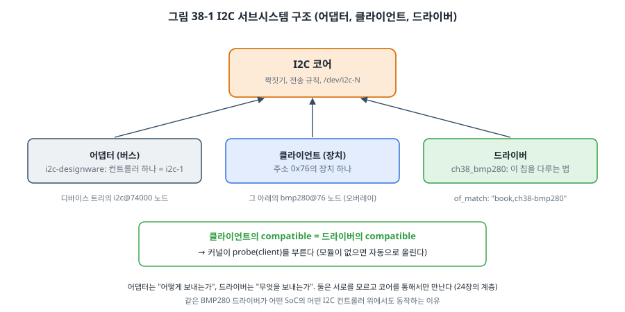
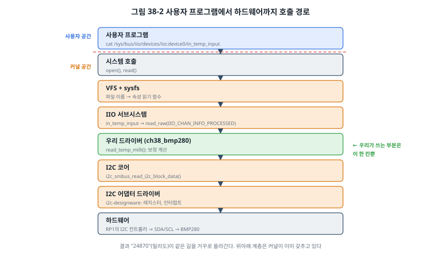

# 38장. 리눅스 디바이스 드라이버

## 이 장에서 배우는 것

- 커널 모듈을 만들고 올리고 내리는 방법, 커널 코드의 규칙
- 문자 장치: 사용자 프로그램이 `read`, `write`로 드라이버와 대화하는 길
- 디바이스 트리 바인딩으로 드라이버와 하드웨어를 짝짓는 방법
- GPIO, I2C 서브시스템의 구조
- sysfs와 IIO로 센서 값을 표준 방식으로 내보내기

---

## 38.1 드라이버는 언제 필요한가

37장에서는 사용자 공간 프로그램이 `/dev/i2c-1`로 BMP280을 직접 읽었습니다. 간단하고 충분히 동작합니다. 그런데 다음과 같은 경우에는 **커널 드라이버**가 필요합니다.

- 인터럽트에 µs 단위로 반응해야 할 때(사용자 공간은 스케줄러에 밀릴 수 있음)
- DMA를 써야 할 때
- 여러 프로그램이 같은 장치를 안전하게 나눠 써야 할 때
- 장치를 **표준 인터페이스**로 보여 주고 싶을 때. 온도 센서라면 어느 회사의 센서든 같은 파일에서 온도를 읽게 하고, 기존 프로그램(모니터링 도구, 다른 서브시스템)이 그대로 쓰게 하고 싶을 때

이 장에서는 세 개의 모듈을 차례로 만들어 봅니다. 가장 작은 모듈, 문자 장치, 그리고 BMP280을 표준 센서 인터페이스(IIO)로 보여 주는 I2C 드라이버입니다. 모든 예제는 이 책을 쓴 Raspberry Pi 5의 커널(6.18) 헤더로 경고 없이 빌드되는 것을 확인했습니다.

> ⚠️ 주의: 커널 코드의 버그는 시스템 전체를 멈추게 합니다(커널 패닉). 사용자 공간 프로그램처럼 "그 프로세스만 죽는" 일이 없습니다. 실습은 중요한 데이터가 없는 개발용 장치에서 하고, 모듈을 올리기 전에 파일을 저장해 두세요.

## 38.2 커널 모듈

리눅스 커널의 기능 대부분은 실행 중에 올리고 내릴 수 있는 **커널 모듈**(`.ko` 파일)로 만들 수 있습니다. 가장 작은 모듈입니다.

```c
// SPDX-License-Identifier: GPL-2.0
#include <linux/init.h>
#include <linux/module.h>

static int __init hello_init(void)
{
	pr_info("ch38 hello: loaded into the kernel\n");   /* printk: dmesg로 본다 */
	return 0;                                           /* 0이 아니면 모듈이 올라가지 않는다 */
}

static void __exit hello_exit(void)
{
	pr_info("ch38 hello: unloaded\n");
}

module_init(hello_init);
module_exit(hello_exit);
MODULE_LICENSE("GPL");
```

모듈은 커널의 빌드 시스템(Kbuild)으로 빌드합니다. `Kbuild` 파일에 `obj-m += hello.o` 한 줄을 쓰고, 지금 실행 중인 커널의 헤더 폴더를 가리켜 `make`를 부릅니다.

```makefile
KDIR ?= /lib/modules/$(shell uname -r)/build

all:
	$(MAKE) -C $(KDIR) M=$(CURDIR) modules
```

```bash
cd code/ch38-drivers/hello
make
sudo insmod hello.ko          # 올리기
sudo dmesg | tail -1          # ch38 hello: loaded into the kernel
lsmod | grep hello
sudo rmmod hello              # 내리기
```

`MODULE_LICENSE("GPL")`은 장식이 아닙니다. 커널의 많은 함수는 GPL 모듈에만 공개되어(`EXPORT_SYMBOL_GPL`) 있어서, 라이선스가 다르면 그 함수를 쓸 수 없습니다. 커널은 GPL v2이고, 커널에 링크되는 모듈의 라이선스는 제품의 법적 검토가 필요한 문제입니다.

### 커널 코드의 규칙

커널 코드는 C지만, 사용자 공간과 규칙이 다릅니다. MCU 펌웨어를 써 본 독자에게는 오히려 익숙한 규칙들입니다.

- **C 표준 라이브러리가 없습니다.** `printf` 대신 `pr_info`(`printk`), `malloc` 대신 `kmalloc`, `strtoul` 대신 `kstrtoul`처럼 커널이 제공하는 함수를 씁니다.
- **부동소수점을 쓰지 않습니다.** 커널은 문맥 전환 때 FPU 레지스터를 저장하지 않는 것을 기본으로 합니다. 12장, 34장처럼 정수와 고정소수점으로 계산합니다. 예제의 온도 보정이 그렇습니다.
- **스택이 작습니다.** arm64 커널의 스택은 태스크당 16 KB입니다. 25장처럼 큰 지역 배열을 피합니다.
- **잠들 수 있는 곳과 없는 곳이 있습니다.** 인터럽트 처리기나 스핀락을 잡은 구간에서는 잠들 수 있는 함수(뮤텍스, I2C 전송, `kmalloc(GFP_KERNEL)`)를 부르면 안 됩니다. 26장에서 ISR이 블로킹 API를 부를 수 없었던 것과 같습니다.
- **사용자 메모리를 직접 만지지 않습니다.** 사용자가 넘긴 포인터는 `copy_to_user()`, `copy_from_user()`로만 다룹니다. 그 주소가 잘못되었거나 사용자가 악의로 커널 주소를 넘겼을 수 있기 때문입니다(33장).

## 38.3 문자 장치

사용자 프로그램과 드라이버가 대화하는 가장 기본적인 길이 **문자 장치**입니다. `/dev`에 파일이 생기고, 그 파일에 대한 `open`, `read`, `write`, `ioctl`이 드라이버의 함수로 연결됩니다. 37장에서 쓴 `/dev/gpiochip0`과 `/dev/i2c-1`이 모두 문자 장치입니다.

`code/ch38-drivers/counter/ch38_counter.c`는 읽을 때마다 숫자가 하나씩 늘어나는 장치 `/dev/ch38counter`를 만듭니다.

```c
static ssize_t counter_read(struct file *f, char __user *buf, size_t len, loff_t *pos)
{
	char tmp[32];
	int n;

	if (*pos > 0)
		return 0;                    /* 한 번 읽으면 파일 끝 (cat이 멈추게) */
	mutex_lock(&lock);
	n = scnprintf(tmp, sizeof(tmp), "count=%lu\n", count++);
	mutex_unlock(&lock);
	if (len < n)
		return -EINVAL;
	if (copy_to_user(buf, tmp, n))   /* 사용자 메모리는 직접 쓰지 않는다 */
		return -EFAULT;
	*pos += n;
	return n;
}

static const struct file_operations counter_fops = {
	.owner = THIS_MODULE,
	.read  = counter_read,
	.write = counter_write,
};

static struct miscdevice counter_dev = {
	.minor = MISC_DYNAMIC_MINOR,
	.name  = "ch38counter",
	.fops  = &counter_fops,
	.mode  = 0666,
};

module_misc_device(counter_dev);
```

`struct file_operations`가 핵심입니다. "이 파일을 읽으면 이 함수를, 쓰면 이 함수를 불러라"는 표입니다. 24장의 `washer_io_t`, 29장 Zephyr의 드라이버 API처럼 함수 포인터 표로 인터페이스를 만드는 같은 방법입니다.

문자 장치는 원래 **주 번호(major)** 와 **부 번호(minor)** 를 할당받고 `cdev`를 등록하는 몇 단계가 필요하지만, `miscdevice`로 등록하면 커널이 그 일을 대신 하고 udev가 `/dev`에 파일까지 만들어 줍니다. 작은 드라이버에 알맞습니다.

여러 프로그램이 동시에 읽을 수 있으므로 `count`는 **뮤텍스**로 지킵니다. 27장의 경쟁 조건이 커널에서도 똑같이 생깁니다. 쓰기 쪽은 사용자가 보낸 문자열을 `kstrtoul_from_user()`로 검사하며 숫자로 바꿉니다. 바깥에서 들어온 데이터를 믿지 않는 원칙(14장, 33장)은 커널에서 더 중요합니다.

```bash
cd code/ch38-drivers/counter && make
sudo insmod ch38_counter.ko
cat /dev/ch38counter          # count=0
cat /dev/ch38counter          # count=1
echo 100 > /dev/ch38counter
cat /dev/ch38counter          # count=100
sudo rmmod ch38_counter
```

(출력은 예시입니다. [확인 필요: 모듈을 올린 실측])

## 38.4 디바이스 트리 바인딩과 플랫폼 드라이버

문자 장치는 하드웨어와 상관없는 예였습니다. 실제 하드웨어를 다루는 드라이버는 "**어느** 하드웨어를 맡을지"를 알아야 합니다. MCU에서는 코드에 주소를 썼지만(4장), 리눅스는 37장의 **디바이스 트리**로 알려 줍니다.

드라이버는 자기가 맡을 수 있는 하드웨어의 `compatible` 문자열 표를 커널에 알립니다.

```c
static const struct of_device_id ch38_of_match[] = {
	{ .compatible = "book,ch38-bmp280" },
	{ }
};
MODULE_DEVICE_TABLE(of, ch38_of_match);
```

커널은 디바이스 트리의 노드를 하나씩 보며, 노드의 `compatible`과 같은 문자열을 가진 드라이버를 찾으면 그 드라이버의 **`probe()`** 함수를 부릅니다. `probe()`는 "이 장치를 맡아라"는 뜻이고, 드라이버는 여기서 장치를 확인하고 초기화하고 등록합니다. `MODULE_DEVICE_TABLE`은 이 표를 모듈 파일에 기록해 두어, 노드가 있으면 커널이 해당 모듈을 **자동으로 올리게** 합니다.

주변장치를 직접 다루는 드라이버(SoC 안의 타이머, GPIO 컨트롤러)는 **플랫폼 드라이버**(`platform_driver`)로 만들고, 디바이스 트리의 `reg`(레지스터 주소)와 `interrupts`를 받아 씁니다. I2C나 SPI 버스 위의 장치는 그 버스의 드라이버 형식으로 만듭니다. BMP280은 I2C 장치이므로 `i2c_driver`입니다.

```c
static struct i2c_driver ch38_driver = {
	.driver = {
		.name = "ch38_bmp280",
		.of_match_table = ch38_of_match,
	},
	.probe = ch38_probe,
};
module_i2c_driver(ch38_driver);
```

## 38.5 I2C 서브시스템



리눅스의 I2C는 세 가지를 나눠 생각합니다.

- **어댑터**: I2C 컨트롤러 하나, 즉 버스 하나입니다. Pi 5에서는 RP1 안의 DesignWare I2C 컨트롤러를 `i2c-designware` 드라이버가 맡아 `i2c-1`로 등록합니다. 15장에서 STM32의 I2C 레지스터를 다룬 코드가 이 위치입니다.
- **클라이언트**: 버스 위의 장치 하나(주소 0x76의 BMP280)입니다. 디바이스 트리에서 어댑터 노드 아래의 자식 노드로 기술합니다.
- **드라이버**: 그 칩을 다루는 방법입니다. 15장의 `bmp280.c`가 이 위치입니다.

어댑터는 "어떻게 보내는가", 드라이버는 "무엇을 보내는가"를 알고, 둘은 서로를 모른 채 **I2C 코어**를 통해서만 만납니다. 그래서 같은 BMP280 드라이버가 어느 SoC의 어떤 I2C 컨트롤러 위에서도 동작합니다. 15장에서 `i2c.h`로 나눈 경계를 커널이 그대로 제도화한 것입니다.

드라이버는 코어의 함수로 레지스터를 읽고 씁니다. 대부분의 센서는 SMBus 형식의 함수로 충분합니다.

```c
id = i2c_smbus_read_byte_data(client, REG_CHIP_ID);                  /* 레지스터 하나 */
ret = i2c_smbus_read_i2c_block_data(client, REG_CALIB, 6, c);         /* 연속 6바이트 */
ret = i2c_smbus_write_byte_data(client, REG_CTRL, 0x27);              /* 쓰기 */
```

### 오버레이로 장치 알리기

이 드라이버가 동작하려면 디바이스 트리의 I2C1 아래에 `compatible = "book,ch38-bmp280"`인 노드가 있어야 합니다. 37장에서 본 오버레이로 덧붙입니다.

```dts
/dts-v1/;
/plugin/;

/ {
	compatible = "brcm,bcm2712";

	fragment@0 {
		target = <&i2c_arm>;          /* Raspberry Pi의 헤더 I2C (Pi 5: RP1의 i2c@74000) */
		__overlay__ {
			#address-cells = <1>;
			#size-cells = <0>;
			status = "okay";

			bmp280@76 {
				compatible = "book,ch38-bmp280";
				reg = <0x76>;
			};
		};
	};
};
```

`i2c_arm`은 Raspberry Pi의 디바이스 트리가 헤더 I2C에 붙여 둔 이름(라벨)입니다. Pi 5에서는 이것이 37장에서 본 `/axi/pcie@1000120000/rp1/i2c@74000`를 가리킵니다. 오버레이를 컴파일해 `overlays` 폴더에 넣고 `config.txt`에 등록한 뒤 재부팅합니다.

```bash
cd code/ch38-drivers/bmp280
dtc -@ -I dts -O dtb -o ch38-bmp280.dtbo ch38-bmp280-overlay.dts
sudo cp ch38-bmp280.dtbo /boot/firmware/overlays/
echo "dtoverlay=ch38-bmp280" | sudo tee -a /boot/firmware/config.txt
make && sudo make -C /lib/modules/$(uname -r)/build M=$PWD modules_install && sudo depmod
sudo reboot
```

> ⚠️ 주의: `config.txt`를 잘못 고치면 부팅하지 않을 수 있습니다. 고치기 전에 복사본을 만들어 두고, SD 카드를 PC에 꽂아 되돌릴 수 있게 준비하세요. 실험이 끝나면 추가한 줄을 지웁니다. 리눅스를 재부팅하지 않고 시험하려면 `sudo dtoverlay ch38-bmp280`으로 실행 중에 오버레이를 적용하는 방법도 있습니다. [확인 필요: Pi 5에서 실행 중 오버레이 적용 동작]

## 38.6 GPIO 서브시스템

GPIO도 같은 구조입니다. GPIO 컨트롤러 드라이버(Pi 5에서는 `raspberrypi,rp1-gpio`)가 **gpiochip**을 등록하고, 다른 드라이버는 컨트롤러를 몰라도 디바이스 트리에 적힌 핀을 받아 씁니다.

```dts
my_device {
	compatible = "vendor,my-device";
	reset-gpios = <&gpio 17 GPIO_ACTIVE_LOW>;
};
```

```c
struct gpio_desc *reset = devm_gpiod_get(&dev, "reset", GPIOD_OUT_HIGH);
gpiod_set_value(reset, 0);        /* 논리값: ACTIVE_LOW이므로 실제 핀은 High */
```

`ACTIVE_LOW` 같은 극성을 디바이스 트리가 처리해 주므로, 드라이버는 "리셋을 건다/푼다"라는 논리값만 다룹니다. 29장 Zephyr의 `gpio_dt_spec`과 같은 생각입니다. 그리고 많은 경우 드라이버를 아예 쓸 필요가 없습니다. LED는 `gpio-leds`, 버튼은 `gpio-keys`라는 범용 드라이버가 있어서, 디바이스 트리에 노드만 쓰면 `/sys/class/leds/`와 입력 장치(`/dev/input/eventN`)로 나타납니다.

## 38.7 sysfs와 IIO

BMP280 드라이버가 온도를 어떻게 사용자에게 보여 줄지 정해야 합니다. 문자 장치를 만들어 자기만의 형식으로 내보낼 수도 있지만, 리눅스에는 센서를 위한 표준 틀이 있습니다. **IIO(Industrial I/O) 서브시스템**입니다. ADC, 온도, 기압, 가속도, 자이로 같은 센서를 같은 방식으로 보여 줍니다.

IIO는 **sysfs**(`/sys`)에 장치마다 폴더를 만들고, 채널마다 파일을 만듭니다. 온도 채널의 처리된 값은 `in_temp_input` 파일에 **밀리도(m°C)** 단위로 나타납니다. 단위까지 표준이므로, 사용자 프로그램은 센서 칩이 무엇이든 같은 코드로 읽을 수 있습니다.

```c
static const struct iio_chan_spec ch38_channels[] = {
	{
		.type = IIO_TEMP,
		.info_mask_separate = BIT(IIO_CHAN_INFO_PROCESSED),   /* in_temp_input 파일이 생긴다 */
	},
};

static int ch38_read_raw(struct iio_dev *indio, struct iio_chan_spec const *chan,
			 int *val, int *val2, long mask)
{
	struct ch38_bmp280 *d = iio_priv(indio);
	int ret;

	if (mask != IIO_CHAN_INFO_PROCESSED)
		return -EINVAL;
	ret = read_temp_milli(d, val);      /* 15장의 보정 계산, 결과는 밀리도 */
	return ret ? ret : IIO_VAL_INT;
}
```

사용자가 파일을 읽으면 IIO가 `read_raw()`를 부르고, 드라이버는 I2C로 원시 값을 읽어 15장과 같은 정수 보정식으로 계산해 돌려줍니다.



그림 38-2은 `cat` 한 번이 거치는 경로입니다. 사용자 공간, 시스템 호출, VFS와 sysfs, IIO, 우리 드라이버, I2C 코어, 어댑터 드라이버, 하드웨어. 우리가 쓴 것은 그중 한 칸뿐이고 나머지는 커널이 이미 갖추고 있습니다. 리눅스 드라이버 개발의 대부분은 **알맞은 서브시스템을 찾아 그 틀에 맞추는 일**입니다.

```bash
cat /sys/bus/iio/devices/iio:device0/name          # ch38_bmp280
cat /sys/bus/iio/devices/iio:device0/in_temp_input  # 24870 → 24.87 °C
```

(장치 번호와 값은 예시입니다. [확인 필요: 센서와 오버레이를 적용한 실측])

`probe()`에서 `devm_iio_device_alloc()`, `devm_iio_device_register()`처럼 **`devm_`** 으로 시작하는 함수를 쓴 것도 눈여겨보세요. "장치에 묶인(device-managed)" 자원이라는 뜻으로, 장치가 떨어지거나 모듈이 내려갈 때 커널이 자동으로 해제합니다. 그래서 이 드라이버에는 `remove()` 함수가 없습니다. 오류 경로마다 앞에서 받은 자원을 하나씩 풀어 주는 코드가 사라져 버그가 크게 줄어듭니다(35장의 누수).

> 💡 팁: 리눅스 본류에는 이미 완전한 BMP280/BME280 IIO 드라이버(`bosch,bmp280`, `drivers/iio/pressure/bmp280-*.c`)가 있고, Raspberry Pi에서는 `dtoverlay=i2c-sensor,bmp280` 한 줄로 쓸 수 있습니다. 이 장의 드라이버는 원리를 보이려고 온도만 남긴 교육용이며, 본류 드라이버와 겹치지 않게 `compatible`을 `book,ch38-bmp280`으로 바꿨습니다. 실무에서는 **먼저 본류에 드라이버가 있는지 찾는 것**이 첫 단계입니다. 직접 쓴 드라이버는 커널 버전이 바뀔 때마다 직접 고쳐야 하지만, 본류 드라이버는 커뮤니티가 함께 유지합니다. 새 칩의 드라이버를 썼다면 본류에 기여하는 것도 좋은 선택입니다.

> 🔧 ATmega128에서는: AVR에는 리눅스 드라이버라는 개념이 없지만, 거꾸로 **리눅스에서 AVR을 장치로 보는** 일은 흔합니다. ATmega128 보드를 I2C 슬레이브(15장)로 만들어 Raspberry Pi에 연결하면, 이 장의 방법으로 그 보드를 위한 I2C 드라이버를 쓸 수 있습니다. 예를 들어 AVR이 여러 ADC 채널을 재고, 리눅스 쪽 드라이버가 그것을 IIO 장치로 보여 주는 식입니다. 37.1절의 "리눅스 + MCU" 구조를 커널 수준에서 매끄럽게 잇는 방법입니다.

---

## 정리

- 인터럽트, DMA, 여러 프로그램의 공유, 표준 인터페이스가 필요하면 커널 드라이버를 씁니다. 커널의 버그는 시스템 전체를 멈춥니다.
- 커널 모듈은 Kbuild로 빌드하고 `insmod`, `rmmod`로 올리고 내립니다. 커널 코드는 C 라이브러리, 부동소수점, 큰 스택 없이 쓰고, 잠들 수 없는 문맥과 사용자 메모리를 조심합니다.
- 문자 장치는 `file_operations` 표로 `read`, `write`를 드라이버 함수에 잇습니다. `miscdevice`가 등록을 간단하게 해 줍니다.
- 드라이버는 `compatible` 표로 디바이스 트리 노드와 짝지어지고, 커널이 `probe()`를 부릅니다. 추가 하드웨어는 오버레이로 알립니다.
- I2C 서브시스템은 어댑터(버스), 클라이언트(장치), 드라이버(칩)를 나누고 코어로 잇습니다. GPIO도 컨트롤러와 사용자를 나눕니다.
- 센서는 IIO로 sysfs에 표준 단위로 내보냅니다. `devm_` 자원은 자동으로 해제됩니다. 먼저 본류 드라이버가 있는지 찾습니다.

## 연습 문제

1. `hello.c`의 `hello_init()`이 `-ENODEV`를 돌려주게 바꾸면 `insmod`가 어떻게 되나요? 이 동작은 어떤 상황에서 쓸모가 있을까요?
2. `ch38_counter.c`에서 뮤텍스를 빼면 어떤 상황에서 문제가 생기나요? 두 프로세스가 동시에 읽는 시나리오로 설명하세요.
3. `counter_read()`에서 `copy_to_user()` 대신 `memcpy(buf, tmp, n)`을 쓰면 어떤 위험이 있나요? 사용자가 `buf`에 커널 주소를 넘기는 경우를 생각해 보세요.
4. `ch38_bmp280.c`에 기압 채널(`IIO_PRESSURE`)을 추가하려면 무엇을 바꿔야 하나요? 15장의 연습 문제에서 만든 기압 보정 코드를 어디에 넣을지 쓰세요.
5. 같은 I2C 버스의 0x76에 BMP280이 있는데 디바이스 트리에 본류 드라이버(`bosch,bmp280`)와 이 장의 드라이버(`book,ch38-bmp280`) 노드를 둘 다 넣으면 어떻게 될까요?
6. (실습) 본류 드라이버를 `dtoverlay=i2c-sensor,bmp280`으로 켜고, 이 장의 드라이버와 같은 `in_temp_input` 값이 나오는지 비교하세요. 본류 드라이버는 그 밖에 어떤 파일(채널, 설정)을 제공하나요?
