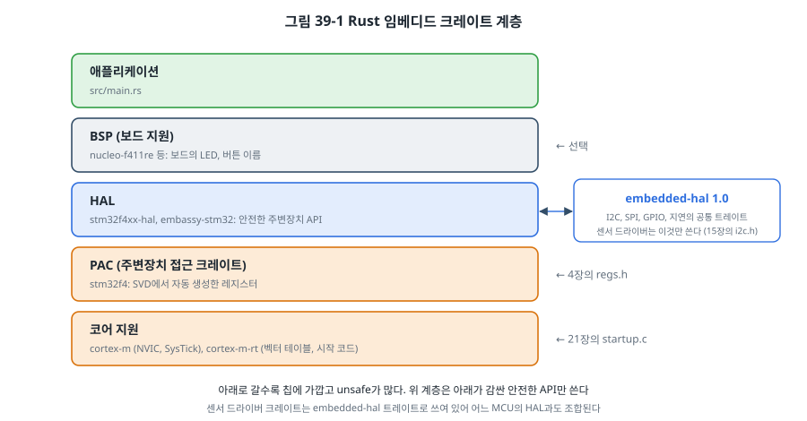
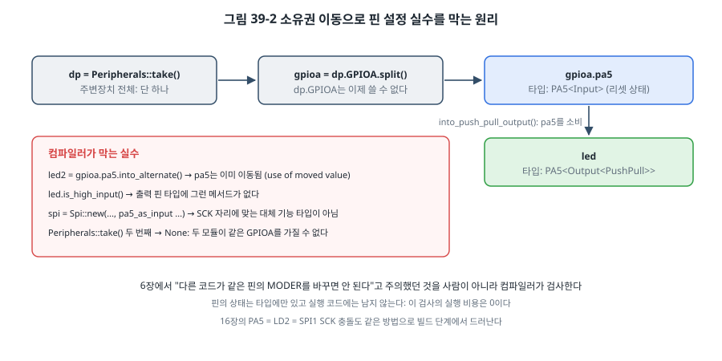

# 39장. 임베디드 Rust

## 이 장에서 배우는 것

- 임베디드에서 Rust를 고려하는 이유와 그 대가
- `no_std` 환경과 Rust 임베디드 크레이트의 계층(PAC, HAL, BSP)
- 소유권과 타입으로 주변장치 설정 실수를 컴파일 단계에서 막는 방법
- Embassy로 async/await 기반 펌웨어 쓰기
- 기존 C 코드와 함께 쓰기 (FFI)

---

## 39.1 왜 Rust인가

이 책은 C로 펌웨어를 썼습니다. C는 하드웨어를 직접 다루기에 가장 오래되고 검증된 언어지만, 이 책의 여러 장이 C의 함정을 피하는 방법에 쓰였습니다. 버퍼 경계(4장, 25장), 해제한 메모리 사용(35장), 공유 데이터 경쟁(7장, 27장), 정의되지 않은 동작(34장). 33장에서 본 것처럼 이런 메모리 오류는 지금도 보안 취약점의 큰 몫을 차지합니다.

**Rust**는 이런 오류의 상당수를 **컴파일 단계에서** 막도록 설계된 언어입니다.

- **소유권과 빌림**: 모든 값에는 주인이 하나 있고, 빌려 쓰는 규칙을 컴파일러가 검사합니다. 해제한 메모리 사용, 이중 해제, 같은 데이터를 두 곳에서 동시에 바꾸는 경쟁 조건이 컴파일 오류가 됩니다.
- **경계 검사**: 배열 범위 밖 접근은 정의되지 않은 동작이 아니라 정해진 실패(panic)입니다.
- **명시적인 위험**: 하드웨어 레지스터처럼 컴파일러가 검사할 수 없는 일은 `unsafe` 블록 안에서만 할 수 있습니다. 위험한 코드가 어디 있는지 소스에서 바로 보입니다.
- **실행 비용 없음**: 이 검사들은 대부분 컴파일할 때 끝나므로, 같은 일을 하는 C 코드와 비슷한 크기와 속도의 기계어가 나옵니다.

리눅스 커널은 6.1부터 Rust로 쓴 드라이버를 받아들이기 시작했고(38장), 기능 안전 인증(35장)을 받은 Rust 컴파일러도 나왔습니다. Ferrous Systems의 **Ferrocene**은 2023년 ISO 26262(ASIL D)와 IEC 61508(SIL 4) 인증을 받았고, 이후 IEC 62304(클래스 C)도 더했습니다. [확인 필요: 출간 시점의 인증 범위]

대가도 있습니다. 배우기가 어렵습니다. 특히 소유권 규칙과 싸우는 첫 몇 주가 힘들고, 제조사 SDK와 예제는 거의 C이며, 크레이트 생태계는 빠르게 바뀌어 버전이 자주 올라갑니다. 이 장의 목표는 Rust를 가르치는 것이 아니라, C로 펌웨어를 써 온 독자가 **Rust 펌웨어가 어떻게 생겼는지, 무엇이 다른지**를 이 책의 예제와 비교하며 보는 것입니다.

> ⚠️ 주의: 이 장의 예제는 2026년 하반기의 크레이트 버전(stm32f4xx-hal 0.23, embassy-stm32 0.6, embassy-executor 0.10)과 그 저장소의 예제에 맞춰 썼습니다. 원고를 쓴 환경에는 Rust 툴체인을 설치하지 않아 `hal-blinky`와 `embassy-async`의 빌드는 확인하지 못했습니다. [확인 필요: 두 예제의 빌드와 보드 실행] `ffi-c`의 C 연동과 테스트는 PC에서 확인했습니다. Rust 임베디드 크레이트는 API가 자주 바뀌므로, 버전이 다르면 각 크레이트의 예제 폴더를 함께 보세요.

## 39.2 시작하기: no_std

PC의 Rust 프로그램은 운영체제 위에서 표준 라이브러리(`std`)를 씁니다. MCU에는 운영체제가 없으므로 `std`를 쓸 수 없고, 언어의 핵심만 담은 **`core`** 라이브러리를 씁니다. 이것을 **`no_std`** 환경이라고 합니다. 동적 할당이 필요하면 `alloc`을 추가할 수 있지만, 25장의 이유로 대부분 쓰지 않습니다.

설치는 다음과 같습니다.

```bash
curl --proto '=https' --tlsv1.2 -sSf https://sh.rustup.rs | sh    # rustup (공식 설치 방법)
rustup target add thumbv7em-none-eabihf                          # Cortex-M4F용 표준 라이브러리 일부
cargo install probe-rs-tools                                     # 업로드와 디버깅 (23장의 OpenOCD 역할)
```

`thumbv7em-none-eabihf`라는 대상 이름에 22장의 내용이 모두 들어 있습니다. Thumb 명령어(`thumbv7em`, Cortex-M4/M7), 운영체제 없음(`none`), 하드웨어 FPU 호출 규약(`eabihf`, 22장의 `-mfloat-abi=hard`).

Rust 펌웨어의 가장 작은 모양은 이렇습니다.

```rust
#![no_std]          // std 없음
#![no_main]         // 일반적인 main 대신 cortex-m-rt의 진입점

use cortex_m_rt::entry;
use panic_halt as _;    // panic이 나면 멈춘다 (23장의 HardFault 처리기에 해당)

#[entry]
fn main() -> ! {        // !: 돌아오지 않는 함수
    loop {}
}
```

21장에서 직접 만든 시작 코드(벡터 테이블, `.data` 복사, `.bss` 지우기)는 **cortex-m-rt** 크레이트가 맡습니다. 링커 스크립트도 cortex-m-rt의 `link.x`를 쓰고, 칩마다 다른 메모리 크기만 `memory.x` 파일로 알려 줍니다. 21장의 MEMORY와 같은 내용입니다.

```
/* memory.x */
MEMORY
{
  FLASH : ORIGIN = 0x08000000, LENGTH = 512K
  RAM   : ORIGIN = 0x20000000, LENGTH = 128K
}
```

## 39.3 PAC, HAL, BSP



Rust 임베디드 생태계는 계층으로 나뉘어 있습니다.

- **PAC(Peripheral Access Crate)**: 칩의 레지스터를 다루는 크레이트입니다. 5장에서 디버거에 쓴 SVD 파일에서 `svd2rust` 도구가 자동으로 만듭니다. 이 책의 `stm32f411_regs.h`(4장)와 같은 위치이지만, 레지스터마다 읽기/쓰기 가능 여부와 필드 값의 범위가 타입으로 들어 있습니다.
- **HAL(Hardware Abstraction Layer)**: PAC 위에서 GPIO, UART, I2C, SPI, 타이머를 안전한 API로 감쌉니다. 24장의 HAL입니다.
- **BSP(Board Support Package)**: 특정 보드의 LED, 버튼, 커넥터에 이름을 붙입니다. 없어도 됩니다.

여기에 **embedded-hal**이라는 중요한 크레이트가 있습니다. I2C, SPI, GPIO, 지연 같은 동작의 **공통 트레이트**(Rust의 인터페이스)를 정의합니다. 각 MCU의 HAL은 이 트레이트를 구현하고, BMP280 같은 센서의 드라이버 크레이트는 이 트레이트만 씁니다. 15장에서 `bmp280.c`가 `i2c.h`만 쓰게 해서 AVR과 STM32, 37장의 리눅스에서 그대로 쓴 것과 같은 구조를 생태계 전체가 따릅니다. 그래서 crates.io에 있는 수많은 센서 드라이버를 어느 MCU에서나 쓸 수 있습니다.

## 39.4 소유권으로 주변장치 지키기

`code/ch39-rust/hal-blinky/`는 6장, 7장, 14장의 일(LED 깜박임, 버튼 읽기, UART 출력)을 stm32f4xx-hal로 합니다.

```rust
#[entry]
fn main() -> ! {
    // 주변장치는 프로그램 전체에서 단 한 번만 가져올 수 있다 (두 번째 take()는 None)
    let dp = pac::Peripherals::take().unwrap();
    let cp = cortex_m::peripheral::Peripherals::take().unwrap();

    let mut rcc = dp.RCC.freeze(Config::hsi().sysclk(16.MHz()));   // 3장: HSI 16 MHz

    let gpioa = dp.GPIOA.split(&mut rcc);
    let gpioc = dp.GPIOC.split(&mut rcc);

    // 핀의 모드가 "타입"이 된다
    let mut led = gpioa.pa5.into_push_pull_output();
    let button = gpioc.pc13.into_floating_input();                 // 보드에 외부 풀업이 있다

    let mut tx = dp.USART2.tx(gpioa.pa2, 115200.bps(), &mut rcc).unwrap();
    let mut delay = cp.SYST.delay(&rcc.clocks);

    loop {
        let fast = button.is_low();
        led.toggle();
        delay.delay_ms(if fast { 100u32 } else { 500u32 });
    }
}
```

C 코드와 비교하면 레지스터 이름도, 비트 위치도 보이지 않습니다. 대신 눈여겨볼 것은 **값이 이동하는 방식**입니다.



`Peripherals::take()`는 프로그램 전체에서 **한 번만** 성공합니다. 주변장치 전체의 소유권이 `dp` 하나에게 주어지고, `dp.GPIOA.split()`가 GPIOA를 핀들로 나누면 `dp.GPIOA`는 더 이상 쓸 수 없습니다. `gpioa.pa5.into_push_pull_output()`은 입력 상태의 `pa5`를 **소비**하고, 출력 핀 타입의 새 값 `led`를 돌려줍니다. 이제 다른 코드가 `pa5`를 다시 꺼내 다른 모드로 바꾸려 하면 "이미 이동된 값을 사용"한다는 **컴파일 오류**가 납니다.

6장에서 "다른 코드가 같은 핀의 MODER를 바꾸면 안 된다"고 주의했고, 16장에서 PA5가 LD2와 SPI1 SCK에 동시에 쓰이는 충돌을 다뤘습니다. C에서는 사람이 기억하고 리뷰로 잡아야 했던 이 규칙을 Rust에서는 컴파일러가 검사합니다. 핀의 상태가 타입(`PA5<Output<PushPull>>`)으로 표현되는 이 방법을 **타입 상태(typestate)** 패턴이라고 하며, 이 정보는 컴파일할 때만 쓰이고 실행 코드에는 남지 않으므로 비용이 없습니다.

```bash
cd code/ch39-rust/hal-blinky
cargo run --release      # 빌드하고 probe-rs로 올린 뒤 실행
```

## 39.5 Embassy: async 펌웨어

26장에서 RTOS가 "기다리는 코드를 자연스럽게 쓰게 해 준다"고 했습니다. 대신 태스크마다 스택이 필요하고(25장), 선점 때문에 동기화가 필요했습니다(27장). Rust의 **async/await**는 이 문제에 다른 답을 줍니다. **Embassy**는 async 기반의 임베디드 프레임워크로, HAL과 실행기(executor), 시간, 동기화 도구, 네트워크와 USB 스택을 제공합니다.

`code/ch39-rust/embassy-async/`는 26~27장의 구조를 async로 씁니다.

```rust
static PERIOD: Channel<ThreadModeRawMutex, u64, 4> = Channel::new();   // 27장의 큐

#[embassy_executor::task]
async fn blink(mut led: Output<'static>) {
    let mut ticker = Ticker::every(Duration::from_millis(500));
    loop {
        if let Ok(ms) = PERIOD.try_receive() {
            ticker = Ticker::every(Duration::from_millis(ms));
        }
        led.toggle();
        ticker.next().await;              // 26장의 vTaskDelayUntil
    }
}

#[embassy_executor::main]
async fn main(spawner: Spawner) {
    let p = embassy_stm32::init(Default::default());
    let led = Output::new(p.PA5, Level::Low, Speed::Low);
    spawner.spawn(unwrap!(blink(led)));                     // 26장의 xTaskCreate

    let mut button = ExtiInput::new(p.PC13, p.EXTI13, Pull::None, Irqs);
    loop {
        button.wait_for_falling_edge().await;               // 7장의 EXTI를 await로
        ...
        PERIOD.send(periods[i]).await;
    }
}
```

`.await`는 "여기서 기다린다"는 뜻입니다. 기다리는 동안 실행기는 다른 async 함수를 실행하고, 할 일이 없으면 CPU를 재웁니다(11장의 WFI). 에지가 오면 EXTI 인터럽트가 해당 async 함수를 깨웁니다. 겉보기에는 26장의 블로킹 코드처럼 순서대로 읽히지만, 내부 동작은 24장의 **이벤트 기반 상태 머신**입니다. 컴파일러가 각 async 함수를 `.await` 지점마다 상태를 바꾸는 상태 머신으로 자동 변환하기 때문입니다.

RTOS와 비교하면 다음과 같습니다.

| | FreeRTOS (26장) | Embassy |
| --- | --- | --- |
| 태스크 | 각자 스택 (워드 단위로 정함) | 스택 하나를 함께 씀. 상태는 컴파일러가 정한 크기의 정적 메모리 |
| 전환 | 선점 (PendSV) | 협력: `.await`에서만 |
| 메모리 | 힙 또는 정적 | 정적, 크기는 빌드할 때 확정 |
| 동기화 | 뮤텍스, 큐 (선점 대비) | 채널, 시그널. 같은 실행기 안에서는 경쟁이 적음 |
| 우선순위 | 태스크 우선순위 | 우선순위가 다른 실행기를 인터럽트로 여러 개 둠 |

협력형이므로 24장의 규칙, 즉 "`.await` 사이에서 오래 계산하지 않는다"가 다시 적용됩니다. 오래 걸리는 계산은 우선순위가 높은 실행기를 따로 두거나 잘게 나눕니다. Rust에는 인터럽트 우선순위를 그대로 태스크 우선순위로 쓰는 **RTIC**라는 다른 프레임워크도 있습니다.

로그는 **defmt**로 출력합니다. 형식 문자열을 펌웨어에 넣지 않고 번호만 보내, PC 쪽 도구(`probe-rs`)가 원래 문장으로 바꿔 보여 줍니다. 23장의 printf 디버깅보다 훨씬 빠르고 Flash를 적게 씁니다.

## 39.6 C와 함께 쓰기

현실의 프로젝트에서 모든 코드를 한 번에 Rust로 바꾸는 일은 드뭅니다. 검증된 C 코드(제조사 SDK, 31장에서 시험한 모듈)를 그대로 두고, 새로 쓰는 부분만 Rust로 쓰는 경우가 많습니다. 두 언어는 **C ABI**로 서로를 부를 수 있습니다(FFI, Foreign Function Interface).

`code/ch39-rust/ffi-c/`는 32장의 C 코드 `crc32.c`를 Rust에서 부릅니다. `build.rs`가 C 파일을 컴파일해 링크하고,

```rust
// build.rs
cc::Build::new()
    .file("../../ch32-bootloader/common/crc32.c")
    .include("../../ch32-bootloader/common")
    .compile("crc32");
```

Rust 쪽은 C 함수의 선언을 쓰고, 이것을 **안전한 Rust 함수로 감쌉니다**.

```rust
extern "C" {
    fn crc32_update(crc: u32, buf: *const c_void, n: usize) -> u32;
}

pub fn crc32(data: &[u8]) -> u32 {
    // SAFETY: data는 유효한 슬라이스이고, C 함수는 n바이트만 읽고 포인터를 보관하지 않는다
    unsafe { crc32_update(0, data.as_ptr().cast(), data.len()) }
}
```

C 함수는 Rust 컴파일러가 검사할 수 없으므로 `unsafe`로만 부를 수 있습니다. 그 `unsafe`를 작은 함수 하나에 가두고, 왜 안전한지를 `SAFETY:` 주석으로 적고, 바깥에는 슬라이스를 받는 안전한 함수만 내놓는 것이 Rust의 관례입니다. 이 함수를 쓰는 쪽에서는 포인터와 길이가 어긋날 일이 없습니다. 이 예제는 PC에서 시험할 수 있습니다.

```bash
cd code/ch39-rust/ffi-c
cargo test          # crc32("123456789") == 0xCBF43926 (32장의 시험과 같은 값)
```

헤더가 큰 C 라이브러리는 **bindgen**이 헤더에서 Rust 선언을 자동으로 만들어 주고, 반대로 Rust 함수를 C에서 부를 때는 **cbindgen**이 C 헤더를 만들어 줍니다. 이 방법으로 기존 C 펌웨어에 Rust 모듈을 하나씩 들여올 수 있습니다.

> 🔧 ATmega128에서는: Rust는 AVR도 지원합니다(공식 지원 등급이 낮아 nightly 컴파일러가 필요). 예전의 `avr-unknown-gnu-atmega328` 같은 칩별 대상 대신, 지금은 `avr-none` 대상에 `-C target-cpu=atmega328p`처럼 칩을 지정하는 방식입니다. [확인 필요: 출간 시점 AVR 대상 이름] **avr-hal** 크레이트가 아두이노 우노(ATmega328P)를 비롯한 여러 AVR 보드를 지원하며, 이 장의 PAC/HAL 구조와 타입 상태 패턴이 그대로 적용됩니다. [확인 필요: avr-hal의 ATmega128 지원 여부와 현재 AVR 대상 이름] 다만 8비트 AVR에서는 Rust의 장점인 경계 검사와 panic 처리 코드가 차지하는 Flash가 상대적으로 커서, 32 KB 칩에서는 크기를 꼼꼼히 확인해야 합니다.

---

## 정리

- Rust는 소유권, 빌림, 경계 검사로 메모리 오류와 경쟁 조건의 상당수를 컴파일 단계에서 막고, 위험한 코드는 `unsafe`로 드러냅니다. 대가는 학습 비용과 빠르게 바뀌는 생태계입니다.
- 펌웨어는 `no_std`와 `core`로 쓰며, cortex-m-rt가 시작 코드와 링커 스크립트를, `memory.x`가 칩의 메모리를 맡습니다.
- 크레이트는 PAC(레지스터), HAL(안전한 API), BSP(보드)로 나뉘고, embedded-hal 트레이트 덕분에 센서 드라이버를 어느 MCU에서나 씁니다.
- 주변장치와 핀의 소유권을 이동시키고 상태를 타입으로 표현해, 같은 핀을 두 곳에서 쓰는 실수를 컴파일 오류로 만듭니다. 실행 비용은 없습니다.
- Embassy의 async/await는 순서대로 읽히는 코드를 컴파일러가 상태 머신으로 바꿔, 스택 하나로 여러 태스크를 협력형으로 돌립니다.
- 기존 C 코드는 FFI로 부르되, `unsafe`를 작은 함수에 가두고 안전한 API로 감쌉니다.

## 연습 문제

1. `hal-blinky`에서 `let led2 = gpioa.pa5.into_open_drain_output();`를 추가하면 어떤 컴파일 오류가 날지 예측하고, 이 오류가 C에서는 어떤 버그에 해당하는지 쓰세요.
2. 26장의 FreeRTOS 예제(sample, console, blink, hog)를 Embassy로 옮긴다고 합시다. hog 태스크(블록하지 않는 계산)는 Embassy에서 어떤 문제를 일으키나요? 어떻게 해결하겠습니까?
3. Rust의 배열 범위 검사는 실패하면 panic을 냅니다. 제품 펌웨어에서 panic이 나면 무엇을 해야 할지 35장의 오류 처리 전략으로 설명하고, `panic-halt` 대신 어떤 처리기를 쓰겠는지 쓰세요.
4. `ffi-c`의 `crc32()` 함수에서 `unsafe` 블록이 안전하다고 말할 수 있는 조건을 모두 쓰세요. C 함수가 포인터를 전역 변수에 보관했다면 무엇이 문제가 되나요?
5. 15장의 `bmp280.c`를 Rust로 다시 쓰는 대신 FFI로 감싸 쓴다면, `i2c.h`의 함수들은 어느 언어로, 어떻게 구현해야 할까요? (힌트: Rust에서 `extern "C" fn`을 정의해 C가 부르게 할 수 있다)
6. (실습) crates.io에서 BMP280용 embedded-hal 드라이버 크레이트를 찾아 `hal-blinky`에 붙여 온도를 UART로 출력해 보세요. 15장의 C 드라이버와 결과를 비교하세요.
