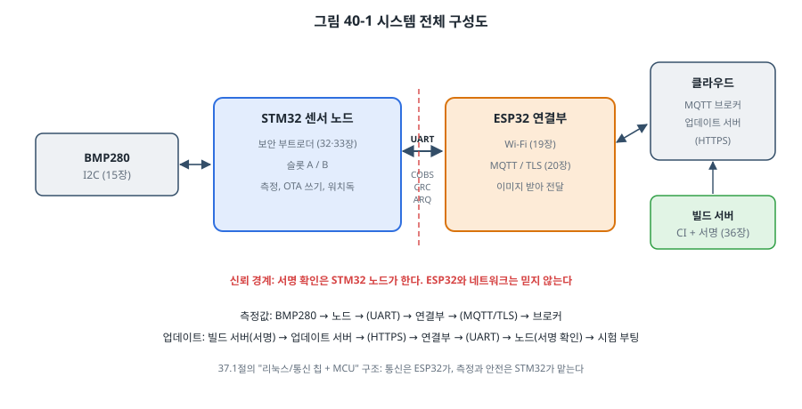
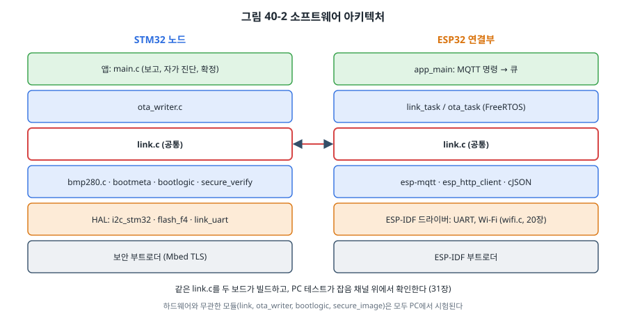
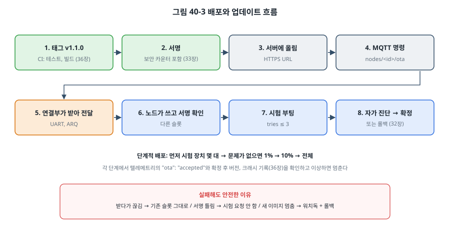

# 40장. 최종 프로젝트: 보안 OTA를 갖춘 IoT 센서 노드

## 이 장에서 배우는 것

- 요구 사항과 위협 모델에서 시작해 시스템을 설계하는 과정
- 두 MCU(STM32와 ESP32)로 역할을 나누는 구조
- 잡음에 강한 보드 간 UART 프로토콜: COBS, CRC, 재전송, 중복 거르기
- 보안 부트와 OTA를 끝에서 끝까지 잇기
- CI와 단계적 배포, 현장 배포 체크리스트

---

## 40.1 무엇을 만드는가

마지막 장에서는 이 책의 거의 모든 장을 한 장치에 모읍니다. 실내 온도를 10초마다 재서 클라우드로 보내고, 현장에 설치한 뒤에도 펌웨어를 원격으로 **안전하게** 업데이트할 수 있는 센서 노드입니다.



구성은 37.1절에서 말한 "통신 칩 + MCU" 구조입니다.

- **STM32 센서 노드**: 측정과 안전을 맡습니다. 15장의 BMP280, 32장의 A/B 슬롯과 부트로더, 33장의 서명 확인, 35장의 워치독.
- **ESP32 연결부**: 통신을 맡습니다. 19장의 Wi-Fi, 20장의 MQTT와 TLS, 업데이트 서버에서 이미지 받기.
- 둘은 **UART**로 대화합니다(14장). 그 위의 프로토콜을 이 장에서 새로 설계합니다.

왜 한 칩으로 하지 않을까요? ESP32 하나로도 측정과 통신을 다 할 수 있습니다. 하지만 역할을 나누면 얻는 것이 있습니다. 통신 스택은 크고 복잡하며 공격면이 넓습니다(33장). 측정과 안전을 맡는 MCU를 통신에서 떼어 두면, 통신 쪽이 멈추거나 뚫려도 측정과 안전은 계속되고, **신뢰 경계**를 분명하게 그을 수 있습니다. 이 프로젝트에서 서명 확인은 STM32 노드가 하므로, ESP32와 네트워크를 믿지 않아도 됩니다. 실제 제품에서도 흔한 구조입니다.

코드는 `code/ch40-sensor-node/`에 있고, 설계 문서(`DESIGN.md`)부터 시작합니다. 30장에서 배운 대로입니다.

## 40.2 요구 사항과 위협 모델

| 번호 | 요구 사항 | 확인 방법 |
| --- | --- | --- |
| R1 | 10초마다 온도를 MQTT `nodes/<id>/telemetry`에 JSON으로 발행한다 | 브로커 구독 |
| R2 | UART에서 바이트를 잃거나 깨져도 OTA 조각은 정확히 한 번씩 순서대로 전달된다 | PC 테스트 (잡음 채널) |
| R3 | 회사의 키로 서명하지 않은 이미지는 노드가 실행하지 않는다 | 33장 테스트, 보드 |
| R4 | 보안 카운터가 낮은 옛 이미지는 실행하지 않는다 | 33장 테스트 |
| R5 | 새 이미지가 자가 진단을 통과하지 못하고 3번 리셋되면 이전 이미지로 돌아간다 | 32장 테스트, 보드 |
| R6 | 업데이트 중 어느 순간 전원이 끊겨도 기존 이미지로 부팅한다 | 32장 테스트, 보드 |
| R7 | MQTT와 다운로드는 TLS로 서버를 인증한다 | 다른 인증서의 서버로 시험 |
| R8 | 노드가 멈추면 워치독이 리셋한다 | 35장 방식 |

요구 사항 대부분이 이미 앞 장의 PC 테스트로 확인됩니다. 새 시스템을 만들 때 검증된 부품을 조합하는 것의 가치가 여기 있습니다.

33장의 방법으로 위협 모델을 세웁니다.

| 위협 | 대책 | 남는 위험 |
| --- | --- | --- |
| 네트워크에서 가짜 펌웨어 주입 | 노드가 ECDSA 서명 확인 | 서명 키 유출 → HSM에 보관 (36장) |
| ESP32 연결부가 뚫림 | 서명 확인은 노드가 한다 | 연결부가 측정값을 위조할 수 있음 |
| 옛 취약 버전으로 되돌리기 | 보안 카운터 | 실습에서는 카운터를 상수로 둠 (제품은 OTP) |
| MQTT, HTTP 중간자 공격 | TLS 서버 인증 | 장치 인증서는 확장 과제 |
| 디버그 포트로 Flash 읽기 | 양산 시 RDP 레벨 1 | 실험실 수준 공격 |
| UART 선을 가로채 조작 | 펌웨어는 서명으로 보호 | 측정값과 명령은 보호하지 않음 |

마지막 줄처럼 **받아들이는 위험**을 적어 두는 것이 중요합니다. 보드 안의 UART 선까지 암호화할지는 제품의 가치와 공격자 모델에 따라 정할 일이고, 이 프로젝트는 그러지 않기로 했습니다. 정했다는 사실이 문서에 남아 있어야 나중에 조건이 바뀌었을 때 다시 검토할 수 있습니다.

## 40.3 하드웨어 구성

| 연결 | STM32 (NUCLEO-F411RE) | ESP32 DevKit |
| --- | --- | --- |
| 링크 TX → RX | PA9 (USART1 TX, D8) | GPIO16 (UART1 RX) |
| 링크 RX ← TX | PA10 (USART1 RX, D2) | GPIO17 (UART1 TX) |
| GND | GND | GND |
| BMP280 | I2C1 PB8/PB9 (15장) | |

두 보드 모두 3.3 V 논리이므로 레벨 변환이 필요 없지만, **GND를 반드시 연결**해야 합니다(14장). USART2는 지금까지처럼 ST-LINK 가상 COM 포트로 디버그 출력에 쓰고, ESP32와의 링크에는 USART1을 따로 씁니다. 디버그 출력과 기계 사이의 프로토콜을 같은 UART에 섞지 않는 것은 작지만 중요한 설계 결정입니다.

## 40.4 보드 간 UART 프로토콜

14장의 명령어 셸은 사람이 읽는 텍스트 한 줄이었습니다. 기계끼리, 그것도 펌웨어 이미지를 주고받으려면 더 단단한 프로토콜이 필요합니다. 요구 사항 R2가 그 기준입니다. 바이트를 잃거나 깨져도 OTA 조각은 **정확히 한 번씩, 순서대로** 도착해야 합니다.

### 프레이밍: COBS

먼저 "어디서 프레임이 시작하고 끝나는가"를 정해야 합니다. 바이트 하나를 잃으면 길이 필드를 믿을 수 없게 되고, 그 뒤의 모든 바이트를 엉뚱하게 해석합니다. 이 프로젝트는 **COBS(Consistent Overhead Byte Stuffing)** 를 씁니다. 데이터에서 0x00을 모두 없애는 변환을 한 뒤 프레임 끝에 0x00 하나를 붙입니다. 그러면 0x00은 항상 프레임의 끝이므로, 무슨 일이 있어도 **다음 0x00에서 다시 맞춰집니다**. 14장에서 줄 바꿈 문자로 줄을 나눈 것과 같은 생각을 이진 데이터에 적용한 것이며, 254바이트마다 1바이트만 늘어나 효율도 좋습니다.

```
[type][seq][data ...][crc16 lo][crc16 hi]   →  COBS 변환  →  ... 0x00
```

### 오류 검출: CRC-16

COBS로 프레임을 나눈 뒤, 13장의 **CRC-16/CCITT**로 깨진 프레임을 버립니다. 1바이트 체크섬보다 훨씬 많은 오류 패턴을 잡습니다.

### 재전송: 정지-대기 ARQ

깨진 프레임을 버리면, 보낸 쪽은 다시 보내야 합니다. 가장 단순한 방법이 **정지-대기 ARQ(Automatic Repeat reQuest)** 입니다. 프레임 하나를 보내고 그 번호(`seq`)의 ACK를 기다리며, 시간 안에 오지 않으면 다시 보냅니다. 정해진 횟수를 넘으면 실패로 처리합니다.

```c
arq_action_t arq_poll(arq_t *a, uint32_t now_ms)
{
    if (!a->busy) return ARQ_IDLE;
    if (now_ms - a->sent_ms < a->timeout_ms) return ARQ_WAIT;   /* 넘침에 안전한 뺄셈 (24장) */
    if (a->tries >= a->max_tries) {
        a->busy = false;
        return ARQ_FAILED;
    }
    a->tries++;
    a->retransmits++;
    a->sent_ms = now_ms;
    return ARQ_RESEND;
}
```

### 중복 거르기

ARQ에는 함정이 하나 있습니다. 데이터는 잘 도착했는데 **ACK가 사라지면**, 보낸 쪽은 같은 조각을 다시 보냅니다. 받는 쪽이 그것을 새 조각으로 처리하면 Flash에 두 번 쓰게 됩니다. 그래서 받는 쪽은 방금 처리한 `seq`를 기억해 두고, 같은 번호가 다시 오면 **처리하지 않고 ACK만 다시** 보냅니다.

```c
if (dedup_accept(&dedup, m->seq)) {          /* 새 프레임이면 처리 */
    ...
}
send(result == 0 ? MSG_ACK : MSG_NACK, m->seq, &result, 1);   /* 어느 경우든 ACK */
```

이 프로토콜에는 함정이 몇 가지 더 있습니다. 첫째, 다시 온 프레임에 그냥 "성공"을 답하면 안 됩니다. 처음 처리할 때 실패했다면(NACK) 그 결과를 다시 알려야 하므로, 노드는 마지막 결과를 기억해 두었다가 돌려줍니다. 둘째, 번호가 겹치면 새 프레임을 중복으로 착각합니다. 연결부가 업데이트를 할 때마다 번호를 1부터 다시 세면, 지난번 마지막 번호가 1이었던 경우 새 OTA_BEGIN이 "중복"으로 처리되어 노드는 슬롯을 지우지 않은 채 결과만 답하게 됩니다. 그래서 연결부는 번호를 세션이 바뀌어도 이어서 세고, 여러 번 받아도 같은 결과인 PING은 중복 거르기 밖에서 처리합니다. 연결부가 재부팅되어 번호가 처음으로 돌아가는 경우까지 막으려면 세션마다 무작위 세션 번호를 더하는 방법이 있습니다(연습 문제 7). 셋째, 연결부가 서버에서 이미지를 읽을 때 `esp_http_client_read()`는 요청한 128바이트보다 **적게** 줄 수 있습니다. TLS 레코드나 TCP 패킷 경계에 따라 87바이트처럼 아무 길이나 옵니다. 그 길이 그대로 노드에 보내면, 노드는 4바이트 단위로 Flash를 쓰므로(32장) 남는 칸을 0xFF로 채워 쓰고, 다음 조각이 이미 쓴 워드를 다시 쓰게 되어 데이터가 틀어집니다. 14장의 UART 수신과 같은 원리입니다. 스트림은 요청한 만큼 오지 않습니다. 그래서 연결부는 128바이트가 찰 때까지(또는 이미지 끝까지) 읽기를 반복하고, 노드도 방어적으로 4의 배수가 아닌 조각(마지막 조각 제외)을 거부합니다. PC 테스트에 87바이트 조각을 넣어 이 규칙을 확인합니다.

이런 함정들은 프로토콜을 설계할 때 "이 메시지가 두 번 오면? 순서가 바뀌면? 한쪽만 재시작하면?"을 하나씩 따져 봐야 찾을 수 있습니다.

### 잡음 채널에서 시험하기

이 프로토콜(`common/link.c`)은 하드웨어와 무관해서 **STM32와 ESP32가 같은 파일**을 빌드하고, PC에서 시험합니다. PC 테스트는 바이트의 0.1%를 잃고 0.1%를 깨뜨리는 UART를 흉내 내어, 그 위에서 128바이트 OTA 조각 300개를 보냅니다. 실제 UART보다 훨씬 나쁜 조건입니다.

```bash
cd code/ch40-sensor-node/test
make
```

```
noisy link: 300 chunks, 97 retransmits, 2 duplicates dropped, rx crc errors 49, format errors 46
all tests passed (0 failures)
all tests passed (0 failures)
```

깨진 프레임 95개(CRC 오류와 형식 오류)를 버리고 97번 다시 보냈으며, ACK를 잃어 다시 온 조각 2개를 걸러 냈습니다. 그리고 300개 조각이 모두 **정확히 한 번씩, 순서대로** 도착해 원본과 같은 이미지가 만들어졌습니다. 요구 사항 R2가 숫자로 확인되었습니다. 이런 시험을 보드에서 하려면 잡음을 일부러 만드는 장비가 필요하지만, PC에서는 난수 몇 줄이면 됩니다(31장).

### 메시지

| 타입 | 방향 | 데이터 | ACK (시간 제한) |
| --- | --- | --- | --- |
| REPORT | 노드 → 연결부 | seq, uptime, 온도, 센서 오류 | 없음 (잃어도 다음 보고가 온다) |
| PING | 연결부 → 노드 | 없음 | 있음 |
| OTA_BEGIN | 연결부 → 노드 | 크기, 버전 | 있음 (4초: 노드가 128 KB 섹터를 지운다) |
| OTA_CHUNK | 연결부 → 노드 | 오프셋, 데이터 ≤ 128 B | 있음 (200 ms) |
| OTA_END | 연결부 → 노드 | 없음 | 있음 (6초: 노드가 서명을 확인한다) |

업데이트 서버는 응답에 `Content-Length`(이미지 크기)를 주어야 합니다. 연결부가 OTA_BEGIN에 크기를 넣기 때문이며, 크기 없이 조각조각 보내는 chunked 전송이면 연결부는 업데이트를 시작하지 않습니다.

명령마다 시간 제한이 다른 것에 주목하세요. 섹터 지우기(32장)와 서명 확인(33장)은 1초를 넘길 수 있으므로, 짧은 시간 제한을 쓰면 연결부는 노드가 죽었다고 판단하고 실패합니다. 실제로 이 값을 잘못 정하는 것은 이런 프로젝트에서 가장 흔한 통합 버그 중 하나입니다.

## 40.5 소프트웨어 아키텍처



두 보드의 소프트웨어는 24장의 계층 구조를 따르고, 가운데에 공통 모듈 `link.c`가 있습니다.

**STM32 노드**(`stm32-node/main.c`)는 RTOS 없이 24장의 슈퍼루프 구조로 충분합니다. 하는 일이 단순하기 때문입니다.

1. 워치독을 갱신합니다(32장 부트로더가 켜 둔 IWDG).
2. 링크 UART의 바이트를 `link_rx_byte()`에 넣고, 프레임이 완성되면 처리합니다.
3. 10초마다 BMP280을 읽어 REPORT를 보냅니다.
4. 시험 부팅 중이고 센서와 연결부가 모두 응답했으면 이미지를 확정합니다.

OTA 명령은 `common/ota_writer.c`가 처리합니다. 32장의 Flash 인터페이스와 부트 규칙 위에서 동작하며, 서명 확인은 함수 포인터로 받습니다.

```c
ota_err_t ota_end(ota_t *o)
{
    if (o->state != OTA_RECEIVING) return OTA_E_STATE;
    if (o->next_off != o->size) { ... return OTA_E_SIZE; }
    if (o->verify(o->base, o->size) != 0) {          /* 서명이 맞지 않으면 여기서 끝: 실행하지 않는다 */
        o->state = OTA_ERROR;
        return OTA_E_VERIFY;
    }
    boot_state_t st;
    meta_load(&st);
    boot_request(&st, o->slot);                       /* 32장: 다음 부팅은 시험 */
    ...
}
```

보드에서는 이 함수 포인터가 33장의 `secure_verify()`를 부르고, PC 테스트에서는 결과를 정해 둔 가짜를 씁니다. 그래서 "서명이 틀리면 부트 상태를 건드리지 않는다", "조각이 빠지면 거부한다" 같은 규칙을 Mbed TLS 없이 PC에서 시험할 수 있습니다(`test/test_ota.c`).

**ESP32 연결부**(`esp32-bridge/main/main.c`)는 ESP-IDF의 FreeRTOS 위에서 태스크 두 개로 나눕니다. 평소에는 `link_task`가 UART를 읽어 노드의 REPORT를 MQTT로 발행하고, MQTT로 업데이트 명령이 오면 `ota_task`가 UART를 넘겨받아 이미지를 내려받으며 조각조각 노드에 보냅니다. UART는 한 번에 한 태스크만 쓰도록 뮤텍스로 지킵니다(27장의 소유권). MQTT 이벤트 처리기는 명령을 큐에 넣기만 하고 바로 돌아옵니다. 이벤트 처리기에서 다운로드처럼 오래 걸리는 일을 하면 MQTT 연결 유지까지 멈추기 때문입니다(27장의 지연 처리).

```c
cJSON *j = cJSON_ParseWithLength(e->data, e->data_len);    /* 바깥에서 온 데이터: 길이와 형식 확인 */
const cJSON *url = cJSON_GetObjectItem(j, "url"), *ver = cJSON_GetObjectItem(j, "version");
if (cJSON_IsString(url) && cJSON_IsString(ver) && strncmp(url->valuestring, "https://", 8) == 0) {
    ...
    xQueueSend(ota_q, &req, 0);                             /* 이벤트 처리기에서는 기다리지 않는다 */
}
```

명령의 URL이 `https://`로 시작하는지 확인하는 것도 33장의 원칙입니다. 다만 이것은 보조 수단이고, 진짜 방어는 노드의 서명 확인입니다. 연결부가 가짜 URL에서 이미지를 받아 오더라도 노드가 실행하지 않습니다.

## 40.6 보안 부트와 OTA

### 보안 부트로더

32장의 부트로더는 CRC로 이미지를 검사했습니다. 이 프로젝트의 부트로더(`stm32-boot/`)는 그 검사를 33장의 서명 확인으로 바꿉니다.

```c
const signed_hdr_t *h = (const signed_hdr_t *)slot_addr(s);
sv_result_t r = secure_verify((const uint8_t *)slot_addr(s), SLOT_SIZE, signing_pubkey, MIN_SEC_COUNTER);
/* 서명이 맞아도 이 슬롯용으로 링크된 이미지여야 한다 (32장) */
valid[s] = (r == SV_OK) && h->load_addr == slot_addr(s);
```

33장의 연습 문제 6에서 예고한 대로, Mbed TLS가 들어가면 부트로더가 32 KB에 들어가는지부터 확인해야 합니다. 이 프로젝트의 부트로더는 `-Os`(34장)와 `--gc-sections`(22장), 33장의 최소 설정(`mbedtls_config_min.h`) 덕분에 들어갑니다.

```
$ arm-none-eabi-size build/node-boot.elf
   text    data     bss     dec     hex filename
  21944      80     156   22180    56a4 build/node-boot.elf
```

(arm-none-eabi-gcc 14.2.1 기준. 툴체인 버전과 옵션에 따라 달라집니다.)

Flash에 들어가는 것은 text와 data를 더한 약 22 KB로, 32 KB 영역의 70% 정도입니다. 그래서 Flash 배치는 32장, 36장과 같게 둡니다. 기능을 더하다 32 KB를 넘으면 부트로더 영역을 섹터 0~3(64 KB)으로 늘리고 부트 상태 기록을 섹터 4로 옮겨야 합니다. 섹터 4는 36장에서 공장 데이터를 넣은 곳이므로, 그때는 공장 데이터를 섹터 7의 일부나 OTP(33장)로 옮겨 배치를 다시 정리합니다. 남은 10 KB는 생각보다 빨리 찹니다. 부트로더에 기능을 더할 때마다 크기를 확인하는 단계를 CI(36장)에 넣어 두세요.

### 끝에서 끝까지

업데이트 한 번이 거치는 과정을 정리하면 다음과 같습니다.

1. 개발자가 `v1.1.0` 태그를 붙이면 CI가 시험하고 빌드한다(36장).
2. 서명 서버가 이미지에 서명한다. 보안 수정이 있었다면 보안 카운터를 올린다(33장).
3. 서명된 `.simg`를 업데이트 서버에 올리고, MQTT로 `nodes/<id>/ota`에 URL과 버전을 보낸다.
4. 연결부가 HTTPS로 이미지를 받아 OTA_BEGIN, CHUNK, END로 노드에 보낸다(이 장).
5. 노드는 실행 중이지 않은 슬롯을 지우고, 조각을 쓰고, 서명을 확인한 뒤 시험 부팅을 요청한다(32장, 33장).
6. 리셋하면 보안 부트로더가 서명을 다시 확인하고 새 슬롯으로 시험 부팅한다.
7. 새 펌웨어가 자가 진단(센서 응답, 연결부 응답)을 통과하면 확정한다. 못 하면 세 번째 리셋 뒤 이전 이미지로 돌아간다.

어느 단계에서 실패해도 장치는 안전합니다. 받다가 끊기면 기존 슬롯이 그대로이고(R6), 서명이 틀리면 시험 요청 자체를 하지 않으며(R3), 새 이미지가 멈추면 워치독과 롤백이 이전 이미지로 되돌립니다(R5, R8).

> ⚠️ 주의: 노드는 OTA_END를 받으면 서명 확인에 1초 이상을 쓰고, OTA_BEGIN에서는 128 KB 섹터를 지우는 동안 CPU가 멈춥니다(32장). 그동안 워치독을 갱신하지 못하므로, 부트로더가 정한 워치독 시간(약 4초, LSI가 빠르면 더 짧음)에 여유가 있는지 보드에서 반드시 확인하세요. 여유가 모자라면 서명 확인 루프 사이에 워치독을 갱신하거나 워치독 시간을 늘립니다. [확인 필요: 16 MHz에서 서명 확인 시간과 워치독 여유 실측]

## 40.7 CI 파이프라인

이 프로젝트의 `test/` 폴더는 36장의 `run_host_tests.sh`가 자동으로 찾아 실행합니다. 이제 책 전체의 PC 테스트는 14묶음입니다.

```
  ...
  ok    ch36-cicd/test
  ok    ch40-sensor-node/test
  ok    ch28-realtime/host
host tests: 14 passed, 0 failed
```

36장의 `firmware.yml`에 이 프로젝트의 빌드를 더하면, 커밋마다 링크 프로토콜, OTA 쓰기, 부트 규칙, 서명 확인이 시험되고, 노드와 부트로더가 빌드되며, 태그를 붙이면 서명된 이미지가 만들어집니다. HIL 단계에서는 31장의 방법으로 실제 노드와 연결부를 연결해 OTA를 끝까지 한 번 돌려 보는 시험을 두면 좋습니다.

## 40.8 배포와 현장 체크리스트



현장의 모든 장치에 한꺼번에 업데이트를 보내지 않습니다. **단계적 배포(staged rollout)** 로, 먼저 사내 시험 장치 몇 대, 문제가 없으면 1%, 10%, 전체 순으로 넓힙니다. 각 단계에서 텔레메트리의 업데이트 결과, 확정 후 보고되는 버전, 36장의 크래시 기록을 확인하고, 이상하면 멈춥니다. 32장의 롤백이 장치 하나를 지킨다면, 단계적 배포는 장치 전체를 지킵니다.

출시 전에 확인할 체크리스트입니다.

**하드웨어와 생산**
- [ ] 두 보드의 GND가 연결되어 있고, 링크 UART 선이 짧고 잡음원에서 떨어져 있다
- [ ] 공장 시험(36장)이 센서, 링크, 워치독 동작을 확인한다
- [ ] 장치마다 다른 ID와 TLS 자격 증명을 프로비저닝했다 (33장, 36장)
- [ ] 노드의 RDP 레벨 1, 부트로더 영역 쓰기 보호를 설정했다 (33장)

**펌웨어**
- [ ] 릴리스 이미지는 CI가 태그에서 만들고 서명했다 (개발자 PC의 바이너리 아님)
- [ ] 다른 키로 서명한 이미지, 보안 카운터가 낮은 이미지가 거부되는 것을 보드에서 확인했다
- [ ] OTA 도중 전원 차단, 연결부 리셋, Wi-Fi 끊김에서 노드가 기존 이미지로 동작한다
- [ ] 자가 진단에 실패하는 이미지를 보내 롤백되는 것을 확인했다
- [ ] 워치독 시간이 가장 오래 걸리는 작업(섹터 지우기, 서명 확인)보다 충분히 길다
- [ ] 모든 [확인 필요] 값을 실측으로 바꿨다

**운영**
- [ ] 서명 키는 HSM이나 키 관리 서비스에 있고, 백업이 있다 (33장)
- [ ] 릴리스마다 `.elf`, `.map`, 해시, 변경 내역을 보관한다 (36장)
- [ ] 단계적 배포 계획과 중단 기준이 있다
- [ ] 크래시 기록과 리셋 원인을 모아 보는 대시보드가 있다 (36장)
- [ ] 보안 업데이트를 얼마나 오래 제공할지 정해 사용자에게 알렸다 (33장의 규제)

## 40.9 책을 마치며

1장에서 우리는 버튼을 누르면 LED가 켜지는 작은 회로로 시작했습니다. 그 뒤로 레지스터 한 비트를 켜는 법(4장), 인터럽트(7장)와 타이머(8장), ADC와 DMA(9장, 10장), UART, I2C, SPI, CAN, USB(14~18장), 무선과 IoT(19장, 20장)를 거쳐, 부팅과 빌드와 디버깅(21~23장), 구조와 메모리(24장, 25장), RTOS(26~29장)를 배웠습니다. 그리고 시험과 업데이트, 보안, 성능, 안전, 양산(31~36장)이라는 "제품으로 가는 길"을 걸어, 마지막으로 리눅스와 Rust(37~39장)까지 시야를 넓혔습니다.

이 마지막 프로젝트의 코드를 다시 보면, 새로 쓴 것은 링크 프로토콜과 OTA 쓰기 모듈 정도이고, 나머지는 모두 앞 장에서 만든 부품입니다. 15장의 BMP280 드라이버는 AVR, STM32, Raspberry Pi, 그리고 이 프로젝트에서 한 줄도 바뀌지 않았습니다. 32장의 부트 규칙과 13장의 CRC는 여러 장에서 다시 쓰였습니다. 그것이 가능했던 것은 각 부품이 하드웨어와 분리된 인터페이스를 가지고(24장), PC에서 시험되었기(31장) 때문입니다. 임베디드 소프트웨어를 잘 만든다는 것은 결국 **믿을 수 있는 부품을 만들고, 그것을 믿을 수 있게 조합하는 일**입니다.

임베디드 시스템은 데이터시트의 레지스터 표와 오실로스코프의 파형, 그리고 현장의 사람들이 만나는 곳입니다. 펌웨어의 버그 하나가 문을 열지 못하게 하고, 기계를 멈추고, 때로는 사람을 다치게 합니다. 반대로 잘 만든 펌웨어는 아무도 그 존재를 모른 채 몇 년, 몇십 년 동안 조용히 제 일을 합니다. 이 책이 그런 펌웨어를 만드는 데 작은 도움이 되기를 바랍니다.

---

## 정리

- 요구 사항과 위협 모델에서 시작해 설계하고, 받아들이는 위험도 문서에 남깁니다.
- 통신과 측정·안전을 서로 다른 MCU로 나누면 신뢰 경계가 분명해지고, 통신 쪽의 실패가 안전으로 번지지 않습니다.
- 보드 간 프로토콜은 COBS로 프레임을 나누고, CRC로 깨진 프레임을 버리고, ARQ로 다시 보내고, seq로 중복을 거릅니다. 명령마다 시간 제한을 받는 쪽의 처리 시간에 맞춥니다.
- 하드웨어와 무관한 모듈은 두 보드가 함께 쓰고, PC의 잡음 채널 시뮬레이션으로 시험합니다.
- 보안 부트와 OTA는 서명, 보안 카운터, A/B 슬롯, 시험 부팅과 확정, 워치독이 함께 동작해 어느 단계에서 실패해도 안전합니다.
- 배포는 단계적으로 하고, 출시 전 체크리스트로 하드웨어, 펌웨어, 운영을 확인합니다.

## 연습 문제

1. 정지-대기 ARQ는 ACK를 기다리는 동안 링크가 놀고 있습니다. 115200 bps에서 128바이트 조각과 짧은 ACK를 주고받을 때, 응답 지연이 2 ms라면 링크 이용률은 얼마인가요? 여러 조각을 ACK 없이 먼저 보내는 슬라이딩 윈도 방식으로 바꾸면 무엇이 나아지고, 받는 쪽은 무엇을 더 처리해야 하나요?
2. 이 장의 프로토콜에서 REPORT에는 ACK가 없습니다. 측정값을 하나도 잃으면 안 된다는 요구 사항이 생기면 어떻게 바꾸겠습니까? 연결부의 Wi-Fi가 몇 시간 끊긴 경우까지 생각하세요(30장의 SD 카드 저장과 연결해서).
3. 위협 모델의 "UART 선을 가로채 조작"을 막아야 한다면 어떤 방법이 있을까요? 노드와 연결부가 같은 키를 공유하는 MAC 방식의 장단점을 33장의 내용으로 설명하세요.
4. ESP32 연결부 자신의 펌웨어도 업데이트해야 합니다. 32장의 ESP32 OTA를 이 프로젝트에 더한다면, 노드와 연결부 중 어느 쪽을 먼저 업데이트해야 할까요? 링크 프로토콜이 바뀌는 업데이트라면 어떻게 하겠습니까?
5. 노드에서 서명 확인에 3초가 걸리고 워치독이 2.7초에 만료될 수 있다면, 어떤 방법들로 해결할 수 있는지 세 가지 이상 제시하고 각각의 위험을 쓰세요.
6. (실습) 전체 시스템을 만들어 보세요. 노드와 연결부를 연결하고, 브로커(20장의 Mosquitto)와 HTTPS 서버를 준비해 1.0.0에서 1.1.0으로 업데이트한 뒤, 일부러 자가 진단에 실패하는 1.2.0을 보내 롤백되는 것까지 확인하세요. 40.8절의 체크리스트 중 몇 개를 확인할 수 있었나요?
7. 연결부가 OTA 도중 재부팅되면 ARQ 번호가 처음부터 다시 시작합니다. 노드가 기억하는 마지막 번호와 겹치는 경우를 막도록, OTA_BEGIN에 무작위 세션 번호를 넣고 노드가 세션이 바뀌면 중복 거르기 상태를 지우게 프로토콜을 고쳐 보세요. `test_link.c`에 "연결부 재시작" 시나리오를 먼저 추가하세요.
